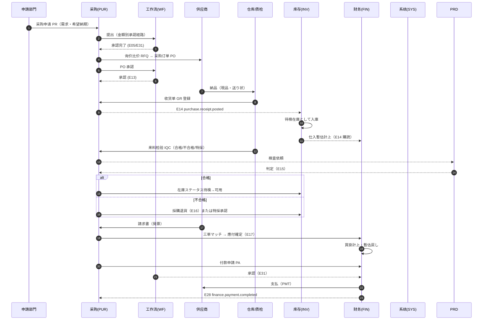
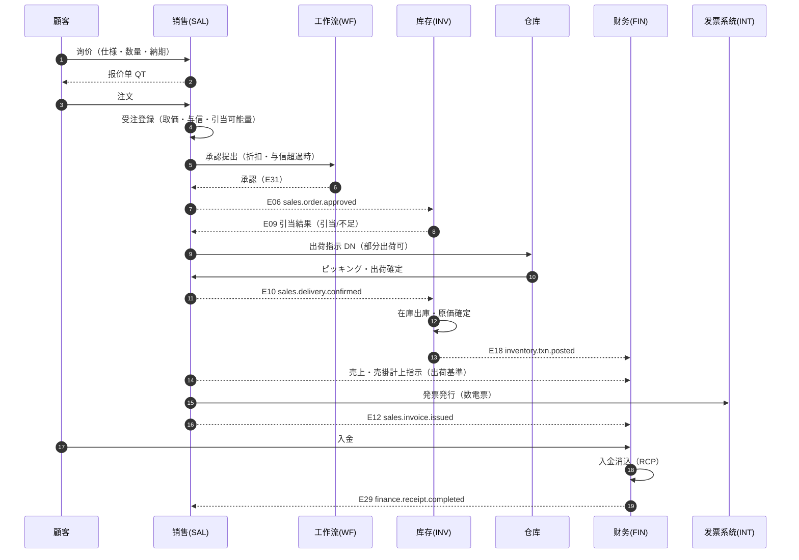
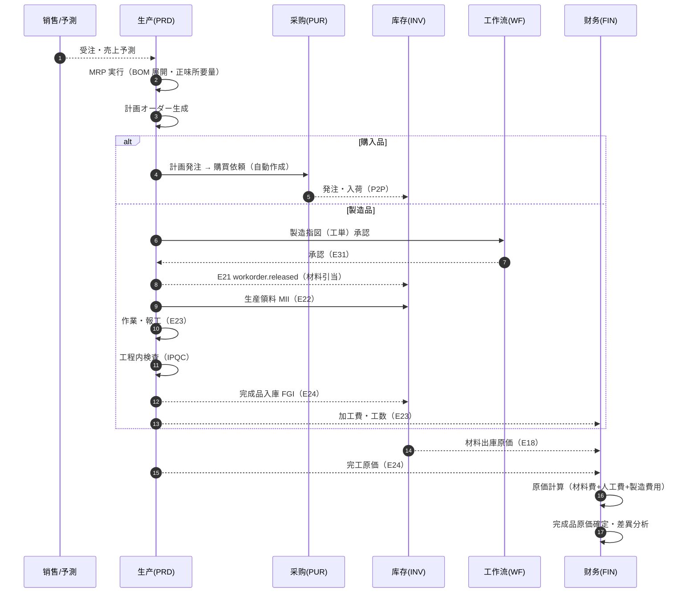
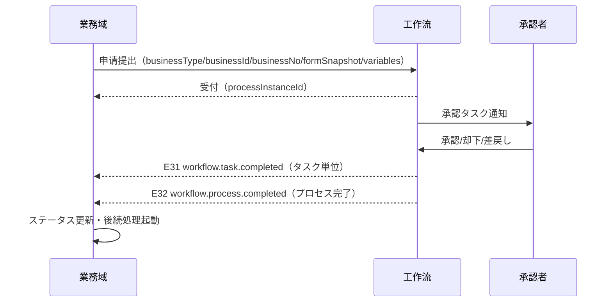

# 跨域业务流程与接口契约（ドメイン間業務フロー・インタフェース契約）

| 項目 | 内容 |
|---|---|
| 文書名 | 跨域业务流程与接口契约（ドメイン間業務フロー・インタフェース契約） |
| 文書番号 | DSN-CMN-009 |
| 版数 | v1.0 |
| 作成日 | 2026-10-20 |
| 作成者 | Lead（设计基盤） |
| 承認者 | 未承認（社内レビュー待ち） |
| 状態 | ドラフト（レビュー中） |
| 関連文書 | [共通业务规则](08-common-business-rules.md) / [API 共通规格](03-common-api-spec.md) / [DB 共通规格](04-common-db-spec.md) / 各域 `00-overview.md` |

---

## 1. 目的と適用範囲

業務域を跨る代表的な 3 つの主鎖（P2P / O2C / P2M）の流れ、状態同期、責任分界、領域イベント契約、在庫→会計の仕訳ルール、異常時の補償方式を定義する。各域の設計書は本契約に従い、**イベント名・ペイロード項目・発行タイミング・更新責任を再定義しない**。

## 2. 連携の基本方針

### 2.1 連携方式の使い分け

| 方式 | 用途 | 例 | 実装 |
|---|---|---|---|
| 同期参照（Query） | マスタ・権限・在庫可用量・期間状態の照会 | 受注登録時の与信参照、引当可能量照会 | モジュール公開インタフェース（根包の Service）+ 内部 REST 呼出（同一プロセス） |
| 同期コマンド（Command） | 即時性が求められ、同一トランザクション内で完結する処理 | 採番（SYS）、権限判定（SYS） | 公開 Service 呼出 |
| 非同期イベント（Event） | 業務状態の確定通知。送信側のトランザクションをブロックしない | 受注承認→在庫引当、出荷確定→売上計上 | Spring Modulith `@ApplicationModuleListener` + Outbox。RabbitMQ 外部化も第一版対象（TODO：外部化の構成設計が未作成） |
| 非同期ジョブ（Job） | 大量処理・定期処理 | MRP、在庫月結、原価計算、月次締め | スケジューラ + ジョブ実行テーブル |

### 2.2 連携原則

1. **更新責任の一元化**：あるデータを更新できるのは 1 つの域のみ。他域は参照またはイベント購読で反応する。
2. **同期呼出は読取のみ**（例外：採番・権限・期間判定などの共通機能）。書込はイベントで行う。
3. **イベントは事実の通知**（命令ではない）。送信側は購読側の処理結果を待たない。購読側は重複受信を前提に冪等に実装する。
4. **トランザクション境界**：送信側のローカルトランザクションとイベント発行は Outbox で同一トランザクションに記録し、非同期で配信する（業務データとイベントの不整合を防ぐ）。
5. **失敗時の整合性**：配信失敗はリトライ → デッドレター → アラート → 手動再送。月結時に未処理イベントが 0 であることを確認する。
6. **循環依存の禁止**：イベント購読関係に循環を作らない（例：INV → FIN → INV の同期呼出は不可）。

### 2.3 イベントエンベロープ（共通）

```json
{
  "eventId": "0f3b5a8e-9d1c-4a2b-8f0e-1c2d3e4f5a6b",
  "eventType": "sales.order.approved",
  "eventVersion": 1,
  "occurredAt": "2026-10-20T14:30:00+08:00",
  "source": "erp-sales",
  "tenantId": 0,
  "companyId": 1,
  "aggregateType": "sales_order",
  "aggregateId": "1845678901234567890",
  "aggregateNo": "SO2610200001",
  "aggregateVersion": 3,
  "idempotencyKey": "sales.order.approved:1845678901234567890:3",
  "payload": { }
}
```

| 字段 | 必須 | 説明 |
|---|---|---|
| `eventId` | ○ | UUID。購読側の重複排除に使用 |
| `eventType` | ○ | `{domain}.{entity}.{action}`。下表の一覧に存在すること |
| `eventVersion` | ○ | ペイロード互換性管理。項目追加は +0、意味変更は +1 |
| `occurredAt` | ○ | 事実発生日時（業務確定時刻） |
| `source` | ○ | 発行モジュール |
| `aggregateId/No/Version` | ○ | 対象集約。version は楽観排他版数 |
| `idempotencyKey` | ○ | 購読側の冪等キー（通常 eventId で代替可） |
| `payload` | ○ | 下記イベント一覧の主要項目。**マスタ名称などのスナップショットを含める**（購読側が最新マスタに依存しない） |

## 3. 領域事件一覧（契约）

| # | イベント名 | 発行契機 | 発行者 | 購読者 | 主なペイロード項目 | 購読側の処理 |
|---|---|---|---|---|---|---|
| E01 | `mdm.material.changed` | 物料マスタ登録・変更・無効化の承認後 | MDM | SAL/PUR/INV/PRD/FIN | materialId, materialCode, materialName, spec, baseUom, categoryCode, changedFields | 参照キャッシュ更新（あれば） |
| E02 | `mdm.customer.changed` | 顧客マスタ承認後 | MDM | SAL/FIN | customerId, customerCode, customerName, creditLimit, taxNo, status | 与信・請求先情報の更新 |
| E03 | `mdm.supplier.changed` | 仕入先マスタ承認後 | MDM | PUR/FIN | supplierId, supplierCode, supplierName, paymentTermCode, bankAccountId, taxNo | 支払条件・口座情報の更新 |
| E04 | `mdm.price.changed` | 価格表・購買価格の有効化 | MDM | SAL/PUR | priceListId, scopeType, materialId, customerId, price, validFrom, validTo, currency | 取価キャッシュ更新 |
| E05 | `sales.order.submitted` | 受注の承認提出 | SAL | WF | businessType, businessId, businessNo, amount（税抜）, taxAmount, totalAmount（税込）, currencyCode, isTaxIncluded, departmentId, applicantId | 承認プロセス開始 |
| E06 | `sales.order.approved` | 受注の最終承認 | SAL | INV/FIN | orderId, orderNo, customerId, lines[{materialId, qty, uom, deliveryDate, warehouseId}], amount（税抜）, taxAmount, totalAmount（税込）, currencyCode, isTaxIncluded, creditCheckResult | 在庫引当（倉庫指定）、与信コミット |
| E07 | `sales.order.changed` | 承認済受注の変更確定 | SAL | INV | orderId, orderNo, lines（差分）, version | 引当数量の増減 |
| E08 | `sales.order.cancelled` | 受注の取消 | SAL | INV/FIN | orderId, orderNo, reason | 引当解除、与信解放 |
| E09 | `inventory.reservation.updated` | 引当成功・解除・不足 | INV | SAL/PRD | reservationId, sourceType, sourceId, lines[{materialId, warehouseId, reservedQty, shortageQty}], status | 受注の出荷可否・工単の引当状態更新 |
| E10 | `sales.delivery.confirmed` | 出荷確定（出庫確定） | SAL | INV/FIN | deliveryId, deliveryNo, orderId, customerId, lines[{materialId, qty, uom, warehouseId, batchNo, serialNos[], unitPrice, taxRate, amount, taxAmount, costAmount?}], amount, taxAmount, deliveryDate | 在庫出庫、売上・売掛計上 |
| E11 | `sales.return.confirmed` | 返品受入・検品完了 | SAL | INV/FIN | returnId, returnNo, orderId, originalDeliveryId, customerId, lines[{materialId, qty, inventoryStatus, unitPrice, taxRate, amount, taxAmount, costAmount}], amount, taxAmount, returnDate | 在庫戻入、赤伝売上・売掛（J23） |
| E12 | `sales.invoice.issued` | 売上請求書（発票）発行 | SAL | FIN | invoiceId, invoiceNo, invoiceCode, invoiceKind, customerId, orderId, deliveryIds[], amount, taxAmount, taxRate, totalAmount, invoiceType, issuedAt | 売掛金・売上の確定（出荷時未計上の場合）、銷項台帳 |
| E13 | `purchase.order.approved` | 発注の最終承認 | PUR | INT（supplier portal） | orderId, orderNo, supplierId, lines[{materialId, qty, price, deliveryDate}], amount | 仕入先送信、納期管理 |
| E14 | `purchase.receipt.posted` | 入荷確定（受入登録） | PUR | INV/PRD/FIN | receiptId, receiptNo, orderId, supplierId, lines[{materialId, receivedQty, uom, warehouseId, batchNo, unitPrice, amount, inspectionFlag}]（`inspectionFlag` は 2026-10-21 後方互換追加。PUR 入荷確定時スナップショット、欠落時は true 扱い）, amount, receivedAt | 在庫待検入庫、IQC 起票、仕入暫估計上 |
| E15 | `quality.inspection.completed` | 来料・工程・最終検査の判定確定 | PRD | PUR/INV | inspectionId, inspectionNo, inspectionType(IQC/IPQC/FQC/OQC), sourceType, sourceId, sourceNo, warehouseId, result(PASS/CONCESSION/REJECT), resultCode(10未検査/20合格/30特採/40不合格/50廃棄), lines[{materialId, batchNo, sampleQty, defectQty, resultCode}], inspectedAt | 在庫ステータス変換、返品/再検査の起動 |
| E16 | `purchase.return.confirmed` | 仕入返品の出庫確定 | PUR | INV/FIN | returnId, returnNo, receiptId, lines[{materialId, qty, warehouseId, unitPrice, taxRate, amount, taxAmount, reason}], amount, taxAmount, returnDate | 在庫出庫、赤伝仕入・買掛（J04） |
| E17 | `purchase.invoice.matched` | 三単マッチ確定（請求書登録・照合） | PUR | FIN | invoiceId, invoiceNo, supplierId, amount, taxAmount, taxRate, matchedStatus, diffAmount, diffTreatment, lines[{poLineId, receiptLineId, qty, price, taxAmount, diffType, diffAmount}] | 買掛計上・暫估戻し・差異処理 |
| E18 | `inventory.txn.posted` | 在庫取引の確定（全取引種別） | INV | FIN/SAL/PUR/PRD | txnId, txnNo, txnType, warehouseId, lines[{materialId, batchNo, qty, unitCost, amount}], totalQty, totalAmount, bizDate, sourceType, sourceId, sourceEventAt, stockDocId, stockDocNo | 原価計算・（必要時）仕訳起票。`stockDocId/stockDocNo` は INV 採番の在庫側伝票番号（MII/MIR/FGI/OSI/OSR 等）を PRD へ返却する |
| E19 | `inventory.cost.updated` | 平均単価・原価調整の確定 | INV | FIN/PRD | materialId, warehouseId, batchNo, avgUnitCost, adjustmentAmount, effectiveDate | 原価差異の取込 |
| E20 | `inventory.period.closed` | 在庫月結完了 | INV | FIN/SAL/PUR/PRD | periodCode, closedAt | 期間ロック、原価確定 |
| E21 | `production.workorder.released` | 工単の下达（材料引当実行） | PRD | INV | workOrderId, workOrderNo, lines[{materialId, requiredQty, uom, warehouseId}], plannedStartDate | 材料引当・不足通知 |
| E22 | `production.material.issued` | 生産領料確定 | PRD | INV/FIN | workOrderId, issueId, lines[{materialId, qty, batchNo, unitCost, amount}], amount, issuedAt | 在庫出庫、材料費計上（J11） |
| E23 | `production.report.confirmed` | 報工確定（良品数・工数） | PRD | FIN/PRD | workOrderId, operationId, goodQty, defectQty, workHours, laborRate, laborAmount, overheadRate, overheadAmount, costCenterCode, reportedAt | 人工費・製造費用の集計（J13）、進捗更新 |
| E24 | `production.workorder.completed` | 完工（完成品入庫） | PRD | INV/FIN | workOrderId, completedQty, lines[{materialId, qty, batchNo, unitCost, amount, stockStatus(10待検/20可用)}], costAmount（完工総原価）, unitCost（完成品単位原価）, inspectionId, inspectionResult, completedAt | 完成品入庫（既定は待検計上）、完工原価計上（J16） |
| E25 | `production.outsourcing.issued` | 委外発料確定 | PRD | INV/FIN | outsourcingOrderId, issueId, lines[{materialId, qty, unitCost, amount}], amount, issuedAt | 委託加工物資への振替（J17） |
| E26 | `production.outsourcing.received` | 委外受入確定 | PRD | INV/FIN | outsourcingOrderId, receiptId, lines[{materialId, qty, unitCost, amount}], processingFee, taxRate, taxAmount, amount, receivedAt | 在庫入庫、加工費計上（J18） |
| E27 | `finance.receivable.created` | 应收単確定 | FIN | SAL | receivableId, receivableNo, sourceType, sourceId, customerId, amount, dueDate | 受注の請求状況更新 |
| E28 | `finance.payment.completed` | 支払完了 | FIN | PUR | paymentId, paymentNo, supplierId, amount, paidAt, bankAccountId | 発注残・買掛残の更新 |
| E29 | `finance.receipt.completed` | 入金完了・消込 | FIN | SAL | receiptId, receiptNo, customerId, amount, receiptDate, method, unappliedAmount, matched[{receivableId, invoiceId, matchedAmount}], matchedInvoiceIds（互換用） | 売掛残・与信解放 |
| E30 | `finance.period.closed` | 会計期間締め | FIN | ALL（業務域） | periodCode, closedAt | 期間内の新規登録・修正禁止 |
| E31 | `workflow.task.completed` | 承認タスク完了（承認/却下/差戻し） | WF | SAL/PUR/PRD/FIN/INV | processInstanceId, taskId, businessType, businessId, result, approverId, comment, completedAt | 業務ステータス更新 |
| E32 | `workflow.process.completed` | 承認プロセス完了 | WF | 各業務域 | processInstanceId, businessType, businessId, finalResult, completedAt | 最終承認/却下の確定 |
| E33 | `integration.sync.failed` | 外部 IF の恒久失敗 | INT | SYS/RPT | ifId, bizKey, errorCode, errorMessage, retryCount | アラート通知、運用対応 |
| E34 | `system.period.status.changed` | 会計・業務期間の状態変更（発行は FIN 単一所有。SYS は参照のみ） | FIN | ALL | periodCode, oldStatus, newStatus, closedAt | 参照キャッシュ更新 |
| E35 | `purchase.receipt.cancelled` | 受入確定後の收货单取消（未検収・未照合に限る） | PUR | INV/PRD/FIN | receiptId, receiptNo, orderId, reason, reversedLines[{materialId, batchNo, qty, unitPrice, amount}], amount, cancelledAt | 待検在庫の取消、仕入暫估の戻し、IQC タスク取消 |
| E36 | `production.material.returned` | 生産退料の確定（未使用材料の戻入） | PRD | INV/FIN | workOrderId, returnId, returnNo, lines[{materialId, qty, batchNo, unitCost, amount}], amount, returnReason, returnedAt | 在庫戻入（MIR）、材料費戻し（J12） |
| E37 | `inventory.period.reopened` | 在庫期間の再開（承認済・FIN 連携） | INV | FIN/SAL/PUR/PRD | periodCode, reason, approvedBy, reopenedAt | 期間ロック解除の通知、再開後取引の受付 |
| E38 | `system.department.changed` | 組織・部門の改編確定 | SYS | ALL | departmentId, departmentCode, changeType(CREATE/UPDATE/DISABLE/MOVE), affectedUserIds[], changedAt | 承認者解決・データ範囲キャッシュ・メニュー権限の更新 |
| E39 | `mdm.warehouse.changed` | 倉庫/庫区/庫位マスタの確定変更 | MDM | INV/PRD/FIN | warehouseId, warehouseCode, warehouseName, factoryId, warehouseType, status, changedFields | 倉庫参照キャッシュ更新、既存在庫の整合確認 |
| E40 | `mdm.tax-code.changed` | 税码・税率の有効化/改定 | MDM | SAL/PUR/FIN | taxCode, taxRateCode, taxRate, taxType, isTaxIncluded, validFrom, validTo | 取税キャッシュ更新（既存伝票は登録時税率を保持） |
| E41 | `mdm.exchange-rate.changed` | 為替レートの確定/更新 | MDM | FIN | currencyCode, rateType, rate, effectiveDate | 換算レートキャッシュ更新、為替評価再計算の起動 |
| E42 | `mdm.credit-limit.changed` | 与信限度・与信状態の変更確定 | MDM | SAL/FIN | customerId, creditLimit, creditStatus, validFrom, reason | 与信チェックキャッシュ更新、与信超過の再判定 |
| E43 | `sales.forecast.updated` | 売上予測の確定 | SAL | PRD | forecastId, periodCode, lines[{materialId, forecastDate, qty}], version | MRP 需要源への取込 |

> イベント名は**過去形**（確定事実）とする。将来の命令（`reserve.stock` 等）はイベントにしない。購読側は `eventId` で重複排除し、`aggregateVersion` が古いイベントは無視する。
>
> **ペイロード追加履歴（後方互換）**：2026-10-20 FIN 設計レビューに伴い、E10（`taxRate`/`amount`/`taxAmount`、明細及びヘッダ）、E12（`deliveryIds[]`/`taxRate`/`totalAmount`/`invoiceCode`/`invoiceKind`）、E29（`receiptDate`/`method`/`unappliedAmount`/`matched[]`。`matchedInvoiceIds` は互換用に残置）を追加した。項目追加のみのため `eventVersion` は +0（=1）。同日、SAL レビューに伴い E06 の `lines[]` に `warehouseId`（引当倉庫）を追加し、E36 `production.material.returned`・E37 `inventory.period.reopened` を新設した。

## 4. P2P：調達→支払（Procure to Pay）

### 4.1 全体フロー



### 4.2 手順・責任分界

| # | 手順 | 実施域/ロール | 入力 | システム処理 | 出力/イベント | 状態 |
|---|---|---|---|---|---|---|
| 1 | 請購登録 | 申請部門 / 部門担当 | 品目・数量・希望納期・理由 | 予算確認、重複チェック、採番 | PR（10 草稿） | 10 |
| 2 | 請購承認 | WF / 承認者 | — | 金額別経路で承認 | WF 承認コールバック（E31/E32）、PR（25）※購買提出に専用イベントは設けない（同期コマンド） | 20→25 |
| 3 | 発注 | PUR / 購買担当 | PR、仕入先、単価 | 価格表照合、納期計算、PO 作成 | PO（10） | — |
| 4 | PO 承認 | WF / 承認者 | — | 承認 | E13、PO（25→30） | 20→25→30 |
| 5 | 入荷 | 倉庫 / 倉管 | 送り状、実数量 | 過入荷チェック（容差 5%）、GR 作成 | GR（30）、E14 | 30 |
| 6 | 受入検査 | 品質 / 検査員 | 検査基準、サンプル | IQC 登録・判定 | E15 | 30→40 |
| 7 | 入庫 | 倉庫 / 倉管 | 合格数量 | 在庫取引（待検→可用） | GRI、E18 | 35→40 |
| 8 | 請求書照合 | PUR+FIN / 会計 | 発票、GR、PO | 三単マッチ、差異判定 | PIV、AP（40）、E17 | — |
| 9 | 支払申請 | PUR/FIN / 担当 | AP、支払期日 | 支払予定作成、承認依頼 | PA（10→20） | 20 |
| 10 | 支払実行 | FIN / 出納 | PA 承認済 | 銀行送金（または手形）、消込 | PMT（40）、E28 | 40 |
| 11 | 消込・完了 | FIN / 会計 | 入出金明細 | AP 消込、買掛残更新 | AP 完了、帳票 | 40 |

### 4.3 P2P 例外処理

| 例外 | 検知 | 処理 | 責任域 |
|---|---|---|---|
| 過入荷（PO 数量超過） | GR 登録時 | 容差内（5% または 1 個）は警告して受入可。超過は受入拒否（または承認後に超過発注変更） | PUR / INV |
| 短入荷・分納 | GR 登録時 | 残数量を保持し PO は 35（一部実行）。納期延長または残取消（手動） | PUR |
| 不合格（IQC） | 判定時 | 返品（E16）または特採（要承認）。返品時は在庫を不合格状態へ移し出庫 | PRD / PUR / INV |
| 単価差異（発票 vs PO） | 三単マッチ | 許容差（例 ±1% または ±10 元）内は自動承認。超過は差異理由入力 + 承認 | PUR / FIN |
| 数量差異 | 三単マッチ | 受入数量と請求数量の差を検出。許容内は受入数量を正とし、超過分は保留 | PUR / FIN |
| 請求書遅延（未着） | 月結チェック | 暫估のまま月結。翌月に発票到着で暫估戻し・差異処理 | FIN |
| 支払不能・口座相違 | 支払実行 | 支払失敗としてアラート。再実行または口座修正（承認必須） | FIN |
| 入荷確定後の取消 | GR 取消操作 | **未に有効化（IQC 未完了）かつ未照合**の場合のみ可。E35 で待検在庫・暫估を逆処理。それ以外は返品処理（E16）で対応 | PUR / INV / FIN |
| 発注取消 | 発注済 | 仕入先合意のうえ取消。入荷済の場合は返品処理が必要 | PUR |

## 5. O2C：受注→回収（Order to Cash）

### 5.1 全体フロー



### 5.2 手順・責任分界

| # | 手順 | 実施域/ロール | 入力 | システム処理 | 出力/イベント | 状態 |
|---|---|---|---|---|---|---|
| 1 | 引合・見積 | SAL / 営業 | 顧客、仕様、数量 | 価格表から取価、納期回答 | QT（有効期限） | — |
| 2 | 受注登録 | SAL / 営業 | 見積、顧客 PO | 取価、与信チェック、引当可能量チェック、採番 | SO（10） | 10 |
| 3 | 受注承認 | WF / 承認者 | — | 折扣・与信超過時の承認 | SO（25）、E06 | 20→25 |
| 4 | 在庫引当 | INV | E06 | 引当（引当可能量の範囲）、不足通知 | E09、SO（30） | 25→30 |
| 5 | 出荷指示 | SAL / 営業 | SO | 出荷数量・納期確定、DN 作成 | DN（30） | 30 |
| 6 | ピッキング・出荷 | 倉庫 / 倉管 | DN | ロット指定、出庫、送り状 | SDO、E10 | 35→40 |
| 7 | 売上計上 | SAL/FIN | E10 | 売上・売上原価・売掛の計上 | E18、AR | — |
| 8 | 請求・発票 | SAL / 経理 | AR、発票情報 | 数電票発行（INT）、請求書 | SIV、E12 | — |
| 9 | 入金 | FIN / 出納 | 銀行明細 | 入金登録、消込（部分可） | RCP、E29 | — |
| 10 | 与信・残高更新 | FIN | E29 | 与信解放、売掛残更新 | — | — |

### 5.3 O2C 例外処理

| 例外 | 検知 | 処理 | 責任域 |
|---|---|---|---|
| 与信超過 | 受注登録 | 警告 + 承認フロー A20（销售总监→财务总监→总经理（設定額以上））。未承認は出荷不可 | SAL / FIN |
| 在庫不足（引当不足） | 引当時 | 引当可能分のみ確保。残はバックオーダー（納期回答）とし、入荷・完成時に自動引当（設定） | INV / SAL |
| 部分出荷 | 出荷指示 | DN を分割。SO は 35。残数量は未出荷として管理 | SAL / WH |
| 価格差異（顧客主張 vs 登録） | 受注・請求 | 承認済価格のみ有効。変更は受注変更 + 再承認 | SAL |
| 出荷後返品 | 返品受付 | 返品期限（例 30 日）内。検品後、在庫戻入（可用/不良）+ 赤伝売上・売掛 | SAL / INV / FIN |
| 入金不足・過入金 | 消込 | 部分消込 or 前受金（過入金）として繰越。差額理由を記録 | FIN |
| 売掛回収遅延 | バッチ | 帳齢レポート、督促通知。貸倒処理（引当金）も第一版対象 | FIN |
| 発票取消・赤伝 | 発票誤り | 数電票の赤伝発行（INT）→ AR 調整。元発票との紐付けを保持 | SAL / FIN / INT |

## 6. P2M：計画→生産→原価（Plan to Manufacture）

### 6.1 全体フロー



### 6.2 手順・責任分界

| # | 手順 | 実施域/ロール | 入力 | システム処理 | 出力/イベント | 状態 |
|---|---|---|---|---|---|---|
| 1 | 需要収集 | PRD | 受注・予測・安全在庫・工単子部品 | 需要の集約、優先度付け | 需要一覧 | — |
| 2 | MRP 実行 | PRD / 計画員 | BOM、在庫、発注残、LT、ロット | 毛需求→正味需求→計画オーダー | 計画オーダー | 10 |
| 3 | 計画承認 | PRD / 製造責任者 | 計画オーダー | 承認、発注/製造への振分け | PR（自動）/WO（10） | 25 |
| 4 | 工単下达 | PRD / 計画員 | WO | 材料引当、着手可能日、作業指示 | WO（30）、E21 | 30 |
| 5 | 材料出庫 | 倉庫 / 倉管 | WO、BOM | 引当分の出庫、不足は補充 | MII、E22 | 35 |
| 6 | 製造・報工 | 製造 / 作業者 | 作業指示 | 工程完了、良品/不良/工数 | WR、E23 | 35 |
| 7 | 検査 | 品質 / 検査員 | 検査基準 | IPQC/FQC 判定 | E15 | — |
| 8 | 完成入庫 | 倉庫 / 倉管 | 完成品 | 入庫、ロット採番 | FGI、E24 | 40 |
| 9 | 原価計算 | FIN / 原価担当 | 材料費・人工費・製造費用 | 品種法/分批法で原価確定 | 原価明細、E19（差異） | — |
| 10 | 差異分析 | FIN / 経理 | 標準 vs 実際 | 差異分解（価格/数量/効率） | 差異レポート | — |

### 6.3 P2M 例外処理

| 例外 | 検知 | 処理 | 責任域 |
|---|---|---|---|
| 材料不足 | 引当時 | 不足分を購買依頼へ（自動/手動）、工単は一部引当で保留 | PRD / PUR / INV |
| BOM 循環・版数不整合 | MRP 実行 | エラー停止。該当品目の BOM を修正して再実行 | PRD |
| 設計変更（ECN） | 製造中 | 適用日以降の工単に新 BOM/工艺を適用。既存工単は変更申請 | PRD |
| 工程遅延 | 日次 | 計画再編成（差立）、残業・外注の判断。納期回答を SAL へ連携 | PRD / SAL |
| 不良多発 | 検査/報工 | NCR 起票、原因分析、返工（追加工単）または廃棄（AOO） | PRD / INV |
| 委外遅延 | 納期管理 | 督促、代替外注先、部分入荷 | PRD / PUR |
| 標準原価差異大 | 原価計算 | 差異原因分析。BOM・工艺・購買価格の見直し | FIN / PRD |

## 7. 在庫取引と会計仕訳の対応

### 7.1 取引種別一覧（`inv_stock_txn.txn_type`）

| コード | 取引種別 | 方向 | 在庫増減 | 原価 | 会計仕訳 |
|---|---|---|---|---|---|
| `PI` | 采购入库（待检/可用） | IN | + | 采购价+费用分摊 | 借方 原材料 / 贷方 应付账款-暂估 |
| `SI` | 销售出库 | OUT | − | 移动平均 | 借方 主营业务成本 / 贷方 库存商品 |
| `MII` | 生产领料 | OUT | − | 移动平均 | 借方 生产成本-直接材料 / 贷方 原材料 |
| `MIR` | 生产退料 | IN | + | 领料时原价 | 借方 原材料 / 贷方 生产成本-直接材料 |
| `FGI` | 成品入库 | IN | + | 完工成本 | 借方 库存商品 / 贷方 生产成本 |
| `OSI` | 委外发料 | OUT | − | 移动平均 | 借方 委托加工物资 / 贷方 原材料 |
| `OSR` | 委外收货 | IN | + | 材料成本+加工费 | 借方 库存商品/原材料、应交税费-进项 / 贷方 委托加工物资、应付账款 |
| `TR_OUT` | 调拨出 | OUT | −（在途） | 移动平均 | 库存转移（不产生损益，内部往来） |
| `TR_IN` | 调拨入 | IN | +（在途） | 调拨成本 | 同上 |
| `ADJ_IN` | 盘盈 | IN | + | 当前平均 | 借方 原材料 / 贷方 待处理财产损溢 |
| `ADJ_OUT` | 盘亏 | OUT | − | 当前平均 | 借方 待处理财产损溢 / 贷方 原材料 |
| `SC_IN` | 报废转入 | IN | +（不良品仓） | 移动平均 | 内部状态移动（不良品仓） |
| `SC_OUT` | 报废出库 | OUT | − | 移动平均 | 借方 管理费用/营业外支出（按原因） / 贷方 原材料 |
| `AOI` | 其他入库（赠品/借入） | IN | + | 设定原价 | 按业务原因定义 |
| `AOO` | 其他出库（领用/借出） | OUT | − | 移动平均 | 按业务原因定义 |
| `RT_IN` | 销售退货入库 | IN | + | 原销售出库原价 | 借方 库存商品 / 贷方 主营业务成本 |
| `PR_OUT` | 采购退货出库 | OUT | − | 原入库价 | 借方 应付账款 / 贷方 原材料 |
| `ST_IN` | 状态转换入（可用化） | IN | 0（状态间） | — | 不产生仕訳（状態のみ） |
| `ST_OUT` | 状态转换出 | OUT | 0（状态间） | — | 不产生仕訳（状態のみ） |

### 7.2 仕訳ルール（主要取引）

| # | 取引・事象 | 借方 | 贷方 | 金額根拠 | 摘要例 | 発生元 |
|---|---|---|---|---|---|---|
| J01 | 采购入库暂估 | 原材料 `1403` | 应付账款-暂估应付 `2202` | 入库税抜金額 | 「采购暂估 {供应商名} {收货单号}」 | E14 |
| J02 | 暂估冲回（发票到着前/月结） | 应付账款-暂估应付 `2202` | 原材料 `1403` | 暂估額（赤伝） | 「暂估冲回 {单号}」 | 月结/发票 |
| J03 | 采购发票确认 | 原材料 `1403`（差额调整）、应交税费-应交增值税（进项税额）`2221` | 应付账款 `2202` | 发票税抜額・税額 | 「采购发票 {发票号}」 | E17 |
| J04 | 采购退货 | 应付账款 `2202` | 原材料 `1403`、应交税费-进项税额转出 `2221` | 退货税抜額・税額 | 「采购退货 {退货单号}」 | E16 |
| J05 | 采购运费 | 原材料 `1403`、应交税费-进项 `2221` | 应付账款/银行存款 | 运费・税額 | 「运费 {运单号}」 | 运费发票 |
| J06 | 销售出库成本结转 | 主营业务成本 `6401` | 库存商品 `1405` | 出庫原価（移動平均） | 「销售成本 {出库单号}」 | E18 |
| J07 | 销售发票/应收 | 应收账款 `1122` | 主营业务收入 `6001`、应交税费-销项税额 `2221` | 税抜額・税額 | 「销售 {发票号}」 | E10（出荷基準で売上計上。E12 は発票の紐付け・台帳のみ） |
| J08 | 收款 | 银行存款 `1002` | 应收账款 `1122`（または預収 `2203`） | 入金額 | 「收款 {收款单号}」 | 收款 |
| J09 | 预收款 | 银行存款 `1002` | 预收账款 `2203` | 入金額 | 「预收 {客户名}」 | 收款 |
| J10 | 付款 | 应付账款 `2202`（または預付 `1123`） | 银行存款 `1002` | 支払額 | 「付款 {付款单号}」 | 付款 |
| J11 | 生产领料 | 生产成本-直接材料 `5001` | 原材料 `1403` | 領料原価 | 「生产领料 {工单号}」 | E22 |
| J12 | 生产退料 | 原材料 `1403` | 生产成本-直接材料 `5001` | 退料原価 | 「生产退料 {工单号}」 | 退料 |
| J13 | 报工人工费 | 生产成本-直接人工 `5001` | 应付职工薪酬 `2211` | 工数 × 賃率 | 「直接人工 {工单号}」 | E23 |
| J14 | 制造费用発生 | 制造费用 `5101` | 银行存款/累计折旧/应付账款等 | 実際発生額 | 「制造费用 {費目}」 | 費用計上 |
| J15 | 制造费用结转 | 生产成本-制造费用 `5001` | 制造费用 `5101` | 配賦額 | 「制造费用结转 {期间}」 | 月結 |
| J16 | 完工入库 | 库存商品 `1405` | 生产成本 `5001` | 完工原価 | 「完工入库 {工单号}」 | E24 |
| J17 | 委外发料 | 委托加工物资 `1408` | 原材料 `1403` | 発料原価 | 「委外发料 {委外单号}」 | E25 |
| J18 | 委外收货 | 库存商品/原材料、应交税费-进项 `2221` | 委托加工物资 `1408`、应付账款 `2202` | 材料費+加工費 | 「委外收货 {委外单号}」 | E26 |
| J19 | 盘盈 | 原材料 `1403` | 待处理财产损溢 `1901` | 現在平均単価 × 数量 | 「盘盈 {盘点单号}」 | 盘点 |
| J20 | 盘亏 | 待处理财产损溢 `1901` | 原材料 `1403` | 同上 | 「盘亏 {盘点单号}」 | 盘点 |
| J21A | 盘盈批准（盘盈） | 待处理财产损溢 `1901` | 管理费用 `6602`（または営業外収入 `6301`） | 承認額 | 「盘盈处理 {单号}」 | 承認 |
| J21B | 盘亏批准（盘亏） | 管理费用 `6602` / 营业外支出 `6711` | 待处理财产损溢 `1901` | 承認額 | 「盘亏处理 {单号}」 | 承認 |
| J22 | 销售退货（销售戻し） | 主营业务收入 `6001`、应交税费-销项税额 `2221` | 应收账款 `1122` | 赤伝 | 「销售退货 {退货单号}」 | E11 |
| J23 | 销售退货（在庫戻し） | 库存商品 `1405` | 主营业务成本 `6401` | 戻入原価 | 「退货成本戻し {退货单号}」 | E11 |
| J24 | 计提工资 | 生产成本/制造费用/管理费用/销售费用 | 应付职工薪酬 `2211` | 給与計算額 | 「计提工资 {期间}」 | 月結 |
| J25 | 计提折旧 | 制造费用 `5101` / 管理费用 `6602` | 累计折旧 `1602` | 減価償却額 | 「计提折旧 {期间}」 | 月結 |
| J26 | 计提附加税费 | 税金及附加 `6403` | 应交税费-城建税/教育费附加 | 税額 | 「计提附加税 {期间}」 | 月結 |
| J27 | 企业所得税 | 所得税费用 `6801` | 应交税费-应交所得税 `2221` | 税額 | 「计提所得税 {期间}」 | 月結 |
| J28 | 期间损益结转 | 主营业务收入 `6001` 等 | 本年利润 `4103` | 当期収益 | 「期末结转 {期间}」 | 月結 |
| J29 | 期间损益结转（费用） | 本年利润 `4103` | 主营业务成本 `6401`、税金及附加 `6403`、销售费用 `6601`、管理费用 `6602`、财务费用 `6603`、所得税费用 `6801` 等 | 当期費用 | 「期末结转 {期间}」 | 月結 |
| J30 | 年结（利润分配） | 本年利润 `4103` | 利润分配 `4104` | 当期純利益 | 「年度结转 {年度}」 | 年結 |

> 科目コードは【実データ】企业会计准则（CAS）常用科目コード。詳細な明細科目・補助核算は [07-finance/01-accounting-subjects.md](../07-finance/01-accounting-subjects.md) と [90-data/accounting-subjects.csv](../90-data/accounting-subjects.csv) を正とする。仕訳は自動仕訳テンプレート（`fin_voucher_template`）で管理し、金額根拠・補助核算を定義する。

### 7.3 出荷基準 vs 請求基準

| 案 | 売上計上時点 | 採用 |
|---|---|---|
| 出荷基準 | 出荷確定（E10）時に売上・売掛計上 | **採用**。請求書は AR との紐付け・発票管理 |
| 検収基準 | 顧客検収時 | 特殊契約のみ個別対応 |
| 請求基準 | 請求書発行時 | 不採用（月跨ぎの売上ずれが生じるため） |

- 出荷基準のため、発票未発行でも AR は計上される。発票発行時は AR に発票番号を紐付ける（金額は変更しない）。
- 売上取消・返品は出荷基準に合わせて処理する。

## 8. 品質連携

| 起点 | 検査種別 | 実施タイミング | 合格時 | 不合格時 |
|---|---|---|---|---|
| 采购收货 GR | IQC 来料检验 | 入荷後、入庫前（在庫は待検状態） | E15 → 在庫ステータス待検→可用 | 返品（E16）/特採（承認）/廃棄 |
| 生产工序 | IPQC 过程检验 | 指定工程完了時 | 次工程へ進捗可 | 返工（追加工単）/廃棄/NCR |
| 生产完工 | FQC 成品检验 | 完成品入庫前 | E15（result=PASS/resultCode=20）→ 入庫ステータス可用化 | 返工/特採/廃棄 |
| 出荷 | OQC 出荷検査（任意） | 出荷前 | 出荷可 | 出荷保留 |

- 検査基準（`prd_inspection_standard`）は品目・工程・顧客別に定義。検査項目・規格・サンプリング（全数/抜取）・判定基準を持つ。
- **判定コード対応**：PRD 内部コード `resultCode` 10=未検査 / 20=合格 / 30=特採 / 40=不合格 / 50=廃棄。イベント E15 では `resultCode` と 3 値 `result`（20→PASS、30→CONCESSION、40/50→REJECT、10 はイベント発行しない）を併記する。
- **受入・完工の在庫状態**：受入は E14 で待検計上 → E15（IQC 合格）で可用化。完工は E24 で**必ず `stockStatus=10 待検` で計上** → E15（FQC 合格）で `20 可用` へ変換する。E24 が E15 より先に到着する前提とし、順序逆転時はイベントを保留して E24 到着後に E15 を適用する。保留テーブルの正本は **`sys_event_wait`（SYS 提供の共通基盤）** とし、INV が暫定実装する `inv_event_wait` は第一版内で `sys_event_wait` へ移管する（物理名の最終正本は SYS）。
- 検査結果は `prd_inspection` / `prd_inspection_line` に記録。不合格は `prd_ncr`（不適合品報告）を起票し、処置（返工/特採/廃棄/返品）を承認する。
- ロットトレーサビリティ：受入ロット → 製造指図 → 完成品ロット → 出荷先をリンクし、いつでも逆引きできる。

## 9. ワークフロー連携

### 9.1 連携シーケンス



| 項目 | 内容 |
|---|---|
| 提出データ | `businessType`（例 `SALES_ORDER`）、`businessId`、`businessNo`、`variables`（金額・部門・与信超過フラグ等）、`formSnapshot`（承認時点の表示項目） |
| 承認中の業務編集 | 原則禁止。項目レベル編集許可（WF フィールド権限）がある場合のみ承認画面で更新可 |
| コールバック冪等性 | `taskId` + `result` で重複処理を排除。業務側は「現在の承認状態」を確認してから更新 |
| 承認取消（管理者） | プロセス強制終了時は業務ステータスを草稿へ戻し、理由を監査ログに記録 |
| WF 停止時 | 提出は失敗（ロールバック）または Outbox 経由で後続実行。業務画面には「承認開始待ち」を表示（設定） |
| 承認経路の変更 | 組織改編・金額改定時は `wf_approval_matrix`（WF 所有）と WF 定義を更新。進行中プロセスは旧経路で継続 |

## 10. 例外・補償処理

### 10.1 Outbox パターン

```sql
-- 正本 DDL は 01-system/90-db-design.md。本表は論理定義（共通カラム L + company_id を含む）。
CREATE TABLE sys_outbox_event (
    id             BIGINT       NOT NULL,
    tenant_id      BIGINT       NOT NULL DEFAULT current_setting('app.tenant_id')::bigint,
    company_id     BIGINT       NOT NULL,
    event_id       UUID         NOT NULL,
    event_type     VARCHAR(100) NOT NULL,
    event_version  INT          NOT NULL DEFAULT 1,
    aggregate_type VARCHAR(64),
    aggregate_id   VARCHAR(64),
    payload        JSONB        NOT NULL,
    status         SMALLINT     NOT NULL DEFAULT 0, -- 0:NEW,1:PUBLISHED,2:FAILED,9:DEAD_LETTER
    retry_count    INT          NOT NULL DEFAULT 0,
    next_retry_at  TIMESTAMPTZ,
    last_error     VARCHAR(1000),
    occurred_at    TIMESTAMPTZ  NOT NULL,
    published_at   TIMESTAMPTZ,
    created_at     TIMESTAMPTZ  NOT NULL DEFAULT now(),
    CONSTRAINT pk_sys_outbox_event PRIMARY KEY (id),
    CONSTRAINT uk_sys_outbox_event_id UNIQUE (tenant_id, event_id)
);
CREATE INDEX idx_sys_outbox_event_pending ON sys_outbox_event (status, next_retry_at);
```

| 項目 | 内容 |
|---|---|
| 発行 | 業務トランザクション内で `status=0` で INSERT（同一コミット） |
| 配信 | `BAT-SYS-xxx`（10 秒間隔）が NEW/FAILED を取得し、Spring イベントまたは RabbitMQ へ配信。成功で `status=1` |
| リトライ | Outbox 配信は指数バックオフ（1 分、5 分、30 分、2 時間、6 時間）で最大 10 回。**外部 IF のリトライは IF 設定（既定 3 回）と層を分けて管理**し、Outbox は業務イベント配信、外部 IF は `int_sync_task` 側で再送する |
| デッドレター | 10 回失敗で `status=9` + アラート。運用画面から再送・手動処理 |
| 冪等性 | 購読側は `eventId` を `sys_event_consume_log` で重複排除 |
| 監視 | 未配信件数（NEW/FAILED）を可視化。月結前に 0 件を確認 |

### 10.2 補償・照合

| 事象 | 補償 |
|---|---|
| 受注承認イベント未処理（引当されない） | Outbox 再送 + 手動引当（在庫照会から）。日次照合バッチで「承認済・未引当」を検出 |
| 出荷確定したが売上未計上 | 日次照合バッチ（出荷実績 vs 売上明細）。差額を検出し再処理 |
| 在庫取引はあるが仕訳がない | 月結チェック（在庫金額 vs 総勘定元帳の在庫科目残高）で検出、再起票 |
| 工単完了したが完工入庫がない | 日次照合（工単完了 vs 完成品入庫）。入庫漏れをアラート |
| 外部 IF 恒久失敗 | デッドレター + エラーファイル + 運用対応。再送画面で再実行 |
| 二重計上 | 冪等キー + 源泉伝票 ID の一意制約（`(source_type, source_id)`）で防止 |

### 10.3 月結時の整合性チェック（FIN 実行、全 0 件が条件）

| # | チェック | 対象 |
|---|---|---|
| 1 | 未発行イベント（Outbox NEW/FAILED） | `sys_outbox_event` |
| 2 | 承認待ち伝票（期間内のまま） | 各伝票 |
| 3 | 入荷済・未請求（暫估残高） | PUR/FIN |
| 4 | 出荷済・未売上 | SAL/FIN |
| 5 | 工単完了・未入庫 | PRD/INV |
| 6 | 在庫取引・未仕訳 | INV/FIN |
| 7 | 試算表の貸借不一致 | FIN |
| 8 | 銀行残高・帳簿残高の未達 | FIN |
| 9 | 在庫金額（INV）と在庫科目残高（FIN）の一致 | INV/FIN |
| 10 | 売掛残高（FIN）と AR 内訳の一致 | FIN |

## 11. マスタ参照・同期規約

| 参照元 | 参照先 | 参照内容 | 方式 | タイミング |
|---|---|---|---|---|
| SAL | MDM | 顧客・物料・価格表・税コード・与信 | 同期参照 | 画面表示・登録時 |
| PUR | MDM | 仕入先・物料・購買価格・税コード・支払条件 | 同期参照 | 同上 |
| INV | MDM | 物料・倉庫・単位・ロット規則 | 同期参照 | 同上 |
| PRD | MDM | 物料・BOM 関連単位 | 同期参照 | 同上 |
| FIN | MDM | 取引先・通貨・税コード・支払条件 | 同期参照 | 同上 |
| 全業務域 | SYS | ユーザ・ロール・権限・組織・数据権限 | 同期参照 | リクエスト毎 |
| SAL/PUR/PRD/INV | FIN | 会計期間の状態（OPEN/CLOSED） | 同期参照（キャッシュ 1 分） | 登録・更新時 |
| SAL | INV | 引当可能量 | 同期参照 | 受注登録・出荷指示 |
| 全業務域 | MDM/SYS | マスタ変更イベント | 非同期購読 | 変更時 |

- マスタの名称は伝票に**スナップショット**として保持し、取引後のマスタ変更で過去伝票の表示が変わらないようにする。
- キャッシュを使う場合も、更新イベントで無効化する（TTL は最大 5 分）。

## 12. 連携マトリクス

| From \ To | SYS | MDM | SAL | PUR | INV | PRD | FIN | WF | INT | RPT |
|---|---|---|---|---|---|---|---|---|---|---|
| SYS | — | — | 権限/組織 | 権限/組織 | 権限/組織 | 権限/組織 | 権限/組織 | 権限/組織 | 権限 | 権限 |
| MDM | — | — | マスタ参照 | マスタ参照 | マスタ参照 | マスタ参照 | マスタ参照 | — | — | 参照 |
| SAL | — | 参照 | — | — | E06/E10/E11 | — | E10/E12 | E05 | 発票 | 参照 |
| PUR | — | 参照 | — | — | E14/E16 | E14（IQC） | E14/E17 | E13 | 送信 | 参照 |
| INV | — | 参照 | E09/E18 | E18 | — | E18 | E18/E20 | — | — | 参照 |
| PRD | — | 参照 | — | 計画 | E21/E22/E24 | — | E23/E24 | 工単承認 | MES | 参照 |
| FIN | — | 参照 | E27/E29 | E28 | E20 | — | — | 支払承認 | 銀企 | 参照 |
| WF | — | — | E31/E32 | E31/E32 | E31/E32 | E31/E32 | E31/E32 | — | — | 参照 |
| INT | — | 同期 | 発票 | 送信 | — | — | 銀企 | — | — | 参照 |
| RPT | — | 参照 | 参照 | 参照 | 参照 | 参照 | 参照 | 参照 | 参照 | — |

> 「参照」は同期参照（読み取りのみ）、`E**` は第 3 章のイベント番号。RPT は業務データを更新せず、読み取り専用の集計ビュー/レポートテーブルを使用する。

## 13. 改訂履歴

| 版数 | 日付 | 変更内容 | 変更者 |
|---|---|---|---|
| v1.0 | 2026-10-20 | 初版：連携方針、イベントエンベロープ、領域事件 E01〜E34、P2P/O2C/P2M、在庫→会計仕訳 30 ルール、品質・WF 連携、Outbox・補償、月結チェック、マスタ参照、連携マトリクス | Lead |
| v1.1 | 2026-10-20 | 設計レビュー反映：E35（受入取消）・E36（生産退料）・E37（在庫期間再開）・E38〜E43（組織/倉庫/税码/為替/与信/予測）を追加（計 43 件）。E06 に `warehouseId`、E10 に `taxRate`/`amount`/`taxAmount`、E12 に `invoiceCode`/`invoiceKind`/`deliveryIds`/`totalAmount`、E17 に `diffTreatment`/`lines[]`、E29 に `receiptDate`/`method`/`unappliedAmount`/`matched[]` を追加（後方互換、eventVersion=1）。承認マトリクスを `wf_approval_matrix` に統一 | Lead |
| v1.2 | 2026-10-21 | `sys_outbox_event` の `uk_sys_outbox_event_id` を `(tenant_id, event_id)` に修正（0708 豁免と一致、蓝色大肥鱼 2026-10-21 決定） | 业务分析 |
