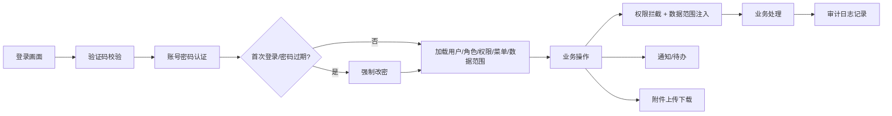
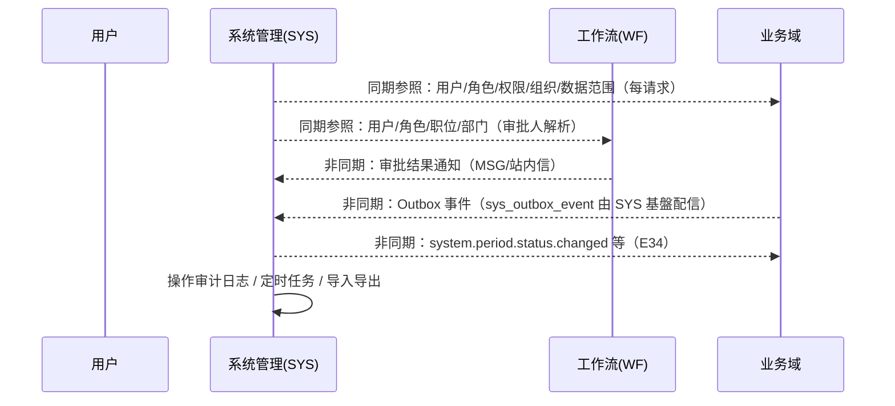

# 系统管理 业务域概要书（系统管理 業務概要書）

| 項目 | 内容 |
|---|---|
| 文書名 | 系统管理 业务域概要书（系统管理 業務概要書） |
| 文書番号 | DSN-SYS-000 |
| 版数 | v1.0 |
| 作成日 | 2026-10-20 |
| 作成者 | system-workflow（域設計担当） |
| 承認者 | 未承認（レビュー待ち） |
| 状態 | ドラフト（レビュー中） |
| 関連文書 | [体系总览](../README.md) / [共通项目定义](../00-common/01-common-item-definitions.md) / [画面共通规格](../00-common/02-common-screen-spec.md) / [API 共通规格](../00-common/03-common-api-spec.md) / [DB 共通规格](../00-common/04-common-db-spec.md) / [共通业务规则](../00-common/08-common-business-rules.md) / [跨域流程](../00-common/09-cross-domain-flow.md) / [工作流概要](../08-workflow/00-overview.md) |

---

## 1. 業務概要

### 1.1 目的

系统管理域（SYS）是 Stellar ERP 的**认证、授权与运营基盤**，为全部业务域提供四类共通能力：

1. **认证与账号**：登录/登出、验证码、密码策略、账号锁定、首次改密、多端登录控制（Sa-Token）。
2. **授权与组织**：用户、角色、权限、菜单、部门、岗位、公司/工厂多组织、数据权限范围（行级）、租户预留。
3. **配置与规则**：数据字典、系统参数、单据编号规则、通知模板、打印模板。
4. **运营与审计**：操作/登录审计日志、附件、消息通知与待办中心、导入导出中心、在线用户与定时任务监控、系统初始化与数据维护。

### 1.2 適用範囲

| 項目 | 内容 |
|---|---|
| 対象会社・拠点 | 华东精密电机股份有限公司 / 常州总装厂、无锡零部件厂（示例企业，参照 [demo-company.md](../90-data/demo-company.md)） |
| 対象機能範囲 | F-SYS-001〜F-SYS-020（认证、授权、组织、配置、审计、通知、导入导出、运维监控） |
| 対象外 | ①审批流引擎本身的流程定义与任务处理（WF 域）；②物料/客户/供应商等主数据（MDM 域）；③邮件/短信/企微的具体网关协议实现（INT 域，SYS 仅调用）；④外部公开 API 的客户端注册与限流（INT 域） |
| 前提 | PostgreSQL 18.6、Redis 7（Sa-Token 会话/验证码/字典缓存）、RabbitMQ（事件外置、第一版）；见 [技术选型](../../tech-selection.md) |

### 1.3 業務上の狙い（KPI）

| KPI | 定義・算式 | 目標値 | 実現する機能 ID |
|---|---|---|---|
| 登录成功率 | 成功登录次数 ÷ 登录尝试次数（排除密码错误） | ≥ 99.5% | F-SYS-001 |
| 认证响应时间 | 登录 API 及鉴权拦截的 P95 响应 | ≤ 300 ms | F-SYS-001、F-SYS-003 |
| 权限变更处理时长 | 申请提交→生效的平均时长 | ≤ 1 営業日 | F-SYS-002、F-SYS-003 |
| 审计覆盖率 | 受审计的写操作数 ÷ 全部写操作数 | 100% | F-SYS-009 |
| 附件上传成功率 | 上传成功数 ÷ 上传请求数 | ≥ 99.9% | F-SYS-010 |
| 通知到达率 | 成功送达数 ÷ 应发数（站内即时、邮件 5 分钟内） | ≥ 99% | F-SYS-011、F-SYS-019 |
| 导入成功率 | 导入成功行数 ÷ 提交行数 | ≥ 98%（剔除源数据错误） | F-SYS-013 |
| 定时任务可用率 | 按时执行次数 ÷ 应执行次数 | ≥ 99.9% | F-SYS-016 |

## 2. 組織とロール

### 2.1 対象組織

| 組織単位 | コード | 説明 | 所管 |
|---|---|---|---|
| 公司 | `1`（华东精密电机股份有限公司） | 会計主体。`sys_company` | 财务总监・总经理 |
| 工厂 | `CZ01` 常州总装厂 / `WX01` 无锡零部件厂 | 生産・在庫拠点。主データは MDM の `mdm_factory`。SYS は `sys_factory_setting`（有効化・既定工場割当）のみ管理 | 生产经理 |
| 部门 | `D010` 销售部 / `D020` 采购部 / `D030` 生产部 / `D040` 技术部 / `D050` 财务部 / `D060` 质量部 / `D070` 综合管理部 / `D080` 信息部 | 承認経路・データ範囲の単位。`sys_department` | 各部门经理 |

> 部门代码规则按 [共通业务规则](../00-common/08-common-business-rules.md) 2.2：`D`+3 桁。完整组织与人员示例参照 [demo-company.md](../90-data/demo-company.md)（90-data，作成中は同パスを正とする）。

### 2.2 ロール（本域利用者）

| ロール | 所属 | 主な操作 | 関連機能 ID | 主な権限コード |
|---|---|---|---|---|
| 系统管理员 | 信息部 | 用户/角色/菜单/参数/字典/编号/模板/任务监控/审计查询 | F-SYS-002〜020 | `system:user:*`、`system:role:*`、`system:menu:*`、`system:param:*` |
| 人事管理员 | 综合管理部 | 用户开立・变更・停用、部门/岗位维护（不含权限付与） | F-SYS-002、005、006 | `system:user:create/update/disable`、`system:department:*`、`system:position:*` |
| 部门经理 | 各部门 | 查看本部门用户、发起权限申请、审批本部门用户申请 | F-SYS-002、009 | `system:user:view`（データ範囲=部門）、`system:user-request:submit/approve` |
| 总经理 | 公司 | 高权限角色付与审批、审计报表查阅 | F-SYS-003、009 | `system:role-grant:approve`、`system:audit-log:view` |
| 财务总监 | 财务部 | 审计日志（财务相关）查阅、权限定期复核确认 | F-SYS-009 | `system:audit-log:view`（モジュール=finance） |
| 内审员 | 综合管理部 | 只读查阅审计日志与登录日志、导出审计报告 | F-SYS-009 | `system:audit-log:view/export`、`system:login-log:view` |
| 运维担当 | 信息部 | 在线用户管理、定时任务监控、数据维护、系统初始化 | F-SYS-016、020 | `system:online-user:*`、`system:job:*`、`system:maintenance:*` |
| 普通员工 | 全公司 | 个人中心、密码修改、我的通知/待办、附件上传下载 | F-SYS-001、010、011、018 | `system:profile:view/update`、`system:notification:view` |

### 2.3 承認経路

本域に金額承認はない。権限・アカウント系の変更は WF 域の簡易承認フローで統制する（詳細は [工作流概要](../08-workflow/00-overview.md)、共通承認ルールは [共通业务规则](../00-common/08-common-business-rules.md) 第 8 章）。

| 対象 | 条件 | 承認経路 | 方式 |
|---|---|---|---|
| 用户开立・变更・停用 | 全件 | 部門经理 → 人事管理员（确认）→ 系统管理员（执行） | 順送 |
| 角色付与（一般业务角色） | 全件 | 部门经理 → 系统管理员 | 順送 |
| 高权限角色（系统管理员・总经理・财务总监）付与 | 全件 | 系统管理员申请 → 总经理审批 → 系统管理员执行（申请人≠执行人） | 順送 |
| 业务角色权限内容变更 | 全件 | 系统管理员制定 → 财务总监复核（SoD 観点）→ 生效 | 順送 |
| 系统参数（高危险级）变更 | 全件 | 系统管理员 → 运维担当复核 | 或签+复核 |
| 数据维护・初期化 | 全件 | 运维担当申请 → 系统管理员承认 | 順送 |

> 审批矩阵及流程路由由 `wf_process_mapping` / `wf_approval_matrix` 配置（F-WF-002）。SYS 不保存审批阈值，避免二重定義。

## 3. 業務フロー

### 3.1 全体フロー（認証・認可・操作）

### 3.2 処理手順（主要業務）

| # | 手順 | 実施者 | システム処理 | 入力 | 出力 | 異常時 |
|---|---|---|---|---|---|---|
| 1 | ログイン | 全ユーザ | 検証コード検証→認証→ロック判定→トークン発行→セッション登録 | 账号/密码/验证码 | トークン、メニュー、権限 | MSG-COM-020〜028 |
| 2 | 初回改密 | 全ユーザ | パスワード強度・履歴 5 代チェック→更新→他端末セッション失効 | 旧/新パスワード | 更新完了 | MSG-COM-026、MSG-SYS-003 |
| 3 | ユーザ開立 | 人事管理员 | 重複チェック→採番（E+6 桁）→ユーザ/ロール/組織登録→通知 | 姓名、部门、岗位、ロール | ユーザ ID、初期パスワード発行 | MSG-SYS-001 |
| 4 | ロール・権限設定 | 系统管理员 | 権限ツリー選択→SoD 警告→保存→キャッシュ無効化 | ロール、権限、データ範囲 | 権限反映 | MSG-SYS-010 |
| 5 | メニュー設定 | 系统管理员 | ツリー編集→ルート/ボタン権限連動→キャッシュ無効化 | 菜单树、权限标识 | メニュー反映 | MSG-SYS-020 |
| 6 | 組織変更 | 人事管理员 | 部門ツリー編集→所属ユーザ/伝票参照チェック | 部门树 | 組織反映 | MSG-SYS-030 |
| 7 | 字典・パラメータ変更 | 系统管理员 | 値域チェック→版数更新→キャッシュ更新（1 分以内） | 字典/参数 | 反映・監査ログ | MSG-SYS-040 |
| 8 | 採番ルール変更 | 系统管理员 | プレフィックス/桁数/リセット周期検証→将来日付から適用 | 规则 | 新規採番へ適用 | MSG-SYS-050 |
| 9 | 監査ログ照会 | 内审员 | 条件検索→詳細（前後値）→エクスポート（非同期） | 条件 | 一覧・Excel | MSG-SYS-060 |
| 10 | 一括インポート | 系统管理员 | 模板検証→ドライラン→実行→エラー報告 DL | Excel | 成功/失敗件数 | MSG-COM-063/064 |
| 11 | 印刷 | 全ユーザ | テンプレート解決→PDF 生成→出力履歴 | 帳票 ID、伝票 | PDF | MSG-SYS-070 |
| 12 | 初期化・データ维护 | 运维担当 | 事前チェック→バックアップ→実行→履歴登録 | 维护类型 | 実行結果 | MSG-SYS-080 |

### 3.3 関連業務域との連携

| 相手域 | 連携内容 | 方式（同期/イベント） | 契約 |
|---|---|---|---|
| 全業務域 | ユーザ・ロール・権限・組織・データ範囲の参照 | 同期参照（モジュール公開 Service、リクエスト毎、ローカルキャッシュ 60 秒） | [跨域流程](../00-common/09-cross-domain-flow.md) 第 11 章 |
| WF | ユーザ/ロール/职位/部门の参照、代理・委任、通知送信 | 同期参照 + 非同期通知 | [跨域流程](../00-common/09-cross-domain-flow.md) 第 9 章 |
| 全業務域 | Outbox イベントの配信基盤（`sys_outbox_event`） | 非同期（10 秒間隔バッチ） | 09 第 10 章 |
| INT | メール・短信・企业微信/钉钉送信、ウイルススキャン | 同期コマンド（失敗時は再送キュー） | IF-SYS-001〜004、007 |
| RPT | 監査・ログイン統計、システム利用状況 | 参照（読み取り専用ビュー） | 09 第 12 章 |
| FIN | 会計期間状態（`system.period.status.changed` E34） | 非同期購読 | 09 第 3 章 E34 |
| 全業務域 | 組織・部門変更の通知（**E38 `system.department.changed`**、F-SYS-005） | 非同期イベント（Outbox） | [09 §3 E38](../00-common/09-cross-domain-flow.md) |

## 4. 機能一覧

| 機能 ID | 機能名 | 概要 | 画面 ID | 種別 | 優先度 | 状態 | 詳細設計書 |
|---|---|---|---|---|---|---|---|
| F-SYS-001 | 认证与登录 | 登录/登出/验证码/密码策略/账号锁定/首次改密/多端会话 | SCR-SYS-001、002 | 登录 | P0 | 設計済 | [01-auth-login.md](01-auth-login.md) |
| F-SYS-002 | 用户管理 | 用户开立/变更/停用/查询/角色付与/密码重置/导入 | SCR-SYS-004〜006、009 | 登録/一覧 | P0 | 設計済 | [02-user-role-permission.md](02-user-role-permission.md) |
| F-SYS-003 | 角色与权限 | 角色维护、权限树、数据范围、项目权限、SoD 检查 | SCR-SYS-007、008 | 登録/一覧 | P0 | 設計済 | [02-user-role-permission.md](02-user-role-permission.md) |
| F-SYS-004 | 菜单管理 | 菜单/按钮权限树维护、路由生成、权限标识管理 | SCR-SYS-014 | 登録/一覧 | P0 | 設計済 | [04-menu-dict-param.md](04-menu-dict-param.md) |
| F-SYS-005 | 组织部门 | 部门树维护、负责人、层级、使用停止 | SCR-SYS-010 | 登録/一覧 | P0 | 設計済 | [03-org-position.md](03-org-position.md) |
| F-SYS-006 | 岗位 | 岗位维护、岗位与用户/角色关联 | SCR-SYS-011 | 登録/一覧 | P1 | 設計済 | [03-org-position.md](03-org-position.md) |
| F-SYS-007 | 数据字典 | 字典类型/字典项目维护、缓存刷新、使用停止 | SCR-SYS-015、016 | 登録/一覧 | P0 | 設計済 | [04-menu-dict-param.md](04-menu-dict-param.md) |
| F-SYS-008 | 系统参数 | 参数分组/值/数据类型/危险级维护、缓存刷新、变更审计 | SCR-SYS-017 | 登録/一覧 | P0 | 設計済 | [04-menu-dict-param.md](04-menu-dict-param.md) |
| F-SYS-009 | 审计日志 | 操作/登录日志记录、照会、前後値、エクスポート、異常検知 | SCR-SYS-018、019 | 照会 | P0 | 設計済 | [05-audit-attachment-notify.md](05-audit-attachment-notify.md) |
| F-SYS-010 | 附件管理 | アップロード/ダウンロード/一覧/削除、業務紐付け、検査 | SCR-SYS-020 | 登録/一覧 | P0 | 設計済 | [05-audit-attachment-notify.md](05-audit-attachment-notify.md) |
| F-SYS-011 | 消息通知与待办中心 | 站内通知、既読管理、待办/已办聚合、通知偏好 | SCR-SYS-021 | 一覧/照会 | P0 | 設計済 | [05-audit-attachment-notify.md](05-audit-attachment-notify.md) |
| F-SYS-012 | 单据编号规则 | 採番规则维护、日次/月次/年次重置、プレビュー、適用開始日 | SCR-SYS-023 | 登録/一覧 | P0 | 設計済 | [06-import-export-numbering.md](06-import-export-numbering.md) |
| F-SYS-013 | 导入导出中心 | 模板管理、ドライラン、非同期実行、エラー報告、履歴 | SCR-SYS-024、025 | 一覧/バッチ | P1 | 設計済 | [06-import-export-numbering.md](06-import-export-numbering.md) |
| F-SYS-014 | 公司/工厂多组织 | 公司主体・会計主体設定、工厂组织設定（有効化・既定割当・責任者）。工厂主データは MDM（`mdm_factory`）を参照 | SCR-SYS-012 | 登録/一覧 | P1 | 設計済 | [03-org-position.md](03-org-position.md) |
| F-SYS-015 | 打印模板管理 | 帳票テンプレート登録/版管理/プレビュー/デフォルト指定 | SCR-SYS-026 | 登録/一覧 | P1 | 設計済 | [07-scheduled-job-print-monitor.md](07-scheduled-job-print-monitor.md) |
| F-SYS-016 | 在线用户与定时任务监控 | セッション一覧・強制ログアウト、ジョブ定義/実行履歴/手動起動 | SCR-SYS-027、028 | 一覧/監視 | P1 | 設計済 | [07-scheduled-job-print-monitor.md](07-scheduled-job-print-monitor.md) |
| F-SYS-017 | 租户与数据隔离 | 租户マスタ予約、tenant_id 付与方針、RLS 第一版有効 | SCR-SYS-013 | 設定 | P0 | 設計済 | [03-org-position.md](03-org-position.md) |
| F-SYS-018 | 个人中心 | プロフィール、パスワード変更、通知設定、画面設定、セッション | SCR-SYS-003 | 登録編集 | P0 | 設計済 | [01-auth-login.md](01-auth-login.md) |
| F-SYS-019 | 通知模板 | 站内/邮件/短信テンプレート、変数、版管理、テスト送信 | SCR-SYS-022、030 | 登録/一覧 | P1 | 設計済 | [05-audit-attachment-notify.md](05-audit-attachment-notify.md) |
| F-SYS-020 | 系统初始化与数据维护 | 初期データ投入、キャッシュ再構築、データ整合性検査、保守 | SCR-SYS-029 | バッチ/ウィザード | P1 | 設計済 | [07-scheduled-job-print-monitor.md](07-scheduled-job-print-monitor.md) |

> 優先度：P0 / P1 / P2 は実装順の目安であり、全て第一版の範囲（用户决定：不分期）。状態：設計済＝本文書に詳細設計あり。

## 5. 画面一覧

| 画面 ID | 画面名 | 類型 | 機能 ID | 権限コード | 遷移元 | 遷移先 |
|---|---|---|---|---|---|---|
| SCR-SYS-001 | 登录 | LOGIN | F-SYS-001 | 認証不要（公開） | 未ログイン/セッション失効 | SCR-SYS-002 or 業務トップ |
| SCR-SYS-002 | 密码修改（强制/任意） | EDIT | F-SYS-001 | `system:profile:update` | SCR-SYS-001、003 | 業務トップ |
| SCR-SYS-003 | 个人中心 | EDIT | F-SYS-018 | `system:profile:view` | ユーザメニュー | 各タブ（同一画面） |
| SCR-SYS-004 | 用户一覧 | LIST | F-SYS-002 | `system:user:view` | メニュー > 系统管理 > 用户管理 | SCR-SYS-005、006 |
| SCR-SYS-005 | 用户登録編集 | EDIT | F-SYS-002 | `system:user:create/update` | SCR-SYS-004 | SCR-SYS-004 |
| SCR-SYS-006 | 用户詳細 | VIEW | F-SYS-002 | `system:user:view` | SCR-SYS-004 | SCR-SYS-005、009 |
| SCR-SYS-007 | 角色一覧 | LIST | F-SYS-003 | `system:role:view` | メニュー > 系统管理 > 角色权限 | SCR-SYS-008 |
| SCR-SYS-008 | 角色登録編集（権限/データ範囲/项目権限） | EDIT | F-SYS-003 | `system:role:create/update` | SCR-SYS-007 | SCR-SYS-007 |
| SCR-SYS-009 | 用户角色割当 | EDIT | F-SYS-003 | `system:user-role:update` | SCR-SYS-004、006 | SCR-SYS-004 |
| SCR-SYS-010 | 组织部门管理 | EDIT | F-SYS-005 | `system:department:view` | メニュー > 系统管理 > 组织管理 | 同一画面（ツリー） |
| SCR-SYS-011 | 岗位管理 | LIST | F-SYS-006 | `system:position:view` | メニュー > 系统管理 > 岗位管理 | 同一画面（ダイアログ） |
| SCR-SYS-012 | 公司/工厂设置 | EDIT | F-SYS-014 | `system:company:view` | メニュー > 系统管理 > 组织设置 | 同一画面（タブ） |
| SCR-SYS-013 | 租户设置（予約） | LIST | F-SYS-017 | `system:tenant:view` | メニュー > 系统管理 > 租户设置 | 同一画面（ダイアログ） |
| SCR-SYS-014 | 菜单管理 | EDIT | F-SYS-004 | `system:menu:view` | メニュー > 系统管理 > 菜单管理 | 同一画面（ツリー） |
| SCR-SYS-015 | 数据字典一覧 | LIST | F-SYS-007 | `system:dict:view` | メニュー > 系统管理 > 数据字典 | SCR-SYS-016 |
| SCR-SYS-016 | 字典項目編集 | EDIT | F-SYS-007 | `system:dict:update` | SCR-SYS-015 | SCR-SYS-015 |
| SCR-SYS-017 | 系统参数 | LIST | F-SYS-008 | `system:param:view` | メニュー > 系统管理 > 系统参数 | 同一画面（編集ダイアログ） |
| SCR-SYS-018 | 操作审计日志 | LIST | F-SYS-009 | `system:audit-log:view` | メニュー > 系统管理 > 审计日志 | 同一画面（詳細ドロワー） |
| SCR-SYS-019 | 登录日志 | LIST | F-SYS-009 | `system:login-log:view` | メニュー > 系统管理 > 登录日志 | 同一画面（ダイアログ） |
| SCR-SYS-020 | 附件管理 | LIST | F-SYS-010 | `system:attachment:view` | メニュー > 系统管理 > 附件管理 | 同一画面（プレビュー） |
| SCR-SYS-021 | 消息通知中心/待办中心 | LIST | F-SYS-011 | `system:notification:view` | ヘッダ通知アイコン | 業務画面（対象伝票） |
| SCR-SYS-022 | 通知模板管理 | LIST | F-SYS-019 | `system:notification-template:view` | メニュー > 系统管理 > 通知模板 | 同一画面（編集ダイアログ） |
| SCR-SYS-023 | 单据编号规则 | LIST | F-SYS-012 | `system:number-rule:view` | メニュー > 系统管理 > 编号规则 | 同一画面（編集ダイアログ） |
| SCR-SYS-024 | 导入导出中心 | LIST | F-SYS-013 | `system:job:view` | メニュー > 系统管理 > 导入导出 | SCR-SYS-025 |
| SCR-SYS-025 | 异步任务詳細/進捗 | VIEW | F-SYS-013 | `system:job:view` | SCR-SYS-024 | 結果 DL |
| SCR-SYS-026 | 打印模板管理 | LIST | F-SYS-015 | `system:print-template:view` | メニュー > 系统管理 > 打印模板 | 同一画面（プレビュー） |
| SCR-SYS-027 | 在线用户 | LIST | F-SYS-016 | `system:online-user:view` | メニュー > 系统管理 > 在线用户 | 同一画面 |
| SCR-SYS-028 | 定时任务监控 | LIST | F-SYS-016 | `system:job-monitor:view` | メニュー > 系统管理 > 定时任务 | SCR-SYS-025（実行履歴） |
| SCR-SYS-029 | 系统初始化与数据维护 | WIZ | F-SYS-020 | `system:maintenance:view` | メニュー > 系统管理 > 系统维护 | 同一画面（ウィザード） |
| SCR-SYS-030 | 通知发送履歴 | LIST | F-SYS-019 | `system:notification-log:view` | SCR-SYS-022、024 | 同一画面 |

## 6. 帳票一覧

| 帳票 ID | 帳票名 | 出力タイミング | 帳票種別 | 機能 ID | 詳細 |
|---|---|---|---|---|---|
| PRT-SYS-001 | 用户台账 | 手動 | 一覧表 | F-SYS-002 | [92](92-report-batch-design.md) |
| PRT-SYS-002 | 权限矩阵表（角色×権限） | 手動 | 一覧表 | F-SYS-003 | [92](92-report-batch-design.md) |
| PRT-SYS-003 | 操作审计日志导出 | 手動（非同期） | 一覧表 | F-SYS-009 | [92](92-report-batch-design.md) |
| PRT-SYS-004 | 登录日志导出 | 手動（非同期） | 一覧表 | F-SYS-009 | [92](92-report-batch-design.md) |
| PRT-SYS-005 | 导入错误报告 | 非同期（インポート完了時） | 一覧表 | F-SYS-013 | [92](92-report-batch-design.md) |
| PRT-SYS-006 | 组织岗位一覧表 | 手動 | 一覧表 | F-SYS-005、006 | [92](92-report-batch-design.md) |
| PRT-SYS-007 | 系统参数・字典一覧表 | 手動 | 一覧表 | F-SYS-007、008 | [92](92-report-batch-design.md) |
| PRT-SYS-008 | 通知发送记录表 | 手動 | 一覧表 | F-SYS-019 | [92](92-report-batch-design.md) |
| PRT-SYS-009 | 数据整合性検査报告 | 手動/バッチ | 集計表 | F-SYS-020 | [92](92-report-batch-design.md) |

## 7. バッチ一覧

| バッチ ID | バッチ名 | 起動方式 | 実行時間帯 | 処理概要 | 冪等性 |
|---|---|---|---|---|---|
| BAT-SYS-001 | Outbox 事件配信 | 自動（10 秒間隔） | 常時 | `sys_outbox_event` の NEW/FAILED を配信 | 条件付き（event_id 一意） |
| BAT-SYS-002 | セッション・在线用户整合 | 自動（5 分間隔） | 常時 | Sa-Token/Redis セッションとログイン履歴の突合、失効セッション清理 | 再実行可 |
| BAT-SYS-003 | パスワード有効期限提醒 | 日次 | 08:00 | 期限 7 日前通知、期限切れアカウントのフラグ更新 | 再実行可（当日分スキップ） |
| BAT-SYS-004 | アカウントロック自動解除 | 自動（1 分間隔） | 常時 | ロック期限到来分を解除 | 再実行可 |
| BAT-SYS-005 | 通知送信リトライ | 自動（1 分間隔） | 常時 | 失敗したメール/短信を再送（最大 5 回） | 条件付き（送信ログで判定） |
| BAT-SYS-006 | 監査日志アーカイブ | 日次 | 02:30 | 保存期間超過分をアーカイブテーブルへ移管 | 条件付き（移管済みフラグ） |
| BAT-SYS-007 | ジョブ結果・一時ファイル清理 | 日次 | 03:00 | 7 日超過のジョブ結果/一時ファイル削除 | 再実行可 |
| BAT-SYS-008 | 添付孤児ファイル検査 | 週次 | 日曜 03:30 | 参照なしファイルのリスト化（削除は手動承認） | 再実行可 |
| BAT-SYS-009 | 定时任务監視・補償 | 自動（1 分間隔） | 常時 | 未実行ジョブ検出、多重起動防止、失敗通知 | 再実行可 |
| BAT-SYS-010 | システム整合性検査 | 日次 | 04:00 | ユーザ・ロール・組織・辞書の参照整合性、孤立レコード検出 | 再実行可 |
| BAT-SYS-011 | キャッシュ再構築 | 手動 | — | 辞書/パラメータ/メニュー/権限キャッシュの再構築 | 再実行可 |
| BAT-SYS-012 | 初期データ投入（初回） | 手動 | — | 会社/工場/部门/ロール/管理员/字典/编号规则的初期登録 | 再実行可（存在時スキップ） |

## 8. テーブル一覧

| 物理名 | 論理名 | 種別 | 主な用途 | 更新元機能 ID | データ量見積 |
|---|---|---|---|---|---|
| sys_company | 公司 | マスタ | 会計主体 | F-SYS-014 | 1〜5 件 |
| sys_factory_setting | 工厂组织设置 | 設定 | 工厂の有効化・既定割当（主データは MDM の `mdm_factory`） | F-SYS-014 | 5 件 |
| sys_tenant | 租户 | マスタ（予約） | マルチテナント契約単位 | F-SYS-017 | 1 件（P2） |
| sys_department | 部门 | マスタ | 組織ツリー | F-SYS-005 | 100 件 |
| sys_position | 岗位 | マスタ | 職位 | F-SYS-006 | 80 件 |
| sys_user | 用户 | マスタ | アカウント | F-SYS-002 | 900→1,150 |
| sys_role | 角色 | マスタ | 権限集合 | F-SYS-003 | 30 件 |
| sys_user_role | 用户角色 | 関連 | ユーザ×ロール | F-SYS-002 | 2,500 件 |
| sys_role_permission | 角色权限 | 関連 | ロール×権限 | F-SYS-003 | 3,000 件 |
| sys_role_data_scope | 角色数据范围 | 設定 | 行レベルの範囲 | F-SYS-003 | 100 件 |
| sys_user_data_scope | 用户数据范围 | 設定 | 個別付与 | F-SYS-002 | 500 件 |
| sys_menu | 菜单/权限 | マスタ | メニュー・ボタン権限 | F-SYS-004 | 500 件 |
| sys_dict_type | 字典类型 | マスタ | 区分値グループ | F-SYS-007 | 120 件 |
| sys_dict_item | 字典项目 | マスタ | 区分値 | F-SYS-007 | 2,000 件 |
| sys_param | 系统参数 | 設定 | 全体設定値 | F-SYS-008 | 200 件 |
| sys_number_rule | 编号规则 | 設定 | 採番ルール | F-SYS-012 | 60 件 |
| sys_sequence | 採番連番 | 設定 | 日次連番 | F-SYS-012 | 1 万/年 |
| sys_audit_log | 操作审计日志 | ログ | 操作履歴 | F-SYS-009 | 1,000 万/年 |
| sys_login_log | 登录日志 | ログ | 認証履歴 | F-SYS-009 | 50 万/年 |
| sys_user_password_history | パスワード履歴 | 履歴 | 5 代チェック | F-SYS-001 | 3,000 件 |
| sys_attachment | 附件 | ログ/マスタ | ファイルメタ | F-SYS-010 | 20 万/年 |
| sys_attachment_biz | 附件業務関連 | 関連 | 業務×附件 | F-SYS-010 | 20 万/年 |
| sys_notification | 站内通知 | ログ | 通知本体 | F-SYS-011 | 50 万/年 |
| sys_notification_receiver | 通知受信者 | 関連 | 受信者・既読 | F-SYS-011 | 100 万/年 |
| sys_notification_template | 通知模板 | マスタ | 文面テンプレート | F-SYS-019 | 100 件 |
| sys_notification_send_log | 通知送信日志 | ログ | メール/短信送信 | F-SYS-019 | 50 万/年 |
| sys_import_export_job | 导入导出任务 | ログ | 非同期ジョブ | F-SYS-013 | 2 万/年 |
| sys_import_export_error | 任务错误行 | ログ | 行エラー | F-SYS-013 | 50 万/年 |
| sys_import_template | 导入模板 | マスタ | Excel テンプレート定義 | F-SYS-013 | 50 件 |
| sys_print_template | 打印模板 | マスタ | 帳票レイアウト | F-SYS-015 | 100 件 |
| sys_print_log | 打印日志 | ログ | 出力履歴 | F-SYS-015 | 10 万/年 |
| sys_scheduled_job | 定时任务定义 | 設定 | ジョブ定義 | F-SYS-016 | 80 件 |
| sys_scheduled_job_log | 定时任务日志 | ログ | 実行履歴 | F-SYS-016 | 50 万/年 |
| sys_outbox_event | Outbox 事件 | ログ | イベント配信 | 全業務域 | 500 万/年 |
| sys_event_consume_log | 事件消費日志 | ログ | 冪等重複排除 | 全業務域 | 500 万/年 |
| sys_idempotency | 冪等キー | 設定 | API 冪等保証 | 全 API | 100 万/年 |
| sys_user_preference | 用户画面設定 | 設定 | 一覧列・検索条件 | F-SYS-018 | 2 万件 |
| sys_data_maintenance_log | 数据维护履歴 | ログ | 初期化・维护実行 | F-SYS-020 | 1,000/年 |

> 全テーブル定義は [90-db-design.md](90-db-design.md)。共通カラム（`id`/`tenant_id`/`company_id`/`created_at` 等）は [共通项目定义](../00-common/01-common-item-definitions.md) 第 2 章に従う。

## 9. 外部 IF 一覧

| IF ID | 名称 | 相手先 | 方向 | 方式 | 頻度 | 契機 |
|---|---|---|---|---|---|---|
| IF-SYS-001 | メール送信 | SMTP サーバ（企业邮箱） | 送信 | SMTP/TLS | リアルタイム/再送 | 通知・パスワードリセット・バッチ失敗 |
| IF-SYS-002 | 短信送信 | 短信网关 | 送信 | REST | リアルタイム | 承認依頼・验证码 |
| IF-SYS-003 | 企业微信/钉钉通知 | 企业微信/钉钉開放平台 | 送信 | REST（Webhook） | リアルタイム | 承認依頼・アラート |
| IF-SYS-004 | 统一身份认证 | LDAP/AD | 双方向 | LDAP | ログイン時 | 認証・ユーザ同期 |
| IF-SYS-005 | 对象存储 | MinIO/S3 | 双方向 | S3 API | リアルタイム | 附件・帳票ファイル保存 |
| IF-SYS-006 | ウイルススキャン | ClamAV | 送信 | clamd/ICAP | リアルタイム | 附件アップロード |
| IF-SYS-007 | PDF 変換 | LibreOffice/Puppeteer ローカルプロセス | 送信 | ローカル実行 | リアルタイム | 帳票・印刷プレビュー生成 |

## 10. 権限一覧

| 権限コード | 対象機能 | 対象データ範囲 | 付与ロール |
|---|---|---|---|
| `system:auth:login` | F-SYS-001 | 本人 | 全ロール（公開 API） |
| `system:profile:view` / `update` | F-SYS-018 | 本人 | 全ロール |
| `system:user:view` | F-SYS-002 | 全社/部門/工場/倉庫 | 系统管理员、人事管理员、部门经理（部門） |
| `system:user:create` / `update` / `disable` / `reset-password` | F-SYS-002 | 全社 | 系统管理员、人事管理员（disable のみ） |
| `system:user:unlock` / `reopen` | F-SYS-002 | 全社 | 系统管理员、人事管理员（unlock のみ） |
| `system:user:import` / `export` | F-SYS-002、013 | 全社 | 系统管理员 |
| `system:user-role:update` | F-SYS-003 | 全社 | 系统管理员 |
| `system:user-request:submit` / `approve` | F-SYS-002 | 部門 | 部门经理、人事管理员 |
| `system:role:view` | F-SYS-003 | 全社 | 系统管理员、财务总监（参照） |
| `system:role:create` / `update` / `delete` | F-SYS-003 | 全社 | 系统管理员 |
| `system:role-grant:approve` | F-SYS-003 | 全社 | 总经理 |
| `system:menu:view` / `create` / `update` / `delete` | F-SYS-004 | 全社 | 系统管理员 |
| `system:department:view` / `create` / `update` / `delete` | F-SYS-005 | 全社 | 系统管理员、人事管理员 |
| `system:position:view` / `create` / `update` / `delete` | F-SYS-006 | 全社 | 系统管理员、人事管理员 |
| `system:company:view` / `update` | F-SYS-014 | 全社 | 系统管理员、财务总监（参照） |
| `system:tenant:view` / `update` | F-SYS-017 | 全社 | 系统管理员（P2） |
| `system:dict:view` / `create` / `update` / `delete` | F-SYS-007 | 全社 | 系统管理员 |
| `system:param:view` / `update` | F-SYS-008 | 全社 | 系统管理员、运维担当（view） |
| `system:audit-log:view` / `export` | F-SYS-009 | 全社/部門/自己 | 内审员、系统管理员、总经理、财务总监 |
| `system:login-log:view` / `export` | F-SYS-009 | 全社 | 内审员、系统管理员 |
| `system:attachment:view` / `upload` / `delete` | F-SYS-010 | 本人/全社 | 全ロール（upload）、系统管理员（delete） |
| `system:notification:view` / `read` | F-SYS-011 | 本人 | 全ロール |
| `system:notification-template:view` / `update` | F-SYS-019 | 全社 | 系统管理员 |
| `system:notification-log:view` | F-SYS-019 | 全社 | 系统管理员、运维担当 |
| `system:number-rule:view` / `update` | F-SYS-012 | 全社 | 系统管理员 |
| `system:job:view` / `cancel` / `download` | F-SYS-013 | 本人/全社 | 全ロール（本人）、系统管理员（全社） |
| `system:import-template:view` / `update` | F-SYS-013 | 全社 | 系统管理员 |
| `system:print-template:view` / `update` | F-SYS-015 | 全社 | 系统管理员 |
| `system:online-user:view` / `kickout` | F-SYS-016 | 全社 | 系统管理员、运维担当 |
| `system:job-monitor:view` / `run` | F-SYS-016 | 全社 | 系统管理员、运维担当 |
| `system:maintenance:view` / `execute` | F-SYS-020 | 全社 | 系统管理员、运维担当（execute は系统管理员のみ） |

> 権限コードは `{module}:{resource}:{action}` 形式（[设计方针](../00-common/00-design-principles.md) 6.6。action に `cancel`/`reopen` を含む）。データ範囲は **7 区分（全社 / 本部门及子部门 / 本部门 / 本人 / 工場 / 倉庫 / 自定义）** を `sys_role_data_scope` / `sys_user_data_scope` で制御し、工場・倉庫次元は MDM の `mdm_factory` / `mdm_warehouse` を参照する（REV-005/REV-018 対応）。フロントは `v-permission`、API は `@SaCheckPermission` で二重チェック。

## 11. 用語（本域固有）

| 用語 | 説明 | 対応英語/日文 |
|---|---|---|
| 登录态 | Sa-Token が管理する認証セッション（token） | Session / ログイン状態 |
| 踢人 | 管理者が指定ユーザのセッションを強制失効させる操作 | Kick-out / 強制ログアウト |
| 数据范围 | ロール/ユーザに付与する行レベル参照範囲（全社/部門/本人/カスタム） | Data Scope / データ権限範囲 |
| 项目权限 | 画面項目単位の表示・編集可否 | Field Permission / 項目権限 |
| 职责分离（SoD） | 相反する職務を同一ユーザに付与しない統制 | Segregation of Duties / 職務分掌 |
| 字典缓存 | 辞書・パラメータ・メニュー・権限の参照キャッシュ（Caffeine + Redis） | Dictionary Cache / マスタキャッシュ |
| 採番 | 伝票番号・マスタコードの自動連番発行 | Numbering / 採番 |
| 幂等键 | 同一リクエストの二重実行を防ぐキー | Idempotency Key / 冪等キー |
| 站内信 | システム内通知（既読管理あり） | In-app Notification / 站内通知 |
| 待办中心 | 承認待ち・未処理事項の集約画面 | To-do Center / 待办センター |
| 审计轨迹 | 操作の前後値・実行者・時刻の記録 | Audit Trail / 監査証跡 |

## 12. 未決事項

| # | 事項 | 理由 | 暫定仕様 | 担当 | 期限 |
|---|---|---|---|---|---|
| 1 | 承認マトリクスのテーブル名（**已裁决**） | 各域・00-common・90-data で `sys_approval_matrix` / `wf_approval_matrix` の記載が混在していた | **已裁决：`wf_approval_matrix`（WF 所有）に統一**。Lead が 00-common/08・09 と全 docs/90-data を置換済み。SYS は承認阈值・経路を保存せず、WF の `wf_approval_matrix` / `wf_process_mapping` を参照のみ | Lead | 完了（2026-10-20） |
| 2 | ユーザ・ロール変更の WF 承認 | SYS 内で WF を呼ぶか、SYS 専用の簡易承認か | WF の汎用申請（業務類型 `SYS_USER_CHANGE`）を利用。WF 未導入環境では管理者 2 名承認 | Lead / system-workflow | 2026-10-27 |
| 3 | パスワードポリシー具体値 | 客户セキュリティ規程が未確定 | 8〜20 位、英大/英小/数字/記号の 3 類以上、90 日期限、履歴 5 代、失敗 5 回で 30 分ロック | 系统管理员（客户確認） | 2026-11-10 |
| 4 | 多端ログイン制御 | 同一ユーザの同時ログイン可否 | 既定は多端可、設定 `auth.multiLogin=false` で 1 端末のみ | 系统管理员 | 2026-11-10 |
| 5 | LDAP/AD 連携の方式 | 客户 IT 環境未確認 | 第一版でローカル認証 + IF-SYS-004 を対応（TODO：接続方式・同期項目の設計が未作成） | Lead | 2026-11-17 |
| 6 | メール・短信サービス商 | 客户調達未定 | 第一版で SMTP と短信（IF-SYS-002）を対応。サービス商は未定 | 系统管理员 | 2026-11-17 |
| 7 | Outbox 配信基盤の帰属 | 09 で `sys_outbox_event` を定義しているが、発行は各域 | テーブルは SYS が提供、発行 API は共通モジュール（`erp-common`）で実装 | Lead | 2026-10-27 |
| 8 | 監査ログのパーティション開始時期 | 年 1,000 万行見込み | 第一版から宣言的パーティション（月次レンジ）。FK 参照しない | 运维担当 | 2026-12-01 |
| 9 | 印刷テンプレートのエンジン | JasperReports / HTML→PDF の選定 | HTML テンプレート + Puppeteer（IF-SYS-007）。JasperReports 要否は検討中 | Lead | 2026-11-10 |
| 10 | 租户分離（RLS）の実装時期 | 已決：不分期 | 第一版で首批業務テーブルと同時に RLS 有効化。テーブル・API は `tenant_id` を全件保持 | Lead | 已決（2026-10-20，Yuri） |

## 13. 改訂履歴

| 版数 | 日付 | 変更内容 | 変更者 |
|---|---|---|---|
| v1.0 | 2026-10-20 | 初版：業務概要、組織/ロール、業務フロー、F-SYS-001〜020、画面 30、帳票 8、バッチ 12、テーブル 38、IF 7、権限一覧、未決事項 10 | system-workflow |
| v1.1 | 2026-10-20 | 未決 #1（承認マトリクス表名）に approval-matrix.md §6 と他域参照の事実、選択肢を追記 | system-workflow |
| v1.2 | 2026-10-20 | Lead 裁决反映：承認マトリクスは `wf_approval_matrix`（WF 所有）に統一（未決 #1 を已裁决に更新）。工厂主データは MDM の `mdm_factory` とし、SYS は `sys_factory_setting`（工厂组织设置）に変更（§2.1・機能一覧 F-SYS-014・テーブル一覧） | system-workflow |
| v1.3 | 2026-10-20 | 整合性修正：帳票一覧に PRT-SYS-009（数据整合性検査报告）を追加（92 章の定義と一致）。E38 `system.department.changed` の発行を §3.3 連携表に追記 | system-workflow（validator） |
| v1.4 | 2026-10-20 | 红队第 2 轮修复：REV-005（データ範囲に工場/倉庫次元を追加）、REV-018（3 区分→7 区分に統一）、権限 action に `cancel`/`reopen` を反映（`system:user:unlock`/`reopen` 行追加） | system-workflow |
