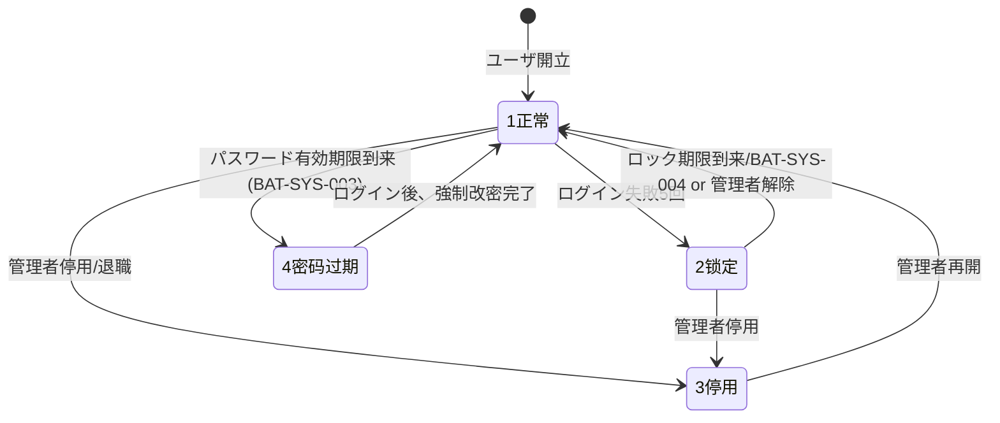
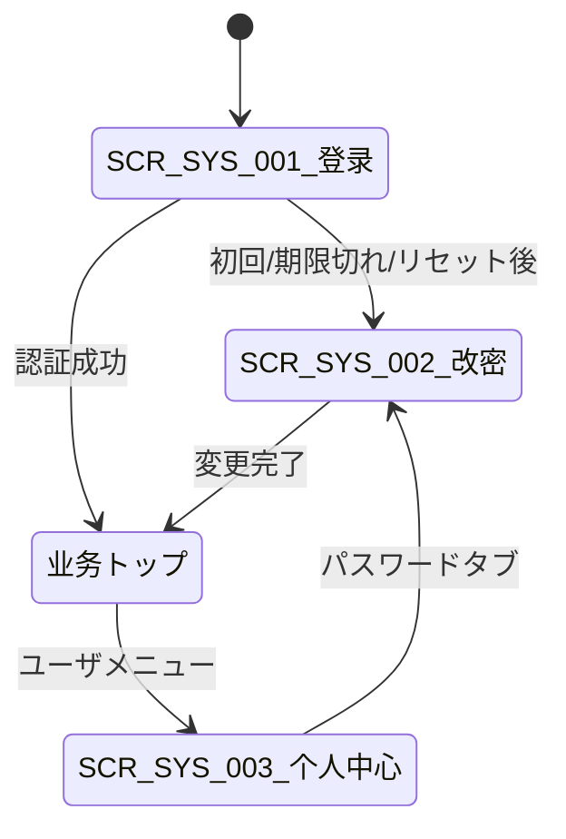

# 认证与登录 详细设计书（認証・ログイン 詳細設計書）

| 項目 | 内容 |
|---|---|
| 文書名 | 认证与登录 详细设计书（認証・ログイン 詳細設計書） |
| 文書番号 | DSN-SYS-001 |
| 版数 | v1.5 |
| 作成日 | 2026-10-20 |
| 作成者 | system-workflow（域設計担当） |
| 承認者 | 未承認（レビュー待ち） |
| 状態 | ドラフト（レビュー中） |
| 関連文書 | [業務域概要](00-overview.md) / [DB 設計](90-db-design.md) / [API 設計](91-api-design.md) / [メッセージ](93-messages.md) / [共通項目定義](../00-common/01-common-item-definitions.md) / [画面共通規格](../00-common/02-common-screen-spec.md) / [API 共通規格](../00-common/03-common-api-spec.md) / [共通業務規則](../00-common/08-common-business-rules.md) |

---

## 1. 機能概要

| 項目 | 内容 |
|---|---|
| 機能 ID | F-SYS-001（認証与登录）、F-SYS-018（个人中心） |
| 機能名 | 登录/登出、验证码、密码策略、账号锁定、首次改密、个人中心 |
| 目的 | 安全に利用者を識別し、認証済みの同一性（ログインユーザ・テナント・公司・工場）を全 API に伝播する。個人情報・パスワード・通知設定を本人が管理できるようにする |
| 利用者・ロール | 全ロール（F-SYS-001）、全ユーザ（F-SYS-018）、系统管理员（ロック解除・リセット） |
| 利用シーン | システム利用開始時、セッション失効時、初回配布時、パスワード期限到来時、退職・異動時 |
| 優先度 | P0 |
| 画面 ID | SCR-SYS-001（登录）、SCR-SYS-002（密码修改/强制改密）、SCR-SYS-003（个人中心） |
| 関連 IF | IF-SYS-001（パスワードリセット通知メール、管理者リセット + 第一版でセルフサービスリセット） |

## 2. 業務要件・業務ルール

### 2.1 前提条件

| # | 前提条件 | 成立しない場合の挙動 |
|---|---|---|
| 1 | `sys_user.status=1`（在职）かつ `account_status IN (1,4)` | ログイン拒否。`account_status=2` はロック中、`3` は停用（`MSG-SYS-001`） |
| 2 | Redis が利用可能（トークン・検証コード・キャッシュ。トークンは Sa-Token の Redis DAO で保存し、メモリ保存は不可） | 503 + `MSG-COM-083`。DB フォールバックはしない |
| 3 | パスワードは BCrypt（cost 10 以上）で保存されている | 認証失敗。実装不備としてログ ERROR |
| 4 | ユーザに少なくとも 1 つの有効ロールがある（必須ではない） | ログインは成功する。`/auth/me` の `menus` は空配列 `[]`、フロントは「暂无权限，请联系管理员」を表示。運用でロール付与（蓝色大肥鱼 2026-10-21 決定） |
| 5 | 入力された企業コード（`tenantCode`）の租户が有効（`status=1`）・未削除（`deleted=FALSE`）・期限内（`expire_date IS NULL OR expire_date >= current_date`） | ログイン拒否。租户不存在・無効・期限切れはユーザ不存在・パスワード誤りと同じ `MSG-COM-021`（code=2002）を返し、区別しない |

### 2.2 業務ルール

| # | ルール | 根拠（法令・社内規程・業務慣行） | 関連項目 |
|---|---|---|---|
| BR-01 | パスワードは 8〜20 位、英大文字/英小文字/数字/記号のうち 3 類以上、空白・全角・ユーザ ID と同一文字列を含まない | 社内情報セキュリティ規程（示例企業）・[共通メッセージ](../00-common/05-common-message-list.md) MSG-COM-026 | `newPassword` |
| BR-02 | パスワード有効期限 90 日。期限 7 日前から通知、期限切れは `account_status=4` とし、ログイン後に強制改密 | 社内規程 | `password_expire_at` |
| BR-03 | 同一パスワードの再利用禁止（直近 5 代）。履歴は `sys_user_password_history` で判定 | 社内規程 | `sys_user_password_history` |
| BR-04 | ログイン失敗 5 回で 30 分ロック（`account_status=2`、`lock_until`）。ロック中は正しいパスワードでも拒否 | 総当たり攻撃対策 | `login_fail_count`、`lock_until` |
| BR-05 | 検証コードは 4 桁英数字・大文字小文字不区別、有効期限 2 分、3 回失敗で再取得。ログイン失敗 3 回以上で必須化 | 自動化攻撃対策 | `captcha` |
| BR-06 | 初回ログイン・管理者リセット後は `password_reset_required=true`。ログイン成功後、業務画面へ遷移せず SCR-SYS-002 へ強制遷移 | 初期パスワード拡散防止 | `password_reset_required` |
| BR-07 | ログアウト時は当該トークンのみ失効（多端ログイン時）。管理者の「踢人」は指定ユーザの全セッションを失効 | セキュリティ運用 | Sa-Token `logout`/`kickout` |
| BR-08 | 多重ログイン制御：設定 `auth.multi-login` = true（既定、多端可）/ false（1 端末のみ、後勝ちで旧セッション失効） | 客户セキュリティ要件（未決 #4） | `sys_param` |
| BR-09 | パスワード変更後は本人の他セッションを全失効（変更したセッションのみ維持） | 窃取されたセッションの無効化 | Sa-Token |
| BR-10 | 個人中心で変更可能な項目は ニックネーム・携帯・メール・アバター・通知設定・画面設定のみ。氏名・部門・工号・ロールは管理者のみ変更可能 | 人事データの統制 | `sys_user` |
| BR-11 | セッションは 8 時間（`sa-token.timeout`）、無操作 30 分で activity-timeout。残り 5 分で画面警告 | [画面共通規格](../00-common/02-common-screen-spec.md) 15 章 | — |
| BR-12 | 認証・ログアウト・失敗・パスワード変更はすべて監査ログ（`sys_audit_log`）とログインログ（`sys_login_log`）に記録 | [共通項目定義](../00-common/01-common-item-definitions.md) 第 12 章 | — |
| BR-13 | ログインは「企業代码（`tenantCode`）＋ 账号（`username`）＋ 密码」で行い、3 項目とも必須。`username` は租户内でのみ一意（`uk_sys_user_username (tenant_id, username)`）のため、企業代码で租户を特定してからユーザを引く。企業代码は大文字小文字を区別しない（照合前に `upper()`、DB は大文字で保存）、`username` は完全一致（区別あり）。子域名による租户判定は第一版対象外（将来は子域名からフロントが `tenantCode` を自動入力するのみで API は変えない） | 多テナント運用（蓝色大肥鱼 2026-10-21 #71 決定） | `tenantCode`、`sys_tenant.tenant_code` |
| BR-14 | 企業代码不存在・租户無効/期限切れ・ユーザ不存在・パスワード不一致は、同一のエラー（HTTP 200 + `code=2002`、`MSG-COM-021`）と同等の応答時間（ダミー BCrypt 照合）で返し、どれに該当したかを応答から判別できないようにする | 租户・アカウント列挙対策（蓝色大肥鱼 2026-10-21 #71 決定） | — |
| BR-15 | ログイン API の HTTP ステータス：HTTP 401 は `code=2001`（未認証・期限切れ）のみ。ログイン API の失敗は**例外なく** HTTP 200 で返し、`code` を body に載せる：`1001`（入力チェック失敗：`tenantCode`・`username`・`password` の欠落・超長、蓝色大肥鱼 16:18 決定）・`2002`（ログイン失敗）・`2003`（ロック）・`2004`（パスワード期限切れ）・`2005`（検証コード不一致）・`10900`（账号停用/离职、MSG-SYS-001）・`4003`（楽観排他競合を 1 回再読込・リトライしても解消しない、MSG-COM-033。フロントはログイン画面に `message` をそのまま表示）。ログイン以外の API の業務エラーは 422（改密の楽観排他競合は 409）。リクエストボディが不正な JSON である等のプロトコル層エラーは全体規則どおり HTTP 400 とする。「401 は 2001 のみ、その他は 200」は業務エラーと入力チェック（パラメータ）エラーにのみ適用する（蓝色大肥鱼 2026-10-21 16:25 決定）。 | 蓝色大肥鱼 2026-10-21 16:15/16:16 決定（[03](../00-common/03-common-api-spec.md) §6.1） | — |

### 2.3 計算式・判定式

| # | 対象 | 算式 | 丸め | 例 |
|---|---|---|---|---|
| CALC-01 | ロック解除日時 | `now() + lock_minutes`（既定 30 分、`sys_param: auth.lock-minutes`） | 秒単位切り捨て | 2026-10-20 14:30:00 → 15:00:00 |
| CALC-02 | パスワード有効期限 | 変更日時 + `auth.password-expire-days`（既定 90 日） | — | 2026-10-20 → 2027-01-18 |
| CALC-03 | パスワード強度スコア | 含まれる文字種数（大小英字・数字・記号） | — | 3 類以上で合格 |

### 2.4 状態遷移（アカウント状態 `account_status`）



| 遷移 | トリガ | 権限 | 更新項目 | メッセージ |
|---|---|---|---|---|
| 1→2 | ログイン失敗 5 回目 | 認証処理 | `account_status=2`、`lock_until` | MSG-COM-023 |
| 2→1 | 期限到来（BAT-SYS-004）/ 管理者解除 | `system:user:unlock` | `account_status=1`、`lock_until=NULL`、`login_fail_count=0` | MSG-SYS-001 |
| 1→4 | BAT-SYS-003（期限到来検出） | バッチ | `account_status=4` | MSG-COM-025 |
| 4→1 | 強制改密完了 | 本人 | `account_status=1` | MSG-COM-001 |
| 1/2→3 | 停用 | `system:user:disable` | `account_status=3` | MSG-SYS-002 |
| 3→1 | 再開 | `system:user:update` | `account_status=1` | MSG-COM-001 |

## 3. 関連機能

| 関係 | 機能 ID | 機能名 | 関係内容 |
|---|---|---|---|
| 上流 | F-SYS-002 | 用户管理 | アカウント・初期パスワード発行・ロック解除 |
| 下流 | F-SYS-003 | 角色与权限 | ログイン時にロール・権限・データ範囲を解決 |
| 下流 | F-SYS-004 | 菜单管理 | ログイン時にメニューツリーを返却 |
| 参照 | F-SYS-009 | 审计日志 | 認証結果・パスワード変更の記録 |
| 参照 | F-SYS-008 | 系统参数 | パスワードポリシー・セッション設定の取得 |
| 参照 | F-SYS-011 | 通知 | パスワード期限通知・初回アカウント通知 |

## 4. 画面設計

### 4.1 画面一覧

| 画面 ID | 画面名 | 類型 | 概要 |
|---|---|---|---|
| SCR-SYS-001 | 登录 | LOGIN | 企業代码・アカウント・パスワード・検証コードで認証。ログイン後にトップへ遷移 |
| SCR-SYS-002 | 密码修改（强制/任意） | EDIT | 旧パスワード確認 + 新パスワード設定。初回/リセット時は強制表示 |
| SCR-SYS-003 | 个人中心 | EDIT | プロフィール、パスワード、通知設定、画面設定、セッション管理のタブ画面 |

### 4.2 画面遷移



### 4.3 画面レイアウト（SCR-SYS-001 登录）

```
┌─────────────────────────────────────────────────────────────┐
│  华东精密电机股份有限公司  Stellar ERP                       │
│                                                             │
│              ┌───────────────────────────────┐              │
│              │  用户登录                      │              │
│              │  企业代码 [HDJM___________]    │              │
│              │  账号 [E000123________]        │              │
│              │  密码 [********________]  [👁]  │              │
│              │  验证码 [____] [ 8F3K ] [更新] │              │
│              │  ☐ 记住账号（企业代码は常に記憶）│              │
│              │        [ 登  录 ]              │              │
│              │  忘记密码？请联系系统管理员      │              │
│              └───────────────────────────────┘              │
│  版本 v1.0.0         © 华东精密电机股份有限公司               │
└─────────────────────────────────────────────────────────────┘
```

### 4.4 画面項目定義（SCR-SYS-001 登录）

| No | 項目 ID | 項目名 | 種別 | 型/桁 | 必須 | 初期値 | 入力チェック | データソース | DB 項目 | 権限 | 備考 |
|---|---|---|---|---|---|---|---|---|---|---|---|
| 0 | `tenantCode` | 企业代码 | テキスト | VARCHAR(32) | ○ | 前回値（localStorage `stellar.login.tenantCode`） | 必須・≤32 字・半角英数 | 入力 | `sys_tenant.tenant_code`（照合のみ） | 公開 | 半角英数。IME 無効。ログイン成功時に localStorage へ保存（`rememberMe` に関係なく保存。パスワードは保存しない） |
| 1 | `username` | 账号 | テキスト | VARCHAR(64) | ○ | 前回値（remember） | 桁数・必須 | 入力 | `sys_user.username`（租户内一意） | 公開 | 半角英数。IME 無効 |
| 2 | `password` | 密码 | パスワード | VARCHAR(100) | ○ | 空 | 必須・8〜20 位 | 入力 | `sys_user.password_hash`（照合のみ） | 公開 | マスク表示。コピー禁止 |
| 3 | `captchaKey` | 验证码 Key | 隠し | UUID | ○ | 自動取得 | — | `GET /api/system/auth/captchas` | Redis | 公開 | 画面非表示 |
| 4 | `captcha` | 验证码 | テキスト | CHAR(4) | 条件付△ | 空 | 4 桁英数・期限 2 分 | 入力 | Redis `auth:captcha:{key}` | 公開 | 失敗 3 回以上で必須 |
| 5 | `rememberMe` | 记住账号 | チェック | BOOLEAN | — | false | — | 入力 | localStorage | 公開 | パスワードは保存しない |
| 6 | `loginBtn` | 登录ボタン | ボタン | — | — | — | 二重送信防止（押下後 3 秒無効） | — | — | 公開 | — |
| 7 | `captchaImg` | 验证码画像 | 画像 | 120×40 | — | — | — | API 返回 base64 | — | 公開 | クリックで更新 |

### 4.5 画面項目定義（SCR-SYS-002 密码修改）

| No | 項目 ID | 項目名 | 種別 | 型/桁 | 必須 | 初期値 | 入力チェック | データソース | DB 項目 | 権限 | 備考 |
|---|---|---|---|---|---|---|---|---|---|---|---|
| 1 | `oldPassword` | 原密码 | パスワード | VARCHAR(100) | ○ | 空 | 必須・照合一致 | 入力 | `password_hash` | 本人 | 連続 5 回失敗で 30 分ロック |
| 2 | `newPassword` | 新密码 | パスワード | VARCHAR(100) | ○ | 空 | BR-01、旧と同一禁止、履歴 5 代 | 入力 | `password_hash` | 本人 | 強度メーター表示 |
| 3 | `confirmPassword` | 确认新密码 | パスワード | VARCHAR(100) | ○ | 空 | 新密码と一致 | 入力 | — | 本人 | 不一致時 MSG-SYS-004 |
| 4 | `strengthBar` | 强度表示 | 表示 | — | — | — | — | 計算 | — | 本人 | 弱/中/強 |

### 4.6 画面項目定義（SCR-SYS-003 个人中心）

| No | タブ | 項目 ID | 項目名 | 種別 | 型/桁 | 必須 | 初期値 | 入力チェック | DB 項目 | 権限 |
|---|---|---|---|---|---|---|---|---|---|---|
| 1 | 基本情報 | `realName` | 姓名 | 表示 | VARCHAR(50) | — | ユーザ値 | 編集不可 | `sys_user.real_name` | 本人参照 |
| 2 | 基本情報 | `userCode` | 工号 | 表示 | VARCHAR(16) | — | ユーザ値 | 編集不可 | `sys_user.user_code` | 本人参照 |
| 3 | 基本情報 | `departmentName` | 部门 | 表示 | — | — | ユーザ値 | 編集不可 | `sys_department.department_name` | 本人参照 |
| 4 | 基本情報 | `nickname` | 昵称 | テキスト | VARCHAR(50) | — | ユーザ値 | 50 字以内 | `sys_user.nickname` | 本人編集 |
| 5 | 基本情報 | `mobile` | 手机号 | テキスト | VARCHAR(20) | — | ユーザ値 | 11 桁数字（中国） | `sys_user.mobile` | 本人編集 |
| 6 | 基本情報 | `email` | 邮箱 | テキスト | VARCHAR(100) | — | ユーザ値 | メール形式 | `sys_user.email` | 本人編集 |
| 7 | 基本情報 | `avatar` | 头像 | 画像 | ≤2MB | — | ユーザ値 | jpg/png、256×256 推奨 | `avatar_attachment_id` | 本人編集 |
| 8 | パスワード | — | パスワード変更 | ボタン | — | — | — | — | — | 本人 |
| 9 | 通知設定 | `notifyInApp` | 站内通知 | スイッチ | BOOLEAN | — | true | — | `sys_user_preference` | 本人 |
| 10 | 通知設定 | `notifyEmail` | 邮件通知 | スイッチ | BOOLEAN | — | true | — | `sys_user_preference` | 本人 |
| 11 | 通知設定 | `notifySms` | 短信通知 | スイッチ | BOOLEAN | — | false | — | `sys_user_preference` | 本人 |
| 12 | 画面設定 | `theme` | テーマ | 選択 | VARCHAR(16) | — | light | light/dark | `sys_user_preference` | 本人 |
| 13 | 画面設定 | `pageSize` | 既定ページサイズ | 選択 | INT | — | 20 | 20/50/100/200 | `sys_user_preference` | 本人 |
| 14 | セッション | — | ログインセッション一覧 | 一覧 | — | — | — | — | Sa-Token（Redis） | 本人参照・他端末ログアウト |

### 4.7 イベント処理

| No | イベント | トリガ | 処理内容 | 呼出 API | 画面遷移 | 備考 |
|---|---|---|---|---|---|---|
| 1 | 画面初期表示 | SCR-SYS-001 表示 | 検証コード取得・前回企業代码（localStorage）と前回アカウント復元。企業代码が復元済みなら账号へフォーカス | GET /api/system/auth/captchas | — | 画像 base64 返却 |
| 2 | 検証コード更新 | 画像クリック | 新規 key で再取得 | GET /api/system/auth/captchas | — | — |
| 3 | 登录 | 登录ボタン/Enter | 入力チェック（企業代码・账号・密码必須）→ 認証 API。成功時に `tenantCode` を localStorage に保存 | POST /api/system/auth/login | 成功：トップ or SCR-SYS-002 | 二重送信防止 |
| 4 | 登录失败 | API エラー | エラー表示、検証コード更新、失敗回数表示 | — | 同一画面 | 5 回で MSG-COM-023 |
| 5 | 密码修改保存 | 保存ボタン | 強度・一致・履歴チェック → API | POST /api/system/auth/password | トップへ | 他セッション失効 |
| 6 | プロフィール保存 | 保存ボタン | 項目チェック → API | PUT /api/system/profile | 同一画面 | メール変更は再認証不要 |
| 7 | 通知設定保存 | 保存ボタン | スイッチ値保存 | PUT /api/system/profile/preferences | 同一画面 | トースト |
| 8 | 他端末ログアウト | 一覧「下线」 | 指定セッション失効 | DELETE /api/system/profile/sessions/{tokenId} | 同一画面 | 自セッションは不可 |
| 9 | ログアウト | ユーザメニュー | トークン失効・ログイン画面へ | POST /api/system/auth/logout | SCR-SYS-001 | トークン破棄 |

### 4.8 表示制御

| 条件 | 対象項目/ボタン | 制御 |
|---|---|---|
| 認証済み | SCR-SYS-001 全体 | トップへリダイレクト |
| ロック中 | 登录ボタン | 押下時に MSG-COM-023（残り時間表示）。ロック解除は管理者のみ |
| パスワード有効期限 7 日前 | ヘッダ通知 | 警告バッジ表示（W） |
| `password_reset_required=true` | 業務画面 | 遷移不可。SCR-SYS-002 のみ表示 |
| 本人以外のセッション | 個人中心セッション一覧の「下线」 | 表示（本人の全セッションは操作可） |
| 氏名・部門・工号 | 個人中心 | 参照のみ（編集ボタン非表示） |

## 5. 入力チェック仕様

| No | チェック ID | 対象項目 | 種別 | 条件 | タイミング | メッセージ ID |
|---|---|---|---|---|---|---|
| 0 | CHK-SYS-001-12 | `tenantCode` | 必須・桁数 | 空でない、≤32 字、半角英数 | ログイン | MSG-COM-040 / MSG-COM-041 |
| 1 | CHK-SYS-001-01 | `username` | 必須 | 空でない | ログイン | MSG-COM-040 |
| 2 | CHK-SYS-001-02 | `username` | 桁数 | ≤64 字、半角英数 | ログイン | MSG-COM-041 |
| 3 | CHK-SYS-001-03 | `password` | 必須 | 空でない | ログイン | MSG-COM-040 |
| 4 | CHK-SYS-001-04 | `captcha` | 必須（条件付） | 失敗 3 回以上は必須 | ログイン | MSG-COM-022（code=2005） |
| 5 | CHK-SYS-001-05 | `captcha` | 一致 | Redis 値と大文字小文字無視で一致・期限内 | ログイン | MSG-COM-022（code=2005） |
| 6 | CHK-SYS-001-06 | `tenantCode`+`username`+`password` | 認証 | 租户が有効・未削除・期限内、ユーザ存在、ハッシュ一致、有効状態。前 3 者の失敗は区別せず同一エラー（BR-14） | ログイン | MSG-COM-021（code=2002）/ MSG-SYS-001 |
| 7 | CHK-SYS-001-07 | `oldPassword` | 一致 | 現在のハッシュと一致 | 改密 | MSG-SYS-003 |
| 8 | CHK-SYS-001-08 | `newPassword` | 強度 | BR-01（8〜20 位・3 類以上・ユーザ ID 含まず） | 改密 | MSG-COM-026 |
| 9 | CHK-SYS-001-09 | `newPassword` | 相関 | `oldPassword` と同一でない | 改密 | MSG-SYS-005 |
| 10 | CHK-SYS-001-10 | `newPassword` | 履歴 | 直近 5 代に同一ハッシュなし | 改密 | MSG-SYS-006 |
| 11 | CHK-SYS-001-11 | `confirmPassword` | 相関 | `newPassword` と一致 | 改密 | MSG-SYS-004 |
| 12 | CHK-SYS-018-01 | `mobile` | 形式 | 中国携帯番号（`^1[3-9]\d{9}$`） | 保存 | MSG-COM-042 |
| 13 | CHK-SYS-018-02 | `email` | 形式 | RFC 5322 簡易チェック | 保存 | MSG-COM-042 |
| 14 | CHK-SYS-018-03 | `avatar` | ファイル | ≤2MB、jpg/png、画像判定 | 保存 | MSG-COM-060/061 |
| 15 | CHK-SYS-018-04 | `nickname` | 桁数 | ≤50 字 | 保存 | MSG-COM-041 |

## 6. 処理詳細

### 6.1 処理一覧

| 処理 ID | 処理名 | 契機 | トランザクション | 排他 |
|---|---|---|---|---|
| PRC-SYS-001-01 | 検証コード発行 | 画面表示・更新 | 不要（Redis） | なし |
| PRC-SYS-001-02 | ログイン認証 | 登录ボタン | 要（ユーザ更新・ログインログ） | ユーザ行の楽観排他（`version`） |
| PRC-SYS-001-03 | ログアウト | ログアウト | 不要 | なし |
| PRC-SYS-001-04 | パスワード変更 | 改密保存 | 要 | ユーザ行ロック（`FOR UPDATE`） |
| PRC-SYS-001-05 | ロック解除 | 管理者操作 / BAT-SYS-004 | 要 | ユーザ行ロック |
| PRC-SYS-001-06 | 踢人（強制ログアウト） | 管理者操作 | 不要 | なし |
| PRC-SYS-018-01 | プロフィール更新 | 保存 | 要 | 楽観排他（`version`） |
| PRC-SYS-018-02 | 通知・画面設定保存 | 保存 | 要（upsert） | 対象行ロック |
| PRC-SYS-018-03 | セッション一覧・失効 | タブ表示・下线 | 不要 | なし |

### 6.2 処理手順（正常系）

**PRC-SYS-001-01 検証コード発行**

1. `captchaKey = UUID` を生成する。
2. 4 桁の英数字（大文字・小文字・数字からランダム、紛らわしい `0/O/1/I/l` を除外）を生成する。
3. Redis に `auth:captcha:{captchaKey}` = コード（小文字化）を 120 秒 TTL で保存する。
4. 画像（120×40、ノイズ線付き）を生成し Base64 で返す（`{captchaKey, captchaImage}`）。
5. `auth:captcha:fail:{ip}` の失敗回数を参照し、3 回以上なら `captchaRequired=true` を返す。

**PRC-SYS-001-02 ログイン認証**

1. 入力チェック（第 5 章 CHK-12、CHK-01〜05）を実行する。検証コード不一致は失敗回数を増やさず `MSG-COM-022`（code=2005）。
2. ログイン前は RLS 用の `app.tenant_id` が未設定でユーザを参照できないため、`erp_app` で SECURITY DEFINER 関数 `sys_auth_find_login_user(p_tenant_code, p_username)` を呼ぶ。`p_tenant_code` には入力値を `upper()` した値を渡す（`tenant_code` は大文字小文字を区別せず大文字で保存、90 §3.3）。`p_username` は変換せず完全一致（大文字小文字を区別）で照合する。関数は `sys_tenant` を `tenant_code` で引き（`deleted=FALSE`・`status=1`・`expire_date IS NULL OR expire_date >= current_date`）、同租户の `sys_user` を `username`（`deleted=FALSE`）で引いて、照合に必要な最小項目のみ返す：`tenant_id`、`user_id`、`company_id`（所属会社）、`password_hash`、`status`、`account_status`、`lock_until`、`login_fail_count`、`password_reset_required`、`password_expire_at`、`version`。氏名・連絡先等は返さない。`EXECUTE` は `erp_app` のみに GRANT（`PUBLIC` から REVOKE）、`SET search_path` を固定する（DB 実装は DBA の `sys_user` 正式迁移）。0 行（企業代码不存在・租户無効/期限切れ・ユーザ不存在）の場合もダミー BCrypt 照合で同等の時間をかけ、パスワード不一致と同じ `MSG-COM-021`（code=2002）を返す（BR-14、租户・ユーザ列挙対策）。
2a. 1 行取得できたら、以降のトランザクションで `app.tenant_id`（＋`app.company_id`）を設定し、ユーザ更新・ログインログは RLS 範囲内で行う。
3. `status`・`account_status` を判定する。`account_status=2` かつ `lock_until > now()` は `MSG-COM-023`（残り分数）。期限切れの場合はロック解除状態に戻す。
4. `BCrypt.checkpw(password, password_hash)` で照合する。不一致時は `login_fail_count+1`、5 回目で `account_status=2`・`lock_until=now()+30 分` に更新し、`sys_login_log` に失敗を記録して `MSG-COM-021` を返す。
5. 成功時、`login_fail_count=0`、`last_login_at/ip` を更新する（`version` 楽観排他。競合時は再読込してリトライ 1 回、なお競合なら HTTP 200 + `code=4003`／`MSG-COM-033`、BR-15）。
6. `password_reset_required=true` または `account_status=4` または `password_expire_at < now()` の場合、`passwordResetRequired=true` を返す（トークンは発行するが業務 API は 403 で制限）。
7. Sa-Token でトークンを発行する（`loginId=userId`、端末種別、`tenantId`/`companyId`/`factoryId` をセッションに格納）。トークン・セッションは Sa-Token の Redis DAO で Redis に保存する（検証コードも Redis。メモリ保存は不可）。BR-08 により多重ログイン不可設定時は既存セッションを失効させる。
8. ロール・権限コード・メニューを解決し、セッション（Redis）とレスポンスに格納する（詳細は F-SYS-003）。権限・メニューは**当前会社分のみ**：`sys_user_role.company_id = セッションの company_id` かつ租户一致のロールに付与されたもの。会社切替時は再計算する。データ範囲（`dataScopes`）は別 PR で設計・実装する。
9. `sys_login_log` に成功を記録し、`sys_audit_log` に `LOGIN` を記録する（非同期）。
10. `{token, tokenName, expiresIn, userInfo, roles, permissions, menus, passwordResetRequired}` を返す。

**PRC-SYS-001-04 パスワード変更**

1. 認証済みユーザを取得し、`sys_user` を `SELECT ... FOR UPDATE` でロックする。
2. `oldPassword` 照合（BCrypt）。不一致は失敗回数をカウントし 5 回で 30 分ロック（`MSG-SYS-003`）。
3. `newPassword` の強度（BR-01）・旧パスワード同一・履歴 5 代（`sys_user_password_history` を `created_at DESC` で 5 件取得し BCrypt 照合）を検証する。
4. `password_hash` を更新し、`password_updated_at=now()`、`password_expire_at=now()+90 日`、`password_reset_required=false`、`account_status=1` に更新する。
5. 旧パスワードのハッシュを `sys_user_password_history` に `change_type`（本人変更=2 / 初期=1 / 管理者リセット=3 / 強制失効=4）で INSERT する。履歴が 6 件以上になった場合は最古を削除する（5 代保持）。
6. 本人の他セッションを失効させる（Sa-Token `kickout` で当該ユーザの token 一覧のうち現トークン以外を削除）。
7. `sys_audit_log` に `UPDATE`（resource=user_password、before/after はハッシュを含めず「変更あり」のみ）を記録する。
8. 成功を返す（MSG-COM-001）。

**PRC-SYS-018-01 プロフィール更新**

1. 認証済みユーザ ID を強制適用する（リクエストの userId は無視）。
2. 入力チェック（CHK-SYS-018-01〜04）を実行する。
3. `nickname`/`mobile`/`email`/`avatar_attachment_id` のみ更新対象とする（他項目が送信されても無視）。
4. `version` 楽観排他で UPDATE し、監査ログ（before/after。mobile/email はマスキング）を記録する。
5. 返却は最新のプロフィール。

**PRC-SYS-018-03 セッション一覧・失効**

1. Sa-Token の `getTokenValueListByLoginId(userId)` 等で当該ユーザの全トークンを取得する（`tokenId`、発行日時、最終アクセス、IP、UA、端末種別、現在トークンか）。
2. 個人中心には現セッション以外に「下线」ボタンを表示する。
3. `下线` API は対象 `tokenId` が当該ユーザのものであることを検証してから `logout(tokenId)` する。監査ログ（`LOGOUT`, resource=session）を記録する。

### 6.3 例外処理

| No | 異常条件 | 検知箇所 | 処理 | ロールバック | メッセージ ID |
|---|---|---|---|---|---|
| 1 | Redis 断 | 検証コード/トークン | 503 を返す。DB フォールバック禁止 | — | MSG-COM-083 |
| 2 | 企業代码不存在・租户無効/期限切れ・ユーザ不存在 | 認証（`sys_auth_find_login_user` が 0 行） | ダミー照合後、パスワード不一致と同一の失敗として返す（列挙防止、BR-14） | — | MSG-COM-021（code=2002） |
| 3 | アカウントロック中 | 認証 | 残り時間を返す | — | MSG-COM-023 |
| 4 | アカウント停用/退職 | 認証 | ログイン拒否（HTTP 200、BR-15） | — | MSG-SYS-001（code=10900） |
| 5 | 検証コード不一致・期限切れ・使用済み | 認証 | 再取得を促す。失敗回数は増やさない | — | MSG-COM-022（code=2005） |
| 6 | パスワード履歴再利用 | 改密 | 拒否 | 全体 | MSG-SYS-006 |
| 7 | 楽観排他競合（ユーザ更新） | ログイン/改密 | 再読込して 1 回リトライ。なお競合ならログインは HTTP 200 + `code=4003`（BR-15、フロントは `message` を表示）、改密は 409 + `code=4003` | 全体 | MSG-COM-033（code=4003） |
| 8 | 他セッション失効失敗 | 改密後処理 | 業務は成功扱い。ログ WARN、次回認可時に失効 | なし | — |
| 9 | 監査ログ書込失敗 | AOP | 業務は成功。アプリログ ERROR に退避 | なし | — |

### 6.4 冪等性・排他

- ログインは冪等でない（毎回トークンを発行）。二重送信はフロントでボタン無効化 + サーバ側で 3 秒以内の同一 `tenantCode`+`username` 連続認証を拒否（`MSG-COM-084`）。
- パスワード変更は `FOR UPDATE` で行ロックし、二重送信時は 2 回目が旧パスワード不一致となるため拒否される。
- プロフィール更新は `version` 楽観排他（[API 共通規格](../00-common/03-common-api-spec.md) 第 10 章）。
- 検証コードは 1 回使用で Redis から削除する（リプレイ防止）。

## 7. API 設計

| No | メソッド | パス | 権限 | 概要 |
|---|---|---|---|---|
| 1 | GET | /api/system/auth/captchas | 公開 | 検証コード発行 |
| 2 | POST | /api/system/auth/login | 公開 | ログイン |
| 3 | POST | /api/system/auth/logout | 公開 | ログアウト（冪等。トークン無効・期限切れでも 200） |
| 4 | GET | /api/system/auth/me | 認証済 | ログインユーザ・権限・メニュー取得 |
| 5 | POST | /api/system/auth/password | 認証済 | パスワード変更 |
| 6 | GET | /api/system/profile | 認証済 | 個人プロフィール取得 |
| 7 | PUT | /api/system/profile | `system:profile:update` | プロフィール更新 |
| 8 | PUT | /api/system/profile/preferences | `system:profile:update` | 通知・画面設定更新 |
| 9 | GET | /api/system/profile/sessions | `system:profile:view` | セッション一覧 |
| 10 | DELETE | /api/system/profile/sessions/{tokenId} | `system:profile:update` | 他セッション失効 |

### 7.1 リクエスト/レスポンス詳細

**POST /api/system/auth/login**

```json
// リクエスト
{ "tenantCode": "HDJM", "username": "E000123", "password": "St@r2026erp", "captchaKey": "9f2c...", "captcha": "8f3k", "rememberMe": true }
// レスポンス（成功）
{
  "code": 0, "message": "ok",
  "data": {
    "token": "a1b2c3...", "tokenName": "Authorization", "expiresIn": 28800,
    "passwordResetRequired": false,
    "userInfo": { "id": "1845000000000000123", "userCode": "E000123", "realName": "张建国", "departmentName": "信息部", "avatarUrl": null },
    "roles": [{ "roleCode": "SYSTEM_ADMIN", "roleName": "系统管理员" }],
    "permissions": ["system:user:view", "system:user:create"],
    "menus": [{ "id": "1", "parentId": "0", "menuType": 1, "menuCode": "system", "routePath": "system", "sortNo": 10 }]
  }
}
// レスポンス（失敗：企業代码不存在・ユーザ不存在・パスワード誤りはすべて同一）
{ "code": 2002, "message": "企业代码、用户名或密码错误。", "data": null }
// レスポンス（失敗：検証コード）
{ "code": 2005, "message": "验证码错误或已过期，请重新输入。", "data": null }
// レスポンス（失敗：ロック）
{ "code": 2003, "message": "账号已被锁定，请于 25 分钟后重试或联系管理员。", "data": null }
```

**POST /api/system/auth/password**

```json
{ "oldPassword": "Init@1234", "newPassword": "St@r2026erp" }
// 成功：{ "code": 0, "message": "保存しました。", "data": null }
// 強度不足（HTTP 422）：{ "code": 10005, "message": "密码强度不符合要求（8〜20 位，且包含大写字母、小写字母、数字、符号中至少 3 类）。", "data": null }
```

**POST /api/system/auth/logout**：免ログイン。ヘッダ `Authorization` のトークンを失効。トークンなし・無効・期限切れでも 200 `{code:0}`（冪等、繰り返し可）（蓝色大肥鱼 2026-10-21 #71 決定）。

**GET /api/system/auth/me**：`userInfo`、`roles`、`permissions`（コードで重複排除）、`menus`、`passwordExpireDays` を返す。`menus[]` はフラット配列で、項目は `id`、`parentId`（DB `parent_id`、0＝ルート）、`menuType`（`menu_type`）、`menuCode`（`menu_code`）、`routePath`（`route_path`、先頭スラッシュなし。按钮行は null）、`sortNo`（`sort_no`）。対象は**当前会社で権限のあるメニュー**（`sys_user_role.company_id = セッション company_id` のロールに付与されたもの）と、その**祖先の目录**（親を辿って補完、付与対象外の目录も含む）。ツリー化はフロントで行う。`id`/`parentId` は文字列（03 §8）。`dataScopes` は別 PR で追加する（本 PR 時点では返さない）（蓝色大肥鱼 2026-10-21 #71 決定）。ロールを 1 つも持たないユーザもログインは成功し、`menus` は空配列 `[]` を返す。フロントは「暂无权限，请联系管理员」を表示する（蓝色大肥鱼 2026-10-21 決定）。

## 8. データ更新仕様

| テーブル | 操作 | 更新項目 | 更新条件 | トリガ（処理 ID） |
|---|---|---|---|---|
| sys_user | UPDATE | `login_fail_count`, `account_status`, `lock_until`, `last_login_at`, `last_login_ip`, `version` | 認証成否 | PRC-SYS-001-02 |
| sys_user | UPDATE | `password_hash`, `password_updated_at`, `password_expire_at`, `password_reset_required`, `account_status`, `version` | パスワード変更 | PRC-SYS-001-04 |
| sys_user | UPDATE | `account_status`, `lock_until`, `login_fail_count`, `version` | ロック解除 | PRC-SYS-001-05 / BAT-SYS-004 |
| sys_user | UPDATE | `nickname`, `mobile`, `email`, `avatar_attachment_id`, `version` | 本人更新 | PRC-SYS-018-01 |
| sys_user_password_history | INSERT | `user_id`, `password_hash`, `change_type`, `changed_by` | 変更毎 | PRC-SYS-001-04 |
| sys_user_preference | UPSERT | `preference_type`, `resource_key`, `preference_value` | 設定保存 | PRC-SYS-018-02 |
| sys_login_log | INSERT | 全項目（租户特定前の失敗は `tenant_id` を記録できないためアプリログのみ） | 認証毎 | PRC-SYS-001-02 |
| sys_audit_log | INSERT | 全項目 | ログイン/ログアウト/改密/プロフィール更新 | PRC-SYS-001/018 |

## 9. エラー処理・メッセージ

| メッセージ ID | 種別 | 本文 | 発生条件 | 利用者への対処 | ログ |
|---|---|---|---|---|---|
| MSG-COM-020 | E | 登录已过期，请重新登录。 | トークン期限切れ | 再ログイン | INFO |
| MSG-COM-021 | E | 企业代码、用户名或密码错误。 | 認証失敗（企業代码不存在・租户無効/期限切れ・ユーザ不存在・パスワード不一致を区別しない、code=2002） | 再入力。5 回でロック | WARN |
| MSG-COM-022 | E | 验证码错误或已过期，请重新输入。 | 検証コード不一致・期限切れ（code=2005） | 再取得 | WARN |
| MSG-COM-023 | E | 账号已被锁定，请于 {0} 分钟后重试或联系管理员。 | ロック中 | 待機 or 管理者解除 | WARN |
| MSG-COM-024 | E | 首次登录或密码已重置，请修改密码。 | `password_reset_required=true` | 強制改密 | INFO |
| MSG-COM-025 | E | 密码已过期，请修改密码。 | 期限切れ | 強制改密 | INFO |
| MSG-COM-026 | E | 密码强度不符合要求（8〜20 位，且包含大写字母、小写字母、数字、符号中至少 3 类）。 | 強度不足 | 再入力 | INFO |
| MSG-COM-027 | E | 原密码不正确。 | 旧パスワード不一致 | 再入力 | WARN |
| MSG-COM-028 | E | 该账号已在其他终端登录，已被强制下线。 | 多重ログイン制限 | 再ログイン | INFO |
| MSG-COM-033 | E | 数据已被其他用户更新，请重新获取最新信息后再操作。 | 楽観排他競合が 1 回リトライ後も解消しない（code=4003。ログインは HTTP 200、改密は 409） | ログイン画面は `message` を表示 | WARN |
| MSG-SYS-001 | E | 该账号已停用或已离职，请联系管理员。 | `status=0` or `account_status=3`（code=10900、ログインは HTTP 200） | 管理者へ連絡 | WARN |
| MSG-SYS-002 | E | 内置账号不能执行此操作。 | builtin ユーザ | 別アカウント使用 | WARN |
| MSG-SYS-003 | E | 原密码不正确，请重新输入。连续 5 次错误将锁定账号 30 分钟。 | 改密の旧パスワード不一致 | 再入力 | WARN |
| MSG-SYS-004 | E | 两次输入的新密码不一致。 | 確認不一致 | 再入力 | INFO |
| MSG-SYS-005 | E | 新密码不能与原密码相同。 | 旧と同一 | 再入力 | INFO |
| MSG-SYS-006 | E | 新密码不能与最近 5 次使用过的密码相同。 | 履歴再利用 | 再入力 | INFO |
| MSG-SYS-007 | E | 密码修改失败，请稍后重试或联系管理员。 | 更新 0 件 | 再試行 | ERROR |

## 10. 権限・セキュリティ

| 種別 | 内容 |
|---|---|
| 画面権限 | SCR-SYS-001 は公開。SCR-SYS-002/003 は認証必須（`system:profile:view/update`） |
| 操作権限 | ロック解除・パスワードリセットは `system:user:unlock` / `system:user:reset-password`（系统管理员・人事管理员） |
| 項目権限 | パスワードは API レスポンスに含めない。モバイル・メールは本人と管理者のみ参照可（マスキングは一覧） |
| データ範囲 | 個人中心は本人データのみ。他ユーザのプロフィール API は提供しない |
| 監査ログ | ログイン/ログアウト/失敗/ロック/解除/改密/プロフィール更新を記録。パスワード・トークンは記録しない |
| 通信 | 本番 HTTPS 必須。トークンは `Authorization` ヘッダ、Cookie 不使用（CSRF 不要） |
| 攻撃対策 | 検証コード（失敗 3 回で必須）、ロック（5 回/30 分）、租户・ユーザ列挙対策（企業代码不存在も同一エラー＋ダミー照合、BR-14）、レート制限（同一 IP 20 回/分、超過 429） |
| ロックによる存在判明 | 連続失敗でロックされた後は `code=2003`／`MSG-COM-023` を返す。ロックは実在アカウントにしか発生しないため、これによりアカウントの存在が判明しうる（BR-14 の列挙対策の例外）。ロック機構の代償としてこのリスクは受容済み（蓝色大肥鱼 2026-10-21 決定） |
| パスワード保存 | BCrypt cost 12（既定）。平文・可逆暗号は禁止 |
| ログイン前の参照 | RLS 外のユーザ参照は SECURITY DEFINER 関数 `sys_auth_find_login_user(tenant_code, username)` のみ。最小項目のみ返却、`EXECUTE` は `erp_app` のみ。`erp_app` に `sys_user`/`sys_tenant` の RLS バイパス権限は付与しない |

## 11. 性能・非機能

| 項目 | 目標値 | 前提 |
|---|---|---|
| ログイン応答 | P95 ≤ 300 ms | Redis セッション、BCrypt cost 12 |
| 検証コード発行 | ≤ 100 ms | 画像生成はメモリ上 |
| 権限・メニュー取得 | ≤ 200 ms | ロール・権限をセッションに保持（毎回 DB 参照しない） |
| 同時ログイン | 50 同時/秒 | ピーク時（始業 8:30〜9:00）を想定 |
| セッション照会 | ≤ 1 秒 | Redis SCAN（ユーザ別 index を維持） |

## 12. テスト観点

| No | 観点 ID | 分類 | 観点 | 期待結果 |
|---|---|---|---|---|
| 1 | TST-F-SYS-001-01 | 正常系 | 正しい企業代码・アカウント・パスワード・検証コードでログイン | トークン発行（Redis に保存）、メニュー表示、`tenantCode` が localStorage に保存 |
| 2 | TST-F-SYS-001-02 | 異常系 | パスワード誤り | MSG-COM-021、失敗回数 +1 |
| 3 | TST-F-SYS-001-03 | 境界値 | 失敗 5 回目 | アカウントロック、MSG-COM-023 |
| 4 | TST-F-SYS-001-04 | 異常系 | 検証コード期限切れ（2 分超過） | MSG-COM-022（code=2005） |
| 5 | TST-F-SYS-001-05 | 異常系 | ロック中に正しいパスワード | ログイン拒否 |
| 6 | TST-F-SYS-001-06 | 正常系 | 初回ログイン | `passwordResetRequired=true`、強制改密画面 |
| 7 | TST-F-SYS-001-07 | 正常系 | パスワード変更（正常） | 変更成功、他セッション失効 |
| 8 | TST-F-SYS-001-08 | 異常系 | 履歴 5 代内のパスワードに変更 | MSG-SYS-006 |
| 9 | TST-F-SYS-001-09 | 異常系 | 新パスワード強度不足（2 類） | MSG-COM-026 |
| 10 | TST-F-SYS-001-10 | セキュリティ | 存在しないユーザでログイン | 応答時間・メッセージが既存ユーザと区別できない |
| 10a | TST-F-SYS-001-14 | セキュリティ | 存在しない企業代码／削除済み租户／`status=0` 租户／`expire_date` 超過租户でログイン | いずれも code=2002・MSG-COM-021 で、パスワード誤り・ユーザ不存在と応答本文・応答時間が区別できない |
| 10b | TST-F-SYS-001-15 | 正常系 | 租户 A・B に同じ `username` が存在、企業代码 A でログイン | 租户 A のユーザとして認証され、セッションの `tenant_id` は A |
| 10c | TST-F-SYS-001-16 | 異常系 | 企業代码未入力 | MSG-COM-040、API は呼ばない |
| 10d | TST-F-SYS-001-17 | セキュリティ | `sys_auth_find_login_user` の権限・戻り値 | `erp_app` 以外（`PUBLIC` 等）は EXECUTE 不可、戻り値に照合用の最小項目以外（氏名・携帯等）を含まない |
| 10e | TST-F-SYS-001-18 | 権限 | 会社 A で権限コードあり・会社 B でなし、会社 B のセッションで当該 API／`/auth/me` | 403（code=3001）、`/auth/me` の `permissions`・`menus` に当該コード・メニューを含まない |
| 10f | TST-F-SYS-001-19 | 正常系 | `/auth/me` の `menus` | 権限のあるメニュー＋その祖先目录のみ、項目は id/parentId/menuType/menuCode/routePath/sortNo |
| 10g | TST-F-SYS-001-20 | 正常系 | 期限切れトークン・トークンなしでログアウトを 2 回 | 2 回とも 200 |
| 11 | TST-F-SYS-001-11 | セキュリティ | 検証コードを使い回す | 2 回目は MSG-COM-022 |
| 12 | TST-F-SYS-001-12 | 権限 | 管理者がユーザをロック解除 | `account_status=1`、ログイン可 |
| 13 | TST-F-SYS-001-13 | 排他 | 同時パスワード変更 2 リクエスト | 1 件成功、1 件は旧パスワード不一致 |
| 14 | TST-F-SYS-018-01 | 正常系 | プロフィール（ニックネーム・携帯）更新 | 更新され監査ログに前後値 |
| 15 | TST-F-SYS-018-02 | 権限 | 氏名・部門を API で更新 | 無視される（更新されない） |
| 16 | TST-F-SYS-018-03 | 正常系 | 他端末セッションを下线 | 対象セッションのみ失効、自セッションは維持 |
| 17 | TST-F-SYS-018-04 | 異常系 | アバター 3MB アップロード | MSG-COM-060 |

## 13. 未決事項

| # | 事項 | 理由 | 暫定仕様 | 担当 | 期限 |
|---|---|---|---|---|---|
| 1 | パスワードポリシー具体値（長さ・期限・ロック回数） | 客户セキュリティ規程が未確定 | 8〜20 位/90 日/5 回/30 分（`sys_param` で変更可） | 系统管理员 | 2026-11-10 |
| 2 | 多端ログインの既定値 | 運用方針未確定 | 多端可（`auth.multi-login=true`） | 系统管理员 | 2026-11-10 |
| 3 | メールによるパスワードリセット（セルフサービス） | メール基盤と本人確認方式が未確定 | 第一版で IF-SYS-001 によるセルフサービスリセットを対応（TODO：本人確認方式の設計が未作成） | Lead | 2026-12-01 |
| 4 | MFA（TOTP/短信）の要否 | セキュリティ要件未確定 | 第一版対応（TODO：設計が未作成）。API は `mfaCode` 項目追加 | Lead | 2027-03-31 |
| 5 | 生体認証・SSO（LDAP/AD） | 客户 IT 環境未確認 | 第一版対応（IF-SYS-004。TODO：設計が未作成） | Lead | 2026-11-17 |

## 14. 改訂履歴

| 版数 | 日付 | 変更内容 | 変更者 |
|---|---|---|---|
| v1.0 | 2026-10-20 | 初版：F-SYS-001/018 の業務ルール、画面項目定義（3 画面）、処理 9 件、API 10 件、メッセージ 17 件、テスト観点 17 件 | system-workflow |
| v1.1 | 2026-10-21 | ログインに必須項目「企业代码」`tenantCode` を追加（前提 #5、BR-13/14、§4.3〜4.7、CHK-SYS-001-12/06、PRC-SYS-001-02 手順 2/2a/7/8、§6.3、§7.1、§10、テスト 14〜20）。今朝（#41、main `de517e8`）の「ログイン ID は `username` のみ（租户単位一意）」を「`tenantCode`＋`username`」に改め、`username` は租户内一意のまま。ログイン前のユーザ参照は SECURITY DEFINER `sys_auth_find_login_user(tenant_code, username)`（最小項目・`erp_app` のみ EXECUTE、租户は有効・未削除・期限内）。企業代码不存在・ユーザ不存在・パスワード誤りは同一エラー（code=2002／MSG-COM-021）。MSG-COM-022 に code=2005。トークン・検証コードは Sa-Token Redis DAO で Redis。logout は免ログイン・冪等。`/auth/me` の `menus` を id/parentId/menuType/menuCode/routePath/sortNo（当前会社の権限メニュー＋祖先目录）に確定、`dataScopes` は別 PR（蓝色大肥鱼 2026-10-21 #71 決定） | 业务分析 |
| v1.2 | 2026-10-21 | BR-13・PRC-SYS-001-02 手順 2：企業代码は大文字小文字を区別せず照合前に `upper()`、`username` は完全一致。§10 にロック後の 2003/MSG-COM-023 がアカウント存在を露呈するリスクを受容済みと追記（蓝色大肥鱼 2026-10-21 決定） | 业务分析 |
| v1.3 | 2026-10-21 | 前提 #4：ロールなしでもログイン成功、`/auth/me` `menus`=`[]`、フロントは「暂无权限，请联系管理员」（前提表 #4/#5 の列ずれも修正）。BR-15：HTTP 401 は 2001 のみ、2002〜2005 は 200＋body `code`。§7.1 `/auth/me` に同旨（蓝色大肥鱼 2026-10-21 決定） | 业务分析 |
| v1.4 | 2026-10-21 | BR-15：ログイン API の失敗は例外なく HTTP 200（入力チェック 1001・10900・4003 を含む）、401 は 2001 のみ、他 API の業務エラーは 422。PRC-SYS-001-02 手順 5・§6.3 #4/#7・§7.1 強度不足 10001→10005・§9 MSG-SYS-001 に code=10900・MSG-COM-033 行を追加（蓝色大肥鱼 2026-10-21 16:15/16:16 決定） | 业务分析 |
| v1.5 | 2026-10-21 | BR-15：不正 JSON 等のプロトコル層エラーは HTTP 400、「401 は 2001 のみ・他は 200」は業務・入力チェックエラーに限ると追記（蓝色大肥鱼 2026-10-21 16:25 決定） | 业务分析 |
