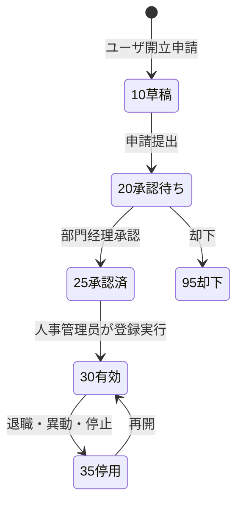
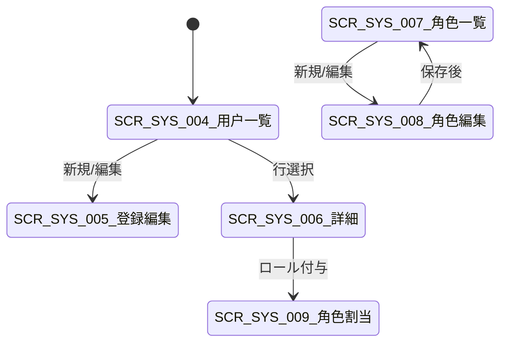

# 用户・角色・权限 详细设计书（ユーザ・ロール・権限 詳細設計書）

| 項目 | 内容 |
|---|---|
| 文書名 | 用户・角色・权限 详细设计书（ユーザ・ロール・権限 詳細設計書） |
| 文書番号 | DSN-SYS-002 |
| 版数 | v1.4 |
| 作成日 | 2026-10-20 |
| 作成者 | system-workflow（域設計担当） |
| 承認者 | 未承認（レビュー待ち） |
| 状態 | ドラフト（レビュー中） |
| 関連文書 | [業務域概要](00-overview.md) / [認証設計](01-auth-login.md) / [DB 設計](90-db-design.md) / [API 設計](91-api-design.md) / [画面共通規格](../00-common/02-common-screen-spec.md) / [共通業務規則](../00-common/08-common-business-rules.md) |

---

## 1. 機能概要

| 項目 | 内容 |
|---|---|
| 機能 ID | F-SYS-002（用户管理）、F-SYS-003（角色与权限） |
| 機能名 | 用户开立/变更/停用、角色付与、密码重置、ロール・権限・データ範囲・項目権限・SoD |
| 目的 | 業務上の職務に必要なアカウントと権限を、統制のとれた手続き（申請→承認→実行→監査）で付与し、最小権限の原則を維持する |
| 利用者・ロール | 系统管理员、人事管理员、部门经理（申請・承認）、总经理（高権限承認）、内审员（参照） |
| 利用シーン | 入社・異動・退職、組織変更、業務分掌変更、監査指摘対応、権限棚卸し |
| 優先度 | P0 |
| 画面 ID | SCR-SYS-004（用户一覧）、SCR-SYS-005（用户登録編集）、SCR-SYS-006（用户詳細）、SCR-SYS-007（角色一覧）、SCR-SYS-008（角色登録編集）、SCR-SYS-009（用户角色割当） |
| 関連 IF | なし（WF の承認結果は非同期 E31/E32 で受信） |

## 2. 業務要件・業務ルール

### 2.1 前提条件

| # | 前提条件 | 成立しない場合の挙動 |
|---|---|---|
| 1 | ユーザ开立は人事管理员または系统管理员が実行し、部門经理の承認済みであること | 未承認の場合は保存不可（`MSG-SYS-010`） |
| 2 | ロール付与には管理者権限（`system:user-role:update`）が必要 | 403 + `MSG-COM-030` |
| 3 | 高権限ロール（系统管理员・总经理・财务总监）付与は总经理承認が必要 | 承認待ち状態で保存、承認後に有効化 |
| 4 | ユーザの所属部門が有効（`status=1`）であること | `MSG-COM-049` |

### 2.2 業務ルール

| # | ルール | 根拠（法令・社内規程・業務慣行） | 関連項目 |
|---|---|---|---|
| BR-01 | ユーザアカウントは工号（`E`+6 桁）と同一。工号は人事システムの採番に従い、変更しない | [共通業務規則](../00-common/08-common-business-rules.md) 2.2 | `user_code`、`username` |
| BR-02 | ユーザ開立時に初期パスワードを発行し、`password_reset_required=true` とする。初期パスワードは画面に一度だけ表示し、通知（メール/口頭）で本人へ伝える。DB・ログには平文を残さない | 社内セキュリティ規程 | `password_hash` |
| BR-03 | 1 ユーザに複数ロール付与可。ただし職務分掌（SoD）に反する組み合わせは警告し、理由入力がなければ保存不可（[共通業務規則](../00-common/08-common-business-rules.md) 9.2） | 内部統制 | `sys_user_role` |
| BR-04 | 自己承認禁止：申請者本人が承認者となるロール付与は不可。管理者が自分の権限を拡大する操作は禁止 | 内部統制 | `granted_by` ≠ `user_id` |
| BR-05 | 退職時はユーザを無効化（`status=0`、`account_status=3`）し、全ロールを解除、進行中タスクを代理者へ転送する | 内部統制・情報漏洩防止 | `sys_user.status` |
| BR-06 | 権限の実効性：ロール変更はキャッシュ無効化後、次回リクエストから即時反映（最大 60 秒）。進行中の承認タスクは旧権限で完了まで処理可 | 業務継続性 | Redis キャッシュ |
| BR-07 | データ範囲は「全社 / 本部门及子部门 / 本部门 / 本人 / 工場 / 倉庫 / 自定义」の **7 区分**。ロール既定をユーザ個別で上書きできる（`sys_user_data_scope`）。**工場（`factoryIds`）・倉庫（`warehouseIds`）次元を必須で持ち**、PRD/INV の「所属工場」「所属倉庫」権限を実現する（`factory_id`/`warehouse_id` は MDM の `mdm_factory`/`mdm_warehouse` を参照） | [共通項目定義](../00-common/01-common-item-definitions.md) 第 4 章 / REV-005 対応 | `scope_type`、`factory_ids`、`warehouse_ids` |
| BR-08 | 項目権限（項目の表示・編集可否）はロール×画面×項目で定義し、API 側でも非表示項目を返さない | [画面共通規格](../00-common/02-common-screen-spec.md) 12 章 | `sys_role_permission`（項目権限は `sys_menu.ext_data` の `fieldPermissions` で保持） |
| BR-09 | 内置ロール（系统管理员等）の権限は変更不可。変更が必要な場合は新しいロールを作成する | システム安定性 | `sys_role.role_type=1` |
| BR-10 | 権限変更・ロール付与・ユーザ停用はすべて監査ログ（before/after）に記録する | [共通項目定義](../00-common/01-common-item-definitions.md) 第 12 章 | `sys_audit_log` |
| BR-11 | ユーザ一覧・詳細の参照はデータ範囲に従う（部門经理は自部門のみ）。ただしシステム管理者は全社 | データ権限 | DataPermissionInterceptor |
| BR-12 | ロール削除は付与ユーザが 0 件の場合のみ可。付与中は「無効化」で対応 | 参照整合性 | `sys_role.status` |
| BR-13 | 定期的な権限棚卸し（四半期）を実施し、未使用ロール・退職者アカウントを検出する（BAT-SYS-010 の検査項目） | 内部統制 | — |

### 2.3 計算式・判定式

| # | 対象 | 算式 | 例 |
|---|---|---|---|
| CALC-01 | 有効ロール数 | `COUNT(sys_user_role WHERE user_id=? AND status=1 AND (valid_to IS NULL OR valid_to >= today))` | 3 |
| CALC-02 | データ範囲の実効値 | ユーザ個別 > ロールのリソース別 > ロール既定（`data_scope_type`）の順で解決。`scope_type=6（工場）` は `factory_ids`、`7（倉庫）` は `warehouse_ids`、`5（自定义）` は `custom_rule.factoryIds/warehouseIds/departmentIds/userIds` を AND 条件で適用 | — |
| CALC-03 | SoD チェック | 付与予定ロール集合が `sys_param: sod.conflict-pairs` のいずれかと一致した場合に警告 | `PURCHASE_CREATE`×`PURCHASE_APPROVE` |

### 2.4 状態遷移



| 遷移 | トリガ | 権限 | 更新項目 | メッセージ |
|---|---|---|---|---|
| 10→20 | 申請提出 | `system:user-request:submit` | `sys_user.status=2`（申請中） | MSG-COM-005 |
| 20→25 | 承認 | `system:user-request:approve` | 承認情報 | — |
| 25→30 | 登録実行 | `system:user:create` | ユーザ作成、`account_status=1` | MSG-COM-001 |
| 30→35 | 停用 | `system:user:disable` | `status=0`、`account_status=3` | MSG-COM-001 |
| 35→30 | 再開 | `system:user:update` | `status=1`、`account_status=1` | MSG-COM-001 |

> ユーザ申請の承認は WF 域（業務類型 `SYS_USER_CHANGE`）で処理する。SYS 側は WF から E31/E32 を受信して状態を更新する（[跨域流程](../00-common/09-cross-domain-flow.md) 第 9 章）。

## 3. 関連機能

| 関係 | 機能 ID | 機能名 | 関係内容 |
|---|---|---|---|
| 上流 | F-WF-003 | 发起审批 | ユーザ開立・権限付与申請の承認フロー |
| 下流 | F-SYS-001 | 认证与登录 | 認証時のユーザ状態・ロック判定 |
| 下流 | F-SYS-004 | 菜单管理 | 権限コードとメニューの紐付け |
| 参照 | F-SYS-005 | 组织部门 | 所属部門・部門ツリー |
| 参照 | F-SYS-006 | 岗位 | 主職位・管理職判定 |
| 参照 | F-SYS-009 | 审计日志 | 権限変更履歴 |
| 参照 | F-SYS-018 | 个人中心 | 本人プロフィール編集 |

## 4. 画面設計

### 4.1 画面一覧

| 画面 ID | 画面名 | 類型 | 概要 |
|---|---|---|---|
| SCR-SYS-004 | 用户一覧 | LIST | ユーザ検索・一括操作（停用/有効化/ロール付与/パスワードリセット/エクスポート） |
| SCR-SYS-005 | 用户登録編集 | EDIT | ユーザ属性・所属・ロール・データ範囲の登録/編集 |
| SCR-SYS-006 | 用户詳細 | VIEW | プロフィール、付与ロール、権限一覧、データ範囲、操作履歴、所属タスク |
| SCR-SYS-007 | 角色一覧 | LIST | ロール検索、付与ユーザ数、有效/无效 |
| SCR-SYS-008 | 角色登録編集 | EDIT | 権限ツリー、データ範囲、項目権限、SoD 警告 |
| SCR-SYS-009 | 用户角色割当 | EDIT | ユーザへのロール付与（有効期間・理由） |

### 4.2 画面遷移



### 4.3 画面レイアウト（SCR-SYS-004 用户一覧）

```
┌───────────────────────────────────────────────────────────────────────────┐
│ ホーム > 系统管理 > 用户管理                                              │
├───────────────────────────────────────────────────────────────────────────┤
│〔検索〕 工号/姓名[________] 部门[▼] 岗位[▼] 状态[▼] 角色[▼] [搜索][クリア]│
├───────────────────────────────────────────────────────────────────────────┤
│〔ツールバー〕[新規][一括停用][一括有効化][ロール付与][パスワードリセット]   │
│              [导出][导入]                                                 │
├───────────────────────────────────────────────────────────────────────────┤
│ ☐ 工号 | 姓名 | 部门 | 岗位 | 角色 | 手机 | 状态 | 最终登录 | 操作          │
│ ☐ E000123 | 张建国 | 信息部 | 系统管理员 | 系统管理员 | 138****5678 | 在职 | 2026-10-20 | [詳細][編集] │
├───────────────────────────────────────────────────────────────────────────┤
│ 全 900 件  1/45 ページ  [<][1][2]…[>]   20 件/ページ                     │
└───────────────────────────────────────────────────────────────────────────┘
```

### 4.4 画面項目定義（SCR-SYS-005 用户登録編集）

| No | 項目 ID | 項目名 | 種別 | 型/桁 | 必須 | 初期値 | 入力チェック | データソース | DB 項目 | 権限 | 備考 |
|---|---|---|---|---|---|---|---|---|---|---|---|
| 1 | `userCode` | 工号 | テキスト | VARCHAR(16) | ○ | 自動採番 | `^E\d{6}$`、一意 | 人事採番 | `sys_user.user_code` | 編集可（新規） | 登録後変更不可 |
| 2 | `username` | 登录账号 | テキスト | VARCHAR(64) | ○ | 工号と同一 | 一意、半角英数 | 入力 | `sys_user.username` | 登録後変更不可 | — |
| 3 | `realName` | 姓名 | テキスト | VARCHAR(50) | ○ | 空 | ≤50 字 | 入力 | `sys_user.real_name` | 編集可 | — |
| 4 | `employeeType` | 用工类型 | 選択 | SMALLINT | ○ | 1 正式 | 1〜4 | 固定値 | `sys_user.employee_type` | 編集可 | — |
| 5 | `departmentId` | 所属部门 | ツリー選択 | BIGINT | ○ | ログインユーザの部門 | 有効部門存在 | `sys_department` | `sys_user.department_id` | 編集可 | 部門変更はデータ範囲に影響 |
| 6 | `positionId` | 岗位 | 選択 | BIGINT | △ | 空 | 有効岗位存在 | `sys_position` | `sys_user.position_id` | 編集可 | — |
| 7 | `factoryId` | 所属工厂 | 選択 | BIGINT | △ | 空 | 有効工厂（MDM） | `mdm_factory` | `sys_user.factory_id` | 編集可 | — |
| 8 | `managerUserId` | 直属上级 | ユーザ選択 | BIGINT | △ | 空 | 循環参照なし | `sys_user` | `sys_user.manager_user_id` | 編集可 | 承認エスカレーション先 |
| 9 | `mobile` | 手机号 | テキスト | VARCHAR(20) | △ | 空 | `^1[3-9]\d{9}$` | 入力 | `sys_user.mobile` | 編集可 | — |
| 10 | `email` | 邮箱 | テキスト | VARCHAR(100) | △ | 空 | メール形式 | 入力 | `sys_user.email` | 編集可 | — |
| 11 | `hireDate` | 入职日期 | 日付 | DATE | △ | 当日 | — | 入力 | `sys_user.hire_date` | 編集可 | — |
| 12 | `leaveDate` | 离职日期 | 日付 | DATE | △ | 空 | ≥入职日期 | 入力 | `sys_user.leave_date` | 編集可 | 停用時に必須 |
| 13 | `roleIds` | 角色 | 複数選択 | BIGINT[] | ○ | 空 | 1 件以上、有効ロール | `sys_role` | `sys_user_role` | `system:user-role:update` | SoD 警告 |
| 14 | `status` | 在职状态 | 選択 | SMALLINT | ○ | 1 在职 | 0/1/2 | 固定値 | `sys_user.status` | 編集可 | — |
| 15 | `accountStatus` | 账号状态 | 表示 | SMALLINT | — | 1 正常 | — | 計算 | `sys_user.account_status` | 管理者のみ編集可 | ロック/停用 |
| 16 | `dataScopeOverride` | 数据范围上書き | 展開 | JSON | — | 空 | scope_type 1〜7、`factoryIds`/`warehouseIds` は有効マスタ存在 | `sys_user_data_scope` | 同上 | 編集可（承認要） | 例外付与・工場/倉庫次元を含む |

### 4.5 画面項目定義（SCR-SYS-008 角色登録編集）

| No | 項目 ID | 項目名 | 種別 | 型/桁 | 必須 | 初期値 | 入力チェック | データソース | DB 項目 | 権限 | 備考 |
|---|---|---|---|---|---|---|---|---|---|---|---|
| 1 | `roleCode` | 角色代码 | テキスト | VARCHAR(64) | ○ | 空 | `^[A-Z][A-Z0-9_]{2,63}$`、一意 | 入力 | `sys_role.role_code` | 編集可 | 登録後変更不可 |
| 2 | `roleName` | 角色名称 | テキスト | VARCHAR(100) | ○ | 空 | ≤100 字 | 入力 | `sys_role.role_name` | 編集可 | — |
| 3 | `roleType` | 类型 | 選択 | SMALLINT | ○ | 2 业务 | 1〜3 | 固定値 | `sys_role.role_type` | 編集可 | 内置は変更不可 |
| 4 | `dataScopeType` | 数据范围（既定） | 選択 | SMALLINT | ○ | 4 本人 | 1〜7（6=工場 / 7=倉庫） | 固定値 | `sys_role.data_scope_type` | 編集可 | リソース別上書き可 |
| 5 | `permissionTree` | 权限树 | ツリーチェック | BIGINT[] | — | 空 | 親子連動、少なくとも 1 件 | `sys_menu` | `sys_role_permission` | 編集可 | モジュール別タブ |
| 6 | `resourceScope` | リソース別数据范围 | 展開 | JSON | — | 空 | scopeType 1〜7、factoryIds/warehouseIds は有効マスタ | 入力 | `sys_role_data_scope` | 編集可 | 例 `sales:order`=部門、`inventory:stock`=倉庫 |
| 6b | `scopeFactoryIds` / `scopeWarehouseIds` | 工場・倉庫範囲 | 複数選択 | BIGINT[] | 条件付△ | 空 | scope_type=6/7 の場合は必須 | `mdm_factory` / `mdm_warehouse` | `sys_role_data_scope.factory_ids` / `warehouse_ids` | 編集可 | 別拠点の越権防止 |
| 7 | `fieldPermissions` | 项目权限 | 展開 | JSON | — | 空 | 画面ID+項目ID+権限 | `sys_menu.ext_data` | 同上 | 編集可 | `{"SCR-SAL-003":{"amount":"HIDDEN"}}` |
| 8 | `requiresApproval` | 付与時承認 | スイッチ | BOOLEAN | ○ | true | — | 入力 | `sys_role.requires_approval` | 編集可 | 高権限ロール |
| 9 | `description` | 说明 | テキストエリア | VARCHAR(500) | — | 空 | ≤500 字 | 入力 | `sys_role.description` | 編集可 | — |
| 10 | `sodWarning` | SoD 警告表示 | 表示 | — | — | — | — | 計算 | — | 編集可 | 競合組み合わせ表示 |
| 11 | `userCount` | 付与用户数 | 表示 | INT | — | 計算 | — | 集計 | `sys_user_role` | 参照 | 削除可否の判断 |

### 4.6 一覧画面仕様（SCR-SYS-004 / SCR-SYS-007）

| 項目 | 内容 |
|---|---|
| 検索条件 | 工号/姓名（部分一致）、部门（ツリー、子部門含む）、岗位、角色、在职状态、账号状态、入职日範囲 |
| 既定検索条件 | 在职のみ（`status=1`） |
| ソート | 既定：工号昇順。ソート可：入職日、最終ログイン |
| ページング | 20/50/100/200、既定 20 |
| 一括操作 | 停用、有効化、ロール付与、パスワードリセット、エクスポート（選択 or 条件全件、最大 10,000 件） |
| エクスポート | Excel（PRT-SYS-001）、非同期（1,000 件超） |
| 権限 | 参照 `system:user:view`、更新系は各権限コード |

### 4.7 イベント処理

| No | イベント | トリガ | 処理内容 | 呼出 API | 画面遷移 | 備考 |
|---|---|---|---|---|---|---|
| 1 | 検索 | 検索ボタン | 条件検証→一覧取得 | GET /api/system/users | 同一画面 | Enter 対応 |
| 2 | 新規 | 新規ボタン | 空フォーム表示、工号自動採番プレビュー | GET /api/system/users/next-code | SCR-SYS-005 | — |
| 3 | 保存 | 保存ボタン | 入力チェック→登録/更新→ロール同期 | POST/PUT /api/system/users | SCR-SYS-004 | 二重送信防止 |
| 4 | 停用 | 一括/行操作 | 確認→停用 API→関連タスク転送確認 | POST /api/system/users/batch-disable | 同一画面 | 進行中タスクがあれば代理選択 |
| 5 | パスワードリセット | 行操作 | 確認→初期パスワード発行→表示 | POST /api/system/users/{id}/reset-password | ダイアログ | 一度だけ表示 |
| 6 | ロール付与 | 一括/行操作 | ロール選択（有効期間・理由）→保存 | POST /api/system/users/{id}/roles | ダイアログ | SoD 警告 |
| 7 | ロール保存 | 保存ボタン | 権限ツリー検証→保存→キャッシュ無効化 | POST/PUT /api/system/roles | SCR-SYS-007 | 内置ロールは制限 |
| 8 | 権限ツリー展開 | ツリーノード | 子ノード取得（全件を一括ロード） | GET /api/system/menus/tree | — | — |
| 9 | データ範囲変更 | 選択変更 | リソース別上書き行の表示/非表示 | — | — | — |
| 10 | エクスポート | ツールバー | 非同期ジョブ起動 | POST /api/system/users/export | ジョブ画面 | 権限必要 |

### 4.8 表示制御

| 条件 | 対象項目/ボタン | 制御 |
|---|---|---|
| ロール `role_type=1`（内置） | 削除・権限ツリー編集・コード変更 | 非表示/無効 |
| ロール付与ユーザ数 > 0 | 削除ボタン | 非表示（無効化のみ可） |
| 権限なし（`system:user:create` なし） | 新規/編集/停用ボタン | 非表示 |
| データ範囲外のユーザ | 一覧行 | 表示しない（API でも返さない） |
| 本人のアカウント | 停用・削除ボタン | 非表示（自己ロック防止） |
| 高権限ロール選択時 | 保存ボタン | 「承認申請」に変更（直接保存不可） |
| `accountStatus=2`（ロック中） | 状態列 | 「锁定」バッジ + 解除ボタン（権限者） |

## 5. 入力チェック仕様

| No | チェック ID | 対象項目 | 種別 | 条件 | タイミング | メッセージ ID |
|---|---|---|---|---|---|---|
| 1 | CHK-SYS-002-01 | `userCode` | 必須 | 空でない | 保存 | MSG-COM-040 |
| 2 | CHK-SYS-002-02 | `userCode` | 形式・一意 | `^E\d{6}$`、既存なし | 保存 | MSG-SYS-001 / MSG-COM-050 |
| 3 | CHK-SYS-002-03 | `username` | 一意 | 既存なし | 保存 | MSG-COM-050 |
| 4 | CHK-SYS-002-04 | `realName` | 必須・桁数 | 1〜50 字 | 保存 | MSG-COM-040/041 |
| 5 | CHK-SYS-002-05 | `departmentId` | コード存在 | 有効部門 | 保存 | MSG-COM-049 |
| 6 | CHK-SYS-002-06 | `mobile` | 形式 | 中国携帯番号 | 保存 | MSG-COM-042 |
| 7 | CHK-SYS-002-07 | `email` | 形式 | メール | 保存 | MSG-COM-042 |
| 8 | CHK-SYS-002-08 | `roleIds` | 必須 | 1 件以上 | 保存 | MSG-SYS-010 |
| 9 | CHK-SYS-002-09 | `roleIds` | SoD | 競合ペアなし（または理由必須） | 保存 | MSG-SYS-012（W） |
| 10 | CHK-SYS-002-10 | `leaveDate` | 相関 | `hireDate` 以降 | 保存 | MSG-COM-045 |
| 11 | CHK-SYS-002-11 | `managerUserId` | 循環 | 自分の部下でない | 保存 | MSG-SYS-013 |
| 12 | CHK-SYS-002-12 | ロック解除 | 状態 | `account_status=2` | 実行 | MSG-COM-034 |
| 13 | CHK-SYS-002-13 | パスワードリセット対象 | 自己以外 | 自分自身は不可 | 実行 | MSG-SYS-014 |
| 14 | CHK-SYS-003-01 | `roleCode` | 形式・一意 | `^[A-Z][A-Z0-9_]{2,63}$`、既存なし | 保存 | MSG-COM-050 |
| 15 | CHK-SYS-003-02 | `permissionTree` | 必須 | 1 件以上（`menu_type IN (1,2,3)`） | 保存 | MSG-SYS-015 |
| 16 | CHK-SYS-003-03 | `permissionTree` | 依存 | ボタン権限のみで親メニューなしを許容（システムは親を自動補完） | 保存 | — |
| 17 | CHK-SYS-003-04 | `dataScopeType` / `scopeType` | 値域 | 1〜7 | 保存 | MSG-COM-044 |
| 17b | CHK-SYS-003-06 | `factoryIds` / `warehouseIds` | 存在 | 有効な `mdm_factory` / `mdm_warehouse` が存在（scope_type=6/7 時は必須） | 保存 | MSG-COM-049 |
| 18 | CHK-SYS-003-05 | 内置ロール | 制約 | 権限変更不可 | 保存 | MSG-SYS-016 |

## 6. 処理詳細

### 6.1 処理一覧

| 処理 ID | 処理名 | 契機 | トランザクション | 排他 |
|---|---|---|---|---|
| PRC-SYS-002-01 | ユーザ登録 | 新規保存 | 要（ユーザ＋ロール＋監査） | ユーザ名一意制約 + 楽観排他 |
| PRC-SYS-002-02 | ユーザ更新 | 編集保存 | 要 | 楽観排他（`version`） |
| PRC-SYS-002-03 | ユーザ停用・退職 | 一括/行操作 | 要 | `FOR UPDATE`（ユーザ行） |
| PRC-SYS-002-04 | パスワードリセット | 管理者操作 | 要 | `FOR UPDATE` |
| PRC-SYS-002-05 | ロール付与 | ダイアログ保存 | 要 | `FOR UPDATE`（ユーザ行） |
| PRC-SYS-002-06 | ユーザ一括インポート | インポート実行 | 行単位 | 行ごと（部分成功） |
| PRC-SYS-003-01 | ロール登録・更新 | 保存 | 要（ロール＋権限＋データ範囲） | 楽観排他、内置ロール制約 |
| PRC-SYS-003-02 | ロール削除・無効化 | 削除 | 要 | 付与件数チェック |
| PRC-SYS-003-03 | 権限キャッシュ無効化 | ロール保存後 | 不要 | Redis pub/sub |

### 6.2 処理手順（正常系）

**PRC-SYS-002-01 ユーザ登録**

1. 権限チェック（`system:user:create`）、データ範囲チェック（自部門のユーザのみ登録可など）。
2. 入力チェック（CHK-SYS-002-01〜11）を実行する。
3. 承認要否を判定する。全ロールが `requires_approval=false` かつ申請者が人事管理员なら即時登録、それ以外は WF へ申請（業務類型 `SYS_USER_CHANGE`、`businessId` は申請 ID）し、`status=2`（申請中）で保存する。
4. 即時登録の場合、`sys_user` を INSERT する（`id` は雪花 ID、`username=user_code`、`password_hash` は初期パスワードの BCrypt、`password_reset_required=true`、`password_updated_at=now()`、`password_expire_at=now()+90 日`）。
5. `sys_user_role` を一括 INSERT する（`grant_type=1`、`granted_by=操作者`、`granted_at=now()`）。
6. `sys_user_data_scope` の上書きがある場合は INSERT する。
7. `sys_audit_log` に `CREATE`（resource=user、after_data=ユーザ情報。パスワード・携帯はマスキング）を記録する。
8. 初期パスワードをレスポンスで一度だけ返す（`initialPassword`）。通知設定があれば `sys_notification` で本人へ通知する。
9. 権限キャッシュを無効化する（新規ユーザのため影響なし）。

**PRC-SYS-002-03 ユーザ停用・退職**

1. 対象ユーザを `SELECT ... FOR UPDATE` でロックし、`status` を検証する（既に停用なら `MSG-COM-034`）。
2. 対象ユーザの進行中承認タスク（WF の `wf_task`）を検索する。存在する場合、代理承認者を選択するよう促す（必須）。選択後 WF の API（`POST /api/workflow/tasks/transfer-batch`）で転送する。
3. `sys_user.status=0`、`account_status=3`、`leave_date`（未設定なら当日）を更新する。
4. `sys_user_role` の有効ロールを `status=0` に更新する（履歴保持）。
5. 当該ユーザの全セッションを失効させる（Sa-Token kickout）。
6. `sys_audit_log` に `UPDATE`（before/after）を記録する。

**PRC-SYS-002-04 パスワードリセット**

1. 権限チェック（`system:user:reset-password`）。自分自身は対象外（`MSG-SYS-014`）。
2. 対象ユーザをロックし、初期パスワードを生成する（12 桁、BR-01 の強度を満たすランダム）。
3. `password_hash` を更新し、`password_reset_required=true`、`password_expire_at=now()+90 日`、`account_status=1`（ロック解除も同時）、`login_fail_count=0` に更新する。
4. 履歴に `change_type=3`（管理者リセット）を INSERT する。
5. 当該ユーザの全セッションを失効させる。
6. 初期パスワードをレスポンスで一度だけ返す。監査ログに `UPDATE`（resource=user_password）を記録する（平文は記録しない）。

**PRC-SYS-003-01 ロール登録・更新**

1. 権限チェック（`system:role:create/update`）。`role_type=1`（内置）の場合、`role_name`・`description` のみ更新可。
2. 入力チェック（CHK-SYS-003-01〜05）を実行する。
3. SoD チェック：保存後のロール集合に対して、`sys_param: sod.conflict-pairs` の競合ペアを評価する。競合時は警告を返し、理由（`remark`）がなければ保存を中断する（`MSG-SYS-012` は W だが理由必須）。
4. ロールを INSERT/UPDATE する（楽観排他）。
5. 権限を「全削除→再登録」する（`sys_role_permission`）。親メニューが未選択の場合は自動補完して INSERT する。
6. `sys_role_data_scope` を「全削除→再登録」する。
7. 項目権限（`fieldPermissions`）を `sys_menu.ext_data` へ保存する（対象メニュー単位）。
8. 権限キャッシュ（Redis `sys:perm:role:{roleId}`、`sys:user:perm:{userId}`）を無効化し、pub/sub で他ノードへ通知する。
9. `sys_audit_log` に `UPDATE`（resource=role、before/after に権限差分）を記録する。

**PRC-SYS-003-02 ロール削除・無効化**

1. `sys_user_role` の有効付与件数を取得する。0 件なら削除（論理削除）、1 件以上なら `MSG-SYS-017` で拒否し、無効化を案内する。
2. 進行中の承認ルートで当該ロールが承認者に指定されている場合も削除不可（`MSG-SYS-018`）。
3. 無効化の場合 `status=0` とし、付与ユーザの認可から除外する（次回リクエストから）。
4. 監査ログを記録する。

### 6.3 例外処理

| No | 異常条件 | 検知箇所 | 処理 | ロールバック | メッセージ ID |
|---|---|---|---|---|---|
| 1 | ユーザ名・工号重複 | DB 一意制約 | 事前チェックで検出、422 返却（code=10001。409 は楽観排他競合のみ） | 全体 | MSG-SYS-095（code=10001） |
| 2 | 有効部門が存在しない | 部門チェック | 保存不可 | 全体 | MSG-COM-049 |
| 3 | ロール 0 件 | 入力チェック | 保存不可 | 全体 | MSG-SYS-010 |
| 4 | SoD 競合 | 保存前 | 警告。理由なしは中断 | 全体 | MSG-SYS-012 |
| 5 | 自己ロック（自分を停用） | 業務チェック | 拒否 | — | MSG-SYS-014 |
| 6 | 内置アカウント操作 | 業務チェック | 拒否 | — | MSG-SYS-002 |
| 7 | 進行中タスクありの停用 | 停用前 | 代理選択を要求 | 全体 | MSG-SYS-019 |
| 8 | 楽観排他競合 | UPDATE 0 件 | 409 返却 | 全体 | MSG-COM-033 |
| 9 | 承認却下（WF） | E32 受信 | 申請を却下状態に更新、通知 | — | MSG-SYS-020 |
| 10 | キャッシュ無効化失敗 | 保存後 | 保存成功。ログ WARN、TTL 60 秒で自然失効 | なし | — |

### 6.4 冪等性・排他

- 登録・更新・状態操作は `Idempotency-Key` 必須（[API 共通規格](../00-common/03-common-api-spec.md) 第 9 章）。同一キーの再送は初回結果を返す。
- ユーザ更新・ロール更新は `version` 楽観排他。一括操作は全件成功 or 全件失敗（デフォルト）。
- ユーザ停用・パスワードリセット・ロール付与は `SELECT ... FOR UPDATE` でユーザ行をロックし、同時操作を直列化する。
- 権限キャッシュ無効化は「保存コミット後」に実行する（コミット前の無効化は旧値の再キャッシュを招く）。

## 7. API 設計

| No | メソッド | パス | 権限 | 概要 |
|---|---|---|---|---|
| 1 | GET | /api/system/users | `system:user:view` | ユーザ一覧（ページング） |
| 2 | GET | /api/system/users/{id} | `system:user:view` | ユーザ詳細 |
| 3 | POST | /api/system/users | `system:user:create` | ユーザ登録 |
| 4 | PUT | /api/system/users/{id} | `system:user:update` | ユーザ更新 |
| 5 | DELETE | /api/system/users/{id} | `system:user:delete` | ユーザ削除（論理削除。原則停用） |
| 6 | POST | /api/system/users/{id}/disable | `system:user:disable` | 停用 |
| 7 | POST | /api/system/users/{id}/enable | `system:user:reopen` | 再開 |
| 8 | POST | /api/system/users/{id}/reset-password | `system:user:reset-password` | パスワードリセット |
| 9 | POST | /api/system/users/{id}/unlock | `system:user:unlock` | ロック解除 |
| 10 | GET | /api/system/users/{id}/roles | `system:user:view` | 付与ロール取得 |
| 11 | POST | /api/system/users/{id}/roles | `system:user-role:update` | ロール付与 |
| 12 | POST | /api/system/users/batch-disable | `system:user:disable` | 一括停用 |
| 13 | POST | /api/system/users/export | `system:user:export` | エクスポート（非同期） |
| 14 | GET | /api/system/roles | `system:role:view` | ロール一覧 |
| 15 | GET | /api/system/roles/{id} | `system:role:view` | ロール詳細（権限ツリー含む） |
| 16 | POST | /api/system/roles | `system:role:create` | ロール登録 |
| 17 | PUT | /api/system/roles/{id} | `system:role:update` | ロール更新 |
| 18 | DELETE | /api/system/roles/{id} | `system:role:delete` | ロール削除 |
| 19 | GET | /api/system/roles/{id}/users | `system:role:view` | 付与ユーザ一覧 |
| 20 | POST | /api/system/roles/{id}/export | `system:role:export` | 権限マトリクス出力 |

### 7.1 リクエスト/レスポンス詳細

**POST /api/system/users**

```json
// リクエスト
{
  "userCode": "E000124", "username": "E000124", "realName": "李明",
  "employeeType": 1, "departmentId": "1845000000000000020", "positionId": "1845000000000000031",
  "factoryId": "1845000000000000002", "managerUserId": "1845000000000000123",
  "mobile": "13812345678", "email": "liming@example.com", "hireDate": "2026-10-20",
  "roleIds": ["1845000000000000101"], "status": 1,
  "dataScopeOverride": [{ "resourceCode": "sales:order", "scopeType": 2, "reason": "华东区域担当" },
                        { "resourceCode": "inventory:stock", "scopeType": 7, "warehouseIds": ["1845000000000000101"], "reason": "担当倉庫のみ" }]
}
// レスポンス（即時登録）
{ "code": 0, "message": "保存しました。", "data": { "id": "1845000000000000999", "userCode": "E000124", "initialPassword": "Xk7#mQ2!pL9z" } }
// レスポンス（承認要）
{ "code": 0, "message": "审批流程已提交。", "data": { "processInstanceId": "..." } }
// エラー（SoD 競合・理由なし）
{ "code": 10010, "message": "所选角色存在职责分离冲突（采购员与采购审批）。如确需兼任，请填写理由。", "data": { "conflicts": ["PURCHASE_CREATE×PURCHASE_APPROVE"] } }
```

**PUT /api/system/roles/{id}**

```json
{
  "version": 3, "roleName": "销售经理", "dataScopeType": 3,
  "permissionTree": ["1845000000000000401", "1845000000000000402"],
  "resourceScope": [{ "moduleCode": "sales", "resourceCode": "order", "scopeType": 3 },
                    { "moduleCode": "inventory", "resourceCode": "stock", "scopeType": 7, "warehouseIds": ["1845000000000000101"] }],
  "fieldPermissions": { "SCR-SAL-003": { "totalAmount": "READONLY", "costAmount": "HIDDEN" } },
  "requiresApproval": true, "description": "受注承認・価格承認（閾値内）", "version": 3
}
```

## 8. データ更新仕様

| テーブル | 操作 | 更新項目 | 更新条件 | トリガ（処理 ID） |
|---|---|---|---|---|
| sys_user | INSERT | 全項目 | 新規 | PRC-SYS-002-01 |
| sys_user | UPDATE | 属性・`status`・`account_status`・`version` | 編集/停用/再開/ロック解除 | PRC-SYS-002-02/03 |
| sys_user | UPDATE | `password_hash` 等 | リセット | PRC-SYS-002-04 |
| sys_user_role | INSERT/DELETE(status=0) | `role_id`・`valid_from/to`・`reason` | ロール付与 | PRC-SYS-002-05 |
| sys_user_data_scope | INSERT/UPDATE | `scope_type`・`custom_rule`・`factory_ids`・`warehouse_ids`・`reason` | 例外付与 | PRC-SYS-002-01/02 |
| sys_role | INSERT/UPDATE | 全項目 | ロール保存 | PRC-SYS-003-01 |
| sys_role_permission | DELETE→INSERT | `menu_id`・`permission_code` | ロール保存 | PRC-SYS-003-01 |
| sys_role_data_scope | DELETE→INSERT | `resource_code`・`scope_type`・`factory_ids`・`warehouse_ids` | ロール保存 | PRC-SYS-003-01 |
| sys_user_password_history | INSERT | `user_id`・`password_hash`・`change_type` | リセット | PRC-SYS-002-04 |
| sys_audit_log | INSERT | 全項目 | 各操作 | 全処理 |

## 9. エラー処理・メッセージ

| メッセージ ID | 種別 | 本文 | 発生条件 | 利用者への対処 | ログ |
|---|---|---|---|---|---|
| MSG-SYS-010 | E | 请至少为用户指定一个角色。 | ロール 0 件 | ロール選択 | INFO |
| MSG-SYS-011 | E | 不能将自己的权限授予自己，请由其他管理员操作。 | 自己付与 | 他管理者へ依頼 | WARN |
| MSG-SYS-012 | W | 所选角色存在职责分离冲突（{0}）。如确需兼任，请填写理由。 | SoD 競合 | 理由入力 or ロール見直し | WARN |
| MSG-SYS-013 | E | 直属上级设置存在循环引用。 | 循環参照 | 修正 | INFO |
| MSG-SYS-014 | E | 不能对当前账号执行此操作。 | 自己停用/リセット | 他管理者へ依頼 | WARN |
| MSG-SYS-015 | E | 请至少选择一项权限。 | 権限 0 件 | 権限選択 | INFO |
| MSG-SYS-016 | E | 内置角色（{0}）的权限不可修改。 | 内置ロール | 新規ロール作成 | WARN |
| MSG-SYS-017 | E | 该角色已分配给 {0} 名用户，不能删除。可改为无效化。 | 付与中削除 | 無効化 | INFO |
| MSG-SYS-018 | E | 该角色正在审批流程中使用，不能删除或无效化。 | 承認ルート使用中 | 経路変更後に再実行 | WARN |
| MSG-SYS-019 | E | 该用户存在进行中的审批任务，请先指定代理人后再停用。 | 進行中タスク | 代理指定 | WARN |
| MSG-SYS-020 | I | 权限申请已{0}。 | 承認結果（承認/却下） | — | INFO |
| MSG-SYS-094 | E | 岗位数据不存在或已失效，请重新选择。 | 岗位無効 | 再選択 | INFO |
| MSG-SYS-022 | E | 该用户为内置管理员，不能停用或删除。 | builtin | — | WARN |

## 10. 権限・セキュリティ

| 種別 | 内容 |
|---|---|
| 画面権限 | 一覧 `system:user:view` / `system:role:view`、編集は各 create/update/delete |
| 操作権限 | 停用 `system:user:disable`、リセット `system:user:reset-password`、ロール付与 `system:user-role:update`、高権限承認 `system:role-grant:approve` |
| 項目権限 | 携帯・メールは一覧でマスキング（`138****5678`）。他部門ユーザの詳細はデータ範囲外なら 403 |
| データ範囲 | 部門经理は自部門のみ。システム管理者は全社。ロール一覧は全社参照可（権限コード保有時） |
| 監査ログ | ユーザ登録/更新/停用/リセット/ロール付与/権限変更を before/after 付きで記録。パスワード平文・ハッシュは記録しない |
| 特権管理 | 系统管理员ロールの付与は 2 名承認（申請者 ≠ 承認者）。内置管理者アカウントは削除・停用不可 |
| セッション | 権限変更・停用・パスワードリセット時は対象ユーザのセッションを失効させる |
| マスキング | 一覧・エクスポートの携帯・メール・生年月日はマスキング（[共通項目定義](../00-common/01-common-item-definitions.md) 15 章） |

## 11. 性能・非機能

| 項目 | 目標値 | 前提 |
|---|---|---|
| ユーザ一覧 | 2 秒以内（1,200 件） | 索引 `idx_sys_user_dept_status`、ページング |
| 権限解決 | 1 リクエストあたり 5 ms 以内 | Redis キャッシュ（ユーザ別権限セット） |
| ロール保存 | 3 秒以内 | 権限 3,000 行の再登録を含む |
| 一括停止 | 1,000 件/回、30 秒以内 | 非同期ジョブ（1,000 件超） |
| 権限マトリクス出力 | 1 分以内 | 非同期（PRT-SYS-002） |

## 12. テスト観点

| No | 観点 ID | 分類 | 観点 | 期待結果 |
|---|---|---|---|---|
| 1 | TST-F-SYS-002-01 | 正常系 | ユーザ新規登録（即時） | 登録され初期パスワードが一度返る |
| 2 | TST-F-SYS-002-02 | 異常系 | 工号重複 | MSG-COM-050、登録されない |
| 3 | TST-F-SYS-002-03 | 異常系 | ロール未選択 | MSG-SYS-010 |
| 4 | TST-F-SYS-002-04 | 業務 | SoD 競合ロール付与（理由なし） | 保存中断、MSG-SYS-012 |
| 5 | TST-F-SYS-002-05 | 業務 | 停用時に進行中タスクあり | 代理指定を要求（MSG-SYS-019） |
| 6 | TST-F-SYS-002-06 | 権限 | 自分自身を停用 | MSG-SYS-014 |
| 7 | TST-F-SYS-002-07 | 正常系 | パスワードリセット | `password_reset_required=true`、次回ログインで強制改密 |
| 8 | TST-F-SYS-002-08 | 排他 | 同時編集（version 競合） | 409、MSG-COM-033 |
| 9 | TST-F-SYS-002-09 | 権限 | 部門经理が他部門ユーザを参照 | 一覧に表示されない・API 403 |
| 10 | TST-F-SYS-002-10 | 監査 | ユーザ更新 | before/after が記録され、携帯はマスキング |
| 11 | TST-F-SYS-003-01 | 正常系 | ロール新規＋権限ツリー保存 | 保存され、キャッシュ無効化後即時反映 |
| 12 | TST-F-SYS-003-02 | 異常系 | 権限 0 件 | MSG-SYS-015 |
| 13 | TST-F-SYS-003-03 | 制約 | 内置ロールの権限変更 | MSG-SYS-016 |
| 14 | TST-F-SYS-003-04 | 制約 | 付与ユーザありロール削除 | MSG-SYS-017 |
| 15 | TST-F-SYS-003-05 | 正常系 | データ範囲「本部门及子部门」設定 | 子部門データが参照可能 |
| 16 | TST-F-SYS-003-06 | 正常系 | 項目権限 HIDDEN 設定 | API レスポンスから項目が消える |
| 17 | TST-F-SYS-003-07 | 権限 | ロール変更後の次回リクエスト | 新権限が適用（最大 60 秒以内） |

## 13. 未決事項

| # | 事項 | 理由 | 暫定仕様 | 担当 | 期限 |
|---|---|---|---|---|---|
| 1 | ユーザ・権限申請の WF 承認フロー詳細 | WF 域の設計と整合が必要 | 業務類型 `SYS_USER_CHANGE` で 部門经理→人事→系统管理员の順送 | Lead / system-workflow | 2026-10-27 |
| 2 | 項目権限の保持場所 | `sys_menu.ext_data` に置く暫定。専用テーブル `sys_field_permission` の要否 | 当面 `ext_data`。項目数増加時に専用テーブルへ昇格 | system-workflow | 2026-11-17 |
| 3 | 権限キャッシュの pub/sub 実装 | Redis pub/sub か TTL のみか | Redis pub/sub + 60 秒 TTL の二重防御 | 运维担当 | 2026-11-10 |
| 4 | 権限棚卸しの自動化範囲 | 四半期棚卸しの運用未確定 | BAT-SYS-010 でレポート出力まで。是正は手動 | 内审员 | 2026-12-01 |
| 5 | SoD 競合ペアの初期定義 | 客户の職務分掌規程が未確定 | 08 共通業務規則 9.2 の 8 ペアを `sys_param` に初期投入 | Lead | 2026-11-10 |

## 14. 改訂履歴

| 版数 | 日付 | 変更内容 | 変更者 |
|---|---|---|---|
| v1.0 | 2026-10-20 | 初版：F-SYS-002/003 の業務ルール 13、画面 6、画面項目定義、処理 9 件、API 20 件、メッセージ 13 件、テスト観点 17 件 | system-workflow |
| v1.1 | 2026-10-20 | Lead 裁决反映：ユーザの `factoryId` データソースを MDM の `mdm_factory` に修正（工厂主データは MDM 所有） | system-workflow |
| v1.2 | 2026-10-20 | 红队 REV-005 対応：データ範囲に**工場/倉庫次元（scope_type 6/7、`factory_ids`/`warehouse_ids`）**を追加。画面項目・入力チェック・API 例・更新仕様を追随。REV-018 対応で区分を 7 区分に統一。ユーザ再開の権限を `system:user:reopen` に変更（REV-027 相当） | system-workflow |
| v1.3 | 2026-10-21 | §9 岗位無効メッセージを MSG-SYS-021 から MSG-SYS-094 に変更（MSG-SYS-021 は 04/93 でメニュー階層違反に使用済みのため重複解消。蓝色大肥鱼 2026-10-21 決定） | 业务分析 |
| v1.4 | 2026-10-21 | §6.3 #1 ユーザ重複を 409 → 422、`code=10001`／MSG-SYS-095 に変更（409 は楽観排他競合のみ）（蓝色大肥鱼 2026-10-21 決定） | 业务分析 |