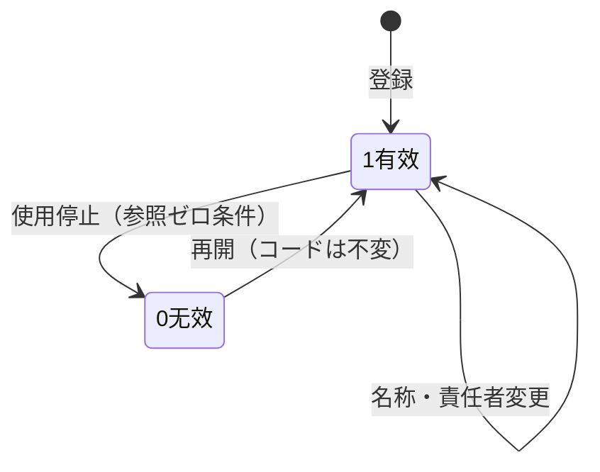

# 组织・岗位・多组织 详细设计书（組織・職位・マルチ組織 詳細設計書）

| 項目 | 内容 |
|---|---|
| 文書名 | 组织・岗位・多组织 详细设计书（組織・職位・マルチ組織 詳細設計書） |
| 文書番号 | DSN-SYS-003 |
| 版数 | v1.4 |
| 作成日 | 2026-10-20 |
| 作成者 | system-workflow（域設計担当） |
| 承認者 | 未承認（レビュー待ち） |
| 状態 | ドラフト（レビュー中） |
| 関連文書 | [業務域概要](00-overview.md) / [DB 設計](90-db-design.md) / [API 設計](91-api-design.md) / [共通項目定義](../00-common/01-common-item-definitions.md) / [共通業務規則](../00-common/08-common-business-rules.md) / [跨域流程](../00-common/09-cross-domain-flow.md) |

---

## 1. 機能概要

| 項目 | 内容 |
|---|---|
| 機能 ID | F-SYS-005（组织部门）、F-SYS-006（岗位）、F-SYS-014（公司/工厂多组织）、F-SYS-017（租户与数据隔离） |
| 機能名 | 部門ツリー、岗位、公司組織設定・工厂組織設定（工厂主データは MDM）、租户予約 |
| 目的 | 承認経路・データ権限・採番・会計主体の基礎となる組織構造を一元管理し、組織改編に追従できるようにする |
| 利用者・ロール | 系统管理员、人事管理员、财务总监（公司情報参照）、总经理（公司情報承認） |
| 利用シーン | 入社・異動・組織改編、新工場/拠点の追加、職位制度改定、多組織展開準備 |
| 優先度 | F-SYS-005 P0、F-SYS-006 P1、F-SYS-014 P1、F-SYS-017 P2 |
| 画面 ID | SCR-SYS-010（组织部门）、SCR-SYS-011（岗位）、SCR-SYS-012（公司/工厂设置）、SCR-SYS-013（租户设置） |
| 関連 IF | なし（他域は同期参照） |

## 2. 業務要件・業務ルール

### 2.1 前提条件

| # | 前提条件 | 成立しない場合の挙動 |
|---|---|---|
| 1 | 部門コードは `D`+3 桁で一意（[共通業務規則](../00-common/08-common-business-rules.md) 2.2） | 保存不可（MSG-SYS-030） |
| 2 | 親部門が有効（`status=1`）であること | 保存不可 |
| 3 | 会社は 1 件以上、工廠は会社に属すること | 保存不可 |
| 4 | 租户機能は参照のみ（データ分離は第一版から RLS） | 画面は参照モード |

### 2.2 業務ルール

| # | ルール | 根拠（法令・社内規程・業務慣行） | 関連項目 |
|---|---|---|---|
| BR-01 | 部門ツリーは 1 会社あたり 6 階層まで。循環参照禁止 | 組織管理規程 | `parent_id`、`department_path` |
| BR-02 | 部門コードは使用開始後変更不可。統廃合は「無効化→新コード」で行い、過去伝票の参照は旧コードで保持 | 監査証跡 | `department_code` |
| BR-03 | 組織改編（部門の親移動）は、進行中の承認タスク・未完了伝票に影響するため、変更日（`valid_from`）を指定して翌日以降に適用する | 業務継続性 | `valid_from` |
| BR-04 | 部門の無効化は、所属ユーザ 0 名・進行中承認 0 件・未完了伝票 0 件の場合のみ可。それ以外はユーザ異動・経路変更を先に行う | 参照整合性 | `status` |
| BR-05 | 部門責任者（`manager_user_id`）は 1 名。承認経路で「部門責任者」を指定した場合の解決先となる | 承認ルール | `manager_user_id` |
| BR-06 | 岗位は職位制度に基づき、`position_level` で序列を表す。承認エスカレーションの上位者判定に使用する（F-WF-008） | 承認ルール | `position_level` |
| BR-07 | 公司は会計主体。`unified_social_credit_code` は GB 32100-2015 の 18 桁（【実データ】形式仕様） | 法令 | `unified_social_credit_code` |
| BR-08 | 工厂は生産・在庫拠点。**工厂主データは MDM（`mdm_factory`）が管理**し、SYS は工厂の有効化・既定割当・責任者（`sys_factory_setting`）のみ管理する。伝票の `factory_id` は原則ログインユーザの既定工厂だが、権限者は切替可能 | [共通項目定義](../00-common/01-common-item-definitions.md) 第 4 章 / [02-mdm](../02-mdm/90-db-design.md) | `factory_id` |
| BR-09 | 多組織のデータ分離は `company_id`（必須）+ `factory_id`（拠点）で行い、`tenant_id` はセッションの `app.tenant_id`（RLS、第一版）。RLS は `tenant_id` のみで分離し、同一テナント内の会社間分離はアプリ層で行う（決定：#10、[10-rls-and-db-roles.md](../00-common/10-rls-and-db-roles.md)） | [DB 共通規格](../00-common/04-common-db-spec.md) 第 14 章 | `tenant_id` |
| BR-10 | 租户分離（RLS）は第一版（首批業務テーブルと同時）。テーブル・API は `tenant_id` を全件保持し、後付け不要とする | 第一版 | `tenant_id` |
| BR-11 | 会社・工厂・部門・岗位の変更は監査ログに before/after を記録 | 内部統制 | `sys_audit_log` |

### 2.3 状態遷移（マスタ有効性 `status`）



| 遷移 | トリガ | 権限 | 更新項目 | メッセージ |
|---|---|---|---|---|
| 1→0 | 無効化 | `system:department:delete` 等 | `status=0` | MSG-SYS-031 |
| 0→1 | 再開 | 同上 update | `status=1` | MSG-COM-001 |

## 3. 関連機能

| 関係 | 機能 ID | 機能名 | 関係内容 |
|---|---|---|---|
| 上流 | F-SYS-002 | 用户管理 | 部門・岗位・工厂をユーザ属性として参照 |
| 下流 | F-SYS-003 | 角色与权限 | データ範囲「本部门及子部门」を部門ツリーで解決 |
| 下流 | F-WF-002、F-WF-008 | 流程映射・エスカレーション | 部門責任者・職位序列で承認者を解決 |
| 下流 | 全業務域 | 伝票 | `company_id`/`factory_id`/`department_id` を保持 |
| 参照 | F-SYS-009 | 审计日志 | 組織変更履歴 |

## 4. 画面設計

### 4.1 画面一覧

| 画面 ID | 画面名 | 類型 | 概要 |
|---|---|---|---|
| SCR-SYS-010 | 组织部门管理 | EDIT | 左：部門ツリー、右：選択部門の詳細編集。並び替え・責任者設定 |
| SCR-SYS-011 | 岗位管理 | LIST | 岗位一覧・編集ダイアログ。職級・管理職フラグ |
| SCR-SYS-012 | 公司/工厂设置 | EDIT | タブ切替：公司情報、工厂一覧 |
| SCR-SYS-013 | 租户设置 | LIST | 参照・編集（第一版。TODO：編集画面の設計が未作成） |

### 4.2 画面レイアウト（SCR-SYS-010 组织部门管理）

```
┌────────────────────────────────────────────────────────────────────────┐
│ ホーム > 系统管理 > 组织管理                                           │
├──────────────────────────┬─────────────────────────────────────────────┤
│〔部門ツリー〕             │〔部門詳細〕                                 │
│ ▼ 华东精密电机股份有限公司 │ 部门代码 [D080]  部门名称 [信息部       ]   │
│   ▼ 常州总装厂            │ 上级部门 [D000 公司本部        ▼]          │
│     ▶ 生产部 (D030)       │ 所属工厂 [CZ01 常州总装厂     ▼]           │
│     ▶ 质量部 (D060)       │ 部门负责人 [张建国 - E000123    ] [选择]   │
│   ▶ 无锡零部件厂          │ 成本中心 [CC0801            ]              │
│   ▼ 公司本部              │ 有效开始 [2026-10-20]  状态 [●有效]        │
│     ▶ 销售部 (D010)       │ 排序 [10]                                  │
│     …                     │ [保存] [新增子部门] [删除]                 │
│ 〔ツリー操作〕[+新增]      │                                             │
└──────────────────────────┴─────────────────────────────────────────────┘
```

### 4.3 画面項目定義（SCR-SYS-010 部门）

| No | 項目 ID | 項目名 | 種別 | 型/桁 | 必須 | 初期値 | 入力チェック | データソース | DB 項目 | 権限 | 備考 |
|---|---|---|---|---|---|---|---|---|---|---|---|
| 1 | `departmentCode` | 部门代码 | テキスト | VARCHAR(16) | ○ | 空 | `^D\d{3}$`、一意 | 入力 | `sys_department.department_code` | 編集可（新規） | 使用後変更不可 |
| 2 | `departmentName` | 部门名称 | テキスト | VARCHAR(200) | ○ | 空 | 1〜200 字 | 入力 | `sys_department.department_name` | 編集可 | 同一親内で一意 |
| 3 | `parentId` | 上级部门 | ツリー選択 | BIGINT | ○ | ルート | 循環なし、階層 ≤6 | `sys_department` | `sys_department.parent_id` | 編集可 | — |
| 4 | `factoryId` | 所属工厂 | 選択 | BIGINT | △ | 親の工場 | 有効工厂（MDM） | `mdm_factory` | `sys_department.factory_id` | 編集可 | — |
| 5 | `managerUserId` | 部门负责人 | ユーザ選択 | BIGINT | △ | 空 | 有効ユーザ | `sys_user` | `sys_department.manager_user_id` | 編集可 | 承認者解決先 |
| 6 | `costCenterCode` | 成本中心 | テキスト | VARCHAR(32) | △ | 空 | ≤32 字 | 入力 | `sys_department.cost_center_code` | 編集可 | 財務連携 |
| 7 | `validFrom` | 有效开始日 | 日付 | DATE | ○ | 当日 | 未来日可 | 入力 | `sys_department.valid_from` | 編集可 | 組織改編の適用日 |
| 8 | `validTo` | 有效结束日 | 日付 | DATE | △ | 空 | ≥開始日 | 入力 | `sys_department.valid_to` | 編集可 | — |
| 9 | `sortNo` | 排序 | 数値 | INT | ○ | 10 | 0〜9999 | 入力 | `sys_department.sort_no` | 編集可 | 10 刻み推奨 |
| 10 | `status` | 状态 | ラジオ | SMALLINT | ○ | 1 有效 | 1/0 | 固定値 | `sys_department.status` | 編集可 | — |

### 4.4 画面項目定義（SCR-SYS-012 公司/工厂）

| No | タブ | 項目 ID | 項目名 | 種別 | 型/桁 | 必須 | 初期値 | 入力チェック | DB 項目 | 権限 |
|---|---|---|---|---|---|---|---|---|---|---|
| 1 | 公司 | `companyCode` | 公司代码 | テキスト | VARCHAR(32) | ○ | 空 | 一意・半角英数 | `sys_company.company_code` | 編集可（新規） |
| 2 | 公司 | `companyName` | 公司名称 | テキスト | VARCHAR(200) | ○ | 空 | 1〜200 字 | `sys_company.company_name` | 編集可 |
| 3 | 公司 | `unifiedSocialCreditCode` | 统一社会信用代码 | テキスト | VARCHAR(18) | ○ | 空 | 18 位（GB 32100-2015 形式） | `sys_company.unified_social_credit_code` | 編集可 |
| 4 | 公司 | `taxPayerType` | 纳税人类型 | 選択 | SMALLINT | ○ | 1 一般纳税人 | 1/2 | `sys_company.tax_payer_type` | 編集可 |
| 5 | 公司 | `fiscalYearStartMonth` | 会计年度起始月 | 数値 | SMALLINT | ○ | 1 | 1〜12 | `sys_company.fiscal_year_start_month` | 編集可 |
| 6 | 公司 | `baseCurrencyCode` | 记账本位币 | 選択 | VARCHAR(3) | ○ | CNY | ISO 4217 | `sys_company.base_currency_code` | 編集可 |
| 7 | 公司 | `address` | 注册地址 | テキスト | VARCHAR(300) | △ | 空 | ≤300 字 | `sys_company.address` | 編集可 |
| 8 | 公司 | `provinceCode`/`cityCode` | 省/市コード | 選択 | VARCHAR(6) | △ | 空 | GB/T 2260 存在 | `sys_company.province_code` | 編集可 |
| 9 | 公司 | `logo` | LOGO | アップロード | — | △ | 空 | png/jpg ≤2MB | `sys_company.logo_attachment_id` | 編集可 |
| 10 | 工厂 | `factoryId` | 工厂（参照） | 表示 | BIGINT | — | 空 | MDM の有効工厂のみ選択可 | `mdm_factory` | `sys_factory_setting.factory_id` | 参照のみ | MDM 主データ |
| 11 | 工厂 | `isEnabled` | 启用 | スイッチ | BOOLEAN | ○ | true | — | 入力 | `sys_factory_setting.is_enabled` | 編集可 | システム利用可否 |
| 12 | 工厂 | `isDefault` | 默认工厂 | スイッチ | BOOLEAN | ○ | false | 会社内 1 件のみ | 入力 | `sys_factory_setting.is_default` | 編集可 | — |
| 13 | 工厂 | `managerUserId` | 负责人 | ユーザ選択 | BIGINT | △ | 空 | 有効ユーザ | `sys_user` | `sys_factory_setting.manager_user_id` | 編集可 | — |
| 14 | 工厂 | `sortNo` | 表示順 | 数値 | INT | ○ | 10 | 0〜9999 | 入力 | `sys_factory_setting.sort_no` | 編集可 | — |

### 4.5 イベント処理

| No | イベント | トリガ | 処理内容 | 呼出 API | 画面遷移 | 備考 |
|---|---|---|---|---|---|---|
| 1 | ツリー選択 | 部門ノード | 部門詳細取得・表示 | GET /api/system/departments/{id} | — | — |
| 2 | 部門保存 | 保存ボタン | 検証→保存→ツリー更新→キャッシュ無効化 | POST/PUT /api/system/departments | 同一画面 | 未来日付は予約変更 |
| 3 | 部門追加 | 追加ボタン | 親配下に空フォーム表示 | — | 同一画面 | コード自動採番候補表示 |
| 4 | 部門移動 | ドラッグ | 親変更確認→保存 | PUT /api/system/departments/{id}/move | 同一画面 | 適用日必須 |
| 5 | 部門削除 | 削除ボタン | 参照チェック→無効化 | DELETE /api/system/departments/{id} | 同一画面 | 使用中は MSG-SYS-031 |
| 6 | 公司保存 | 保存ボタン | 検証→保存 | PUT /api/system/companies/{id} | 同一画面 | 会計主体変更は警告 |
| 7 | 工厂組織設定 保存 | 保存ボタン | MDM 存在検証→組織設定保存 | POST/PUT /api/system/factories | 同一画面 | 默认工厂の排他制御 |
| 8 | 岗位編集 | ダイアログ保存 | 検証→保存 | POST/PUT /api/system/positions | 同一画面 | — |

### 4.6 表示制御

| 条件 | 対象項目/ボタン | 制御 |
|---|---|---|
| 部門に所属ユーザあり | 削除ボタン | 非表示（異動を促すメッセージ） |
| 部門が承認ルートで使用中 | 無効化ボタン | 非表示（経路変更を促す） |
| 内置ルート部門（D000） | 削除・移動 | 不可 |
| 権限なし | 編集/追加/削除 | 非表示 |
| 公司が 1 件のみ | 会社削除 | 非表示（最後の会社は削除不可） |
| 租户設定 | 編集ボタン | 権限 `system:tenant:update` で表示（TODO：編集仕様未設計） |

## 5. 入力チェック仕様

| No | チェック ID | 対象項目 | 種別 | 条件 | タイミング | メッセージ ID |
|---|---|---|---|---|---|---|
| 1 | CHK-SYS-005-01 | `departmentCode` | 必須・形式 | `^D\d{3}$` | 保存 | MSG-COM-040/042 |
| 2 | CHK-SYS-005-02 | `departmentCode` | 一意 | 既存なし（無効含む） | 保存 | MSG-SYS-030 |
| 3 | CHK-SYS-005-03 | `parentId` | 循環 | 自分の子孫を親にできない | 保存 | MSG-SYS-032 |
| 4 | CHK-SYS-005-04 | `parentId` | 階層 | 階層 ≤6 | 保存 | MSG-SYS-033 |
| 5 | CHK-SYS-005-05 | `departmentName` | 一意 | 同一親内で一意 | 保存 | MSG-COM-050 |
| 6 | CHK-SYS-005-06 | `validFrom`/`validTo` | 相関 | 開始 ≤ 終了 | 保存 | MSG-COM-046 |
| 7 | CHK-SYS-005-07 | 部門無効化 | 参照 | 所属ユーザ・進行中承認・未完了伝票 0 件 | 実行 | MSG-SYS-031 |
| 8 | CHK-SYS-014-01 | `unifiedSocialCreditCode` | 形式 | 18 位英数 | 保存 | MSG-COM-042 |
| 9 | CHK-SYS-014-02 | `factoryId` | コード存在 | MDM に有効工厂が存在 | 保存 | MSG-COM-049 |
| 10 | CHK-SYS-014-03 | `isDefault` | 一意 | 会社内 1 件 | 保存 | MSG-SYS-034 |
| 11 | CHK-SYS-006-01 | `positionCode` | 一意 | 会社内一意 | 保存 | MSG-COM-050 |
| 12 | CHK-SYS-006-02 | `positionLevel` | 値域 | 1〜20 | 保存 | MSG-COM-044 |

## 6. 処理詳細

### 6.1 処理一覧

| 処理 ID | 処理名 | 契機 | トランザクション | 排他 |
|---|---|---|---|---|
| PRC-SYS-005-01 | 部門登録・更新 | 保存 | 要 | 楽観排他 |
| PRC-SYS-005-02 | 部門移動（組織改編） | ドラッグ保存 | 要 | `FOR UPDATE`（対象部門と子孫） |
| PRC-SYS-005-03 | 部門無効化 | 削除 | 要 | `FOR UPDATE` |
| PRC-SYS-014-01 | 公司更新 | 保存 | 要 | 楽観排他 |
| PRC-SYS-014-03 | 公司登録（既定パラメータ投入） | 保存（新規） | 要 | 一意索引 |
| PRC-SYS-014-02 | 工厂登録・更新 | 保存 | 要 | 楽観排他、默认排他 |
| PRC-SYS-006-01 | 岗位登録・更新 | 保存 | 要 | 楽観排他 |
| PRC-SYS-017-01 | 租户参照 | 画面表示 | 不要 | — |

### 6.2 処理手順（正常系）

**PRC-SYS-005-01 部門登録・更新**

1. 権限チェック（`system:department:create/update`）とデータ範囲チェック（自部門配下のみ編集可など）。
2. 入力チェック（CHK-SYS-005-01〜06）を実行する。
3. `parent_id` から親の `department_path`・`department_level` を取得し、自部門の `department_path = 親path + 自ID + '/'`、`department_level = 親level + 1` を計算する。
4. 親の `is_leaf=false` に更新する（新規時）。UPDATE の場合は子孫の `department_path` を一括更新する（`UPDATE ... SET department_path = replace(...)`）。
5. `sys_department` を INSERT/UPDATE する（`version` 楽観排他）。
6. 影響ユーザの権限キャッシュ（データ範囲）を無効化する。組織変更イベント `system.department.changed` を **E38 として 09 §3 に定義済み**の契約に従い Outbox に登録する（payload：departmentId, departmentCode, changeType, affectedUserIds[], changedAt。未決 #1 は已裁决）。
7. 監査ログ（before/after）を記録する。

**PRC-SYS-005-03 部門無効化**

1. 所属ユーザ数（`sys_user WHERE department_id=? AND status=1`）を取得し、1 以上なら `MSG-SYS-031` で拒否。
2. `wf_task` の未完了タスクで当該部門が承認者解決に使われていないか確認する（WF の公開 API で照会）。使用中なら拒否。
3. 未完了伝票（各域の `department_id` 参照）は域を跨ぐため、SYS は「参照チェック API」を公開せず、無効化後も参照可能（名称スナップショット）とする。新規選択のみ不可とする。
4. 子部門が存在する場合は無効化不可（先に子を処理）。
5. `status=0` に更新し、監査ログを記録する。

**PRC-SYS-014-03 公司登録**（蓝色大肥鱼 2026-10-21 決定）

1. 権限チェック（`system:company:create`。テナント開設級の操作で `update` とは分離）と入力チェック（汎用検証違反は `1001`。公司代码・统一社会信用代码の重複は 422／`10035`／`MSG-SYS-093`）。
2. `sys_company` を INSERT する（共通カラム `company_id` は自行 `id` と同値）。
3. 同一トランザクションで、[90 §3.15](90-db-design.md)「業務パラメータ」表の全キー（現時点 `prd.completion_over_rate = 0.05`、`prd.overproduction_max_rate = 1.0000`）を `sys_param` に `company_id` = 新しい `sys_company.id` で INSERT する。既存行はスキップ（`ON CONFLICT ... DO NOTHING`）。失敗時は会社登録ごとロールバック。
4. 監査ログを記録する。以後、当該会社でのパラメータ読取りは `company_id = 0` へフォールバックせず、行がなければ `5000`。

**PRC-SYS-014-02 工厂組織設定 登録・更新**

1. 入力チェック（CHK-SYS-014-02〜03）。`is_default=true` の場合、同一会社の既存默认工厂を `false` に更新する（`FOR UPDATE`）。
2. MDM の公開 Service（`FactoryService.exists`）で `factory_id` の有効性を検証し、`sys_factory_setting` を INSERT/UPDATE する（工厂主データ `mdm_factory` は更新しない）。
3. 監査ログを記録する。`factory_id` は MDM マスタ参照のため、名称は伝票側スナップショットに依存する（変更しても過去伝票表示は不変）。

### 6.3 例外処理

| No | 異常条件 | 検知箇所 | 処理 | ロールバック | メッセージ ID |
|---|---|---|---|---|---|
| 1 | 部門コード重複 | 事前チェック/DB | 409 | 全体 | MSG-SYS-030 |
| 2 | 循環参照 | パス計算 | 拒否 | 全体 | MSG-SYS-032 |
| 3 | 階層超過 | パス計算 | 拒否 | 全体 | MSG-SYS-033 |
| 4 | 使用中部門の無効化 | 参照チェック | 拒否 | — | MSG-SYS-031 |
| 5 | 默认工厂重複 | 排他更新 | 既存を解除して新規を默认（正常） | — | — |
| 6 | 最後の会社の削除 | 業務チェック | 拒否 | — | MSG-SYS-035 |
| 6a | 公司代码・信用代码の重複（公司登録） | 事前チェック/DB 一意索引 | 422（`10035`） | 全体 | MSG-SYS-093 |
| 7 | 楽観排他競合 | UPDATE 0 件 | 409 | 全体 | MSG-COM-033 |

### 6.4 冪等性・排他

- 保存系は `Idempotency-Key` + `version` 楽観排他。
- 部門移動は対象部門と子孫を `FOR UPDATE` でロックし、同時移動を防止する。
- 無効化・削除は参照チェックと更新を同一トランザクションで実行する（チェック後に参照が増える競合は `FOR UPDATE` と FK で防止）。

## 7. API 設計

| No | メソッド | パス | 権限 | 概要 |
|---|---|---|---|---|
| 1 | GET | /api/system/departments/tree | `system:department:view` | 部門ツリー（有効のみ/全部） |
| 2 | GET | /api/system/departments/{id} | `system:department:view` | 部門詳細 |
| 3 | POST | /api/system/departments | `system:department:create` | 部門登録 |
| 4 | PUT | /api/system/departments/{id} | `system:department:update` | 部門更新 |
| 5 | PUT | /api/system/departments/{id}/move | `system:department:update` | 部門移動（適用日付き） |
| 6 | DELETE | /api/system/departments/{id} | `system:department:delete` | 部門無効化 |
| 7 | GET | /api/system/departments/{id}/users | `system:user:view` | 所属ユーザ一覧 |
| 8 | GET | /api/system/positions | `system:position:view` | 岗位一覧 |
| 9 | POST | /api/system/positions | `system:position:create` | 岗位登録 |
| 10 | PUT | /api/system/positions/{id} | `system:position:update` | 岗位更新 |
| 11 | DELETE | /api/system/positions/{id} | `system:position:delete` | 岗位無効化 |
| 12 | GET | /api/system/companies | `system:company:view` | 公司一覧 |
| 12a | POST | /api/system/companies | `system:company:create` | 公司登録（PRC-SYS-014-03） |
| 13 | PUT | /api/system/companies/{id} | `system:company:update` | 公司更新 |
| 14 | GET | /api/system/factories | `system:company:view` | 工厂组织設合一覧（MDM の `mdm_factory` を参照） |
| 15 | POST | /api/system/factories | `system:company:update` | 工厂组织設定登録（有効化・既定割当） |
| 16 | PUT | /api/system/factories/{id} | `system:company:update` | 工厂组织設定更新 |
| 17 | GET | /api/system/tenants | `system:tenant:view` | 租户一覧 |

### 7.1 リクエスト/レスポンス詳細

**POST /api/system/departments**

```json
{
  "departmentCode": "D090", "departmentName": "数字化推进室", "parentId": "1845000000000000100",
  "factoryId": "1845000000000000002", "managerUserId": "1845000000000000123",
  "costCenterCode": "CC0901", "validFrom": "2026-11-01", "sortNo": 20, "status": 1
}
// 成功
{ "code": 0, "message": "保存しました。", "data": { "id": "1845000000000000999", "departmentPath": "/1/100/999/", "departmentLevel": 3 } }
// エラー（循環）
{ "code": 10030, "message": "上级部门不能选择当前部门或其下级部门。", "data": null }
```

**PUT /api/system/departments/{id}/move**

```json
{ "parentId": "1845000000000000100", "effectiveDate": "2026-11-01", "version": 4 }
```

## 8. データ更新仕様

| テーブル | 操作 | 更新項目 | 更新条件 | トリガ（処理 ID） |
|---|---|---|---|---|
| sys_department | INSERT/UPDATE | 全項目 + `department_path`/`department_level`/`is_leaf` | 登録・編集・移動 | PRC-SYS-005-01/02 |
| sys_department | UPDATE | 子孫の `department_path` | 親移動 | PRC-SYS-005-02 |
| sys_department | UPDATE | `status` | 無効化/再開 | PRC-SYS-005-03 |
| sys_position | INSERT/UPDATE | 全項目 | 岗位保存 | PRC-SYS-006-01 |
| sys_company | UPDATE | 全項目 | 公司保存 | PRC-SYS-014-01 |
| sys_factory_setting | INSERT/UPDATE | `is_enabled`・`is_default`・`manager_user_id`・`sort_no` | 工厂組織設定保存 | PRC-SYS-014-02 |
| sys_audit_log | INSERT | 全項目 | 全処理 | 全処理 |

## 9. エラー処理・メッセージ

| メッセージ ID | 種別 | 本文 | 発生条件 | 利用者への対処 | ログ |
|---|---|---|---|---|---|
| MSG-SYS-030 | E | 部门代码「{0}」已存在，请使用其他代码。 | コード重複 | 別コード | INFO |
| MSG-SYS-031 | E | 该部门下存在用户或进行中的审批，不能停用。请先完成人员异动或审批。 | 参照あり無効化 | 異動後に再実行 | WARN |
| MSG-SYS-032 | E | 上级部门不能选择当前部门或其下级部门。 | 循環 | 修正 | INFO |
| MSG-SYS-033 | E | 部门层级不能超过 6 级。 | 階層超過 | 階層見直し | INFO |
| MSG-SYS-034 | E | 已存在默认工厂，请先取消其他工厂的默认设置。 | 默认重複 | 既存解除 | INFO |
| MSG-SYS-035 | E | 系统至少需要保留一家公司，不能删除。 | 最後の会社 | — | WARN |
| MSG-SYS-093 | E | 公司代码「{0}」或统一社会信用代码已存在，请使用其他代码。 | 公司登録時のコード重複（10035、422） | 別コード | WARN |
| MSG-SYS-036 | E | 该岗位已被用户使用，不能停用。 | 岗位使用中 | ユーザ異動 | WARN |

## 10. 権限・セキュリティ

| 種別 | 内容 |
|---|---|
| 画面権限 | `system:department:view` / `system:position:view` / `system:company:view` / `system:tenant:view` |
| 操作権限 | create/update/delete はそれぞれ対応権限。公司更新は系统管理员・财务总监のみ |
| データ範囲 | 部門ツリーは全社参照可（権限保有時）。編集は自部門配下に制限（設定可） |
| 監査ログ | 部門・岗位・公司・工厂の作成/変更/無効化を before/after 付きで記録 |
| 個人情報 | 部門責任者の氏名・連絡先はユーザ API 経由（マスキング適用） |

## 11. 性能・非機能

| 項目 | 目標値 | 前提 |
|---|---|---|
| 部門ツリー表示 | 500 ms 以内（100 部門） | 全件取得 + メモリ展開、キャッシュ 5 分 |
| 部門保存 | 1 秒以内 | 子孫パス更新を含む |
| 組織変更の反映 | 次回リクエストから | キャッシュ無効化 |

## 12. テスト観点

| No | 観点 ID | 分類 | 観点 | 期待結果 |
|---|---|---|---|---|
| 1 | TST-F-SYS-005-01 | 正常系 | 部門新規登録（子部門） | `department_path`/`level` が正しく設定 |
| 2 | TST-F-SYS-005-02 | 異常系 | 部門コード重複 | MSG-SYS-030 |
| 3 | TST-F-SYS-005-03 | 異常系 | 自分の子部門を親に指定 | MSG-SYS-032 |
| 4 | TST-F-SYS-005-04 | 境界値 | 7 階層目の登録 | MSG-SYS-033 |
| 5 | TST-F-SYS-005-05 | 業務 | 所属ユーザあり部門の無効化 | MSG-SYS-031 |
| 6 | TST-F-SYS-005-06 | 正常系 | 部門移動 | 子孫の `department_path` が更新 |
| 7 | TST-F-SYS-006-01 | 正常系 | 岗位登録・編集 | 保存され一覧に反映 |
| 8 | TST-F-SYS-014-01 | 正常系 | 公司情報更新 | 保存され帳票ヘッダに反映 |
| 9 | TST-F-SYS-014-02 | 正常系 | 默认工厂変更 | 既存默认が解除され 1 件のみ |
| 10 | TST-F-SYS-014-03 | 異常系 | 統一社会信用代码 17 桁 | 形式エラー |
| 11 | TST-F-SYS-017-01 | 参照 | 租户設定画面（権限あり） | 参照モードで表示、保存不可 |

## 13. 未決事項

| # | 事項 | 理由 | 暫定仕様 | 担当 | 期限 |
|---|---|---|---|---|---|
| 1 | 組織改編イベント `system.department.changed` の追加（**已裁决**） | 09 に未定義だったが、Lead が **E38** として 09 §3 に追補（2026-10-20） | **已裁决：E38 `system.department.changed`（SYS→ALL）として発行**。payload：departmentId, departmentCode, changeType(CREATE/UPDATE/DISABLE/MOVE), affectedUserIds[], changedAt。WF の承認者解決・データ範囲キャッシュ更新の契機とする | Lead / system-workflow | 完了（2026-10-20） |
| 2 | 未完了伝票がある部門の無効化可否 | 域を跨る参照チェックの実装方式が未確定 | 新規選択不可とする（既存参照は名称スナップショットで保持） | Lead | 2026-11-10 |
| 3 | 多公司の会社間取引・会社別採番 | 第一版対象（不分期） | `company_id` は保持済み。TODO：取引ロジックの設計が未作成 | Lead | 2027-03-31 |
| 4 | 租户 RLS の実装方式 | 第一版 | `tenant_id` 保持、RLS は第一版で首批業務テーブルと同時に有効化 | Lead | 已決（2026-10-20，Yuri：不分期） |

## 14. 改訂履歴

| 版数 | 日付 | 変更内容 | 変更者 |
|---|---|---|---|
| v1.0 | 2026-10-20 | 初版：F-SYS-005/006/014/017 の業務ルール、画面 4、画面項目定義、処理 7 件、API 17 件、メッセージ 7 件、テスト観点 11 件 | system-workflow |
| v1.1 | 2026-10-20 | Lead 裁决反映：工厂主データは MDM（`mdm_factory`）へ移管。F-SYS-014 は公司主体＋工厂组织設定（`sys_factory_setting`：有効化・既定割当・責任者）に限定し、画面項目定義・処理手順・API・更新仕様を修正 | system-workflow |
| v1.2 | 2026-10-20 | Lead 追補 E38 `system.department.changed` を反映：組織変更イベントの発行を E38 契約に確定し、未決 #1 を已裁决に更新 | system-workflow（validator） |
| v1.3 | 2026-10-21 | PRC-SYS-014-03 公司登録・API 12a `POST /api/system/companies` を追加：同一トランザクションで 90 §3.15 業務パラメータの既定行を当該会社に冪等投入。権限 `system:company:create`、重複は 409／`10035`／`MSG-SYS-093`（蓝色大肥鱼 2026-10-21 決定） | 业务分析 |
| v1.4 | 2026-10-21 | PRC-SYS-014-03 手順 1・§6.3 #6a・§9 MSG-SYS-093：公司重複 10035 の HTTP を 409 → 422（409 は楽観排他競合のみ）（蓝色大肥鱼 2026-10-21 16:24 決定） | 业务分析 |
