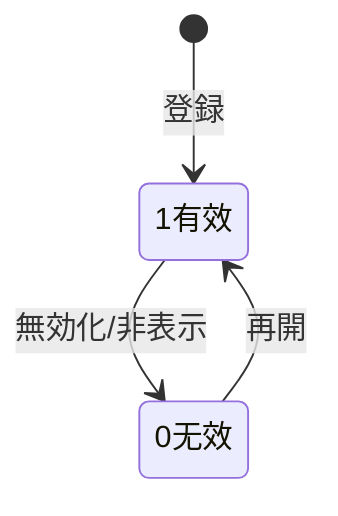

# 菜单・数据字典・系统参数 详细设计书（メニュー・辞書・システムパラメータ 詳細設計書）

| 項目 | 内容 |
|---|---|
| 文書名 | 菜单・数据字典・系统参数 详细设计书（メニュー・辞書・システムパラメータ 詳細設計書） |
| 文書番号 | DSN-SYS-004 |
| 版数 | v1.1 |
| 作成日 | 2026-10-20 |
| 作成者 | system-workflow（域設計担当） |
| 承認者 | 未承認（レビュー待ち） |
| 状態 | ドラフト（レビュー中） |
| 関連文書 | [業務域概要](00-overview.md) / [DB 設計](90-db-design.md) / [API 設計](91-api-design.md) / [画面共通規格](../00-common/02-common-screen-spec.md) / [共通項目定義](../00-common/01-common-item-definitions.md) |

---

## 1. 機能概要

| 項目 | 内容 |
|---|---|
| 機能 ID | F-SYS-004（菜单管理）、F-SYS-007（数据字典）、F-SYS-008（系统参数） |
| 機能名 | メニュー/ボタン権限ツリー、区分値辞書、システム設定値 |
| 目的 | 画面ナビゲーションと操作権限の識別子を一元管理し、業務運用で変化する区分値・設定値を再デプロイなしで変更可能にする |
| 利用者・ロール | 系统管理员（全般）、运维担当（パラメータ参照）、各業務管理者（辞書参照） |
| 利用シーン | 新機能リリース時のメニュー追加、業務区分値の追加、通知・ファイル・承認閾値等の設定変更 |
| 優先度 | P0 |
| 画面 ID | SCR-SYS-014（菜单管理）、SCR-SYS-015（数据字典一覧）、SCR-SYS-016（字典項目編集）、SCR-SYS-017（系统参数） |
| 関連 IF | なし |

## 2. 業務要件・業務ルール

### 2.1 前提条件

| # | 前提条件 | 成立しない場合の挙動 |
|---|---|---|
| 1 | メニュー変更後、フロントのルートキャッシュを再取得する（ログインし直し or `GET /auth/me`） | 変更が反映されない |
| 2 | 辞書・パラメータは Redis キャッシュに保持され、更新後 60 秒以内に全ノードへ反映 | 一時的に旧値 |
| 3 | 内置辞書・パラメータは削除不可 | `MSG-SYS-040` |

### 2.2 業務ルール

| # | ルール | 根拠（法令・社内規程・業務慣行） | 関連項目 |
|---|---|---|---|
| BR-01 | メニューは「目录（1）> 菜单（2）> 按钮（3）」の階層を守る。ボタンは必ずメニュー配下 | [画面共通規格](../00-common/02-common-screen-spec.md) 3 章 | `menu_type`、`parent_id` |
| BR-02 | 権限コードは `{module}:{resource}:{action}` 形式（[設計方針](../00-common/00-design-principles.md) 6.6）。メニュー・ボタンで一意 | 統一規約 | `permission_code` |
| BR-03 | メニューの削除は子メニュー・ロール権限付与がない場合のみ。使用中は「非表示/無効化」で対応 | 参照整合性 | `status`、`is_visible` |
| BR-04 | メニュー変更は権限キャッシュ（メニューツリー）を無効化する。進行中セッションは次回 `/auth/me` で新ツリーを取得 | 即時反映 | Redis |
| BR-05 | 辞書は「処理ロジックが依存する固定区分」を登録しない（伝票ステータス等は Java enum）。辞書は業務運用で追加・変更される区分のみ | [共通項目定義](../00-common/01-common-item-definitions.md) 7.2 | `is_system` |
| BR-06 | 辞書項目の `item_code` は使用開始後変更不可。名称変更は可（過去データはコードで保持） | 監査証跡 | `item_code` |
| BR-07 | 辞書項目の無効化は新規選択のみ不可とし、既存データの表示は継続（名称解決は維持） | 業務継続性 | `status` |
| BR-08 | システムパラメータは型（文字列/整数/小数/真偽/JSON/日付）と値域を持ち、型に適合しない値は保存不可 | [API 共通規格](../00-common/03-common-api-spec.md) | `value_type`、`value_range` |
| BR-09 | 高危パラメータ（`is_danger=true`：パスワードポリシー、承認閾値、締め日等）の変更は 2 名承認（申請者 ≠ 承認者） | 内部統制 | `is_danger` |
| BR-10 | 機密パラメータ（SMTP パスワード等）は AES-256 で暗号化保存し、API は `******` を返す。値をログ・監査ログに残さない | [共通項目定義](../00-common/01-common-item-definitions.md) 15 章 | `is_encrypted` |
| BR-11 | パラメータの変更履歴は `sys_audit_log`（before/after）に記録。`is_encrypted` の値は差分を「変更あり」とだけ記録 | 監査 | `sys_audit_log` |
| BR-12 | 辞書・パラメータの更新はキャッシュ更新 API を通す（DB 直接更新禁止） | 運用統制 | — |

### 2.3 状態遷移（マスタ有効性）



| 遷移 | トリガ | 権限 | 更新項目 | メッセージ |
|---|---|---|---|---|
| 1→0 | 無効化・非表示 | `system:menu:update` 等 | `status=0` or `is_visible=false` | MSG-COM-001 |
| 0→1 | 再開 | 同上 | `status=1` | MSG-COM-001 |

## 3. 関連機能

| 関係 | 機能 ID | 機能名 | 関係内容 |
|---|---|---|---|
| 上流 | F-SYS-003 | 角色与权限 | 権限ツリーの選択肢を提供 |
| 下流 | 全業務域 | 画面 | メニュー・ルート生成、`v-permission` |
| 下流 | 全業務域 | 区分値参照 | 辞書 API による名称解決 |
| 参照 | F-SYS-009 | 审计日志 | 変更履歴 |
| 参照 | F-SYS-020 | 系统维护 | キャッシュ再構築（BAT-SYS-011） |

## 4. 画面設計

### 4.1 画面一覧

| 画面 ID | 画面名 | 類型 | 概要 |
|---|---|---|---|
| SCR-SYS-014 | 菜单管理 | EDIT | 左：メニューツリー、右：メニュー/ボタン詳細。ルートパス・権限コード編集 |
| SCR-SYS-015 | 数据字典一覧 | LIST | 字典类型一覧、項目数表示、項目編集への遷移 |
| SCR-SYS-016 | 字典項目編集 | EDIT | 選択字典の項目一覧（テーブル編集）。並び替え・色・既定値 |
| SCR-SYS-017 | 系统参数 | LIST | グループ別一覧、型別入力ダイアログ、変更理由入力、高危パラメータ承認 |

### 4.2 画面レイアウト（SCR-SYS-017 系统参数）

```
┌──────────────────────────────────────────────────────────────────────────┐
│ ホーム > 系统管理 > 系统参数                                             │
├──────────────────────────────────────────────────────────────────────────┤
│〔グループ〕[全部][认证 auth][文件 file][通知 notify][审批 workflow][其他] │
├──────────────────────────────────────────────────────────────────────────┤
│ 参数键                  | 名称             | 值            | 类型 | 操作   │
│ auth.password-expire-days | 密码有效期(日)   | 90            | 整数 | [编辑] │
│ auth.lock-minutes         | 登录锁定(分)     | 30            | 整数 | [编辑] │
│ file.max-size-mb          | 附件大小上限(MB) | 20            | 整数 | [编辑] │
│ notify.email.enabled      | 启用邮件通知     | true          | 布尔 | [编辑] │
│ smtp.password             | SMTP 密码        | ******        | 字符串(加密) | [编辑] │
├──────────────────────────────────────────────────────────────────────────┤
│ 共 150 件  1/8 ページ                                                     │
└──────────────────────────────────────────────────────────────────────────┘
```

### 4.3 画面項目定義（SCR-SYS-014 菜单）

| No | 項目 ID | 項目名 | 種別 | 型/桁 | 必須 | 初期値 | 入力チェック | データソース | DB 項目 | 権限 | 備考 |
|---|---|---|---|---|---|---|---|---|---|---|---|
| 1 | `menuCode` | 菜单代码 | テキスト | VARCHAR(64) | ○ | 空 | 一意・半角英数 | 入力 | `sys_menu.menu_code` | 編集可（新規） | — |
| 2 | `menuName` | 菜单名称 | テキスト | VARCHAR(100) | ○ | 空 | 1〜100 字 | 入力 | `sys_menu.menu_name` | 編集可 | — |
| 3 | `menuType` | 类型 | ラジオ | SMALLINT | ○ | 2 菜单 | 1/2/3/4 | 固定値 | `sys_menu.menu_type` | 編集可（新規） | 変更時警告 |
| 4 | `parentId` | 上级菜单 | ツリー選択 | BIGINT | ○ | 選択中ノード | 階層ルール | `sys_menu` | `sys_menu.parent_id` | 編集可 | — |
| 5 | `moduleCode` | 模块 | 選択 | VARCHAR(32) | ○ | 親の模块 | 固定 10 モジュール | 固定値 | `sys_menu.module_code` | 編集可 | — |
| 6 | `routePath` | 路由路径 | テキスト | VARCHAR(300) | △ | 空 | `/` 開始、一意 | 入力 | `sys_menu.route_path` | 編集可 | menu_type=2 で必須 |
| 7 | `componentPath` | 组件路径 | テキスト | VARCHAR(300) | △ | 空 | 半角英数/`/` | 入力 | `sys_menu.component_path` | 編集可 | menu_type=2 で必須 |
| 8 | `permissionCode` | 权限代码 | テキスト | VARCHAR(100) | △ | 空 | `^[a-z]+:[a-z-]+:[a-z-]+$`、一意 | 入力 | `sys_menu.permission_code` | 編集可 | ボタンで必須 |
| 9 | `icon` | 图标 | 選択 | VARCHAR(64) | △ | 空 | Element Plus アイコン名 | 固定値 | `sys_menu.icon` | 編集可 | — |
| 10 | `isVisible` | 显示 | スイッチ | BOOLEAN | ○ | true | — | 入力 | `sys_menu.is_visible` | 編集可 | — |
| 11 | `isExternal` | 外部链接 | スイッチ | BOOLEAN | ○ | false | true 時 `external_url` 必須 | 入力 | `sys_menu.is_external` | 編集可 | — |
| 12 | `sortNo` | 排序 | 数値 | INT | ○ | 10 | 0〜9999 | 入力 | `sys_menu.sort_no` | 編集可 | — |
| 13 | `status` | 状态 | ラジオ | SMALLINT | ○ | 1 有效 | 1/0 | 固定値 | `sys_menu.status` | 編集可 | — |

### 4.4 画面項目定義（SCR-SYS-016 字典項目）

| No | 項目 ID | 項目名 | 種別 | 型/桁 | 必須 | 初期値 | 入力チェック | DB 項目 |
|---|---|---|---|---|---|---|---|---|
| 1 | `itemCode` | 项目代码 | テキスト | VARCHAR(64) | ○ | 空 | 同一字典内一意、大文字推奨 | `sys_dict_item.item_code` |
| 2 | `itemName` | 项目名称 | テキスト | VARCHAR(200) | ○ | 空 | 1〜200 字 | `sys_dict_item.item_name` |
| 3 | `itemValue` | 项目值 | テキスト | VARCHAR(200) | △ | コードと同値 | ≤200 字 | `sys_dict_item.item_value` |
| 4 | `parentId` | 上级项目 | 選択 | BIGINT | △ | 0 | ツリー辞書のみ | `sys_dict_item.parent_id` |
| 5 | `sortNo` | 排序 | 数値 | INT | ○ | 10 | 0〜9999 | `sys_dict_item.sort_no` |
| 6 | `tagType` | 显示色 | 選択 | VARCHAR(32) | △ | 空 | success/warning/danger/info | `sys_dict_item.tag_type` |
| 7 | `isDefault` | 默认值 | スイッチ | BOOLEAN | ○ | false | 同一字典内 1 件 | `sys_dict_item.is_default` |
| 8 | `status` | 状态 | ラジオ | SMALLINT | ○ | 1 有效 | 1/0 | `sys_dict_item.status` |

### 4.5 画面項目定義（SCR-SYS-017 系统参数 編集ダイアログ）

| No | 項目 ID | 項目名 | 種別 | 型/桁 | 必須 | 初期値 | 入力チェック | DB 項目 |
|---|---|---|---|---|---|---|---|---|
| 1 | `paramKey` | 参数键 | 表示 | VARCHAR(100) | — | 選択行 | 編集不可 | `sys_param.param_key` |
| 2 | `paramValue` | 参数值 | 型別入力 | TEXT | ○ | 現在値 | `value_type`・`value_range` 適合 | `sys_param.param_value` |
| 3 | `changeReason` | 变更理由 | テキストエリア | VARCHAR(500) | △ | 空 | 高危・機密は必須 | `sys_audit_log.remark` |
| 4 | `approver` | 复核者 | ユーザ選択 | BIGINT | △ | 空 | 高危は必須、申請者と別人 | — |

### 4.6 イベント処理

| No | イベント | トリガ | 処理内容 | 呼出 API | 画面遷移 | 備考 |
|---|---|---|---|---|---|---|
| 1 | メニューツリー表示 | 画面表示 | 全メニュー取得（管理用は無効含む） | GET /api/system/menus/tree?includeDisabled=true | — | — |
| 2 | メニュー保存 | 保存ボタン | 階層・権限コード検証→保存→権限キャッシュ無効化 | POST/PUT /api/system/menus | 同一画面 | ルートパス重複チェック |
| 3 | メニュー削除 | 削除ボタン | 子・権限付与チェック→無効化 | DELETE /api/system/menus/{id} | 同一画面 | 使用中は MSG-SYS-023 |
| 4 | 字典保存 | 保存ボタン | 項目検証→保存→キャッシュ更新 | PUT /api/system/dicts/{code}/items | 同一画面 | 一括保存 |
| 5 | キャッシュ更新 | ツールバー | 辞書・パラメータ・メニューの再構築 | POST /api/system/caches/refresh | — | `system:cache:refresh` |
| 6 | パラメータ保存 | 保存ボタン | 型・値域検証→高危は承認申請→保存→キャッシュ更新 | PUT /api/system/params/{key} | 同一画面 | 監査ログ |
| 7 | グループ切替 | タブ | 該当グループの一覧取得 | GET /api/system/params?group=auth | — | — |

### 4.7 表示制御

| 条件 | 対象項目/ボタン | 制御 |
|---|---|---|
| `is_system=true`（内置辞書/パラメータ） | 削除ボタン | 非表示 |
| `is_readonly=true` | 編集ダイアログ | 参照表示のみ |
| `is_encrypted=true` | 値表示 | `******`、編集時のみ入力可 |
| `is_danger=true` | 保存ボタン | 「申请复核」に変更（2 名承認） |
| 権限なし | 編集/削除 | 非表示 |
| 内置メニュー（`ext_data.builtin=true`） | コード・権限コード | 編集不可 |

## 5. 入力チェック仕様

| No | チェック ID | 対象項目 | 種別 | 条件 | タイミング | メッセージ ID |
|---|---|---|---|---|---|---|
| 1 | CHK-SYS-004-01 | `menuCode` | 一意・必須 | 既存なし | 保存 | MSG-COM-050 |
| 2 | CHK-SYS-004-02 | `menuType` | 階層 | ボタンはメニュー配下 | 保存 | MSG-SYS-021 |
| 3 | CHK-SYS-004-03 | `routePath` | 一意 | 既存なし | 保存 | MSG-SYS-022 |
| 4 | CHK-SYS-004-04 | `permissionCode` | 形式 | `^[a-z]+:[a-z-]+:[a-z-]+$` | 保存 | MSG-SYS-024 |
| 5 | CHK-SYS-004-05 | `permissionCode` | 一意 | 既存なし | 保存 | MSG-COM-050 |
| 6 | CHK-SYS-007-01 | `dictCode` | 一意 | 既存なし | 保存 | MSG-COM-050 |
| 7 | CHK-SYS-007-02 | `itemCode` | 一意 | 同一字典内既存なし | 保存 | MSG-SYS-042 |
| 8 | CHK-SYS-007-03 | `isDefault` | 一意 | 同一字典内 1 件 | 保存 | MSG-SYS-043 |
| 9 | CHK-SYS-007-04 | 内置字典 | 制約 | 削除不可 | 削除 | MSG-SYS-040 |
| 10 | CHK-SYS-008-01 | `paramKey` | 一意 | 既存なし | 保存 | MSG-COM-050 |
| 11 | CHK-SYS-008-02 | `paramValue` | 型 | `value_type` に適合 | 保存 | MSG-SYS-044 |
| 12 | CHK-SYS-008-03 | `paramValue` | 値域 | `value_range` に適合 | 保存 | MSG-COM-044 |
| 13 | CHK-SYS-008-04 | 高危パラメータ | 承認 | 変更理由・复核者必須、申請者≠复核者 | 保存 | MSG-SYS-045 |
| 14 | CHK-SYS-008-05 | 只读パラメータ | 制約 | 更新拒否 | 保存 | MSG-SYS-041 |

## 6. 処理詳細

### 6.1 処理一覧

| 処理 ID | 処理名 | 契機 | トランザクション | 排他 |
|---|---|---|---|---|
| PRC-SYS-004-01 | メニュー登録・更新 | 保存 | 要 | 楽観排他 |
| PRC-SYS-004-02 | メニューツリー生成 | `/auth/me` | 不要 | — |
| PRC-SYS-004-03 | メニュー無効化 | 削除 | 要 | 参照チェック |
| PRC-SYS-007-01 | 辞書項目一括保存 | 保存 | 要 | 楽観排他（辞書単位） |
| PRC-SYS-007-02 | 辞書キャッシュ更新 | 保存後 | 不要 | Redis set + pub/sub |
| PRC-SYS-008-01 | パラメータ更新 | 保存 | 要（承認含む） | 楽観排他 |
| PRC-SYS-008-02 | パラメータ取得（キャッシュ） | 業務処理 | 不要 | — |

### 6.2 処理手順（正常系）

**PRC-SYS-004-01 メニュー登録・更新**

1. 権限チェック（`system:menu:create/update`）。
2. 入力チェック（CHK-SYS-004-01〜05）を実行する。
3. 階層ルールを検証する：`menu_type=3`（ボタン）は親が `menu_type=2`、`menu_type=1/2` は親が `menu_type=1` またはルート。
4. ルートパス・権限コードの一意性を確認する（権限コードは無効メニューも含めて一意）。
5. `sys_menu` を INSERT/UPDATE する（`version` 楽観排他）。
6. 権限キャッシュ（Redis `sys:menu:tree`、`sys:perm:all`）を無効化し、pub/sub 通知する。
7. 監査ログ（before/after）を記録する。フロントは次回起動時に新ツリーを取得する旨を表示する。

**PRC-SYS-004-02 メニューツリー生成（ログイン時 `/auth/me`）**

1. ログインユーザの有効ロールに付与された `sys_role_permission` → `sys_menu` を取得する。
2. `menu_type IN (1,2)` かつ `status=1` かつ `is_visible=true` のノードをツリー化する（ルートから再帰）。
3. ボタン権限（`menu_type=3`）は権限コード一覧として `permissions` に含める。
4. 外部リンク（`menu_type=4`）は URL をそのまま返す（フロントで `window.open`）。
5. 結果をセッション（Redis）にキャッシュし、メニュー更新時の無効化で再生成する。

**PRC-SYS-007-01 辞書項目一括保存**

1. 権限チェック（`system:dict:update`）。
2. 対象辞書を取得し、`is_system=true` の場合は項目の削除・コード変更を拒否する（追加・名称変更・並び替えは可）。
3. 入力チェック（CHK-SYS-007-02〜03）。一意制約は辞書内 `item_code`。
4. 削除された項目は論理削除（`deleted=true`）、既存は UPDATE、新規は INSERT（トランザクション内）。
5. `sys_dict_item` の保存後、Redis `sys:dict:{dictCode}` を丸ごと更新（TTL なし）し、pub/sub で他ノードへ通知する。
6. 監査ログ（resource=dict_item、before/after は項目配列の差分）を記録する。

**PRC-SYS-008-01 パラメータ更新**

1. 権限チェック（`system:param:update`）。`is_readonly=true` は拒否。
2. `value_type` に応じて値を検証する（整数・小数・真偽・JSON 構文・日付）。`value_range` は `min-max` / カンマ区切り / 正規表現で評価する。
3. `is_danger=true` の場合、変更理由と复核者を要求し、WF 承認（業務類型 `SYS_PARAM_CHANGE`）を起動する。承認完了（E32）まで `sys_param` は更新しない。
4. `is_encrypted=true` の場合、AES-256-GCM で暗号化して保存する（鍵は環境変数 `ERP_SECRET_KEY`）。
5. `sys_param` を UPDATE する（`version` 楽観排他）。
6. Redis `sys:param:{key}` を更新（暗号化値はキャッシュせず、取得時に復号）し、pub/sub 通知する。
7. 監査ログ（before/after。暗号化項目は「変更あり」のみ）を記録する。

### 6.3 例外処理

| No | 異常条件 | 検知箇所 | 処理 | ロールバック | メッセージ ID |
|---|---|---|---|---|---|
| 1 | 権限コード重複 | 事前チェック | 422 | 全体 | MSG-COM-050 |
| 2 | 階層ルール違反 | 保存前 | 拒否 | 全体 | MSG-SYS-021 |
| 3 | 使用中メニューの削除 | 参照チェック | 無効化を案内 | — | MSG-SYS-023 |
| 4 | 内置辞書削除 | 業務チェック | 拒否 | — | MSG-SYS-040 |
| 5 | パラメータ型不一致 | 型検証 | 拒否 | 全体 | MSG-SYS-044 |
| 6 | 只读パラメータ更新 | 業務チェック | 拒否 | — | MSG-SYS-041 |
| 7 | 高危パラメータの自己承認 | 承認チェック | 拒否 | — | MSG-SYS-045 |
| 8 | キャッシュ更新失敗 | 保存後 | DB は更新済み。ログ WARN、60 秒 TTL で自然更新 | — | — |
| 9 | 楽観排他競合 | UPDATE 0 件 | 409 | 全体 | MSG-COM-033 |

### 6.4 冪等性・排他

- メニュー・辞書・パラメータ更新は `version` 楽観排他 + `Idempotency-Key`。
- 辞書一括保存は辞書単位でロックし、同時編集を防止する（`SELECT ... FOR UPDATE` on `sys_dict_type`）。
- キャッシュ更新は DB コミット後に実行する。失敗しても DB が正であり、TTL 60 秒で自己修復する。

## 7. API 設計

| No | メソッド | パス | 権限 | 概要 |
|---|---|---|---|---|
| 1 | GET | /api/system/menus/tree | `system:menu:view` | 管理用メニューツリー |
| 2 | GET | /api/system/menus/routes | 認証済 | ログインユーザのルート（フロント生成用） |
| 3 | POST | /api/system/menus | `system:menu:create` | メニュー登録 |
| 4 | PUT | /api/system/menus/{id} | `system:menu:update` | メニュー更新 |
| 5 | DELETE | /api/system/menus/{id} | `system:menu:delete` | メニュー無効化 |
| 6 | GET | /api/system/dicts | `system:dict:view` | 字典类型一覧 |
| 7 | GET | /api/system/dicts/{code}/items | 認証済（業務参照） | 字典項目一覧（有効のみ） |
| 8 | POST | /api/system/dicts | `system:dict:create` | 字典类型登録 |
| 9 | PUT | /api/system/dicts/{code}/items | `system:dict:update` | 字典項目一括保存 |
| 10 | GET | /api/system/params | `system:param:view` | パラメータ一覧 |
| 11 | GET | /api/system/params/{key} | 認証済（内部参照） | パラメータ取得 |
| 12 | PUT | /api/system/params/{key} | `system:param:update` | パラメータ更新 |
| 13 | POST | /api/system/caches/refresh | `system:cache:refresh` | キャッシュ再構築 |

### 7.1 リクエスト/レスポンス詳細

**PUT /api/system/params/{key}**

```json
{ "paramValue": "60", "changeReason": "ピーク時ログイン集中に対応", "approverId": null, "version": 2 }
// 成功（通常）
{ "code": 0, "message": "保存しました。", "data": { "paramKey": "auth.lock-minutes", "paramValue": "60", "version": 3 } }
// 高危（承認申請）
{ "code": 0, "message": "审批流程已提交。", "data": { "processInstanceId": "..." } }
```

**GET /api/system/dicts/{code}/items**（業務参照用）

```json
{ "code": 0, "message": "ok", "data": [
  { "itemCode": "A", "itemName": "战略客户", "itemValue": "A", "sortNo": 10, "tagType": "danger" },
  { "itemCode": "B", "itemName": "重点客户", "itemValue": "B", "sortNo": 20, "tagType": "warning" }
] }
```

## 8. データ更新仕様

| テーブル | 操作 | 更新項目 | 更新条件 | トリガ（処理 ID） |
|---|---|---|---|---|
| sys_menu | INSERT/UPDATE | 全項目 | メニュー保存 | PRC-SYS-004-01 |
| sys_menu | UPDATE | `status`/`is_visible` | 無効化 | PRC-SYS-004-03 |
| sys_dict_type | INSERT/UPDATE | 全項目 | 字典保存 | PRC-SYS-007-01 |
| sys_dict_item | INSERT/UPDATE/deleted | 全項目 | 項目一括保存 | PRC-SYS-007-01 |
| sys_param | UPDATE | `param_value`・`version` | パラメータ更新 | PRC-SYS-008-01 |
| sys_audit_log | INSERT | 全項目 | 全処理 | 全処理 |

## 9. エラー処理・メッセージ

| メッセージ ID | 種別 | 本文 | 発生条件 | 利用者への対処 | ログ |
|---|---|---|---|---|---|
| MSG-SYS-021 | E | 按钮菜单必须挂在菜单节点下。 | 階層違反 | 親変更 | INFO |
| MSG-SYS-022 | E | 路由路径「{0}」已被使用。 | パス重複 | 修正 | INFO |
| MSG-SYS-023 | E | 该菜单已分配给角色或包含子菜单，不能删除。可改为隐藏/停用。 | 使用中削除 | 無効化 | INFO |
| MSG-SYS-024 | E | 权限代码格式不正确，应形如 module:resource:action。 | 形式違反 | 修正 | INFO |
| MSG-SYS-040 | E | 系统内置字典/参数不能删除。 | 内置 | — | WARN |
| MSG-SYS-041 | E | 该参数为只读参数，不能修改。 | 只读更新 | — | WARN |
| MSG-SYS-042 | E | 字典项目代码「{0}」已存在。 | 項目重複 | 別コード | INFO |
| MSG-SYS-043 | E | 同一字典只能设置一个默认值。 | 默认重複 | 解除 | INFO |
| MSG-SYS-044 | E | 参数值不符合类型要求（{0}）。 | 型不一致 | 修正 | INFO |
| MSG-SYS-045 | E | 高危参数变更需要复核，且复核人不能与申请人相同。 | 承認不備 | 复核者選択 | WARN |
| MSG-SYS-046 | E | 参数值超出允许范围（{0}）。 | 値域外 | 修正 | INFO |

## 10. 権限・セキュリティ

| 種別 | 内容 |
|---|---|
| 画面権限 | `system:menu:view`、`system:dict:view`、`system:param:view` |
| 操作権限 | create/update/delete は各権限。キャッシュ再構築は `system:cache:refresh`（系统管理员のみ） |
| 項目権限 | 機密パラメータは `******` 表示。復号は内部 API のみ（画面に返さない） |
| データ範囲 | 管理系のため全社。参照 API（辞書・パラメータ）は全ロール |
| 監査ログ | メニュー・辞書・パラメータの全変更を before/after 付きで記録。暗号化項目は変更有無のみ |
| 入力検証 | JSON パラメータはサイズ上限（8KB）。正規表現は ReDoS 対策（タイムアウト付き） |

## 11. 性能・非機能

| 項目 | 目標値 | 前提 |
|---|---|---|
| メニューツリー生成 | 50 ms 以内 | セッションキャッシュ |
| 辞書参照 | 5 ms 以内 | Redis キャッシュ |
| パラメータ参照 | 5 ms 以内 | Redis キャッシュ |
| キャッシュ更新反映 | 60 秒以内（全ノード） | pub/sub + TTL |

## 12. テスト観点

| No | 観点 ID | 分類 | 観点 | 期待結果 |
|---|---|---|---|---|
| 1 | TST-F-SYS-004-01 | 正常系 | メニュー追加→ロールに付与→ログイン | メニューが表示され画面遷移可能 |
| 2 | TST-F-SYS-004-02 | 異常系 | 権限コード形式違反 | MSG-SYS-024 |
| 3 | TST-F-SYS-004-03 | 異常系 | ボタンをルート直下に配置 | MSG-SYS-021 |
| 4 | TST-F-SYS-004-04 | 業務 | 使用中メニュー削除 | MSG-SYS-023、無効化を案内 |
| 5 | TST-F-SYS-004-05 | 権限 | 権限なしユーザが管理画面 URL 直アクセス | 403 画面 |
| 6 | TST-F-SYS-007-01 | 正常系 | 字典項目追加・名称変更 | 業務画面の選択肢に反映（60 秒以内） |
| 7 | TST-F-SYS-007-02 | 異常系 | 項目コード重複 | MSG-SYS-042 |
| 8 | TST-F-SYS-007-03 | 業務 | 組み込み辞書の項目削除 | 拒否（削除不可） |
| 9 | TST-F-SYS-008-01 | 正常系 | 整数パラメータ変更 | 保存され、次回参照から新値 |
| 10 | TST-F-SYS-008-02 | 異常系 | 整数パラメータに文字列 | MSG-SYS-044 |
| 11 | TST-F-SYS-008-03 | 境界値 | 値域ちょうど上限/下限 | 保存可、超過は MSG-SYS-046 |
| 12 | TST-F-SYS-008-04 | 業務 | 高危パラメータ変更 | 承認申請となり、承認まで未反映 |
| 13 | TST-F-SYS-008-05 | セキュリティ | 機密パラメータ取得 API | `******` を返し平文を返さない |

## 13. 未決事項

| # | 事項 | 理由 | 暫定仕様 | 担当 | 期限 |
|---|---|---|---|---|---|
| 1 | メニュー変更の即時反映方式 | 全ユーザのセッション再取得を強制するか | `/auth/me` 再取得 + 60 秒キャッシュ。強制再ログインは行わない | system-workflow | 2026-11-10 |
| 2 | 辞書キャッシュの pub/sub 実装 | Redis pub/sub の運用要件 | pub/sub + TTL の二重防御 | 运维担当 | 2026-11-10 |
| 3 | 高危パラメータの範囲 | 客户の内部統制規程が未確定 | `sys_param` 初期データで `is_danger` を設定（パスワード・承認閾値・締め日等） | Lead | 2026-11-10 |

## 14. 改訂履歴

| 版数 | 日付 | 変更内容 | 変更者 |
|---|---|---|---|
| v1.0 | 2026-10-20 | 初版：F-SYS-004/007/008 の業務ルール 12、画面 4、画面項目定義、処理 7 件、API 13 件、メッセージ 11 件、テスト観点 13 件 | system-workflow |
| v1.1 | 2026-10-21 | 重複・既存系の業務エラーの HTTP を 409 → 422 に統一（409 は楽観排他競合 4003 のみ。03 §5・01-system 91 v1.10 と整合）。対象：:249（蓝色大肥鱼 2026-10-21 決定） | 业务分析 |