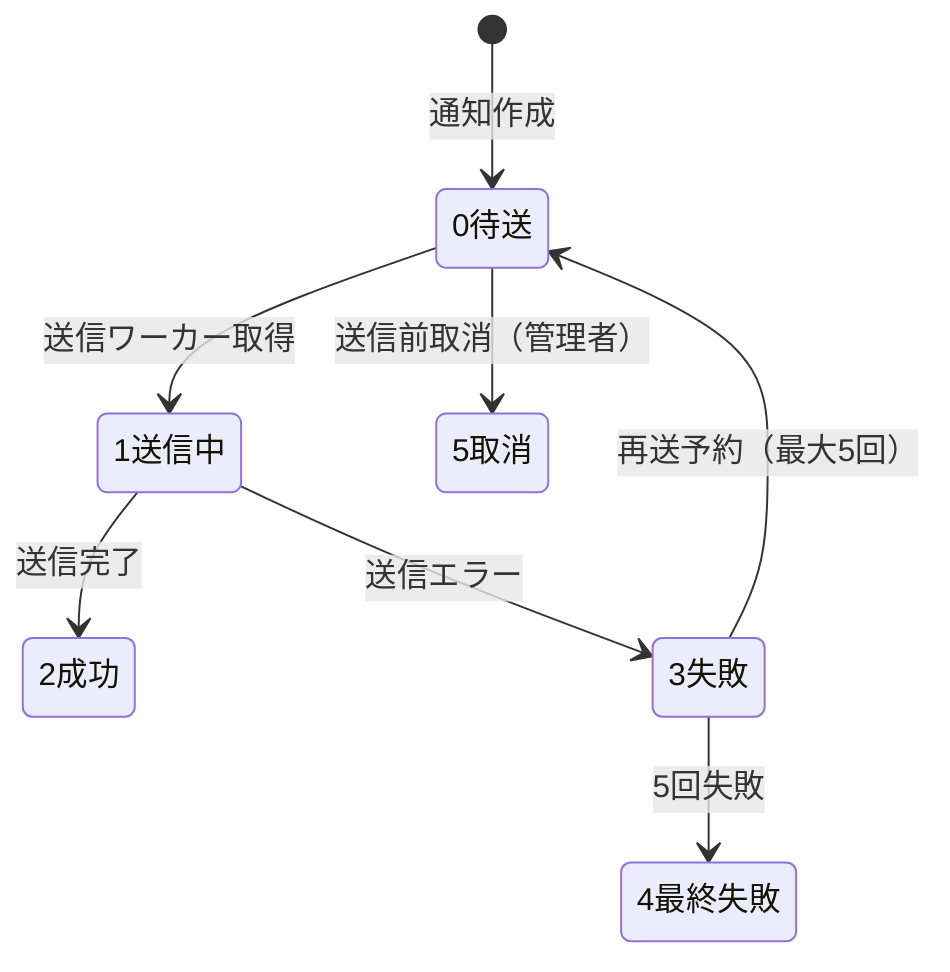

# 审计日志・附件・通知 详细设计书（監査ログ・添付・通知 詳細設計書）

| 項目 | 内容 |
|---|---|
| 文書名 | 审计日志・附件・通知 详细设计书（監査ログ・添付・通知 詳細設計書） |
| 文書番号 | DSN-SYS-005 |
| 版数 | v1.0 |
| 作成日 | 2026-10-20 |
| 作成者 | system-workflow（域設計担当） |
| 承認者 | 未承認（レビュー待ち） |
| 状態 | ドラフト（レビュー中） |
| 関連文書 | [業務域概要](00-overview.md) / [DB 設計](90-db-design.md) / [API 設計](91-api-design.md) / [共通項目定義](../00-common/01-common-item-definitions.md) / [共通業務規則](../00-common/08-common-business-rules.md) / [跨域流程](../00-common/09-cross-domain-flow.md) |

---

## 1. 機能概要

| 項目 | 内容 |
|---|---|
| 機能 ID | F-SYS-009（审计日志）、F-SYS-010（附件管理）、F-SYS-011（消息通知与待办中心）、F-SYS-019（通知模板） |
| 機能名 | 操作/登录監査、ファイル管理、站内通知・待办集約、通知文面テンプレート |
| 目的 | ①操作の完全な監査証跡を残す。②業務文書の根拠資料を安全に保管する。③承認依頼・結果・アラートを確実に届け、未処理を可視化する |
| 利用者・ロール | 全ロール（通知・添付）、内审员・系统管理员（監査）、系统管理员（テンプレート） |
| 利用シーン | 監査対応・障害調査、契約書・図面・発票の添付、承認依頼の受信、通知文面の変更 |
| 優先度 | P0（F-SYS-009/010/011）、P1（F-SYS-019） |
| 画面 ID | SCR-SYS-018（操作审计日志）、SCR-SYS-019（登录日志）、SCR-SYS-020（附件管理）、SCR-SYS-021（消息通知中心/待办中心）、SCR-SYS-022（通知模板）、SCR-SYS-030（通知发送履歴） |
| 関連 IF | IF-SYS-001（メール送信）、IF-SYS-002（短信・P2）、IF-SYS-003（企微/钉钉・P2）、IF-SYS-005（对象存储・P2）、IF-SYS-006（ウイルススキャン・P2） |

## 2. 業務要件・業務ルール

### 2.1 前提条件

| # | 前提条件 | 成立しない場合の挙動 |
|---|---|---|
| 1 | 監査ログは追記専用（UPDATE/DELETE API なし） | 提供しない |
| 2 | 添付ファイルは StorageService が利用可能 | 503 + MSG-SYS-070 |
| 3 | 通知は非同期送信。送信失敗は業務処理をロールバックしない | 再送キューへ |
| 4 | 通知テンプレートが存在しない場合、既定文面（コード内フォールバック）で送信 | WARN ログ |

### 2.2 業務ルール

| # | ルール | 根拠（法令・社内規程・業務慣行） | 関連項目 |
|---|---|---|---|
| BR-01 | 記録対象：ログイン/ログアウト/失敗、全マスタ・伝票の登録/更新/削除、承認操作、エクスポート/インポート、印刷、過帳/取消/月結、権限・パラメータ変更 | [共通項目定義](../00-common/01-common-item-definitions.md) 第 12 章 | `operation_type` |
| BR-02 | 監査ログにパスワード・トークン・銀行口座・身份证号は記録しない。携帯・メールはマスキング | 個人情報保護 | `before_data`/`after_data` |
| BR-03 | 監査ログの保存期間は 3 年。期間超過分は月次でアーカイブテーブルへ移管（BAT-SYS-006） | [共通業務規則](../00-common/08-common-business-rules.md) 12 章 | — |
| BR-04 | 添付は 1 ファイル 20MB、1 業務 20 ファイル・合計 100MB 以下。許可形式は pdf/jpg/jpeg/png/xlsx/xls/docx/doc/csv/txt/zip | [共通項目定義](../00-common/01-common-item-definitions.md) 第 9 章 | `file_size`、`file_ext` |
| BR-05 | アップロード・ダウンロード・削除を監査ログに記録。削除はアップロード者または管理者のみ | 監査 | — |
| BR-06 | 通知の種類：承認依頼（即時）、承認結果（即時）、承認遅延（24h/48h）、バッチ失敗（即時）、外部 IF 失敗（即時）、在庫不足/納期遅延（日次） | [共通業務規則](../00-common/08-common-business-rules.md) 13.3 | `biz_scene` |
| BR-07 | 通知はユーザ単位・ロール単位でチャネル ON/OFF 可。既定は站内 ON、メール ON、短信 OFF | 運用要件 | `sys_user_preference` |
| BR-08 | 站内通知は 1 年保存。既読管理は受信者単位。一斉通知は 5,000 人までを 1 バッチ（分割送信） | 性能 | — |
| BR-09 | 通知テンプレートは版管理し、使用中テンプレートの上書き禁止（新版を登録→旧版を無効化） | 監査 | `version_no` |
| BR-10 | メール・短信の送信失敗は最大 5 回再送（指数バックオフ）。最終失敗は運用担当へアラート | 可用性 | `sys_notification_send_log` |
| BR-11 | 待办中心は WF のタスクと SYS の通知を集約表示する。WF タスクの実体は WF が保持し、SYS は表示用に参照する | 責任分界 | [跨域流程](../00-common/09-cross-domain-flow.md) 第 9 章 |

### 2.3 状態遷移



| 遷移 | トリガ | 権限 | 更新項目 | メッセージ |
|---|---|---|---|---|
| 0→1 | BAT-SYS-005 | システム | `send_status=1` | — |
| 1→2 | 送信成功 | システム | `send_status=2`、`sent_at` | — |
| 1→3 | 送信失敗 | システム | `send_status=3`、`error_message` | — |
| 3→0 | 再送予約 | システム | `retry_count+1`、`next_retry_at` | — |
| 1→4 | 5 回失敗 | システム | `send_status=4` | MSG-SYS-075（運用通知） |

## 3. 関連機能

| 関係 | 機能 ID | 機能名 | 関係内容 |
|---|---|---|---|
| 上流 | 全業務域 | 全機能 | 監査ログの記録対象、添付の紐付け元 |
| 上流 | F-WF-012 | 审批消息通知 | 承認依頼・結果の通知要求（SYS の通知基盤を利用） |
| 下流 | F-SYS-001 | 认证 | ログイン失敗の記録 |
| 参照 | F-SYS-008 | 系统参数 | 添付上限・通知有効化の設定 |
| 参照 | F-SYS-020 | 系统维护 | アーカイブ・キャッシュ再構築 |

## 4. 画面設計

### 4.1 画面一覧

| 画面 ID | 画面名 | 類型 | 概要 |
|---|---|---|---|
| SCR-SYS-018 | 操作审计日志 | LIST | 条件検索、詳細ドロワー（前後値 JSON 差分）、エクスポート |
| SCR-SYS-019 | 登录日志 | LIST | 認証履歴、失敗理由、IP、異常検知リンク |
| SCR-SYS-020 | 附件管理 | LIST | ファイル検索、プレビュー、ダウンロード、削除（権限者） |
| SCR-SYS-021 | 消息通知中心/待办中心 | LIST | タブ：未読/既読/全部/待办。対象業務への遷移、既読操作 |
| SCR-SYS-022 | 通知模板管理 | LIST | テンプレート一覧、編集ダイアログ、テスト送信、有効化 |
| SCR-SYS-030 | 通知发送履歴 | LIST | チャネル別送信結果、再送、到達率 |

### 4.2 画面レイアウト（SCR-SYS-018 操作审计日志）

```
┌─────────────────────────────────────────────────────────────────────────────┐
│ ホーム > 系统管理 > 审计日志                                                │
├─────────────────────────────────────────────────────────────────────────────┤
│〔検索〕期间[2026-10-01]〜[2026-10-20] 用户[____] 模块[▼] 操作[▼] 结果[▼]   │
│        关键字[业务单号/对象ID________]  [搜索][クリア][导出]                │
├─────────────────────────────────────────────────────────────────────────────┤
│ 日時                | 用户   | 模块 | 操作   | 对象        | 结果 | 操作     │
│ 2026-10-20 14:30:12 | 张建国 | system | UPDATE | 用户 E000124 | 成功 | [詳細] │
│ 2026-10-20 14:28:03 | 李明   | sales  | APPROVE | SO2610200001 | 成功 | [詳細] │
├─────────────────────────────────────────────────────────────────────────────┤
│ 全 12,345 件 1/618 [<][1][2]…[>]                                           │
└─────────────────────────────────────────────────────────────────────────────┘
（詳細ドロワー：操作者・IP・UA・trace_id・before_data / after_data の差分表示）
```

### 4.3 画面項目定義（SCR-SYS-018 操作审计日志 検索・一覧）

| No | 項目 ID | 項目名 | 種別 | 型/桁 | 必須 | 初期値 | 入力チェック | データソース | DB 項目 | 権限 | 備考 |
|---|---|---|---|---|---|---|---|---|---|---|---|
| 1 | `dateFrom` | 开始日期 | 日付 | DATE | ○ | 当月1日 | ≤`dateTo` | 入力 | `sys_audit_log.occurred_at` | 監査権限 | 期間最大 3 か月 |
| 2 | `dateTo` | 结束日期 | 日付 | DATE | ○ | 当日 | ≥開始 | 入力 | 同上 | 監査権限 | — |
| 3 | `userId` | 用户 | ユーザ選択 | BIGINT | △ | 空 | — | `sys_user` | `user_id` | 監査権限 | — |
| 4 | `moduleCode` | 模块 | 選択 | VARCHAR(32) | △ | 空 | 10 モジュール | 固定値 | `module_code` | 監査権限 | — |
| 5 | `operationType` | 操作种别 | 複数選択 | VARCHAR(32)[] | △ | 空 | 固定値 | 固定値 | `operation_type` | 監査権限 | LOGIN/UPDATE/APPROVE 等 |
| 6 | `result` | 结果 | 選択 | SMALLINT | △ | 空 | 1/0 | 固定値 | `result` | 監査権限 | — |
| 7 | `keyword` | 关键字 | テキスト | VARCHAR(100) | △ | 空 | ≤100 字 | 入力 | `resource_no`/`resource_id`/`trace_id` | 監査権限 | 部分一致 |
| 8 | `occurredAt` | 操作日時 | 表示 | TIMESTAMPTZ | — | — | — | DB | `occurred_at` | 監査権限 | 一覧列 |
| 9 | `username` | 操作者 | 表示 | VARCHAR(64) | — | — | — | DB | `username` | 監査権限 | 一覧列 |
| 10 | `beforeData`/`afterData` | 变更前/后 | JSON 差分 | JSONB | — | — | — | DB | `before_data`/`after_data` | 監査権限 | ドロワー表示。マスキング済み |

### 4.4 画面項目定義（SCR-SYS-021 通知中心）

| No | 項目 ID | 項目名 | 種別 | 型/桁 | 必須 | 初期値 | 入力チェック | データソース | DB 項目 | 権限 |
|---|---|---|---|---|---|---|---|---|---|---|
| 1 | `tab` | タブ | ラジオ | — | ○ | 未読 | 未読/既読/全部/待办/抄送 | — | — | 本人 |
| 2 | `notificationType` | 通知类型 | 選択 | SMALLINT | △ | 空 | 1〜4 | 固定値 | `sys_notification.notification_type` | 本人 |
| 3 | `title` | タイトル | 表示 | VARCHAR(200) | — | — | — | DB | `title` | 本人 |
| 4 | `content` | 本文 | 表示 | TEXT | — | — | — | DB | `content` | 本人 |
| 5 | `readFlag` | 既読 | バッジ | BOOLEAN | — | — | — | DB | `read_flag` | 本人 |
| 6 | `relatedUrl` | 対象画面リンク | リンク | VARCHAR(500) | — | — | — | DB | `related_url` | 本人 | 権限確認後に遷移可 |
| 7 | `todoType` | 待办类型 | 表示 | VARCHAR(32) | — | — | — | WF API | — | 本人 | 承認待ち・差戻し等 |

### 4.5 画面項目定義（SCR-SYS-022 通知模板）

| No | 項目 ID | 項目名 | 種別 | 型/桁 | 必須 | 初期値 | 入力チェック | データソース | DB 項目 | 権限 |
|---|---|---|---|---|---|---|---|---|---|---|
| 1 | `templateCode` | 模板代码 | テキスト | VARCHAR(64) | ○ | 空 | `^[A-Z][A-Z0-9_]{2,63}$` | 入力 | `sys_notification_template.template_code` | 編集可（新規） |
| 2 | `templateName` | 模板名称 | テキスト | VARCHAR(100) | ○ | 空 | ≤100 字 | 入力 | `template_name` | 編集可 |
| 3 | `channelType` | 渠道 | 複数チェック | SMALLINT[] | ○ | 1,2 | 1〜5 | 固定値 | `channel_type` | 編集可 |
| 4 | `bizScene` | 业务场景 | 選択 | VARCHAR(64) | △ | 空 | 固定シーン | 固定値 | `biz_scene` | 編集可 |
| 5 | `titleTemplate` | 标题模板 | テキスト | VARCHAR(300) | ○ | 空 | プレースホルダ整合 | `title_template` | 編集可 |
| 6 | `contentTemplate` | 正文模板 | テキストエリア | TEXT | ○ | 空 | プレースホルダ整合・≤4000 字 | `content_template` | 編集可 |
| 7 | `variablesSchema` | 变量定义 | JSON エディタ | JSON | △ | 空 | JSON 構文 | `variables_schema` | 編集可 |
| 8 | `testSend` | 测试送信 | ボタン | — | — | — | 送信先入力 | — | 編集可 |

### 4.6 イベント処理

| No | イベント | トリガ | 処理内容 | 呼出 API | 画面遷移 | 備考 |
|---|---|---|---|---|---|---|
| 1 | 監査検索 | 検索ボタン | 条件検証→一覧取得 | GET /api/system/audit-logs | — | 期間最大 3 か月 |
| 2 | 監査詳細 | 行選択 | 詳細取得（前後値・trace_id） | GET /api/system/audit-logs/{id} | ドロワー | — |
| 3 | 監査エクスポート | ツールバー | 非同期ジョブ起動（PRT-SYS-003） | POST /api/system/audit-logs/export | ジョブ画面 | `system:audit-log:export` |
| 4 | 添付アップロード | アップロード | 検証→ストレージ保存→メタ登録→ウイルス検査 | POST /api/system/attachments | — | 業務画面からも呼ぶ |
| 5 | 添付DL | リンク | 権限チェック→署名 URL 発行 or ストリーム | GET /api/system/attachments/{id} | — | ダウンロード記録 |
| 6 | 添付削除 | 削除ボタン | 権限・アップロード者チェック→論理削除 | DELETE /api/system/attachments/{id} | — | 監査ログ |
| 7 | 通知一覧更新 | タブ/検索 | 受信箱取得 | GET /api/system/notifications | — | 未読件数バッジ |
| 8 | 既読 | 行クリック | 1 件既読化→対象画面へ遷移 | PUT /api/system/notifications/{id}/read | 対象画面 | 権限なしはメッセージ |
| 9 | 一括既読 | ボタン | 選択/全件既読 | PUT /api/system/notifications/read-all | — | — |
| 10 | テンプレート保存 | 保存ボタン | 変数整合検証→新版登録→旧版無効化 | POST /api/system/notification-templates | — | 内置は新規版のみ |
| 11 | テスト送信 | ボタン | 変数サンプルで送信 | POST /api/system/notification-templates/{id}/test-send | — | 本人宛のみ |
| 12 | 再送 | 送信履歴の再送 | 失敗分を再送キューへ | POST /api/system/notification-logs/{id}/resend | — | 最大 5 回 |

### 4.7 表示制御

| 条件 | 対象項目/ボタン | 制御 |
|---|---|---|
| 監査権限なし | 監査ログメニュー | 非表示 |
| 監査対象のモジュール権限なし | 該当モジュールの before/after | 非表示（`system:audit-log:view` のデータ範囲で制御） |
| 添付の紐付け先参照権限なし | ダウンロードリンク | 非表示 |
| 他ユーザの通知 | 通知一覧 | 表示されない（API で `receiver_user_id` を強制） |
| テンプレート内置 | 削除ボタン | 非表示 |
| 送信成功済み | 再送ボタン | 非表示 |
| チャネル未設定（メール無効） | メール送信ログ | 「無効」表示 |

## 5. 入力チェック仕様

| No | チェック ID | 対象項目 | 種別 | 条件 | タイミング | メッセージ ID |
|---|---|---|---|---|---|---|
| 1 | CHK-SYS-009-01 | `dateFrom`/`dateTo` | 相関 | 開始 ≤ 終了、期間 ≤ 3 か月 | 検索 | MSG-COM-046 / MSG-SYS-060 |
| 2 | CHK-SYS-009-02 | エクスポート件数 | 上限 | ≤10 万件（超過は非同期） | エクスポート | MSG-COM-065 |
| 3 | CHK-SYS-010-01 | `file` | サイズ | ≤20MB | アップロード | MSG-COM-060 |
| 4 | CHK-SYS-010-02 | `fileExt` | 形式 | 許可拡張子 | アップロード | MSG-COM-061 |
| 5 | CHK-SYS-010-03 | `bizType`/`bizId` | 存在 | 対象業務が存在し参照権限あり | アップロード | MSG-COM-049/031 |
| 6 | CHK-SYS-010-04 | 件数・合計サイズ | 上限 | 1 業務 20 ファイル・100MB | アップロード | MSG-SYS-071 |
| 7 | CHK-SYS-010-05 | 削除権限 | 権限 | アップロード者 or 管理者 | 削除 | MSG-COM-030 |
| 8 | CHK-SYS-019-01 | `templateCode` | 形式・一意 | 形式 + 同渠道内一意 | 保存 | MSG-SYS-072 |
| 9 | CHK-SYS-019-02 | プレースホルダ | 整合 | `{n}` 数 ≤ `variables_schema` 件数 | 保存 | MSG-SYS-061 |
| 10 | CHK-SYS-019-03 | `contentTemplate` | 桁数 | ≤4000 字（メール）、≤500 字（短信） | 保存 | MSG-SYS-073 |
| 11 | CHK-SYS-011-01 | `notificationId` | 所有者 | 受信者本人のみ既読化可 | 既読 | MSG-COM-031 |
| 12 | CHK-SYS-011-02 | 一括既読 | 上限 | 1 回 1,000 件 | 既読 | MSG-COM-052 |

## 6. 処理詳細

### 6.1 処理一覧

| 処理 ID | 処理名 | 契機 | トランザクション | 排他 |
|---|---|---|---|---|
| PRC-SYS-009-01 | 監査ログ記録 | 全書き込み API | 業務TX外（非同期） | なし |
| PRC-SYS-009-02 | 監査ログ検索 | 検索 | 不要（読み取り） | なし |
| PRC-SYS-009-03 | 監査ログアーカイブ | BAT-SYS-006 | 要 | アーカイブ済みフラグ |
| PRC-SYS-010-01 | 添付アップロード | アップロード | 要（メタ + 関連） | SHA-256 重複可 |
| PRC-SYS-010-02 | 添付ダウンロード | リンク | 不要 | なし |
| PRC-SYS-010-03 | 添付削除 | 削除 | 要 | 楽観排他 |
| PRC-SYS-011-01 | 通知作成・配信 | 業務イベント | 要（通知本体＋受信者） | なし |
| PRC-SYS-011-02 | 既読更新 | 既読 | 要 | 受信者行ロック |
| PRC-SYS-019-01 | テンプレート保存（新版） | 保存 | 要 | テンプレート行ロック |
| PRC-SYS-019-02 | チャネル送信 | BAT-SYS-005 | 1 件単位 | FOR UPDATE SKIP LOCKED |

### 6.2 処理手順（正常系）

**PRC-SYS-009-01 監査ログ記録**

1. AOP またはインターセプタ（`@AuditLog`）で、更新系 API の成功/失敗を捕捉する。
2. `trace_id`（`X-Request-Id`）、`user_id`/`username`、`operation_type`、`module_code`、`resource_code`、`resource_id`/`resource_no` を収集する。
3. `before_data`/`after_data` は DTO の差分から生成し、機密項目（password/token/bank_account/id_card）を除去、携帯・メールをマスキングする。
4. **重要操作（POST/REVERSE/APPROVE/CLOSE/DELETE 等の更新・状態操作）は、業務トランザクションと同一 TX で `sys_audit_log` へ同期 INSERT する**。INSERT 失敗時は業務トランザクション全体をロールバックし、`MSG-SYS-091` を返す（監査証跡なしの業務完了を禁止。REV-006 対応）。
5. 参照系・非重要操作のみ非同期キュー（`BlockingQueue`、容量 10,000）へ投入し、ライターが 100 件 or 1 秒ごとにバッチ INSERT する。**キュー飽和時は同期 INSERT に切替え、破棄しない**。同期 INSERT も失敗した場合はローカルファイル（`audit-spool/{yyyyMMdd}.jsonl`）へ退避してアラート（`MSG-SYS-092`）を送信し、起動時のリカバリ処理（`AuditSpoolRecovery`。未投入スプールを検出して再 INSERT）で再投入する。
6. アーカイブ対象（3 年超）は BAT-SYS-006 が `sys_audit_log_archive`（Phase 2）へ移管する。Phase 1 は削除せず保持する。

**PRC-SYS-010-01 添付アップロード**

1. 権限チェック（`system:attachment:upload`）と業務参照権限（`bizType`/`bizId`）。
2. `Content-Length` と実サイズで 20MB 以下を検証する。ストリーム処理でメモリに全展開しない。
3. 拡張子・MIME を検証する。実行ファイル（exe/dll/bat/sh 等）は拒否する。
4. `sha256` を計算し、同一 `biz_type`/`biz_id` に同一ファイルが既にある場合は紐付けのみ行う（重複排除）。
5. `StorageService.store()` で実体を保存する（Phase 1: `{base}/{yyyy}/{MM}/{uuid}.{ext}`）。
6. `sys_attachment` にメタ情報を INSERT し、`sys_attachment_biz` に紐付けを INSERT する（トランザクション）。
7. DB 失敗時は実体ファイルを削除する（補償）。
8. ウイルススキャン（Phase 2、IF-SYS-006）を非同期で実行し、結果を `virus_scan_status` に反映する。
9. 監査ログ（`CREATE`, resource=attachment）を記録し、メタ情報を返す。

**PRC-SYS-010-02 添付ダウンロード**

1. `sys_attachment` と `sys_attachment_biz` から対象を取得し、紐付け先の参照権限を確認する（業務域の公開 API で権限判定）。
2. `storage_path` から実体を取得する。存在しない場合は MSG-SYS-070。
3. `Content-Disposition: attachment; filename*=UTF-8''{encoded}` で返す（ファイル名は UTF-8 エンコード）。
4. `download_count+1` に更新し、監査ログ（`PRINT`ではなく`EXPORT`? → `operation_type=DOWNLOAD` を追加できないため `EXPORT` を使用し、`resource=attachment` で識別）。Phase 1 は専用の `DOWNLOAD` 種別を追加提案（未決 #3）。

**PRC-SYS-011-01 通知作成・配信**

1. 呼出元（WF の承認依頼、バッチ失敗、与信超過等）から `biz_scene`、`biz_type`/`biz_id`、受信者リスト、変数を受け取る。
2. `sys_notification_template` から有効なテンプレート（`biz_scene` + `channel_type`）を取得し、`{n}` を変数で置換する。テンプレートなしはコード内フォールバック。
3. 受信者の通知設定（`sys_user_preference` の `preference_type=4`）を確認し、チャネルごとに送信対象を決定する（站内は常に送信）。
4. `sys_notification` を INSERT（`send_status=0`）し、`sys_notification_receiver` を一括 INSERT する（トランザクション）。
5. 站内通知は即時完了（`send_status=2`）。メール・短信は `sys_notification_send_log` に `send_status=0` で INSERT し、BAT-SYS-005 の送信対象とする。
6. 受信者数が 5,000 を超える場合は 500 件ずつ分割して登録する（トランザクション分割）。
7. 監査ログには通知内容ではなく「通知送信（件数・シーン）」のみを記録する（機密保持）。

### 6.3 例外処理

| No | 異常条件 | 検知箇所 | 処理 | ロールバック | メッセージ ID |
|---|---|---|---|---|---|
| 1 | 添付サイズ超過 | アップロード | 拒否 | 全体 | MSG-COM-060 |
| 2 | 拡張子不正 | アップロード | 拒否 | 全体 | MSG-COM-061 |
| 3 | ストレージ容量不足 | アップロード | 拒否、実体削除 | 全体 | MSG-SYS-070 |
| 4 | 実体ファイル不存在 | ダウンロード | 404、メタを「欠損」フラグ | — | MSG-SYS-070 |
| 5 | メール送信失敗 | BAT-SYS-005 | 再送（最大 5 回） | なし | MSG-SYS-075 |
| 6 | テンプレート変数不足 | 通知作成 | フォールバック文面で送信、WARN | — | — |
| 7 | 受信者 0 件 | 通知作成 | 送信スキップ（WARN） | なし | — |
| 8 | 監査ログ記録失敗 | 記録時 | **重要操作**: 業務トランザクションをロールバックし `MSG-SYS-091`。参照系: ローカルファイル退避 + アラート（`MSG-SYS-092`）、起動時リカバリ（`AuditSpoolRecovery`）で再投入 | 重要操作は全体 | MSG-SYS-091 / MSG-SYS-092 |
| 9 | 通知対象の権限なし | 通知遷移 | 通知は表示、遷移時に 403 メッセージ | — | MSG-COM-031 |

### 6.4 冪等性・排他

- 通知作成は `eventId`（WF タスク ID 等の自然キー）+ `biz_scene` の一意インデックスで重複作成を防止する（同一承認依頼の二重通知防止）。
- 添付アップロードは `Idempotency-Key` 対応。同一キー再送は既存メタを返す。
- 既読更新は `UPDATE ... WHERE receiver_user_id=? AND notification_id=? AND status=0` の影響件数で判定（二重既読でエラーにしない）。
- メール・短信送信は `SELECT ... FOR UPDATE SKIP LOCKED` で多重送信を防止する。

## 7. API 設計

| No | メソッド | パス | 権限 | 概要 |
|---|---|---|---|---|
| 1 | GET | /api/system/audit-logs | `system:audit-log:view` | 監査ログ検索 |
| 2 | GET | /api/system/audit-logs/{id} | `system:audit-log:view` | 監査詳細 |
| 3 | POST | /api/system/audit-logs/export | `system:audit-log:export` | 監査エクスポート（非同期） |
| 4 | GET | /api/system/login-logs | `system:login-log:view` | ログインログ検索 |
| 5 | POST | /api/system/login-logs/export | `system:login-log:export` | ログインログ出力 |
| 6 | POST | /api/system/attachments | `system:attachment:upload` | アップロード（multipart） |
| 7 | GET | /api/system/attachments/{id} | `system:attachment:view` | ダウンロード |
| 8 | GET | /api/system/attachments | `system:attachment:view` | 添付検索（管理用） |
| 9 | DELETE | /api/system/attachments/{id} | `system:attachment:delete` | 添付削除 |
| 10 | GET | /api/system/attachments/biz/{bizType}/{bizId} | 認証済 | 業務別添付一覧 |
| 11 | GET | /api/system/notifications | `system:notification:view` | 通知一覧（受信箱） |
| 12 | GET | /api/system/notifications/unread-count | `system:notification:view` | 未読件数 |
| 13 | PUT | /api/system/notifications/{id}/read | `system:notification:read` | 既読 |
| 14 | PUT | /api/system/notifications/read-all | `system:notification:read` | 一括既読 |
| 15 | GET | /api/system/notifications/todos | 認証済 | 待办一覧（WF 連携） |
| 16 | GET | /api/system/notification-templates | `system:notification-template:view` | テンプレート一覧 |
| 17 | POST | /api/system/notification-templates | `system:notification-template:update` | テンプレート新版登録 |
| 18 | POST | /api/system/notification-templates/{id}/test-send | `system:notification-template:update` | テスト送信 |
| 19 | GET | /api/system/notification-logs | `system:notification-log:view` | 送信履歴 |
| 20 | POST | /api/system/notification-logs/{id}/resend | `system:notification-log:view` | 再送 |

### 7.1 リクエスト/レスポンス詳細

**POST /api/system/attachments**（multipart/form-data）

```
bizType=SALES_ORDER&bizId=1845000000000002001&fileCategory=CONTRACT&file=@contract.pdf
// 成功
{ "code": 0, "message": "保存しました。", "data": {
  "id": "1845000000000009001", "attachmentNo": "ATT2610200001", "originalName": "contract.pdf",
  "fileSize": 1048576, "sha256": "e3b0c442...", "virusScanStatus": 0 } }
// エラー
{ "code": 10060, "message": "文件大小超过限制（单文件最大 20 MB）。", "data": null }
```

**GET /api/system/notifications?tab=UNREAD&pageNum=1&pageSize=20**

```json
{ "code": 0, "message": "ok", "data": {
  "list": [
    { "id": "1845000000000008001", "title": "您有新的审批任务：采购申请 PR2610200001",
      "content": "金额 CNY 12,000.00，请及时处理。", "notificationType": 3,
      "readFlag": false, "relatedUrl": "/purchase/requisitions/1845000000000030001",
      "createdAt": "2026-10-20T14:30:00+08:00" } ],
  "total": 12, "pageNum": 1, "pageSize": 20, "pages": 1 } }
```

**POST /api/system/notification-templates**（新版登録）

```json
{ "templateCode": "WF_TASK_CREATED", "templateName": "审批任务到达", "channelType": [1, 2],
  "bizScene": "WORKFLOW_TASK_CREATED", "titleTemplate": "您有新的审批任务：{0}",
  "contentTemplate": "{1}于{2}提交了{3}，金额{4}，请及时处理。",
  "variablesSchema": [ {"code":"taskName","name":"任务名"}, {"code":"applicantName","name":"申请人"},
    {"code":"submitAt","name":"提交时间"}, {"code":"businessNo","name":"单据号"}, {"code":"amount","name":"金额"} ] }
```

## 8. データ更新仕様

| テーブル | 操作 | 更新項目 | 更新条件 | トリガ（処理 ID） |
|---|---|---|---|---|
| sys_audit_log | INSERT | 全項目 | 全書き込み操作 | PRC-SYS-009-01 |
| sys_attachment | INSERT/UPDATE | 全項目・`download_count`・`status` | アップロード/DL/削除 | PRC-SYS-010-01/02/03 |
| sys_attachment_biz | INSERT/UPDATE | `biz_type`・`biz_id` | 紐付け | PRC-SYS-010-01 |
| sys_notification | INSERT/UPDATE | 全項目・`send_status` | 通知作成/送信 | PRC-SYS-011-01、BAT-SYS-005 |
| sys_notification_receiver | INSERT/UPDATE | `read_flag`・`read_at`・`status` | 通知作成/既読 | PRC-SYS-011-01/02 |
| sys_notification_template | INSERT/UPDATE | 全項目・`status` | 新版登録/旧版無効化 | PRC-SYS-019-01 |
| sys_notification_send_log | INSERT/UPDATE | 全項目・`send_status`・`retry_count` | 送信/再送 | PRC-SYS-019-02 |
| sys_login_log | INSERT | 全項目 | 認証 | F-SYS-001 |

## 9. エラー処理・メッセージ

| メッセージ ID | 種別 | 本文 | 発生条件 | 利用者への対処 | ログ |
|---|---|---|---|---|---|
| MSG-SYS-060 | E | 审计日志查询期间不能超过 3 个月，请缩小范围。 | 期間超過 | 範囲縮小 | INFO |
| MSG-SYS-061 | E | 模板变量与占位符不匹配，请检查 {0}。 | 変数不整合 | 修正 | INFO |
| MSG-SYS-070 | E | 文件保存或读取失败，请稍后重试或联系管理员。 | ストレージ障害 | 再試行/管理者 | ERROR |
| MSG-SYS-071 | E | 该单据附件已达上限（20 个/100MB）。 | 件数・容量超過 | 不要ファイル削除 | INFO |
| MSG-SYS-072 | E | 模板代码「{0}」已存在，请使用其他代码或新增版本。 | コード重複 | 修正 | INFO |
| MSG-SYS-073 | E | 模板内容超过长度上限（邮件 4000 字/短信 500 字）。 | 桁数超過 | 短縮 | INFO |
| MSG-SYS-074 | I | 测试邮件已发送，请查收。 | テスト送信 | — | INFO |
| MSG-SYS-075 | E | 通知发送失败（渠道：{0}，接收者：{1}）。请检查通知配置。 | 送信失敗 | 設定確認/再送 | ERROR |
| MSG-SYS-076 | I | 已全部标记为已读。 | 一括既読 | — | INFO |
| MSG-SYS-077 | E | 该通知不存在或不属于当前用户。 | 他ユーザ通知 | 再取得 | WARN |
| MSG-SYS-091 | E | 审计日志写入失败，操作已中止，请稍后重试或联系管理员。 | 重要操作の監査ログ INSERT 失敗 | 再試行/管理者へ連絡 | ERROR |
| MSG-SYS-092 | W | 审计日志写入延迟，已转存本地待补录，请通知运维人员处理。 | ローカルファイル退避発生 | 運用担当へ連絡 | ERROR |

## 10. 権限・セキュリティ

| 種別 | 内容 |
|---|---|
| 画面権限 | `system:audit-log:view/export`、`system:login-log:view/export`、`system:attachment:view`、`system:notification:view`、`system:notification-template:view/update`、`system:notification-log:view` |
| 操作権限 | 添付削除はアップロード者 or `system:attachment:delete`。テンプレートは系统管理员のみ |
| 項目権限 | 監査ログの before/after は権限者のみ。通知本文は受信者のみ |
| データ範囲 | 監査ログは「全社」のみ（部門经理には自部門操作のみ許可する設定可）。通知は本人のみ |
| 監査ログ | 監査ログの閲覧自体もログに記録（`operation_type=EXPORT`, resource=audit_log） |
| ファイル | アップロードは拡張子・MIME・サイズ検証。ダウンロードは権限 + 署名 URL（Phase 2）。ウイルススキャン（Phase 2） |
| 個人情報 | 通知本文・監査ログの携帯・メールはマスキング。銀行口座は下 4 桁のみ |

## 11. 性能・非機能

| 項目 | 目標値 | 前提 |
|---|---|---|
| 監査ログ検索 | 2 秒以内（1 か月・100 万件） | 索引 `idx_sys_audit_log_time` |
| 監査ログ書込み | 業務処理に与える影響 ≤10 ms/件（重要操作は同期 INSERT、業務 TX 内） | 同期 INSERT（重要操作）+ 非同期バッチ（参照系） |
| 添付アップロード | 20MB で 5 秒以内 | ストリーム処理 |
| 通知配信（站内） | 1,000 件で 3 秒以内 | バルク INSERT |
| メール送信 | 1 分以内に送信開始 | 非同期ワーカー |
| 未読件数取得 | 100 ms 以内 | 索引 `idx_sys_notification_receiver_inbox` |

## 12. テスト観点

| No | 観点 ID | 分類 | 観点 | 期待結果 |
|---|---|---|---|---|
| 1 | TST-F-SYS-009-01 | 正常系 | ユーザ更新操作 | 監査ログに before/after が記録される |
| 2 | TST-F-SYS-009-02 | セキュリティ | 監査ログのパスワード変更 | ハッシュ・平文が記録されない |
| 3 | TST-F-SYS-009-03 | 権限 | 権限なしユーザが監査ログ API | 403 |
| 4 | TST-F-SYS-009-04 | 異常系 | 監査ログの期間 4 か月指定 | MSG-SYS-060 |
| 5 | TST-F-SYS-009-05 | 正常系 | ログイン失敗 | ログインログに失敗理由が記録 |
| 6 | TST-F-SYS-010-01 | 正常系 | PDF アップロード→DL | 内容一致、監査ログ 2 件 |
| 7 | TST-F-SYS-010-02 | 異常系 | 25MB ファイル | MSG-COM-060 |
| 8 | TST-F-SYS-010-03 | 異常系 | exe ファイル | MSG-COM-061 |
| 9 | TST-F-SYS-010-04 | 権限 | 紐付け先参照権限なしで DL | 403 |
| 10 | TST-F-SYS-010-05 | 境界値 | 1 業務 21 ファイル目 | MSG-SYS-071 |
| 11 | TST-F-SYS-011-01 | 正常系 | 承認依頼通知の受信 | 未読件数 +1、対象画面へ遷移 |
| 12 | TST-F-SYS-011-02 | 正常系 | 一括既読 | 未読 0 件 |
| 13 | TST-F-SYS-011-03 | 冪等 | 同一タスクで通知作成 2 回 | 通知は 1 件のみ |
| 14 | TST-F-SYS-011-04 | 権限 | 他ユーザの通知を既読化 | 404/403 |
| 15 | TST-F-SYS-019-01 | 正常系 | テンプレート新版登録 | 新版本が有効、旧版は無効 |
| 16 | TST-F-SYS-019-02 | 異常系 | プレースホルダ数不一致 | MSG-SYS-061 |
| 17 | TST-F-SYS-019-03 | 正常系 | メール送信失敗→再送 | 再送 5 回後に最終失敗・アラート |

## 13. 未決事項

| # | 事項 | 理由 | 暫定仕様 | 担当 | 期限 |
|---|---|---|---|---|---|
| 1 | 監査ログのアーカイブ先 | 別スキーマ/別 DB の選定 | Phase 1 は削除せず保持。Phase 2 でアーカイブスキーマ | 运维担当 | 2026-12-01 |
| 2 | ウイルススキャン導入 | ClamAV の運用コスト | Phase 1 は拡張子・サイズ検査のみ（IF-SYS-006 は Phase 2） | Lead | 2027-03-31 |
| 3 | ダウンロード操作の監査種別 `DOWNLOAD` 追加 | 01 共通項目定義の `operation_type` に DOWNLOAD がない | 暫定 `EXPORT` + `resource=attachment` で記録。共通定義への追加を Lead に提案 | Lead | 2026-10-27 |
| 4 | 通知チャネルの拡張（企微/钉钉） | 客户利用ツール未確定 | Phase 2（IF-SYS-003） | Lead | 2027-03-31 |
| 5 | 通知テンプレートの多言語対応 | Phase 2 | Phase 1 は中国語のみ | Lead | 2027-06-30 |

## 14. 改訂履歴

| 版数 | 日付 | 変更内容 | 変更者 |
|---|---|---|---|
| v1.0 | 2026-10-20 | 初版：F-SYS-009/010/011/019 の業務ルール 11、画面 6、画面項目定義、処理 10 件、API 20 件、メッセージ 10 件、テスト観点 17 件 | system-workflow |
| v1.1 | 2026-10-20 | 红队 REV-006 対応：監査ログを重要操作は同一 TX 同期 INSERT（失敗時ロールバック）、参照系のみ非同期・キュー飽和時も破棄せず同期切替、失敗時はローカル退避+アラート。MSG-SYS-091/092 追加、性能前提と例外表を修正 | system-workflow |