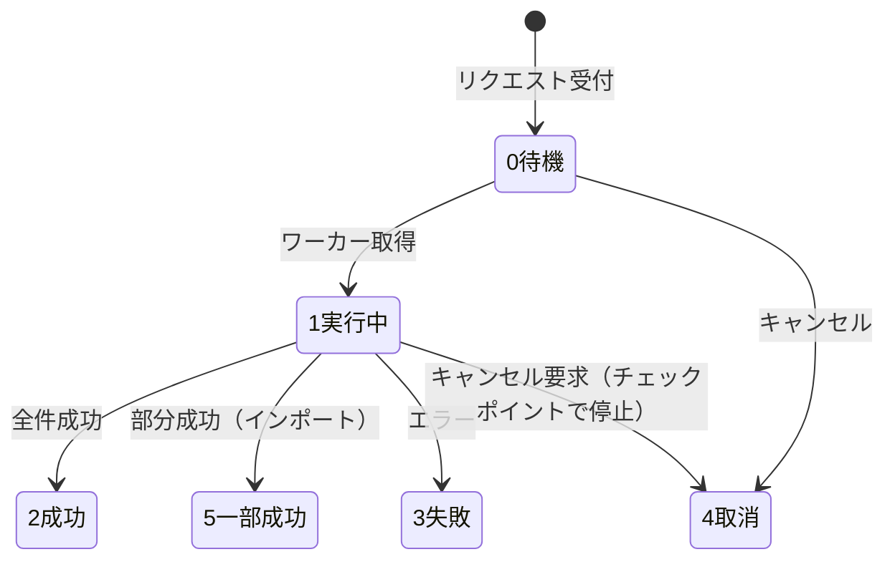

# 单据编号・导入导出 详细设计书（採番・インポート/エクスポート 詳細設計書）

| 項目 | 内容 |
|---|---|
| 文書名 | 单据编号・导入导出 详细设计书（採番・インポート/エクスポート 詳細設計書） |
| 文書番号 | DSN-SYS-006 |
| 版数 | v1.0 |
| 作成日 | 2026-10-20 |
| 作成者 | system-workflow（域設計担当） |
| 承認者 | 未承認（レビュー待ち） |
| 状態 | ドラフト（レビュー中） |
| 関連文書 | [業務域概要](00-overview.md) / [DB 設計](90-db-design.md) / [API 設計](91-api-design.md) / [帳票・バッチ設計](92-report-batch-design.md) / [共通業務規則](../00-common/08-common-business-rules.md) |

---

## 1. 機能概要

| 項目 | 内容 |
|---|---|
| 機能 ID | F-SYS-012（单据编号规则）、F-SYS-013（导入导出中心） |
| 機能名 | 採番ルール管理・採番 API、Excel インポート/エクスポート・非同期ジョブ・エラー報告 |
| 目的 | 全業務域の伝票番号・マスタコードを一元採番し、重複・欠番管理を統制する。大量データの一括投入・抽出を安全に行う |
| 利用者・ロール | 系统管理员（採番ルール・全社ジョブ）、全ロール（自分のエクスポート・権限内のインポート） |
| 利用シーン | 新伝票種別の追加、年度切替、期首データ投入、一覧データの抽出、マスタ一括更新 |
| 優先度 | F-SYS-012 P0、F-SYS-013 P1 |
| 画面 ID | SCR-SYS-023（单据编号规则）、SCR-SYS-024（导入导出中心）、SCR-SYS-025（异步任务詳細/進捗） |
| 関連 IF | なし（ファイルはローカルストレージ） |

## 2. 業務要件・業務ルール

### 2.1 前提条件

| # | 前提条件 | 成立しない場合の挙動 |
|---|---|---|
| 1 | 採番ルールが有効（`status=1`）かつ適用開始日 ≤ 当日 | 採番不可（MSG-SYS-050） |
| 2 | 採番は `sys_sequence` の行ロックで原子的に実行 | ロックタイムアウト時は MSG-SYS-052 |
| 3 | インポートはテンプレート（`sys_import_template`）に一致するファイルのみ | 不一致は MSG-COM-062 |
| 4 | ジョブ実行ユーザは対象業務の権限を持つこと | 403 |

### 2.2 業務ルール

| # | ルール | 根拠（法令・社内規程・業務慣行） | 関連項目 |
|---|---|---|---|
| BR-01 | 共通形式 `{prefix}{date}{4桁日序}`（日次リセット）。プレフィックス・桁数・リセット周期はルールで管理（[共通業務規則](../00-common/08-common-business-rules.md) 2.1） | 共通規約 | `prefix`、`seq_length` |
| BR-02 | 日付は採番実行日（業務日付ではない）。取消・再作成でも新しい番号を採番し、欠番は許容する | 共通規約 | `sequence_date` |
| BR-03 | 採番はトランザクション内で実行し、失敗時は番号を消費しない（ロールバック） | 共通規約 | — |
| BR-04 | 承認取消・再提出では番号を変えない（同一伝票の状態遷移） | 共通規約 | — |
| BR-05 | 採番済みの伝票種別は `is_locked=true` となり、プレフィックス・桁数・リセット周期の変更禁止（新ルールを `effective_from` 付きで追加） | 監査証跡 | `is_locked` |
| BR-06 | ルールのプレビュー（例 `SO2610200001`）を保存時に生成し、画面に表示する | 操作性 | `example_value` |
| BR-07 | インポートは「検証（ドライラン）→ 実行」の 2 段階。検証結果（エラー行・理由）をダウンロードできる | [共通業務規則](../00-common/08-common-business-rules.md) 13.2 | `sys_import_export_error` |
| BR-08 | インポートの最大行数は 10,000 行/回。超過はエラー（分割を促す） | 共通規約 | — |
| BR-09 | 一括処理は全件成功 or 全件失敗を既定。行単位の部分成功を許すインポートは結果一覧を返す | 共通規約 | `fail_count` |
| BR-10 | エクスポートは 1 回 10,000 件まで同期、超過は非同期ジョブ（202 + jobId）。ジョブ結果は 7 日保存 | [API 共通規格](../00-common/03-common-api-spec.md) 12 章 | `expire_at` |
| BR-11 | エクスポート・インポートは件数・対象・実行者を監査ログに記録する。個人情報はマスキング | 監査 | `sys_audit_log` |
| BR-12 | 同時実行は 1 ユーザ 3 ジョブ、全体 10 ジョブまで。超過はキュー待ち（`0 待機`） | 性能 | `sys_param` |

### 2.3 判定式

| # | 対象 | 算式 | 例 |
|---|---|---|---|
| CALC-01 | 採番値の文字列 | `prefix + date.format(date_format) + zeroPad(seq, seq_length)` | `SO` + `261020` + `0001` = `SO2610200001` |
| CALC-02 | リセット単位日 | 日次=当日、月次=月初、年次=年初、無=1970-01-01 | 2026-10-20 日次 → 2026-10-20 |
| CALC-03 | エクスポート上限判定 | `count > 10000` なら非同期 | 12,000 件 → 非同期 |

### 2.4 状態遷移（非同期ジョブ `job_status`）



| 遷移 | トリガ | 権限 | 更新項目 | メッセージ |
|---|---|---|---|---|
| 0→1 | ワーカー取得 | システム | `job_status=1`、`started_at` | — |
| 1→2/5/3 | 完了 | システム | `job_status`、`finished_at`、件数 | MSG-COM-003/063/064 |
| 0/1→4 | キャンセル | 所有者 or 管理者 | `job_status=4` | MSG-COM-003 |

## 3. 関連機能

| 関係 | 機能 ID | 機能名 | 関係内容 |
|---|---|---|---|
| 上流 | 全業務域 | 伝票登録 | 採番 API（同期コマンド）の呼出 |
| 上流 | 各域一覧画面 | エクスポート | 非同期ジョブ起動を依頼 |
| 下流 | F-SYS-010 | 附件 | 入出力ファイルの保存・DL |
| 参照 | F-SYS-009 | 审计日志 | 実行履歴 |
| 参照 | F-SYS-020 | 系统维护 | ジョブ・ファイル清理 |

## 4. 画面設計

### 4.1 画面一覧

| 画面 ID | 画面名 | 類型 | 概要 |
|---|---|---|---|
| SCR-SYS-023 | 单据编号规则 | LIST | ルール一覧、編集ダイアログ、プレビュー、適用開始日 |
| SCR-SYS-024 | 导入导出中心 | LIST | ジョブ一覧（自分/全社）、新規インポート、テンプレート DL、結果 DL |
| SCR-SYS-025 | 异步任务詳細/進捗 | VIEW | 進捗バー、成功/失敗件数、エラー行一覧、エラー報告 DL、キャンセル |

### 4.2 画面レイアウト（SCR-SYS-024 导入导出中心）

```
┌─────────────────────────────────────────────────────────────────────────────┐
│ ホーム > 系统管理 > 导入导出中心                                            │
├─────────────────────────────────────────────────────────────────────────────┤
│〔タブ〕[我的任务][全部任务（管理者）]                                        │
│〔ツールバー〕[新建导入] [下载模板▼] [刷新]                                  │
├─────────────────────────────────────────────────────────────────────────────┤
│ 任务编号        | 类型 | 名称       | 进度 | 成功/失败 | 状态   | 操作       │
│ JOB2610200003  | 导入 | 用户导入   | 100% | 950/50   | 一部成功 | [詳細][错误报告] │
│ JOB2610200002  | 导出 | 用户台账   | 100% | 900/0    | 成功    | [下载][詳細] │
│ JOB2610200001  | 导出 | 受注一覧   | 45%  | -        | 执行中  | [取消]      │
├─────────────────────────────────────────────────────────────────────────────┤
│ 全 3 件                                                                    │
└─────────────────────────────────────────────────────────────────────────────┘
```

### 4.3 画面項目定義（SCR-SYS-023 编号规则）

| No | 項目 ID | 項目名 | 種別 | 型/桁 | 必須 | 初期値 | 入力チェック | データソース | DB 項目 | 権限 | 備考 |
|---|---|---|---|---|---|---|---|---|---|---|---|
| 1 | `ruleCode` | 规则代码 | テキスト | VARCHAR(64) | ○ | 空 | `^[A-Z][A-Z0-9_]{2,63}$`、一意 | 入力 | `sys_number_rule.rule_code` | 編集可（新規） | 例 `SALES_ORDER` |
| 2 | `ruleName` | 规则名称 | テキスト | VARCHAR(100) | ○ | 空 | ≤100 字 | 入力 | `rule_name` | 編集可 | 「销售订单」 |
| 3 | `moduleCode` | 模块 | 選択 | VARCHAR(32) | ○ | 空 | 固定 10 モジュール | 固定値 | `module_code` | 編集可 | — |
| 4 | `prefix` | 前缀 | テキスト | VARCHAR(10) | ○ | 空 | 大文字英数 1〜10 | 入力 | `prefix` | 編集可 | 例 `SO` |
| 5 | `dateFormat` | 日期格式 | 選択 | VARCHAR(16) | ○ | `yyMMdd` | 日次は日を含む形式必須 | 固定値 | `date_format` | 編集可 | `yyMMdd`/`yyMM`/`yyyy`/空 |
| 6 | `seqLength` | 流水位数 | 数値 | SMALLINT | ○ | 4 | 1〜10 | 入力 | `seq_length` | 編集可 | — |
| 7 | `resetCycle` | 重置周期 | 選択 | SMALLINT | ○ | 1 日次 | 1〜4 | 固定値 | `reset_cycle` | 編集可 | — |
| 8 | `startValue` | 起始值 | 数値 | BIGINT | ○ | 1 | ≥1 | 入力 | `start_value` | 編集可 | — |
| 9 | `exampleValue` | 预览 | 表示 | VARCHAR(64) | — | 計算 | — | 計算 | `example_value` | 参照 | 入力に応じ動的更新 |
| 10 | `effectiveFrom` | 适用开始日 | 日付 | DATE | ○ | 当日 | 過去日は警告 | 入力 | `effective_from` | 編集可 | 既存ルールは未来日 |
| 11 | `isLocked` | 锁定 | 表示 | BOOLEAN | — | 計算 | — | 計算 | `is_locked` | 参照 | 採番実績あり=true |
| 12 | `status` | 状态 | ラジオ | SMALLINT | ○ | 1 有效 | 1/0 | 固定値 | `status` | 編集可 | — |

### 4.4 画面項目定義（SCR-SYS-024 新規インポート ダイアログ）

| No | 項目 ID | 項目名 | 種別 | 型/桁 | 必須 | 初期値 | 入力チェック | データソース | DB 項目 | 権限 |
|---|---|---|---|---|---|---|---|---|---|---|
| 1 | `templateId` | 导入模板 | 選択 | BIGINT | ○ | 空 | 有効テンプレート | `sys_import_template` | `template_id` | `system:job:create` |
| 2 | `file` | 文件 | アップロード | — | ○ | 空 | xlsx、≤20MB、≤10,000 行 | 入力 | `source_file_id` | 同上 |
| 3 | `mode` | 执行模式 | ラジオ | SMALLINT | ○ | 1 验证并执行 | 1 検証のみ / 2 検証して実行 | 固定値 | `request_params.mode` | 同上 |
| 4 | `overwrite` | 既存更新 | スイッチ | BOOLEAN | ○ | false | — | 入力 | `request_params.overwrite` | 同上 |
| 5 | `errorPolicy` | 错误处理 | ラジオ | SMALLINT | ○ | 1 全部回滚 | 1 全部回滚 / 2 跳过错误行 | 固定値 | `request_params.errorPolicy` | 同上 |

### 4.5 イベント処理

| No | イベント | トリガ | 処理内容 | 呼出 API | 画面遷移 | 備考 |
|---|---|---|---|---|---|---|
| 1 | ルール保存 | 保存ボタン | 検証→保存→プレビュー更新 | POST/PUT /api/system/number-rules | 同一画面 | ロック時は制限 |
| 2 | 採番テスト | ボタン | 採番を消費せずプレビュー生成 | POST /api/system/number-rules/{code}/preview | — | 連番は進めない |
| 3 | テンプレート DL | ツールバー | テンプレート取得 | GET /api/system/import-templates/{id}/download | — | 監査ログ |
| 4 | インポート起動 | 実行ボタン | ファイル検証→ジョブ登録→202 | POST /api/system/jobs/import | SCR-SYS-025 | 非同期 |
| 5 | エクスポート起動 | 各一覧のエクスポート | 検索条件付きジョブ登録 | POST /api/system/jobs/export | SCR-SYS-025 | 1 万件超 |
| 6 | 進捗確認 | 画面表示/ポーリング（5 秒） | ジョブ状態取得 | GET /api/system/jobs/{id} | — | 完了まで |
| 7 | 結果 DL | リンク | 署名チェック→ダウンロード | GET /api/system/jobs/{id}/files/{fileId} | — | 7 日期限 |
| 8 | エラー報告 DL | リンク | PRT-SYS-005 生成 | GET /api/system/jobs/{id}/errors/export | — | — |
| 9 | キャンセル | ボタン | 取消要求→チェックポイント停止 | DELETE /api/system/jobs/{id} | — | 実行中のみ |
| 10 | ジョブ再実行 | ボタン | 失敗ジョブと同じ条件で新規起動 | POST /api/system/jobs/{id}/retry | SCR-SYS-025 | 新規 jobId |

### 4.6 表示制御

| 条件 | 対象項目/ボタン | 制御 |
|---|---|---|
| `is_locked=true` | プレフィックス・桁数・リセット周期 | 編集不可（適用開始日のみ可） |
| ジョブ所有者以外（管理者以外） | キャンセル・結果 DL | 非表示 |
| `job_status IN (2,3,4,5)` | キャンセルボタン | 非表示 |
| 結果ファイル期限切れ | ダウンロードリンク | 「期限切れ」表示（MSG-COM-066） |
| 権限なし | 新規インポート/エクスポート | 非表示 |
| 他ユーザのジョブ | 一覧（全部タブ） | 管理者のみ表示 |

## 5. 入力チェック仕様

| No | チェック ID | 対象項目 | 種別 | 条件 | タイミング | メッセージ ID |
|---|---|---|---|---|---|---|
| 1 | CHK-SYS-012-01 | `ruleCode` | 形式・一意 | `^[A-Z][A-Z0-9_]{2,63}$`、既存なし | 保存 | MSG-COM-050 |
| 2 | CHK-SYS-012-02 | `prefix` | 形式 | 大文字英数 1〜10 | 保存 | MSG-SYS-053 |
| 3 | CHK-SYS-012-03 | `seqLength` | 値域 | 1〜10 | 保存 | MSG-COM-044 |
| 4 | CHK-SYS-012-04 | `dateFormat` | 相関 | 日次リセットは日付部分に日を含む | 保存 | MSG-SYS-051 |
| 5 | CHK-SYS-012-05 | `effectiveFrom` | 相関 | 既存ルール変更時は未来日（当日以降） | 保存 | MSG-SYS-054 |
| 6 | CHK-SYS-012-06 | 採番実績 | 制約 | `sys_sequence` に実績ありの桁数短縮禁止 | 保存 | MSG-SYS-055 |
| 7 | CHK-SYS-013-01 | `file` | 形式 | .xlsx/.xls、テンプレート一致（列ヘッダ） | 起動 | MSG-COM-062 |
| 8 | CHK-SYS-013-02 | `file` | 行数 | ≤10,000 行 | 起動 | MSG-SYS-056 |
| 9 | CHK-SYS-013-03 | `templateId` | 有効 | `status=1` かつ有効期間内 | 起動 | MSG-COM-049 |
| 10 | CHK-SYS-013-04 | ジョブ同時実行 | 上限 | ユーザ 3 件・全体 10 件 | 起動 | MSG-SYS-057 |
| 11 | CHK-SYS-013-05 | エクスポート件数 | 上限 | 条件件数 ≤1,000,000（超は条件絞り込み） | 起動 | MSG-COM-052 |
| 12 | CHK-SYS-013-06 | キャンセル | 状態 | `job_status IN (0,1)` | キャンセル | MSG-COM-034 |

## 6. 処理詳細

### 6.1 処理一覧

| 処理 ID | 処理名 | 契機 | トランザクション | 排他 |
|---|---|---|---|---|
| PRC-SYS-012-01 | 採番（同期コマンド） | 業務域の伝票登録 | 呼出元と同一 TX | `sys_sequence` 行ロック |
| PRC-SYS-012-02 | ルール保存 | 画面保存 | 要 | 楽観排他 |
| PRC-SYS-012-03 | 採番プレビュー | ボタン | 不要 | なし（連番を進めない） |
| PRC-SYS-013-01 | インポート起動 | API | 要（ジョブ＋ファイル） | 同時実行数チェック |
| PRC-SYS-013-02 | インポート実行 | ワーカー | 行単位 / 全件 | ジョブ状態 |
| PRC-SYS-013-03 | エクスポート実行 | ワーカー | 不要（読み取り） | なし |
| PRC-SYS-013-04 | ジョブキャンセル | API | 要 | ジョブ行ロック |
| PRC-SYS-013-05 | 結果ファイル清理 | BAT-SYS-007 | 要 | 期限切れ抽出 |

### 6.2 処理手順（正常系）

**PRC-SYS-012-01 採番（同期コマンド）**

1. 呼出元（伝票登録サービス）から `ruleCode` を指定して SYS の公開 Service（`NumberingService.next(ruleCode)`）を呼ぶ（[跨域流程](../00-common/09-cross-domain-flow.md) 2.1 同期コマンド）。
2. `sys_number_rule` から有効ルールを取得する（`status=1`、`effective_from <= today`、最新 `effective_from`）。
3. `reset_cycle` に応じて `sequence_date` を計算する（日次=当日、月次=当月 1 日、年次=当年 1 月 1 日、無=1970-01-01）。
4. `INSERT INTO sys_sequence ... ON CONFLICT (company_id, sequence_key, sequence_date) DO UPDATE SET current_value = sys_sequence.current_value + sys_sequence.step RETURNING current_value` を実行する（呼出元トランザクション内）。
5. 採番値を `prefix + date.format(date_format) + zeroPad(current_value, seq_length)` で生成する。`current_value` が `seq_length` 桁を超える場合は `MSG-SYS-058`（桁溢れ）でエラー。
6. 番号を返す。呼出元がロールバックした場合、連番は消費される（欠番許容）。
7. ルールの `example_value` を更新する（初回のみ）。

**PRC-SYS-013-01 インポート起動**

1. 権限チェック（`system:job:create`）。テンプレートの `module_code` に対する業務権限も確認する。
2. 同時実行数を確認する（ユーザ 3・全体 10）。超過時はキュー（`0 待機`）として登録し、202 を返す。
3. ファイルを `sys_attachment`（一時ファイル、`expire_at=+7 日`）として保存し、`sys_import_export_job` を INSERT する（`job_status=0`）。
4. ワーカー（`ImportJobWorker`、1 分間隔 + 即時トリガ）が `job_status=0` を取得し `1` に更新する。
5. ファイルを Apache POI（SXSSF、ストリーム）で読み込み、`column_schema` に基づき行検証を行う（必須・型・桁・コード存在・業務ルール）。
6. `mode=1`（検証のみ）は検証結果のみで完了（`2 成功` or `5 一部成功`）。`mode=2` は有効行を業務サービス経由で登録する（SQL 直接投入禁止）。
7. 行エラーは `sys_import_export_error` に INSERT する（先頭 1,000 件まで。超過は総件数のみ）。`errorPolicy=1`（全部回滚）の場合は 1 件でもエラーがあれば全件ロールバックし `3 失敗`。
8. 完了時 `job_status`・件数・`progress=100`・`finished_at` を更新し、結果ファイル（エラー報告 PRT-SYS-005）を `sys_attachment` に保存して `result_file_id` を設定する。
9. 監査ログ（`IMPORT`）を記録し、完了を `sys_notification` で実行者へ通知する。

**PRC-SYS-013-03 エクスポート実行**

1. `request_params`（検索条件・列定義）を復元し、業務域の一覧サービス（読み取り）からデータを取得する。
2. SXSSF で 1,000 行ごとにフラッシュして `.xlsx` を生成する（メモリ一定）。
3. 個人情報はマスキング、金額・数量は表示形式を統一する（[共通項目定義](../00-common/01-common-item-definitions.md) 第 6 章）。
4. 生成ファイルを `sys_attachment` に保存し、`result_file_id` と `expire_at=+7 日` を設定する。
5. 監査ログ（`EXPORT`）を記録し、完了通知を送る。

**PRC-SYS-013-04 ジョブキャンセル**

1. ジョブ所有者 or `system:job:cancel` 権限を確認する。
2. `job_status IN (0,1)` を確認し `4 取消` に更新する。
3. 実行中ワーカーはチェックポイント（1,000 行ごと）で `job_status=4` を検出して停止し、部分結果を破棄する（全件ロールバック）か、部分結果を残す（エクスポートのみ）。インポートは全件ロールバック。

### 6.3 例外処理

| No | 異常条件 | 検知箇所 | 処理 | ロールバック | メッセージ ID |
|---|---|---|---|---|---|
| 1 | 有効ルールなし | 採番 | エラー | 呼出元全体 | MSG-SYS-050 |
| 2 | 採番ロックタイムアウト（3 秒） | 採番 | エラー | 呼出元全体 | MSG-SYS-052 |
| 3 | 連番桁溢れ | 採番 | エラー、ルール見直しを促す | 呼出元全体 | MSG-SYS-058 |
| 4 | テンプレート不一致 | インポート起動 | 拒否 | — | MSG-COM-062 |
| 5 | 行数超過（10,000 超） | インポート起動 | 拒否 | — | MSG-SYS-056 |
| 6 | 行エラー（必須・型・コード） | インポート実行 | 行エラー記録、ポリシーに従い続行/中断 | ポリシー依存 | MSG-COM-063 |
| 7 | 業務エラー（重複・状態不整合） | インポート実行 | 行エラー記録 | 同上 | 各域 MSG |
| 8 | ワーカー異常終了 | 監視 | ジョブを `3 失敗` に更新、再実行を案内 | 全体 | MSG-SYS-059 |
| 9 | 結果ファイル期限切れ | DL | 再実行を案内 | — | MSG-COM-066 |
| 10 | 同時実行上限超過 | 起動 | キュー待ち（0 待機） | — | — |

### 6.4 冪等性・再実行

- 採番は冪等でない（呼出毎に番号を消費）。ただし呼出元のロールバック時は欠番として許容する。
- インポート起動は `Idempotency-Key` 必須。同一ファイル・同一テンプレートの二重起動は同一ジョブを返す。
- ジョブの再実行は「新規ジョブ」として起動する（既存結果を上書きしない）。
- インポートの部分成功後、再実行時は `overwrite=true` の場合に既存更新、false の場合は重複エラーとなる（ユーザが判断）。

## 7. API 設計

| No | メソッド | パス | 権限 | 概要 |
|---|---|---|---|---|
| 1 | GET | /api/system/number-rules | `system:number-rule:view` | 採番ルール一覧 |
| 2 | GET | /api/system/number-rules/{code} | `system:number-rule:view` | 採番ルール詳細 |
| 3 | POST | /api/system/number-rules | `system:number-rule:update` | ルール登録 |
| 4 | PUT | /api/system/number-rules/{code} | `system:number-rule:update` | ルール更新 |
| 5 | POST | /api/system/number-rules/{code}/preview | `system:number-rule:view` | 採番プレビュー（消費なし） |
| 6 | POST | /api/system/numbers | 内部（サービス間） | 採番実行（他域から Service 呼出。API は公開しない） |
| 7 | GET | /api/system/import-templates | `system:import-template:view` | テンプレート一覧 |
| 8 | GET | /api/system/import-templates/{id}/download | `system:import-template:view` | テンプレート DL |
| 9 | POST | /api/system/jobs/import | `system:job:create` | インポート起動（multipart） |
| 10 | POST | /api/system/jobs/export | 各域 `:export` 権限 | エクスポート起動 |
| 11 | GET | /api/system/jobs | `system:job:view` | ジョブ一覧 |
| 12 | GET | /api/system/jobs/{id} | `system:job:view` | ジョブ状態・進捗 |
| 13 | GET | /api/system/jobs/{id}/files/{fileId} | `system:job:download` | 結果 DL |
| 14 | GET | /api/system/jobs/{id}/errors | `system:job:view` | エラー行一覧 |
| 15 | POST | /api/system/jobs/{id}/errors/export | `system:job:view` | エラー報告出力（PRT-SYS-005） |
| 16 | DELETE | /api/system/jobs/{id} | `system:job:cancel` | キャンセル |
| 17 | POST | /api/system/jobs/{id}/retry | `system:job:create` | 再実行 |
| 18 | GET | /api/system/jobs/{id}/download | `system:job:download` | （互換）結果 DL |

### 7.1 リクエスト/レスポンス詳細

**POST /api/system/jobs/import**（multipart/form-data）

```
templateId=1845000000000007001&mode=2&overwrite=false&errorPolicy=1&file=@users.xlsx
// 202 Accepted
{ "code": 0, "message": "导出任务已受理，完成后可在「导入导出中心」下载。", "data": { "jobId": "1845000000000007101", "jobNo": "JOB2610200003", "jobStatus": 0 } }
```

**GET /api/system/jobs/{id}**

```json
{ "code": 0, "message": "ok", "data": {
  "jobId": "1845000000000007101", "jobNo": "JOB2610200003", "jobType": 1, "jobName": "用户导入",
  "jobStatus": 5, "progress": 100, "totalCount": 1000, "successCount": 950, "failCount": 50,
  "startedAt": "2026-10-20T14:30:00+08:00", "finishedAt": "2026-10-20T14:31:20+08:00",
  "resultFileId": "1845000000000007201", "expireAt": "2026-10-27T14:31:20+08:00" } }
```

**POST /api/system/number-rules/{code}/preview**

```json
{ "prefix": "SO", "dateFormat": "yyMMdd", "seqLength": 4, "nextValue": 1 }
// → { "code": 0, "data": { "exampleValue": "SO2610200001" } }
```

## 8. データ更新仕様

| テーブル | 操作 | 更新項目 | 更新条件 | トリガ（処理 ID） |
|---|---|---|---|---|
| sys_number_rule | INSERT/UPDATE | 全項目・`example_value` | ルール保存 | PRC-SYS-012-02 |
| sys_sequence | UPSERT | `current_value` | 採番 | PRC-SYS-012-01 |
| sys_import_export_job | INSERT/UPDATE | 全項目 | 起動/実行/完了 | PRC-SYS-013-01/02/03/04 |
| sys_import_export_error | INSERT | 全項目 | 行エラー | PRC-SYS-013-02 |
| sys_attachment | INSERT/UPDATE | 一時ファイル・結果ファイル・`expire_at` | 入出力 | PRC-SYS-013-01/02/03 |
| sys_audit_log | INSERT | `operation_type`=IMPORT/EXPORT | 実行 | 全処理 |

## 9. エラー処理・メッセージ

| メッセージ ID | 種別 | 本文 | 発生条件 | 利用者への対処 | ログ |
|---|---|---|---|---|---|
| MSG-SYS-050 | E | 未找到有效的编号规则（{0}），请联系管理员。 | ルールなし | 管理者へ連絡 | ERROR |
| MSG-SYS-051 | E | 日次重置的编号规则日期格式必须包含日（如 yyMMdd）。 | 形式不整合 | 修正 | INFO |
| MSG-SYS-052 | E | 编号生成超时，请稍后重试。 | ロックタイムアウト | 再試行 | WARN |
| MSG-SYS-053 | E | 前缀只能使用大写字母和数字（1〜10 位）。 | 形式違反 | 修正 | INFO |
| MSG-SYS-054 | E | 已启用规则的修改必须从未来日期生效。 | 過去日 | 未来日設定 | INFO |
| MSG-SYS-055 | E | 已存在采番记录，不能缩短流水位数。 | 桁数短縮 | 新ルール追加 | WARN |
| MSG-SYS-056 | E | 导入文件行数超过上限（10,000 行），请分割后导入。 | 行数超過 | 分割 | INFO |
| MSG-SYS-057 | E | 当前任务数已达上限（用户 3 个/系统 10 个），请稍后重试。 | 同時実行上限 | 待機 | WARN |
| MSG-SYS-058 | E | 编号流水位数不足（当前值 {0}），请调整规则或起始值。 | 桁溢れ | ルール見直し | ERROR |
| MSG-SYS-059 | E | 任务执行失败：{0}。请检查数据后重新执行。 | ワーカー失敗 | 再実行 | ERROR |

## 10. 権限・セキュリティ

| 種別 | 内容 |
|---|---|
| 画面権限 | `system:number-rule:view`、`system:job:view`、`system:import-template:view` |
| 操作権限 | ルール変更 `system:number-rule:update`、インポート起動 `system:job:create`、キャンセル `system:job:cancel` |
| データ範囲 | ジョブ一覧は自分のジョブのみ。管理者は全社。結果ファイルはジョブ所有者のみ DL |
| 監査ログ | ルール変更・インポート/エクスポート実行（件数・ファイル名・対象）を記録 |
| ファイル | 一時ファイルは 7 日で自動削除。アップロードは 20MB 制限。マクロ付き Excel（xlsm）は拒否 |
| 注入対策 | Excel 数式インジェクション対策（セル先頭 `=`/`+`/`-`/`@` は文字列化）、SQL は MyBatis バインドのみ |

## 11. 性能・非機能

| 項目 | 目標値 | 前提 |
|---|---|---|
| 採番応答 | 5 ms 以内（P95） | `sys_sequence` 行ロック、PK アクセス |
| インポート 10,000 行 | 3 分以内 | SXSSF ストリーム、バルク INSERT |
| エクスポート 10,000 行 | 1 分以内 | SXSSF、非同期 |
| 同時ジョブ | 10 件 | ワーカースレッドプール 5 |
| 進捗更新頻度 | 1,000 行ごと | `progress` 更新 |

## 12. テスト観点

| No | 観点 ID | 分類 | 観点 | 期待結果 |
|---|---|---|---|---|
| 1 | TST-F-SYS-012-01 | 正常系 | 伝票登録で採番 | ルール通りの番号が発行される |
| 2 | TST-F-SYS-012-02 | 境界値 | 日次リセット（翌日） | 連番が 0001 に戻る |
| 3 | TST-F-SYS-012-03 | 例外 | 採番後に業務ロールバック | 番号は欠番（重複しない） |
| 4 | TST-F-SYS-012-04 | 異常系 | 有効ルールなし | MSG-SYS-050 |
| 5 | TST-F-SYS-012-05 | 排他 | 100 同時採番 | 重複なし、連番が一意 |
| 6 | TST-F-SYS-012-06 | 制約 | 採番実績ありルールの桁数短縮 | MSG-SYS-055 |
| 7 | TST-F-SYS-012-07 | 正常系 | プレビュー | 連番を消費しない |
| 8 | TST-F-SYS-013-01 | 正常系 | 1,000 行インポート（全件成功） | 成功件数 1,000、結果通知 |
| 9 | TST-F-SYS-013-02 | 異常系 | 必須漏れ行を含むインポート（全部回滚） | 全件ロールバック、エラー報告DL |
| 10 | TST-F-SYS-013-03 | 正常系 | 部分成功ポリシー | 成功/失敗件数が正しく、失敗行が一覧化 |
| 11 | TST-F-SYS-013-04 | 境界値 | 10,001 行ファイル | MSG-SYS-056 |
| 12 | TST-F-SYS-013-05 | 正常系 | 12,000 件エクスポート | 非同期ジョブになり完了後に DL |
| 13 | TST-F-SYS-013-06 | 権限 | 他ユーザのジョブ DL | 403 |
| 14 | TST-F-SYS-013-07 | 正常系 | ジョブキャンセル（実行中） | チェックポイントで停止、状態 4 |
| 15 | TST-F-SYS-013-08 | 冪等 | 同一 Idempotency-Key でインポート 2 回 | 同一ジョブが返る |
| 16 | TST-F-SYS-013-09 | セキュリティ | 数式 `=cmd` を含むセルのエクスポート | 文字列として出力される |

## 13. 未決事項

| # | 事項 | 理由 | 暫定仕様 | 担当 | 期限 |
|---|---|---|---|---|---|
| 1 | ジョブワーカーの実行方式 | アプリ内スレッド or 外部ワーカー | アプリ内（`@Async` + スレッドプール 5）。水平分割も第一版対象（TODO：設計が未作成） | Lead | 2026-11-17 |
| 2 | 採番 API の公開形態 | モジュール公開 Service か内部 REST か | 同一プロセスの公開 Service（[跨域流程](../00-common/09-cross-domain-flow.md) 2.1）。REST は公開しない | Lead | 2026-10-27 |
| 3 | インポートの業務サービス呼出方式 | 域を跨るバルク登録の責任分界 | 各域が `ImportHandler` インタフェースを実装し、SYS が呼ぶ（更新責任は各域） | Lead | 2026-11-17 |
| 4 | 年度切替時の採番ルール運用 | `effective_from` による切替の運用詳細 | 年次ルールは 12/1 までに翌年ルールを登録。進行中伝票は旧番号 | 系统管理员 | 2026-12-01 |

## 14. 改訂履歴

| 版数 | 日付 | 変更内容 | 変更者 |
|---|---|---|---|
| v1.0 | 2026-10-20 | 初版：F-SYS-012/013 の業務ルール 12、画面 3、画面項目定義、処理 8 件、API 18 件、メッセージ 10 件、テスト観点 16 件 | system-workflow |