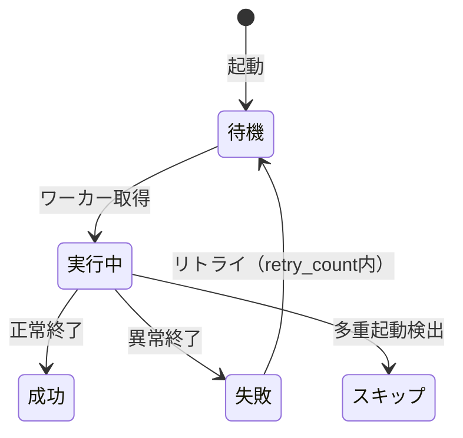

# 打印模板・定时任务・运维监控 详细设计书（帳票テンプレート・定期ジョブ・運用監視 詳細設計書）

| 項目 | 内容 |
|---|---|
| 文書名 | 打印模板・定时任务・运维监控 详细设计书（帳票テンプレート・定期ジョブ・運用監視 詳細設計書） |
| 文書番号 | DSN-SYS-007 |
| 版数 | v1.0 |
| 作成日 | 2026-10-20 |
| 作成者 | system-workflow（域設計担当） |
| 承認者 | 未承認（レビュー待ち） |
| 状態 | ドラフト（レビュー中） |
| 関連文書 | [業務域概要](00-overview.md) / [DB 設計](90-db-design.md) / [帳票・バッチ設計](92-report-batch-design.md) / [API 設計](91-api-design.md) / [共通業務規則](../00-common/08-common-business-rules.md) |

---

## 1. 機能概要

| 項目 | 内容 |
|---|---|
| 機能 ID | F-SYS-015（打印模板管理）、F-SYS-016（在线用户与定时任务监控）、F-SYS-020（系统初始化与数据维护） |
| 機能名 | 帳票テンプレート、オンラインユーザ・セッション管理、ジョブ監視、初期化・キャッシュ再構築・整合性検査 |
| 目的 | 帳票レイアウトを業務側で変更可能にし、システム運用（セッション・ジョブ・キャッシュ・データ整合性）を可視化・統制する |
| 利用者・ロール | 系统管理员、运维担当（監視・実行者）、内审员（データ整合性検査の参照） |
| 利用シーン | 帳票レイアウト変更、退職者のセッション強制切断、ジョブ失敗時の再実行、期首のキャッシュ再構築、障害時の整合性調査 |
| 優先度 | F-SYS-015 P1、F-SYS-016 P1、F-SYS-020 P1 |
| 画面 ID | SCR-SYS-026（打印模板）、SCR-SYS-027（在线用户）、SCR-SYS-028（定时任务）、SCR-SYS-029（系统初始化与数据维护） |
| 関連 IF | IF-SYS-007（PDF 変換） |

## 2. 業務要件・業務ルール

### 2.1 前提条件

| # | 前提条件 | 成立しない場合の挙動 |
|---|---|---|
| 1 | 帳票 ID（PRT-xxx）が [92](92-report-batch-design.md) に定義されている | テンプレート登録不可 |
| 2 | PDF 変換エンジン（Puppeteer/LibreOffice）が利用可能 | 出力不可（MSG-SYS-080） |
| 3 | データ维护は実行前バックアップ必須 | 実行不可（MSG-SYS-085） |
| 4 | システム初期化は初回のみ（データ存在時は拒否） | 実行不可（MSG-SYS-086） |

### 2.2 業務ルール

| # | ルール | 根拠（法令・社内規程・業務慣行） | 関連項目 |
|---|---|---|---|
| BR-01 | テンプレートは版管理。編集は新バージョン登録で行い、使用中版の上書き禁止（出力中帳票の再現性確保） | 監査 | `version_no` |
| BR-02 | 業務種別ごとに既定テンプレートを 1 件指定。帳票出力時は `report_id + biz_type` → 既定テンプレート → 最新版の順で解決 | 出力規則 | `is_default` |
| BR-03 | 出力履歴（PRT・伝票・出力者・部数）を `sys_print_log` に記録。再出力可。出力後の取消は不可 | 監査 | `sys_print_log` |
| BR-04 | テンプレートのプレビューはサンプルデータ（示例値）で生成し、実データを含めない | 情報保護 | — |
| BR-05 | オンラインユーザの強制ログアウト（踢人）は理由必須。監査ログに記録 | 内部統制 | `sys_audit_log` |
| BR-06 | セッション一覧は Redis（Sa-Token）から取得し、DB に複製しない。強制ログアウトは Sa-Token API で実行 | 性能 | — |
| BR-07 | ジョブの手動実行は監視画面から可能。多重起動防止（`allow_concurrent=false`）を守る | 運用 | `sys_scheduled_job` |
| BR-08 | ジョブ失敗は運用担当へ通知（IF-SYS-001 メール + 站内）。3 連続失敗でアラート強化 | 運用 | `sys_notification` |
| BR-09 | データ维护（初期化・キャッシュ再構築・データ修正）はドライラン→承認→実行の 3 段階。実行履歴にバックアップパスを記録 | 内部統制 | `sys_data_maintenance_log` |
| BR-10 | 整合性検査（BAT-SYS-010）は読み取り専用。検出結果はレポート（PRT-SYS-009）で出力し、是正は手動承認後に行う | 安全 | — |
| BR-11 | DB 直接更新・手動 SQL によるデータ修正は禁止。修正が必要な場合は専用の维护メニューで行い、監査ログを残す | [共通業務規則](../00-common/08-common-business-rules.md) 11 章 | — |

### 2.3 状態遷移（ジョブ実行状態）



| 遷移 | トリガ | 権限 | 更新項目 | メッセージ |
|---|---|---|---|---|
| 待機→実行中 | スケジューラ | システム | `start_at` | — |
| 実行中→成功/失敗 | 終了 | システム | `end_at`・`execute_result` | MSG-SYS-081 |
| 実行中→スキップ | 多重起動 | システム | `execute_result=2` | MSG-COM-084 |

## 3. 関連機能

| 関係 | 機能 ID | 機能名 | 関係内容 |
|---|---|---|---|
| 上流 | 全業務域 | 帳票出力 | テンプレート解決と PDF 生成を依頼 |
| 上流 | 全業務域 | バッチ | ジョブ定義を SYS に登録し、実行履歴を SYS が管理 |
| 下流 | F-SYS-001 | 認証 | セッション一覧・強制ログアウト |
| 下流 | F-SYS-011 | 通知 | ジョブ失敗・保守完了の通知 |
| 参照 | F-SYS-020 | 系统维护 | キャッシュ再構築（BAT-SYS-011） |

## 4. 画面設計

### 4.1 画面一覧

| 画面 ID | 画面名 | 類型 | 概要 |
|---|---|---|---|
| SCR-SYS-026 | 打印模板管理 | LIST | テンプレート一覧、編集（HTML エディタ）、プレビュー、既定指定 |
| SCR-SYS-027 | 在线用户 | LIST | セッション一覧（ユーザ・IP・端末・最終アクセス）、強制ログアウト |
| SCR-SYS-028 | 定时任务监控 | LIST | ジョブ定義一覧、実行履歴、手動実行、停止/再開、次回実行日時 |
| SCR-SYS-029 | 系统初始化与数据维护 | WIZ | ウィザード：维护種別選択→ドライラン→承認→実行→結果 |

### 4.2 画面レイアウト（SCR-SYS-028 定时任务监控）

```
┌───────────────────────────────────────────────────────────────────────────────┐
│ ホーム > 系统管理 > 定时任务                                                  │
├───────────────────────────────────────────────────────────────────────────────┤
│〔タブ〕[任务定义][执行历史]                                                   │
│ 任务编号        | 名称               | Cron        | 状态 | 最终执行   | 结果 | 操作       │
│ BAT-SYS-001    | Outbox 事件配信    | */10 * * * * * | 有效 | 14:30:00 | 成功 | [执行][历史] │
│ BAT-SYS-003    | 密码有效期提醒     | 0 0 8 * * *  | 有效 | 08:00:00 | 失败 | [执行][历史] │
│ BAT-INV-001    | 库存月结           | 0 30 2 1 * * | 有效 | 10-01 02:30 | 成功 | [执行][历史] │
├───────────────────────────────────────────────────────────────────────────────┤
│ 共 32 件                                                                       │
└───────────────────────────────────────────────────────────────────────────────┘
```

### 4.3 画面項目定義（SCR-SYS-026 打印模板）

| No | 項目 ID | 項目名 | 種別 | 型/桁 | 必須 | 初期値 | 入力チェック | データソース | DB 項目 | 権限 | 備考 |
|---|---|---|---|---|---|---|---|---|---|---|---|
| 1 | `templateCode` | 模板代码 | テキスト | VARCHAR(64) | ○ | 空 | 一意 | 入力 | `sys_print_template.template_code` | 編集可（新規） | — |
| 2 | `templateName` | 模板名称 | テキスト | VARCHAR(200) | ○ | 空 | ≤200 字 | 入力 | `template_name` | 編集可 | — |
| 3 | `reportId` | 帳票 ID | 選択 | VARCHAR(32) | ○ | 空 | 92 章の定義済み PRT | `92-report-batch-design.md` | `report_id` | 編集可 | — |
| 4 | `bizType` | 業務種別 | テキスト | VARCHAR(64) | ○ | 空 | 英大文字/`_` | 入力 | `biz_type` | 編集可 | — |
| 5 | `engineType` | 引擎 | 選択 | SMALLINT | ○ | 1 HTML | 1/2 | 固定値 | `engine_type` | 編集可 | — |
| 6 | `content` | テンプレート内容 | コードエディタ | TEXT | ○ | 既定 HTML | 構文チェック・`${}` 変数 | 入力 | `content` | 編集可 | — |
| 7 | `pageSize` | 用紙 | 選択 | VARCHAR(16) | ○ | A4 | A4/A5/LABEL | 固定値 | `page_size` | 編集可 | — |
| 8 | `orientation` | 向き | ラジオ | SMALLINT | ○ | 1 縦 | 1/2 | 固定値 | `orientation` | 編集可 | — |
| 9 | `versionNo` | 版数 | 表示 | INT | — | 自動 | — | 計算 | `version_no` | 参照 | 保存で +1 |
| 10 | `isDefault` | 默认模板 | スイッチ | BOOLEAN | ○ | false | 業務種別内 1 件 | 入力 | `is_default` | 編集可 | — |
| 11 | `effectiveFrom`/`effectiveTo` | 有効期間 | 日付 | DATE | △ | 空 | 開始≤終了 | 入力 | `effective_from`/`to` | 編集可 | — |
| 12 | `preview` | プレビュー | ボタン | — | — | — | サンプルデータ | — | — | 参照 | PDF プレビュー |

### 4.4 画面項目定義（SCR-SYS-027 在线用户）

| No | 項目 ID | 項目名 | 種別 | 型/桁 | 必須 | 初期値 | 入力チェック | データソース | 権限 | 備考 |
|---|---|---|---|---|---|---|---|---|---|---|
| 1 | `username` | 账号/姓名 | テキスト | VARCHAR(64) | △ | 空 | 部分一致 | Sa-Token + `sys_user` | `system:online-user:view` | — |
| 2 | `ipAddress` | IP | テキスト | VARCHAR(45) | △ | 空 | 部分一致 | セッション | 同上 | — |
| 3 | `deviceType` | 端末 | 選択 | SMALLINT | △ | 空 | 1 PC / 2 移动 | セッション | 同上 | — |
| 4 | `loginAt` | ログイン日時 | 表示 | TIMESTAMPTZ | — | — | — | セッション | 同上 | 一覧列 |
| 5 | `lastAccessAt` | 最終アクセス | 表示 | TIMESTAMPTZ | — | — | — | セッション | 同上 | 一覧列 |
| 6 | `kickoutReason` | 强制下线理由 | テキスト | VARCHAR(200) | ○ | 空 | ≤200 字 | 入力 | `system:online-user:kickout` | ダイアログ |

### 4.5 画面項目定義（SCR-SYS-029 系统初始化与数据维护 ウィザード）

| No | ステップ | 項目 ID | 項目名 | 種別 | 必須 | 初期値 | 入力チェック | 権限 |
|---|---|---|---|---|---|---|---|---|
| 1 | 1 维护種別 | `maintenanceType` | 维护类型 | ラジオ | ○ | 空 | 初期化/キャッシュ再構築/整合性検査/アーカイブ/データ修正 | `system:maintenance:execute` |
| 2 | 1 维护種別 | `target` | 対象 | 複数選択 | △ | 空 | 種別に応じた対象（テーブル/キャッシュ/モジュール） | 同上 |
| 3 | 2 ドライラン | `dryRunResult` | ドライラン結果 | 表示 | — | 実行結果 | — | 同上 |
| 4 | 3 承認 | `approverId` | 承認者 | ユーザ選択 | ○ | 空 | 実行者と別人・`system:maintenance:approve` | — |
| 5 | 4 実行 | `backupPath` | バックアップ | 表示 | — | 自動生成 | — | — |
| 6 | 4 実行 | `confirmText` | 確認入力 | テキスト | ○ | 空 | `EXECUTE` と完全一致 | 同上 |

### 4.6 イベント処理

| No | イベント | トリガ | 処理内容 | 呼出 API | 画面遷移 | 備考 |
|---|---|---|---|---|---|---|
| 1 | テンプレート保存 | 保存ボタン | 構文検証→新版登録→旧版無効化 | POST /api/system/print-templates | 同一画面 | — |
| 2 | プレビュー | ボタン | サンプルデータで PDF 生成 | POST /api/system/print-templates/{id}/preview | プレビュー | 監査ログ |
| 3 | 既定指定 | スイッチ | 同一業務種別の既存默认を解除して設定 | PUT /api/system/print-templates/{id}/default | 同一画面 | — |
| 4 | セッション検索 | 検索ボタン | Redis からセッション一覧取得 | GET /api/system/online-users | — | 1,000 件まで |
| 5 | 強制ログアウト | 行操作 | 理由入力→Sa-Token kickout→監査ログ | POST /api/system/online-users/{tokenId}/kickout | — | 理由必須 |
| 6 | ジョブ手動実行 | 行操作/ボタン | 多重起動チェック→実行 | POST /api/system/jobs/{id}/run | 履歴へ | 確認ダイアログ |
| 7 | ジョブ停止/再開 | スイッチ | `status` 切替 | PUT /api/system/jobs/{id}/status | — | — |
| 8 | 実行履歴表示 | タブ/リンク | ジョブログ取得 | GET /api/system/jobs/{id}/logs | — | ページング |
| 9 | 维护ウィザード開始 | 画面表示 | 種別選択 | GET /api/system/maintenance/options | — | — |
| 10 | ドライラン | 次へ | 対象に対し読み取り検査 | POST /api/system/maintenance/dry-run | ステップ2 | 実行しない |
| 11 | 実行 | 実行ボタン | 承認確認→バックアップ→実行→履歴 | POST /api/system/maintenance/execute | 結果 | 二重送信防止 |

### 4.7 表示制御

| 条件 | 対象項目/ボタン | 制御 |
|---|---|---|
| 使用中テンプレート | 上書き保存 | 新版登録のみ（版数 +1） |
| 権限なし | テンプレート編集・踢人・ジョブ実行 | 非表示 |
| 自セッション | 強制ログアウト | 非表示 |
| `allow_concurrent=false` かつ実行中 | 手動実行 | 無効（多重起動防止） |
| 初期化済み（管理データあり） | 初期化メニュー | 無効（BAT-SYS-012 は初回のみ） |
| ドライラン未実施 | 実行ボタン | 無効 |

## 5. 入力チェック仕様

| No | チェック ID | 対象項目 | 種別 | 条件 | タイミング | メッセージ ID |
|---|---|---|---|---|---|---|
| 1 | CHK-SYS-015-01 | `reportId` | 存在 | 92 章に定義された PRT | 保存 | MSG-SYS-080 |
| 2 | CHK-SYS-015-02 | `content` | 構文 | HTML/変数 `${}` の整合 | 保存 | MSG-SYS-081 |
| 3 | CHK-SYS-015-03 | `isDefault` | 一意 | 同一 `report_id + biz_type` で 1 件 | 保存 | MSG-SYS-082 |
| 4 | CHK-SYS-016-01 | `kickoutReason` | 必須 | 空でない | キック | MSG-COM-040 |
| 5 | CHK-SYS-016-02 | 手動実行 | 多重起動 | 実行中ジョブなし | 実行 | MSG-COM-084 |
| 6 | CHK-SYS-016-03 | `cronExpression` | 形式 | Spring Cron 6 桁として妥当 | 保存 | MSG-SYS-083 |
| 7 | CHK-SYS-020-01 | `confirmText` | 一致 | `EXECUTE` と一致 | 実行 | MSG-SYS-084 |
| 8 | CHK-SYS-020-02 | `approverId` | 別人 | 実行者と別人 | 実行 | MSG-SYS-085 |
| 9 | CHK-SYS-020-03 | 初期化 | 状態 | 初期化済みでないこと | 実行 | MSG-SYS-086 |
| 10 | CHK-SYS-020-04 | バックアップ | 必須 | 実行前バックアップ成功 | 実行 | MSG-SYS-087 |

## 6. 処理詳細

### 6.1 処理一覧

| 処理 ID | 処理名 | 契機 | トランザクション | 排他 |
|---|---|---|---|---|
| PRC-SYS-015-01 | テンプレート新版登録 | 保存 | 要 | テンプレート行ロック |
| PRC-SYS-015-02 | 帳票出力（PDF 生成） | 各業務画面 | 不要（生成のみ） | なし |
| PRC-SYS-016-01 | セッション一覧取得 | 画面表示 | 不要 | なし |
| PRC-SYS-016-02 | 強制ログアウト | キック | 要（監査ログ） | なし |
| PRC-SYS-016-03 | ジョブ実行・履歴管理 | スケジューラ | ジョブ単位 | 多重起動チェック |
| PRC-SYS-020-01 | キャッシュ再構築 | 手動/起動時 | 不要 | 実行中フラグ |
| PRC-SYS-020-02 | データ整合性検査 | 手動/バッチ | 不要（読み取り） | なし |
| PRC-SYS-020-03 | システム初期化 | 手動 | 要 | Advisory Lock |
| PRC-SYS-020-04 | データ修正（限定） | 手動 | 要 | 承認 + バックアップ |

### 6.2 処理手順（正常系）

**PRC-SYS-015-02 帳票出力（PDF 生成）**

1. 出力要求（`reportId`、`bizType`、`bizId`、部数）を受け取る。権限・出力可能ステータスを検証する。
2. `sys_print_template` から有効テンプレートを解決する（`report_id` + `biz_type` + `is_default=true` → なければ最新版）。
3. 業務域の公開 API から帳票印字データ（スナップショット）を取得する（[共通項目定義](../00-common/01-common-item-definitions.md) 13 章の項目）。
4. HTML テンプレートの `${...}` をデータで置換し、CSS（A4 ページ設定）を適用する。
5. IF-SYS-007（Puppeteer）で PDF を生成する（タイムアウト 30 秒、失敗時 MSG-SYS-080）。
6. `sys_print_log` に出力履歴を INSERT する（result、出力者、部数）。`sys_audit_log` に `PRINT` を記録する。
7. PDF をレスポンス（`application/pdf`）で返す。非同期出力（大量）の場合はジョブに登録し 202 を返す。

**PRC-SYS-016-01/02 セッション管理**

1. Sa-Token のセッション一覧 API（`getTokenValueListByLoginId` 相当）で全ログインユーザのトークンを取得する。ただし全件はメモリ負荷が高いため、`sys_user` の有効ユーザに限定し、Redis のキー走査（SCAN、100 件ずつ）で構築する。
2. 各セッションから `tokenId`、`userId`、`username`、`loginAt`（`token-create-time`）、`lastAccessAt`（`token-last-active-time`）、IP、UA、端末種別を取得する。
3. 画面に一覧表示する（1,000 件を上限、超過はユーザ/端末で絞り込みを促す）。
4. 強制ログアウト：対象 `tokenId` を `logout(tokenId)` で失効させ、理由を `sys_audit_log`（`LOGOUT`, resource=session, remark=理由）に記録する。対象ユーザへ站内通知を送る（可能な場合）。

**PRC-SYS-016-03 ジョブ実行**

1. スケジューラ（Spring `ThreadPoolTaskScheduler`）が 1 分間隔で `sys_scheduled_job` を確認し、`next_run_at <= now()` のジョブを起動する。
2. 実行前に `sys_scheduled_job_log` に開始を INSERT する。`allow_concurrent=false` の場合、`end_at IS NULL` の既存ログを `FOR UPDATE` で確認し、存在すればスキップ（`execute_result=2`）。
3. ジョブハンドラ（`handler_bean`）を実行する。`timeout_seconds` を超えた場合、スレッドを中断し `失敗` とする（DB トランザクションはハンドラ側で管理）。
4. 終了時に `end_at`・`duration_ms`・`processed_count`・`execute_result` を更新し、`sys_scheduled_job.last_run_at/last_result/next_run_at` を更新する。
5. 失敗時は `retry_count` まで `next_run_at` を再設定してリトライする。最終失敗は `sys_notification` で運用担当へ通知する。

**PRC-SYS-020-01 キャッシュ再構築**

1. `system:cache:refresh` 権限を確認し、実行中フラグ（Redis SETNX）で二重実行を防止する。
2. 対象（辞書/パラメータ/メニュー/権限/組織/採番ルール）ごとに DB から全件取得し、Redis を再構築する。
3. 再構築中は旧キャッシュを TTL 付きで残し、完了後に差し替える（無停止）。
4. 結果（件数・所要時間）を `sys_data_maintenance_log` に記録し、監査ログを残す。

**PRC-SYS-020-02 データ整合性検査（BAT-SYS-010）**

検査項目（読み取り専用、検出のみ）：
1. ユーザの `department_id`/`position_id`/`factory_id` が有効マスタに存在するか。
2. 有効ロールを持たない有効ユーザ。
3. ユーザとロールの循環（ロールなし管理者）。
4. ロール付与の有効期間切れ（`valid_to < today` かつ `status=1`）。
5. 論理削除済みユーザへの有効なロール付与。
6. 添付メタはあるが実体ファイルがないもの（`storage_path` の存在確認、サンプリング）。
7. 参照なし添付（1 年以上 `sys_attachment_biz` なし）。
8. `sys_sequence` と `sys_number_rule` の不整合（ルールなしの連番）。
9. 承認タスクが滞留しているユーザ（退職・停用）※WF 公開 API で照会。
結果を JSON で `sys_data_maintenance_log.detail` に保存し、PRT-SYS-009 として出力可能にする。

### 6.3 例外処理

| No | 異常条件 | 検知箇所 | 処理 | ロールバック | メッセージ ID |
|---|---|---|---|---|---|
| 1 | テンプレート未定義 | 帳票出力 | デフォルト文面で出力しない（エラー） | — | MSG-SYS-080 |
| 2 | PDF 変換失敗 | 帳票出力 | エラー、ジョブの場合は再試行 | なし | MSG-SYS-080 |
| 3 | Sa-Token セッション取得失敗 | オンライン一覧 | 503、Redis 障害扱い | — | MSG-COM-083 |
| 4 | 多重起動検出 | ジョブ実行 | スキップ（正常扱い） | — | MSG-COM-084 |
| 5 | ジョブタイムアウト | 実行 | 中断・失敗記録・通知 | ハンドラ依存 | MSG-SYS-081 |
| 6 | キャッシュ再構築失敗 | 再構築 | 旧キャッシュを維持、エラー | なし | MSG-SYS-088 |
| 7 | 初期化済みで実行 | 初期化 | 拒否 | — | MSG-SYS-086 |
| 8 | バックアップ失敗 | 维护実行 | 実行中止 | — | MSG-SYS-087 |
| 9 | 承認者なし | 维护実行 | 拒否 | — | MSG-SYS-085 |

### 6.4 冪等性・排他

- 帳票出力は冪等（同じ伝票・テンプレート版なら同じ PDF）。出力履歴は毎回記録する。
- ジョブは `sys_scheduled_job_log` の実行中行で多重起動を防止する。
- データ维护・初期化は `pg_advisory_lock` で多重実行を防止し、実行前にフルバックアップを取得する。
- キャッシュ再構築は Redis SETNX（`sys:cache:rebuilding`）で二重実行を防止する。

## 7. API 設計

| No | メソッド | パス | 権限 | 概要 |
|---|---|---|---|---|
| 1 | GET | /api/system/print-templates | `system:print-template:view` | テンプレート一覧 |
| 2 | POST | /api/system/print-templates | `system:print-template:update` | テンプレート新版登録 |
| 3 | GET | /api/system/print-templates/{id} | `system:print-template:view` | テンプレート詳細 |
| 4 | POST | /api/system/print-templates/{id}/preview | `system:print-template:view` | プレビュー PDF |
| 5 | PUT | /api/system/print-templates/{id}/default | `system:print-template:update` | 既定指定 |
| 6 | GET | /api/system/online-users | `system:online-user:view` | セッション一覧 |
| 7 | POST | /api/system/online-users/{tokenId}/kickout | `system:online-user:kickout` | 強制ログアウト |
| 8 | GET | /api/system/scheduled-jobs | `system:job-monitor:view` | ジョブ定義一覧 |
| 9 | GET | /api/system/scheduled-jobs/{id}/logs | `system:job-monitor:view` | 実行履歴 |
| 10 | POST | /api/system/scheduled-jobs/{id}/run | `system:job-monitor:run` | 手動実行 |
| 11 | PUT | /api/system/scheduled-jobs/{id}/status | `system:job-monitor:run` | 停止/再開 |
| 12 | GET | /api/system/maintenance/options | 認証済（[91 §1.2](91-api-design.md)） | 维护種別一覧 |
| 13 | POST | /api/system/maintenance/dry-run | `system:maintenance:execute` | ドライラン |
| 14 | POST | /api/system/maintenance/execute | `system:maintenance:execute` | 実行 |
| 15 | GET | /api/system/maintenance/logs | `system:maintenance:view` | 维护履歴 |

### 7.1 リクエスト/レスポンス詳細

**POST /api/system/online-users/{tokenId}/kickout**

```json
{ "reason": "退職者アカウントの強制切断（人事連絡 2026-10-20）" }
// → { "code": 0, "message": "处理已完成。", "data": { "tokenId": "a1b2...", "username": "E000125" } }
```

**POST /api/system/maintenance/dry-run**

```json
{ "maintenanceType": 3, "targets": ["CACHE_DICT", "CACHE_PARAM", "DATA_INTEGRITY"] }
// → { "code": 0, "data": {
//   "maintenanceType": 3, "willAffectCount": 12,
//   "details": [ {"target":"CACHE_DICT","count":120,"warnings":[]}, {"target":"DATA_INTEGRITY","count":3,
//     "warnings":["有効ロールなしユーザ 2 件","期限切れロール付与 1 件"]} ] } }
```

**POST /api/system/maintenance/execute**

```json
{ "maintenanceType": 3, "targets": ["CACHE_DICT"], "approverId": "1845000000000000124",
  "confirmText": "EXECUTE", "dryRunToken": "..." }
// → { "code": 0, "data": { "maintenanceLogId": "...", "affectedCount": 120, "backupPath": "/backup/20261020/cache_1430.sql" } }
```

## 8. データ更新仕様

| テーブル | 操作 | 更新項目 | 更新条件 | トリガ（処理 ID） |
|---|---|---|---|---|
| sys_print_template | INSERT/UPDATE | 全項目・`version_no`・`status` | 保存/既定指定 | PRC-SYS-015-01 |
| sys_print_log | INSERT | 全項目 | 帳票出力 | PRC-SYS-015-02 |
| sys_scheduled_job | UPDATE | `last_run_at`・`last_result`・`next_run_at`・`status` | 実行/停止 | PRC-SYS-016-03 |
| sys_scheduled_job_log | INSERT/UPDATE | 全項目 | ジョブ実行 | PRC-SYS-016-03 |
| sys_data_maintenance_log | INSERT | 全項目 | 维护実行 | PRC-SYS-020-01/02/03 |
| sys_audit_log | INSERT | 全項目 | 帳票・踢人・维护 | 全処理 |

## 9. エラー処理・メッセージ

| メッセージ ID | 種別 | 本文 | 発生条件 | 利用者への対処 | ログ |
|---|---|---|---|---|---|
| MSG-SYS-080 | E | 打印模板不存在或生成失败，请联系管理员。 | テンプレートなし/PDF 失敗 | 管理者へ連絡 | ERROR |
| MSG-SYS-081 | E | 模板格式错误：{0}。 | 構文エラー | 修正 | INFO |
| MSG-SYS-082 | E | 同一报表只能指定一个默认模板。 | 既定重複 | 解除 | INFO |
| MSG-SYS-083 | E | Cron 表达式格式不正确。 | Cron 不正 | 修正 | INFO |
| MSG-SYS-084 | E | 请输入「EXECUTE」以确认执行。 | 確認不一致 | 再入力 | WARN |
| MSG-SYS-085 | E | 数据维护需要由其他管理员审批，且申请人不能自行审批。 | 承認不備 | 他管理者へ依頼 | WARN |
| MSG-SYS-086 | E | 系统已初始化，不能重复执行初始化。 | 初期化済み | — | WARN |
| MSG-SYS-087 | E | 执行前备份失败，已中止维护操作。 | バックアップ失敗 | ディスク確認後再実行 | ERROR |
| MSG-SYS-088 | E | 缓存重建失败，已保留旧缓存，请重试或联系管理员。 | 再構築失敗 | 再実行 | ERROR |

## 10. 権限・セキュリティ

| 種別 | 内容 |
|---|---|
| 画面権限 | `system:print-template:view/update`、`system:online-user:view/kickout`、`system:job-monitor:view/run`、`system:maintenance:view/execute` |
| 操作権限 | テンプレート編集・ファイルアップロードは系统管理员。踢人は运维担当以上。维护実行は系统管理员 + 別管理者承認 |
| 項目権限 | テンプレート内容（HTML）は管理者のみ。一般ユーザは出力のみ |
| 監査ログ | テンプレート変更・帳票出力・強制ログアウト・ジョブ実行・维护実行を記録 |
| セキュリティ | テンプレート HTML はサニタイズ（`<script>`、`on*` 属性、外部 URL を除去）。PDF 生成はサンドボックス |
| データ保護 | オンライン一覧の IP は管理者のみ表示。一般ユーザは表示しない |

## 11. 性能・非機能

| 項目 | 目標値 | 前提 |
|---|---|---|
| テンプレート解決 | 10 ms 以内 | キャッシュ（5 分） |
| PDF 生成（1 伝票） | 5 秒以内 | Puppeteer、同時 5 並列 |
| セッション一覧 | 1 秒以内（1,000 件） | Redis SCAN |
| ジョブ実行間隔 | 1 分以内 | スケジューラ |
| 整合性検査（全項目） | 5 分以内 | 読み取り専用、夜間実行 |

## 12. テスト観点

| No | 観点 ID | 分類 | 観点 | 期待結果 |
|---|---|---|---|---|
| 1 | TST-F-SYS-015-01 | 正常系 | テンプレート新版登録→帳票出力 | 新テンプレートで PDF 生成 |
| 2 | TST-F-SYS-015-02 | 異常系 | 変数 `${unknown}` を含むテンプレート | 構文エラー（保存時 or 出力時） |
| 3 | TST-F-SYS-015-03 | 正常系 | 既定テンプレート変更 | 出力に新既定が適用 |
| 4 | TST-F-SYS-015-04 | 監査 | 帳票出力 | `sys_print_log` に履歴、監査ログに PRINT |
| 5 | TST-F-SYS-016-01 | 正常系 | セッション一覧表示 | ログインユーザのセッションが表示 |
| 6 | TST-F-SYS-016-02 | 正常系 | 強制ログアウト | 対象のみ失効、理由が監査ログ |
| 7 | TST-F-SYS-016-03 | 異常系 | 実行中ジョブの手動実行 | スキップ（MSG-COM-084） |
| 8 | TST-F-SYS-016-04 | 正常系 | 失敗ジョブの再実行 | 成功し履歴が残る |
| 9 | TST-F-SYS-020-01 | 正常系 | キャッシュ再構築 | 再構築後も業務継続、ログ記録 |
| 10 | TST-F-SYS-020-02 | 異常系 | 承認者なしで维护実行 | MSG-SYS-085 |
| 11 | TST-F-SYS-020-03 | 異常系 | 初期化の二重実行 | MSG-SYS-086 |
| 12 | TST-F-SYS-020-04 | 正常系 | 整合性検査 | 検出件数と内容が出力される |
| 13 | TST-F-SYS-020-05 | 異常系 | バックアップ失敗時の実行 | 中止（MSG-SYS-087） |

## 13. 未決事項

| # | 事項 | 理由 | 暫定仕様 | 担当 | 期限 |
|---|---|---|---|---|---|
| 1 | 帳票エンジンの選定 | HTML+Puppeteer か JasperReports か | HTML + Puppeteer（IF-SYS-007）。Jasper 要否は検討中 | Lead | 2026-11-10 |
| 2 | ジョブ実行基盤 | アプリ内スケジューラか Quartz/外部ジョブか | Spring `ThreadPoolTaskScheduler` + DB 定義。分散実行も第一版対象（TODO：設計が未作成） | Lead | 2026-11-17 |
| 3 | データ修正機能の提供範囲 | 手動修正の統制が未確定 | 「整合性検査」「キャッシュ再構築」に加え、データ修正も第一版対象（TODO：統制・承認の設計が未作成） | 系统管理员 | 2026-12-01 |
| 4 | 帳票テンプレートのエディタ方式 | コードエディタ/ドラッグ&ドロップ | HTML コードエディタ + プレビュー。WYSIWYG も第一版対象（TODO：設計が未作成） | Lead | 2027-03-31 |

## 14. 改訂履歴

| 版数 | 日付 | 変更内容 | 変更者 |
|---|---|---|---|
| v1.0 | 2026-10-20 | 初版：F-SYS-015/016/020 の業務ルール 11、画面 4、画面項目定義、処理 9 件、API 15 件、メッセージ 9 件、テスト観点 13 件 | system-workflow |
| v1.1 | 2026-10-20 | 红队 REV-017 対応：監視画面サンプルのバッチ ID を `BAT-INV-001 库存月结` に修正し、Cron を 6 桁（秒 分 時 日 月 週）に統一 | system-workflow |
| v1.2 | 2026-10-21 | API #12 `GET /api/system/maintenance/options` の権限を認証済（ログインのみ）に変更（[91 §1.2](91-api-design.md) `/options` 共通規則、蓝色大肥鱼 2026-10-21 決定） | 业务分析 |
