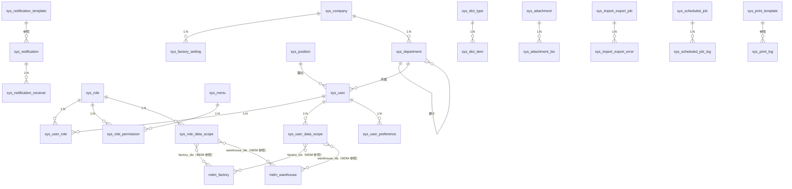

# 系统管理 DB 设计书（系统管理 DB 設計書）

| 項目 | 内容 |
|---|---|
| 文書名 | 系统管理 DB 设计书（系统管理 DB 設計書） |
| 文書番号 | DSN-SYS-090 |
| 版数 | v1.0 |
| 作成日 | 2026-10-20 |
| 作成者 | system-workflow（域設計担当） |
| 承認者 | 未承認（レビュー待ち） |
| 状態 | ドラフト（レビュー中） |
| 関連文書 | [業務域概要](00-overview.md) / [共通项目定义](../00-common/01-common-item-definitions.md) / [DB 共通规格](../00-common/04-common-db-spec.md) / [共通业务规则](../00-common/08-common-business-rules.md) / [跨域流程](../00-common/09-cross-domain-flow.md) / [テーブル定義書テンプレート](../_template/03-table-definition-template.md) |

---

## 1. 設計方針

### 1.1 データモデル概要

本域は「人・組織・権限」のマスタ系、「ログ・通知・ジョブ」の運用系、「採番・冪等・Outbox」の基盤系の 3 グループで構成する。

| グループ | テーブル | 特徴 |
|---|---|---|
| マスタ系（人・組織・権限） | `sys_company` / `sys_factory_setting` / `sys_tenant` / `sys_department` / `sys_position` / `sys_user` / `sys_role` / `sys_menu` / `sys_dict_*` / `sys_param` / `sys_number_rule` / `sys_*_template` | 論理削除可。参照中の削除禁止（使用停止で運用）。`version` 楽観排他 |
| 関連・設定系 | `sys_user_role` / `sys_role_permission` / `sys_role_data_scope` / `sys_user_data_scope` / `sys_attachment_biz` / `sys_notification_receiver` / `sys_user_preference` | 組み合わせ一意制約。付与履歴を残す |
| ログ・運用系 | `sys_audit_log` / `sys_login_log` / `sys_notification*` / `sys_import_export_*` / `sys_print_log` / `sys_scheduled_job*` / `sys_data_maintenance_log` | 追記専用。更新系カラムは最小限。保存期間後アーカイブ |
| 基盤系（全域共用） | `sys_sequence` / `sys_outbox_event` / `sys_event_consume_log` / `sys_idempotency` | 全業務域が利用。定義は [09 跨域流程](../00-common/09-cross-domain-flow.md) 第 10 章と整合 |

### 1.2 共通カラム・セット

[共通项目定义](../00-common/01-common-item-definitions.md) 第 2 章の共通カラムを、テーブル種別ごとに次の 3 セットで展開する。各テーブル DDL ではセット名を注記し、物理 DDL 生成時に展開する（**全テーブルで再定義しない**）。

| セット | 適用対象 | カラム |
|---|---|---|
| **M**（マスタ） | マスタ・設定テーブル | `id BIGINT PK` / `tenant_id BIGINT NOT NULL DEFAULT current_setting('app.tenant_id')::bigint` / `company_id BIGINT NOT NULL` / `version INT NOT NULL DEFAULT 0` / `deleted BOOLEAN NOT NULL DEFAULT FALSE` / `remark VARCHAR(500)` / `ext_data JSONB` / `created_at TIMESTAMPTZ NOT NULL DEFAULT now()` / `created_by BIGINT NOT NULL DEFAULT 0` / `updated_at TIMESTAMPTZ NOT NULL DEFAULT now()` / `updated_by BIGINT NOT NULL DEFAULT 0` |
| **T**（取引・設定） | 関連・設定・ジョブテーブル | M から `deleted` / `ext_data` を除いたもの（`remark` は任意） |
| **L**（追記ログ） | ログ・履歴テーブル | `id BIGINT PK` / `tenant_id BIGINT NOT NULL DEFAULT current_setting('app.tenant_id')::bigint` / `created_at TIMESTAMPTZ NOT NULL DEFAULT now()` / `created_by BIGINT NOT NULL DEFAULT 0`（必要な場合のみ `company_id` を追加） |

- 主キーは BIGINT 雪花 ID（MyBatis-Plus `ASSIGN_ID`）。API・画面では文字列で扱う。
- マスタの有効/無効は `status SMALLINT NOT NULL DEFAULT 1`（`1`:有效 / `0`:无效）で表現する（[共通业务规则](../00-common/08-common-business-rules.md) 2.2「使用停止は status=0」）。伝票系の状態コード `10/20/25/30/35/40/90/95` は本域では使用しない（承認状態は WF が保持）。
- 全テーブル・全カラムに `COMMENT ON` を付与する（実装時、本設計の中文論理名を使用）。本設計では DDL 内に `-- 中文名` の形式で列コメントを併記する。

### 1.3 ER 図（主要関連）



### 1.4 設計上の決定事項

| # | 決定 | 理由 |
|---|---|---|
| D-01 | 権限は「メニュー + ボタン」を `sys_menu` の 1 テーブルで管理し、`permission_code` を保持 | フロントのルート生成と `@SaCheckPermission` の二重チェックを同一データで行う |
| D-02 | データ範囲は「ロール既定（`sys_role_data_scope`）+ ユーザ個別上書き（`sys_user_data_scope`）」の 2 段 | 例外付与をロール複製なしで実現する |
| D-03 | パスワードは `sys_user.password_hash`（BCrypt）+ 履歴 `sys_user_password_history` 5 代 | 共通项目定义 15 章。平文保存禁止 |
| D-04 | セッション（Sa-Token）は Redis に保持し、DB にはログイン履歴のみ残す | 高頻度アクセスのため DB を経由しない。監査は `sys_login_log` |
| D-05 | 監査ログはアプリ層で非同期書込み（キュー）とし、業務トランザクションをブロックしない | 応答性能。消失防止のため書込み失敗時はアプリログに退避 |
| D-06 | Outbox・冪等・採番テーブルは SYS が提供し、全業務域が共通モジュール経由で利用 | 09 第 10 章の契約を 1 箇所で実装する |
| D-07 | 添付実体は StorageService（ローカル / S3 を設定で切替）に置き、DB はメタ情報のみ | 大容量バイナリを DB に置かない（04 共通规格） |
| D-08 | 通知は「通知本体（`sys_notification`）+ 受信者（`sys_notification_receiver`）」に分離 | 一斉通知・既読管理・送信チャネル分岐のため |

## 2. テーブル一覧

| # | 物理名 | 論理名 | 種別 | 更新元機能 | データ量見積 | 保存期間 | 節 |
|---|---|---|---|---|---|---|---|
| 1 | sys_company | 公司 | マスタ | F-SYS-014 | 1〜5 件 | 無期限 | 3.1 |
| 2 | sys_factory_setting | 工厂组织设置 | 設定 | 工厂の有効化・既定割当（主データは mdm_factory） | F-SYS-014 | 5 件 | 無期限 | 3.2 |
| 3 | sys_tenant | 租户 | マスタ（予約） | F-SYS-017 | テナント数 | 無期限 | 3.3 |
| 4 | sys_department | 部门 | マスタ | F-SYS-005 | 100 件 | 無期限 | 3.4 |
| 5 | sys_position | 岗位 | マスタ | F-SYS-006 | 80 件 | 無期限 | 3.5 |
| 6 | sys_user | 用户 | マスタ | F-SYS-002 | 900→1,150 | 無期限（退職後 5 年） | 3.6 |
| 7 | sys_role | 角色 | マスタ | F-SYS-003 | 30 件 | 無期限 | 3.7 |
| 8 | sys_user_role | 用户角色 | 関連 | F-SYS-002 | 2,500 件 | 無期限（履歴保持） | 3.8 |
| 9 | sys_role_permission | 角色权限 | 関連 | F-SYS-003 | 3,000 件 | 無期限 | 3.9 |
| 10 | sys_role_data_scope | 角色数据范围 | 設定 | F-SYS-003 | 100 件 | 無期限 | 3.10 |
| 11 | sys_user_data_scope | 用户数据范围 | 設定 | F-SYS-002 | 500 件 | 無期限 | 3.11 |
| 12 | sys_menu | 菜单/权限 | マスタ | F-SYS-004 | 500 件 | 無期限 | 3.12 |
| 13 | sys_dict_type | 字典类型 | マスタ | F-SYS-007 | 120 件 | 無期限 | 3.13 |
| 14 | sys_dict_item | 字典项目 | マスタ | F-SYS-007 | 2,000 件 | 無期限 | 3.14 |
| 15 | sys_param | 系统参数 | マスタ | F-SYS-008 | 200 件 | 無期限 | 3.15 |
| 16 | sys_number_rule | 编号规则 | マスタ | F-SYS-012 | 60 件 | 無期限 | 3.16 |
| 17 | sys_sequence | 採番連番 | 設定 | F-SYS-012 | 1 万/年 | 3 年（その後リセット削除） | 3.17 |
| 18 | sys_audit_log | 操作审计日志 | ログ | F-SYS-009 | 1,000 万/年 | 3 年 | 3.18 |
| 19 | sys_login_log | 登录日志 | ログ | F-SYS-009 | 50 万/年 | 3 年 | 3.19 |
| 20 | sys_user_password_history | 密码历史 | 履歴 | F-SYS-001 | 3,000 件 | 無期限 | 3.20 |
| 21 | sys_attachment | 附件 | ログ | F-SYS-010 | 20 万/年 | 業務データに準拠 | 3.21 |
| 22 | sys_attachment_biz | 附件业务关联 | 関連 | F-SYS-010 | 20 万/年 | 同上 | 3.22 |
| 23 | sys_notification | 站内通知 | ログ | F-SYS-011、019 | 50 万/年 | 1 年 | 3.23 |
| 24 | sys_notification_receiver | 通知受信者 | 関連 | F-SYS-011 | 100 万/年 | 1 年 | 3.24 |
| 25 | sys_notification_template | 通知模板 | マスタ | F-SYS-019 | 100 件 | 無期限 | 3.25 |
| 26 | sys_notification_send_log | 通知发送日志 | ログ | F-SYS-019 | 50 万/年 | 1 年 | 3.26 |
| 27 | sys_import_export_job | 导入导出任务 | ログ | F-SYS-013 | 2 万/年 | 1 年（結果は 7 日） | 3.27 |
| 28 | sys_import_export_error | 任务错误行 | ログ | F-SYS-013 | 50 万/年 | 1 年 | 3.28 |
| 29 | sys_import_template | 导入模板 | マスタ | F-SYS-013 | 50 件 | 無期限 | 3.29 |
| 30 | sys_print_template | 打印模板 | マスタ | F-SYS-015 | 100 件 | 無期限 | 3.30 |
| 31 | sys_print_log | 打印日志 | ログ | F-SYS-015 | 10 万/年 | 3 年 | 3.31 |
| 32 | sys_scheduled_job | 定时任务定义 | マスタ | F-SYS-016 | 80 件 | 無期限 | 3.32 |
| 33 | sys_scheduled_job_log | 定时任务日志 | ログ | F-SYS-016 | 50 万/年 | 1 年 | 3.33 |
| 34 | sys_outbox_event | Outbox 事件 | ログ | 全業務域 | 500 万/年 | 3 か月（配信済） | 3.34 |
| 35 | sys_event_consume_log | 事件消费日志 | ログ | 全業務域 | 500 万/年 | 3 か月 | 3.35 |
| 36 | sys_idempotency | 幂等键 | 設定 | 全 API | 100 万/年 | 24 時間（期限後清理） | 3.36 |
| 37 | sys_user_preference | 用户画面设置 | 設定 | F-SYS-018 | 2 万件 | 無期限 | 3.37 |
| 38 | sys_data_maintenance_log | 数据维护历史 | ログ | F-SYS-020 | 1,000/年 | 5 年 | 3.38 |

## 3. テーブル定義

### 3.1 sys_company 公司

| 項目 | 内容 |
|---|---|
| テーブル物理名 | sys_company |
| 種別 | マスタ（M セット） |
| 更新元機能 | F-SYS-014 公司/工厂多组织设置 |
| データ量見積 | 初期 1 件 / 年間 +0〜1 / 5 年後 1〜5 件 |
| 保存期間 | 無期限 |

**概要**：会計主体（法人）を表す。伝票・マスタは必ず `company_id` を保持するが、第一版で多公司対応し、本テーブルが正。

```sql
CREATE TABLE sys_company (
    -- [共通カラム M]
    company_code            VARCHAR(32)   NOT NULL,        -- 公司代码
    company_name            VARCHAR(200)  NOT NULL,        -- 公司名称（中文全称）
    company_name_en         VARCHAR(200),                  -- 公司英文名称
    short_name              VARCHAR(100),                  -- 公司简称
    unified_social_credit_code VARCHAR(18),               -- 统一社会信用代码（GB 32100-2015，18 位）
    tax_no                  VARCHAR(30),                   -- 纳税人识别号
    tax_payer_type          SMALLINT      NOT NULL DEFAULT 1, -- 纳税人类型：1 一般纳税人 / 2 小规模纳税人
    legal_representative    VARCHAR(50),                   -- 法定代表人
    province_code           VARCHAR(6),                    -- 省级行政区划代码（GB/T 2260，例 320000）
    city_code               VARCHAR(6),                    -- 市级行政区划代码（例 320400）
    address                 VARCHAR(300),                  -- 注册地址
    postal_code             VARCHAR(10),                   -- 邮政编码
    phone                   VARCHAR(30),                   -- 联系电话
    email                   VARCHAR(100),                  -- 邮箱
    invoice_title           VARCHAR(200),                  -- 发票抬头
    bank_account_name       VARCHAR(200),                  -- 开户名称（发票/收付款用）
    fiscal_year_start_month SMALLINT      NOT NULL DEFAULT 1, -- 会计年度起始月（中国=1）
    base_currency_code      VARCHAR(3)    NOT NULL DEFAULT 'CNY', -- 记账本位币（ISO 4217）
    logo_attachment_id      BIGINT,                        -- 公司 LOGO 附件 ID（sys_attachment.id）
    status                  SMALLINT      NOT NULL DEFAULT 1, -- 状态：1 有效 / 0 无效
    sort_no                 INT           NOT NULL DEFAULT 0  -- 表示顺
);
COMMENT ON TABLE sys_company IS '公司（会计主体）';
```

| 索引 | 種別 | 対象列 | 条件 | 目的 |
|---|---|---|---|---|
| uk_sys_company_code | UNIQUE | (tenant_id, company_code) | WHERE deleted=FALSE | 公司代码一意 |
| uk_sys_company_credit | UNIQUE | (tenant_id, unified_social_credit_code) | WHERE deleted=FALSE AND unified_social_credit_code IS NOT NULL | 信用代码一意 |

**更新仕様**：F-SYS-014 のみが INSERT/UPDATE。削除は無効化（`status=0`）で表現し、`company_id` が参照されている場合は削除不可（`MSG-SYS-014`）。

### 3.2 sys_factory_setting 工厂组织设置

| 項目 | 内容 |
|---|---|
| テーブル物理名 | sys_factory_setting |
| 種別 | 設定（M セット） |
| 更新元機能 | F-SYS-014 |
| データ量見積 | 初期 2 件（常州总装厂 / 无锡零部件厂）/ 5 年後 5 件 |
| 保存期間 | 無期限 |

**概要**：工厂の**主データは MDM 域が管理する**（`mdm_factory`、[02-mdm/90-db-design.md](../02-mdm/90-db-design.md) 4.3.1）。本テーブルは SYS が管理する**工厂组织设置**（システム利用可否・既定工厂割当・表示順・組織責任者）のみを保持し、工場コード・名称・住所等の主データは複製しない。伝票・ユーザの `factory_id` は `mdm_factory.id` を参照する（[跨域流程](../00-common/09-cross-domain-flow.md) 第 11 章）。

```sql
CREATE TABLE sys_factory_setting (
    -- [共通カラム M]
    factory_id          BIGINT        NOT NULL,           -- 工厂 ID（mdm_factory.id、MDM 主データ参照）
    is_enabled          BOOLEAN       NOT NULL DEFAULT TRUE,  -- システム利用可否（组织設置）
    is_default          BOOLEAN       NOT NULL DEFAULT FALSE, -- 是否默认工厂（会社内 1 件）
    manager_user_id     BIGINT,                           -- 工厂负责人（sys_user.id、組織責任者）
    sort_no             INT           NOT NULL DEFAULT 0, -- 表示顺
    description         VARCHAR(500)                      -- 说明
);
COMMENT ON TABLE sys_factory_setting IS '工厂组织设置（工厂主数据は mdm_factory が管理）';
```

| 索引 | 種別 | 対象列 | 条件 | 目的 |
|---|---|---|---|---|
| uk_sys_factory_setting | UNIQUE | (tenant_id, company_id, factory_id) | WHERE deleted=FALSE | 工厂×設定一意 |
| idx_sys_factory_setting_default | B-Tree | (company_id, is_default) | WHERE is_default AND deleted=FALSE | 既定工厂一意 |

**更新仕様**：F-SYS-014 のみ。`is_default=true` は会社ごとに 1 件（アプリで保証、部分一意インデックス）。`factory_id` の有効性は MDM の公開 Service（`FactoryService.exists`）で検証する。MDM 側で工場が無効化された場合は本設定も `is_enabled=false` に更新する（起動時の整合性検査 BAT-SYS-010 で検出）。

### 3.3 sys_tenant 租户（予約）

| 項目 | 内容 |
|---|---|
| テーブル物理名 | sys_tenant |
| 種別 | マスタ（M セット、`company_id` は持たない） |
| 更新元機能 | F-SYS-017 |
| データ量見積 | `id=0` はシステムテナント。テナント数に応じて増加 |
| 保存期間 | 無期限 |

**概要**：マルチテナントの契約単位。画面・API は参照のみ。第一版から RLS（`tenant_id = current_setting('app.tenant_id')::bigint`）を有効化しており、その親テーブルとなる（[04 §14](../00-common/04-common-db-spec.md)）。テナント作成時は同一トランザクションで `sys_init_tenant(tenant_id)` を呼び出し、テナント単位の既定パラメータ（§3.15「業務パラメータ」の一覧）を投入する（関数は DBA の T1 マイグレーションで定義、本書は参照のみ）。

```sql
CREATE TABLE sys_tenant (
    -- [共通カラム M のうち company_id を除く]
    tenant_code         VARCHAR(32)   NOT NULL,           -- 租户代码
    tenant_name         VARCHAR(200)  NOT NULL,           -- 租户名称
    contact_name        VARCHAR(50),                      -- 联系人
    contact_phone       VARCHAR(30),                      -- 联系电话
    max_user_count      INT           NOT NULL DEFAULT 0, -- 最大用户数（0=無制限）
    expire_date         DATE,                             -- 契約満了日
    status              SMALLINT      NOT NULL DEFAULT 1  -- 状态：1 有效 / 0 无效
);
COMMENT ON TABLE sys_tenant IS '租户（マルチテナント契約単位）';
```

| 索引 | 種別 | 対象列 | 条件 | 目的 |
|---|---|---|---|---|
| uk_sys_tenant_code | UNIQUE | (tenant_id, tenant_code) | WHERE deleted=FALSE | 租户コード一意 |

**更新仕様**：画面での編集も第一版対象（TODO：編集仕様未設計）。初期データで `id=0`「系统默认租户」を投入する。

### 3.4 sys_department 部门

| 項目 | 内容 |
|---|---|
| テーブル物理名 | sys_department |
| 種別 | マスタ（M セット） |
| 更新元機能 | F-SYS-005 |
| データ量見積 | 初期 8 件 / 5 年後 100 件 |
| 保存期間 | 無期限 |

**概要**：承認経路・データ範囲・費目部門の単位となる組織ツリー。`department_path` に素材化パス（`/1/2/5/`）を保持し、子孫検索を高速化する。

```sql
CREATE TABLE sys_department (
    -- [共通カラム M]
    department_code     VARCHAR(16)   NOT NULL,           -- 部门代码（D+3 桁、规则见 08 2.2）
    department_name     VARCHAR(200)  NOT NULL,           -- 部门名称
    parent_id           BIGINT        NOT NULL DEFAULT 0, -- 父部门 ID（0=ルート）
    department_path     VARCHAR(500)  NOT NULL DEFAULT '/', -- 素材化パス（例 /1/12/35/）
    department_level    SMALLINT      NOT NULL DEFAULT 1, -- 階層（1 起算）
    factory_id          BIGINT,                           -- 所属工厂（mdm_factory.id、MDM 主データ参照）
    manager_user_id     BIGINT,                           -- 部门负责人（sys_user.id）
    cost_center_code    VARCHAR(32),                      -- 成本中心代码（財務連携用）
    is_leaf             BOOLEAN       NOT NULL DEFAULT TRUE, -- 是否末级（子追加時に更新）
    status              SMALLINT      NOT NULL DEFAULT 1, -- 状态：1 有效 / 0 无效
    sort_no             INT           NOT NULL DEFAULT 0, -- 同级表示顺
    valid_from          DATE,                             -- 有効開始日（組織改編用）
    valid_to            DATE                              -- 有効終了日
);
COMMENT ON TABLE sys_department IS '部门（组织ツリー）';
```

| 索引 | 種別 | 対象列 | 条件 | 目的 |
|---|---|---|---|---|
| uk_sys_department_company_code | UNIQUE | (tenant_id, company_id, department_code) | WHERE deleted=FALSE | 部門コード一意 |
| idx_sys_department_parent | B-Tree | (parent_id, sort_no) | — | ツリー表示 |
| idx_sys_department_path | B-Tree | (department_path) | — | 子孫検索（`LIKE '/1/12/%'`） |

**制約**：`parent_id` は自己参照 FK（`ON DELETE RESTRICT`）。循環参照はアプリで検出（`MSG-SYS-031`）。子部門・所属ユーザ・進行中承認経路がある場合は削除不可。

### 3.5 sys_position 岗位

| 項目 | 内容 |
|---|---|
| テーブル物理名 | sys_position |
| 種別 | マスタ（M セット） |
| 更新元機能 | F-SYS-006 |
| データ量見積 | 初期 20 件 / 5 年後 80 件 |
| 保存期間 | 無期限 |

**概要**：職務上の役割。ユーザは主職位を 1 つ持ち（`sys_user.position_id`）、承認者の解決（職位指定の承認ノード）に使用する。

```sql
CREATE TABLE sys_position (
    -- [共通カラム M]
    position_code       VARCHAR(32)   NOT NULL,           -- 岗位代码
    position_name       VARCHAR(100)  NOT NULL,           -- 岗位名称
    position_category   SMALLINT      NOT NULL DEFAULT 2, -- 分类：1 管理 / 2 专业 / 3 操作
    position_level      SMALLINT      NOT NULL DEFAULT 1, -- 职级（1〜20）
    department_id       BIGINT,                           -- 所属部门（sys_department.id）
    is_manager          BOOLEAN       NOT NULL DEFAULT FALSE, -- 是否管理岗（审批者判定用）
    status              SMALLINT      NOT NULL DEFAULT 1, -- 状态：1 有效 / 0 无效
    sort_no             INT           NOT NULL DEFAULT 0  -- 表示顺
);
COMMENT ON TABLE sys_position IS '岗位（職位）';
```

| 索引 | 種別 | 対象列 | 条件 | 目的 |
|---|---|---|---|---|
| uk_sys_position_company_code | UNIQUE | (tenant_id, company_id, position_code) | WHERE deleted=FALSE | 岗位コード一意 |
| idx_sys_position_department | B-Tree | (department_id, status) | — | 部門別岗位一覧 |

### 3.6 sys_user 用户

| 項目 | 内容 |
|---|---|
| テーブル物理名 | sys_user |
| 種別 | マスタ（M セット） |
| 更新元機能 | F-SYS-002、F-SYS-018（本人項目）、F-SYS-001（パスワード関連） |
| データ量見積 | 初期 900 件 / 年間 +50 / 5 年後 1,150 件 |
| 保存期間 | 無期限（退職者は `status=0` で保持、個人情報は 5 年後に匿名化） |

**概要**：ログインアカウントと社員属性。1 ユーザ 1 アカウント（工号 `E`+6 桁）。`account_status` がロック/停止を表現し、`status` は在籍有効性を表す（両者を分離）。

```sql
CREATE TABLE sys_user (
    -- [共通カラム M]
    user_code           VARCHAR(16)   NOT NULL,           -- 工号（用户账号，E+6 桁，08 2.2）
    username            VARCHAR(64)   NOT NULL,           -- 登录账号（默认=工号，可変更不可）
    password_hash       VARCHAR(100)  NOT NULL,           -- BCrypt ハッシュ（cost≥10、平文禁止）
    real_name           VARCHAR(50)   NOT NULL,           -- 姓名
    nickname            VARCHAR(50),                      -- 昵称
    gender              SMALLINT      NOT NULL DEFAULT 0, -- 性别：0 未填 / 1 男 / 2 女
    birth_date          DATE,                             -- 出生日期（任意、マスキング対象）
    mobile              VARCHAR(20),                      -- 手机号（表示時マスキング）
    email               VARCHAR(100),                     -- 邮箱
    avatar_attachment_id BIGINT,                          -- 头像附件 ID
    employee_type       SMALLINT      NOT NULL DEFAULT 1, -- 用工类型：1 正式 / 2 试用 / 3 外包 / 4 实习
    department_id       BIGINT,                           -- 所属部门
    position_id         BIGINT,                           -- 主岗位
    factory_id          BIGINT,                           -- 所属工厂（既定値として使用）
    manager_user_id     BIGINT,                           -- 直属上级（承認エスカレーション先）
    hire_date           DATE,                             -- 入职日期
    leave_date          DATE,                             -- 离职日期
    status              SMALLINT      NOT NULL DEFAULT 1, -- 在职状态：1 在职 / 0 离职 / 2 待入职
    account_status      SMALLINT      NOT NULL DEFAULT 1, -- 账号状态：1 正常 / 2 锁定 / 3 停用 / 4 密码过期
    lock_until          TIMESTAMPTZ,                      -- ロック解除日時（NULL=無期限）
    login_fail_count    SMALLINT      NOT NULL DEFAULT 0, -- 連続ログイン失敗回数
    password_updated_at TIMESTAMPTZ,                      -- パスワード最終更新日時
    password_expire_at  TIMESTAMPTZ,                      -- パスワード有効期限（90 日）
    password_reset_required BOOLEAN   NOT NULL DEFAULT TRUE, -- 次回ログイン時変更必須（初回/管理者リセット）
    last_login_at       TIMESTAMPTZ,                      -- 最終ログイン日時
    last_login_ip       VARCHAR(45),                      -- 最終ログイン IP
    is_builtin          BOOLEAN       NOT NULL DEFAULT FALSE, -- 内置账号（管理者初期化、削除不可）
    sort_no             INT           NOT NULL DEFAULT 0  -- 表示顺
);
COMMENT ON TABLE sys_user IS '用户（ログインアカウント＋社員属性）';
```

| 索引 | 種別 | 対象列 | 条件 | 目的 |
|---|---|---|---|---|
| uk_sys_user_code | UNIQUE | (tenant_id, company_id, user_code) | WHERE deleted=FALSE | 工号一意 |
| uk_sys_user_username | UNIQUE | (tenant_id, username) | WHERE deleted=FALSE | ログイン ID 一意。テナント単位の豁免（蓝色大肥鱼 2026-10-21 決定）。※ 現行 DB では `V1__baseline.sql:18` の `uk_sys_user_tenant_username`（`tenant_id DEFAULT 0`）。sys_user の正式迁移時に本名へ改名し、`DEFAULT 0` を `current_setting('app.tenant_id')::bigint` に修正、pgTAP 豁免に追加する |
| idx_sys_user_dept_status | B-Tree | (department_id, status) | — | 部門別ユーザ一覧 |
| idx_sys_user_name_trgm | GIN | (real_name gin_trgm_ops) | — | 氏名曖昧検索 |
| idx_sys_user_mobile | B-Tree | (mobile) | — | 電話番号検索 |

**制約**：`manager_user_id` の循環参照禁止（アプリ）。`is_builtin=true` のアカウントは削除・停用不可（`MSG-SYS-002`）。退職処理時は `status=0`・`account_status=3` とし、進行中タスクは代理者へ転送する（F-WF-007）。

### 3.7 sys_role 角色

| 項目 | 内容 |
|---|---|
| テーブル物理名 | sys_role |
| 種別 | マスタ（M セット） |
| 更新元機能 | F-SYS-003 |
| データ量見積 | 初期 18 件（[共通业务规则](../00-common/08-common-business-rules.md) 9.1 のロール）/ 5 年後 30 件 |
| 保存期間 | 無期限 |

**概要**：権限の集合。ロールにデータ範囲の既定値を付与する（`data_scope_type`）。内置ロールは削除不可・変更は限定的。

```sql
CREATE TABLE sys_role (
    -- [共通カラム M]
    role_code           VARCHAR(64)   NOT NULL,           -- 角色代码（例 SYSTEM_ADMIN、SALES_MANAGER）
    role_name           VARCHAR(100)  NOT NULL,           -- 角色名称
    role_type           SMALLINT      NOT NULL DEFAULT 2, -- 类型：1 内置系统 / 2 业务 / 3 只读
    data_scope_type     SMALLINT      NOT NULL DEFAULT 2, -- 数据范围：1 全社 / 2 本部门及子部门 / 3 本部门 / 4 本人 / 5 自定义 / 6 工場 / 7 倉庫
    description         VARCHAR(500),                     -- 说明
    is_default          BOOLEAN       NOT NULL DEFAULT FALSE, -- 新規ユーザの既定ロール
    requires_approval   BOOLEAN       NOT NULL DEFAULT TRUE,  -- 付与時承認要否（高権限ロール）
    status              SMALLINT      NOT NULL DEFAULT 1, -- 状态：1 有效 / 0 无效
    sort_no             INT           NOT NULL DEFAULT 0  -- 表示顺
);
COMMENT ON TABLE sys_role IS '角色（権限集合）';
```

| 索引 | 種別 | 対象列 | 条件 | 目的 |
|---|---|---|---|---|
| uk_sys_role_code | UNIQUE | (tenant_id, company_id, role_code) | WHERE deleted=FALSE | ロールコード一意 |
| idx_sys_role_status | B-Tree | (status, sort_no) | — | 有効ロール一覧 |

**制約**：`role_type=1`（内置）は `role_code` 変更・削除不可。SoD（職務分掌）チェックは付与時にアプリで実施（[共通业务规则](../00-common/08-common-business-rules.md) 9.2、`MSG-SYS-012` 警告）。

### 3.8 sys_user_role 用户角色

| 項目 | 内容 |
|---|---|
| テーブル物理名 | sys_user_role |
| 種別 | 関連（T セット） |
| 更新元機能 | F-SYS-002、F-SYS-003、F-WF-007（代理） |
| データ量見積 | 初期 2,500 件 / 年間 +300 |
| 保存期間 | 無期限（付与履歴として保持） |

**概要**：ユーザとロールの多対多。有効期間付きで付与できる（期限付き代理・臨時権限）。削除ではなく `status=0` で解除し、履歴を残す。

```sql
CREATE TABLE sys_user_role (
    -- [共通カラム T]
    user_id             BIGINT        NOT NULL,           -- ユーザ ID（sys_user.id）
    role_id             BIGINT        NOT NULL,           -- ロール ID（sys_role.id）
    grant_type          SMALLINT      NOT NULL DEFAULT 1, -- 付与種別：1 直接付与 / 2 岗位連動 / 3 代理 / 4 临时
    valid_from          DATE,                             -- 有効開始日
    valid_to            DATE,                             -- 有効終了日（NULL=無期限）
    granted_by          BIGINT        NOT NULL DEFAULT 0, -- 付与者
    granted_at          TIMESTAMPTZ   NOT NULL DEFAULT now(), -- 付与日時
    reason              VARCHAR(500),                     -- 付与理由（高権限ロールは必須）
    status              SMALLINT      NOT NULL DEFAULT 1  -- 状态：1 有效 / 0 解除
);
COMMENT ON TABLE sys_user_role IS '用户角色（付与履歴付き）';
```

| 索引 | 種別 | 対象列 | 条件 | 目的 |
|---|---|---|---|---|
| uk_sys_user_role | UNIQUE | (tenant_id, company_id, user_id, role_id, grant_type) | WHERE deleted=FALSE | 重複付与防止 |
| idx_sys_user_role_role | B-Tree | (role_id, status) | — | ロール別ユーザ一覧 |

**制約**：有効期間 `valid_from <= valid_to`。期限切れ `valid_to < today` は認可判定時に無効扱い（バッチで `status=0` に更新）。自己付与（`granted_by = user_id`）は禁止（`MSG-SYS-011`）。

### 3.9 sys_role_permission 角色权限

| 項目 | 内容 |
|---|---|
| テーブル物理名 | sys_role_permission |
| 種別 | 関連（T セット） |
| 更新元機能 | F-SYS-003 |
| データ量見積 | 初期 3,000 件 / 年間 +200 |
| 保存期間 | 無期限 |

**概要**：ロールに付与するメニュー/ボタン権限。`sys_menu` の `menu_type=2`（メニュー）または `3`（ボタン）を参照し、`permission_code` を非正規化保持して認可判定を 1 クエリで行う。

```sql
CREATE TABLE sys_role_permission (
    -- [共通カラム T]
    role_id             BIGINT        NOT NULL,           -- ロール ID
    menu_id             BIGINT        NOT NULL,           -- メニュー/ボタン ID（sys_menu.id）
    permission_code     VARCHAR(100)  NOT NULL,           -- 権限コード（sys_menu.permission_code のスナップショット）
    granted_by          BIGINT        NOT NULL DEFAULT 0, -- 付与者
    granted_at          TIMESTAMPTZ   NOT NULL DEFAULT now() -- 付与日時
);
COMMENT ON TABLE sys_role_permission IS '角色权限（ロール×メニュー/ボタン）';
```

| 索引 | 種別 | 対象列 | 条件 | 目的 |
|---|---|---|---|---|
| uk_sys_role_permission | UNIQUE | (tenant_id, company_id, role_id, menu_id) | WHERE deleted=FALSE | 重複付与防止 |
| idx_sys_role_permission_code | B-Tree | (permission_code) | — | 権限コード逆引き（監査用） |

**更新仕様**：F-SYS-003 の保存時に「全削除→再登録」（トランザクション内）。権限キャッシュ（Redis）を無効化し、影響ユーザの次回リクエストから反映。

### 3.10 sys_role_data_scope 角色数据范围

| 項目 | 内容 |
|---|---|
| テーブル物理名 | sys_role_data_scope |
| 種別 | 設定（T セット） |
| 更新元機能 | F-SYS-003 |
| データ量見積 | 100 件 |
| 保存期間 | 無期限 |

**概要**：ロールのデータ範囲をリソース（モジュール:リソース）単位で上書きする。行が無いリソースは `sys_role.data_scope_type` の既定値を使用する。**工場（`factory_ids`）・倉庫（`warehouse_ids`）次元**を持ち、PRD/INV の「所属工場」「所属倉庫」権限を実現する（REV-005 対応。参照先は MDM の `mdm_factory`/`mdm_warehouse` で、SYS はマスタを複製しない）。

```sql
CREATE TABLE sys_role_data_scope (
    -- [共通カラム T]
    role_id             BIGINT        NOT NULL,           -- ロール ID
    resource_code       VARCHAR(100)  NOT NULL,           -- リソース（例 sales:order、'*'=全リソース）
    scope_type          SMALLINT      NOT NULL,           -- 数据范围：1 全社 / 2 本部门及子部门 / 3 本部门 / 4 本人 / 5 自定义 / 6 工場 / 7 倉庫
    factory_ids         JSONB,                            -- 工場 ID 配列（scope_type=6 時必須。例 ["1","2"]、mdm_factory.id）
    warehouse_ids       JSONB,                            -- 倉庫 ID 配列（scope_type=7 時必須。mdm_warehouse.id）
    custom_rule         JSONB,                            -- 自定义规则（scope_type=5 時。例 {"departmentIds":[...],"userIds":[...],"factoryIds":[...],"warehouseIds":[...]}）
    module_code         VARCHAR(32)   NOT NULL DEFAULT '*', -- モジュール名（system/sales/…、'*'=全域）
    description         VARCHAR(500)                      -- 说明
);
COMMENT ON TABLE sys_role_data_scope IS '角色数据范围（リソース単位の上書き。工場/倉庫次元を含む）';
```

| 索引 | 種別 | 対象列 | 条件 | 目的 |
|---|---|---|---|---|
| uk_sys_role_data_scope | UNIQUE | (tenant_id, company_id, role_id, module_code, resource_code) | WHERE deleted=FALSE | リソース単位一意 |
| idx_sys_role_data_scope_factory | GIN | (factory_ids jsonb_path_ops) | — | 工場範囲検索 |
| idx_sys_role_data_scope_warehouse | GIN | (warehouse_ids jsonb_path_ops) | — | 倉庫範囲検索 |

**制約**：`scope_type IN (1,2,3,4,5,6,7)`。`scope_type=6` は `factory_ids` 必須、`=7` は `warehouse_ids` 必須（アプリ検証 `MSG-COM-049`）。`custom_rule` は [共通项目定义](../00-common/01-common-item-definitions.md) 第 10 章の JSONB 検証に従い、`factoryIds`/`warehouseIds` は有効マスタ存在を検証する。データ範囲の変更は監査ログ（`operation_type=UPDATE`, `resource=role_data_scope`）に前後値を記録。

### 3.11 sys_user_data_scope 用户数据范围

| 項目 | 内容 |
|---|---|
| テーブル物理名 | sys_user_data_scope |
| 種別 | 設定（T セット） |
| 更新元機能 | F-SYS-002 |
| データ量見積 | 500 件 |
| 保存期間 | 無期限 |

**概要**：ロール既定のデータ範囲に対するユーザ個別の上書き。有効期間付き。認可時は「ユーザ個別 > ロール設定 > ロール既定」の順で解決する。工場・倉庫次元（`factory_ids`/`warehouse_ids`）を含む。

```sql
CREATE TABLE sys_user_data_scope (
    -- [共通カラム T]
    user_id             BIGINT        NOT NULL,           -- ユーザ ID
    resource_code       VARCHAR(100)  NOT NULL,           -- リソース（'*'=全リソース）
    scope_type          SMALLINT      NOT NULL,           -- データ範囲（3.10 と同一値域 1〜7）
    factory_ids         JSONB,                            -- 工場 ID 配列（scope_type=6 時必須）
    warehouse_ids       JSONB,                            -- 倉庫 ID 配列（scope_type=7 時必須）
    custom_rule         JSONB,                            -- 自定义规则（factoryIds/warehouseIds を含む）
    valid_from          DATE,                             -- 有効開始日
    valid_to            DATE,                             -- 有効終了日
    reason              VARCHAR(500)  NOT NULL,           -- 上書き理由（必須）
    granted_by          BIGINT        NOT NULL DEFAULT 0  -- 付与者
);
COMMENT ON TABLE sys_user_data_scope IS '用户数据范围（個別上書き。工場/倉庫次元を含む）';
```

| 索引 | 種別 | 対象列 | 条件 | 目的 |
|---|---|---|---|---|
| uk_sys_user_data_scope | UNIQUE | (tenant_id, company_id, user_id, resource_code) | WHERE deleted=FALSE | リソース単位一意 |
| idx_sys_user_data_scope_user | B-Tree | (user_id, valid_to) | — | 認可時の有効範囲取得 |

### 3.12 sys_menu 菜单/权限

| 項目 | 内容 |
|---|---|
| テーブル物理名 | sys_menu |
| 種別 | マスタ（M セット） |
| 更新元機能 | F-SYS-004 |
| データ量見積 | 初期 300 件 / 5 年後 500 件 |
| 保存期間 | 無期限 |

**概要**：メニュー（ディレクトリ・画面）とボタン権限を同一ツリーで管理。`permission_code` が `@SaCheckPermission` / `v-permission` の識別子となる。フロントのルートは `route_path`/`component_path` から生成する。

```sql
CREATE TABLE sys_menu (
    -- [共通カラム M]
    menu_code           VARCHAR(64)   NOT NULL,           -- 菜单代码（一意）
    menu_name           VARCHAR(100)  NOT NULL,           -- 菜单名称
    menu_type           SMALLINT      NOT NULL,           -- 类型：1 目录 / 2 菜单 / 3 按钮 / 4 外链
    parent_id           BIGINT        NOT NULL DEFAULT 0, -- 父菜单 ID（0=ルート）
    module_code         VARCHAR(32)   NOT NULL,           -- 模块名（system/sales/mdm/…）
    route_path          VARCHAR(300),                     -- 前端路由路径（例 /system/users）
    component_path      VARCHAR(300),                     -- コンポーネントパス（例 system/user/index）
    permission_code     VARCHAR(100),                     -- 权限代码（例 system:user:view）
    icon                VARCHAR(64),                      -- アイコン
    is_external         BOOLEAN       NOT NULL DEFAULT FALSE, -- 外部リンク
    external_url        VARCHAR(500),                     -- 外部 URL
    is_visible          BOOLEAN       NOT NULL DEFAULT TRUE,  -- メニュー表示
    is_cache            BOOLEAN       NOT NULL DEFAULT FALSE, -- keep-alive
    is_affix           BOOLEAN       NOT NULL DEFAULT FALSE, -- 固定タブ
    sort_no             INT           NOT NULL DEFAULT 0, -- 表示顺
    status              SMALLINT      NOT NULL DEFAULT 1, -- 状态：1 有效 / 0 无效
    description         VARCHAR(500)                      -- 说明
);
COMMENT ON TABLE sys_menu IS '菜单/权限（メニューツリー＋ボタン権限）';
```

| 索引 | 種別 | 対象列 | 条件 | 目的 |
|---|---|---|---|---|
| uk_sys_menu_code | UNIQUE | (tenant_id, menu_code) | WHERE deleted=FALSE | メニューコード一意 |
| uk_sys_menu_permission | UNIQUE | (tenant_id, permission_code) | WHERE deleted=FALSE AND permission_code IS NOT NULL | 権限コード一意 |
| idx_sys_menu_parent | B-Tree | (parent_id, sort_no) | — | ツリー表示 |
| idx_sys_menu_module | B-Tree | (module_code, menu_type) | — | モジュール別一覧 |

**制約**：`menu_type=3`（ボタン）は `permission_code` 必須。親に `menu_type=1/2`、子に `2/3` の階層ルールをアプリで強制（`MSG-SYS-021`）。メニュー削除時、子メニュー・権限付与がある場合は禁止。

### 3.13 sys_dict_type 字典类型

| 項目 | 内容 |
|---|---|
| テーブル物理名 | sys_dict_type |
| 種別 | マスタ（M セット） |
| 更新元機能 | F-SYS-007 |
| データ量見積 | 初期 80 件 / 5 年後 120 件 |
| 保存期間 | 無期限 |

**概要**：業務で追加・変更される区分値のグループ定義（[共通项目定义](../00-common/01-common-item-definitions.md) 7.2 の 3 層方針）。処理ロジックが依存する固定区分（伝票ステータス等）はここに置かず Java enum とする。

```sql
CREATE TABLE sys_dict_type (
    -- [共通カラム M]
    dict_code           VARCHAR(64)   NOT NULL,           -- 字典代码（例 CUSTOMER_GRADE）
    dict_name           VARCHAR(100)  NOT NULL,           -- 字典名称
    module_code         VARCHAR(32)   NOT NULL,           -- 所辖模块（system/mdm/sales/…）
    is_system           BOOLEAN       NOT NULL DEFAULT FALSE, -- 系统内置（削除不可）
    is_tree             BOOLEAN       NOT NULL DEFAULT FALSE, -- ツリー辞書（項目に parent_id を許可）
    status              SMALLINT      NOT NULL DEFAULT 1, -- 状态：1 有效 / 0 无效
    description         VARCHAR(500)                      -- 说明
);
COMMENT ON TABLE sys_dict_type IS '数据字典类型';
```

| 索引 | 種別 | 対象列 | 条件 | 目的 |
|---|---|---|---|---|
| uk_sys_dict_type_code | UNIQUE | (tenant_id, dict_code) | WHERE deleted=FALSE | 字典コード一意 |
| idx_sys_dict_type_module | B-Tree | (module_code, status) | — | モジュール別一覧 |

### 3.14 sys_dict_item 字典项目

| 項目 | 内容 |
|---|---|
| テーブル物理名 | sys_dict_item |
| 種別 | マスタ（M セット） |
| 更新元機能 | F-SYS-007 |
| データ量見積 | 初期 1,500 件 / 5 年後 2,000 件 |
| 保存期間 | 無期限 |

**概要**：字典の値。`item_value` が DB 保存値、`item_name` が表示名。使用停止は `status=0`。`ext_data` に色・アイコン等の表示属性を保持。

```sql
CREATE TABLE sys_dict_item (
    -- [共通カラム M]
    dict_type_id        BIGINT        NOT NULL,           -- 字典类型 ID（sys_dict_type.id）
    item_code           VARCHAR(64)   NOT NULL,           -- 项目代码（一意、大文字推奨）
    item_name           VARCHAR(200)  NOT NULL,           -- 项目名称（表示名）
    item_value          VARCHAR(200),                     -- 项目值（省略時は item_code と同値）
    parent_id           BIGINT        NOT NULL DEFAULT 0, -- 親項目（ツリー辞書用）
    sort_no             INT           NOT NULL DEFAULT 0, -- 表示顺
    tag_type            VARCHAR(32),                      -- 表示色（Element Plus: success/warning/danger/info）
    is_default          BOOLEAN       NOT NULL DEFAULT FALSE, -- 既定値
    status              SMALLINT      NOT NULL DEFAULT 1, -- 状态：1 有效 / 0 无效
    description         VARCHAR(500)                      -- 说明
);
COMMENT ON TABLE sys_dict_item IS '数据字典项目';
```

| 索引 | 種別 | 対象列 | 条件 | 目的 |
|---|---|---|---|---|
| uk_sys_dict_item | UNIQUE | (tenant_id, company_id, dict_type_id, item_code) | WHERE deleted=FALSE | 同一字典内コード一意 |
| idx_sys_dict_item_type | B-Tree | (dict_type_id, status, sort_no) | — | 字典参照（キャッシュ元） |

**キャッシュ**：起動時に全件を Caffeine（ローカル、10 分 TTL）へ、Redis（`sys:dict:{dictCode}`、無期限）へロード。更新時は更新 API が Redis を更新し、他ノードへ pub/sub 通知（または TTL 失効）。辞書削除はキャッシュから除去。

### 3.15 sys_param 系统参数

| 項目 | 内容 |
|---|---|
| テーブル物理名 | sys_param |
| 種別 | マスタ（M セット） |
| 更新元機能 | F-SYS-008 |
| データ量見積 | 初期 150 件 / 5 年後 200 件 |
| 保存期間 | 無期限 |

**概要**：システム全体の設定値。値の型・値域・危険度を保持し、UI で型に応じた入力を提供する。機密パラメータ（SMTP パスワード等）は暗号化して保存し、API ではマスクして返す。

```sql
CREATE TABLE sys_param (
    -- [共通カラム M]
    param_key           VARCHAR(100)  NOT NULL,           -- 参数键（テナント・会社内で一意、group.key 形式）
    param_name          VARCHAR(100)  NOT NULL,           -- 参数名称
    param_group         VARCHAR(64)   NOT NULL,           -- 分组（auth/file/notify/workflow/report/…）
    param_value         TEXT,                             -- 参数值（加密対象は AES-256 暗号文）
    default_value       TEXT,                             -- 默认值
    value_type          SMALLINT      NOT NULL DEFAULT 1, -- 类型：1 字符串 / 2 整数 / 3 小数 / 4 布尔 / 5 JSON / 6 日期
    value_range         VARCHAR(500),                     -- 值域（例 1-100、a,b,c、正则）
    is_encrypted        BOOLEAN       NOT NULL DEFAULT FALSE, -- 是否加密保存
    is_danger           BOOLEAN       NOT NULL DEFAULT FALSE, -- 高危参数（変更時复核必須）
    is_readonly         BOOLEAN       NOT NULL DEFAULT FALSE, -- 只读（システム固定）
    effective_scope     SMALLINT      NOT NULL DEFAULT 1, -- 有効範囲：1 全社 / 2 工厂 / 3 用户
    sort_no             INT           NOT NULL DEFAULT 0, -- 表示顺
    description         VARCHAR(500),                     -- 说明
    status              SMALLINT      NOT NULL DEFAULT 1  -- 状态：1 有效 / 0 无效
);
COMMENT ON TABLE sys_param IS '系统参数';
```

| 索引 | 種別 | 対象列 | 条件 | 目的 |
|---|---|---|---|---|
| uk_sys_param_key | UNIQUE | (tenant_id, company_id, param_key) | WHERE deleted=FALSE | テナント×会社×パラメータキー一意（迁移 `sys/V202610210103__sys_t1_core_tables.sql` と一致） |
| idx_sys_param_group | B-Tree | (tenant_id, company_id, param_group, sort_no) | — | グループ別一覧 |

**業務パラメータ（2026-10-20 決定）**：

| param_key | param_group | value_type | default_value | value_range | 説明 |
|---|---|---|---|---|---|
| `prd.completion_over_rate` | prd | 3 小数 | `0.05` | `0.0000-1.0000`（比率、小数 4 桁、`NUMERIC(5,4)` 相当） | 完工超収容差の会社既定（比率。`0.05` = 5%）。キー名はバックエンド PR #47 と一致 |

- `sys_param` はテナント単位（`tenant_id` + RLS）。既定値は**テナント作成時**に `sys_init_tenant(tenant_id)` を呼び出して投入する。既存の種テナントにはマイグレーションで明示的に行を投入する。関数・DDL は DBA の T1 マイグレーションで定義（本書は参照のみ）。
- `sys_init_tenant` が投入する既定パラメータ：`prd.completion_over_rate = 0.05`（今後追加する既定パラメータもこの表に列挙する）。
- 値が存在しない場合は既定値で補わず、エラー `5000` を返す。
- **参照範囲（2026-10-21 決定）**：パラメータは**当該会社のみ**を参照する（`tenant_id`・`company_id` はログインコンテキストから取得）。`company_id = 0` へのフォールバックは行わず、当該会社に行がなければ `5000`。迁移 `V202610210103__sys_t1_core_tables.sql:165` の `--` 注釈（「租户级默认使用 company_id = 0」）は廃止扱いとし、本書を正とする。
- `sys_init_tenant` のセキュリティ要件（関数定義は DBA の T1 マイグレーション）：`SECURITY DEFINER`、`search_path` を固定（`SET search_path = pg_catalog, public`）、処理の最初に `set_config('app.tenant_id', 対象 tenant_id, true)` を設定してから投入する。`REVOKE EXECUTE ... FROM PUBLIC` とし、`erp_app` には付与しない。実行権限はテナント払い出し用ロールのみ。
- 完工超収の容差チェーン：受注行 > 物料 > 物料分類 > 会社既定（本パラメータ）。購買受入の容差チェーン（物料 > 分類 > 仕入先 > 会社）とは別系統。
- `allowed_qty = floor(ordered_qty × (1 + rate))`（数量は基本単位、`mdm_uom.decimal_places` の精度で切捨て）。受注行確定時にスナップショットし、承認済みの受注変更または超産承認の承認時のみ再計算する。
- 超産承認は専用の承認表（承認番号、申請数量、承認後 `allowed_qty`、承認者、承認日時）を Flowable 承認で更新する。DDL は 06-production で定義予定（TODO、本書では相互参照のみ）。ロック順序は [04 §11.1](../00-common/04-common-db-spec.md)。

**更新仕様**：更新時に `value_type` に基づく検証 + `value_range` 判定。`is_danger=true` は 2 名承認（申請者 ≠ 承認者）。更新後キャッシュ（Redis `sys:param:{key}`）更新 + 監査ログ。`is_readonly=true` は API でも更新拒否（`MSG-SYS-041`）。

### 3.16 sys_number_rule 编号规则

| 項目 | 内容 |
|---|---|
| テーブル物理名 | sys_number_rule |
| 種別 | マスタ（M セット） |
| 更新元機能 | F-SYS-012 |
| データ量見積 | 初期 40 件 / 5 年後 60 件 |
| 保存期間 | 無期限 |

**概要**：伝票番号・マスタコードの採番ルール。共通形式は `{prefix}{date}{連番}`（[共通业务规则](../00-common/08-common-business-rules.md) 2.1）。`rule_code` は API/業務側が指定するキー（例 `SALES_ORDER`）。`effective_from` 以降の新規採番に適用する。

```sql
CREATE TABLE sys_number_rule (
    -- [共通カラム M]
    rule_code           VARCHAR(64)   NOT NULL,           -- 规则代码（例 SALES_ORDER、PURCHASE_ORDER）
    rule_name           VARCHAR(100)  NOT NULL,           -- 规则名称
    module_code         VARCHAR(32)   NOT NULL,           -- モジュール名
    biz_type            VARCHAR(64),                      -- 業務類型（任意）
    prefix              VARCHAR(10)   NOT NULL,           -- プレフィックス（例 SO、PO、C）
    date_format         VARCHAR(16)   NOT NULL DEFAULT 'yyMMdd', -- 日付部分形式（Java DateTimeFormatter 記法）
    seq_length          SMALLINT      NOT NULL DEFAULT 4, -- 連番桁数（1〜10）
    reset_cycle         SMALLINT      NOT NULL DEFAULT 1, -- リセット周期：1 日次 / 2 月次 / 3 年次 / 4 無
    start_value         BIGINT        NOT NULL DEFAULT 1, -- 連番初期値
    separator           VARCHAR(2)    NOT NULL DEFAULT '', -- 区切り文字（保存値には付けない、表示時のみ）
    example_value       VARCHAR(64),                      -- プレビュー例（保存時に自動生成）
    effective_from      DATE          NOT NULL,           -- 適用開始日
    is_locked           BOOLEAN       NOT NULL DEFAULT FALSE, -- 使用中ロック（承認済伝票あり=変更不可）
    status              SMALLINT      NOT NULL DEFAULT 1, -- 状态：1 有效 / 0 无效
    description         VARCHAR(500)                      -- 说明
);
COMMENT ON TABLE sys_number_rule IS '编号规则（採番ルール）';
```

| 索引 | 種別 | 対象列 | 条件 | 目的 |
|---|---|---|---|---|
| uk_sys_number_rule_code | UNIQUE | (tenant_id, company_id, rule_code) | WHERE deleted=FALSE | ルールコード一意 |
| idx_sys_number_rule_status | B-Tree | (status, module_code) | — | 有効ルール一覧 |

**制約**：`seq_length` 1〜10。`reset_cycle=1` のとき `date_format` は日を含む形式（`yyMMdd` 等）必須（アプリ検証 `MSG-SYS-051`）。採番実績（`sys_sequence`）が存在する状態での桁数短縮は禁止（欠番・桁溢れ防止）。

### 3.17 sys_sequence 採番連番

| 項目 | 内容 |
|---|---|
| テーブル物理名 | sys_sequence |
| 種別 | 設定（**正本 DDL = [04 DB 共通規格](../00-common/04-common-db-spec.md) §5**。以下は同 DDL を展開したもの） |
| 更新元機能 | F-SYS-012（採番 API 経由で全業務域が更新） |
| データ量見積 | 60 ルール × 365 日 ≈ 2.2 万/年（日次） |
| 保存期間 | 3 年（その後削除可。欠番許容のため参照不要） |

**概要**：採番の現在値をルール×期間単位で保持する。`UPDATE ... RETURNING` で原子的に取得（行ロック）。欠番は許容、重複は絶対不可。**DDL は 04-common §5 を正**とし、監査列（`created_by`/`updated_by`）を含めて一致させる（REV-026 対応）。

```sql
CREATE TABLE sys_sequence (
    id             BIGINT       NOT NULL,
    tenant_id      BIGINT       NOT NULL DEFAULT current_setting('app.tenant_id')::bigint,
    company_id     BIGINT       NOT NULL,   -- 公司 ID（会社別採番）
    sequence_key   VARCHAR(64)  NOT NULL,   -- 採番キー（sys_number_rule.rule_code）
    sequence_date  DATE         NOT NULL,   -- 期間開始日（日次=当日、月次=月初、年次=年初、無=1970-01-01）
    current_value  BIGINT       NOT NULL DEFAULT 0, -- 現在値
    step           INT          NOT NULL DEFAULT 1, -- 増分
    version        INT          NOT NULL DEFAULT 0,
    created_at     TIMESTAMPTZ  NOT NULL DEFAULT now(),
    created_by     BIGINT       NOT NULL DEFAULT 0,
    updated_at     TIMESTAMPTZ  NOT NULL DEFAULT now(),
    updated_by     BIGINT       NOT NULL DEFAULT 0,
    CONSTRAINT pk_sys_sequence PRIMARY KEY (id),
    CONSTRAINT uk_sys_sequence_key_date UNIQUE (tenant_id, company_id, sequence_key, sequence_date)
);
COMMENT ON TABLE sys_sequence IS '採番連番（ルール×期間。DDL 正本は 04-common §5）';
```

| 索引 | 種別 | 対象列 | 条件 | 目的 |
|---|---|---|---|---|
| uk_sys_sequence_key_date | UNIQUE | (tenant_id, company_id, sequence_key, sequence_date) | — | 租户×会社×採番キー×期間一意。本表は論理削除列を持たないため `WHERE deleted=FALSE` を付けない（部分一意索引規則の例外として登記） |

**更新仕様**：`INSERT ... ON CONFLICT (tenant_id, company_id, sequence_key, sequence_date) DO UPDATE SET current_value = sys_sequence.current_value + sys_sequence.step RETURNING current_value` を単一 SQL で実行。行ロック競合の待ち時間は 3 秒（超過時 `MSG-SYS-052`）。採番失敗時は業務トランザクション全体をロールバックし、番号を消費しない（共通业务规则 2.1）。

### 3.18 sys_audit_log 操作审计日志

| 項目 | 内容 |
|---|---|
| テーブル物理名 | sys_audit_log |
| 種別 | ログ（L セット + `company_id`） |
| 更新元機能 | F-SYS-009（全機能から記録） |
| データ量見積 | 初期 — / 年間 1,000 万 / 5 年後 5,000 万（3 年保存＋アーカイブ） |
| 保存期間 | 3 年（[共通业务规则](../00-common/08-common-business-rules.md) 12 章） |

**概要**：操作の監査証跡。追記専用で UPDATE/DELETE 禁止（アプリ層で `INSERT` のみ許可）。項目は [共通项目定义](../00-common/01-common-item-definitions.md) 第 12 章に一致させる。

```sql
CREATE TABLE sys_audit_log (
    -- [共通カラム L + company_id]
    trace_id            VARCHAR(64),                      -- リクエスト追跡 ID（X-Request-Id）
    user_id             BIGINT        NOT NULL DEFAULT 0, -- 操作者（未ログイン=0）
    username            VARCHAR(64),                      -- 操作者アカウント（スナップショット）
    operation_type      VARCHAR(32)   NOT NULL,           -- 操作種別：LOGIN/LOGOUT/CREATE/UPDATE/DELETE/SUBMIT/APPROVE/REJECT/EXPORT/IMPORT/PRINT/POST/REVERSE/CLOSE
    module_code         VARCHAR(32)   NOT NULL,           -- 模块名
    resource_code       VARCHAR(64)   NOT NULL,           -- リソース名（例 user、sales-order）
    resource_id         VARCHAR(64),                      -- 対象 ID
    resource_no         VARCHAR(64),                      -- 対象業務番号（例 SO2610200001）
    before_data         JSONB,                            -- 変更前（マスタ・重要項目のみ。パスワード等は含めない）
    after_data          JSONB,                            -- 変更後
    ip_address          VARCHAR(45),                      -- IPv4/IPv6
    user_agent          VARCHAR(500),                     -- UA
    result              SMALLINT      NOT NULL DEFAULT 1, -- 1 成功 / 0 失敗
    error_message       VARCHAR(1000),                    -- 失敗理由
    duration_ms         INT,                              -- 処理時間（ミリ秒）
    occurred_at         TIMESTAMPTZ   NOT NULL DEFAULT now() -- 発生日時
);
COMMENT ON TABLE sys_audit_log IS '操作审计日志（追記専用）';
```

| 索引 | 種別 | 対象列 | 条件 | 目的 |
|---|---|---|---|---|
| idx_sys_audit_log_time | B-Tree | (occurred_at DESC) | — | 期間検索・アーカイブ |
| idx_sys_audit_log_user | B-Tree | (user_id, occurred_at DESC) | — | ユーザ別監査 |
| idx_sys_audit_log_resource | B-Tree | (module_code, resource_code, resource_id) | — | 対象伝票の履歴 |
| idx_sys_audit_log_type | B-Tree | (operation_type, result, occurred_at DESC) | — | 失敗操作の異常検知 |

**更新仕様**：アプリ層の AOP（`@AuditLog`）または共通インターセプタで記録。**重要操作（POST/REVERSE/APPROVE/CLOSE/DELETE 等の更新・状態操作）は業務トランザクションと同一 TX で同期 INSERT し、INSERT 失敗時は業務をロールバックして `MSG-SYS-091` を返す（監査証跡なしの業務完了を禁止）**。参照系・非重要操作のみ非同期キュー（`BlockingQueue`、容量 10,000）→ 100 件 or 1 秒バッチで INSERT し、キュー飽和時は同期 INSERT に切替えて**破棄しない**。同期 INSERT も失敗した場合はローカルファイル（`audit-spool/{yyyyMMdd}.jsonl`）へ退避してアラート（`MSG-SYS-092`）を送信し、起動時のリカバリ処理（`AuditSpoolRecovery`。未投入スプールを検出して再 INSERT）で再投入する（REV-006 対応）。`before_data`/`after_data` は機密項目（パスワード、銀行口座、身份证号）をマスキングしてから保存。監査ログ自体の削除・更新 API は提供しない。

### 3.19 sys_login_log 登录日志

| 項目 | 内容 |
|---|---|
| テーブル物理名 | sys_login_log |
| 種別 | ログ（L セット + `company_id`） |
| 更新元機能 | F-SYS-001、F-SYS-009 |
| データ量見積 | 年間 50 万 |
| 保存期間 | 3 年 |

**概要**：認証の成否・失敗理由・端末情報を記録。アカウントロック判定（直近 30 分の失敗回数）と異常検知に使用する。

```sql
CREATE TABLE sys_login_log (
    -- [共通カラム L + company_id]
    user_id             BIGINT,                           -- ユーザ ID（不存在ユーザは NULL）
    username            VARCHAR(64)   NOT NULL,           -- ログイン試行アカウント
    login_type          SMALLINT      NOT NULL DEFAULT 1, -- 認証種別：1 密码 / 2 验证码 / 3 SSO / 4 刷新
    login_result        SMALLINT      NOT NULL,           -- 1 成功 / 0 失敗
    fail_reason         VARCHAR(200),                     -- 失敗理由（MSG-COM-021/022/023 等）
    ip_address          VARCHAR(45),                      -- IP
    location            VARCHAR(100),                     -- 地域（IP から推定、任意）
    user_agent          VARCHAR(500),                     -- UA
    device_type         SMALLINT,                         -- 端末：1 PC / 2 移动 / 3 API
    session_id          VARCHAR(100),                     -- Sa-Token セッション ID（成功時）
    occurred_at         TIMESTAMPTZ   NOT NULL DEFAULT now() -- 発生日時
);
COMMENT ON TABLE sys_login_log IS '登录日志（認証履歴）';
```

| 索引 | 種別 | 対象列 | 条件 | 目的 |
|---|---|---|---|---|
| idx_sys_login_log_user_time | B-Tree | (username, occurred_at DESC) | — | ユーザ別履歴・ロック判定 |
| idx_sys_login_log_result | B-Tree | (login_result, occurred_at DESC) | — | 失敗ログ分析 |
| idx_sys_login_log_ip | B-Tree | (ip_address, occurred_at DESC) | — | 同一 IP からの攻撃検知 |

**更新仕様**：ログイン API 内で同期 INSERT（成否とも）。成功時は `sys_user.last_login_at/last_login_ip/login_fail_count=0` を更新。失敗時は `login_fail_count+1`、5 回で `account_status=2`・`lock_until=now()+30 分`。

### 3.20 sys_user_password_history 密码历史

| 項目 | 内容 |
|---|---|
| テーブル物理名 | sys_user_password_history |
| 種別 | 履歴（L セット） |
| 更新元機能 | F-SYS-001 |
| データ量見積 | 900 ユーザ × 3 件 ≈ 3,000 件 |
| 保存期間 | 無期限（5 代チェック用に直近 5 件のみ保持し、古いものは削除可） |

**概要**：パスワード変更履歴。再利用禁止（直近 5 代）の判定に使用する。ハッシュのみ保存。

```sql
CREATE TABLE sys_user_password_history (
    -- [共通カラム L]
    user_id             BIGINT        NOT NULL,           -- ユーザ ID
    password_hash       VARCHAR(100)  NOT NULL,           -- BCrypt ハッシュ
    change_type         SMALLINT      NOT NULL,           -- 変更種別：1 初期設定 / 2 本人変更 / 3 管理者リセット / 4 強制失効
    changed_by          BIGINT        NOT NULL DEFAULT 0  -- 変更者（本人=user_id、管理者=管理者 ID）
);
COMMENT ON TABLE sys_user_password_history IS '密码历史（再利用禁止判定）';
```

| 索引 | 種別 | 対象列 | 条件 | 目的 |
|---|---|---|---|---|
| idx_sys_user_password_history_user | B-Tree | (user_id, created_at DESC) | — | 直近 5 代取得 |

### 3.21 sys_attachment 附件

| 項目 | 内容 |
|---|---|
| テーブル物理名 | sys_attachment |
| 種別 | ログ（T セット、`deleted` 付き） |
| 更新元機能 | F-SYS-010 |
| データ量見積 | 20 万/年（メタのみ） |
| 保存期間 | 紐付け先業務データの保存期間に準拠 |

**概要**：ファイル実体のメタ情報。実体は StorageService（ローカルディスク / S3・MinIO を設定で切替）。`sha256` で完全性を検証する。

```sql
CREATE TABLE sys_attachment (
    -- [共通カラム T + deleted]
    attachment_no       VARCHAR(32)   NOT NULL,           -- 附件编号（ATT+yyMMdd+連番）
    original_name       VARCHAR(255)  NOT NULL,           -- 元ファイル名
    file_name           VARCHAR(255)  NOT NULL,           -- 保存ファイル名（UUID.ext）
    file_ext            VARCHAR(16)   NOT NULL,           -- 拡張子（小文字）
    mime_type           VARCHAR(100),                     -- MIME 类型
    file_size           BIGINT        NOT NULL,           -- サイズ（byte）
    storage_type        SMALLINT      NOT NULL DEFAULT 1, -- 保存类型：1 本地 / 2 S3/MinIO
    storage_path        VARCHAR(500)  NOT NULL,           -- 保存パス／オブジェクトキー
    sha256              CHAR(64)      NOT NULL,           -- SHA-256（完全性検査）
    upload_user_id      BIGINT        NOT NULL,           -- アップロード者
    virus_scan_status   SMALLINT      NOT NULL DEFAULT 0, -- スキャン：0 未実施 / 1 合格 / 2 不合格 / 3 失敗
    download_count      INT           NOT NULL DEFAULT 0, -- ダウンロード回数
    expire_at           TIMESTAMPTZ,                      -- 一時ファイルの有効期限（業務添付は NULL）
    status              SMALLINT      NOT NULL DEFAULT 1  -- 状态：1 有效 / 0 削除
);
COMMENT ON TABLE sys_attachment IS '附件（ファイルメタ情報）';
```

| 索引 | 種別 | 対象列 | 条件 | 目的 |
|---|---|---|---|---|
| uk_sys_attachment_no | UNIQUE | (tenant_id, company_id, attachment_no) | WHERE deleted=FALSE | 附件番号一意 |
| idx_sys_attachment_sha | B-Tree | (sha256) | — | 同一ファイル検出（重複排除） |
| idx_sys_attachment_user | B-Tree | (upload_user_id, created_at DESC) | — | マイ附件一覧 |
| idx_sys_attachment_expire | B-Tree | (expire_at) | WHERE expire_at IS NOT NULL | 一時ファイル清理 |

**制約**：1 ファイル 20MB 以下（`sys_param: file.max-size-mb`）、許可拡張子は [共通项目定义](../00-common/01-common-item-definitions.md) 第 9 章。アップロード時に拡張子・サイズ・MIME を検証し、SHA-256 を計算。保存失敗時は実体ファイルを削除。

### 3.22 sys_attachment_biz 附件业务关联

| 項目 | 内容 |
|---|---|
| テーブル物理名 | sys_attachment_biz |
| 種別 | 関連（T セット） |
| 更新元機能 | F-SYS-010（全業務域から紐付け） |
| データ量見積 | 20 万/年 |
| 保存期間 | 紐付け先業務データに準拠 |

**概要**：添付と業務データの多対多関連。`biz_type` + `biz_id` で業務伝票を特定する（[共通项目定义](../00-common/01-common-item-definitions.md) 第 9 章）。

```sql
CREATE TABLE sys_attachment_biz (
    -- [共通カラム T]
    attachment_id       BIGINT        NOT NULL,           -- 附件 ID
    biz_type            VARCHAR(64)   NOT NULL,           -- 業務種別（例 SALES_ORDER、PURCHASE_ORDER、WORKFLOW_TASK）
    biz_id              BIGINT        NOT NULL,           -- 業務 ID
    file_category       VARCHAR(32),                      -- 文件分类（例 CONTRACT、DRAWING、INVOICE、OTHER）
    sort_no             INT           NOT NULL DEFAULT 0, -- 表示顺
    is_primary          BOOLEAN       NOT NULL DEFAULT FALSE -- 主附件（帳票・一覧に表示）
);
COMMENT ON TABLE sys_attachment_biz IS '附件业务关联（業務×附件）';
```

| 索引 | 種別 | 対象列 | 条件 | 目的 |
|---|---|---|---|---|
| uk_sys_attachment_biz | UNIQUE | (tenant_id, company_id, attachment_id, biz_type, biz_id) | WHERE deleted=FALSE | 重複紐付け防止 |
| idx_sys_attachment_biz | B-Tree | (biz_type, biz_id, sort_no) | — | 業務詳細の添付一覧 |

**制約**：1 業務 20 ファイル・合計 100MB 以下（`sys_param` で変更可）。業務データ削除（取消）時も添付は保持し、参照のみ不可とする。

### 3.23 sys_notification 站内通知

| 項目 | 内容 |
|---|---|
| テーブル物理名 | sys_notification |
| 種別 | ログ（T セット） |
| 更新元機能 | F-SYS-011、F-SYS-019、F-WF-012 |
| データ量見積 | 50 万/年 |
| 保存期間 | 1 年 |

**概要**：通知の本体（タイトル・本文・関連 URL）。送信チャネルごとの結果は `sys_notification_send_log` に記録。受信者は `sys_notification_receiver`。

```sql
CREATE TABLE sys_notification (
    -- [共通カラム T]
    notification_no     VARCHAR(32)   NOT NULL,           -- 通知编号（NTF+yyMMdd+連番）
    notification_type   SMALLINT      NOT NULL DEFAULT 1, -- 类型：1 系统通知 / 2 业务提醒 / 3 审批通知 / 4 告警
    biz_scene           VARCHAR(64),                      -- 業務シーン（例 WORKFLOW_TASK_CREATED、BATCH_FAILED）
    biz_type            VARCHAR(64),                      -- 関連業務種別
    biz_id              BIGINT,                           -- 関連業務 ID
    template_code       VARCHAR(64),                      -- 使用テンプレート（sys_notification_template.template_code）
    title               VARCHAR(200)  NOT NULL,           -- タイトル
    content             TEXT          NOT NULL,           -- 本文（プレースホルダ置換済み）
    related_url         VARCHAR(500),                     -- 関連画面 URL（フロントルート）
    priority            SMALLINT      NOT NULL DEFAULT 2, -- 優先度：1 高 / 2 中 / 3 低
    sender_id           BIGINT        NOT NULL DEFAULT 0, -- 送信者（0=システム）
    send_status         SMALLINT      NOT NULL DEFAULT 0, -- 送信：0 待送 / 1 送信中 / 2 成功 / 3 一部失敗 / 4 失敗
    expire_at           TIMESTAMPTZ                       -- 表示期限（NULL=無期限）
);
COMMENT ON TABLE sys_notification IS '站内通知（通知本体）';
```

| 索引 | 種別 | 対象列 | 条件 | 目的 |
|---|---|---|---|---|
| uk_sys_notification_no | UNIQUE | (tenant_id, company_id, notification_no) | — | 通知番号一意 |
| idx_sys_notification_scene | B-Tree | (biz_scene, created_at DESC) | — | シーン別監視 |
| idx_sys_notification_status | B-Tree | (send_status, created_at) | — | 再送対象抽出 |
| idx_sys_notification_expire | B-Tree | (expire_at) | WHERE expire_at IS NOT NULL | 期限切れ清理 |

### 3.24 sys_notification_receiver 通知受信者

| 項目 | 内容 |
|---|---|
| テーブル物理名 | sys_notification_receiver |
| 種別 | 関連（T セット） |
| 更新元機能 | F-SYS-011（既読更新）、F-WF-012 |
| データ量見積 | 100 万/年 |
| 保存期間 | 1 年 |

**概要**：通知の受信者と既読状態。受信箱（站内信）の表示は本テーブルを起点に検索する。

```sql
CREATE TABLE sys_notification_receiver (
    -- [共通カラム T]
    notification_id     BIGINT        NOT NULL,           -- 通知 ID
    receiver_user_id    BIGINT        NOT NULL,           -- 受信者ユーザ ID
    receiver_type       SMALLINT      NOT NULL DEFAULT 1, -- 受信種別：1 主送 / 2 抄送
    read_flag           BOOLEAN       NOT NULL DEFAULT FALSE, -- 既読
    read_at             TIMESTAMPTZ,                      -- 既読日時
    status              SMALLINT      NOT NULL DEFAULT 0  -- 状态：0 未読 / 1 既読 / 2 削除（ユーザ非表示）
);
COMMENT ON TABLE sys_notification_receiver IS '通知受信者（既読管理）';
```

| 索引 | 種別 | 対象列 | 条件 | 目的 |
|---|---|---|---|---|
| uk_sys_notification_receiver | UNIQUE | (tenant_id, company_id, notification_id, receiver_user_id) | — | 受信者重複防止 |
| idx_sys_notification_receiver_inbox | B-Tree | (receiver_user_id, status, created_at DESC) | — | 受信箱一覧 |

**更新仕様**：通知作成時に受信者を一括 INSERT。既読 API は `read_flag=true`・`read_at`・`status=1` を更新。ユーザ削除（退職）時も受信者レコードは保持（1 年で清理）。

### 3.25 sys_notification_template 通知模板

| 項目 | 内容 |
|---|---|
| テーブル物理名 | sys_notification_template |
| 種別 | マスタ（M セット） |
| 更新元機能 | F-SYS-019 |
| データ量見積 | 100 件 |
| 保存期間 | 無期限 |

**概要**：站内・メール・短信・企微の文面テンプレート。`{0}` 形式のプレースホルダと `variables_schema` で変数を定義し、送信時に置換する。版管理は `version_no` で行い、更新は新バージョンとして登録（旧版は無効化）。

```sql
CREATE TABLE sys_notification_template (
    -- [共通カラム M]
    template_code       VARCHAR(64)   NOT NULL,           -- 模板代码（一意、例 WF_TASK_CREATED）
    template_name       VARCHAR(100)  NOT NULL,           -- 模板名称
    channel_type        SMALLINT      NOT NULL DEFAULT 1, -- 渠道：1 站内 / 2 邮件 / 3 短信 / 4 企业微信 / 5 钉钉
    biz_scene           VARCHAR(64),                      -- 対応シーン
    title_template      VARCHAR(300)  NOT NULL,           -- 标题模板
    content_template    TEXT          NOT NULL,           -- 本文模板（{0}、{1}…）
    variables_schema    JSONB,                            -- 変数定義（例 [{"code":"taskName","name":"任务名","type":"string"}]）
    version_no          INT           NOT NULL DEFAULT 1, -- 版数
    is_system           BOOLEAN       NOT NULL DEFAULT FALSE, -- 系统内置（削除不可）
    effective_from      DATE,                             -- 適用開始日
    effective_to        DATE,                             -- 適用終了日
    status              SMALLINT      NOT NULL DEFAULT 1, -- 状态：1 有效 / 0 无效
    description         VARCHAR(500)                      -- 说明
);
COMMENT ON TABLE sys_notification_template IS '通知模板（站内/邮件/短信/企微）';
```

| 索引 | 種別 | 対象列 | 条件 | 目的 |
|---|---|---|---|---|
| uk_sys_notification_template | UNIQUE | (tenant_id, company_id, template_code, channel_type, version_no) | WHERE deleted=FALSE | テンプレート×渠道×版数一意 |
| idx_sys_notification_template_scene | B-Tree | (biz_scene, channel_type, status) | — | シーン別有効テンプレート取得 |

**制約**：`title_template`/`content_template` のプレースホルダ（`{n}`）は `variables_schema` の件数と一致（アプリ検証 `MSG-SYS-061`）。使用中テンプレートの削除禁止（無効化で対応）。

### 3.26 sys_notification_send_log 通知发送日志

| 項目 | 内容 |
|---|---|
| テーブル物理名 | sys_notification_send_log |
| 種別 | ログ（L セット） |
| 更新元機能 | F-SYS-019 |
| データ量見積 | 50 万/年 |
| 保存期間 | 1 年 |

**概要**：メール・短信など外部チャネルの送信結果。再送対象の抽出と到達率分析に使用する。

```sql
CREATE TABLE sys_notification_send_log (
    -- [共通カラム L]
    notification_id     BIGINT        NOT NULL,           -- 通知 ID
    channel_type        SMALLINT      NOT NULL,           -- 渠道：1 站内 / 2 邮件 / 3 短信 / 4 企业微信 / 5 钉钉
    receiver_user_id    BIGINT,                           -- 受信者ユーザ ID
    receiver_address    VARCHAR(200),                     -- 送信先（メール/電話、マスキング保存）
    send_status         SMALLINT      NOT NULL DEFAULT 0, -- 0 待送 / 1 送信中 / 2 成功 / 3 失敗
    retry_count         SMALLINT      NOT NULL DEFAULT 0, -- 再送回数
    error_message       VARCHAR(1000),                    -- 失敗理由
    provider_msg_id     VARCHAR(100),                     -- サービス事業者メッセージ ID
    sent_at             TIMESTAMPTZ,                      -- 送信日時
    cost_ms             INT,                              -- 処理時間
    next_retry_at       TIMESTAMPTZ                       -- 次回再送日時
);
COMMENT ON TABLE sys_notification_send_log IS '通知发送日志（外部渠道）';
```

| 索引 | 種別 | 対象列 | 条件 | 目的 |
|---|---|---|---|---|
| idx_sys_notification_send_log_retry | B-Tree | (send_status, next_retry_at) | WHERE send_status IN (0,3) | 再送対象抽出 |
| idx_sys_notification_send_log_user | B-Tree | (receiver_user_id, created_at DESC) | — | ユーザ別送信履歴 |

**更新仕様**：BAT-SYS-005（1 分間隔）が `send_status IN (0,3) AND next_retry_at <= now()` を抽出して再送。最大 5 回、指数バックオフ（1 分/5 分/30 分/2 時間/6 時間）。最終失敗時は `sys_notification.send_status=4` とし、運用担当へアラート。

### 3.27 sys_import_export_job 导入导出任务

| 項目 | 内容 |
|---|---|
| テーブル物理名 | sys_import_export_job |
| 種別 | ログ（T セット） |
| 更新元機能 | F-SYS-013 |
| データ量見積 | 2 万/年 |
| 保存期間 | 1 年（結果ファイルは 7 日） |

**概要**：非同期のインポート・エクスポート・帳票生成・一括処理のジョブ管理。API の `202` 応答で返す `jobId` は本テーブル `id`。進捗・結果ファイル・エラー件数を保持する。

```sql
CREATE TABLE sys_import_export_job (
    -- [共通カラム T]
    job_no              VARCHAR(32)   NOT NULL,           -- 任务编号（JOB+yyMMdd+連番）
    job_type            SMALLINT      NOT NULL,           -- 类型：1 导入 / 2 导出 / 3 帳票 / 4 批量処理
    job_name            VARCHAR(200)  NOT NULL,           -- 任务名称（例 用户导入）
    module_code         VARCHAR(32)   NOT NULL,           -- 模块名
    biz_type            VARCHAR(64),                      -- 業務種別（import-template.biz_type）
    template_id         BIGINT,                           -- 导入テンプレート ID
    request_params      JSONB,                            -- 検索条件・対象 ID 等のリクエスト
    source_file_id      BIGINT,                           -- 入力ファイル（附件 ID）
    result_file_id      BIGINT,                           -- 結果ファイル（附件 ID）
    total_count         BIGINT        NOT NULL DEFAULT 0, -- 総件数
    success_count       BIGINT        NOT NULL DEFAULT 0, -- 成功件数
    fail_count          BIGINT        NOT NULL DEFAULT 0, -- 失敗件数
    progress            SMALLINT      NOT NULL DEFAULT 0, -- 進捗（0〜100）
    job_status          SMALLINT      NOT NULL DEFAULT 0, -- 0 待機 / 1 実行中 / 2 成功 / 3 失敗 / 4 取消 / 5 一部成功
    error_message       VARCHAR(1000),                    -- 失敗理由
    started_at          TIMESTAMPTZ,                      -- 開始日時
    finished_at         TIMESTAMPTZ,                      -- 終了日時
    expire_at           TIMESTAMPTZ,                      -- 結果ファイル有効期限（完了+7 日）
    trace_id            VARCHAR(64)                       -- 追跡 ID
);
COMMENT ON TABLE sys_import_export_job IS '导入导出任务（非同期ジョブ）';
```

| 索引 | 種別 | 対象列 | 条件 | 目的 |
|---|---|---|---|---|
| uk_sys_import_export_job_no | UNIQUE | (tenant_id, company_id, job_no) | — | 任务番号一意 |
| idx_sys_import_export_job_user | B-Tree | (created_by, created_at DESC) | — | 自分のジョブ一覧 |
| idx_sys_import_export_job_status | B-Tree | (job_status, created_at) | — | 実行待ち抽出・多重起動防止 |
| idx_sys_import_export_job_expire | B-Tree | (expire_at) | WHERE expire_at IS NOT NULL | ファイル清理 |

**制約**：同時実行上限は 1 ユーザ 3 ジョブ・全体 10 ジョブ（`sys_param: job.max-concurrent`）。状態遷移は `0→1→2/3/5`、`1→4`（キャンセル）。完了後の再実行は不可（新規ジョブ）。

### 3.28 sys_import_export_error 任务错误行

| 項目 | 内容 |
|---|---|
| テーブル物理名 | sys_import_export_error |
| 種別 | ログ（L セット） |
| 更新元機能 | F-SYS-013 |
| データ量見積 | 50 万/年 |
| 保存期間 | 1 年 |

```sql
CREATE TABLE sys_import_export_error (
    -- [共通カラム L]
    job_id              BIGINT        NOT NULL,           -- ジョブ ID
    row_no              INT           NOT NULL,           -- 行番号（Excel 行、1 起算）
    error_type          SMALLINT      NOT NULL,           -- 1 必須 / 2 型・桁 / 3 コード不存在 / 4 業務 / 5 DB 制約
    column_name         VARCHAR(64),                      -- 列名（項目エラーの場合）
    error_value         VARCHAR(500),                     -- 入力値（マスキング済み）
    message             VARCHAR(500)  NOT NULL,           -- エラー内容（MSG-xxx 本文）
    raw_row             JSONB,                            -- 取込行の原本（項目→値）
    message_id          VARCHAR(32)                       -- メッセージ ID
);
COMMENT ON TABLE sys_import_export_error IS '导入错误行（行単位エラー）';
```

| 索引 | 種別 | 対象列 | 条件 | 目的 |
|---|---|---|---|---|
| idx_sys_import_export_error_job | B-Tree | (job_id, row_no) | — | ジョブ詳細・エラー報告出力 |

### 3.29 sys_import_template 导入模板

| 項目 | 内容 |
|---|---|
| テーブル物理名 | sys_import_template |
| 種別 | マスタ（M セット） |
| 更新元機能 | F-SYS-013 |
| データ量見積 | 50 件 |
| 保存期間 | 無期限 |

**概要**：インポート用 Excel テンプレートの定義。列定義（`column_schema`）と配布ファイルを保持し、取込時の列マッピング・型検証・必須検証に使用する。

```sql
CREATE TABLE sys_import_template (
    -- [共通カラム M]
    template_code       VARCHAR(64)   NOT NULL,           -- 模板代码（一意、例 USER_IMPORT）
    template_name       VARCHAR(200)  NOT NULL,           -- 模板名称
    module_code         VARCHAR(32)   NOT NULL,           -- 模块名
    biz_type            VARCHAR(64)   NOT NULL,           -- 業務種別（取込データの種類）
    file_name           VARCHAR(255)  NOT NULL,           -- 配布ファイル名
    storage_path        VARCHAR(500)  NOT NULL,           -- テンプレート保存パス
    column_schema       JSONB         NOT NULL,           -- 列定義（[{"column":"user_code","name":"用户账号","type":"string","required":true,"maxLength":16,"dictCode":null}]）
    version_no          INT           NOT NULL DEFAULT 1, -- 版数
    download_count      INT           NOT NULL DEFAULT 0, -- ダウンロード回数
    status              SMALLINT      NOT NULL DEFAULT 1, -- 状态：1 有效 / 0 无效
    description         VARCHAR(500)                      -- 说明
);
COMMENT ON TABLE sys_import_template IS '导入模板（Excel テンプレート定義）';
```

| 索引 | 種別 | 対象列 | 条件 | 目的 |
|---|---|---|---|---|
| uk_sys_import_template_code | UNIQUE | (tenant_id, company_id, template_code, version_no) | WHERE deleted=FALSE | 模板×版数一意 |
| idx_sys_import_template_biz | B-Tree | (module_code, biz_type, status) | — | 業務別テンプレート取得 |

### 3.30 sys_print_template 打印模板

| 項目 | 内容 |
|---|---|
| テーブル物理名 | sys_print_template |
| 種別 | マスタ（M セット） |
| 更新元機能 | F-SYS-015 |
| データ量見積 | 100 件 |
| 保存期間 | 無期限 |

**概要**：帳票（PRT-xxx）のレイアウトテンプレート。HTML テンプレート（変数 `${...}`）+ PDF 変換（IF-SYS-007）。業務種別ごとに既定テンプレートを 1 件指定する。

```sql
CREATE TABLE sys_print_template (
    -- [共通カラム M]
    template_code       VARCHAR(64)   NOT NULL,           -- 模板代码（一意）
    template_name       VARCHAR(200)  NOT NULL,           -- 模板名称
    report_id           VARCHAR(32)   NOT NULL,           -- 帳票 ID（例 PRT-SAL-001）
    biz_type            VARCHAR(64)   NOT NULL,           -- 業務種別
    module_code         VARCHAR(32)   NOT NULL,           -- 模块名
    engine_type         SMALLINT      NOT NULL DEFAULT 1, -- エンジン：1 HTML / 2 JasperReports
    content             TEXT          NOT NULL,           -- テンプレート内容（HTML/JSON）
    page_size           VARCHAR(16)   NOT NULL DEFAULT 'A4', -- 用紙（A4/A5/LABEL）
    orientation         SMALLINT      NOT NULL DEFAULT 1, -- 1 縦 / 2 横
    version_no          INT           NOT NULL DEFAULT 1, -- 版数
    is_default          BOOLEAN       NOT NULL DEFAULT FALSE, -- 業務種別の既定テンプレート
    effective_from      DATE,                             -- 適用開始日
    effective_to        DATE,                             -- 適用終了日
    status              SMALLINT      NOT NULL DEFAULT 1, -- 状态：1 有效 / 0 无效
    description         VARCHAR(500)                      -- 说明
);
COMMENT ON TABLE sys_print_template IS '打印模板（帳票レイアウト）';
```

| 索引 | 種別 | 対象列 | 条件 | 目的 |
|---|---|---|---|---|
| uk_sys_print_template | UNIQUE | (tenant_id, company_id, template_code, version_no) | WHERE deleted=FALSE | 模板×版数一意 |
| idx_sys_print_template_report | B-Tree | (report_id, is_default, status) | — | 帳票の既定テンプレート取得 |

### 3.31 sys_print_log 打印日志

| 項目 | 内容 |
|---|---|
| テーブル物理名 | sys_print_log |
| 種別 | ログ（L セット） |
| 更新元機能 | F-SYS-015 |
| データ量見積 | 10 万/年 |
| 保存期間 | 3 年 |

```sql
CREATE TABLE sys_print_log (
    -- [共通カラム L + company_id]
    print_no            VARCHAR(32)   NOT NULL,           -- 出力番号（PRN+yyMMdd+連番）
    report_id           VARCHAR(32)   NOT NULL,           -- 帳票 ID
    biz_type            VARCHAR(64),                      -- 業務種別
    biz_id              BIGINT,                           -- 業務 ID
    template_id         BIGINT,                           -- 使用テンプレート ID
    output_type         SMALLINT      NOT NULL DEFAULT 1, -- 出力形式：1 PDF / 2 Excel / 3 プレビュー
    print_count         INT           NOT NULL DEFAULT 1, -- 部数
    result              SMALLINT      NOT NULL DEFAULT 1, -- 1 成功 / 0 失敗
    error_message       VARCHAR(1000),                    -- 失敗理由
    printer_user_id     BIGINT        NOT NULL,           -- 出力者
    trace_id            VARCHAR(64),                      -- 追跡 ID
    occurred_at         TIMESTAMPTZ   NOT NULL DEFAULT now() -- 出力日時
);
COMMENT ON TABLE sys_print_log IS '打印日志（帳票出力履歴）';
```

| 索引 | 種別 | 対象列 | 条件 | 目的 |
|---|---|---|---|---|
| idx_sys_print_log_biz | B-Tree | (biz_type, biz_id, occurred_at DESC) | — | 伝票別出力履歴 |
| idx_sys_print_log_user | B-Tree | (printer_user_id, occurred_at DESC) | — | ユーザ別履歴 |

### 3.32 sys_scheduled_job 定时任务定义

| 項目 | 内容 |
|---|---|
| テーブル物理名 | sys_scheduled_job |
| 種別 | マスタ（M セット） |
| 更新元機能 | F-SYS-016 |
| データ量見積 | 80 件 |
| 保存期間 | 無期限 |

**概要**：バッチ／定期ジョブの定義。Spring `SchedulingConfigurer` + DB 定義の Cron で起動する（多重起動は `sys_scheduled_job_log` で防止）。`handler_bean` はアプリ内の実行クラス名（実装詳細は 92 章のバッチ一覧を参照）。

```sql
CREATE TABLE sys_scheduled_job (
    -- [共通カラム M]
    job_code            VARCHAR(64)   NOT NULL,           -- ジョブコード（例 BAT-SYS-001）
    job_name            VARCHAR(200)  NOT NULL,           -- ジョブ名
    job_group           VARCHAR(64)   NOT NULL,           -- グループ（system/sales/mdm/…）
    handler_bean        VARCHAR(200)  NOT NULL,           -- 実行ハンドラ（Bean 名 or クラス名）
    schedule_type       SMALLINT      NOT NULL DEFAULT 1, -- 起動方式：1 Cron / 2 固定間隔 / 3 手動のみ
    cron_expression     VARCHAR(100),                     -- Cron（6 桁、秒 分 時 日 月 週）
    fixed_interval_ms   INT,                              -- 固定間隔（schedule_type=2）
    allow_concurrent    BOOLEAN       NOT NULL DEFAULT FALSE, -- 並行実行許可
    timeout_seconds     INT           NOT NULL DEFAULT 300,   -- タイムアウト（秒）
    retry_count         SMALLINT      NOT NULL DEFAULT 0, -- 失敗時リトライ回数
    retry_interval_sec  INT           NOT NULL DEFAULT 60, -- リトライ間隔（秒）
    param_json          JSONB,                            -- ジョブパラメータ
    status              SMALLINT      NOT NULL DEFAULT 1, -- 状态：1 有效 / 0 停止
    last_run_at         TIMESTAMPTZ,                      -- 最終実行日時
    last_result         SMALLINT,                         -- 最終結果：1 成功 / 0 失敗 / 2 スキップ
    next_run_at         TIMESTAMPTZ,                      -- 次回実行予定
    description         VARCHAR(500)                      -- 说明
);
COMMENT ON TABLE sys_scheduled_job IS '定时任务定义';
```

| 索引 | 種別 | 対象列 | 条件 | 目的 |
|---|---|---|---|---|
| uk_sys_scheduled_job_code | UNIQUE | (tenant_id, company_id, job_code) | WHERE deleted=FALSE | ジョブコード一意 |
| idx_sys_scheduled_job_status | B-Tree | (status, next_run_at) | — | スケジューラ起動時のロード |

**制約**：`schedule_type=1` は `cron_expression` 必須、`=2` は `fixed_interval_ms` 必須。`job_code` はバッチ ID（`BAT-{DOM}-{3桁}`）と一致させる。

### 3.33 sys_scheduled_job_log 定时任务日志

| 項目 | 内容 |
|---|---|
| テーブル物理名 | sys_scheduled_job_log |
| 種別 | ログ（L セット） |
| 更新元機能 | F-SYS-016 |
| データ量見積 | 50 万/年 |
| 保存期間 | 1 年 |

```sql
CREATE TABLE sys_scheduled_job_log (
    -- [共通カラム L]
    job_id              BIGINT        NOT NULL,           -- ジョブ ID（sys_scheduled_job.id）
    job_code            VARCHAR(64)   NOT NULL,           -- ジョブコード（スナップショット）
    trigger_type        SMALLINT      NOT NULL DEFAULT 1, -- 1 自動 / 2 手動 / 3 補償実行
    start_at            TIMESTAMPTZ   NOT NULL,           -- 開始日時
    end_at              TIMESTAMPTZ,                      -- 終了日時
    duration_ms         INT,                              -- 処理時間
    execute_result      SMALLINT      NOT NULL DEFAULT 1, -- 1 成功 / 0 失敗 / 2 スキップ（多重起動等）
    processed_count     BIGINT        NOT NULL DEFAULT 0, -- 処理件数
    error_message       VARCHAR(2000),                    -- 失敗理由
    execute_node        VARCHAR(64),                      -- 実行ノード（マルチインスタンス時）
    trace_id            VARCHAR(64)                       -- 追跡 ID
);
COMMENT ON TABLE sys_scheduled_job_log IS '定时任务日志（実行履歴）';
```

| 索引 | 種別 | 対象列 | 条件 | 目的 |
|---|---|---|---|---|
| idx_sys_scheduled_job_log_job | B-Tree | (job_id, start_at DESC) | — | ジョブ別実行履歴 |
| idx_sys_scheduled_job_log_result | B-Tree | (execute_result, start_at DESC) | — | 失敗ジョブ抽出 |
| idx_sys_scheduled_job_log_running | B-Tree | (job_id, end_at) | WHERE end_at IS NULL | 実行中判定・多重起動防止 |

**多重起動防止**：`allow_concurrent=false` の場合、開始前に `SELECT ... FROM sys_scheduled_job_log WHERE job_id=? AND end_at IS NULL FOR UPDATE` で実行中を検出し、存在すれば `execute_result=2`（スキップ）で記録。

### 3.34 sys_outbox_event Outbox 事件

| 項目 | 内容 |
|---|---|
| テーブル物理名 | sys_outbox_event |
| 種別 | ログ（L セット + `company_id`） |
| 更新元機能 | 全業務域（共通モジュール API） |
| データ量見積 | 500 万/年 |
| 保存期間 | 配信済みは 3 か月（その後アーカイブ削除） |

**概要**：ドメインイベントの Outbox テーブル。**本テーブルの DDL を正本とする（00-common/09 §10.1 は本定義を参照する論理定義）**（Lead 裁决 2026-10-20）。業務トランザクション内で `status=0` で INSERT し、BAT-SYS-001 が配信する。

```sql
CREATE TABLE sys_outbox_event (
    -- [共通カラム L + company_id]
    event_id            UUID          NOT NULL,           -- イベント ID（冪等キー）
    event_type          VARCHAR(100)  NOT NULL,           -- イベント名（{domain}.{entity}.{action}）
    event_version       INT           NOT NULL DEFAULT 1, -- イベントバージョン（後方互換管理）
    aggregate_type      VARCHAR(64),                      -- 集約種別
    aggregate_id        VARCHAR(64),                      -- 集約 ID
    payload             JSONB         NOT NULL,           -- イベントペイロード（エンベロープ含む：source/aggregateVersion は payload 内）
    status              SMALLINT      NOT NULL DEFAULT 0, -- 0 NEW / 1 PUBLISHED / 2 FAILED / 9 DEAD_LETTER
    retry_count         INT           NOT NULL DEFAULT 0, -- 再送回数
    next_retry_at       TIMESTAMPTZ,                      -- 次回再送日時
    last_error          VARCHAR(1000),                    -- 最終エラー
    occurred_at         TIMESTAMPTZ   NOT NULL,           -- 事実発生日時
    published_at        TIMESTAMPTZ                       -- 配信日時
);
COMMENT ON TABLE sys_outbox_event IS 'Outbox 事件（ドメインイベント配信。DDL 正本）';
```

| 索引 | 種別 | 対象列 | 条件 | 目的 |
|---|---|---|---|---|
| uk_sys_outbox_event_id | UNIQUE | (tenant_id, event_id) | — | イベント冪等 |
| idx_sys_outbox_event_pending | B-Tree | (status, next_retry_at) | — | 配信対象抽出 |
| idx_sys_outbox_event_type | B-Tree | (event_type, occurred_at DESC) | — | イベント監視 |

**配信仕様**：BAT-SYS-001 が `status IN (0,2) AND (next_retry_at IS NULL OR next_retry_at <= now())` を 100 件取得 → `SELECT ... FOR UPDATE SKIP LOCKED` → 配信 → 成功 `status=1`、失敗 `retry_count+1`・指数バックオフ（1 分/5 分/30 分/2 時間/6 時間、最大 10 回）→ 10 回失敗で `status=9` + アラート。

### 3.35 sys_event_consume_log 事件消费日志

| 項目 | 内容 |
|---|---|
| テーブル物理名 | sys_event_consume_log |
| 種別 | ログ（L セット） |
| 更新元機能 | 全業務域（イベント購読側） |
| データ量見積 | 500 万/年 |
| 保存期間 | 3 か月 |

**概要**：購読側の冪等重複排除。`(event_id, consumer_name)` の一意制約で二重処理を防止する（[跨域流程](../00-common/09-cross-domain-flow.md) 10.1）。

```sql
CREATE TABLE sys_event_consume_log (
    -- [共通カラム L]
    event_id            UUID          NOT NULL,           -- イベント ID
    event_type          VARCHAR(100)  NOT NULL,           -- イベント名
    consumer_name       VARCHAR(100)  NOT NULL,           -- 購読者（モジュール+リスナー名）
    consume_status      SMALLINT      NOT NULL DEFAULT 1, -- 1 成功 / 0 失敗
    retry_count         SMALLINT      NOT NULL DEFAULT 0, -- 再試行回数
    error_message       VARCHAR(1000),                    -- 失敗理由
    consumed_at         TIMESTAMPTZ   NOT NULL DEFAULT now() -- 消費日時
);
COMMENT ON TABLE sys_event_consume_log IS '事件消费日志（冪等重複排除）';
```

| 索引 | 種別 | 対象列 | 条件 | 目的 |
|---|---|---|---|---|
| uk_sys_event_consume_log | UNIQUE | (tenant_id, event_id, consumer_name) | — | 二重消費防止 |
| idx_sys_event_consume_log_type | B-Tree | (event_type, consumed_at DESC) | — | 消費状況監視 |

### 3.36 sys_idempotency 幂等键

| 項目 | 内容 |
|---|---|
| テーブル物理名 | sys_idempotency |
| 種別 | 設定（T セット） |
| 更新元機能 | API 共通フィルタ（全モジュール） |
| データ量見積 | 100 万/年 |
| 保存期間 | 24 時間（期限後 BAT-SYS-007 で削除） |

**概要**：`Idempotency-Key` による二重リクエスト防止。同一キーの再送時は初回レスポンスを返す（[API 共通规格](../00-common/03-common-api-spec.md) 第 9 章）。

```sql
CREATE TABLE sys_idempotency (
    -- [共通カラム T]
    idempotency_key     VARCHAR(64)   NOT NULL,           -- クライアント生成キー（UUID）
    user_id             BIGINT        NOT NULL DEFAULT 0, -- 送信者
    request_path        VARCHAR(300)  NOT NULL,           -- リクエストパス
    request_hash        VARCHAR(64)   NOT NULL,           -- リクエストボディのハッシュ
    response_code       INT,                              -- 初回の業務コード
    response_body       TEXT,                             -- 初回のレスポンス JSON
    process_status      SMALLINT      NOT NULL DEFAULT 0, -- 0 処理中 / 1 完了
    expires_at          TIMESTAMPTZ   NOT NULL            -- 有効期限（作成+24 時間）
);
COMMENT ON TABLE sys_idempotency IS '幂等键（Idempotency-Key 管理）';
```

| 索引 | 種別 | 対象列 | 条件 | 目的 |
|---|---|---|---|---|
| uk_sys_idempotency_key | UNIQUE | (tenant_id, idempotency_key) | — | キー一意 |
| idx_sys_idempotency_expire | B-Tree | (expires_at) | — | 期限切れ削除 |

**制約**：同一キーで `process_status=0`（処理中）は `409 + code=4005`。`request_hash` が異なる同一キーは `400` で拒否（キー使い回し検出）。

### 3.37 sys_user_preference 用户画面设置

| 項目 | 内容 |
|---|---|
| テーブル物理名 | sys_user_preference |
| 種別 | 設定（T セット） |
| 更新元機能 | F-SYS-018 |
| データ量見積 | 2 万件（900 ユーザ × 平均 20 画面） |
| 保存期間 | 無期限（ユーザ削除時に削除） |

**概要**：一覧の列表示・列順、検索条件の復元、テーマ等の画面設定（[画面共通规格](../00-common/02-common-screen-spec.md) 4.2）。

```sql
CREATE TABLE sys_user_preference (
    -- [共通カラム T]
    user_id             BIGINT        NOT NULL,           -- ユーザ ID
    preference_type     SMALLINT      NOT NULL,           -- 类型：1 一覧列 / 2 検索条件 / 3 テーマ / 4 通知設定 / 5 ショートカット
    resource_key        VARCHAR(200)  NOT NULL,           -- 対象リソース（例 SCR-SAL-003）
    preference_value    JSONB         NOT NULL            -- 設定値
);
COMMENT ON TABLE sys_user_preference IS '用户画面设置（列構成・検索条件等）';
```

| 索引 | 種別 | 対象列 | 条件 | 目的 |
|---|---|---|---|---|
| uk_sys_user_preference | UNIQUE | (tenant_id, company_id, user_id, preference_type, resource_key) | WHERE deleted=FALSE | ユーザ×種別×画面一意 |

**制約**：値は 8KB 以下。他ユーザの設定は参照不可（API で `userId` をログインユーザに強制）。

### 3.38 sys_data_maintenance_log 数据维护历史

| 項目 | 内容 |
|---|---|
| テーブル物理名 | sys_data_maintenance_log |
| 種別 | ログ（L セット） |
| 更新元機能 | F-SYS-020 |
| データ量見積 | 1,000/年 |
| 保存期間 | 5 年 |

**概要**：システム初期化・キャッシュ再構築・整合性検査・アーカイブ・データ修正の実行履歴。実行前バックアップのパスを保持し、復旧可能性を担保する。

```sql
CREATE TABLE sys_data_maintenance_log (
    -- [共通カラム L]
    maintenance_type    SMALLINT      NOT NULL,           -- 1 初期化 / 2 キャッシュ再構築 / 3 整合性検査 / 4 アーカイブ / 5 データ修正
    target              VARCHAR(200)  NOT NULL,           -- 対象（テーブル/モジュール/キャッシュ名）
    execute_mode        SMALLINT      NOT NULL DEFAULT 1, -- 1 ドライラン / 2 実行
    execute_result      SMALLINT      NOT NULL DEFAULT 1, -- 1 成功 / 0 失敗 / 2 一部成功
    affected_count      BIGINT        NOT NULL DEFAULT 0, -- 影響件数
    backup_path         VARCHAR(500),                     -- 実行前バックアップパス
    detail              JSONB,                            -- 実行結果明細
    operator_id         BIGINT        NOT NULL,           -- 実行依頼者
    approved_by         BIGINT,                           -- 承認者
    start_at            TIMESTAMPTZ   NOT NULL,           -- 開始日時
    end_at              TIMESTAMPTZ,                      -- 終了日時
    trace_id            VARCHAR(64)                       -- 追跡 ID
);
COMMENT ON TABLE sys_data_maintenance_log IS '数据维护历史（初期化・维护実行履歴）';
```

| 索引 | 種別 | 対象列 | 条件 | 目的 |
|---|---|---|---|---|
| idx_sys_data_maintenance_log_type | B-Tree | (maintenance_type, start_at DESC) | — | 種別別履歴 |
| idx_sys_data_maintenance_log_operator | B-Tree | (operator_id, start_at DESC) | — | 実行者別履歴 |

## 4. インデックス一覧（横断）

| 目的 | 索引 | 対象テーブル |
|---|---|---|
| 認証 | uk_sys_user_username、idx_sys_user_code | sys_user |
| 権限解決 | uk_sys_user_role、idx_sys_role_permission_code | sys_user_role、sys_role_permission |
| メニュー生成 | idx_sys_menu_parent、uk_sys_menu_permission | sys_menu |
| 組織ツリー | idx_sys_department_parent、idx_sys_department_path | sys_department |
| 辞書キャッシュ | idx_sys_dict_item_type | sys_dict_item |
| 採番 | uk_sys_sequence_key_date | sys_sequence |
| 監査検索 | idx_sys_audit_log_time、idx_sys_audit_log_resource | sys_audit_log |
| ログイン監視 | idx_sys_login_log_user_time、idx_sys_login_log_result | sys_login_log |
| 通知 | idx_sys_notification_receiver_inbox、idx_sys_notification_send_log_retry | sys_notification_receiver、sys_notification_send_log |
| ジョブ | idx_sys_import_export_job_status、idx_sys_import_export_job_expire | sys_import_export_job |
| Outbox | idx_sys_outbox_event_pending | sys_outbox_event |
| 幂等 | uk_sys_idempotency_key、idx_sys_idempotency_expire | sys_idempotency |

## 5. データ量見積・保存期間（まとめ）

| グループ | 年間増加 | 保存期間 | アーカイブ方針 |
|---|---|---|---|
| マスタ・関連 | 数百件 | 無期限 | 論理削除で保持。退職者は 5 年後に匿名化 |
| 監査・ログインログ | 1,050 万件 | 3 年 | BAT-SYS-006 で月次アーカイブ（別スキーマ） |
| 通知 | 150 万件 | 1 年 | BAT-SYS-007 で削除（統計は RPT へスナップショット） |
| ジョブ・印刷 | 12 万件 | 1〜3 年 | BAT-SYS-007 で削除 |
| Outbox・消費ログ | 1,000 万件 | 3 か月 | BAT-SYS-001 のアーカイブ処理 |
| 添付 | 20 万件（メタ） | 業務データ準拠 | 業務データ削除後も保存期間満了まで保持 |

性能目標：認証・権限解決は P95 300ms 以内（Redis キャッシュ前提）、監査ログ検索は 2 秒以内（期間 1 か月・索引使用）、ユーザ一覧は 2 秒以内（1,200 件）。

## 6. 更新タイミング一覧

| テーブル | INSERT | UPDATE | DELETE/無効化 | トリガ |
|---|---|---|---|---|
| sys_user | ユーザ開立（F-SYS-002） | 属性変更・ログイン成功/失敗・パスワード変更 | 退職（status=0、物理削除なし） | 各 API、BAT-SYS-003 |
| sys_user_role | ロール付与 | status=0（解除） | なし | F-SYS-003、有効期限バッチ |
| sys_role_permission | 権限保存 | 全削除→再登録 | トランザクション内削除 | F-SYS-003 |
| sys_menu | メニュー追加 | メニュー変更 | 論理削除 | F-SYS-004 |
| sys_dict_item | 項目追加 | 項目変更・無効化 | 論理削除 | F-SYS-007 |
| sys_param | 初期データ | 値変更・暗号化更新 | 無効化 | F-SYS-008 |
| sys_sequence | 初回採番 | 採番毎に +step | 3 年後削除 | 採番 API |
| sys_audit_log | 操作毎（非同期） | なし（追記専用） | アーカイブ | AOP / BAT-SYS-006 |
| sys_login_log | 認証毎 | なし | 3 年後削除 | F-SYS-001 |
| sys_notification | 通知作成 | send_status 更新 | 期限切れ削除 | F-SYS-011/019、BAT-SYS-005 |
| sys_import_export_job | ジョブ起動 | progress/status/結果 | 1 年後削除 | F-SYS-013、BAT-SYS-007 |
| sys_outbox_event | イベント発行 | status/retry | 配信後 3 か月 | 各域、BAT-SYS-001 |
| sys_scheduled_job_log | ジョブ開始 | 終了時に結果更新 | 1 年後削除 | BAT-SYS-009 |

## 7. 改訂履歴

| 版数 | 日付 | 変更内容 | 変更者 |
|---|---|---|---|
| v1.0 | 2026-10-20 | 初版：設計方針、ER 図、38 テーブル定義（DDL・索引・制約・更新仕様）、容量・保存期間、更新タイミング | system-workflow |
| v1.1 | 2026-10-20 | Lead 裁决に伴う修正：承認マトリクスは `wf_approval_matrix`（WF 所有）に統一（本域は保存しない）。工厂主データを MDM（`mdm_factory`）へ移管し、SYS は `sys_factory` を `sys_factory_setting`（工厂组织设置）に変更。ER・テーブル一覧・コメントを更新 | system-workflow |
| v1.2 | 2026-10-20 | 红队第 2 轮修复：REV-005（データ範囲に工場/倉庫次元 `factory_ids`/`warehouse_ids`、scope_type 6/7、GIN 索引、ER 追加）、REV-006（監査ログは重要操作を同一 TX で同期 INSERT・破棄禁止・ローカル退避+アラート）、REV-026（`sys_sequence` DDL を 04-common §5 に一致）、Outbox DDL 正本を本ファイルと明記し `event_version` 追加 | system-workflow |
| v1.3 | 2026-10-21 | §3.15 `uk_sys_param_key` を `(tenant_id, company_id, param_key) WHERE deleted=FALSE` に修正（迁移 V202610210103 に一致）、`param_key` 注釈を「テナント・会社内で一意」に、`idx_sys_param_group` を `(tenant_id, company_id, param_group, sort_no)` に修正（迁移 :167 に一致）、参照範囲を当該会社のみ・`company_id=0` フォールバックなし・欠落は 5000 と明記（迁移 :165 注釈は廃止） | 业务分析 |
| v1.4 | 2026-10-21 | sys 一意索引 23 件を 0708 に合わせ `(tenant_id, company_id, …)` 先頭に変更、豁免 7 件（company/menu/dict_type/outbox/idempotency）は `(tenant_id, …)`（蓝色大肥鱼 2026-10-21 決定） | 业务分析 |
| v1.5 | 2026-10-21 | `uk_sys_user_username` を `(tenant_id, username)` に戻しテナント単位の豁免とする（蓝色大肥鱼 2026-10-21 決定） | 业务分析 |
| v1.6 | 2026-10-21 | `uk_sys_user_username (tenant_id, username)` を目標名として記載、現行 `V1__baseline.sql:18` `uk_sys_user_tenant_username` からの改名・DEFAULT 0 修正・pgTAP 豁免は sys_user 正式迁移時と注記（蓝色大肥鱼 2026-10-21 決定） | 业务分析 |
