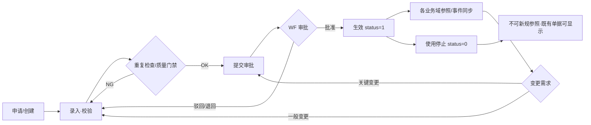
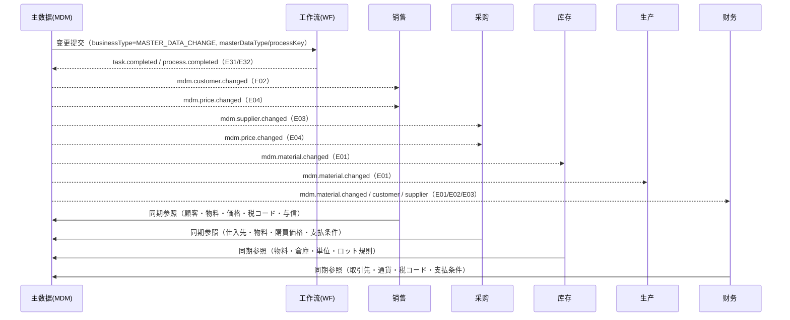

# 主数据管理 业务域概要书（主数据管理 業務概要書）

| 項目 | 内容 |
|---|---|
| 文書名 | 主数据管理 业务域概要书（主数据管理 業務概要書） |
| 文書番号 | DSN-MDM-000 |
| 版数 | v1.0 |
| 作成日 | 2026-10-20 |
| 作成者 | mdm-designer |
| 承認者 | 未承認（レビュー待ち） |
| 状態 | ドラフト（レビュー中） |
| 関連文書 | [体系总览](../README.md) / [共通项目定义](../00-common/01-common-item-definitions.md) / [共通业务规则](../00-common/08-common-business-rules.md) / [跨域流程](../00-common/09-cross-domain-flow.md) / [代码一览](../00-common/06-code-list.md) / [真实资料](../90-data/README.md) |

---

## 1. 業務概要

### 1.1 目的

主数据管理（MDM）是 Stellar ERP 的**公共基础域**：统一管理物料、客户、供应商、仓库/库位、计量单位、货币汇率、税码税率、销售/采购价格、结算条件、银行账户、客户信用与供应商评估等主数据，为销售（SAL）、采购（PUR）、库存（INV）、生产（PRD）、财务（FIN）提供**唯一、准确、可追溯**的基础数据。MDM 的职责不是单纯「维护数据」，而是建立「申请→录入→校验→审批→生效→变更→停用」的治理闭环，保证：① 一物一码、一户一码，禁止重复与随意创码；② 字段级完整（采购/销售/库存/生产/财务多视图）；③ 关键变更留痕、可审批、可回溯；④ 通过领域事件（`mdm.material.changed` 等）把变更同步给各业务域。

### 1.2 適用範囲

| 項目 | 内容 |
|---|---|
| 対象会社・拠点 | 华东精密电机股份有限公司 / 常州总装厂（P01）・无锡零部件厂（P02）；公司 ID=1，租户隔离按 RLS（第一版） |
| 対象機能範囲 | 物料分类与物料主数据（多视图）、客户/供应商主数据、仓库/库区/库位/货架、计量单位与换算、货币与汇率、税码与税率、销售价格表与折扣、采购价格与供应商报价、结算方式/付款条件/银行账户与联行号、客户信用额度与检查规则、供应商准入/评估/分级、物料替代、条码规则、主数据变更审批与版本历史、数据质量校验与批量维护、主数据数据权限 |
| 対象外 | 会计科目表（FIN 管理，MDM 只引用科目代码）；BOM/工艺路线（PRD 管理，MDM 只引用默认 BOM/工艺路线编码）；**工作中心（PRD 所有 `prd_work_center`，MDM 不持有工作中心表、只引用 default_work_center_id）**；检验标准（PRD 质量管理）；客户信用占用的实时计算（SAL/FIN，MDM 只维护额度与规则）；组织/用户/角色（SYS）；价格审批的流程引擎（WF，MDM 只发起审批） |
| 前提 | SYS 的公司/工厂/部门/用户/角色/权限/字典/编号/附件/导入导出中心已可用；FIN 会计科目表已初始化；WF 审批流已配置 |

### 1.3 業務上の狙い（KPI）

| KPI | 定義・算式 | 目標値 | 実現する機能 ID |
|---|---|---|---|
| 物料一码率 | 唯一编码物料数 ÷ 物料总数 | 100% | F-MDM-002/003 |
| 主数据重复率 | 重複判定された取引先数 ÷ 取引先总数 | ≤ 1% | F-MDM-004/005/019 |
| 主数据字段完整率 | 必填字段非空组合 ÷ 应填组合（按对象分类） | ≥ 98% | F-MDM-019 |
| 关键字段变更审批率 | 已审批的关键变更数 ÷ 关键变更总数（价格/信用/银行账户/税分类） | 100% | F-MDM-018 |
| 主数据变更同步时延 | 变更生效至各域可查询的最大时延（事件+缓存 TTL） | ≤ 5 分钟 | F-MDM-002/004/005/010 |
| 供应商合格率 | 合格供应商数 ÷ 在用供应商数 | ≥ 90% | F-MDM-015 |
| 价格取价准确率 | 取价结果与价格表预期一致的业务行数 ÷ 抽样行数 | 100% | F-MDM-010/011 |

## 2. 組織とロール

| ロール | 所属 | 主な操作 | 関連機能 ID | 権限 |
|---|---|---|---|---|
| 物料主数据担当 | 技术部/生产管理部 | 物料分类、物料登记、多视图字段维护、替代关系、条码规则 | F-MDM-001/002/016/017 | `mdm:material:create/update` |
| 客户主数据担当 | 销售部 | 客户登记与变更（基本/财务/开票/联系人/收货地址） | F-MDM-004 | `mdm:customer:create/update` |
| 供应商主数据担当 | 采购部 | 供应商登记与变更、供货范围、资质 | F-MDM-005/015 | `mdm:supplier:create/update` |
| 销售价格担当 | 销售部/财务部 | 价格表、折扣规则、销售价格生效 | F-MDM-010 | `mdm:price:create/update` |
| 采购价格担当 | 采购部 | 采购价格、供应商报价登记 | F-MDM-011 | `mdm:purchase-price:create/update` |
| 财务主数据担当 | 财务部 | 货币汇率、税码税率、结算方式、付款条件、银行/联行号、信用额度 | F-MDM-008/009/012/013/014 | `mdm:finance-master:*` |
| 仓库管理员 | 仓储部 | 仓库/库区/库位、库位条码、库位生成 | F-MDM-006 | `mdm:warehouse:create/update` |
| 系统管理员 | 信息部 | 编码规则、数据权限、批量导入、主数据参数 | F-MDM-003/019/020 | `mdm:config:*` |
| 主数据审批者 | 各部门主管/财务/采购/销售负责人 | 变更审批 | F-MDM-018 | `mdm:change:approve` |
| 只读用户 | 全部门 | 主数据查询、导出（权限范围内） | 全部 | `mdm:*:view/export` |

### 2.1 承認経路

主数据变更按 [approval-matrix.md](../90-data/approval-matrix.md) 的 **A16/A19/A20** 与 [08 §8.1](../00-common/08-common-business-rules.md) 联合正本执行。本表は要約であり、金額閾値・承認順序・役割コードは approval-matrix.md を正とし、重複定義しない。

| 変更対象 | シナリオ | processKey | 条件 | 承認経路（approval-matrix 正本） | 方式 |
|---|---|---|---|---|---|
| 主数据变更（物料・客户・供应商） | A16 | `APR-MDM` | 全件 | 主管部門長（技术部長／销售经理／采购经理）→ 财务／采购／销售責任者 | 順送 |
| 主数据变更（税码・汇率・结算条件・使用停止） | A16 | `APR-MDM` | 全件 | 主管部門長（财务经理／データ担当）→ 財務責任者 | 順送 |
| 客户开票情報・取引先銀行口座 | A16B | `APR-MDM-BANK` | 全件 | 主管部門長（销售经理／采购经理）→ 财务经理 → **財務总监承认**（SoD：08 §9.2 #8、approval-matrix A16B） | 順送 |
| 销售価格表・特別価格 | A19 | `APR-PRC` | 全件 | 销售经理 → 销售总监 → 财务经理 | 順送 |
| 信用額度（設定・変更） | A20 | `APR-CR` | 全件 | 销售总监 → 财务总监（→ 总经理※設定額以上） | 順送 |
| 采购価格 | A16 | `APR-MDM` | 全件 | 采购经理 → 财务经理（采购責任者 → 財務責任者） | 順送 |

> **WF 提出契約（Lead 裁定 2026-10-20）**：`businessType=MASTER_DATA_CHANGE` を単一使用し、`variables.masterDataType`（`MDM_MATERIAL`/`MDM_CUSTOMER`/`MDM_SUPPLIER`/`MDM_PRICE`/`MDM_CREDIT`）と `processKey`（`APR-MDM`/`APR-MDM-BANK`/`APR-PRC`/`APR-CR`）で対象と経路を識別する（WF 94 の方式が正）。MDM は提交・コールバック受信・状態/履歴更新を担当する。承認者は申請者と同一不可（自己承認禁止）。
>
> **A16B 口座変更の SoD（Lead 裁定 2026-10-20、R-PURDES-003）**：取引先（客户/供应商）の銀行口座の新規・変更は **A16B（`processKey=APR-MDM-BANK`）** とし、A16 の一般経路ではなく「主管部門長 → 财务经理 → **財務总监（`ROLE-FIN-DIR`）承認**」の 3 段経路を必須とする（approval-matrix A16B、08 §9.2 #8 に対応）。申請者・一次承認者・財務总监は相互に同一人物不可。`variables.bankAccountChanged=true` と `masterDataType=MDM_CUSTOMER`/`MDM_SUPPLIER` で A16B を選択する。

## 3. 業務フロー

### 3.1 全体フロー（主数据生命周期）

### 3.2 処理手順（標準）

| # | 手順 | 実施者 | システム処理 | 入力 | 出力 | 異常時 |
|---|---|---|---|---|---|---|
| 1 | 主数据申请 | 业务部门 | 申请单登记（对象类型、原因、影响范围） | 对象类型、申请人、理由 | 变更申请单 `mdm_change_request` | 必填漏れ→項目エラー |
| 2 | 重复检查 | 系统 | 编码/名称/税号/银行账号相似度检查（pg_trgm + 精确匹配） | 申请内容 | 疑似重复候选清单 | 高相似→警告（MSG-MDM-006），强制重复→阻止 |
| 3 | 录入 | 数据担当 | 多视图字段录入、下拉/代码选择、校验 | 字段值 | 草稿记录（`status=10`） | 入力チェックで差戻し |
| 4 | 数据质量校验 | 系统 | 必填、格式、代码存在、业务规则、跨字段一致性校验 | 草稿记录 | 校验结果（错误/警告清单） | 错误未解消时保存不可 |
| 5 | 提交审批 | 数据担当 | 生成 WF 实例、锁定编辑 | 对象 ID、version | WF `processInstanceId`、状态 20 | WF 未設定→MSG-COM-073 |
| 6 | 审批 | 审批者 | 同意/驳回/退回（字段级权限内可修正） | 审批结论、意见 | 状态 25/95/10、变更历史 | 排他競合→MSG-COM-033 |
| 7 | 生效 | 系统 | 状态置 1，发布事件（E01〜E04），写历史 `mdm_*_his` | — | 生效主数据、Outbox 事件 | 事件失败→Outbox 重试 |
| 8 | 业务参照 | SAL/PUR/INV/PRD/FIN | 同步参照（09 第 11 节） | 编码/ID | 主数据快照（写入单据） | 無効/削除コードは新規参照不可 |
| 9 | 变更 | 数据担当 | 同 1〜7，`version+1`，记录 before/after | 变更申请 | 新版本、事件 | 关键字段需重新审批 |
| 10 | 使用停止 | 数据担当/审批者 | `status=0`；参照中检查；发布事件 | 停止理由 | 停止主数据、历史 | 未完了伝票参照时警告/阻止 |

### 3.3 関連業務域との連携

| 相手域 | 連携内容 | 方式（同期/イベント） | 契約 |
|---|---|---|---|
| SYS | ユーザ・ロール・権限・組織・公司/工場・字典・採番・附件・导入导出 | 同期参照 | [09 第 11 节](../00-common/09-cross-domain-flow.md) |
| WF | 主数据变更审批（提交/回调/状态联动） | 同期提交 + E31/E32 购读 | 09 第 9 节 |
| SAL | 顾客、物料、价格表、税码、信用额度 | 同期参照 + E02/E04/E40/E42 购读 | 09 第 11 节、第 5 章 |
| PUR | 供应商、物料、采购价格、税码、付款条件 | 同期参照 + E03/E04/E40 购读 | 09 第 11 节、第 4 章 |
| INV | 物料、仓库/库位、单位、批次/序列号规则、安全库存 | 同期参照 + E01/E39 购读 | 09 第 11 节、第 6 章 |
| PRD | 物料、BOM 相关单位、物料类型、默认仓库、倒冲标志 | 同期参照 + E01/E39 购读 | 09 第 11 节 |
| FIN | 取引先、货币汇率、税码、结算条件、存货/收入/成本科目映射 | 同期参照 + E01/E02/E03/E39/E40/E41/E42 购读 | 09 第 7 章、第 11 节 |

> **事件契约**：MDM が発行するイベントは 09 第 3 章の E01〜E04 に加え、2026-10-20 Lead 追補の **E39 `mdm.warehouse.changed` / E40 `mdm.tax-code.changed` / E41 `mdm.exchange-rate.changed` / E42 `mdm.credit-limit.changed`** を使用する（各イベントは確定変更後に Outbox へ記録し、購読側はキャッシュ更新・再判定を行う）。未定義イベントの独自発行は禁止。
>
> **税码口径（Lead 裁定）**：06 的 `VAT13` 等为基础税率码（rate-level），MDM 的 `mdm_tax_code` 使用具体税码 `VAT13-OUT`/`VAT13-IN` 等，字段含 `tax_rate_code`（引用 06 基础码）、`tax_type`（10 销项/11 进项/20 附加/30 关税/40 所得税）、`is_tax_included`、`valid_from`/`valid_to`。SAL/PUR/FIN 取税统一引用 `mdm_tax_code`，**不得自行判定税额方向**（详见 [04-uom-currency-tax.md](04-uom-currency-tax.md) 第 2.4 节）。
>
> **物料编码口径（Lead 裁定）**：10 位＝分类码 4 位＋流水 6 位；大分类 `10 原材料/20 半成品/30 成品/40 外购件/50 包装材料/60 低值易耗品/70 委外加工品/90 其他`；例：50W470 硅钢片=`1001000001`，YE3-100L1-4=`3001000001`（详见 06 §11、[01-material-master.md](01-material-master.md)）。

## 4. 機能一覧

| 機能 ID | 機能名 | 概要 | 画面 ID | 種別 | 優先度 | 状態 | 詳細設計書 |
|---|---|---|---|---|---|---|---|
| F-MDM-001 | 物料分类树与分类属性 | 多阶分类树、分类属性模板、分类编码 4 桁 | SCR-MDM-004 | 登録/一覧 | P0 | 設計済 | [01](01-material-master.md) |
| F-MDM-002 | 物料主数据（多视图） | 基本/采购/销售/库存/生产/财务/质量多视图字段级维护 | SCR-MDM-001/002/003 | 登録/一覧/参照 | P0 | 設計済 | [01](01-material-master.md) |
| F-MDM-003 | 物料编码规则与自动编码 | 分类 4 + 流水 6 自动采番、手動指定、空番检查 | SCR-MDM-005 | 登録 | P0 | 設計済 | [01](01-material-master.md) |
| F-MDM-004 | 客户主数据 | 基本/财务/信用/开票/联系人/收货地址 | SCR-MDM-011/012/013/014/015 | 登録/一覧/参照 | P0 | 設計済 | [02](02-business-partner.md) |
| F-MDM-005 | 供应商主数据 | 基本/财务/付款条件/供货范围/银行账户/资质 | SCR-MDM-021/022/023/024/025 | 登録/一覧/参照 | P0 | 設計済 | [02](02-business-partner.md) |
| F-MDM-006 | 仓库/库区/库位/货架 | 仓库类型、库区、库位编码、库位容量与条码 | SCR-MDM-031/032/033/034 | 登録/一覧 | P0 | 設計済 | [03](03-warehouse-location.md) |
| F-MDM-007 | 计量单位与单位换算组 | UN/ECE Rec20 + GB/T 3100 单位、换算组、精度 | SCR-MDM-041/042 | 登録/一覧 | P0 | 設計済 | [04](04-uom-currency-tax.md) |
| F-MDM-008 | 货币与汇率 | ISO 4217 货币、即期/期间汇率、汇率导入与生效 | SCR-MDM-043/044/045 | 登録/一覧/取込 | P0 | 設計済 | [04](04-uom-currency-tax.md) |
| F-MDM-009 | 税码与税率 | 增值税/附加税/关税、含税标志、税收分类编码 | SCR-MDM-046/047 | 登録/一覧 | P0 | 設計済 | [04](04-uom-currency-tax.md) |
| F-MDM-010 | 销售价格表与折扣 | 客户/分类/物料/阶梯价/生效期/币种/含税/折扣 | SCR-MDM-051/052/053/056 | 登録/一覧 | P0 | 設計済 | [05](05-price-settlement.md) |
| F-MDM-011 | 采购价格与供应商报价 | 供应商+物料采购价、报价单、比价支持 | SCR-MDM-054/055 | 登録/一覧 | P0 | 設計済 | [05](05-price-settlement.md) |
| F-MDM-012 | 结算方式与付款条件 | 现金/转账/承兑/信用证；付款条件与分期 | SCR-MDM-061/062 | 登録/一覧 | P0 | 設計済 | [05](05-price-settlement.md) |
| F-MDM-013 | 银行账户与联行号 | 银行主数据、CNAPS 联行号、取引先银行账户 | SCR-MDM-063/064 | 登録/一覧 | P0 | 設計済 | [05](05-price-settlement.md) |
| F-MDM-014 | 客户信用额度与检查规则 | 信用额度、超限比例、检查时点、冻结/解除申请 | SCR-MDM-071/072 | 登録/一覧 | P0 | 設計済 | [06](06-credit-supplier-eval.md) |
| F-MDM-015 | 供应商准入/评估/分级 | 准入审查、资质、月度评分、A/B/C/D 分级、AVL | SCR-MDM-026/073/074 | 登録/一覧 | P1 | 設計済 | [06](06-credit-supplier-eval.md) |
| F-MDM-016 | 物料替代关系 | 单向/双向/一对一/一对多替代、优先级、生效期 | SCR-MDM-081 | 登録/一覧 | P1 | 設計済 | [07](07-substitute-barcode-governance.md) |
| F-MDM-017 | 条码规则与标签 | 物料/批次/库位条码规则、Code128/GS1-128、标签打印 | SCR-MDM-082/083 | 登録/帳票 | P1 | 設計済 | [07](07-substitute-barcode-governance.md) |
| F-MDM-018 | 主数据变更审批与版本历史 | 变更申请、审批、版本历史、前后值对比 | SCR-MDM-091/092/093 | ワークフロー | P0 | 設計済 | [07](07-substitute-barcode-governance.md) |
| F-MDM-019 | 数据质量校验与批量维护 | 质量规则、日检、批量导入/更新、错误报告 | SCR-MDM-094/095 | バッチ/取込 | P1 | 設計済 | [07](07-substitute-barcode-governance.md) |
| F-MDM-020 | 主数据数据权限 | 按公司/工厂/部门分配数据范围（委托 SYS 数据权限） | SCR-MDM-096 | 設定 | P0 | 設計済 | [07](07-substitute-barcode-governance.md) |
| F-MDM-021 | 物料工厂视图参数 | 工厂级默认仓库、安全库存、提前期、批量规则 | SCR-MDM-006 | 登録 | P1 | 設計済 | [01](01-material-master.md) |
| F-MDM-022 | 主数据检索与导出 | 跨对象统一检索、主数据门户、导出 | SCR-MDM-097 | 照会 | P1 | 設計済 | [07](07-substitute-barcode-governance.md) |
| F-MDM-023 | 主数据分发与外部同步 | PLM 物料/BOM 同步、多工厂分发 | — | 連携 | P2 | 設計済（概要） | [07](07-substitute-barcode-governance.md) |
| F-MDM-024 | 汇率与标准代码导入 | 汇率、单位、货币、联行号等标准数据导入 | SCR-MDM-045 | 取込 | P1 | 設計済 | [04](04-uom-currency-tax.md) |
| F-MDM-025 | 工厂主数据 | 工厂编码・名称・类型・负责人・公司组织参照（Lead 裁定：工厂主数据归 MDM、`mdm_factory`） | SCR-MDM-098 | 登録/一覧 | P0 | 設計済 | [03](03-warehouse-location.md) |

> 優先度：P0 / P1 / P2 は実装順の目安であり、全て当面の範囲（用户决定：不分期）。状態：すべて設計済（本域詳細設計完了時点）。F-MDM-015/019/022/023 は P1/P2 のため詳細度を一部概要に留めるが、フィールド定義は省略しない。

## 5. 画面一覧

| 画面 ID | 画面名 | 類型 | 機能 ID | 権限コード | 遷移元 | 遷移先 |
|---|---|---|---|---|---|---|
| SCR-MDM-001 | 物料一覧 | 一覧検索 | F-MDM-002 | `mdm:material:view` | 主数据菜单 | SCR-MDM-002/003 |
| SCR-MDM-002 | 物料登録編集 | 登録編集 | F-MDM-002 | `mdm:material:create/update` | 001 | 001/003 |
| SCR-MDM-003 | 物料参照詳細 | 参照詳細 | F-MDM-002 | `mdm:material:view` | 001/002 | 002 |
| SCR-MDM-004 | 物料分类树管理 | 登録編集 | F-MDM-001 | `mdm:material-category:update` | 菜单/002 | 002 |
| SCR-MDM-005 | 物料编码规则 | 登録編集 | F-MDM-003 | `mdm:code-rule:update` | 菜单 | — |
| SCR-MDM-006 | 物料工厂视图設定 | 登録編集 | F-MDM-021 | `mdm:material-factory:update` | 003/菜单 | 003 |
| SCR-MDM-011 | 客户一覧 | 一覧検索 | F-MDM-004 | `mdm:customer:view` | 菜单 | 012/013 |
| SCR-MDM-012 | 客户登録編集 | 登録編集 | F-MDM-004 | `mdm:customer:create/update` | 011 | 011/013 |
| SCR-MDM-013 | 客户参照詳細 | 参照詳細 | F-MDM-004 | `mdm:customer:view` | 011/012 | 012 |
| SCR-MDM-014 | 客户联系人管理 | 登録編集 | F-MDM-004 | `mdm:customer:update` | 012 | 012 |
| SCR-MDM-015 | 客户收货地址管理 | 登録編集 | F-MDM-004 | `mdm:customer:update` | 012 | 012 |
| SCR-MDM-021 | 供应商一覧 | 一覧検索 | F-MDM-005 | `mdm:supplier:view` | 菜单 | 022/023 |
| SCR-MDM-022 | 供应商登録編集 | 登録編集 | F-MDM-005 | `mdm:supplier:create/update` | 021 | 021/023 |
| SCR-MDM-023 | 供应商参照詳細 | 参照詳細 | F-MDM-005 | `mdm:supplier:view` | 021/022 | 022 |
| SCR-MDM-024 | 供应商资质管理 | 登録編集 | F-MDM-005/015 | `mdm:supplier:update` | 023/022 | 023 |
| SCR-MDM-025 | 供应商供货范围管理 | 登録編集 | F-MDM-005 | `mdm:supplier:update` | 022/023 | 023 |
| SCR-MDM-026 | 供应商准入审查 | ワークフロー | F-MDM-015 | `mdm:supplier-admission:approve` | 菜单/023 | 023 |
| SCR-MDM-031 | 仓库一覧/登録編集 | 一覧検索/登録編集 | F-MDM-006 | `mdm:warehouse:*` | 菜单 | 032/033 |
| SCR-MDM-032 | 库区登録編集 | 登録編集 | F-MDM-006 | `mdm:warehouse:update` | 031 | 033 |
| SCR-MDM-033 | 库位一覧/登録編集 | 一覧検索/登録編集 | F-MDM-006 | `mdm:warehouse:update` | 031/032 | 034 |
| SCR-MDM-034 | 库位一括生成ウィザード | ウィザード | F-MDM-006 | `mdm:warehouse:update` | 033 | 033 |
| SCR-MDM-041 | 计量单位一覧/登録編集 | 一覧検索/登録編集 | F-MDM-007 | `mdm:uom:*` | 菜单 | 042 |
| SCR-MDM-042 | 单位换算组管理 | 登録編集 | F-MDM-007 | `mdm:uom:update` | 041 | 041 |
| SCR-MDM-043 | 货币一覧/登録編集 | 一覧検索/登録編集 | F-MDM-008 | `mdm:currency:*` | 菜单 | 044 |
| SCR-MDM-044 | 汇率一覧/登録編集 | 一覧検索/登録編集 | F-MDM-008 | `mdm:exchange-rate:*` | 菜单/043 | 045 |
| SCR-MDM-045 | 标准代码・汇率导入 | 取込 | F-MDM-024 | `mdm:exchange-rate:import` | 044 | 044 |
| SCR-MDM-046 | 税码一覧/登録編集 | 一覧検索/登録編集 | F-MDM-009 | `mdm:tax-code:*` | 菜单 | 047 |
| SCR-MDM-047 | 税率与税收分类编码 | 登録編集 | F-MDM-009 | `mdm:tax-code:update` | 046 | 046 |
| SCR-MDM-051 | 销售价格表一覧 | 一覧検索 | F-MDM-010 | `mdm:price:view` | 菜单 | 052 |
| SCR-MDM-052 | 销售价格表登録編集 | 登録編集 | F-MDM-010 | `mdm:price:create/update` | 051 | 051 |
| SCR-MDM-053 | 折扣规则管理 | 登録編集 | F-MDM-010 | `mdm:price:update` | 菜单 | 052 |
| SCR-MDM-054 | 采购价格一覧/登録編集 | 一覧検索/登録編集 | F-MDM-011 | `mdm:purchase-price:*` | 菜单 | 055 |
| SCR-MDM-055 | 供应商报价管理 | 登録編集 | F-MDM-011 | `mdm:supplier-quotation:*` | 菜单/054 | 054 |
| SCR-MDM-056 | 取价模拟与照会 | 照会 | F-MDM-010/011 | `mdm:price:view` | 菜单 | — |
| SCR-MDM-061 | 结算方式一覧/登録編集 | 一覧検索/登録編集 | F-MDM-012 | `mdm:settlement:*` | 菜单 | — |
| SCR-MDM-062 | 付款条件一覧/登録編集 | 一覧検索/登録編集 | F-MDM-012 | `mdm:payment-term:*` | 菜单 | — |
| SCR-MDM-063 | 银行一覧/登録編集 | 一覧検索/登録編集 | F-MDM-013 | `mdm:bank:*` | 菜单 | 064 |
| SCR-MDM-064 | 取引先银行账户管理 | 登録編集 | F-MDM-013 | `mdm:bank-account:*` | 023/064 | — |
| SCR-MDM-071 | 客户信用额度一覧/登録編集 | 一覧検索/登録編集 | F-MDM-014 | `mdm:credit:*` | 菜单/013 | 072 |
| SCR-MDM-072 | 信用检查规则管理 | 登録編集 | F-MDM-014 | `mdm:credit:update` | 071 | 071 |
| SCR-MDM-073 | 供应商评估 | 一覧検索/登録編集 | F-MDM-015 | `mdm:supplier-eval:*` | 菜单 | 074 |
| SCR-MDM-074 | 供应商分级/AVL | 照会 | F-MDM-015 | `mdm:supplier-eval:view` | 073 | 023 |
| SCR-MDM-081 | 物料替代关系管理 | 登録編集 | F-MDM-016 | `mdm:substitute:*` | 菜单/003 | — |
| SCR-MDM-082 | 条码规则管理 | 登録編集 | F-MDM-017 | `mdm:barcode-rule:*` | 菜单 | 083 |
| SCR-MDM-083 | 条码标签打印 | 帳票プレビュー | F-MDM-017 | `mdm:barcode:print` | 003/033 | — |
| SCR-MDM-091 | 主数据变更申请一覧 | 一覧検索 | F-MDM-018 | `mdm:change:view` | 菜单 | 092 |
| SCR-MDM-092 | 主数据变更审批/详细 | ワークフロー | F-MDM-018 | `mdm:change:approve` | 091 | 091 |
| SCR-MDM-093 | 主数据变更历史照会 | 一覧検索 | F-MDM-018 | `mdm:change:view` | 003/013/023/091 | — |
| SCR-MDM-094 | 数据质量校验 | 一覧検索 | F-MDM-019 | `mdm:data-quality:*` | 菜单 | 095 |
| SCR-MDM-095 | 主数据批量维护导入 | ウィザード | F-MDM-019 | `mdm:material:import` 等 | 菜单/094 | 094 |
| SCR-MDM-096 | 主数据数据权限設定 | 登録編集 | F-MDM-020 | `mdm:data-scope:update` | 菜单 | — |
| SCR-MDM-097 | 主数据检索（主数据门户） | 一覧検索 | F-MDM-022 | `mdm:portal:view` | 菜单 | 003/013/023 |
| SCR-MDM-098 | 工厂一覧/登録編集 | 一覧検索/登録編集 | F-MDM-025 | `mdm:factory:view/update` | 菜单 | SCR-MDM-031 |

## 6. 帳票一覧

| 帳票 ID | 帳票名 | 出力タイミング | 帳票種別 | 機能 ID | 詳細 |
|---|---|---|---|---|---|
| PRT-MDM-001 | 物料主数据一覧表 | 手動（検索条件） | 一覧表 | F-MDM-002 | [92](92-report-batch-design.md) |
| PRT-MDM-002 | 物料多视图明细表 | 手動（1 物料） | 一覧表 | F-MDM-002 | [92](92-report-batch-design.md) |
| PRT-MDM-003 | 物料标签（条码） | 手動/入荷時 | ラベル | F-MDM-017 | [92](92-report-batch-design.md) |
| PRT-MDM-004 | 客户主数据一覧表 | 手動 | 一覧表 | F-MDM-004 | [92](92-report-batch-design.md) |
| PRT-MDM-005 | 客户信用额度一覧表 | 手動/月次 | 一覧表 | F-MDM-014 | [92](92-report-batch-design.md) |
| PRT-MDM-006 | 供应商主数据一覧表 | 手動 | 一覧表 | F-MDM-005 | [92](92-report-batch-design.md) |
| PRT-MDM-007 | 合格供应商目录（AVL） | 手動/月次 | 一覧表 | F-MDM-015 | [92](92-report-batch-design.md) |
| PRT-MDM-008 | 供应商评估结果表 | 月次/手動 | 集計表 | F-MDM-015 | [92](92-report-batch-design.md) |
| PRT-MDM-009 | 有效销售价格表 | 手動（基準日指定） | 一覧表 | F-MDM-010 | [92](92-report-batch-design.md) |
| PRT-MDM-010 | 采购价格・报价比较表 | 手動 | 一覧表 | F-MDM-011 | [92](92-report-batch-design.md) |
| PRT-MDM-011 | 汇率一覧表 | 手動/月次 | 一覧表 | F-MDM-008 | [92](92-report-batch-design.md) |
| PRT-MDM-012 | 税码税率一覧表 | 手動 | 一覧表 | F-MDM-009 | [92](92-report-batch-design.md) |
| PRT-MDM-013 | 库位一覧表・库位标签 | 手動 | 一覧表/ラベル | F-MDM-006 | [92](92-report-batch-design.md) |
| PRT-MDM-014 | 主数据变更履历表 | 手動 | 一覧表 | F-MDM-018 | [92](92-report-batch-design.md) |
| PRT-MDM-015 | 主数据质量报告 | 月次/手動 | 集計表 | F-MDM-019 | [92](92-report-batch-design.md) |

## 7. バッチ一覧

| バッチ ID | バッチ名 | 起動方式 | 実行時間帯 | 処理概要 | 冪等性 |
|---|---|---|---|---|---|
| BAT-MDM-001 | 汇率导入与生效 | 日次（取込）+ イベント | 毎日 07:00 | 外币汇率取込（CSV/手入力）・有効化・基準レート更新 | 再実行可（同一日付は upsert） |
| BAT-MDM-002 | 价格生效/失效处理 | 日次 | 毎日 00:10 | 価格表・購買価格の有効期間判定、状態更新、E04 発行 | 再実行可（状態から再判定） |
| BAT-MDM-003 | 信用额度日切快照 | 日次 | 毎日 06:00 | 顧客信用额度・利用状況スナップショット作成（SAL/FIN 参照用） | 再実行可（当日分上書き） |
| BAT-MDM-004 | 供应商评估月次计算 | 月次 | 毎月 1 日 02:00 | 品質/納期/価格/サービス点数を集計し評価・分级更新 | 再実行可（期間単位で再計算） |
| BAT-MDM-005 | 主数据质量日检 | 日次 | 毎日 03:00 | 必須・形式・重複・参照整合性チェック、問題起票 | 再実行可 |
| BAT-MDM-006 | 主数据质量月报 | 月次 | 毎月 1 日 04:00 | 品質指標集計・レポート出力・責任者通知 | 再実行可 |
| BAT-MDM-007 | 资质・证照到期预警 | 日次 | 毎日 08:00 | 供應商資質/客户证照の到期 30/15/7 日前通知 | 再実行可（通知ログで重複排除） |
| BAT-MDM-008 | 变更审批超时提醒 | 日次 | 毎日 09:00 | 承認待ち 24h/48h のリマインダ・エスカレーション | 再実行可（通知ログ） |
| BAT-MDM-009 | 主数据分发导出 | 日次 | 毎日 23:00 | 多工廠・外部システム向け主数据全量/差分抽出 | 再実行可（日付単位） |
| BAT-MDM-010 | 编码空番・使用停止检查 | 月次 | 毎月 1 日 05:00 | 未使用コード・長期未使用主数据の検出、停止候補レポート | 再実行可 |

## 8. テーブル一覧（実装 53 テーブル + 未設計 4 テーブル）

| 物理名 | 論理名 | 種別 | 主な用途 | 更新元機能 ID | データ量見積 |
|---|---|---|---|---|---|
| `mdm_material_category` | 物料分类 | マスタ | 多阶分类树、分类属性 | F-MDM-001 | 300 件 |
| `mdm_material` | 物料主数据 | マスタ | 全视图字段（基本/采购/销售/库存/生产/财务/质量） | F-MDM-002 | 8,000→13,000 件 |
| `mdm_material_factory` | 物料工厂视图参数 | マスタ | 工厂별 默认仓库/安全库存/提前期/批量 | F-MDM-021 | 16,000 件 |
| `mdm_material_his` | 物料变更历史 | 履歴 | 变更前后值、审批 | F-MDM-018 | 50,000 件/年 |
| `mdm_material_substitute` | 物料替代关系 | マスタ | 替代料、优先级、生效期 | F-MDM-016 | 2,000 件 |
| `mdm_material_barcode` | 物料条码 | マスタ | 物料/批次条码发行 | F-MDM-017 | 10,000 件 |
| `mdm_customer` | 客户主数据 | マスタ | 基本/财务/信用/开票 | F-MDM-004 | 1,200→1,700 件 |
| `mdm_customer_contact` | 客户联系人 | マスタ | 联系人、职务、联系方式 | F-MDM-004 | 5,000 件 |
| `mdm_customer_address` | 客户收货地址 | マスタ | 多收货地址、默认地址 | F-MDM-004 | 4,000 件 |
| `mdm_customer_his` | 客户变更历史 | 履歴 | 变更前后 JSON、审批 | F-MDM-018 | 50,000 件/年 |
| `mdm_supplier` | 供应商主数据 | マスタ | 基本/财务/付款/准入 | F-MDM-005 | 800→1,050 件 |
| `mdm_supplier_contact` | 供应商联系人 | マスタ | 联系人 | F-MDM-005 | 3,000 件 |
| `mdm_supplier_address` | 供应商地址 | マスタ | 送货/开票地址 | F-MDM-005 | 2,000 件 |
| `mdm_supplier_qualification` | 供应商资质 | マスタ | 营业执照/ISO/3C/许可、有效期 | F-MDM-015 | 4,000 件 |
| `mdm_supplier_material` | 供应商供货范围 | マスタ | 供应物料/品类、采购价引用 | F-MDM-005/011 | 20,000 件 |
| `mdm_supplier_his` | 供应商变更历史 | 履歴 | 变更前后 JSON、准入记录 | F-MDM-018 | 40,000 件/年 |
| `mdm_partner_bank_account` | 取引先银行账户 | マスタ | 客户/供应商开户行、账号、CNAPS | F-MDM-013 | 3,000 件 |
| `mdm_partner_bank_account_his` | 银行账户变更历史 | 履歴 | 变更前口座（下 4 桁）、审批 | F-MDM-013 | 500 件/年 |
| `mdm_factory` | 工厂 | マスタ | 工厂主数据（工厂编码/名称/类型/负责人。Lead 裁定：MDM 所有） | F-MDM-025 | 2〜5 件 |
| `mdm_warehouse` | 仓库 | マスタ | 仓库类型、仓库属性 | F-MDM-006 | 10〜30 件 |
| `mdm_warehouse_zone` | 库区 | マスタ | 库区类型、面积 | F-MDM-006 | 60 件 |
| `mdm_warehouse_bin` | 库位 | マスタ | 库位编码、容量、条码 | F-MDM-006 | 20,000 件 |
| `mdm_uom` | 计量单位 | マスタ | UN/ECE Rec20 + GB/T 3100 | F-MDM-007 | 100 件 |
| `mdm_uom_conversion` | 单位换算 | マスタ | 换算组、换算率、精度 | F-MDM-007 | 300 件 |
| `mdm_currency` | 货币 | マスタ | ISO 4217 货币 | F-MDM-008 | 30 件 |
| `mdm_exchange_rate` | 汇率 | マスタ | 即期/期间汇率、生效日、来源 | F-MDM-008/024 | 20,000 件/年 |
| `mdm_tax_code` | 税码 | マスタ | 税区分、税率、含税标志 | F-MDM-009 | 24 件（`90-data/code-lists/mdm-tax-code.csv`） |
| `mdm_tax_rate` | 税率 | マスタ | 税率历史、适用期间 | F-MDM-009 | 500 件 |
| `mdm_tax_classification` | 税收分类编码 | マスタ | 商品和服务税收分类编码 | F-MDM-009 | 4,000 件 |
| `mdm_price_list` | 价格表 | マスタ | 价格表头（适用维度、币种、含税） | F-MDM-010 | 300 件 |
| `mdm_price_list_line` | 价格表明细 | マスタ | 客户/分类/物料/阶梯价、生效期 | F-MDM-010 | 300,000 件 |
| `mdm_price_discount` | 折扣规则 | マスタ | 折扣率、条件、适用期间 | F-MDM-010 | 2,000 件 |
| `mdm_purchase_price` | 采购价格 | マスタ | 供应商+物料+阶梯价 | F-MDM-011 | 100,000 件 |
| `mdm_supplier_quotation` | 供应商报价单 | マスタ/履歴 | 报价头、有效期、比价 | F-MDM-011 | 20,000 件/年 |
| `mdm_supplier_quotation_line` | 供应商报价明细 | マスタ/履歴 | 物料、价格、阶梯 | F-MDM-011 | 200,000 件/年 |
| `mdm_settlement_method` | 结算方式 | マスタ | 现金/转账/承兑/信用证 | F-MDM-012 | 20 件 |
| `mdm_payment_term` | 付款条件 | マスタ | 付款条件头 | F-MDM-012 | 50 件 |
| `mdm_payment_term_line` | 付款条件分期 | マスタ | 分期比例、账期 | F-MDM-012 | 200 件 |
| `mdm_bank` | 银行 | マスタ | 银行名称、CNAPS 行别 | F-MDM-013 | 100 件 |
| `mdm_credit_limit` | 客户信用额度 | マスタ | 额度、超限处理、冻结 | F-MDM-014 | 2,000 件 |
| `mdm_credit_limit_his` | 信用额度变更历史 | 履歴 | 额度变更前后、审批 | F-MDM-014 | 2,500 件/年 |
| `mdm_credit_check_rule` | 信用检查规则 | マスタ | 检查时点、计算口径、容差 | F-MDM-014 | 50 件 |
| `mdm_supplier_admission` | 供应商准入申请 | 履歴 | 准入流程、审查结果 | F-MDM-015 | 800 件 |
| `mdm_supplier_evaluation` | 供应商评估 | 履歴 | 月度评分、等级 | F-MDM-015 | 50,000 件/年 |
| `mdm_supplier_eval_item` | 供应商评估明细 | 履歴 | 评价维度、得分 | F-MDM-015 | 250,000 件/年 |
| `mdm_barcode_rule` | 条码规则 | 設定 | 条码类型、编码段、校验 | F-MDM-017 | 100 件 |
| `mdm_change_request` | 主数据变更申请 | 履歴 | 变更申请头、状态 | F-MDM-018 | 20,000 件/年 |
| `mdm_change_request_line` | 主数据变更申请明细 | 履歴 | 字段级变更前后值 | F-MDM-018 | 200,000 件/年 |
| `mdm_data_quality_rule` | 数据质量规则 | 設定 | 规则、对象、级别 | F-MDM-019 | 200 件 |
| `mdm_data_quality_issue` | 数据质量问题 | 履歴 | 问题实例、处理状态 | F-MDM-019 | 100,000 件/年 |
| `mdm_code_rule` | 主数据编码规则 | 設定 | 编码模板、流水位数、对象类型 | F-MDM-003 | 30 件 |
| `mdm_ext_field` | 扩展字段定义 | 設定 | 对象、字段代码、型、必填 | F-MDM-002 等 | 500 件 |
| `mdm_data_scope_policy` | 数据权限策略 | 設定 | 对象、权限键列、范围类型 | F-MDM-020 | 30 件 |

> 全表设计详见 [90-db-design.md](90-db-design.md)（53 テーブルの完全 DDL・索引・制約）。業務域内表の参照関係は 90 の ER 図を正とし、接頭辞は `mdm_`（[04 DB 共通規格](../00-common/04-common-db-spec.md) 第 2.1 節）。

**未設計マスタ（第一版対象。TODO：DDL 未作成）**

| 物理名（予定） | 論理名 | 所有 | 参照予定域 | 備考 |
|---|---|---|---|---|
| `mdm_project` | 項目マスタ（プロジェクト） | MDM（TODO：未設計） | FIN（項目輔助核算） | TODO：DDL 未作成。FIN の `PROJECT` 辅助核算（07-finance/01-accounting-subjects.md）が参照予定 |
| `mdm_asset_category` | 固定資産分類マスタ | MDM（TODO：未設計） | FIN（固定資産） | TODO：DDL 未作成。耐用年数・残存率の分類は FIN が設定、分類マスタは MDM が所有予定 |
| `mdm_contract` | 框架合同マスタ（フレーム契約） | MDM（TODO：未設計） | PUR（框架合同/一揽子订单） | Lead 裁定 2026-10-20：P2 框架合同は MDM 所有。TODO：DDL 未作成（PUR 00-overview の `CONTRACT` 区分が参照予定） |
| `mdm_material_warehouse` | 物料倉庫別パラメータ | MDM（TODO：未設計） | INV（倉庫別安全在庫） | Lead 裁定 2026-10-20：倉庫別安全在庫等は MDM 所有。DDL 作成までは `mdm_material`（全社値）+ `mdm_material_factory`（工場値）で運用 |

**未設計フィールド（第一版対象、TODO）**：`mdm_material.expiry_base`（有効期限の基準日：製造日/入荷日切替。INV 04-batch-serial-status.md 未決 #4 が参照予定）。DDL 追加までは「製造日があれば製造日、無ければ入荷日」で運用し、フィールドは追加しない。

## 9. 外部 IF 一覧

| IF ID | 名称 | 相手先 | 方向 | 方式 | 頻度 | 契機 |
|---|---|---|---|---|---|---|
| IF-MDM-001 | 汇率导入 | 中国外汇交易中心 / 银行公开牌价（CSV） | 受信 | ファイル（CSV） | 日次 | BAT-MDM-001 |
| IF-MDM-002 | 银行联行号（CNAPS）取込 | 人民银行支付系统公开行号表 | 受信 | ファイル（CSV） | 月次/随時 | F-MDM-024 |
| IF-MDM-003 | 标准代码取込（货币/单位） | ISO 4217 / UN/ECE Rec20 公开代码表 | 受信 | ファイル（CSV） | 随時 | F-MDM-024 |
| IF-MDM-004 | PLM 物料/设计 BOM 同步 | PLM（如 Siemens Teamcenter） | 双方向 | REST | 随時 | F-MDM-023 |
| IF-MDM-005 | 供应商工商信息核验 | 国家企业信用信息公示系统 / 第三方（如企查查） | 受信 | REST | 随時 | F-MDM-005 |
| IF-MDM-006 | 税码/税收分类编码取込 | 国家税务总局公开代码表 | 受信 | ファイル（CSV） | 随時 | F-MDM-024 |
| IF-MDM-007 | 庫位マスタ配信（PDA/WMS） | WMS/PDA | 送信 | REST / ファイル | 日次/随時 | F-MDM-023 |

> 外部参照先はすべて公開情報であり、個人情報・非公開情報を取得しない。IF 詳細は [92-report-batch-design.md](92-report-batch-design.md) 第 C 章。

## 10. 権限一覧

| 権限コード | 対象機能 | 対象データ範囲 | 付与ロール |
|---|---|---|---|
| `mdm:material:view` | F-MDM-002/001 | 全社（工場はデータ権限で絞込） | 全ロール |
| `mdm:material:create/update` | F-MDM-002 | 全社 | 物料主数据担当 |
| `mdm:material:delete` | F-MDM-002（使用停止） | 全社 | 物料主数据担当（承認必須） |
| `mdm:material:import/export` | F-MDM-019/022 | 全社 | 物料主数据担当/系统管理员 |
| `mdm:material-category:update` | F-MDM-001 | 全社 | 物料主数据担当 |
| `mdm:code-rule:update` | F-MDM-003 | 全社 | 系统管理员 |
| `mdm:customer:view/create/update` | F-MDM-004 | 全社/自部门（データ権限） | 客户担当、销售员（参照） |
| `mdm:customer:credit:view` | F-MDM-014 | 全社 | 销售经理、财务 |
| `mdm:customer:credit:update` | F-MDM-014 | 全社 | 财务主数据担当（承認必須） |
| `mdm:supplier:view/create/update` | F-MDM-005 | 全社 | 供应商担当 |
| `mdm:supplier:bank:update` | F-MDM-013 | 全社 | 财务主数据担当（承認必須） |
| `mdm:supplier-admission:approve` | F-MDM-015 | 全社 | 采购经理、财务经理 |
| `mdm:supplier-eval:view/update` | F-MDM-015 | 全社 | 采购经理、品质、财务 |
| `mdm:warehouse:view` | F-MDM-006 | 全社/工場 | 全ロール |
| `mdm:warehouse:create/update` | F-MDM-006 | 工場単位 | 仓库管理员、系统管理员 |
| `mdm:uom:view/update` | F-MDM-007 | 全社 | 系统管理员、财务担当 |
| `mdm:currency:update` | F-MDM-008 | 全社 | 财务担当 |
| `mdm:exchange-rate:view/update/import` | F-MDM-008/024 | 全社 | 财务担当、系统管理员 |
| `mdm:tax-code:view/update` | F-MDM-009 | 全社 | 财务担当 |
| `mdm:price:view` | F-MDM-010 | 全社 | 销售员、财务、审批者 |
| `mdm:price:create/update` | F-MDM-010 | 全社 | 销售价格担当（承認必須） |
| `mdm:purchase-price:view/create/update` | F-MDM-011 | 全社 | 采购员、采购经理（承認必須） |
| `mdm:settlement:update` / `mdm:payment-term:update` | F-MDM-012 | 全社 | 财务担当 |
| `mdm:bank:update` / `mdm:bank-account:update` | F-MDM-013 | 全社 | 财务担当（承認必須） |
| `mdm:change:view` | F-MDM-018 | 全社 | 全ロール |
| `mdm:change:approve` | F-MDM-018 | 全社 | 主数据审批者 |
| `mdm:data-quality:view/update` | F-MDM-019 | 全社 | 数据治理担当、系统管理员 |
| `mdm:data-scope:update` | F-MDM-020 | 全社 | 系统管理员（SoD：不可兼任数据担当） |
| `mdm:barcode-rule:*` / `mdm:barcode:print` | F-MDM-017 | 全社 | 物料担当、仓库 |
| `mdm:portal:view` | F-MDM-022 | 数据権限範囲 | 全ロール |
| `mdm:factory:view/update` | F-MDM-025 | 公司/自工廠 | 系统管理员、工厂主数据担当（SYS 组织設定担当と分離可） |

> データ範囲は SYS のデータ権限（全社/事業部/部門/本人/カスタム）に従う（[01 共通项目定义](../00-common/01-common-item-definitions.md) 第 4 章）。工場限定ロール（例：無錫工場の倉管）には `factory_id` 条件を強制注入する。

## 11. 用語（本域固有）

| 用語 | 説明 | 対応英語/日文 |
|---|---|---|
| 主数据 | 各業務で共通利用する基礎データ（物料・取引先・倉庫・価格等） | Master Data / マスタ |
| 物料多视图 | 1 物料在采购/销售/库存/生产/财务等视图下的属性集合 | Material Views / 品目ビュー |
| 工厂视图参数 | 同一物料在不同工厂的库存/计划参数（安全库存、提前期等） | Plant Data / プラント別品目 |
| 一物一码 | 同一实物只允许一个物料编码 | One Material One Code |
| 阶梯价 | 按数量区间设定不同单价的定价方式 | Tiered Price / 段階価格 |
| 取价优先级 | 销售/采购时从多来源价格中选定唯一价格的有序规则 | Pricing Priority / 価格決定優先順位 |
| 信用额度 | 允许客户赊销的最大金额 | Credit Limit / 与信限度額 |
| 信用占用 | 已发货未收款、已开票未收款、订单未发货等占用的信用额度 | Credit Exposure / 与信使用額 |
| 超限比例 | 允许超过信用额度的比例（超过则阻断或需审批） | Over-limit Tolerance / 与信超過許容 |
| 合格供应商名单（AVL） | 经准入审查、可下单的供应商清单 | Approved Vendor List |
| 供应商分级 | 按评估得分划分的 A/B/C/D 等级，影响采购策略 | Supplier Rating / 仕入先ランク |
| 资质 | 营业执照、ISO9001、3C、生产许可证等证照及有效期 | Qualification / 資格 |
| 结算方式 | 现金、银行转账、银行承兑汇票、商业承兑汇票、信用证等 | Settlement Method / 決済方法 |
| 付款条件 | 结算起算日、账期、分期比例等条件 | Payment Terms / 支払条件 |
| 联行号 | 人民银行支付系统银行行号（CNAPS，12 位） | CNAPS Code / 銀行コード |
| 替代料 | 可替代原物料使用且需满足技术条件的物料 | Substitute Material / 代替品目 |
| 条码规则 | 条码类型、前缀、编码段、校验位、标签模板的定义 | Barcode Rule / バーコード規則 |
| 变更申请 | 主数据关键字段变更前提交的申请单 | Change Request / 変更申請 |
| 数据质量规则 | 必填、格式、唯一性、参照整合性等校验规则 | Data Quality Rule |
| 数据权限 | 按公司/工厂/部门限定可查看和操作的数据范围 | Data Scope / データ権限 |
| 使用停止 | 主数据不可用于新业务但保留历史参照的状态（`status=0`） | Deactivation / 使用停止 |

## 12. 未決事項

| # | 事項 | 理由 | 暫定仕様 | 担当 | 期限 |
|---|---|---|---|---|---|
| 1 | 06-code-list への追補・中分類整合（**已裁决**） | Lead 裁定 2026-10-20：06 §7 に 7.4 其他税码（VAT05/STAMP03/10/025/TARIFF/EXCISE）を追加、§12 に 1411 追加、§11 中分類を material-category.csv に一致（1006/1007/2005 削除）。単位グループは 90-data uom.csv を正として 04 に反映済み | **06 は v1.4 に更新済み**（§6 VOL 基本単位 MTQ、§7 法令根拠＝增值税法/关税法、§7.4 業務税碼 24 件、§14 実測＝24 ファイル/CSV 483 行/科目 108/出典 109）。本域は 06 v1.4/90-data の最新版に追従済み | 済（lead 裁定） | 2026-10-20 |
| 2 | MDM 新增领域事件（**已裁决**） | 09 に E39〜E42 が追補された（2026-10-20 Lead） | **已裁决：E39 `mdm.warehouse.changed`（INV/PRD/FIN）、E40 `mdm.tax-code.changed`（SAL/PUR/FIN）、E41 `mdm.exchange-rate.changed`（FIN）、E42 `mdm.credit-limit.changed`（SAL/FIN）を発行**。確定変更後に Outbox へ記録し、購読側はキャッシュ更新・再判定を行う | Lead / mdm-designer | 完了（2026-10-20） |
| 3 | 工厂主数据表归属（**已裁决**） | Lead 裁定 2026-10-20：工厂主数据归 MDM，表名 `mdm_factory` 维持；SYS 的 F-SYS-014 仅负责公司/工厂组织设置，不拥有工厂主数据表 | 本域新增 F-MDM-025（工厂主数据）/ SCR-MDM-098，更新责任归 MDM；SYS 只读参照 | 済（lead 裁定） | 2026-10-20 |
| 4 | 客户信用「占用额」的计算与更新责任域（**已裁决**） | Lead 裁定 2026-10-20：维持 MDM 只维护额度/规则/状态，占用额由 SAL/FIN 保有，与 FIN/SAL 契约一致 | 与本域 [06](06-credit-supplier-eval.md)・[91](91-api-design.md) 的契约相同，无需变更 | 済（lead 裁定） | 2026-10-20 |
| 5 | 物料主数据的会计科目映射字段（存货/收入/成本科目）与 FIN 科目表的校验接口 | 科目主数据归 FIN；MDM 需保存默认映射并校验科目存在且为末级 | 字段定义于 `mdm_material`（`inventory_account_code` 等），校验通过 FIN 模块公开接口 `GET /api/finance/accounts/{code}`；FIN 详细设计未完成前按「科目代码字符串 + 定期质量校验」实现 | mdm-designer / FIN 担当 | 2026-10-24 |
| 6 | 批次/序列号编码规则由 MDM 定义还是 INV 定义 | 批次/序列号的实际采番发生在 INV 入库时；MDM 物料主数据需指定规则 | MDM 保存物料级的「管理标志 + 规则代码」（`batch_rule_code`/`serial_rule_code`），规则内容归 INV 域；交叉引用待 INV 设计确认 | lead / INV 担当 | 2026-10-24 |
| 7 | 多币种汇率的取用口径：即期汇率 / 月初汇率 / 业务日汇率 | 财务域多币种为第一版对象 | 多币种为第一版对象，汇率表按「汇率类型（SPOT/PERIOD）+ 生效日」保留扩展；财务记账汇率类型由 FIN 指定 | lead / FIN 担当 | 2026-10-30 |
| 8 | 供应商评估数据源：质量（IQC 合格率）、交付（交期达成率）需 PUR/INV/PRD 提供 | 本域 BAT-MDM-004 需跨域数据 | 设计确定前先以「人工评分 + 采购收货达成率（INV 提供）」实现；质量与生产数据接入时间待定 | lead / PUR/INV 担当 | 2026-10-30 |
| 9 | 未設計マスタ `mdm_project`（項目マスタ） | Lead 裁定 2026-10-20：主数据归 MDM（第一版対象、TODO：詳細設計未作成）。FIN（項目輔助核算）が参照予定 | 00-overview 第 8 章の「未設計マスタ」に登記済み。設計着手時に 90-db/91-api を追加 | mdm-designer | — |
| 10 | 未設計マスタ `mdm_asset_category`（固定資産分類） | Lead 裁定 2026-10-20：主数据归 MDM（第一版対象、TODO：詳細設計未作成）。FIN（固定資産）が参照予定 | 同上 | mdm-designer | — |
| 11 | 未設計マスタ `mdm_contract`（框架合同） | Lead 裁定 2026-10-20：P2 框架合同は MDM 所有、TODO：詳細設計未作成。PUR が参照予定 | 同上。PUR の `CONTRACT` 区分は未使用（TODO） | mdm-designer | — |
| 12 | 未設計マスタ `mdm_material_warehouse`（倉庫別パラメータ）/ 予約フィールド `mdm_material.expiry_base` | Lead 裁定 2026-10-20：倉庫別安全在庫・有効期限基準日は MDM 所有、TODO：詳細設計未作成 | DDL 作成までは `mdm_material`（全社値）+ `mdm_material_factory`（工場値）で運用。`expiry_base` は製造日/入荷日で暫定判定 | mdm-designer | — |

## 13. 改訂履歴

| 版数 | 日付 | 変更内容 | 変更者 |
|---|---|---|---|
| v1.0 | 2026-10-20 | 初版：業務概要、組織/ロール、業務フロー、機能 25 件、画面 53 件、帳票 15 件、バッチ 10 件、テーブル 53 件、IF 7 件、権限、用語、未決事項。同日追記：Lead 裁定（工厂主数据归 MDM＝F-MDM-025/SCR-MDM-098、信用占用は SAL/FIN 維持）を反映。第 2 次追記：WF 提出契約を `businessType=MASTER_DATA_CHANGE`＋`masterDataType`＋`processKey` 方式へ変更、承認経路を A16/A19/A20 に整合、Phase 2 予約マスタ（`mdm_project`/`mdm_asset_category`）を登記。第 3 次追記：Phase 2 予約に `mdm_contract`/`mdm_material_warehouse`/`expiry_base` を追加、工作中心は PRD（`prd_work_center`）所有で MDM 対象外と明記 | mdm-designer |
| v1.1 | 2026-10-20 | 第一版全量範囲（用户决定：不分期）。分期表記を削除し、未設計の機能・マスタは TODO として範囲内に残す | 业务分析 |
| v1.1 | 2026-10-20 | Lead 追補 E39〜E42 を反映：イベント契約の記載を更新し、未決 #2 を已裁决に更新 | system-workflow（validator） |
| v1.2 | 2026-10-20 | 红队第 2 轮修复：A16B（銀行口座変更、`APR-MDM-BANK`、財務总监承認の SoD）を承認経路表へ追加、FIN の購読に E39/E42 を追加、`mdm_tax_code` の件数を CSV 正（24 件）に変更 | mdm-designer |
| v1.3 | 2026-10-20 | 06-code-list **v1.4**（VOL=MTQ／法令根拠更新／§7.4 業務税碼 24 件／§14 実測件数）と 90-data 実測（24 ファイル・CSV 483 行・科目 108・出典 109）に追従。未決 #1 の版数参照を v1.2→v1.4 に修正 | mdm-designer |
