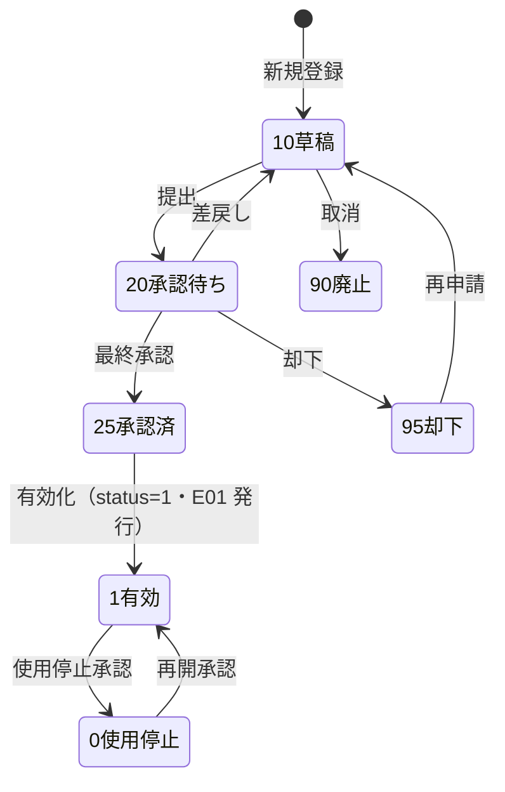
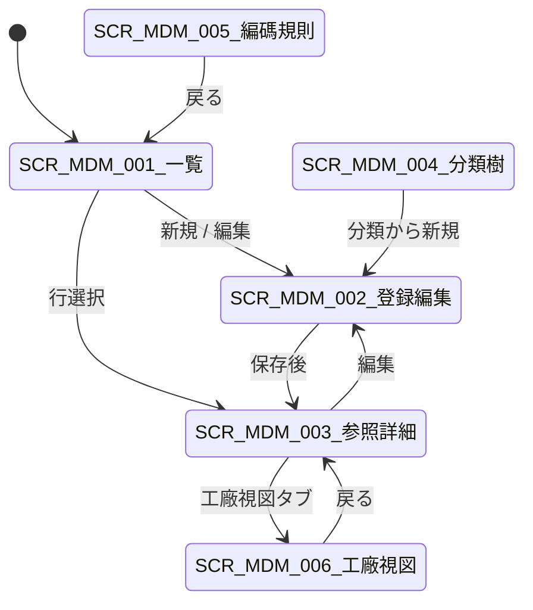

# 物料主数据 详细设计书（物料マスタ 詳細設計書）

| 項目 | 内容 |
|---|---|
| 文書名 | 物料主数据 详细设计书（物料マスタ 詳細設計書） |
| 文書番号 | DSN-MDM-001 |
| 版数 | v1.0 |
| 作成日 | 2026-10-20 |
| 作成者 | mdm-designer |
| 承認者 | 未承認（レビュー待ち） |
| 状態 | ドラフト（レビュー中） |
| 関連文書 | [業務域概要](00-overview.md) / [共通項目定義](../00-common/01-common-item-definitions.md) / [画面共通規格](../00-common/02-common-screen-spec.md) / [API 共通規格](../00-common/03-common-api-spec.md) / [共通業務規則](../00-common/08-common-business-rules.md) / [跨域流程](../00-common/09-cross-domain-flow.md) / [DB 設計](90-db-design.md) |

---

## 1. 機能概要

| 項目 | 内容 |
|---|---|
| 機能 ID | F-MDM-001（分類）/ F-MDM-002（物料多視図）/ F-MDM-003（編碼規則）/ F-MDM-021（工廠視図参数） |
| 機能名 | 物料分類樹・物料主数据・物料編碼・物料工廠視図 |
| 目的 | 建立「一物一碼」的物料主数据：以多階分類樹定義物料屬性模板，物料登録時按基本/采购/销售/库存/生产/财务/质量 7 个视图逐项维护，保証 SAL/PUR/INV/PRD/FIN 在同一個物料編碼下取得完整、可解釋的業務属性；編碼自動採番与工廠別参数保証多工廠下的計划・库存・采购差異化管理 |
| 利用者・ロール | 物料主数据担当（技術部/生產管理部）、技術部長、生產・财务責任者（承認）、一般参照者 |
| 利用シーン | 新製品 YE3/YVF 系列投産前建碼；外購原材料（硅鋼片・漆包線・軸承・鑄件・標準件）導入；設計変更時の代替料登録；工場ごとの安全在庫・購買提前期調整 |
| 優先度 | P0（F-MDM-001/002/003）、P1（F-MDM-021） |
| 画面 ID | SCR-MDM-001〜006 |
| 関連 IF | IF-MDM-004（PLM 物料同期、Phase 2） |

## 2. 業務要件・業務ルール

### 2.1 前提条件

| # | 前提条件 | 成立しない場合の挙動 |
|---|---|---|
| 1 | 物料分類（末級）已登録且 `is_leaf=true`、`status=1` | 分類選択不可・保存時エラー `MSG-MDM-011` |
| 2 | 基準計量単位（`mdm_uom`）已登録且有效 | 単位選択不可・エラー |
| 3 | 税碼（`mdm_tax_code`）、倉庫（`mdm_warehouse`）、供應商・客户（有効）が存在 | 必須選択項目のコード存在エラー `MSG-COM-049` |
| 4 | FIN 会計科目表已初始化（科目映射字段校験用） | 科目コード保存時エラー `MSG-MDM-012`（FIN 照会失敗時は保存不可） |
| 5 | 審批流程（WF）已配置：`businessType=MASTER_DATA_CHANGE`、`variables.masterDataType=MDM_MATERIAL`、`processKey=APR-MDM`（A16） | 提交時 `MSG-COM-073` |
| 6 | ユーザに `mdm:material:create/update` 権限がある | 403 `MSG-COM-030` |

### 2.2 業務ルール

| # | ルール | 根拠（法令・社内規程・業務慣行） | 関連項目 |
|---|---|---|---|
| BR-MDM-01 | 物料編碼は 10 桁＝分類碼 4 桁（大類 2＋中類 2）＋流水 6 桁。分類変更は不可（変更需要は新コード発行・旧コード使用停止） | [08 共通業務規則](../00-common/08-common-business-rules.md) 2.2 | `material_code` |
| BR-MDM-02 | 同一公司内で物料編碼は一意。編碼大文字・小文字は区別しない（DB は大文字保存） | 同上 | `material_code` |
| BR-MDM-03 | 1 物料 1 個基本単位（`base_uom_code`）。在庫数量は常に基本単位で保持し、購買・販売単位は換算率で換算する | 08 第 5 章 | `base_uom_code`、`purchase_uom_code`、`sales_uom_code` |
| BR-MDM-04 | 批次・序列号・保質期・质检の各フラグは在庫・生產・质量域の動作を決める。登録後の変更は「关键項目变更」として審批必須 | 08 第 6 章、09 第 8 章 | `is_batch_managed`、`is_serial_managed`、`shelf_life_days`、`inspection_stage` |
| BR-MDM-05 | 倒冲（`is_backflush`）は「製造品かつ BOM 必須」の品目のみ設定可。倒冲倉庫は必須 | プル型生産の業務慣行 | `is_backflush`、`backflush_warehouse_id` |
| BR-MDM-06 | 安全在庫・再訂貨点・最大在庫は 0 以上。`safety_stock_qty <= reorder_point_qty <= max_stock_qty` を満たすこと（0 は未設定扱い） | INV 補充発注の運用 | `safety_stock_qty` 等 |
| BR-MDM-07 | 標準原価（`standard_cost`）は財務が費用計上に使う参考値。移動平均法運用中は原価計算に使用しない（Phase 2 標準原価法で使用） | 08 第 6 章 | `valuation_method`、`standard_cost` |
| BR-MDM-08 | 采购・销售・库存の各「使用停止」フラグ（`is_purchase_stopped` 等）は業務停止のみ。マスタ全体の使用停止は `status=0`（承認必須） | 08 第 11 章 | `status`、`is_*_stopped` |
| BR-MDM-09 | 使用中の物料は論理削除不可。参照チェック（未完了伝票・在庫残・BOM 使用・価格表行）で 1 件でも参照があれば `status=0`（使用停止）を案内する | 01 共通項目定義 11.2、[04 DB 共通規格](../00-common/04-common-db-spec.md) 第 6 章 | `status` |
| BR-MDM-10 | 物料名称・規格・材質・品牌・執行標準は技術部の図面・標準に一致すること。材料牌号（例 50W470、HT200、45#）は GB/JB 標準の表記をそのまま使用する | 国家標準表記の慣行 | `material_grade`、`standard_code` |
| BR-MDM-11 | 編碼の手動指定は `mdm:material:create` 権限かつ「分類碼と一致」の場合のみ可。既存コード・連番の重複は不可 | 08 第 2.2 節 | `material_code` |
| BR-MDM-12 | 物料分類の削除は子分類・物料が存在しない場合のみ可。使用中の分類は `status=0` で停止 | 01 共通項目定義 11.2 | `mdm_material_category` |
| BR-MDM-13 | 关键項目（基本単位、批次/序列号/保質期/质检フラグ、类型、成本分类、会計科目映射、税分類、販売/購買単位）の変更は WF 審批を通す。一般項目（名称、規格、 remark 等）は担当者更新＋履歴記録で可 | 08 第 11 章、[00-overview](00-overview.md) 2.1 | `approval_status` |
| BR-MDM-14 | 購買・販売単位の換算率は 0 より大きいこと。換算後の基本単位数量は小数 4 桁で保持し、端数は機能側（PUR/SAL）で丸める | 08 第 5 章 | `purchase_conversion_rate`、`sales_conversion_rate` |
| BR-MDM-15 | 物料の有効化（`approval_status=25` かつ `status=1`）後、初回の領域事件 `mdm.material.changed`（E01）を発行する。以後の変更も同イベントで通知する | 09 第 3 章 E01 | — |
| BR-MDM-16 | 危险品・冷藏品等の保管条件（`storage_condition`）を設定した物料は、倉庫・庫位の保管条件と一致しない場合に警告を出す（移動は可） | 倉庫管理の安全規程 | `storage_condition` |
| BR-MDM-17 | 工廠視図参数（`mdm_material_factory`）は「公司共通の物料属性を上書きしない」。工廠ごとに異なるのは既定倉庫・安全在庫・再訂貨点・購買提前期・MRP 类型・批量規則のみ | 多工廠運用の慣行 | `mdm_material_factory` |
| BR-MDM-18 | 客供品（`is_customer_supplied`）は購買・販売の対象外。受入・出庫は「客供品」取引種別で処理（PUR/INV の設計に委ねる） | 受託加工の慣行 | `is_customer_supplied` |

### 2.3 計算式・判定式

| # | 対象 | 算式 | 丸め | 例 |
|---|---|---|---|---|
| CALC-MDM-01 | 購買単位→基本単位 | 購買数量 × `purchase_conversion_rate` | 基本単位の數量精度（4 桁） | 4 巻 × 25 = 100.0000 KGM（漆包線） |
| CALC-MDM-02 | 販売単位→基本単位 | 販売数量 × `sales_conversion_rate` | 同上 | 2 箱 × 100 = 200.0000 PCE（螺栓） |
| CALC-MDM-03 | 標準原価差異（参考） | 実際単価 − `standard_cost` | 2 桁 | 【示例値】858.333333 − 850.000000 = 8.33 |
| CALC-MDM-04 | 理論重量 | `unit_weight` × 基本単位数量 | 6 桁 | 【示例値】0.089000 KGM × 500 = 44.500000 KGM |
| CALC-MDM-05 | 再訂貨点（ROP 参考） | 平均日需要 × 購買提前期 + 安全在庫 | 4 桁切上げ | 【示例値】20 PCE/日 × 7 日 + 100 = 240.0000 PCE |

### 2.4 状態遷移



| 遷移 | トリガ | 権限 | 更新項目 | メッセージ |
|---|---|---|---|---|
| 10→20 | 「提出」ボタン | `mdm:material:create/update` | `approval_status=20`、`submitted_at`、WF `processInstanceId` | MSG-COM-005 |
| 20→25 | WF 最終承認（E32） | `mdm:change:approve` | `approval_status=25`、`approved_at` | MSG-MDM-020 |
| 20→10 | 差戻し | `mdm:change:approve` | `approval_status=10`、`reject_reason` | MSG-MDM-021 |
| 20→95 | 却下 | `mdm:change:approve` | `approval_status=95`、`reject_reason` | MSG-MDM-022 |
| 25→1 | WF 完了後の有効化（自動） | システム | `status=1`、`effective_at`、E01 発行 | MSG-MDM-023 |
| 1→0 | 使用停止申請の承認 | `mdm:material:delete` | `status=0`、`deactivate_reason`、E01 発行 | MSG-MDM-024 |
| 0→1 | 再開申請の承認 | `mdm:material:update` | `status=1`、E01 発行 | MSG-MDM-025 |

### 2.5 多視図フィールド定義（フィールドレベル）

> 記号：`NN`=NOT NULL、`NULL`=NULL 可。`必須`＝画面での必須入力（○=必須、△=条件付き必須、—=任意）。共通監査列（`id`/`tenant_id`/`company_id`/`version`/`deleted`/`created_*`/`updated_*`/`remark`/`ext_data`）は [01 共通項目定義](../00-common/01-common-item-definitions.md) 第 2 章に従い本表では省略する。物理名・型は [90-db-design.md](90-db-design.md) の `mdm_material` と一致させる。

#### 2.5.1 基本ビュー（全類型共通）

| No | 物理名 | 論理名 | 型/桁 | NULL | 必須 | 既定値 | 入力チェック | データソース | 影響域 | 備考 |
|---|---|---|---|---|---|---|---|---|---|---|
| B01 | `material_code` | 物料編碼 | VARCHAR(10) | NN | ○ | 自動採番 | 10 桁・分類 4＋流水 6・一意 | 採番/手動 | 全業務域 | 登録後変更不可 |
| B02 | `material_name` | 物料名称 | VARCHAR(200) | NN | ○ | 空 | 1〜200 字 | 入力 | 全業務域・帳票 | 正式名称（中文） |
| B03 | `material_short_name` | 略称 | VARCHAR(100) | NULL | — | 空 | ≤ 100 字 | 入力 | 帳票・一覧 | — |
| B04 | `material_type` | 物料類型 | SMALLINT | NN | ○ | 分類既定 | 10 成品/20 半成品/30 原材料/40 外購件/50 包装材料/60 低値易耗品/70 委外加工件/80 服務（90-data material-master.csv の類型と整合） | 分類既定/選択 | PRD 製造判定・FIN 原価 | 关键項目 |

**物料類型コード対照表（分類コードとは別次元）**

| 碼值 | 中文類型 | 90-data material-master.csv の值 | 典型物料例（real code） |
|---|---|---|---|
| 10 | 成品 | 成品 | YE3-100L1-4 `3001000001` |
| 20 | 半成品 | 半成品 | 定子铁心 `2001000002` |
| 30 | 原材料 | 原材料 | 50W470 硅钢片 `1001000001`、45# 圆钢 `1002000001`、HT200 机座铸件 `1003000001`、QZY-2/180 漆包线 `1004000001` |
| 40 | 外购件 | 外购件 | 6205-2RS 轴承 `4001000001`、GB/T 5782 六角螺栓 `4002000001`、风扇 `4005000001`（4005 其他电机配件） |
| 50 | 包装材料 | 包装材料 | 木托盘 `5001000001`、瓦楞纸箱 `5002000001`、铭牌 `5004000001` |
| 60 | 低值易耗品 | 低值易耗品 | 定转子冲片模具 `6002000001` |
| 70 | 委外加工件 | （Phase 2） | 委外加工的定子扣片等（Phase 1 按外购件管理） |
| 80 | 服务 | （未在 CSV） | 加工服务・修理服务（Phase 2） |

> **2 つの次元を混同しない**：`material_type`（上表、10〜80）は物料の業務類型であり、物料分類コード（06 §11、大分類 10/20/30/40/50/60/70/90）とは別の軸である。分類は「何から作られているか/どう調達するか」、類型は「製造・販売・在庫の扱い」を表す。両者は通常一致するが、例外（例：外注加工品を Phase 1 では外購件として管理）は備考に明記する。
| B05 | `category_id` | 物料分類 | BIGINT | NN | ○ | 呼出元 | 末級・有効（`is_leaf=TRUE`） | マスタ | 採番・属性・会計 | 変更時は編碼不整合注意 |
| B06 | `spec` | 規格・型号 | VARCHAR(200) | NN | ○ | 空 | 1〜200 字 | 入力 | SAL/PUR/帳票 | 例「YE3-100L1-4，2.2kW」 |
| B07 | `material_grade` | 材質・牌号 | VARCHAR(100) | NULL | △ | 空 | ≤ 100 字 | 入力 | PUR/PRD/品質 | 例 50W470、HT200、45# |
| B08 | `drawing_no` | 図号 | VARCHAR(64) | NULL | — | 空 | ≤ 64 字 | 入力 | PRD/PLM | 技術部図面番号 |
| B09 | `standard_code` | 執行標準 | VARCHAR(100) | NULL | △ | 空 | ≤ 100 字 | 入力 | PUR/品質 | 例 GB/T 5782-2025 |
| B10 | `brand` | 品牌 | VARCHAR(100) | NULL | — | 空 | ≤ 100 字 | 入力 | PUR/品質 | ハ軸・瓦軸等 |
| B11 | `product_series` | 製品系列 | VARCHAR(64) | NULL | △ | 空 | ≤ 64 字 | 入力 | SAL/PRD | YE3/YVF（成品） |
| B12 | `unit_weight` | 単位重量 | NUMERIC(18,6) | NULL | — | 空 | > 0 | 入力/PLM | INV/FIN（運費配賦） | KGM |
| B13 | `gross_weight` | 毛重 | NUMERIC(18,6) | NULL | — | 空 | > 0 | 入力 | INV/物流 | KGM |
| B14 | `volume` | 体積 | NUMERIC(18,6) | NULL | — | 空 | ≥ 0 | 入力 | 物流 | MTQ |
| B15 | `origin_country_code` | 原産国 | VARCHAR(2) | NULL | — | CHN | GB/T 2659 の 2 桁 | 固定値/入力 | PUR（関税・原産地） | — |
| B16 | `base_uom_code` | 基本単位 | VARCHAR(16) | NN | ○ | 分類既定 | 有効単位（`mdm_uom.status=1`） | マスタ | INV 数量・原価単位 | 关键項目 |
| B17 | `is_key_material` | 关键件 | BOOLEAN | NN | — | FALSE | — | 入力 | PRD/品質/調達 | 重点管理対象 |
| B18 | `is_customer_supplied` | 客供品 | BOOLEAN | NN | — | FALSE | TRUE 時は購買/販売対象外の警告 | 入力 | PUR/INV | — |
| B19 | `is_consumable` | 消耗品 | BOOLEAN | NN | — | FALSE | — | 入力 | INV/FIN | 工具・輔料 |
| B20 | `status` | 使用状態 | SMALLINT | NN | ○ | 0 | 1 有効/0 使用停止 | 承認制御 | 全業務域（参照可否） | 使用停止は承認必須 |
| B21 | `approval_status` | 承認状態 | SMALLINT | NN | ○ | 10 | 10 草稿/20 承認待ち/25 承認済/95 却下/90 廃止 | WF | 編集可否 | 承認後に `status=1` |

#### 2.5.2 采购ビュー（購買対象品のみ）

| No | 物理名 | 論理名 | 型/桁 | NULL | 必須 | 既定値 | 入力チェック | データソース | 影響域 | 備考 |
|---|---|---|---|---|---|---|---|---|---|---|
| P01 | `purchase_uom_code` | 購買単位 | VARCHAR(16) | NULL | △ | 基本単位 | 有効単位 | マスタ | PUR 発注 | 購買停止時は非表示 |
| P02 | `purchase_conversion_rate` | 購買換算率 | NUMERIC(18,8) | NULL | △ | 1 | > 0（単位が異なる場合） | 入力 | PUR 発注数量換算 | 1 購買単位＝n 基本単位 |
| P03 | `purchase_lead_time_days` | 購買提前期 | INT | NULL | △ | 0 | 0〜365 | 入力 | MRP・PUR 納期 | 日。解決優先順位は 05 §2.4 BR-SET-11 |
| P04 | `min_order_qty` | 最小発注量 | NUMERIC(18,4) | NULL | △ | 0 | ≥ 0 | 入力 | PUR 発注 | MOQ。0=制約なし。解決優先順位は 05 §2.4 BR-SET-11 |
| P05 | `order_multiple` | 発注倍数 | NUMERIC(18,4) | NULL | — | 1 | ≥ 0 | 入力 | PUR 発注 | 0=制約なし |
| P06 | `default_supplier_id` | 既定供應商 | BIGINT | NULL | — | NULL | 有効供應商 | マスタ | MRP 計画発注 | 参考値。発注時に変更可 |
| P07 | `supplier_material_no` | 供應商品番 | VARCHAR(64) | NULL | — | NULL | ≤ 64 字 | 入力 | PUR 発注書・対照 | — |
| P08 | `purchase_tax_code` | 購買税码 | VARCHAR(32) | NULL | △ | 分類既定 | 有効税码・`tax_type=11` 進項 | マスタ | PUR/FIN 進項税 | 例 VAT13-IN（基礎税率コード VAT13） |
| P09 | `over_receipt_tolerance_pct` | 過入荷容差 | NUMERIC(7,4) | NULL | — | 0 | 0〜100 | 入力 | PUR 受入 | 5.0000=5%。品目>分類>仕入先>会社既定の優先順（05 §2.4 BR-SET-11） |
| P10 | `buyer_id` | 購買担当 | BIGINT | NULL | — | NULL | 有効ユーザ | マスタ | PUR 割当 | — |
| P11 | `is_purchase_stopped` | 購買停止 | BOOLEAN | NN | — | FALSE | — | 入力 | PUR 新規発注可否 | TRUE で警告・ブロック |

#### 2.5.3 销售ビュー（販売対象品のみ）

| No | 物理名 | 論理名 | 型/桁 | NULL | 必須 | 既定値 | 入力チェック | データソース | 影響域 | 備考 |
|---|---|---|---|---|---|---|---|---|---|---|
| S01 | `sales_uom_code` | 販売単位 | VARCHAR(16) | NULL | △ | 基本単位 | 有効単位 | マスタ | SAL 受注・出荷 | — |
| S02 | `sales_conversion_rate` | 販売換算率 | NUMERIC(18,8) | NULL | △ | 1 | > 0（単位が異なる場合） | 入力 | SAL 受注数量換算 | — |
| S03 | `sales_tax_code` | 販売税码 | VARCHAR(32) | NULL | △ | 分類既定 | 有効税码・`tax_type=10` 銷項 | マスタ | SAL/FIN 銷項税 | 例 VAT13-OUT（基礎税率コード VAT13） |
| S04 | `sales_price_group_code` | 販売価格グループ | VARCHAR(32) | NULL | — | NULL | 有効グループ | マスタ | 価格表取価 | 価格表の分類軸 |
| S05 | `min_sales_qty` | 最小販売量 | NUMERIC(18,4) | NULL | — | 0 | ≥ 0 | 入力 | SAL 受注 | 0=制約なし |
| S06 | `sales_lead_time_days` | 販売可能日数 | INT | NULL | — | 0 | 0〜365 | 入力 | SAL 納期回答 | 受注〜出荷 |
| S07 | `return_limit_days` | 返品期限日数 | INT | NULL | — | 30 | 0〜365 | 入力 | SAL 返品受付 | 出荷日基準 |
| S08 | `is_sales_stopped` | 販売停止 | BOOLEAN | NN | — | FALSE | — | 入力 | SAL 新規受注可否 | TRUE で警告・ブロック |

#### 2.5.4 库存ビュー

| No | 物理名 | 論理名 | 型/桁 | NULL | 必須 | 既定値 | 入力チェック | データソース | 影響域 | 備考 |
|---|---|---|---|---|---|---|---|---|---|---|
| I01 | `default_warehouse_id` | 既定倉庫 | BIGINT | NULL | △ | NULL | 有効倉庫 | マスタ | INV/PUR/PRD 入出庫 | 工廠視図で上書き可 |
| I02 | `default_bin_id` | 既定庫位 | BIGINT | NULL | — | NULL | 倉庫に属する有効庫位 | マスタ | INV 入庫提案 | — |
| I03 | `is_batch_managed` | 批次管理 | BOOLEAN | NN | ○ | FALSE | 序列号管理と同時 TRUE 不可 | 入力 | INV 入出庫・追溯 | 关键項目 |
| I04 | `batch_rule_code` | 批次規則 | VARCHAR(32) | NULL | △ | NULL | 批次管理時必須・有効規則 | マスタ（INV） | INV 批次採番 | 規則本体は INV 域 |
| I05 | `is_serial_managed` | 序列号管理 | BOOLEAN | NN | ○ | FALSE | 批次管理と同時 TRUE 不可 | 入力 | INV 個体管理 | 关键項目 |
| I06 | `serial_rule_code` | 序列号規則 | VARCHAR(32) | NULL | △ | NULL | 序列管理時必須・有効規則 | マスタ（INV） | INV 序列採番 | — |
| I07 | `shelf_life_days` | 保質期日数 | INT | NULL | △ | 0 | 0〜3,650 | 入力 | INV 有効期限・出荷引当 | 0=管理しない |
| I08 | `expiry_warning_days` | 失効警告日数 | INT | NULL | △ | 30 | 0〜365 | 入力 | INV 期限警告 | 保質期管理時使用 |
| I09 | `safety_stock_qty` | 安全在庫 | NUMERIC(18,4) | NULL | — | 0 | ≥ 0 | 入力 | INV 補充・MRP | 基本単位 |
| I10 | `reorder_point_qty` | 再訂貨点 | NUMERIC(18,4) | NULL | — | 0 | ≥ 安全在庫（0 は未設定） | 入力 | INV 補充発注 | 基本単位 |
| I11 | `max_stock_qty` | 最大在庫 | NUMERIC(18,4) | NULL | — | 0 | ≥ 再訂貨点（0 は未設定） | 入力 | INV 過剰在庫警告 | — |
| I12 | `abc_class` | ABC 区分 | VARCHAR(1) | NULL | — | NULL | A/B/C | 入力 | INV 重点管理・棚卸 | — |
| I13 | `cycle_count_cycle` | 棚卸周期 | VARCHAR(16) | NULL | — | NULL | MONTH/QUARTER/YEAR | 入力 | INV 循環棚卸 | — |
| I14 | `storage_condition` | 保管条件 | VARCHAR(32) | NULL | — | 常温 | 常温/防潮/防尘/冷藏/危险品 | 固定値/入力 | INV 倉庫条件照合 | 不一致は警告 |
| I15 | `is_negative_stock_allowed` | マイナス在庫許可 | BOOLEAN | NN | — | FALSE | — | 入力 | INV 在庫不足制御 | P0 は false 固定推奨 |
| I16 | `is_hazardous` | 危険物 | BOOLEAN | NN | — | FALSE | — | 入力 | INV 保管・運搬 | 安全規程 |

#### 2.5.5 生产ビュー

| No | 物理名 | 論理名 | 型/桁 | NULL | 必須 | 既定値 | 入力チェック | データソース | 影響域 | 備考 |
|---|---|---|---|---|---|---|---|---|---|---|
| M01 | `is_manufactured` | 製造品 | BOOLEAN | NN | ○ | 類型から既定 | — | 入力 | PRD 工単対象判定 | 成品/半成品は TRUE |
| M02 | `is_outsourced` | 委外品 | BOOLEAN | NN | — | FALSE | — | 入力 | PRD 委外 | — |
| M03 | `bom_required_flag` | BOM 要否 | BOOLEAN | NN | △ | 製造品 TRUE | 製造品以外は FALSE | 入力 | PRD BOM 必須判定 | 关键項目 |
| M04 | `default_bom_code` | 既定 BOM | VARCHAR(64) | NULL | — | NULL | 存在・有効（PRD 照会） | PRD 参照 | PRD 工単展開 | BOM 採番は PRD |
| M05 | `default_routing_code` | 既定工順 | VARCHAR(64) | NULL | — | NULL | 存在・有効（PRD 照会） | PRD 参照 | PRD 工単展開 | 同上 |
| M06 | `is_backflush` | 倒冲 | BOOLEAN | NN | — | FALSE | 製造品かつ BOM 要のみ TRUE | 入力 | PRD/INV 材料払出 | 关键項目 |
| M07 | `backflush_warehouse_id` | 倒冲倉庫 | BIGINT | NULL | △ | 既定倉庫 | 有効倉庫・倒冲時必須 | マスタ | INV 倒冲払出 | — |
| M08 | `default_work_center_id` | 既定工作中心 | BIGINT | NULL | — | NULL | 有効 WC（PRD 照会） | PRD 参照 | PRD 能力計画 | — |
| M09 | `yield_rate` | 歩留率 | NUMERIC(7,4) | NULL | — | 100 | 0〜100 | 入力 | PRD MRP 正味所要量 | %表記 |
| M10 | `mrp_type` | MRP 类型 | SMALLINT | NULL | △ | 10 | 10 MTS/20 MTO | 入力 | PRD MRP | 計画方式 |
| M11 | `planning_policy` | 補充方式 | SMALLINT | NULL | △ | 10 | 10 MRP/20 ROP/30 手動 | 入力 | PRD/INV 補充 | — |
| M12 | `manufacturing_lead_time_days` | 製造提前期 | INT | NULL | — | 0 | 0〜365 | 入力 | MRP 逆算 | 日 |

#### 2.5.6 财务ビュー

| No | 物理名 | 論理名 | 型/桁 | NULL | 必須 | 既定値 | 入力チェック | データソース | 影響域 | 備考 |
|---|---|---|---|---|---|---|---|---|---|---|
| F01 | `inventory_account_code` | 在庫（存貨）科目 | VARCHAR(32) | NULL | △ | NULL | FIN 科目存在・末級 | FIN 照会 | FIN 在庫計上 | 例 1403/1405 |
| F02 | `revenue_account_code` | 売上（収入）科目 | VARCHAR(32) | NULL | △ | NULL | FIN 科目存在・末級 | FIN 照会 | FIN 売上計上 | 例 6001 |
| F03 | `cogs_account_code` | 売上原価科目 | VARCHAR(32) | NULL | △ | NULL | FIN 科目存在・末級 | FIN 照会 | FIN 原価計上 | 例 6401 |
| F04 | `cost_category` | 成本分類 | SMALLINT | NULL | △ | 10 | 10 直接材料/20 直接人工/30 製造間接費/40 期間費用 | 入力 | FIN 原価集計 | — |
| F05 | `valuation_method` | 評価方法 | SMALLINT | NULL | △ | 10 | 10 移動平均/20 標準原価 | 入力 | INV/FIN 原価 | 会社政策と矛盾不可 |
| F06 | `standard_cost` | 標準原価 | NUMERIC(18,6) | NULL | — | 0 | ≥ 0 | 入力 | FIN 参考原価 | Phase 2 標準原価法 |
| F07 | `tax_classification_code` | 税収分類編碼 | VARCHAR(32) | NULL | △ | NULL | 有効分類（税） | マスタ | FIN/INT 発票 | 商品和服务税收分类编码 |
| F08 | `cost_method` | 成本核算方法 | SMALLINT | NN | ○ | 1 | 1 品種法/2 分批法（1 のみ/2 のみ） | 入力 | FIN 原価計算（直接参照） | 標準機（MTS）は 1、MTO・非標は 2 可 |

#### 2.5.7 質量・その他ビュー

| No | 物理名 | 論理名 | 型/桁 | NULL | 必須 | 既定値 | 入力チェック | データソース | 影響域 | 備考 |
|---|---|---|---|---|---|---|---|---|---|---|
| Q01 | `inspection_stage` | 検査段階 | SMALLINT | NN | ○ | 00 | 00 免検/10 IQC/20 IPQC/30 FQC/40 全工程 | 入力 | PRD 品質・INV 入庫 | 材料は IQC、成品は FQC |
| Q02 | `inspection_standard_id` | 検査基準 | BIGINT | NULL | △ | NULL | 有効基準（PRD 照会）・段階≠00 で必須 | PRD 参照 | PRD 検査 | 検査項目は PRD 管理 |
| Q03 | `certificate_required` | 材質証明要否 | BOOLEAN | NN | — | FALSE | — | 入力 | PRD/PUR 品質 | 鋼材等 |
| Q04 | `quality_grade` | 品質等級 | VARCHAR(8) | NULL | — | NULL | A/B/C | 入力 | INV/PRD | 材質・外観等級 |
| Q05 | `ext_data` | 拡張項目（分類属性） | JSONB | NULL | — | NULL | 分類属性テンプレートに従う | 分類定義 | 業務域（属性利用時） | 例 モータ出力/極数 |

#### 2.5.8 工廠視図（`mdm_material_factory`）

| No | 物理名 | 論理名 | 型/桁 | NULL | 必須 | 既定値 | 入力チェック | データソース | 影響域 | 備考 |
|---|---|---|---|---|---|---|---|---|---|---|
| PF01 | `factory_id` | 工廠 ID | BIGINT | NN | ○ | ログイン既定 | 有効工廠 | マスタ（SYS） | 全部門 | 公司+工廠で一意 |
| PF02 | `default_warehouse_id` | 工廠既定倉庫 | BIGINT | NULL | — | NULL | 工廠に属する有効倉庫 | マスタ | INV/PUR/PRD | 公司共通値を上書き |
| PF03 | `default_bin_id` | 工廠既定庫位 | BIGINT | NULL | — | NULL | 倉庫所属・有効 | マスタ | INV | — |
| PF04 | `safety_stock_qty` | 工廠安全在庫 | NUMERIC(18,4) | NULL | — | NULL | ≥ 0（NULL=公司値） | 入力 | INV 補充 | — |
| PF05 | `reorder_point_qty` | 工廠再訂貨点 | NUMERIC(18,4) | NULL | — | NULL | ≥ 安全在庫 | 入力 | INV 補充 | — |
| PF06 | `max_stock_qty` | 工廠最大在庫 | NUMERIC(18,4) | NULL | — | NULL | ≥ 再訂貨点 | 入力 | INV | — |
| PF07 | `purchase_lead_time_days` | 工廠購買提前期 | INT | NULL | — | NULL | 0〜365 | 入力 | MRP | — |
| PF08 | `manufacturing_lead_time_days` | 工廠製造提前期 | INT | NULL | — | NULL | 0〜365 | 入力 | MRP | — |
| PF09 | `mrp_type` | 工廠 MRP 类型 | SMALLINT | NULL | — | NULL | 10 MTS/20 MTO | 入力 | MRP | — |
| PF10 | `planning_policy` | 工廠補充方式 | SMALLINT | NULL | — | NULL | 10 MRP/20 ROP/30 手動 | 入力 | MRP/INV | — |
| PF11 | `lot_size_rule` | 工廠批量規則 | SMALLINT | NULL | — | NULL | 10 Lot-for-Lot/20 固定/30 期間 | 入力 | MRP | — |
| PF12 | `is_active` | 工廠展開有効 | BOOLEAN | NN | — | TRUE | — | 入力 | 全業務域 | FALSE で當該工廠の業務対象外 |

## 3. 関連機能

| 関係 | 機能 ID | 機能名 | 関係内容 |
|---|---|---|---|
| 参照 | F-MDM-001 | 物料分類樹 | 分類コード・属性テンプレートを取得 |
| 参照 | F-MDM-003 | 物料編碼規則 | 自動採番 |
| 参照 | F-MDM-007/009 | 単位・税碼 | 単位換算・税区分の既定値 |
| 参照 | F-MDM-010/011 | 价格表 | 販売/購買価格の参照（物料は価格を持たない） |
| 参照 | F-MDM-013 | 倉庫・庫位 | 既定倉庫・既定庫位 |
| 参照 | F-MDM-016/017 | 替代・条码 | 替代関係・条码発行 |
| 参照 | F-MDM-018 | 変更審批・履歴 | 关键項目変更の審批と履歴 |
| 下流 | F-SAL-002/003 | 報価・受注 | 販売視図・税码・販売単位を参照 |
| 下流 | F-PUR-003/004 | 発注・受入 | 購買視図・購買単位・IQC 要否を参照 |
| 下流 | F-INV-001〜006 | 在庫・批次・原価 | 批次/序列号/保質期/既定倉庫/安全在庫を参照 |
| 下流 | F-PRD-001/002/005 | BOM・工順・MRP | 製造視図・倒冲・MRP 类型・批量規則を参照 |
| 下流 | F-FIN-001/006 | 科目・自動仕訳 | 会計科目映射・成本分类・標準原価を参照 |

## 4. 画面設計

### 4.1 画面一覧

| 画面 ID | 画面名 | 類型 | 概要 |
|---|---|---|---|
| SCR-MDM-001 | 物料一覧 | 一覧検索 | 多条件検索（分類・類型・状態・批次等）、一括使用停止・エクスポート |
| SCR-MDM-002 | 物料登録編集 | 登録編集 | 7 タブ（基本/采购/销售/库存/生产/财务/质量・附属）による多視図入力 |
| SCR-MDM-003 | 物料参照詳細 | 参照詳細 | 全視図、工廠視図、価格・在庫・BOM 参照リンク、変更履歴、相关伝票 |
| SCR-MDM-004 | 物料分類樹管理 | 登録編集 | 多階分類樹の CRUD、属性テンプレート（`ext_data` 項目定義）連結 |
| SCR-MDM-005 | 物料編碼規則 | 登録編集 | 分類別の流水桁・プレフィックス・空番管理 |
| SCR-MDM-006 | 物料工廠視図設定 | 登録編集 | 工廠別の既定倉庫・安全在庫・提前期・MRP 参数 |

### 4.2 画面遷移



### 4.3 画面レイアウト

**SCR-MDM-001 物料一覧**

```
┌──────────────────────────────────────────────────────────────────────────────┐
│ ヘッダ：会社/工場切替・通知・ユーザメニュー                                    │
├──────────────────────────────────────────────────────────────────────────────┤
│ パンくず：ホーム > 主数据 > 物料一覧                    [新規][エクスポート]   │
├──────────────────────────────────────────────────────────────────────────────┤
│〔検索条件〕                                                                   │
│ 物料編碼/名称 [________] 分類 [▼ 末級のみ] 物料類型 [▼] 状態 [▼]              │
│ 批次管理 [▼] 序列号 [▼] 质检 [▼] 販売停止 [▼] 購買停止 [▼] 品牌 [______]      │
│ [詳細条件]  [検索] [クリア]                                                   │
├──────────────────────────────────────────────────────────────────────────────┤
│〔一覧〕チェック | 物料編碼 | 物料名称 | 規格/材質 | 分類 | 類型 | 基本単位 |   │
│        批次 | 序列 | 安全在庫 | 既定倉庫 | 状態 | 変更日時                     │
│        □ | 3001000001 | YE3-100L1-4 三相异步电动机 2.2kW | ... | 3001 | 成品 │
├──────────────────────────────────────────────────────────────────────────────┤
│〔フッタ〕全 8,012 件  1/401 ページ  [<][1][2]…[>]   20 件/ページ            │
└──────────────────────────────────────────────────────────────────────────────┘
```

**SCR-MDM-002 物料登録編集（タブ構成）**

```
┌──────────────────────────────────────────────────────────────────────────────┐
│ 物料コード: 3001000001 (自動採番/手動可)   状態: 草稿   版数: 0    [保存][提出]│
├──────────────────────────────────────────────────────────────────────────────┤
│ [基本] [采购] [销售] [库存] [生产] [财务] [质量/附属]        ← タブ           │
├──────────────────────────────────────────────────────────────────────────────┤
│ 基本タブ：名称* 略称 分類* 類型* 規格* 材質/牌号 図号 執行標準 品牌 単位* …  │
│ 采购タブ：購買単位 換算率 購買提前期 MOQ 発注倍数 既定供應商 税码 …         │
│ 库存タブ：批次□ 序列□ 保質期 检疫期 既定倉庫/庫位 安全在庫 再訂貨点 …       │
│ 生産タブ：製造品□ BOM 要□ 倒冲□ 倒冲倉庫 工順コード 歩留 標準工数 …        │
│ 財務タブ：存貨科目 収入科目 原価科目 成本分類 評価方法 標準原価 税分類 …     │
│ 質量タブ：検査段階 検査基準 材質証明要否 保管条件 危険物 客供品 …           │
├──────────────────────────────────────────────────────────────────────────────┤
│ [取消] [保存して継続] [保存] [提出]        変更履歴: 最終更新 2026-10-20     │
└──────────────────────────────────────────────────────────────────────────────┘
```

### 4.4 画面項目定義

#### 4.4.1 一覧画面 SCR-MDM-001（検索条件・一覧列）

| No | 項目 ID | 項目名 | 区分 | 種別 | 型/桁 | 必須 | 初期値 | 入力チェック | データソース | DB 項目 | 権限 | 備考 |
|---|---|---|---|---|---|---|---|---|---|---|---|---|
| 1 | `keyword` | 物料編碼・名称 | 検索 | テキスト | VARCHAR(100) | — | 空 | 最大 100 字；部分一致（pg_trgm） | 入力 | material_code/name | 参照可 | 空白区切りで AND |
| 2 | `categoryId` | 物料分類 | 検索 | ツリー選択 | BIGINT(文字列) | — | 空 | 末級のみ選択可／子孫含む | mdm_material_category | category_id | 参照可 | 子孫分類を含めて検索 |
| 3 | `materialType` | 物料類型 | 検索 | 選択（複数） | SMALLINT | — | 空 | 10/20/30/40/50/60/70/80 | コード固定値 | material_type | 参照可 | — |
| 4 | `status` | 状態 | 検索 | 選択（複数） | SMALLINT | — | 1（有効） | 1/0 | 固定値 | status | 参照可 | — |
| 5 | `isBatchManaged` | 批次管理 | 検索 | 選択 | BOOLEAN | — | 空 | true/false | 固定値 | is_batch_managed | 参照可 | — |
| 6 | `isSerialManaged` | 序列号管理 | 検索 | 選択 | BOOLEAN | — | 空 | true/false | 固定値 | is_serial_managed | 参照可 | — |
| 7 | `inspectionStage` | 検査段階 | 検索 | 選択 | SMALLINT | — | 空 | 00/10/20/30/40 | 固定値 | inspection_stage | 参照可 | — |
| 8 | `isSalesStopped` | 販売停止 | 検索 | 選択 | BOOLEAN | — | 空 | true/false | 固定値 | is_sales_stopped | 参照可 | — |
| 9 | `isPurchaseStopped` | 購買停止 | 検索 | 選択 | BOOLEAN | — | 空 | true/false | 固定値 | is_purchase_stopped | 参照可 | — |
| 10 | `brand` | 品牌 | 検索 | テキスト | VARCHAR(100) | — | 空 | 最大 100 字；部分一致 | 入力 | brand | 参照可 | 例：哈轴/瓦轴 |
| 11 | `updatedAt` | 変更日時範囲 | 検索 | 日時範囲 | TIMESTAMPTZ | — | 空 | 開始≦終了 | 入力 | updated_at | 参照可 | — |
| 12 | `col_material_code` | 物料編碼 | 一覧 | リンク | VARCHAR(10) | — | — | — | DB | material_code | 参照可 | 左固定列 |
| 13 | `col_material_name` | 物料名称 | 一覧 | テキスト | VARCHAR(200) | — | — | — | DB | material_name | 参照可 | — |
| 14 | `col_spec` | 規格/材質 | 一覧 | テキスト | VARCHAR(200) | — | — | — | DB | spec、material_grade | 参照可 | 「規格 / 牌号」連結表示 |
| 15 | `col_category` | 分類 | 一覧 | テキスト | VARCHAR(64) | — | — | — | マスタ | category_name | 参照可 | コード-名称 |
| 16 | `col_type` | 類型 | 一覧 | バッジ | SMALLINT | — | — | — | 固定値 | material_type | 参照可 | 名称表示 |
| 17 | `col_base_uom` | 基本単位 | 一覧 | テキスト | VARCHAR(16) | — | — | — | マスタ | base_uom_code | 参照可 | — |
| 18 | `col_batch` | 批次/序列 | 一覧 | アイコン | — | — | — | — | DB | is_batch_managed/is_serial_managed | 参照可 | 有効ならアイコン |
| 19 | `col_safety` | 安全在庫 | 一覧 | 数値 | NUMERIC(18,4) | — | — | — | DB | safety_stock_qty | 参照可 | 権限なし時非表示 |
| 20 | `col_warehouse` | 既定倉庫 | 一覧 | テキスト | VARCHAR(16) | — | — | — | マスタ | default_warehouse_code | 参照可 | — |
| 21 | `col_status` | 状態 | 一覧 | バッジ | SMALLINT | — | — | — | DB | status | 参照可 | 有効=緑、停止=灰 |
| 22 | `col_updated` | 変更日時 | 一覧 | 日時 | ISO 8601 | — | — | — | DB | updated_at | 参照可 | 既定ソート降順 |
| 23 | `btn_new` | 新規 | ボタン | — | — | — | — | — | — | — | `mdm:material:create` | 一覧上部 |
| 24 | `btn_export` | エクスポート | ボタン | — | — | — | — | — | — | — | `mdm:material:export` | 10,000 件超は非同期 |
| 25 | `btn_batch_stop` | 一括使用停止 | ボタン | — | — | — | — | 選択 1〜1,000 件 | — | — | `mdm:material:delete` | 承認必須・確認ダイアログ |

#### 4.4.2 登録編集画面 SCR-MDM-002（UI 項目。物理名の詳細は第 2 章・[90-db-design.md](90-db-design.md)）

| No | タブ | 項目 ID（物理名） | 項目名 | 種別 | 必須 | 初期値 | 入力チェック | 表示制御/権限 | 備考 |
|---|---|---|---|---|---|---|---|---|---|
| 1 | 基本 | `material_code` | 物料編碼 | テキスト | ○ | 自動採番 | 10 桁・分類碼一致・一意 | 編集可（手動は権限者のみ） | 変更不可（登録後） |
| 2 | 基本 | `material_name` | 物料名称 | テキスト | ○ | 空 | 1〜200 字 | 編集可 | 正式名称（中国語） |
| 3 | 基本 | `material_short_name` | 略称 | テキスト | — | 空 | ≤ 100 字 | 編集可 | 帳票用 |
| 4 | 基本 | `material_type` | 物料類型 | 選択 | ○ | 分類の既定値 | 10〜80 | 編集可 | 关键項目 |
| 5 | 基本 | `category_id` | 物料分類 | ツリー選択 | ○ | 呼出元分類 | 末級のみ・有効 | 編集可 | 分类決定編碼 4 桁 |
| 6 | 基本 | `spec` | 規格・型号 | テキスト | ○ | 空 | 1〜200 字 | 編集可 | 例：YE3-100L1-4 |
| 7 | 基本 | `material_grade` | 材質・牌号 | テキスト | △ | 空 | ≤ 100 字 | 編集可 | 例：50W470、HT200、45# |
| 8 | 基本 | `drawing_no` | 図号 | テキスト | — | 空 | ≤ 64 字 | 編集可 | 技術部図面番号 |
| 9 | 基本 | `standard_code` | 執行標準 | テキスト | △ | 空 | ≤ 100 字 | 編集可 | GB/T 5782 等 |
| 10 | 基本 | `brand` | 品牌 | テキスト | — | 空 | ≤ 100 字 | 編集可 | 哈轴/瓦轴等 |
| 11 | 基本 | `product_series` | 製品系列 | テキスト | △ | 空 | ≤ 64 字 | 編集可 | YE3/YVF（成品のみ） |
| 12 | 基本 | `unit_weight` | 単位重量 | 数値 | — | 空 | > 0、小数 6 桁 | 編集可 | KGM |
| 13 | 基本 | `gross_weight` | 毛重 | 数値 | — | 空 | > 0、小数 6 桁 | 編集可 | KGM |
| 14 | 基本 | `volume` | 体積 | 数値 | — | 空 | ≥ 0、小数 6 桁 | 編集可 | MTQ |
| 15 | 基本 | `origin_country_code` | 原産国 | 選択 | — | CHN | GB/T 2659 コード | 編集可 | 2 桁コード |
| 16 | 基本 | `base_uom_code` | 基本単位 | 選択 | ○ | 分類既定 | 有効単位 | 編集可（关键項目） | 在庫数量の単位 |
| 17 | 基本 | `is_key_material` | 关键件 | チェック | — | false | — | 編集可 | 品質・調達重点管理 |
| 18 | 基本 | `is_customer_supplied` | 客供品 | チェック | — | false | — | 編集可 | true 時は購買/販売対象外 |
| 19 | 基本 | `is_consumable` | 消耗品 | チェック | — | false | — | 編集可 | 工具・輔料 |
| 20 | 采购 | `purchase_uom_code` | 購買単位 | 選択 | △ | 基本単位 | 有効単位・換算率必須 | `mdm:material:update` | 購買停止時は非表示 |
| 21 | 采购 | `purchase_conversion_rate` | 購買換算率 | 数値 | △ | 1 | > 0、小数 8 桁 | 同上 | 1 購買単位＝n 基本単位 |
| 22 | 采购 | `purchase_lead_time_days` | 購買提前期 | 数値 | △ | 0 | 0〜365 整数 | 同上 | 日 |
| 23 | 采购 | `min_order_qty` | 最小発注量（MOQ） | 数値 | △ | 0 | ≥ 0、小数 4 桁 | 同上 | — |
| 24 | 采购 | `order_multiple` | 発注倍数 | 数値 | — | 1 | ≥ 0、小数 4 桁 | 同上 | 0=制約なし |
| 25 | 采购 | `default_supplier_id` | 既定供應商 | 選択ダイアログ | — | 空 | 有効供應商 | 同上 | 計画購買の参考 |
| 26 | 采购 | `supplier_material_no` | 供應商品番 | テキスト | — | 空 | ≤ 64 字 | 同上 | 発注書・照合に使用 |
| 27 | 采购 | `purchase_tax_code` | 購買税码 | 選択 | △ | 分類既定 | 有効税码（進項） | 同上 | 13% 等 |
| 28 | 采购 | `over_receipt_tolerance_pct` | 過入荷容差 | 数値 | — | 0 | 0〜100、小数 2 桁 | 同上 | 5.00 = 5% |
| 29 | 采购 | `buyer_id` | 購買担当 | 選択 | — | 空 | 有効ユーザ | 同上 | 業務割当 |
| 30 | 采购 | `is_purchase_stopped` | 購買停止 | チェック | — | false | — | 同上 | true で新規発注不可 |
| 31 | 销售 | `sales_uom_code` | 販売単位 | 選択 | △ | 基本単位 | 有効単位・換算率必須 | `mdm:material:update` | 販売停止時は非表示 |
| 32 | 销售 | `sales_conversion_rate` | 販売換算率 | 数値 | △ | 1 | > 0、小数 8 桁 | 同上 | — |
| 33 | 销售 | `sales_tax_code` | 販売税码 | 選択 | △ | 分類既定 | 有効税码（銷項） | 同上 | 13% 等 |
| 34 | 销售 | `sales_price_group_code` | 販売価格グループ | 選択 | — | 空 | 有効グループ | 同上 | 価格表の分類軸 |
| 35 | 销售 | `min_sales_qty` | 最小販売量 | 数値 | — | 0 | ≥ 0、小数 4 桁 | 同上 | — |
| 36 | 销售 | `sales_lead_time_days` | 販売可能日数 | 数値 | — | 0 | 0〜365 整数 | 同上 | 受注から出荷まで |
| 37 | 销售 | `return_limit_days` | 返品期限日数 | 数値 | — | 30 | 0〜365 整数 | 同上 | 出荷日基準（SAL 使用） |
| 38 | 销售 | `is_sales_stopped` | 販売停止 | チェック | — | false | — | 同上 | true で新規受注不可 |
| 39 | 库存 | `default_warehouse_id` | 既定倉庫 | 選択 | △ | 空 | 有効倉庫 | `mdm:material:update` | 在庫・購買・生産の既定倉庫 |
| 40 | 库存 | `default_bin_id` | 既定庫位 | 選択 | — | 空 | 倉庫に属する有効庫位 | 同上 | 入庫提案 |
| 41 | 库存 | `is_batch_managed` | 批次管理 | チェック | ○ | false | — | 同上（关键項目） | true で批次必須 |
| 42 | 库存 | `batch_rule_code` | 批次規則 | 選択 | △ | 空 | 批次管理時必須・INV 規則有効 | 同上 | 規則内容は INV 域 |
| 43 | 库存 | `is_serial_managed` | 序列号管理 | チェック | ○ | false | 批次管理と排他（同時 TRUE 不可） | 同上（关键項目） | — |
| 44 | 库存 | `serial_rule_code` | 序列号規則 | 選択 | △ | 空 | 序列管理時必須・INV 規則有効 | 同上 | — |
| 45 | 库存 | `shelf_life_days` | 保質期日数 | 数値 | △ | 0 | 0〜3,650 整数 | 同上 | 0=管理しない |
| 46 | 库存 | `expiry_warning_days` | 失効警告日数 | 数値 | △ | 30 | 0〜365 整数 | 同上 | 保質期管理時使用 |
| 47 | 库存 | `safety_stock_qty` | 安全在庫 | 数値 | — | 0 | ≥ 0、小数 4 桁 | 同上 | 基本単位 |
| 48 | 库存 | `reorder_point_qty` | 再訂貨点 | 数値 | — | 0 | ≥ 0、且 ≥ 安全在庫 | 同上 | 0=未設定 |
| 49 | 库存 | `max_stock_qty` | 最大在庫 | 数値 | — | 0 | ≥ 0、且 ≥ 再訂貨点 | 同上 | 0=未設定 |
| 50 | 库存 | `abc_class` | ABC 区分 | 選択 | — | 空 | A/B/C | 同上 | 重点管理 |
| 51 | 库存 | `cycle_count_cycle` | 棚卸周期 | 選択 | — | 空 | 月/四半期/年 | 同上 | 循環棚卸 |
| 52 | 库存 | `storage_condition` | 保管条件 | 選択 | — | 常温 | 常温/防潮/防尘/冷藏/危险品 | 同上 | 倉庫条件と照合 |
| 53 | 库存 | `is_negative_stock_allowed` | マイナス在庫許可 | チェック | — | false | — | 同上 | P0 は原則 false |
| 54 | 库存 | `is_hazardous` | 危険物 | チェック | — | false | — | 同上 | 保管・運搬制約 |
| 55 | 生产 | `is_manufactured` | 製造品 | チェック | ○ | 類型から既定 | — | `mdm:material:update` | 成品/半成品は true |
| 56 | 生产 | `is_outsourced` | 委外品 | チェック | — | false | — | 同上 | 委外加工対象 |
| 57 | 生产 | `bom_required_flag` | BOM 要否 | チェック | △ | 製造品 true | 製造品以外は false | 同上（关键項目） | PRD が BOM 必須判定に使用 |
| 58 | 生产 | `default_bom_code` | 既定 BOM | 参照選択 | — | 空 | 有効 BOM（PRD 照会） | 同上 | PRD 生成時に参照 |
| 59 | 生产 | `default_routing_code` | 既定工順 | 参照選択 | — | 空 | 有効工順（PRD 照会） | 同上 | 同上 |
| 60 | 生产 | `is_backflush` | 倒冲 | チェック | — | false | 製造品かつ BOM 要のみ可 | 同上（关键項目） | true で倒冲倉庫必須 |
| 61 | 生产 | `backflush_warehouse_id` | 倒冲倉庫 | 選択 | △ | 既定倉庫 | 有効倉庫 | 同上 | 倒冲時のみ |
| 62 | 生产 | `default_work_center_id` | 既定工作中心 | 選択 | — | 空 | 有効 WC（PRD 照会） | 同上 | 能力計画の既定 |
| 63 | 生产 | `yield_rate` | 歩留率 | 数値 | — | 100 | 0〜100、小数 4 桁 | 同上 | MRP 正味所要量に使用 |
| 64 | 生产 | `mrp_type` | MRP 类型 | 選択 | △ | 10 MTS | 10 MTS / 20 MTO | 同上 | 計画方式 |
| 65 | 生产 | `planning_policy` | 補充方式 | 選択 | △ | 10 MRP | 10 MRP / 20 ROP / 30 手動 | 同上 | — |
| 66 | 生产 | `manufacturing_lead_time_days` | 製造提前期 | 数値 | — | 0 | 0〜365 整数 | 同上 | 日 |
| 67 | 财务 | `inventory_account_code` | 在庫（存貨）科目 | 選択 | △ | 空 | FIN 科目存在・末級 | `mdm:material:update`（关键項目） | 例 1403/1405 |
| 68 | 财务 | `revenue_account_code` | 売上（収入）科目 | 選択 | △ | 空 | FIN 科目存在・末級 | 同上 | 例 6001（販売品） |
| 69 | 财务 | `cogs_account_code` | 売上原価科目 | 選択 | △ | 空 | FIN 科目存在・末級 | 同上 | 例 6401 |
| 70 | 财务 | `cost_category` | 成本分類 | 選択 | △ | 直接材料 | 10 直接材料/20 直接人工/30 製造間接費/40 期間費用 | 同上 | 原価集計 |
| 71 | 财务 | `cost_method` | 成本核算方法 | 選択 | ○ | 1 品種法 | 1 品種法/2 分批法 | 同上 | FIN 原価計算が参照。MTO は 2 可 |
| 72 | 财务 | `valuation_method` | 評価方法 | 選択 | △ | 10 移動平均 | 10 移動平均/20 標準原価（Phase2） | 同上 | 会社政策と矛盾不可 |
| 73 | 财务 | `standard_cost` | 標準原価 | 数値 | — | 0 | ≥ 0、小数 6 桁 | 同上 | 参考値 |
| 74 | 财务 | `tax_classification_code` | 税収分類編碼 | 選択 | △ | 空 | 有効分類（FIN/税） | 同上 | 例：1090101 等 |
| 75 | 質量/附属 | `inspection_stage` | 検査段階 | 選択 | ○ | 00 免検 | 00/10 IQC/20 IPQC/30 FQC/40 全工程 | `mdm:material:update` | PRD 品質管理が参照 |
| 76 | 質量/附属 | `inspection_standard_id` | 検査基準 | 参照選択 | △ | 空 | 有効検査基準（PRD 照会） | 同上 | 検査段階≠00 で必須 |
| 77 | 質量/附属 | `certificate_required` | 材質証明要否 | チェック | — | false | — | 同上 | 鋼材等で true |
| 78 | 質量/附属 | `quality_grade` | 品質等級 | 選択 | — | 空 | A/B/C | 同上 | 材質・外観等級 |
| 79 | 質量/附属 | `attachment` | 添付 | アップロード | — | 空 | ≤ 20MB/件、20 件まで | 同上 | 図面・証明書 |
| 80 | 共通 | `remark` | 備考 | テキストエリア | — | 空 | ≤ 500 字 | 同上 | 自由記述 |
| 81 | 共通 | `ext_data` | 拡張項目 | 動的項目 | — | 空 | 分類属性テンプレートに従う | 同上 | 分類別カスタム属性 |
| 82 | ボタン | `btn_save` | 保存 | ボタン | — | — | 二重送信防止 | `mdm:material:update` | Idempotency-Key |
| 83 | ボタン | `btn_submit` | 提出 | ボタン | — | — | 必須チェック通過後に有効 | `mdm:material:update` | 承認待ちへ |
| 84 | ボタン | `btn_history` | 変更履歴 | ボタン | — | — | — | 参照可 | `mdm:change:view` |

### 4.5 イベント処理

| No | イベント | トリガ | 処理内容 | 呼出 API | 画面遷移 | 備考 |
|---|---|---|---|---|---|---|
| 1 | 分類選択 | ツリー選択 | 末級判定、類型・単位・税码の既定値を設定、属性テンプレート読込 | `GET /api/mdm/material-categories/{id}` | 同一画面 | 既定値は変更可 |
| 2 | 単位変更 | `base_uom_code` 変更 | 購買/販売単位が未設定なら同値に設定、換算率を 1 に | — | 同一画面 | 換算率再計算 |
| 3 | 批次管理 ON | `is_batch_managed` 変更 | `is_serial_managed` を false に、批次規則を必須化 | — | 同一画面 | 相互排他 |
| 4 | 序列号管理 ON | `is_serial_managed` 変更 | `is_batch_managed` を false に、序列規則を必須化 | — | 同一画面 | 同上 |
| 5 | 製造品 OFF | `is_manufactured` 変更 | BOM/工順/倒冲関連項目をクリア・非表示 | — | 同一画面 | — |
| 6 | 倒冲 ON | `is_backflush` 変更 | 倒冲倉庫・既定倉庫を必須化 | — | 同一画面 | — |
| 7 | 科目コード選択 | 選択ダイアログ | FIN 科目照会で存在・末級を確認 | `GET /api/finance/accounts/{code}` | 同一画面 | 失敗時エラー |
| 8 | 保存 | 保存ボタン | 入力チェック→登録/更新→履歴→（初回は WF 提出可） | `POST/PUT /api/mdm/materials` | 詳細へ | Idempotency-Key、楽観排他 |
| 9 | 提出 | 提出ボタン | 保存後 WF へ提交、`approval_status=20` | `POST /api/mdm/materials/{id}/submit` | 一覧へ | `mdm:material:update` |
| 10 | 使用停止 | 詳細「使用停止」 | 参照チェック→承認申請 | `POST /api/mdm/materials/{id}/deactivate` | 一覧へ | 承認後に `status=0` |
| 11 | 複製 | 詳細「複製」 | 全項目コピー、コードのみ自動採番、名称に「(複製)」 | — | 登録編集 | 新規モード |
| 12 | エクスポート | 一覧 | 検索条件を引数に非同期ジョブ | `POST /api/mdm/exports` | ジョブ一覧 | 10,000 件超非同期 |

### 4.6 一覧画面仕様（SCR-MDM-001）

| 項目 | 内容 |
|---|---|
| 検索条件 | 第 4.4.1 節 No.1〜11。既定：状態=1（有効）、その他空 |
| 既定検索条件 | `status=1`（使用停止を含める場合は条件変更） |
| ソート | 既定 `updated_at DESC`。`material_code ASC`、`category_code ASC`、`safety_stock_qty DESC` 可 |
| ページング | 20/50/100/200（既定 20）。100,000 件超は条件絞込要求 `MSG-COM-052` |
| 一括操作 | 使用停止（承認申請）、エクスポート。選択 1,000 件上限 |
| エクスポート | Excel、最大 10,000 件同期／超過は非同期ジョブ（BAT-SYS-013 連携）。個人情報なし |
| 印刷 | PRT-MDM-001 を PDF 出力（権限 `mdm:material:print`） |

### 4.7 表示制御

| 条件 | 対象項目/ボタン | 制御 |
|---|---|---|
| 権限 `mdm:material:update` なし | 保存・提出・編集ボタン | 非表示（API は 403） |
| `approval_status=20`（承認待ち） | 全入力項目・保存/提出 | 参照のみ（差戻し後編集可） |
| `approval_status=25` かつ `status=1` | 关键項目（単位・批次・類型・科目・税） | 編集不可（变更申请経由） |
| `status=0`（使用停止） | 編集・提出 | 参照のみ、再開申請のみ可 |
| `is_manufactured=false` | 生產タブ | BOM/工順/倒冲/歩留を非表示 |
| 権限 `mdm:material:cost:view` なし | 標準原価・原価関連 | マスク表示（`***`）、API も返さない |
| 権限 `mdm:material:export` なし | エクスポート | 非表示 |
| 他社・他工場データ | 一覧・詳細 | データ権限インターセプタで除外（403） |

## 5. 入力チェック仕様

| No | チェック ID | 対象項目 | 種別 | 条件 | タイミング | メッセージ ID |
|---|---|---|---|---|---|---|
| 1 | CHK-MDM-002-01 | `material_code` | 必須/形式 | 10 桁英数字、先頭 4 桁＝分類碼 | 保存時 | MSG-COM-040 / MSG-MDM-013 |
| 2 | CHK-MDM-002-02 | `material_code` | 一意 | `(company_id, material_code)` 未使用（論理削除除く） | 保存時 | MSG-MDM-014 |
| 3 | CHK-MDM-002-03 | `material_name` | 必須/桁 | 1〜200 字 | 保存時 | MSG-COM-040/041 |
| 4 | CHK-MDM-002-04 | `category_id` | コード存在 | 有効・末級 | フォーカスアウト | MSG-MDM-011 |
| 5 | CHK-MDM-002-05 | `material_type` | 必須/範囲 | 10/20/30/40/50/60/70/80 | 保存時 | MSG-COM-044 |
| 6 | CHK-MDM-002-06 | `base_uom_code` | 必須/コード存在 | 有効単位 | 保存時 | MSG-COM-049 |
| 7 | CHK-MDM-002-07 | `purchase_conversion_rate` | 相関 | 購買単位≠基本単位のとき > 0 | 保存時 | MSG-MDM-015 |
| 8 | CHK-MDM-002-08 | `sales_conversion_rate` | 相関 | 販売単位≠基本単位のとき > 0 | 保存時 | MSG-MDM-015 |
| 9 | CHK-MDM-002-09 | `is_batch_managed`/`is_serial_managed` | 相関 | 同時 TRUE 不可 | 変更時 | MSG-MDM-016 |
| 10 | CHK-MDM-002-10 | `batch_rule_code` | 必須 | 批次管理 TRUE のとき必須 | 保存時 | MSG-COM-040 |
| 11 | CHK-MDM-002-11 | `shelf_life_days` | 範囲 | 0〜3,650 | 保存時 | MSG-COM-044 |
| 12 | CHK-MDM-002-12 | 安全在庫/ROP/最大在庫 | 相関 | 0 または 安全≦ROP≦最大 | 保存時 | MSG-MDM-017 |
| 13 | CHK-MDM-002-13 | `is_backflush` | 相関 | 製造品かつ BOM 要のみ TRUE。TRUE 時 `backflush_warehouse_id` 必須 | 保存時 | MSG-MDM-018 |
| 14 | CHK-MDM-002-14 | 会計科目 3 項目 | コード存在 | FIN 科目が存在・末級 | フォーカスアウト | MSG-MDM-012 |
| 15 | CHK-MDM-002-15 | `inspection_stage` | 相関 | ≠00 のとき `inspection_standard_id` 必須 | 保存時 | MSG-MDM-019 |
| 16 | CHK-MDM-002-16 | `is_customer_supplied` | 相関 | TRUE のとき購買/販売停止を推奨（警告） | 保存時 | MSG-MDM-026（W） |
| 17 | CHK-MDM-002-17 | `product_series` | 相関 | 類型=成品のとき推奨（警告） | 保存時 | MSG-MDM-027（W） |
| 18 | CHK-MDM-002-18 | `standard_cost` | 範囲 | ≥ 0 | 保存時 | MSG-COM-048 |
| 19 | CHK-MDM-002-19 | `valid_from`/`valid_to` | 相関 | 開始≦終了（価格等は価格表側） | 保存時 | MSG-COM-046 |
| 20 | CHK-MDM-002-20 | 提出 | 業務チェック | 必須・相関チェック全通過、承認者存在 | 提出時 | MSG-MDM-028 |
| 21 | CHK-MDM-002-21 | `cost_method` | 範囲 | 1 品種法 または 2 分批法 | 保存時 | MSG-COM-044 |

## 6. 処理詳細

### 6.1 処理一覧

| 処理 ID | 処理名 | 契機 | トランザクション | 排他 |
|---|---|---|---|---|
| PRC-MDM-002-01 | 物料新規登録 | 保存 | 要（mdm_material + mdm_material_his + Outbox） | 楽観排他 |
| PRC-MDM-002-02 | 物料更新 | 保存 | 要 | 楽観排他（version） |
| PRC-MDM-002-03 | 物料提出（WF） | 提出 | 要 | version + 状態チェック |
| PRC-MDM-002-04 | 承認結果反映・有効化 | E31/E32 | 要 | version |
| PRC-MDM-002-05 | 使用停止 | 使用停止承認後 | 要＋参照チェック | 行ロック（`SELECT ... FOR UPDATE`） |
| PRC-MDM-002-06 | 工廠視図パラメータ更新 | 画面保存 | 要 | 楽観排他 |
| PRC-MDM-001-01 | 分類登録・更新 | 保存 | 要 | 楽観排他 |
| PRC-MDM-003-01 | 物料編碼採番 | 登録 | 要（`sys_sequence` 行ロック） | 悲観（採番行） |

### 6.2 処理手順（正常系）

**PRC-MDM-002-01 物料新規登録**

1. 権限 `mdm:material:create` とデータ範囲をチェックする。
2. 入力チェック（第 5 章）を実行する。エラー時は項目別エラーを返し、DB 更新しない。
3. 分類を取得し、`material_type`・既定単位・税码・会計科目の既定値を確定する。
4. 編碼が未指定なら `PRC-MDM-003-01` で採番：`category_code`（4 桁）+ `sys_sequence`（`sequence_key=MDM_MATERIAL_{category_code}`、`sequence_date=当日`、`step=1`）を 6 桁ゼロ埋め。採番は同一トランザクション内で実行する。
5. `mdm_material` に INSERT する（`approval_status=10`、`status=0`、`version=0`、`created_by`=ログインユーザ）。
6. `mdm_material_factory` に工廠行を INSERT する（対象工廠の既定倉庫・安全在庫=0 で初期化。F-MDM-021）。
7. `mdm_material_his` に `operation=CREATE`、`after_data` = 全項目 JSON を INSERT する。
8. 初回承認要否を判定し、要なら自動で `approval_status=20` にせず「保存」で草稿のまま返す（画面から提出）。
9. 監査ログ（`sys_audit_log`）に CREATE を記録し、結果を返す。

**PRC-MDM-002-04 承認結果反映・有効化**

1. WF からの `workflow.process.completed`（E32）を購読し、`eventId` で冪等チェックする。
2. 対象物料を `SELECT ... FOR UPDATE` で取得し、`approval_status=20` であることを確認する（不一致は `MSG-COM-034`）。
3. 承認時：`approval_status=25`、`approved_at`、`approved_by` を更新する。
4. 关键項目の変更を含む場合、変更履歴（`mdm_material_his`、`operation=UPDATE`、`before_data`/`after_data`、`change_request_id`）を記録する。
5. `status=1`、`effective_at` を更新し、領域事件 `mdm.material.changed`（E01）を `sys_outbox_event` に INSERT する（同一トランザクション）。ペイロード：`materialId、materialCode、materialName、spec、baseUom、categoryCode、changedFields、status`。
6. 却下時：`approval_status=95`、`reject_reason` を保存し、状態を変えない。
7. 監査ログに APPROVE/REJECT を記録する。

**PRC-MDM-002-05 使用停止**

1. `mdm:material:delete` とデータ範囲をチェックし、使用停止理由（≥ 10 字）を検証する。
2. 参照チェックを実行する（[07-substitute-barcode-governance.md](07-substitute-barcode-governance.md) 5.3 の参照チェック一覧を共用）：未完了の SAL/PUR/PRD 伝票、在庫残高 ≠ 0、有効 BOM の構成部品、有効価格表行、代替関係。1 件でもあれば `MSG-MDM-029`（参照中）を返し、停止不可（強制停止は `mdm:material:force-deactivate` 権限＋管理者承認＋監査ログ）。
3. 参照なしなら WF に使用停止申請を提出し、承認後に `status=0`、`deactivate_reason`、E01 発行。
4. `mdm_material_his` に `operation=DEACTIVATE` を記録する。

**PRC-MDM-003-01 物料編碼採番**

```
BEGIN;
-- 1) 分類の有効性・末級を確認
SELECT category_code, status, is_leaf FROM mdm_material_category WHERE id = :categoryId;
-- 2) 当日の連番を原子的に取得（行ロック）
INSERT INTO sys_sequence (id, tenant_id, sequence_key, sequence_date, current_value, step, created_at, updated_at)
VALUES (:snowflakeId, 0, 'MDM_MATERIAL_' || :categoryCode, CURRENT_DATE, 1, 1, now(), now())
ON CONFLICT (sequence_key, sequence_date)
DO UPDATE SET current_value = sys_sequence.current_value + 1, updated_at = now()
RETURNING current_value;   -- 例: 1
-- 3) material_code = categoryCode || lpad(current_value, 6, '0')
COMMIT;
```

### 6.3 例外処理

| No | 異常条件 | 検知箇所 | 処理 | ロールバック | メッセージ ID |
|---|---|---|---|---|---|
| 1 | 編碼重複 | DB 一意制約 / 事前チェック | エラー終了、登録しない | 全体 | MSG-MDM-014 |
| 2 | 分類が末級でない | 保存前チェック | エラー、分類再選択促す | 全体 | MSG-MDM-011 |
| 3 | 楽観排他競合 | UPDATE 0 件 | 409、最新情報再取得 | 全体 | MSG-COM-033 |
| 4 | WF 未設定 | 提出時 | エラー、WF 管理者へ | 全体 | MSG-COM-073 |
| 5 | 承認待ち以外の承認コールバック | 状態チェック | 重複処理スキップ（冪等） | なし | MSG-COM-034 |
| 6 | イベント書込失敗 | Outbox INSERT | トランザクション全体ロールバック | 全体 | MSG-COM-080 |
| 7 | 使用停止対象が参照中 | 参照チェック | エラー、使用停止不可案内 | 全体 | MSG-MDM-029 |
| 8 | 科目コード不存在 | FIN 照会 | エラー、科目再選択 | 全体 | MSG-MDM-012 |
| 9 | 採番枯渇（流水 > 999,999） | 採番 | エラー、分類分割を管理者へ | 全体 | MSG-MDM-030 |
| 10 | 同時更新の項目競合 | version チェック | 409 | 全体 | MSG-COM-033 |

### 6.4 冪等性・再実行

- 登録・更新・提出 API は `Idempotency-Key` 必須（[03 API 共通規格](../00-common/03-common-api-spec.md) 第 9 章）。同一キー 24 時間は初回結果を返す。
- 承認コールバックは `eventId` を `sys_event_consume_log` で重複排除し、`aggregateVersion` が古いイベントは無視する。
- 採番はトランザクションロールバック時に欠番となるが、重複は発生しない（08 第 2.1 節）。
- 使用停止・工廠視図更新は再実行可能（状態を再判定して同一結果）。BAT-MDM-002/005 は再実行可。

### 6.5 テスト観点

| No | 観点 ID | 分類 | 観点 | 期待結果 |
|---|---|---|---|---|
| 1 | TST-F-MDM-002-01 | 正常系 | 必須項目を入力して登録 | 10 桁コードが採番され、`approval_status=10`、工廠行も作成される |
| 2 | TST-F-MDM-002-02 | 正常系 | 承認後に有効化 | `status=1`、E01 が Outbox に記録される |
| 3 | TST-F-MDM-002-03 | 異常系 | 分類が末級でない | エラー MSG-MDM-011、保存されない |
| 4 | TST-F-MDM-002-04 | 異常系 | 基本単位と購買単位が同一なのに換算率 0 | エラー MSG-MDM-015 |
| 5 | TST-F-MDM-002-05 | 境界値 | 安全在庫 > 再訂貨点 | エラー MSG-MDM-017 |
| 6 | TST-F-MDM-002-06 | 境界値 | 保質期 3,650 日 | 登録可。3,651 日はエラー |
| 7 | TST-F-MDM-002-07 | 排他 | 同一物料を 2 ユーザが同時更新 | 後勝ちせず 409 MSG-COM-033 |
| 8 | TST-F-MDM-002-08 | 権限 | 権限なしユーザが直接 API 実行 | 403 MSG-COM-030 |
| 9 | TST-F-MDM-002-09 | 業務 | 参照中物料の使用停止 | 停止不可 MSG-MDM-029 |
| 10 | TST-F-MDM-002-10 | 業務 | 序列号と批次を同時 TRUE | エラー MSG-MDM-016 |
| 11 | TST-F-MDM-002-11 | 整合 | 承認却下後の状態 | `approval_status=95`、`status` 不変 |
| 12 | TST-F-MDM-002-12 | 性能 | 8,000 件で一覧検索 | 2 秒以内（索引あり） |
| 13 | TST-F-MDM-002-13 | 數量 | 購買単位 4 巻×25 | 換算 100.0000 KGM（SAL/PUR 連携確認） |
| 14 | TST-F-MDM-021-01 | 正常系 | 工廠視図で安全在庫変更 | `mdm_material_factory` のみ更新され、`mdm_material` の安全在庫は不変 |

## 7. API 設計

| No | メソッド | パス | 権限 | 概要 | リクエスト | レスポンス |
|---|---|---|---|---|---|---|
| 1 | GET | `/api/mdm/materials` | `mdm:material:view` | 物料一覧検索 | 検索条件・ページング | `PageResult<MaterialListDto>` |
| 2 | GET | `/api/mdm/materials/{id}` | `mdm:material:view` | 物料詳細（全視図） | id（文字列） | `MaterialDetailDto` |
| 3 | GET | `/api/mdm/materials/by-code/{code}` | `mdm:material:view` | コード照会（他域参照用） | code | `MaterialDetailDto`（参照用サブセット） |
| 4 | POST | `/api/mdm/materials` | `mdm:material:create` | 新規登録 | `MaterialCreateRequest` | `MaterialDetailDto`（201） |
| 5 | PUT | `/api/mdm/materials/{id}` | `mdm:material:update` | 更新 | `MaterialUpdateRequest`（version 必須） | `MaterialDetailDto` |
| 6 | POST | `/api/mdm/materials/{id}/submit` | `mdm:material:update` | 承認提出 | `{version, comment}` | `MaterialDetailDto` |
| 7 | POST | `/api/mdm/materials/{id}/deactivate` | `mdm:material:delete` | 使用停止申請 | `{version, reason}` | `ChangeRequestDto` |
| 8 | POST | `/api/mdm/materials/{id}/reactivate` | `mdm:material:update` | 再開申請 | `{version, reason}` | `ChangeRequestDto` |
| 9 | GET | `/api/mdm/materials/{id}/factories` | `mdm:material:view` | 工廠視図一覧 | id | `List<MaterialFactoryDto>` |
| 10 | PUT | `/api/mdm/materials/{id}/factories/{factoryId}` | `mdm:material-factory:update` | 工廠視図更新 | `MaterialFactoryUpdateRequest` | `MaterialFactoryDto` |
| 11 | GET | `/api/mdm/material-categories/tree` | `mdm:material:view` | 分類樹取得 | `{withDisabled?}` | `List<CategoryTreeNode>` |
| 12 | POST/PUT/DELETE | `/api/mdm/material-categories[/{id}]` | `mdm:material-category:update` | 分類 CRUD | `CategoryRequest` | `CategoryDto` |
| 13 | GET | `/api/mdm/code-rules` | `mdm:code-rule:update` | 編碼規則一覧 | — | `List<CodeRuleDto>` |
| 14 | PUT | `/api/mdm/code-rules/{id}` | `mdm:code-rule:update` | 編碼規則更新 | `CodeRuleRequest` | `CodeRuleDto` |
| 15 | GET | `/api/mdm/materials/{id}/history` | `mdm:change:view` | 変更履歴 | ページング | `PageResult<ChangeHistoryDto>` |
| 16 | POST | `/api/mdm/materials/import` | `mdm:material:import` | 一括取込（検証→実行） | multipart + mode | `ImportResultDto` |
| 17 | POST | `/api/mdm/exports` | `mdm:material:export` | エクスポートジョブ | 検索条件・帳票 ID | `{jobId}`（202） |

### 7.1 リクエスト/レスポンス詳細

**POST /api/mdm/materials（新規登録）リクエスト例**

```json
{
  "materialCode": null,
  "materialName": "YE3-100L1-4 三相异步电动机 2.2kW",
  "materialShortName": "YE3-2.2kW-4P",
  "categoryId": "1845000000000000101",
  "materialType": 10,
  "spec": "YE3-100L1-4，2.2kW，380V，50Hz，4极",
  "productSeries": "YE3",
  "materialGrade": "【示例值】",
  "drawingNo": "【示例值】DJ-YE3-100L1-4",
  "standardCode": "GB/T 28575-2020",
  "baseUomCode": "PCE",
  "purchaseUomCode": "PCE",
  "purchaseConversionRate": "1",
  "salesUomCode": "PCE",
  "salesConversionRate": "1",
  "isBatchManaged": true,
  "batchRuleCode": "LOT-FG-YYYYMMDD-NNN",
  "isSerialManaged": true,
  "serialRuleCode": "SN-YE3-YYYY-NNNNNN",
  "shelfLifeDays": 0,
  "defaultWarehouseId": "1845000000000000201",
  "safetyStockQty": "20.0000",
  "isManufactured": true,
  "bomRequiredFlag": true,
  "inspectionStage": 40,
  "inventoryAccountCode": "1405",
  "revenueAccountCode": "6001",
  "cogsAccountCode": "6401",
  "costCategory": 10,
  "valuationMethod": 10,
  "taxClassificationCode": "1090101",
  "salesTaxCode": "VAT13-OUT",
  "purchaseTaxCode": "VAT13-IN",
  "extData": { "motor_power_kw": "2.2", "motor_poles": "4" }
}
```

**レスポンス例（201）**

```json
{
  "code": 0,
  "message": "保存しました。",
  "data": {
    "id": "1845678901234567890",
    "materialCode": "3001000001",
    "materialName": "YE3-100L1-4 三相异步电动机 2.2kW",
    "approvalStatus": 10,
    "status": 0,
    "version": 0,
    "createdAt": "2026-10-20T14:30:00+08:00"
  }
}
```

**エラー例（422 業務エラー）**

```json
{
  "code": 20017,
  "message": "安全在庫は再訂貨点以下に設定してください。",
  "data": { "fieldErrors": [ { "field": "safetyStockQty", "message": "安全在庫は再訂貨点以下に設定してください。" } ] }
}
```

### 7.2 主データ参照 API（他域向け・読み取り専用）

| メソッド | パス | 目的 | 返却主要項目 |
|---|---|---|---|
| GET | `/api/mdm/materials/{id}` | 物料基本＋全視図 | materialCode, materialName, spec, materialType, baseUom, isBatchManaged, isSerialManaged, shelfLifeDays, inspectionStage, isBackflush, defaultWarehouseId, categories, sales/purchase UoM, taxCodes, accounts |
| GET | `/api/mdm/materials/by-code/{code}` | コード参照 | 同上 |
| POST | `/api/mdm/materials/batch-get` | 一括参照（ID ≤ 500） | `List<MaterialSummaryDto>` |
| GET | `/api/mdm/material-categories` | 分類一覧 | categoryCode, categoryName, parentId, level, isLeaf |

## 8. データ更新仕様

| テーブル | 操作 | 更新項目 | 更新条件 | トリガ |
|---|---|---|---|---|
| `mdm_material` | INSERT | 全項目 | 新規登録 | PRC-MDM-002-01 |
| `mdm_material` | UPDATE | 業務項目、`approval_status`、`status`、`version+1` | 更新・承認・使用停止 | PRC-MDM-002-02/04/05 |
| `mdm_material_factory` | INSERT/UPDATE | 工廠別パラメータ | 登録・工廠視図更新 | PRC-MDM-002-01/06 |
| `mdm_material_his` | INSERT | 変更前後 JSON、操作種別、理由 | 登録・更新・承認・停止 | すべての更新処理 |
| `mdm_material_category` | INSERT/UPDATE | 分類属性 | 分類登録・更新 | PRC-MDM-001-01 |
| `mdm_code_rule` | INSERT/UPDATE | 編碼テンプレート | 規則変更 | F-MDM-003 |
| `sys_sequence` | UPSERT | `current_value+1` | 採番 | PRC-MDM-003-01 |
| `sys_outbox_event` | INSERT | E01 ペイロード | 有効化・変更・停止 | PRC-MDM-002-04/05 |
| `sys_audit_log` | INSERT | CREATE/UPDATE/APPROVE/EXPORT | 各操作 | 全処理 |

## 9. エラー処理・メッセージ

| メッセージ ID | 種別 | 本文 | 発生条件 | 利用者への対処 | ログ |
|---|---|---|---|---|---|
| MSG-MDM-011 | E | 指定した物料分類は使用できません。末級の有効な分類を選択してください。 | 分類が末級・有効でない | 分類を選び直す | WARN |
| MSG-MDM-012 | E | 指定した会計科目が存在しないか、末級科目ではありません。 | 科目コード照会失敗 | 財務に科目を確認 | WARN |
| MSG-MDM-013 | E | 物料編碼は 10 桁（分類 4 桁＋流水 6 桁）で、分類コードと一致する必要があります。 | コード形式不正 | 自動採番を使用 | WARN |
| MSG-MDM-014 | E | 物料編碼「{0}」は既に使用されています。 | 重複 | 別コードを使用 | WARN |
| MSG-MDM-015 | E | 購買・販売単位が基本単位と異なる場合、換算率は 0 より大きい値を入力してください。 | 換算率不正 | 換算率を修正 | WARN |
| MSG-MDM-016 | E | 批次管理と序列号管理は同時に有効にできません。 | 相互排他違反 | いずれかを解除 | WARN |
| MSG-MDM-017 | E | 安全在庫 ≦ 再訂貨点 ≦ 最大在庫 となるように入力してください。 | 在庫パラメータ相関不正 | 値を修正 | WARN |
| MSG-MDM-018 | E | 倒冲は製造品かつ BOM 要の品目のみ設定できます。倒冲倉庫も必須です。 | 倒冲条件違反 | 条件を満たすか解除 | WARN |
| MSG-MDM-019 | E | 検査段階を「免検」以外に設定した場合、検査基準の指定が必要です。 | 検査基準未設定 | 基準を選択 | WARN |
| MSG-MDM-020 | I | 承認が完了し、物料を有効化しました。 | 最終承認 | — | INFO |
| MSG-MDM-021 | W | 申請が差戻されました。内容を修正して再提出してください。 | 差戻し | 修正・再提出 | INFO |
| MSG-MDM-022 | E | 申請が却下されました。理由：{0} | 却下 | 理由確認、再申請 | INFO |
| MSG-MDM-023 | I | 物料「{0}」を有効化しました。関連業務に反映されます（最大 5 分）。 | 有効化 | — | INFO |
| MSG-MDM-024 | I | 物料「{0}」を使用停止にしました。新規の業務利用はできません。 | 使用停止 | — | INFO |
| MSG-MDM-025 | I | 物料「{0}」の使用を再開しました。 | 再開 | — | INFO |
| MSG-MDM-026 | W | 客供品は購買・販売の対象外です。購買/販売停止の設定を推奨します。 | 客供品登録 | 停止設定を検討 | INFO |
| MSG-MDM-027 | W | 製品系列が未入力です。製品（成品）には製品系列の設定を推奨します。 | 成品で系列空 | 入力を検討 | INFO |
| MSG-MDM-028 | E | 承認者または承認経路が設定されていないため提出できません。管理者に連絡してください。 | 提出時 WF 経路なし | 管理者へ | ERROR |
| MSG-MDM-029 | E | 該当物料は使用中のため使用停止できません（参照：{0}）。参照を解消するか強制停止を申請してください。 | 参照中 | 参照解消 | WARN |
| MSG-MDM-030 | E | 物料編碼の流水が枯渇しました。分類の分割または採番規則の見直しが必要です。 | 流水 > 999,999 | 管理者へ | ERROR |

> 共通メッセージ（MSG-COM-xxx）は [05 共通消息一覧](../00-common/05-common-message-list.md) を正とする。業務エラーコードは 20001〜29999（[03 API 共通規格](../00-common/03-common-api-spec.md) 6.1）。本節の `MSG-MDM-xxx` とコードの対応は [93-messages.md](93-messages.md) に定義する。

## 10. 権限・セキュリティ

| 種別 | 内容 |
|---|---|
| 画面権限 | `mdm:material:view`（一覧・詳細）、`mdm:material:create/update/delete`、`mdm:material:import/export/print` |
| 操作権限 | 保存=`update`、提出=`update`、承認=`mdm:change:approve`、使用停止=`delete`、強制停止=`mdm:material:force-deactivate`（管理者のみ） |
| 項目権限 | 標準原価・原価関連は `mdm:material:cost:view` がなければマスク。購買担当・営業担当は相手側視図の原価/利益項目を参照不可 |
| データ範囲 | 工場ロールは `factory_id` で絞込（SYS データ権限）。他社データは参照不可 |
| 監査ログ | 登録・更新・承認・却下・使用停止・エクスポートを `sys_audit_log` に記録（before/after は重要項目のみ、原価はマスク） |
| 機密 | 図面番号・標準原価は権限者のみ。添付ファイルは署名 URL + 権限検査 |
| SoD | データ登録者と承認者は同一人物不可（WF が制御）。データ権限設定（`mdm:data-scope:update`）は主数据担当と兼任不可 |

## 11. 性能・非機能

| 項目 | 目標値 | 前提 |
|---|---|---|
| 一覧検索応答 | 2 秒以内（100 件） | `idx_mdm_material_category/type`、`gin_mdm_material_name` |
| 詳細取得 | 1 秒以内 | PK 参照 + 7 視図結合 |
| 登録・更新 | 3 秒以内 | 採番行ロック・WF 呼出含む |
| 同時実行 | 20 ユーザ | 楽観排他 |
| 最大件数 | 13,000 件（5 年後） | 1 万件超の一覧は条件絞込要求 |
| 一括取込 | 10,000 行/回、5 分以内 | 非同期ジョブ + バルク INSERT |
| エクスポート | 10,000 件同期、超過非同期 | Excel 生成は非同期 |
| 可用性 | 業務時間中 99.5% | マスタ参照はキャッシュ利用（TTL 5 分） |

## 12. テスト観点（画面・API・権限補足）

| No | 観点 ID | 分類 | 観点 | 期待結果 |
|---|---|---|---|---|
| 1 | TST-F-MDM-001-01 | 正常系 | 分類樹の追加・移動 | 階層が更新され、子孫の `category_path` が更新される |
| 2 | TST-F-MDM-001-02 | 異常系 | 子分類がある分類の削除 | 削除不可 MSG-MDM-031 |
| 3 | TST-F-MDM-003-01 | 正常系 | 同分類で連続登録 | 流水が 000001、000002 と採番される |
| 4 | TST-F-MDM-003-02 | 境界値 | 流水 999,999 の次 | MSG-MDM-030 |
| 5 | TST-F-MDM-003-03 | 異常系 | 分類コードと不一致な手動コード | MSG-MDM-013 |
| 6 | TST-F-MDM-021-01 | 正常系 | 工廠視図の更新 | 他工廠の値が変わらない |
| 7 | TST-F-MDM-021-02 | 権限 | 工廠限定ユーザが他工廠を更新 | 403 MSG-COM-030 |

## 13. 未決事項

| # | 事項 | 理由 | 暫定仕様 | 担当 | 期限 |
|---|---|---|---|---|---|
| 1 | 分類コード体系（大類 2＋中類 2）の具体割当 | 90-data `material-category.csv` が未完成 | Lead 裁定（06 §11）に従い `10 原材料/20 半成品/30 成品/40 外購品/50 包装/60 低値易耗品/70 委外/90 その他`。例：50W470 硅鋼片=`1001000001`、YE3-100L1-4=`3001000001`。中分類 4 桁の全件は CSV 完成後に確定 | data-researcher / mdm-designer | 2026-10-22 |
| 2 | BOM/工順コードの参照方法（`default_bom_code`） | PRD の BOM 採番規則（`BOM-{物料}-V{NN}`）との整合確認が必要 | 文字列参照 + PRD 公開 API で存在検証。PRD 設計確定後に方式を再確認 | lead / PRD 担当 | 2026-10-24 |
| 3 | 批次/序列号規則コードの実体と採番責任 | INV 域設計待ち | MDM はコード参照のみ保持。規則本体は INV が管理 | lead / INV 担当 | 2026-10-24 |
| 4 | 品質等級・材質証明の入力要否を分類属性で制御するか | 分類属性テンプレート（`ext_data`）との重複定義を避けたい | 現状は物料単位のフラグ。分類属性で制御する場合は 90-db の `mdm_material_category.attribute_template` を拡張 | mdm-designer | 2026-10-30 |

## 14. 改訂履歴

| 版数 | 日付 | 変更内容 | 変更者 |
|---|---|---|---|
| v1.0 | 2026-10-20 | 初版：3 機能 6 画面、7 視図フィールド定義、編碼採番、処理詳細、API、エラー、権限、テスト観点。同日追記：WF 提出契約を `MASTER_DATA_CHANGE`＋`masterDataType`＋`processKey` 方式へ変更、財務視図に `cost_method`（1 品種法/2 分批法、FIN 直接参照）を追加。第 2 次追記（红队第 2 轮 REV-FIN-011/REV-PURDES-013）：標準例を GB/T 5782-2025 に更新、P03/P04/P09 の解決優先順位（05 BR-SET-11）を明記 | mdm-designer |
