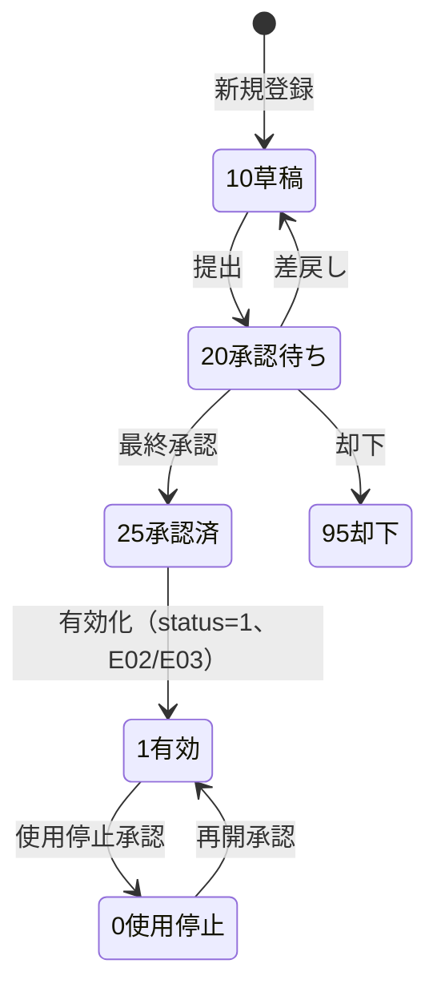
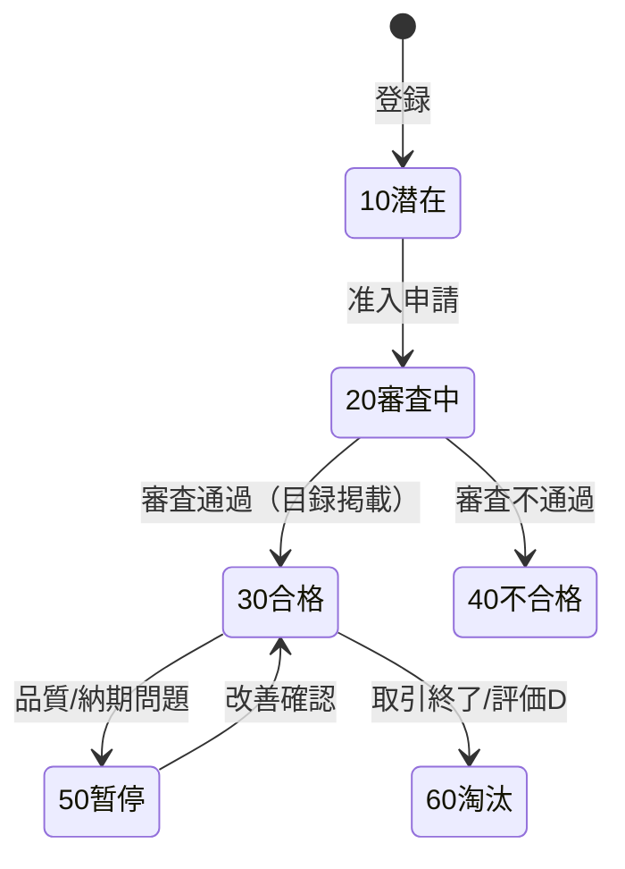
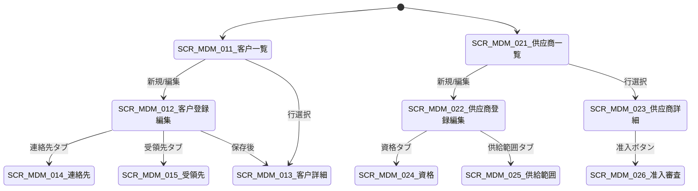

# 客户・供应商主数据 详细设计书（取引先マスタ 詳細設計書）

| 項目 | 内容 |
|---|---|
| 文書名 | 客户・供应商主数据 详细设计书（取引先マスタ 詳細設計書） |
| 文書番号 | DSN-MDM-002 |
| 版数 | v1.0 |
| 作成日 | 2026-10-20 |
| 作成者 | mdm-designer |
| 承認者 | 未承認（レビュー待ち） |
| 状態 | ドラフト（レビュー中） |
| 関連文書 | [業務域概要](00-overview.md) / [共通項目定義](../00-common/01-common-item-definitions.md) / [画面共通規格](../00-common/02-common-screen-spec.md) / [API 共通規格](../00-common/03-common-api-spec.md) / [共通業務規則](../00-common/08-common-business-rules.md) / [跨域流程](../00-common/09-cross-domain-flow.md) / [价格・结算](05-price-settlement.md) / [信用・供应商评估](06-credit-supplier-eval.md) / [DB 設計](90-db-design.md) |

---

## 1. 機能概要

| 項目 | 内容 |
|---|---|
| 機能 ID | F-MDM-004（客户）/ F-MDM-005（供应商） |
| 機能名 | 客户主数据・供应商主数据 |
| 目的 | 建立「一戸一码」的取引先主数据。客户侧覆盖基本/财务/信用/开票/联系人/收货地址，支撑销售受注・出货・开票・应收；供应商侧覆盖基本/财务/付款条件/供货范围/银行账户/资质，支撑采购发注・受入・对账・应付。两侧共用「银行账户」「联系人」「地址」子结构，避免重复建模 |
| 利用者・ロール | 客户主数据担当（销售部）、供应商主数据担当（采购部）、财务主数据担当（开票/银行/信用）、销售/采购经理（承认）、全业务用户（参照） |
| 利用シーン | 新規取引先登録、口座変更、開票情報の訂正、信用限度の設定、取引先の使用停止、仕入先の准入・資格更新、領収書/請求書の宛名確認 |
| 優先度 | P0 |
| 画面 ID | SCR-MDM-011〜015（客户）、SCR-MDM-021〜026（供应商） |
| 関連 IF | IF-MDM-005（供应商工商信息核验） |

## 2. 業務要件・業務ルール

### 2.1 前提条件

| # | 前提条件 | 成立しない場合の挙動 |
|---|---|---|
| 1 | 取引先分類（`customer_type` / `supplier_type`）は固定区分値で管理 | 値域外は保存不可 |
| 2 | 税碼（`mdm_tax_code`）、付款条件（`mdm_payment_term`）、結算方式（`mdm_settlement_method`）、銀行（`mdm_bank`）が有効 | コード存在エラー `MSG-COM-049` |
| 3 | 销售/采购组织（部門）・担当者が SYS に登録済み | 選択不可 |
| 4 | 財務の客先/仕入先補助核算科目が存在（FIN 設計） | 保存時警告／エラー（段階適用の要否は TODO） |
| 5 | 承認経路（WF）が配置済み：`businessType=MASTER_DATA_CHANGE`、`variables.masterDataType=MDM_CUSTOMER`/`MDM_SUPPLIER`、`processKey=APR-MDM`（A16。口座変更は `APR-MDM-BANK`＝A16B） | 提出時 `MSG-COM-073` |

### 2.2 業務ルール（客户）

| # | ルール | 根拠 | 関連項目 |
|---|---|---|---|
| BR-CUS-01 | 客户編碼は `C` + 6 桁流水（例 `C000123`）。自動採番、登録後の変更不可 | 08 第 2.2 節 | `customer_code` |
| BR-CUS-02 | 統一社会信用コード（18 桁）は一意。同一コードの顧客を重複登録しない。入力時は GB 32100-2015 の形式（数字・大文字英字、チェックコード含む）を検証する | 【実データ】GB 32100-2015《法人和其他组织统一社会信用代码编码规则》 | `tax_no` |
| BR-CUS-03 | 顧客名・請求宛名・税号は「開票情報」として財務と整合。増値税専用発票の発行には名称・納税者識別番号・住所電話・开户行及账号の 4 要素が必須 | 【実データ】《中华人民共和国发票管理办法》及現行増値税発票管理规定 | `invoice_*` |
| BR-CUS-04 | 与信限度額は `mdm_credit_limit` で管理し、顧客には `credit_limit_id` と `credit_status` のみ保持（双方向の重複更新禁止） | 09 第 3 章 E02、[06 信用](06-credit-supplier-eval.md) | `credit_limit_id`、`credit_status` |
| BR-CUS-05 | 顧客の使用停止（`status=0`）は未完了の受注・出荷・請求・未回収残高がない場合のみ。適用中は新規受注不可 | 08 第 11 章 | `status` |
| BR-CUS-06 | 銀行口座・開票情報の変更は「重要変更」として必ず WF 承認 + 監査ログ + 財務通知を伴う（口座振替詐欺対策） | 08 第 9.2 節 SoD 8 | `mdm_partner_bank_account`、`invoice_bank_account` |
| BR-CUS-07 | 与信停止（`credit_status=30`）中は与信チェックを行わず受注を拒否。解除は財務の承認が必要 | 09 第 5.3 節 | `credit_status` |
| BR-CUS-08 | 顧客の価格表（`price_list_id`）は既定値。受注時は「取价優先順位」で別価格表が優先され得る（[05](05-price-settlement.md) 第 4 章） | 09 第 11 节 | `price_list_id` |
| BR-CUS-09 | 同一顧客に複数收货地址を登録でき、`is_default=TRUE` は 1 件のみ。受注・出荷は住所スナップショットを伝票に保持 | 01 共通項目定義 13 章 | `mdm_customer_address` |
| BR-CUS-10 | 個人情報（連絡先の氏名・携帯・メール）はマスキング表示し、エクスポート時もマスクする | 01 共通項目定義 15 章 | `mdm_customer_contact` |

### 2.3 業務ルール（供应商）

| # | ルール | 根拠 | 関連項目 |
|---|---|---|---|
| BR-SUP-01 | 供应商編碼は `S` + 6 桁流水（例 `S000045`）。自動採番、変更不可 | 08 第 2.2 節 | `supplier_code` |
| BR-SUP-02 | 統一社会信用コードは一意。重複登録不可。形式検証は顧客と同一 | GB 32100-2015 | `tax_no` |
| BR-SUP-03 | 供应商は「准入（潜在→審査中→合格→暂停→淘汰）」の状態を持ち、`admission_status=10 合格` のみ発注可能 | 08 第 11 章、[06](06-credit-supplier-eval.md) | `admission_status` |
| BR-SUP-04 | 銀行口座は `mdm_partner_bank_account` で管理。発注先口座の変更は WF 承認（采购经理→财务经理→财务总监）+ 変更前後の通知 + 監査ログ | 08 第 9.2 節 | `mdm_partner_bank_account` |
| BR-SUP-05 | 供給範囲（`mdm_supplier_material`）は「供應商 × 物料/分類」で登録。発注時は供給範囲外の警告を出す（ブロックは `sys_param` で制御） | 購買統制の慣行 | `mdm_supplier_material` |
| BR-SUP-06 | 資質（営業執照・ISO 9001・ISO 14001・CCC/防爆合格証等）は有効期限を持ち、期限切れ 30/15/7 日前に警告通知（BAT-MDM-007）。期限切れ時は発注時に警告 | 品質マネジメントの慣行 | `mdm_supplier_qualification` |
| BR-SUP-07 | 供应商評価は品質・納期・価格・サービス・技術の 5 観点で月次評価し、A/B/C/D に分级。C 以下は発注比率を落とし、D は准入停止候補とする（[06](06-credit-supplier-eval.md)） | 購買戦略の慣行 | `supplier_grade` |
| BR-SUP-08 | 外注先（`supplier_type=30`）は委外加工の対象。加工費単価は `mdm_purchase_price` で管理 | 09 第 6 章 | `supplier_type` |
| BR-SUP-09 | 供应商の使用停止は未完了の発注・受入・未払残高がない場合のみ。停止後は新規発注不可（既存発注の受入は可） | 08 第 11 章 | `status` |
| BR-SUP-10 | 税号・口座・付款条件・通貨は財務の AP（買掛）と一致させる。変更時は `mdm.supplier.changed`（E03）で通知 | 09 第 3 章 E03 | 各項目 |

### 2.4 計算式・判定式

| # | 対象 | 算式 | 丸め | 例 |
|---|---|---|---|---|
| CALC-CUS-01 | 与信余力（参照用） | 与信限度額 − 与信占用額（SAL/FIN 提供） | 2 桁 | 【示例値】500,000.00 − 320,000.00 = 180,000.00 CNY |
| CALC-CUS-02 | 単一受注上限チェック | 受注税込金額 ≦ `single_order_limit_amount`（0 は無制限） | 2 桁 | 【示例値】120,000.00 ≦ 200,000.00 |
| CALC-SUP-01 | 評価総合点 | Σ（観点得点 × 权重） | 2 桁 | 【示例値】品質 90×0.35 + 納期 80×0.25 + 価格 85×0.20 + 服務 88×0.10 + 技術 82×0.10 = 85.60 |
| CALC-SUP-02 | 支払期日 | 基準日 + `net_days`（`settlement_basis` で基準日決定） | 日 | 【示例値】2026-10-31 締め → 2026-11-30 支払 |

### 2.5 状態遷移

**取引先マスタ共通（客户・供应商）**



**供应商准入**



| 遷移 | トリガ | 権限 | 更新項目 | メッセージ |
|---|---|---|---|---|
| 10→20 | 提出 | `mdm:customer:update` / `mdm:supplier:update` | `approval_status=20`、WF 連携 | MSG-COM-005 |
| 20→25 | WF 最終承認 | `mdm:change:approve` | `approval_status=25` | MSG-MDM-040 |
| 25→1 | 有効化 | システム | `status=1`、E02/E03 | MSG-MDM-041 |
| 1→0 | 使用停止承認 | `mdm:customer:delete` / `mdm:supplier:delete` | `status=0`、E02/E03 | MSG-MDM-042 |
| 准入 20→30 | 准入審査完了 | `mdm:supplier-admission:approve` | `admission_status=30`、AVL 掲載 | MSG-MDM-043 |

## 3. 関連機能

| 関係 | 機能 ID | 機能名 | 関係内容 |
|---|---|---|---|
| 参照 | F-MDM-010/012/013 | 価格表・結算・銀行 | 顧客の価格表/支払条件/口座 |
| 参照 | F-MDM-014 | 信用额度 | 顧客の与信限度・チェック規則 |
| 参照 | F-MDM-015 | 准入/評估 | 供应商の准入状態・分级 |
| 参照 | F-MDM-018 | 変更審批 | 关键項目変更 |
| 下流 | F-SAL-002/003/005/010 | 報価/受注/発票/信用 | 顧客・請求先・与信・価格表を参照 |
| 下流 | F-PUR-003/004/007 | 発注/受入/対照 | 供应商・口座・付款条件・供給範囲を参照 |
| 下流 | F-FIN-003/004 | 应付/应收 | 取引先補助核算・税号・開票情報・口座を参照 |

**他域との契約（09 第 11 節準拠）**

| 契約項目 | MDM が保証する内容 | 利用側 |
|---|---|---|
| 顧客参照 | `GET /api/mdm/customers/{id}` で `customer_code/name/tax_no/invoice_type/payment_term_code/price_list_id/currency_code/credit_status/status` を返す | SAL、FIN |
| 顧客信用 | `GET /api/mdm/customers/{id}/credit-limit` で `credit_limit_amount/single_order_limit_amount/over_limit_ratio/credit_status/check_rule` を返す。**占用額は含まない**（SAL/FIN が算出） | SAL、FIN |
| 開票情報 | 顧客詳細の `invoice_*` を 4 要素セットで返す。発票発行時のスナップショット用 | SAL、FIN、INT |
| 銀行口座 | `GET /api/mdm/partner-bank-accounts?ownerType=CUSTOMER|SUPPLIER&ownerId=` で口座一覧を返す（口座番号は権限者のみ全桁、他は下 4 桁） | FIN、INT |
| 供应商参照 | `GET /api/mdm/suppliers/{id}` で `supplier_code/name/tax_no/payment_term_code/settlement_method_code/currency_code/admission_status/status` を返す | PUR、FIN |
| 供給範囲 | `GET /api/mdm/suppliers/{id}/materials` で供給可能な物料/分類を返す | PUR（発注時警告） |
| 变更通知 | E02 `mdm.customer.changed` / E03 `mdm.supplier.changed` を承認後発行 | SAL/FIN、PUR/FIN |

## 4. 画面設計

### 4.1 画面一覧

| 画面 ID | 画面名 | 類型 | 概要 |
|---|---|---|---|
| SCR-MDM-011 | 客户一覧 | 一覧検索 | コード/名称/税号/担当/信用状態/使用停止で検索 |
| SCR-MDM-012 | 客户登録編集 | 登録編集 | 基本/財務・与信/開票/連絡先/受領先のタブ |
| SCR-MDM-013 | 客户参照詳細 | 参照詳細 | 全情報＋与信＋価格＋直近取引（SAL 連携リンク） |
| SCR-MDM-014 | 客户連絡先管理 | 登録編集 | 連絡先 CRUD、既定連絡先 |
| SCR-MDM-015 | 客户収貨地址管理 | 登録編集 | 複数住所、既定住所、受領時間帯 |
| SCR-MDM-021 | 供应商一覧 | 一覧検索 | コード/名称/税号/准入状態/分级で検索 |
| SCR-MDM-022 | 供应商登録編集 | 登録編集 | 基本/財務・支払/銀行/資格/供給範囲 |
| SCR-MDM-023 | 供应商参照詳細 | 参照詳細 | 全情報＋評価＋直近取引 |
| SCR-MDM-024 | 供应商資格管理 | 登録編集 | 資格・有効期限・添付 |
| SCR-MDM-025 | 供应商供給範囲管理 | 登録編集 | 供給物料/分類、優先度 |
| SCR-MDM-026 | 供应商准入審査 | ワークフロー | 准入申請内容＋審査結果＋承認 |

### 4.2 画面遷移



### 4.3 画面レイアウト

**SCR-MDM-012 客户登録編集（タブ）**

```
┌──────────────────────────────────────────────────────────────────────────┐
│ 客户コード C000123   状態 有効   与信状態 正常   版数 3   [保存][提出][履歴]│
├──────────────────────────────────────────────────────────────────────────┤
│ [基本] [財務・与信] [開票情報] [連絡先] [収貨地址]        ← タブ          │
├──────────────────────────────────────────────────────────────────────────┤
│ 基本：客户名* 略称 類型* 等級 業種 税号* 法人代表 登録住所 事務所 …       │
│ 財務：価格表 価格G 税码 付款条件 結算方式 通貨 与信限度 与信状態 担当 …   │
│ 開票：発票種別* 宛名* 税号* 住所電話* 开户行 口座番号                     │
│ 連絡先：氏名 役職 電話 メール 既定                                      │
│ 受領先：名称 住所 連絡先 受領時間帯 既定                                │
└──────────────────────────────────────────────────────────────────────────┘
```

**SCR-MDM-022 供应商登録編集（タブ）**

```
┌──────────────────────────────────────────────────────────────────────────┐
│ 供应商コード S000045  状態 有効  准入 合格  分级 A   版数 5  [保存][提出]  │
├──────────────────────────────────────────────────────────────────────────┤
│ [基本] [財務・支払] [銀行口座] [資格] [供給範囲]          ← タブ          │
├──────────────────────────────────────────────────────────────────────────┤
│ 基本：供应商名* 略称 類型* 分類 税号* 法人 住所 担当 リードタイム …       │
│ 財務：付款条件* 結算方式* 通貨 税码 買掛科目 前払可否 …                   │
│ 銀行：銀行* 支店 口座種別* 口座番号* 名義 CNAPS 既定                    │
│ 資格：資格種別* 番号* 発行機関 有効期限 添付                            │
│ 供給：物料/分類 優先度 最小発注量 リードタイム 過入荷容差%                        │
└──────────────────────────────────────────────────────────────────────────┘
```

### 4.4 画面項目定義

#### 4.4.1 客户一覧 SCR-MDM-011（検索条件・一覧列）

| No | 項目 ID | 項目名 | 区分 | 種別 | 型/桁 | 必須 | 初期値 | 入力チェック | データソース | DB 項目 | 権限 | 備考 |
|---|---|---|---|---|---|---|---|---|---|---|---|---|
| 1 | `keyword` | 客户コード・名称 | 検索 | テキスト | VARCHAR(100) | — | 空 | ≤ 100 字、部分一致 | 入力 | customer_code/name | 参照可 | — |
| 2 | `customerType` | 客户類型 | 検索 | 選択（複数） | SMALLINT | — | 空 | 10 企業/20 経銷商/30 個人/40 輸出 | 固定値 | customer_type | 参照可 | — |
| 3 | `customerGrade` | 客户等級 | 検索 | 選択（複数） | VARCHAR(1) | — | 空 | A/B/C/D | 固定値 | customer_grade | 参照可 | — |
| 4 | `taxNo` | 税号 | 検索 | テキスト | VARCHAR(18) | — | 空 | 18 桁 or 部分一致 | 入力 | tax_no | 参照可 | 権限者のみ全桁 |
| 5 | `creditStatus` | 与信状態 | 検索 | 選択（複数） | SMALLINT | — | 空 | 10 正常/20 超限/30 凍結/40 閉鎖 | 固定値 | credit_status | 参照可 | — |
| 6 | `ownerUserId` | 担当者 | 検索 | ユーザ選択 | BIGINT | — | 自分 | 有効ユーザ | SYS | owner_user_id | 参照可 | データ権限で絞込 |
| 7 | `status` | 状態 | 検索 | 選択 | SMALLINT | — | 1 | 1/0 | 固定値 | status | 参照可 | — |
| 8 | `col_customer_code` | 客户コード | 一覧 | リンク | VARCHAR(8) | — | — | — | DB | customer_code | 参照可 | 左固定 |
| 9 | `col_customer_name` | 客户名 | 一覧 | テキスト | VARCHAR(200) | — | — | — | DB | customer_name | 参照可 | — |
| 10 | `col_customer_type` | 類型 | 一覧 | バッジ | SMALLINT | — | — | — | DB | customer_type | 参照可 | — |
| 11 | `col_grade` | 等級 | 一覧 | バッジ | VARCHAR(1) | — | — | — | DB | customer_grade | 参照可 | — |
| 12 | `col_credit_status` | 与信状態 | 一覧 | バッジ | SMALLINT | — | — | — | DB | credit_status | 参照可 | 正常=緑/超限=橙/凍結=赤 |
| 13 | `col_owner` | 担当者 | 一覧 | テキスト | VARCHAR(64) | — | — | — | SYS | owner_user_id | 参照可 | — |
| 14 | `col_phone` | 連絡先 | 一覧 | テキスト | VARCHAR(32) | — | — | — | DB | 連絡先表 | 参照可 | マスキング |
| 15 | `col_status` | 状態 | 一覧 | バッジ | SMALLINT | — | — | — | DB | status | 参照可 | — |
| 16 | `btn_new` | 新規 | ボタン | — | — | — | — | — | — | — | `mdm:customer:create` | — |
| 17 | `btn_export` | エクスポート | ボタン | — | — | — | — | — | — | — | `mdm:customer:export` | マスキング |
| 18 | `btn_batch_stop` | 一括使用停止 | ボタン | — | — | — | — | 選択 1〜1,000 | — | — | `mdm:customer:delete` | 承認必須 |

#### 4.4.2 客户登録編集 SCR-MDM-012（主要 UI 項目）

| No | タブ | 項目 ID（物理名） | 項目名 | 種別 | 必須 | 初期値 | 入力チェック | 表示制御/権限 | 備考 |
|---|---|---|---|---|---|---|---|---|---|
| 1 | 基本 | `customer_code` | 客户コード | テキスト | ○ | 自動採番 | C+6 桁・一意 | 参照のみ | 登録後変更不可 |
| 2 | 基本 | `customer_name` | 客户名 | テキスト | ○ | 空 | 1〜200 字 | 編集可 | 正式名称 |
| 3 | 基本 | `short_name` | 略称 | テキスト | — | 空 | ≤ 100 字 | 編集可 | 帳票用 |
| 4 | 基本 | `customer_type` | 客户類型 | 選択 | ○ | 10 企業 | 固定値 | 編集可 | — |
| 5 | 基本 | `customer_grade` | 客户等級 | 選択 | — | 空 | A/B/C/D | 編集可 | 評価で自動更新も可 |
| 6 | 基本 | `industry_code` | 業種 | 選択 | — | 空 | 有効業種（GB/T 4754） | 編集可 | 国民经济行业分类 |
| 7 | 基本 | `tax_no` | 統一社会信用コード | テキスト | ○ | 空 | 18 桁・形式・一意 | 編集可（変更は重要変更） | — |
| 8 | 基本 | `legal_rep` | 法人代表 | テキスト | — | 空 | ≤ 64 字 | 編集可 | — |
| 9 | 基本 | `registered_address` | 登録住所 | テキスト | — | 空 | ≤ 200 字 | 編集可 | — |
| 10 | 基本 | `office_address` | 事務所住所 | テキスト | — | 空 | ≤ 200 字 | 編集可 | — |
| 11 | 基本 | `phone` | 代表電話 | テキスト | — | 空 | ≤ 32 字、数字/ハイフン | 編集可 | マスキング |
| 12 | 基本 | `website` | Web サイト | テキスト | — | 空 | URL 形式 | 編集可 | — |
| 13 | 基本 | `sales_department_id` | 所管部門 | 選択 | — | ログイン部門 | 有効部門 | 編集可 | データ権限の基礎 |
| 14 | 基本 | `owner_user_id` | 営業担当 | 選択 | ○ | ログインユーザ | 有効ユーザ | 編集可 | — |
| 15 | 財務・与信 | `price_list_id` | 既定価格表 | 選択 | — | 標準価格表 | 有効価格表 | `mdm:customer:finance:update` | 空=標準価格 |
| 16 | 財務・与信 | `price_group_code` | 価格グループ | 選択 | — | 空 | 有効グループ | 同上 | 取価の分類軸 |
| 17 | 財務・与信 | `tax_code` | 既定税码 | 選択 | △ | VAT13-OUT | 有効税码（銷項） | 同上 | — |
| 18 | 財務・与信 | `payment_term_code` | 付款条件 | 選択 | ○ | 空 | 有効条件 | 同上 | 例：月締翌月払 |
| 19 | 財務・与信 | `settlement_method_code` | 結算方式 | 選択 | ○ | 空 | 有効方式 | 同上 | — |
| 20 | 財務・与信 | `currency_code` | 取引通貨 | 選択 | ○ | CNY | ISO 4217・有効 | 同上 | — |
| 21 | 財務・与信 | `credit_limit_id` | 与信限度 | 参照 | △ | 空 | 有効与信レコード | `mdm:customer:credit:view` | 信用管理画面で設定 |
| 22 | 財務・与信 | `credit_status` | 与信状態 | 選択 | ○ | 10 正常 | 10/20/30/40 | `mdm:customer:credit:update` | 凍結は財務のみ |
| 23 | 財務・与信 | `ar_account_code` | 売掛科目 | 選択 | — | 1122 | FIN 科目存在・末級 | `mdm:customer:finance:update` | FIN 照会 |
| 24 | 財務・与信 | `delivery_address` | 既定収貨地址 | 参照選択 | — | 空 | 有効住所 | 編集可 | 住所管理から選択 |
| 25 | 財務・与信 | `return_limit_days` | 返品期限日数 | 数値 | — | 30 | 0〜365 | 編集可 | SAL 参照 |
| 26 | 開票情報 | `invoice_type` | 発票種別 | 選択 | ○ | 10 専票 | 10 専票/20 普票/30 数電専票/40 数電普票/50 紅字発票（赤伝登録時のみ） | `mdm:customer:finance:update` | — |
| 27 | 開票情報 | `invoice_title` | 請求宛名 | テキスト | ○ | 客户名 | ≤ 200 字 | 同上 | — |
| 28 | 開票情報 | `invoice_tax_no` | 請求税号 | テキスト | ○ | tax_no | 18 桁 | 同上 | — |
| 29 | 開票情報 | `invoice_address_phone` | 住所・電話 | テキスト | ○ | 空 | ≤ 200 字 | 同上 | 専票 4 要素の 1 |
| 30 | 開票情報 | `invoice_bank_name` | 开户行 | テキスト | ○ | 空 | ≤ 100 字 | 同上 | 専票 4 要素の 1 |
| 31 | 開票情報 | `invoice_bank_account` | 口座番号 | テキスト | ○ | 空 | 数字 8〜32 桁 | 同上 | マスキング、変更は重要変更 |
| 32 | 連絡先 | `contact_name` | 氏名 | テキスト | △ | 空 | ≤ 64 字 | 編集可 | 連絡先 1 件以上推奨 |
| 33 | 連絡先 | `contact_position` | 役職 | テキスト | — | 空 | ≤ 64 字 | 編集可 | — |
| 34 | 連絡先 | `contact_phone` | 電話 | テキスト | △ | 空 | ≤ 32 字 | 編集可 | マスキング |
| 35 | 連絡先 | `contact_email` | メール | テキスト | — | 空 | メール形式 | 編集可 | マスキング |
| 36 | 連絡先 | `is_default_contact` | 既定連絡先 | チェック | — | false | 1 顧客 1 件のみ | 編集可 | — |
| 37 | 収貨地址 | `address_name` | 住所名称 | テキスト | ○ | 空 | ≤ 100 字 | 編集可 | 例：常州本社倉庫 |
| 38 | 収貨地址 | `receiver_name` | 受領者 | テキスト | ○ | 空 | ≤ 64 字 | 編集可 | マスキング |
| 39 | 収貨地址 | `receiver_phone` | 受領電話 | テキスト | ○ | 空 | ≤ 32 字 | 編集可 | マスキング |
| 40 | 収貨地址 | `address_detail` | 住所 | テキスト | ○ | 空 | ≤ 200 字 | 編集可 | — |
| 41 | 収貨地址 | `delivery_window` | 受領時間帯 | テキスト | — | 空 | ≤ 64 字 | 編集可 | 例 08:00-12:00 |
| 42 | 収貨地址 | `is_default_address` | 既定住所 | チェック | — | false | 1 顧客 1 件のみ | 編集可 | — |
| 43 | ボタン | `btn_save` / `btn_submit` | 保存/提出 | ボタン | — | — | 二重送信防止 | `mdm:customer:update` | Idempotency-Key |
| 44 | ボタン | `btn_bank_change` | 口座変更申請 | ボタン | — | — | 変更理由必須 | `mdm:customer:bank:update` | 重要変更 WF |

#### 4.4.3 供应商一覧 SCR-MDM-021（検索条件・一覧列）

| No | 項目 ID | 項目名 | 区分 | 種別 | 型/桁 | 必須 | 初期値 | 入力チェック | データソース | DB 項目 | 権限 | 備考 |
|---|---|---|---|---|---|---|---|---|---|---|---|---|
| 1 | `keyword` | コード・名称 | 検索 | テキスト | VARCHAR(100) | — | 空 | ≤ 100 字 | 入力 | supplier_code/name | 参照可 | — |
| 2 | `supplierType` | 類型 | 検索 | 選択（複数） | SMALLINT | — | 空 | 10 製造商/20 経銷商/30 外注/40 服務 | 固定値 | supplier_type | 参照可 | — |
| 3 | `admissionStatus` | 准入状態 | 検索 | 選択（複数） | SMALLINT | — | 空 | 10 潜在/20 審査中/30 合格/40 不合格/50 暂停/60 淘汰 | 固定値 | admission_status | 参照可 | — |
| 4 | `supplierGrade` | 分级 | 検索 | 選択（複数） | VARCHAR(1) | — | 空 | A/B/C/D | 固定値 | supplier_grade | 参照可 | — |
| 5 | `categoryCode` | 供給分類 | 検索 | ツリー選択 | VARCHAR(4) | — | 空 | 有効分類 | マスタ | 供給範囲表 | 参照可 | — |
| 6 | `taxNo` | 税号 | 検索 | テキスト | VARCHAR(18) | — | 空 | 18 桁 | 入力 | tax_no | 参照可 | — |
| 7 | `status` | 状態 | 検索 | 選択 | SMALLINT | — | 1 | 1/0 | 固定値 | status | 参照可 | — |
| 8 | `col_supplier_code` | コード | 一覧 | リンク | VARCHAR(8) | — | — | — | DB | supplier_code | 参照可 | 左固定 |
| 9 | `col_supplier_name` | 供应商名 | 一覧 | テキスト | VARCHAR(200) | — | — | — | DB | supplier_name | 参照可 | — |
| 10 | `col_type` | 類型 | 一覧 | バッジ | SMALLINT | — | — | — | DB | supplier_type | 参照可 | — |
| 11 | `col_admission` | 准入状態 | 一覧 | バッジ | SMALLINT | — | — | — | DB | admission_status | 参照可 | 合格=緑、暂停=橙 |
| 12 | `col_grade` | 分级 | 一覧 | バッジ | VARCHAR(1) | — | — | — | DB | supplier_grade | 参照可 | — |
| 13 | `col_lead_time` | 購買提前期 | 一覧 | 数値 | INT | — | — | — | DB | default_lead_time_days | 参照可 | 日 |
| 14 | `col_payment_term` | 付款条件 | 一覧 | テキスト | VARCHAR(32) | — | — | — | マスタ | payment_term_code | 参照可 | — |
| 15 | `col_owner` | 購買担当 | 一覧 | テキスト | VARCHAR(64) | — | — | — | SYS | owner_user_id | 参照可 | — |
| 16 | `col_status` | 状態 | 一覧 | バッジ | SMALLINT | — | — | — | DB | status | 参照可 | — |
| 17 | `btn_new` | 新規 | ボタン | — | — | — | — | — | — | — | `mdm:supplier:create` | — |
| 18 | `btn_export` | エクスポート | ボタン | — | — | — | — | — | — | — | `mdm:supplier:export` | — |

#### 4.4.4 供应商登録編集 SCR-MDM-022（主要 UI 項目）

| No | タブ | 項目 ID（物理名） | 項目名 | 種別 | 必須 | 初期値 | 入力チェック | 表示制御/権限 | 備考 |
|---|---|---|---|---|---|---|---|---|---|
| 1 | 基本 | `supplier_code` | コード | テキスト | ○ | 自動採番 | S+6 桁・一意 | 参照のみ | 変更不可 |
| 2 | 基本 | `supplier_name` | 供应商名 | テキスト | ○ | 空 | 1〜200 字 | 編集可 | — |
| 3 | 基本 | `short_name` | 略称 | テキスト | — | 空 | ≤ 100 字 | 編集可 | — |
| 4 | 基本 | `supplier_type` | 類型 | 選択 | ○ | 10 製造商 | 10/20/30/40 | 編集可 | — |
| 5 | 基本 | `supplier_grade` | 分级 | 選択 | — | 空 | A/B/C/D | 編集可（評価で自動） | — |
| 6 | 基本 | `tax_no` | 統一社会信用コード | テキスト | ○ | 空 | 18 桁・形式・一意 | 編集可（重要変更） | — |
| 7 | 基本 | `legal_rep` | 法人代表 | テキスト | — | 空 | ≤ 64 字 | 編集可 | — |
| 8 | 基本 | `registered_address` | 登録住所 | テキスト | — | 空 | ≤ 200 字 | 編集可 | — |
| 9 | 基本 | `office_address` | 事務所住所 | テキスト | — | 空 | ≤ 200 字 | 編集可 | — |
| 10 | 基本 | `contact_phone` | 代表電話 | テキスト | — | 空 | ≤ 32 字 | 編集可 | マスキング |
| 11 | 基本 | `buyer_id` | 購買担当 | 選択 | ○ | ログインユーザ | 有効ユーザ | 編集可 | — |
| 12 | 基本 | `default_lead_time_days` | 標準購買提前期 | 数値 | — | 0 | 0〜365 | 編集可 | PUR/MRP |
| 13 | 基本 | `currency_code` | 取引通貨 | 選択 | ○ | CNY | ISO 4217 | 編集可 | — |
| 14 | 基本 | `admission_status` | 准入状態 | 選択 | ○ | 10 潜在 | 固定値 | `mdm:supplier-admission:approve` | 合格は審査経由 |
| 15 | 財務・支払 | `payment_term_code` | 付款条件 | 選択 | ○ | 空 | 有効条件 | `mdm:supplier:finance:update` | — |
| 16 | 財務・支払 | `settlement_method_code` | 結算方式 | 選択 | ○ | 空 | 有効方式 | 同上 | — |
| 17 | 財務・支払 | `tax_code` | 既定税码 | 選択 | △ | VAT13-IN | 有効税码（進項） | 同上 | — |
| 18 | 財務・支払 | `ap_account_code` | 買掛科目 | 選択 | — | 2202 | FIN 科目存在・末級 | 同上 | FIN 照会 |
| 19 | 財務・支払 | `advance_payment_allowed` | 前払可否 | チェック | — | false | — | 同上 | PA の参考 |
| 20 | 財務・支払 | `vmi_flag` | VMI 対象 | チェック | — | false | — | 同上 | — |
| 21 | 銀行口座 | `bank_id` | 銀行 | 選択 | ○ | 空 | 有効銀行 | `mdm:supplier:bank:update` | 銀行マスタ |
| 22 | 銀行口座 | `bank_branch_name` | 支店名 | テキスト | ○ | 空 | ≤ 100 字 | 同上 | — |
| 23 | 銀行口座 | `cnaps_code` | 聯行号 | テキスト | ○ | 空 | 12 桁（CNAPS） | 同上 | 銀行照会 |
| 24 | 銀行口座 | `account_type` | 口座種別 | 選択 | ○ | 10 基本 | 10 基本/20 一般 | 同上 | — |
| 25 | 銀行口座 | `account_no` | 口座番号 | テキスト | ○ | 空 | 数字 8〜32 桁 | 同上 | マスキング |
| 26 | 銀行口座 | `account_name` | 口座名義 | テキスト | ○ | 供应商名 | ≤ 100 字 | 同上 | 名義一致チェック |
| 27 | 銀行口座 | `is_default_account` | 既定口座 | チェック | — | false | 1 供应商 1 件 | 同上 | — |
| 28 | 資格 | `qualification_type` | 資格種別 | 選択 | ○ | 空 | 営業執照/ISO9001/ISO14001/CCC/防爆合格証/その他 | 編集可 | — |
| 29 | 資格 | `qualification_no` | 資格番号 | テキスト | ○ | 空 | ≤ 64 字 | 編集可 | — |
| 30 | 資格 | `issuer` | 発行機関 | テキスト | — | 空 | ≤ 100 字 | 編集可 | — |
| 31 | 資格 | `valid_from` / `valid_to` | 有効期間 | 日付範囲 | ○ | 空 | 開始≦終了 | 編集可 | 期限切れ警告 |
| 32 | 資格 | `qualification_file` | 資格添付 | アップロード | — | 空 | PDF/JPG、≤ 20MB | 編集可 | — |
| 33 | 供給範囲 | `material_id` / `category_code` | 供給対象 | 選択 | ○ | 空 | 物料 or 分類のいずれか | 編集可 | — |
| 34 | 供給範囲 | `priority` | 優先度 | 数値 | — | 100 | 1〜999 | 編集可 | 小さいほど優先 |
| 35 | 供給範囲 | `is_preferred` | 推奨供應商 | チェック | — | false | 1 物料 1 件推奨 | 編集可 | MRP 参考 |
| 36 | 供給範囲 | `moq` | 最小発注量 | 数値 | NUMERIC(18,4) | △ | 空 | ≥ 0 | 編集可 | 供給範囲単位の MOQ。未設定時は `mdm_material.min_order_qty`（05 §2.4） |
| 37 | 供給範囲 | `purchase_lead_time_days` | 購買提前期 | 数値 | INT | △ | 空 | 0〜365 | 編集可 | 供給範囲単位の LT。未設定時は `mdm_supplier.default_lead_time_days`（05 §2.4） |
| 38 | 供給範囲 | `over_receipt_tolerance_pct` | 過入荷容差 | 数値（%） | NUMERIC(5,4)（比率） | — | 空 | 0〜100、小数 2 桁（画面は % で入出力、保存は比率、フロントで換算） | 編集可 | 仕入先既定の過入荷容差（品目>分類>仕入先>会社の優先順、05 §2.4） |
| 39 | ボタン | `btn_admission` | 准入申請 | ボタン | — | — | 資格 1 件以上必須 | `mdm:supplier:update` | SCR-MDM-026 へ |
| 40 | ボタン | `btn_bank_change` | 口座変更申請 | ボタン | — | — | 変更理由必須 | `mdm:supplier:bank:update` | 重要変更 WF（A16B/`APR-MDM-BANK`） |

### 4.5 イベント処理

| No | イベント | トリガ | 処理内容 | 呼出 API | 画面遷移 | 備考 |
|---|---|---|---|---|---|---|
| 1 | 税号入力 | `tax_no` フォーカスアウト | 18 桁形式・チェックコード検証、既存重複チェック | `GET /api/mdm/customers/check-tax-no?taxNo=` | 同一画面 | 重複時エラー |
| 2 | 与信限度参照 | ボタン | 与信レコード・与信状態を取得 | `GET /api/mdm/customers/{id}/credit-limit` | 同一画面 | 権限が必要 |
| 3 | 口座変更申請 | ボタン | 変更理由必須、旧口座との差分を WF へ | `POST /api/mdm/partner-bank-accounts/{id}/change-request` | 承認待ち表示 | 監査ログ+通知 |
| 4 | 保存 | 保存ボタン | 入力チェック→INSERT/UPDATE→履歴 | `POST/PUT /api/mdm/customers` / `suppliers` | 詳細へ | 楽観排他 |
| 5 | 提出 | 提出ボタン | 保存後 WF へ提出 | `POST /api/mdm/customers/{id}/submit` | 一覧へ | — |
| 6 | 使用停止 | 詳細「使用停止」 | 参照チェック→承認申請 | `POST /api/mdm/customers/{id}/deactivate` | 一覧へ | 参照中は不可 |
| 7 | 准入申請（供应商） | ボタン | 資格・評価をチェックし WF へ | `POST /api/mdm/suppliers/{id}/admission-requests` | SCR-MDM-026 | — |
| 8 | 資格期限更新 | 画面保存 | 有効期限を更新し、警告バッチ対象を再計算 | — | 同一画面 | — |

### 4.6 一覧画面仕様

| 項目 | 内容（共通） |
|---|---|
| 検索条件 | 各一覧の 4.4.1 / 4.4.3 節。既定：状態=1 |
| 既定条件 | `status=1`、与信状態/准入状態は未指定（全件） |
| ソート | 既定 `updated_at DESC`。コード昇順・名称昇順可 |
| ページング | 20/50/100/200（既定 20） |
| 一括操作 | 使用停止申請、エクスポート。選択上限 1,000 件 |
| エクスポート | Excel、10,000 件まで同期／超過非同期。個人情報・口座はマスキング |
| 印刷 | PRT-MDM-004（客户一覧）、PRT-MDM-006（供应商一覧） |

### 4.7 表示制御

| 条件 | 対象 | 制御 |
|---|---|---|
| 権限 `mdm:customer:finance:update` なし | 財務・与信/開票タブ | 参照のみ（金額・口座はマスク） |
| 権限 `mdm:supplier:bank:update` なし | 銀行口座タブ | 参照のみ（口座下 4 桁のみ） |
| `approval_status=20` | 全項目 | 参照のみ |
| `status=0` | 編集・提出 | 参照のみ、再開申請のみ |
| `credit_status=30`（凍結） | 与信状態 | 赤バッジ、決済条件変更を警告 |
| 個人情報 | 連絡先・受領者・電話・メール | マスキング（`138****5678`） |
| データ範囲外 | 一覧・詳細 | 403 / 非表示 |

## 5. 入力チェック仕様

| No | チェック ID | 対象項目 | 種別 | 条件 | タイミング | メッセージ ID |
|---|---|---|---|---|---|---|
| 1 | CHK-MDM-004-01 | `customer_code` | 形式/一意 | C+6 桁、一意 | 保存時 | MSG-MDM-050 |
| 2 | CHK-MDM-004-02 | `customer_name` | 必須/桁 | 1〜200 字 | 保存時 | MSG-COM-040 |
| 3 | CHK-MDM-004-03 | `tax_no` | 形式/一意 | 18 桁・GB 32100-2015 形式・一意 | フォーカスアウト/保存 | MSG-MDM-051 |
| 4 | CHK-MDM-004-04 | `invoice_*` 4 要素 | 相関 | `invoice_type` が専票系のとき全て必須 | 保存時 | MSG-MDM-052 |
| 5 | CHK-MDM-004-05 | `payment_term_code` | コード存在 | 有効条件 | 保存時 | MSG-COM-049 |
| 6 | CHK-MDM-004-06 | `currency_code` | コード存在 | ISO 4217・有効 | 保存時 | MSG-COM-049 |
| 7 | CHK-MDM-004-07 | 連絡先 | 必須（条件） | 連絡先 0 件は警告、`is_default_contact` は 1 件のみ | 保存時 | MSG-MDM-053（W） |
| 8 | CHK-MDM-004-08 | 収貨地址 | 相関 | `is_default_address` 1 件のみ、住所必須 | 保存時 | MSG-MDM-054 |
| 9 | CHK-MDM-004-09 | 口座番号 | 形式 | 数字 8〜32 桁、名義一致 | 保存時 | MSG-MDM-055 |
| 10 | CHK-MDM-004-10 | 与信状態変更 | 権限 | 凍結/解除は `mdm:customer:credit:update` | 変更時 | MSG-COM-030 |
| 11 | CHK-MDM-005-01 | `supplier_code` | 形式/一意 | S+6 桁、一意 | 保存時 | MSG-MDM-050 |
| 12 | CHK-MDM-005-02 | `tax_no` | 形式/一意 | 18 桁・一意 | フォーカスアウト | MSG-MDM-051 |
| 13 | CHK-MDM-005-03 | `admission_status` | 業務 | 合格（30）への変更は審査経由のみ | 保存時 | MSG-MDM-056 |
| 14 | CHK-MDM-005-04 | 資格 | 必須 | 准入申請時に営業執照 1 件以上 | 申請時 | MSG-MDM-057 |
| 15 | CHK-MDM-005-05 | `valid_to` | 範囲 | 資格有効期限が過去日の場合警告 | 保存時 | MSG-MDM-058（W） |
| 16 | CHK-MDM-005-06 | 供給範囲 | 相関 | `material_id` と `category_code` のいずれか必須 | 保存時 | MSG-MDM-059 |
| 17 | CHK-MDM-005-07 | `cnaps_code` | 形式 | 12 桁数字 | 保存時 | MSG-MDM-060 |
| 18 | CHK-MDM-005-08 | `account_name` | 相関 | 供应商名と一致しない場合は警告 | 保存時 | MSG-MDM-061（W） |
| 19 | CHK-MDM-005-09 | 使用停止 | 業務 | 未完了発注・受入・未払なし | 申請時 | MSG-MDM-062 |

## 6. 処理詳細

### 6.1 処理一覧

| 処理 ID | 処理名 | 契機 | トランザクション | 排他 |
|---|---|---|---|---|
| PRC-MDM-004-01 | 客户新規登録 | 保存 | 要 | 楽観排他 |
| PRC-MDM-004-02 | 客户更新 | 保存 | 要 | 楽観排他 |
| PRC-MDM-004-03 | 客户有効化・E02 発行 | WF 承認 | 要 | version |
| PRC-MDM-004-04 | 客户使用停止 | 承認後 | 要＋参照チェック | 行ロック |
| PRC-MDM-005-01 | 供应商新規登録 | 保存 | 要 | 楽観排他 |
| PRC-MDM-005-02 | 供应商更新 | 保存 | 要 | 楽観排他 |
| PRC-MDM-005-03 | 供应商有効化・E03 発行 | WF 承認 | 要 | version |
| PRC-MDM-005-04 | 供应商使用停止 | 承認後 | 要＋参照チェック | 行ロック |
| PRC-MDM-005-05 | 准入審査・AVL 更新 | 准入承認 | 要 | version |
| PRC-MDM-013-01 | 口座変更申請・反映 | 口座変更承認 | 要 | 行ロック（旧口座を履歴化） |

### 6.2 処理手順（正常系）

**PRC-MDM-004-01 客户新規登録**

1. 権限 `mdm:customer:create` とデータ範囲をチェックする。
2. 入力チェック（第 5 章）を実行する。
3. 税号・名称・連絡先の重複チェックを行う（税号完全一致、名称は pg_trgm 類似度 0.8 以上で候補提示）。
4. `customer_code` を採番する：`sys_sequence` の `sequence_key=CUSTOMER`、当日連番を 6 桁ゼロ埋めして `C` を付加。
5. `mdm_customer` に INSERT する（`approval_status=10`、`status=0`）。
6. 連絡先・住所・口座があれば子テーブルへ INSERT する。
7. `mdm_customer_his` に CREATE 履歴を記録する。
8. 監査ログを記録し、結果を返す（提出は別操作）。

**PRC-MDM-004-03 客户有効化・E02 発行**

1. WF `workflow.process.completed`（E32）を購読し、`eventId` で冪等チェックする。
2. `mdm_customer` を `FOR UPDATE` で取得し、`approval_status=20` を確認する。
3. `approval_status=25`、`status=1`、`approved_at/by` を更新する。
4. `mdm_customer_his` に承認・変更前後を記録する。
5. `mdm.customer.changed`（E02）を Outbox に INSERT する。ペイロード：`customerId、customerCode、customerName、creditLimit、taxNo、status、changedFields`。
6. 口座・与信の重要変更を含む場合は財務通知（站内+メール）を送信する。
7. 監査ログに APPROVE を記録する。

**PRC-MDM-005-05 准入審査・AVL 更新**

1. WF 承認結果を受信し、承認なら `admission_status=30`、`admitted_at`、`admitted_by` を更新する。
2. 資格（営業執照・ISO 等）の有効性を再チェックし、期限切れがあれば警告して承認は保留（`MSG-MDM-057`）。
3. 供給範囲を AVL（合格供应商目录）として有効化し、`mdm_supplier_material.is_active=TRUE` に更新する。
4. 承認イベント（E03）を Outbox に INSERT し、PUR/FIN に通知する。
5. 監査ログに APPROVE を記録する。

**（口座変更）PRC-MDM-013-01**

1. 変更申請を受け付け、旧口座を `mdm_partner_bank_account_his` に退避する（変更前スナップショット）。
2. WF（采购经理→财务经理→财务总监）へ提出する。申請者と承認者の同一人物は拒否する。
3. 承認後、`mdm_partner_bank_account` を更新し、`is_verified=FALSE`（未検証）にリセットする。
4. FIN・INT へ E02/E03（該当取引先の changed イベント）で通知し、財務は振込先マスタを再確認する。
5. 変更前後の口座（下 4 桁のみ）を監査ログに記録し、取引先担当へ通知する。

### 6.3 例外処理

| No | 異常条件 | 検知箇所 | 処理 | ロールバック | メッセージ ID |
|---|---|---|---|---|---|
| 1 | 税号重複 | 事前チェック/一意制約 | エラー、既存取引先を提示 | 全体 | MSG-MDM-051 |
| 2 | コード重複 | 一意制約 | エラー | 全体 | MSG-MDM-050 |
| 3 | 与信状態の直接変更（権限なし） | 権限チェック | 403 | 全体 | MSG-COM-030 |
| 4 | 使用停止対象が参照中 | 参照チェック | エラー、停止不可 | 全体 | MSG-MDM-062 |
| 5 | 准入審査中に資格期限切れ | 審査時 | 承認保留、資格更新要求 | 全体 | MSG-MDM-057 |
| 6 | 口座名義不一致 | 保存時 | 警告、強制保存は承認者判断 | なし | MSG-MDM-061（W） |
| 7 | 楽観排他競合 | version 不一致 | 409 | 全体 | MSG-COM-033 |
| 8 | 与信限度レコード不存在 | 与信参照 | エラー、与信設定を促す | 全体 | MSG-MDM-063 |

### 6.4 冪等性・再実行

- 登録・更新・提出は `Idempotency-Key` 必須。承認コールバックは `eventId` で重複排除。
- 使用停止・口座変更は再実行可（状態を再判定）。
- BAT-MDM-007（資格期限警告）は通知ログで同日重複を排除する。

## 7. API 設計

| No | メソッド | パス | 権限 | 概要 | リクエスト | レスポンス |
|---|---|---|---|---|---|---|
| 1 | GET | `/api/mdm/customers` | `mdm:customer:view` | 客户一覧 | 検索条件 | `PageResult<CustomerListDto>` |
| 2 | GET | `/api/mdm/customers/{id}` | `mdm:customer:view` | 客户詳細 | id | `CustomerDetailDto` |
| 3 | POST | `/api/mdm/customers` | `mdm:customer:create` | 客户登録 | `CustomerCreateRequest` | `CustomerDetailDto`（201） |
| 4 | PUT | `/api/mdm/customers/{id}` | `mdm:customer:update` | 客户更新 | `CustomerUpdateRequest` | `CustomerDetailDto` |
| 5 | DELETE | `/api/mdm/customers/{id}` | `mdm:customer:delete` | 使用停止申請 | `{version, reason}` | `ChangeRequestDto` |
| 6 | POST | `/api/mdm/customers/{id}/submit` | `mdm:customer:update` | 承認提出 | `{version}` | `CustomerDetailDto` |
| 7 | GET | `/api/mdm/customers/{id}/credit-limit` | `mdm:customer:credit:view` | 与信情報 | id | `CreditLimitDto` |
| 8 | GET | `/api/mdm/customers/{id}/contacts` | `mdm:customer:view` | 連絡先一覧 | id | `List<ContactDto>` |
| 9 | GET | `/api/mdm/customers/{id}/addresses` | `mdm:customer:view` | 住所一覧 | id | `List<AddressDto>` |
| 10 | GET | `/api/mdm/customers/check-tax-no` | `mdm:customer:view` | 税号重複チェック | `taxNo`、`excludeId` | `{exists, candidates[]}` |
| 11 | GET | `/api/mdm/customers/{id}/history` | `mdm:change:view` | 変更履歴 | ページング | `PageResult<ChangeHistoryDto>` |
| 12 | GET | `/api/mdm/suppliers` | `mdm:supplier:view` | 供应商一覧 | 検索条件 | `PageResult<SupplierListDto>` |
| 13 | GET | `/api/mdm/suppliers/{id}` | `mdm:supplier:view` | 供应商詳細 | id | `SupplierDetailDto` |
| 14 | POST | `/api/mdm/suppliers` | `mdm:supplier:create` | 供应商登録 | `SupplierCreateRequest` | `SupplierDetailDto` |
| 15 | PUT | `/api/mdm/suppliers/{id}` | `mdm:supplier:update` | 供应商更新 | `SupplierUpdateRequest` | `SupplierDetailDto` |
| 16 | DELETE | `/api/mdm/suppliers/{id}` | `mdm:supplier:delete` | 使用停止申請 | `{version, reason}` | `ChangeRequestDto` |
| 17 | GET | `/api/mdm/suppliers/{id}/materials` | `mdm:supplier:view` | 供給範囲 | id | `List<SupplierMaterialDto>` |
| 18 | GET | `/api/mdm/suppliers/{id}/qualifications` | `mdm:supplier:view` | 資格一覧 | id | `List<QualificationDto>` |
| 19 | POST | `/api/mdm/suppliers/{id}/admission-requests` | `mdm:supplier:update` | 准入申請 | `{qualificationIds[], comment}` | `AdmissionDto` |
| 20 | POST | `/api/mdm/suppliers/{id}/admission-approve` | `mdm:supplier-admission:approve` | 准入承認 | `{result, comment}` | `SupplierDetailDto` |
| 21 | GET | `/api/mdm/partner-bank-accounts` | `mdm:supplier:view`/`mdm:customer:view` | 口座一覧 | ownerType、ownerId | `List<BankAccountDto>`（マスキング） |
| 22 | POST | `/api/mdm/partner-bank-accounts/{id}/change-request` | `mdm:supplier:bank:update` | 口座変更申請 | `{newAccount..., reason}` | `ChangeRequestDto` |
| 23 | POST | `/api/mdm/customers/import` / `/suppliers/import` | `mdm:customer:import` 等 | 一括取込 | multipart | `ImportResultDto` |

### 7.1 リクエスト/レスポンス詳細

**GET /api/mdm/customers/{id} レスポンス例（抜粋）**

```json
{
  "code": 0,
  "message": "ok",
  "data": {
    "id": "1845000000000000201",
    "customerCode": "C000123",
    "customerName": "【示例值】常州泵业有限公司",
    "shortName": "常州泵业",
    "customerType": 10,
    "customerGrade": "A",
    "taxNo": "91320400【示例】X",
    "invoiceType": 10,
    "invoiceTitle": "【示例值】常州泵业有限公司",
    "invoiceTaxNo": "91320400【示例】X",
    "invoiceAddressPhone": "【示例值】江苏省常州市新北区xx路 8 号 0519-8888xxxx",
    "invoiceBankName": "【示例值】中国工商银行常州分行",
    "invoiceBankAccount": "**** **** 5678",
    "paymentTermCode": "NET30",
    "settlementMethodCode": "BANK_TRANSFER",
    "currencyCode": "CNY",
    "priceListId": "1845000000000000301",
    "priceGroupCode": "PG-DIST",
    "creditStatus": 10,
    "creditLimit": {
      "creditLimitAmount": "500000.00",
      "singleOrderLimitAmount": "200000.00",
      "overLimitRatio": "0.0000",
      "currencyCode": "CNY",
      "validFrom": "2026-01-01",
      "validTo": "2026-12-31"
    },
    "status": 1,
    "version": 3
  }
}
```

**POST /api/mdm/customers エラー例（重複）**

```json
{
  "code": 20051,
  "message": "統一社会信用コード「91320400…」は既に登録されています（C000123）。",
  "data": { "fieldErrors": [ { "field": "taxNo", "message": "該当税号の取引先が既に存在します。" } ] }
}
```

**銀行口座のマスキング規則（API）**

| 権限 | 返却 |
|---|---|
| `mdm:supplier:bank:view` / `mdm:customer:bank:view` | 全桁（監査ログ記録） |
| 上記以外 | 下 4 桁のみ `**** **** 1234` |
| エクスポート | 常にマスキング（権限者でもマスク、別途「口座一覧（機密）」帳票はなくす） |

## 8. データ更新仕様

| テーブル | 操作 | 更新項目 | 更新条件 | トリガ |
|---|---|---|---|---|
| `mdm_customer` | INSERT/UPDATE | 全項目、`approval_status`、`status` | 登録・更新・承認・停止 | PRC-MDM-004-01〜04 |
| `mdm_customer_contact` | INSERT/UPDATE/DELETE | 連絡先（論理削除） | 画面操作 | PRC-MDM-004-02 |
| `mdm_customer_address` | INSERT/UPDATE/DELETE | 住所（論理削除） | 画面操作 | PRC-MDM-004-02 |
| `mdm_customer_his` | INSERT | 前後 JSON・操作種別・理由 | 全更新 | 各処理 |
| `mdm_supplier` | INSERT/UPDATE | 全項目、`admission_status`、`status` | 登録・更新・承認・准入・停止 | PRC-MDM-005-01〜05 |
| `mdm_supplier_contact` | INSERT/UPDATE/DELETE | 連絡先 | 画面操作 | PRC-MDM-005-02 |
| `mdm_supplier_address` | INSERT/UPDATE/DELETE | 住所 | 画面操作 | PRC-MDM-005-02 |
| `mdm_supplier_qualification` | INSERT/UPDATE/DELETE | 資格・有効期限 | 画面操作 | PRC-MDM-005-02 |
| `mdm_supplier_material` | INSERT/UPDATE | 供給範囲・優先度・有効 | 画面操作・准入 | PRC-MDM-005-05 |
| `mdm_supplier_his` | INSERT | 前後 JSON | 全更新 | 各処理 |
| `mdm_partner_bank_account` | INSERT/UPDATE | 口座・検証状態 | 口座変更承認 | PRC-MDM-013-01 |
| `mdm_partner_bank_account_his` | INSERT | 変更前スナップショット | 口座変更 | PRC-MDM-013-01 |
| `sys_outbox_event` | INSERT | E02/E03 | 有効化・変更・停止 | 各承認処理 |
| `sys_audit_log` | INSERT | 各操作（口座はマスク） | 全操作 | 全処理 |

## 9. エラー処理・メッセージ

| メッセージ ID | 種別 | 本文 | 発生条件 | 利用者への対処 | ログ |
|---|---|---|---|---|---|
| MSG-MDM-040 | I | 承認が完了し、取引先を有効化しました。 | 最終承認 | — | INFO |
| MSG-MDM-041 | I | 取引先「{0}」を有効化しました。 | 有効化 | — | INFO |
| MSG-MDM-042 | I | 取引先「{0}」を使用停止にしました。新規の業務利用はできません。 | 使用停止 | — | INFO |
| MSG-MDM-043 | I | 供应商「{0}」を合格供应商（AVL）に登録しました。 | 准入承認 | — | INFO |
| MSG-MDM-050 | E | 取引先コード「{0}」は既に使用されています。 | コード重複 | 別コード | WARN |
| MSG-MDM-051 | E | 統一社会信用コードの形式が正しくないか、既に登録されています。 | 税号不備/重複 | 確認・修正 | WARN |
| MSG-MDM-052 | E | 増値税専用発票の発行には、請求宛名・税号・住所電話・开户行及口座の入力が必要です。 | 発票情報欠落 | 4 要素を入力 | WARN |
| MSG-MDM-053 | W | 連絡先が登録されていません。取引先の連絡先登録を推奨します。 | 連絡先 0 件 | 登録を検討 | INFO |
| MSG-MDM-054 | E | 既定の収貨地址は 1 件のみ設定できます。 | 既定住所重複 | 修正 | WARN |
| MSG-MDM-055 | E | 銀行口座番号は 8〜32 桁の数字で入力してください。 | 口座形式不正 | 修正 | WARN |
| MSG-MDM-056 | E | 供应商の「合格」への変更は准入審査の承認によってのみ可能です。 | 准入状態の直接変更 | 准入申請を実施 | WARN |
| MSG-MDM-057 | E | 有効な資格（営業執照等）が登録されていないため准入承認できません。 | 資格不足 | 資格を登録 | WARN |
| MSG-MDM-058 | W | 資格「{0}」の有効期限が切れています。更新してください。 | 期限切れ | 更新 | WARN |
| MSG-MDM-059 | E | 供給範囲は物料または物料分類のいずれかを指定してください。 | 供給範囲不正 | 修正 | WARN |
| MSG-MDM-060 | E | 聯行号（CNAPS）は 12 桁の数字で入力してください。 | CNAPS 形式不正 | 修正 | WARN |
| MSG-MDM-061 | W | 口座名義が供应商名と一致しません。確認してください。 | 名義不一致 | 確認 | WARN |
| MSG-MDM-062 | E | 該当取引先は未完了の取引があるため使用停止できません（参照：{0}）。 | 参照中 | 参照解消 | WARN |
| MSG-MDM-063 | E | 与信限度額が設定されていません。信用管理画面で設定してください。 | 与信レコードなし | 与信設定 | WARN |

## 10. 権限・セキュリティ

| 種別 | 内容 |
|---|---|
| 画面権限 | `mdm:customer:view/create/update/delete/export/import`、`mdm:supplier:view/create/update/delete/export/import` |
| 操作権限 | 財務・開票項目=`mdm:customer:finance:update`、与信=`mdm:customer:credit:update`、口座=`mdm:supplier:bank:update`、准入承認=`mdm:supplier-admission:approve` |
| 項目権限 | 口座番号は `*:bank:view` がなければ下 4 桁。税号は権限者のみ全桁。与信限度は営業担当に参照のみ |
| データ範囲 | 営業担当は自部門・自分の顧客のみ。購買担当は自部門の供应商のみ（SYS データ権限） |
| 監査ログ | 登録・更新・承認・口座変更・エクスポートを記録。口座はマスキング、変更前後は下 4 桁 |
| SoD | 口座変更の申請者と承認者は同一不可。准入審査の申請と承認は別ロール |
| 通知 | 口座変更・与信凍結・准入承認は财务/采购/销售責任者へ即時通知 |

## 11. 性能・非機能

| 項目 | 目標値 | 前提 |
|---|---|---|
| 一覧検索 | 2 秒以内（100 件） | 索引（コード・名称 trigram・税号・状態） |
| 詳細取得 | 1 秒以内 | 子テーブル含む |
| 登録・更新 | 3 秒以内 | 外部照会なし（FIN 科目はキャッシュ） |
| 件数 | 客户 1,700、供应商 1,050（5 年後） | — |
| 重複チェック | 500ms 以内 | pg_trgm GIN |
| 一括取込 | 10,000 行/回、5 分以内 | 非同期 |
| 可用性 | 99.5% | マスタ参照キャッシュ TTL 5 分 |

## 12. テスト観点

| No | 観点 ID | 分類 | 観点 | 期待結果 |
|---|---|---|---|---|
| 1 | TST-F-MDM-004-01 | 正常系 | 客户登録→承認→有効化 | C+6 桁採番、E02 発行、`status=1` |
| 2 | TST-F-MDM-004-02 | 異常系 | 同一税号で登録 | MSG-MDM-051 |
| 3 | TST-F-MDM-004-03 | 異常系 | 専票で請求住所・電話が未入力 | MSG-MDM-052 |
| 4 | TST-F-MDM-004-04 | 境界値 | 連絡先 0 件 | 警告のみで保存可 |
| 5 | TST-F-MDM-004-05 | 排他 | 同時更新 | 409 MSG-COM-033 |
| 6 | TST-F-MDM-004-06 | 権限 | 営業担当が他部門顧客を閲覧 | 403/非表示 |
| 7 | TST-F-MDM-005-01 | 正常系 | 供应商登録→准入→AVL 掲載 | `admission_status=30`、PUR 参照可 |
| 8 | TST-F-MDM-005-02 | 異常系 | 資格なしで准入承認 | MSG-MDM-057 |
| 9 | TST-F-MDM-005-03 | 異常系 | CNAPS 11 桁 | MSG-MDM-060 |
| 10 | TST-F-MDM-005-04 | 業務 | 口座変更承認後の反映 | 旧口座履歴化、E03 発行、FIN 通知 |
| 11 | TST-F-MDM-005-05 | マスキング | 権限なしで口座参照 | 下 4 桁のみ |
| 12 | TST-F-MDM-005-06 | 使用停止 | 未完了発注ありの供应商停止 | MSG-MDM-062 |

## 13. 未決事項

| # | 事項 | 理由 | 暫定仕様 | 担当 | 期限 |
|---|---|---|---|---|---|
| 1 | 業種コード（GB/T 4754）の取込範囲 | 90-data/region・industry データ待ち | 主要製造業分類のみ初期投入、後日追加 | data-researcher | 2026-10-22 |
| 2 | 与信占用額の表示方法（MDM 詳細画面） | 占用額は SAL/FIN が保有。MDM から同期参照する API が必要 | 設計確定までは MDM 詳細に「与信状態」のみ表示。占用額は SAL の顧客与信照会画面で表示 | lead / SAL/FIN | 2026-10-30 |
| 3 | 税号チェックコード検証の実装（GB 32100-2015 のチェック文字） | 実装は開発時。設計書では形式要件を定義 | 形式＋一意チェック、チェック文字検証は実装で追加 | mdm-designer | 2026-11-06 |
| 4 | 客户住所の住所コード（GB/T 2260 行政区画）正規化 | 90-data/region 待ち。住所は自由文本＋行政区画選択の併用を想定 | 自由文本＋任意で郵便番号。行政区画コードも第一版対象（TODO：設計未作成） | data-researcher | 2026-10-30 |
| 5 | 個人情報の保存期間と削除 | 個人情報保護法の社内基準待ち | 取引終了後 5 年でマスク/削除（設定可） | lead | 2026-10-30 |

## 14. 改訂履歴

| 版数 | 日付 | 変更内容 | 変更者 |
|---|---|---|---|
| v1.0 | 2026-10-20 | 初版：客户/供应商 2 機能 11 画面、フィールド定義、入职/准入/口座変更処理、API、エラー、権限、テスト観点。同日追記：WF 提出契約を `MASTER_DATA_CHANGE`＋`masterDataType`＋`processKey` 方式へ変更、承認経路を A16 に整合。第 2 次追記（红队第 2 轮 REV-PURDES-004）：供給範囲に `moq`/`purchase_lead_time_days`/`over_receipt_tolerance_pct` を追加（画面項目 36〜38）、`invoice_type` に 50 紅字発票を追加 | mdm-designer |
