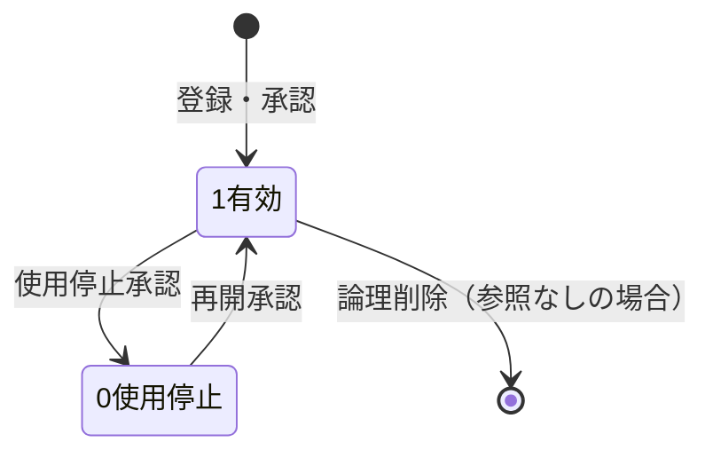
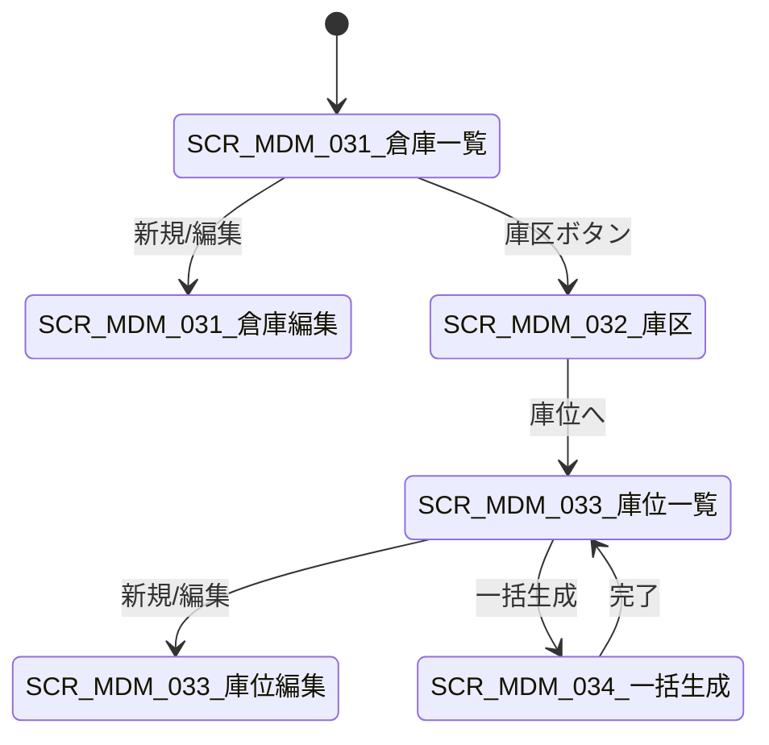

# 仓库・库区・库位管理 详细设计书（倉庫・ロケーション管理 詳細設計書）

| 項目 | 内容 |
|---|---|
| 文書名 | 仓库・库区・库位管理 详细设计书（倉庫・ロケーション管理 詳細設計書） |
| 文書番号 | DSN-MDM-003 |
| 版数 | v1.0 |
| 作成日 | 2026-10-20 |
| 作成者 | mdm-designer |
| 承認者 | 未承認（レビュー待ち） |
| 状態 | ドラフト（レビュー中） |
| 関連文書 | [業務域概要](00-overview.md) / [共通項目定義](../00-common/01-common-item-definitions.md) / [共通業務規則](../00-common/08-common-business-rules.md) / [跨域流程](../00-common/09-cross-domain-flow.md) / [条码規則](07-substitute-barcode-governance.md) / [DB 設計](90-db-design.md) |

---

## 1. 機能概要

| 項目 | 内容 |
|---|---|
| 機能 ID | F-MDM-006 |
| 機能名 | 仓库・库区・库位管理（含库位一括生成・库位条码） |
| 目的 | 建立库存管理的物理空间主数据：仓库（工厂内独立核算/管理単位）→ 库区（功能区域）→ 货架 → 层 → 库位（最小保管単位）の 5 階層を定義し、INV の入出庫・棚卸・引当・批次管理が一意のロケーションで処理できるようにする。库位编码は 08 第 2.2 節の形式に従い、库位条码を発行して PDA/ハンディ端末の運用に供する |
| 利用者・ロール | 倉庫管理員（仓储部）、系統管理員、在庫・購買・生産・販売の参照ユーザ |
| 利用シーン | 新倉庫の開設、棚卸エリアの再編、保管条件別の庫区設定、庫位ラベルの一括発行、倉庫の使用停止 |
| 優先度 | P0 |
| 画面 ID | SCR-MDM-031〜034 |
| 関連 IF | IF-MDM-007（PDA/WMS 庫位マスタ同期） |
| 関連機能 | F-MDM-025 工厂主数据（本域 4.4.4。Lead 裁定 2026-10-20：工厂主数据归 MDM）/ F-MDM-021 工廠視図 |

## 2. 業務要件・業務ルール

### 2.1 前提条件

| # | 前提条件 | 成立しない場合の挙動 |
|---|---|---|
| 1 | 工廠（`mdm_factory`）が登録済みで有効 | 倉庫登録不可 `MSG-MDM-071` |
| 2 | 倉庫管理者（`sys_user`）が有効 | 選択不可 |
| 3 | INV の在庫取引・残高が当該倉庫を参照していない（使用停止時） | 使用停止不可 `MSG-MDM-075` |
| 4 | 条码規則（`mdm_barcode_rule`）が有効（库位标签発行時） | 発行不可 `MSG-MDM-078` |

### 2.2 業務ルール

| # | ルール | 根拠 | 関連項目 |
|---|---|---|---|
| BR-WH-01 | 倉庫編碼は `WH` + 2 桁（`WH01`〜）。拠点・用途で意味付けし、変更不可 | 08 第 2.2 節 | `warehouse_code` |
| BR-WH-02 | 庫位編碼は `{倉庫}-{庫区}-{棚}-{層}-{位}`（例 `WH01-A-01-02-03`）。一括生成時は規則に従い連番を振る | 08 第 2.2 節 | `bin_code` |
| BR-WH-03 | 倉庫は 1 以上の庫区を持ち、庫区は 1 以上の庫位を持つ。庫位のない庫区には在庫を置けない | 倉庫管理の慣行 | `mdm_warehouse_zone`、`mdm_warehouse_bin` |
| BR-WH-04 | 倉庫種別は在庫の会計・品質扱いを決める：`10 原料倉/20 半製品倉/30 製品倉/40 待検倉/50 不合格品倉/60 寄託倉/70 在途倉/80 委外倉` | 09 第 7.1 節の在庫状態と整合 | `warehouse_type` |
| BR-WH-05 | 待検倉・不合格品倉は「品質状態」を表す仮想倉庫として扱い、入出庫は状態変換取引（`ST_IN`/`ST_OUT`）で行う（[09 §7.1](../00-common/09-cross-domain-flow.md)） | 09 第 7.1・8 章 | `warehouse_type` |
| BR-WH-06 | マイナス在庫の許可は倉庫単位（`allow_negative_stock`）で既定を定め、物料単位の設定（`mdm_material.is_negative_stock_allowed`）と AND 条件で判定する。P0 は両方 false を既定 | 08 第 6.1 節 | `allow_negative_stock` |
| BR-WH-07 | 保管条件（常温/防潮/防尘/冷藏/危险品）は倉庫・庫区・庫位で定義し、物料の `storage_condition` と矛盾する場合は入庫時に警告（移動は可） | 安全在庫管理の慣行 | `storage_condition` |
| BR-WH-08 | 同一庫位に異なる物料を混在させる場合は `is_mixed_material_allowed=TRUE` が必要。異なる批次の混在は `is_mixed_batch_allowed=TRUE` が必要（シリアル管理品は混在不可） | 在庫精度確保の慣行 | `is_mixed_*_allowed` |
| BR-WH-09 | 倉庫の使用停止は在庫残高 0・未完了の入出庫指示 0・棚卸中でないこと。停止後も過去取引の参照は可 | 08 第 11 章 | `status` |
| BR-WH-10 | 庫位の削除は在庫残高 0 かつ予約 0 の場合のみ。使用停止（`is_active=false`）で運用し、履歴参照は保持する | 01 共通項目定義 11.2 | `is_active` |
| BR-WH-11 | 庫位ラベルは Code 128（ISO/IEC 15417）または GS1-128 を使用し、内容は `bin_code` を 1 次元コード化する。ラベルには倉庫名・庫区名・棚番を印字する | 【実データ】ISO/IEC 15417:2007《信息技术 自动识别与数据采集技术 Code 128 条码符号规范》 | `bin_barcode` |
| BR-WH-12 | 倉庫・庫区・庫位の変更は F-MDM-018 の変更申請（一般変更）で記録し、`sys_audit_log` に前後値を残す。削除は論理削除（`deleted=TRUE`） | 08 第 11 章 | — |
| BR-WH-13 | 工場（`factory_id`）は倉庫に必須。同一工場内で倉庫コードは一意 | 04 DB 共通規格 14 章 | `factory_id` |
| BR-WH-14 | 既定入庫庫位・既定出庫庫位は倉庫に 1 つずつ設定でき、INV の入出庫提案に使用する | 倉庫運用の慣行 | `default_receiving_bin_id`、`default_issue_bin_id` |
| BR-WH-15 | 倉庫・庫区・庫位の確定変更（登録・更新・使用停止）時に領域事件 **E39 `mdm.warehouse.changed`** を Outbox に記録して発行する（09 第 3 章）。ペイロード：`warehouseId, warehouseCode, warehouseName, factoryId, warehouseType, status, changedFields` | 09 第 3 章 E39 | `status`、`is_active` |

### 2.3 計算式・判定式

| # | 対象 | 算式 | 丸め | 例 |
|---|---|---|---|---|
| CALC-WH-01 | 庫位容積 | 長さ × 幅 × 高さ（mm→m³） | 6 桁 | 【示例値】1,200×800×1,500mm = 1.440000 MTQ |
| CALC-WH-02 | 庫位重量上限使用率 | 現在保管重量 ÷ `max_weight_kg` | 2 桁 % | 【示例値】420 ÷ 1,000 = 42.00% |
| CALC-WH-03 | 倉庫収容率 | 使用済庫位数 ÷ 有効庫位数 | 2 桁 % | 【示例値】1,860 ÷ 2,400 = 77.50% |
| CALC-WH-04 | 庫位コード生成 | `{WH}-{ZONE}-{SHELF:02}-{LEVEL:02}-{POS:02}` | ゼロ埋め | WH01-A-01-02-03 |

### 2.4 状態遷移



| 遷移 | トリガ | 権限 | 更新項目 | メッセージ |
|---|---|---|---|---|
| 新規→1 | 登録承認 | `mdm:warehouse:update` | `status=1` | MSG-MDM-070 |
| 1→0 | 使用停止承認 | `mdm:warehouse:update` | `status=0`、`deactivate_reason` | MSG-MDM-075 |
| 庫位 1→0 | 使用停止 | `mdm:warehouse:update` | `is_active=FALSE` | MSG-MDM-076 |

## 3. 関連機能

| 関係 | 機能 ID | 機能名 | 関係内容 |
|---|---|---|---|
| 参照 | F-MDM-002 | 物料主数据 | 既定倉庫・既定庫位・保管条件 |
| 参照 | F-MDM-025 | 工廠主数据 | 倉庫の所属工廠（Lead 裁定：工厂主数据归 MDM） |
| 参照 | F-MDM-021 | 工廠視図 | 倉庫の所属工廠 |
| 参照 | F-MDM-017 | 条码規則 | 庫位ラベルの条码規則 |
| 参照 | F-MDM-018 | 変更審批 | 倉庫・庫位変更の記録 |
| 下流 | F-INV-001/002/003 | 庫存照会・入出庫・移動 | 入出庫のロケーション指定・在庫残高单位 |
| 下流 | F-INV-010 | 棚卸 | 棚卸対象庫位の決定 |
| 下流 | F-PUR-004/007 | 受入・入庫 | 受入倉庫（待検倉）の決定 |
| 下流 | F-SAL-003/005 | 出荷・出庫 | 引当倉庫・出庫庫位の決定 |
| 下流 | F-PRD-003/004 | 材料払出・完成品入庫 | 倒冲倉庫・完成品倉庫 |

## 4. 画面設計

### 4.1 画面一覧

| 画面 ID | 画面名 | 類型 | 概要 |
|---|---|---|---|
| SCR-MDM-031 | 仓库一覧/登録編集 | 一覧検索/登録編集 | 倉庫の CRUD、既定庫位・在庫許可設定 |
| SCR-MDM-032 | 库区登録編集 | 登録編集 | 倉庫配下の庫区 CRUD |
| SCR-MDM-033 | 库位一覧/登録編集 | 一覧検索/登録編集 | 庫位の CRUD、条码、容量、混在可否 |
| SCR-MDM-034 | 库位一括生成ウィザード | ウィザード | 棚・層・位を指定して庫位コード・ラベルを一括生成 |
| SCR-MDM-098 | 工厂一覧/登録編集 | 一覧検索/登録編集 | 工場の CRUD（MDM 所有。SYS 組織設定は参照のみ） |

### 4.2 画面遷移



### 4.3 画面レイアウト

**SCR-MDM-033 库位一覧**

```
┌────────────────────────────────────────────────────────────────────────────┐
│ パンくず：ホーム > 主数据 > 仓库 > 库位        [新規][一括生成][ラベル印刷]  │
├────────────────────────────────────────────────────────────────────────────┤
│〔検索条件〕倉庫[▼] 庫区[▼] 库位コード[______] 種別[▼] 有効[▼] [検索]       │
├────────────────────────────────────────────────────────────────────────────┤
│〔一覧〕库位コード | 倉庫 | 庫区 | 棚 | 層 | 位 | 種別 | 容積 | 重量上限 | 状態│
│        WH01-A-01-02-03 | 原料倉 | A | 01 | 02 | 03 | 保管 | 1.44 | 1000 | 有効│
├────────────────────────────────────────────────────────────────────────────┤
│〔フッタ〕全 2,400 件 1/120 ページ   [<][1][2]…[>]                          │
└────────────────────────────────────────────────────────────────────────────┘
```

### 4.4 画面項目定義

#### 4.4.1 仓库 SCR-MDM-031（一覧検索・編集）

| No | 項目 ID | 項目名 | 区分 | 種別 | 型/桁 | 必須 | 初期値 | 入力チェック | データソース | DB 項目 | 権限 | 備考 |
|---|---|---|---|---|---|---|---|---|---|---|---|---|
| 1 | `keyword` | 倉庫コード・名称 | 検索 | テキスト | VARCHAR(64) | — | 空 | ≤ 64 字 | 入力 | warehouse_code/name | 参照可 | — |
| 2 | `factoryId` | 工廠 | 検索 | 選択 | BIGINT | — | ログイン既定 | 有効工廠 | マスタ | factory_id | 参照可 | データ権限 |
| 3 | `warehouseType` | 倉庫種別 | 検索 | 選択（複数） | SMALLINT | — | 空 | 10〜80 | 固定値 | warehouse_type | 参照可 | — |
| 4 | `status` | 状態 | 検索 | 選択 | SMALLINT | — | 1 | 1/0 | 固定値 | status | 参照可 | — |
| 5 | `warehouse_code` | 倉庫コード | 編集 | テキスト | VARCHAR(8) | ○ | 空 | `WH`+2 桁・一意 | 入力/採番 | warehouse_code | `mdm:warehouse:update` | 変更不可 |
| 6 | `warehouse_name` | 倉庫名 | 編集 | テキスト | VARCHAR(100) | ○ | 空 | 1〜100 字 | 入力 | warehouse_name | 同上 | 例：原料倉 |
| 7 | `warehouse_type` | 倉庫種別 | 編集 | 選択 | SMALLINT | ○ | 10 | 10〜80 | 固定値 | warehouse_type | 同上 | 種別で在庫状態を決定 |
| 8 | `factory_id` | 工廠 | 編集 | 選択 | BIGINT | ○ | ログイン工廠 | 有効工廠 | マスタ | factory_id | 同上 | — |
| 9 | `address` | 所在地 | 編集 | テキスト | VARCHAR(200) | — | 空 | ≤ 200 字 | 入力 | address | 同上 | — |
| 10 | `manager_user_id` | 倉庫責任者 | 編集 | ユーザ選択 | BIGINT | — | 空 | 有効ユーザ | SYS | manager_user_id | 同上 | — |
| 11 | `phone` | 電話 | 編集 | テキスト | VARCHAR(32) | — | 空 | ≤ 32 字 | 入力 | phone | 同上 | マスキング |
| 12 | `is_physical` | 物理倉庫 | 編集 | チェック | BOOLEAN | — | TRUE | — | 入力 | is_physical | 同上 | 仮想倉庫は FALSE |
| 13 | `is_consignment` | 寄託倉庫 | 編集 | チェック | BOOLEAN | — | FALSE | — | 入力 | is_consignment | 同上 | — |
| 14 | `allow_negative_stock` | マイナス在庫許可 | 編集 | チェック | BOOLEAN | — | FALSE | 物料設定と AND | 入力 | allow_negative_stock | 同上 | P0 は FALSE 推奨 |
| 15 | `storage_condition` | 保管条件 | 編集 | 選択 | VARCHAR(32) | — | 常温 | 常温/防潮/防尘/冷藏/危险品 | 入力 | storage_condition | 同上 | — |
| 16 | `default_receiving_bin_id` | 既定入庫庫位 | 編集 | 庫位選択 | BIGINT | — | 空 | 倉庫所属・有効 | マスタ | default_receiving_bin_id | 同上 | — |
| 17 | `default_issue_bin_id` | 既定出庫庫位 | 編集 | 庫位選択 | BIGINT | — | 空 | 倉庫所属・有効 | マスタ | default_issue_bin_id | 同上 | — |
| 18 | `area_m2` | 面積 | 編集 | 数値 | NUMERIC(18,2) | — | 空 | ≥ 0 | 入力 | area_m2 | 同上 | m² |
| 19 | `status` | 状態 | 編集 | 選択 | SMALLINT | ○ | 1 | 1/0（0 は承認経由） | 承認制御 | status | 同上 | — |
| 20 | `remark` | 備考 | 編集 | テキストエリア | VARCHAR(500) | — | 空 | ≤ 500 字 | 入力 | remark | 同上 | — |

#### 4.4.2 库区 SCR-MDM-032

| No | 項目 ID | 項目名 | 種別 | 型/桁 | 必須 | 初期値 | 入力チェック | DB 項目 | 備考 |
|---|---|---|---|---|---|---|---|---|---|
| 1 | `zone_code` | 庫区コード | テキスト | VARCHAR(8) | ○ | 空 | 1〜8 字（A〜Z、数字）・倉庫内一意 | zone_code | 例 A/B/C |
| 2 | `zone_name` | 庫区名 | テキスト | VARCHAR(100) | ○ | 空 | 1〜100 字 | zone_name | 例：A 区 |
| 3 | `warehouse_id` | 倉庫 | 選択 | BIGINT | ○ | 呼出元 | 有効倉庫 | warehouse_id | 変更不可 |
| 4 | `zone_type` | 庫区種別 | 選択 | SMALLINT | ○ | 10 保管 | 10 保管/20 ピッキング/30 入荷/40 出荷/50 待検/60 凍結/70 不合格/80 返品 | zone_type | — |
| 5 | `floor_no` | 階 | 数値 | SMALLINT | — | 1 | 1〜99 | floor_no | — |
| 6 | `area_m2` | 面積 | 数値 | NUMERIC(18,2) | — | 空 | ≥ 0 | area_m2 | m² |
| 7 | `is_picking_zone` | ピッキング対象 | チェック | BOOLEAN | — | FALSE | — | is_picking_zone | — |
| 8 | `status` | 状態 | 選択 | SMALLINT | ○ | 1 | 1/0 | status | — |

#### 4.4.3 库位 SCR-MDM-033（一覧・編集）

| No | 項目 ID | 項目名 | 区分 | 種別 | 型/桁 | 必須 | 初期値 | 入力チェック | データソース | DB 項目 | 権限 | 備考 |
|---|---|---|---|---|---|---|---|---|---|---|---|---|
| 1 | `warehouseId` | 倉庫 | 検索 | 選択 | BIGINT | — | 空 | 有効倉庫 | マスタ | warehouse_id | 参照可 | — |
| 2 | `zoneId` | 庫区 | 検索 | 選択 | BIGINT | — | 空 | 倉庫配下 | マスタ | zone_id | 参照可 | — |
| 3 | `binCode` | 庫位コード | 検索 | テキスト | VARCHAR(64) | — | 空 | 前方一致 | 入力 | bin_code | 参照可 | — |
| 4 | `binType` | 庫位種別 | 検索 | 選択（複数） | SMALLINT | — | 空 | 10 保管/20 ピッキング/30 入荷/40 出荷/50 待検/60 凍結/70 不合格 | 固定値 | bin_type | 参照可 | — |
| 5 | `is_mixed_material_allowed` | 混在可否（物料） | 検索 | 選択 | BOOLEAN | — | 空 | true/false | 固定値 | is_mixed_material_allowed | 参照可 | — |
| 6 | `isActive` | 有効 | 検索 | 選択 | BOOLEAN | — | true | true/false | 固定値 | is_active | 参照可 | — |
| 7 | `bin_code` | 庫位コード | 編集 | テキスト | VARCHAR(64) | ○ | 自動生成 | `{WH}-{ZONE}-{SHELF}-{LEVEL}-{POS}`・一意 | 採番/入力 | bin_code | `mdm:warehouse:update` | 一括生成推奨 |
| 8 | `bin_name` | 庫位名 | 編集 | テキスト | VARCHAR(100) | — | 空 | ≤ 100 字 | 入力 | bin_name | 同上 | — |
| 9 | `warehouse_id` | 倉庫 | 編集 | 選択 | BIGINT | ○ | 呼出元 | 有効倉庫 | マスタ | warehouse_id | 同上 | — |
| 10 | `zone_id` | 庫区 | 編集 | 選択 | BIGINT | ○ | 呼出元 | 倉庫配下の有効庫区 | マスタ | zone_id | 同上 | — |
| 11 | `shelf_code` | 棚番 | 編集 | テキスト | VARCHAR(8) | ○ | 01 | 2 桁（01〜99 or A1〜） | 入力 | shelf_code | 同上 | — |
| 12 | `level_no` | 層 | 編集 | 数値 | SMALLINT | ○ | 1 | 1〜99 | 入力 | level_no | 同上 | — |
| 13 | `position_no` | 位 | 編集 | 数値 | SMALLINT | ○ | 1 | 1〜99 | 入力 | position_no | 同上 | — |
| 14 | `bin_type` | 庫位種別 | 編集 | 選択 | SMALLINT | ○ | 10 保管 | 10〜70 | 固定値 | bin_type | 同上 | — |
| 15 | `max_weight_kg` | 重量上限 | 編集 | 数値 | NUMERIC(18,4) | — | 空 | ≥ 0 | 入力 | max_weight_kg | 同上 | KGM |
| 16 | `max_volume_mtq` | 容積上限 | 編集 | 数値 | NUMERIC(18,6) | — | 空 | ≥ 0 | 入力 | max_volume_mtq | 同上 | MTQ |
| 17 | `length_mm` / `width_mm` / `height_mm` | 寸法 | 編集 | 数値 | INT | — | 空 | ≥ 0 | 入力 | 各列 | 同上 | mm |
| 18 | `abc_class` | ABC 区分 | 編集 | 選択 | VARCHAR(1) | — | 空 | A/B/C | 入力 | abc_class | 同上 | ピッキング最適化 |
| 19 | `is_mixed_material_allowed` | 物料混在可 | 編集 | チェック | BOOLEAN | — | FALSE | — | 入力 | is_mixed_material_allowed | 同上 | — |
| 20 | `is_mixed_batch_allowed` | 批次混在可 | 編集 | チェック | BOOLEAN | — | FALSE | シリアル管理品は混在不可 | 入力 | is_mixed_batch_allowed | 同上 | — |
| 21 | `storage_condition` | 保管条件 | 編集 | 選択 | VARCHAR(32) | — | 倉庫の値 | 倉庫と矛盾する場合は警告 | 入力 | storage_condition | 同上 | — |
| 22 | `bin_barcode` | 庫位条码 | 編集 | テキスト | VARCHAR(100) | — | 空 | Code 128・一意 | 生成 | bin_barcode | 同上 | ラベル印刷 |
| 23 | `is_active` | 有効 | 編集 | チェック | BOOLEAN | ○ | TRUE | — | 入力 | is_active | 同上 | — |

#### 4.4.4 工厂 SCR-MDM-098（F-MDM-025、Lead 裁定：工厂主数据归 MDM）

| No | 項目 ID | 項目名 | 種別 | 型/桁 | 必須 | 初期値 | 入力チェック | DB 項目 | 権限 | 備考 |
|---|---|---|---|---|---|---|---|---|---|---|
| 1 | `factory_code` | 工厂编码 | テキスト | VARCHAR(8) | ○ | 空 | 2〜8 字（例 CZ01/WX01）・一意 | factory_code | `mdm:factory:update` | 変更不可 |
| 2 | `factory_name` | 工厂名称 | テキスト | VARCHAR(100) | ○ | 空 | 1〜100 字 | factory_name | 同上 | — |
| 3 | `plant_type` | 工厂类型 | 選択 | SMALLINT | — | 10 总装 | 10 总装/20 零部件/30 其他 | plant_type | 同上 | — |
| 4 | `address` | 所在地 | テキスト | VARCHAR(200) | — | 空 | ≤ 200 字 | address | 同上 | — |
| 5 | `manager_user_id` | 工厂负责人 | ユーザ選択 | BIGINT | — | 空 | 有効ユーザ | manager_user_id | 同上 | — |
| 6 | `is_active` | 有効 | チェック | BOOLEAN | ○ | TRUE | — | is_active | 同上 | FALSE で業務対象外 |
| 7 | `btn_save` | 保存 | ボタン | — | — | — | 二重送信防止 | — | 同上 | 監査ログ記録 |

> 工厂マスタは SYS の F-SYS-014（公司/工厂组织设置）が参照するのみで、更新責任は MDM（F-MDM-025）。倉庫・データ権限・工廠視図は `mdm_factory.factory_code` を権限キーとして参照する。

### 4.5 イベント処理

| No | イベント | トリガ | 処理内容 | 呼出 API | 画面遷移 | 備考 |
|---|---|---|---|---|---|---|
| 1 | 倉庫選択 | 倉庫変更 | 庫区一覧を絞込み | `GET /api/mdm/warehouses/{id}/zones` | 同一画面 | — |
| 2 | 庫区選択 | 庫区変更 | 庫位一覧を絞込み | `GET /api/mdm/warehouse-bins?zoneId=` | 同一画面 | — |
| 3 | 一括生成 | ウィザード「生成」 | プレビュー→重複チェック→一括 INSERT | `POST /api/mdm/warehouse-bins/batch-generate` | 一覧へ | 最大 5,000 件 |
| 4 | ラベル印刷 | ボタン | 条码ルール取得→PDF 生成 | `POST /api/mdm/warehouse-bins/labels` | プレビュー | 最大 500 枚/回 |
| 5 | 使用停止 | ボタン | 在庫残高・予約チェック→承認 | `POST /api/mdm/warehouses/{id}/deactivate` | 一覧へ | 参照中は不可 |
| 6 | 保存 | 保存 | 入力チェック→INSERT/UPDATE→監査ログ | `POST/PUT /api/mdm/warehouses` 等 | 一覧へ | 楽観排他 |

### 4.6 一覧画面仕様（SCR-MDM-033）

| 項目 | 内容 |
|---|---|
| 検索条件 | 4.4.3 No.1〜6。既定：有効のみ |
| ソート | 既定 `bin_code ASC`（物理配置順）。倉庫→庫区→棚→層→位の順にソート |
| ページング | 20/50/100/200（既定 50） |
| 一括操作 | 使用停止、ラベル一括印刷、エクスポート。上限 5,000 件 |
| エクスポート | Excel、10,000 件まで。庫位マスタの外部連携用 CSV も可 |
| 印刷 | PRT-MDM-013 库位ラベル（A4 シート 24 面 or ラベルプリンタ） |

### 4.7 表示制御

| 条件 | 対象 | 制御 |
|---|---|---|
| 権限 `mdm:warehouse:update` なし | 新規・編集・一括生成・停止ボタン | 非表示 |
| 倉庫 `status=0` | 庫区・庫位の新規追加 | 不可（メッセージ表示） |
| 他工場の倉庫 | 一覧・詳細 | データ権限で非表示 |
| 在庫残高 > 0 の庫位 | 削除 | 不可（使用停止のみ） |
| シリアル管理品が保管されている庫位 | 批次混在設定 | 変更時警告 |

## 5. 入力チェック仕様

| No | チェック ID | 対象項目 | 種別 | 条件 | タイミング | メッセージ ID |
|---|---|---|---|---|---|---|
| 1 | CHK-MDM-006-01 | `warehouse_code` | 形式/一意 | `WH`+2 桁、工場内一意 | 保存時 | MSG-MDM-071 |
| 2 | CHK-MDM-006-02 | `warehouse_name` | 必須 | 1〜100 字 | 保存時 | MSG-COM-040 |
| 3 | CHK-MDM-006-03 | `factory_id` | コード存在 | 有効工廠 | 保存時 | MSG-COM-049 |
| 4 | CHK-MDM-006-04 | `warehouse_type` | 範囲 | 10〜80 | 保存時 | MSG-COM-044 |
| 5 | CHK-MDM-006-05 | `default_receiving_bin_id` | 相関 | 同一倉庫の有効庫位 | 保存時 | MSG-MDM-072 |
| 6 | CHK-MDM-006-06 | `zone_code` | 形式/一意 | 倉庫内一意、英数字 | 保存時 | MSG-MDM-073 |
| 7 | CHK-MDM-006-07 | `bin_code` | 形式/一意 | 08 の形式、公司内一意 | 保存時 | MSG-MDM-074 |
| 8 | CHK-MDM-006-08 | `shelf_code`/`level_no`/`position_no` | 範囲 | 各 1〜99 | 保存時 | MSG-COM-044 |
| 9 | CHK-MDM-006-09 | 使用停止 | 業務 | 在庫残高 0・未完了指示 0 | 停止時 | MSG-MDM-075 |
| 10 | CHK-MDM-006-10 | 庫位削除 | 業務 | 在庫 0・予約 0 | 削除時 | MSG-MDM-076 |
| 11 | CHK-MDM-006-11 | `storage_condition` | 相関 | 庫区/倉庫との矛盾は警告 | 保存時 | MSG-MDM-077（W） |
| 12 | CHK-MDM-006-12 | 一括生成件数 | 上限 | 1〜5,000 件 | 生成時 | MSG-MDM-079 |
| 13 | CHK-MDM-006-13 | ラベル印刷 | 上限 | 1〜500 枚 | 印刷時 | MSG-MDM-080 |

## 6. 処理詳細

### 6.1 処理一覧

| 処理 ID | 処理名 | 契機 | トランザクション | 排他 |
|---|---|---|---|---|
| PRC-MDM-006-01 | 倉庫登録・更新 | 保存 | 要 | 楽観排他 |
| PRC-MDM-006-02 | 庫区登録・更新 | 保存 | 要 | 楽観排他 |
| PRC-MDM-006-03 | 庫位登録・更新 | 保存 | 要 | 楽観排他 |
| PRC-MDM-006-04 | 庫位一括生成 | ウィザード | 要（全件成功 or 全件失敗） | 一意制約 + 事前チェック |
| PRC-MDM-006-05 | 倉庫使用停止 | 承認後 | 要＋参照チェック | 行ロック |
| PRC-MDM-006-06 | 庫位ラベル生成 | 印刷 | 不要（参照のみ） | — |

### 6.2 処理手順（正常系）

**PRC-MDM-006-04 庫位一括生成**

1. 権限・データ範囲（工場）をチェックする。
2. 入力：倉庫、庫区、棚範囲（`shelf_from`〜`shelf_to`）、層範囲（`level_from`〜`level_to`）、位範囲（`position_from`〜`position_to`）、命名規則（ゼロ埋め桁）を受け取る。
3. 生成件数 = 棚数 × 層数 × 位数 を計算し、1〜5,000 件の範囲をチェックする（`MSG-MDM-079`）。
4. 生成コード一覧を作成し、既存 `bin_code` との重複を一括チェックする。1 件でも重複があれば全体を中止し、重複一覧を返す（全件失敗方式）。
5. プレビュー結果を画面に返す（ユーザ確認）。
6. 実行時、`mdm_warehouse_bin` にバルク INSERT する（`is_active=TRUE`、`bin_type` は既定 10 保管）。
7. 条码ルール（`mdm_barcode_rule.rule_code=LOCATION`）に従い `bin_barcode` を生成する（Code 128 の内容は `bin_code`）。
8. 監査ログに「一括生成（N 件、倉庫、庫区）」を記録し、生成結果を返す。

**PRC-MDM-006-05 倉庫使用停止**

1. 参照チェック：`inv_stock_balance` に当該倉庫の在庫残高（数量≠0）があるか、`inv_stock_txn` に未確定取引があるか、棚卸（`inv_count`）が進行中でないかを確認する。
2. 参照があれば `MSG-MDM-075` を返して停止不可。
3. 承認申請（F-MDM-018 一般変更）へ提出し、承認後に `status=0`。
4. `sys_audit_log` に前後値を記録する。

### 6.3 例外処理

| No | 異常条件 | 検知箇所 | 処理 | ロールバック | メッセージ ID |
|---|---|---|---|---|---|
| 1 | 庫位コード重複（一括生成） | 事前チェック | 全件中止・重複一覧返却 | 全体 | MSG-MDM-074 |
| 2 | 庫区に庫位がない | 倉庫使用停止時 | 警告（強制停止は不可） | 全体 | MSG-MDM-075 |
| 3 | 在庫残高ありの庫位削除 | 削除時 | エラー、使用停止案内 | 全体 | MSG-MDM-076 |
| 4 | 既定庫位が他倉庫 | 保存時 | エラー | 全体 | MSG-MDM-072 |
| 5 | 保管条件不一致 | 保存時 | 警告のみ | なし | MSG-MDM-077（W） |
| 6 | ラベル印刷上限超過 | 印刷時 | エラー | なし | MSG-MDM-080 |
| 7 | 楽観排他競合 | version | 409 | 全体 | MSG-COM-033 |

### 6.4 冪等性・再実行

- 一括生成は同一入力の再実行で重複エラーとなるため、冪等ではない。実行前にプレビューし、生成結果を履歴に残す。
- 倉庫使用停止・更新は再実行可能（状態再判定）。
- ラベル印刷は何度でも再発行可能（印刷履歴を `sys_audit_log` に記録）。

## 7. API 設計

| No | メソッド | パス | 権限 | 概要 | リクエスト | レスポンス |
|---|---|---|---|---|---|---|
| 1 | GET | `/api/mdm/warehouses` | `mdm:warehouse:view` | 倉庫一覧 | 検索条件 | `PageResult<WarehouseListDto>` |
| 2 | GET | `/api/mdm/warehouses/{id}` | `mdm:warehouse:view` | 倉庫詳細 | id | `WarehouseDetailDto` |
| 3 | POST | `/api/mdm/warehouses` | `mdm:warehouse:update` | 倉庫登録 | `WarehouseRequest` | `WarehouseDetailDto` |
| 4 | PUT | `/api/mdm/warehouses/{id}` | `mdm:warehouse:update` | 倉庫更新 | `WarehouseRequest`（version） | `WarehouseDetailDto` |
| 5 | GET | `/api/mdm/warehouses/{id}/zones` | `mdm:warehouse:view` | 庫区一覧 | id | `List<ZoneDto>` |
| 6 | POST/PUT | `/api/mdm/warehouse-zones[/{id}]` | `mdm:warehouse:update` | 庫区 CRUD | `ZoneRequest` | `ZoneDto` |
| 7 | GET | `/api/mdm/warehouse-bins` | `mdm:warehouse:view` | 庫位一覧 | 倉庫/庫区/コード | `PageResult<BinListDto>` |
| 8 | GET | `/api/mdm/warehouse-bins/{id}` | `mdm:warehouse:view` | 庫位詳細 | id | `BinDetailDto` |
| 9 | POST/PUT | `/api/mdm/warehouse-bins[/{id}]` | `mdm:warehouse:update` | 庫位 CRUD | `BinRequest` | `BinDetailDto` |
| 10 | POST | `/api/mdm/warehouse-bins/batch-generate` | `mdm:warehouse:update` | 一括生成（プレビュー/実行） | `{warehouseId, zoneId, shelfFrom, shelfTo, levelFrom, levelTo, positionFrom, positionTo, mode}` | `{count, bins[]}` または `{createdCount}` |
| 11 | POST | `/api/mdm/warehouse-bins/labels` | `mdm:warehouse:view` + print | ラベル PDF 生成 | `{binIds[], templateId}` | PDF バイナリ |
| 12 | POST | `/api/mdm/warehouses/{id}/deactivate` | `mdm:warehouse:update` | 使用停止申請 | `{version, reason}` | `ChangeRequestDto` |
| 13 | GET | `/api/mdm/warehouses/options` | `mdm:warehouse:view` | 選択用一覧（他域参照） | factoryId | `List<WarehouseOptionDto>` |
| 14 | GET | `/api/mdm/factories` | `mdm:factory:view` | 工場一覧（他域参照） | — | `List<FactoryDto>` |
| 15 | POST | `/api/mdm/factories` | `mdm:factory:update` | 工場登録 | `FactoryRequest` | `FactoryDto` |
| 16 | PUT | `/api/mdm/factories/{id}` | `mdm:factory:update` | 工場更新 | `FactoryRequest`（version） | `FactoryDto` |

### 7.1 リクエスト/レスポンス詳細

**GET /api/mdm/warehouses/{id} レスポンス例**

```json
{
  "code": 0,
  "message": "ok",
  "data": {
    "id": "1845000000000000301",
    "warehouseCode": "WH01",
    "warehouseName": "原料仓",
    "warehouseType": 10,
    "factoryId": "1845000000000000002",
    "factoryCode": "CZ01",
    "isPhysical": true,
    "allowNegativeStock": false,
    "storageCondition": "常温",
    "defaultReceivingBinId": "1845000000000000401",
    "defaultIssueBinId": "1845000000000000402",
    "zoneCount": 6,
    "binCount": 2400,
    "status": 1,
    "version": 2
  }
}
```

**POST /api/mdm/warehouse-bins/batch-generate リクエスト例**

```json
{
  "warehouseId": "1845000000000000301",
  "zoneId": "1845000000000000311",
  "zoneCode": "A",
  "shelfFrom": 1,
  "shelfTo": 2,
  "levelFrom": 1,
  "levelTo": 3,
  "positionFrom": 1,
  "positionTo": 4,
  "mode": "EXECUTE"
}
```

## 8. データ更新仕様

| テーブル | 操作 | 更新項目 | 更新条件 | トリガ |
|---|---|---|---|---|
| `mdm_warehouse` | INSERT/UPDATE | 倉庫属性、`status` | 登録・更新・停止 | PRC-MDM-006-01/05 |
| `mdm_warehouse_zone` | INSERT/UPDATE/DELETE | 庫区属性 | 画面操作 | PRC-MDM-006-02 |
| `mdm_warehouse_bin` | INSERT/UPDATE/DELETE | 庫位属性、`is_active` | 画面操作・一括生成 | PRC-MDM-006-03/04 |
| `mdm_warehouse_bin` | UPDATE | `bin_barcode` | 条码生成 | PRC-MDM-006-04/06 |
| `sys_audit_log` | INSERT | CREATE/UPDATE/DELETE/IMPORT/PRINT | 全操作 | 全処理 |

## 9. エラー処理・メッセージ

| メッセージ ID | 種別 | 本文 | 発生条件 | 利用者への対処 | ログ |
|---|---|---|---|---|---|
| MSG-MDM-070 | I | 倉庫「{0}」を登録しました。 | 登録完了 | — | INFO |
| MSG-MDM-071 | E | 倉庫コードは `WH`＋2 桁で入力してください。既に使用されている場合は別のコードを使用してください。 | 形式/重複 | 修正 | WARN |
| MSG-MDM-072 | E | 既定庫位は同一倉庫に属する有効な庫位を指定してください。 | 既定庫位不整合 | 修正 | WARN |
| MSG-MDM-073 | E | 庫区コードが不正か、同一倉庫内で重複しています。 | 庫区コード不正 | 修正 | WARN |
| MSG-MDM-074 | E | 庫位コードが重複しています（{0} 件）。重複一覧を確認してください。 | 一括生成重複 | 範囲修正 | WARN |
| MSG-MDM-075 | E | 該当倉庫は在庫残高または未完了の入出庫指示があるため使用停止できません。 | 参照中 | 在庫処理を完了 | WARN |
| MSG-MDM-076 | E | 在庫残高または予約がある庫位は削除できません。使用停止を利用してください。 | 庫位削除不可 | 使用停止 | WARN |
| MSG-MDM-077 | W | 庫位の保管条件が倉庫と異なります。保管条件を確認してください。 | 保管条件不一致 | 確認 | INFO |
| MSG-MDM-078 | E | 庫位ラベルの条码規則が設定されていません。条码規則を設定してください。 | 条码規則なし | 設定 | ERROR |
| MSG-MDM-079 | E | 一括生成件数は 1〜5,000 件の範囲で指定してください。 | 件数超過 | 範囲縮小 | WARN |
| MSG-MDM-080 | E | ラベル印刷は 1 回 500 枚までです。分割して実行してください。 | 印刷超過 | 分割 | WARN |

## 10. 権限・セキュリティ

| 種別 | 内容 |
|---|---|
| 画面権限 | `mdm:warehouse:view`（参照）、`mdm:warehouse:update`（登録・更新・一括生成・停止）、`mdm:warehouse:print`（ラベル） |
| データ範囲 | 工廠ロールは自工廠の倉庫のみ操作可（SYS データ権限）。他工廠は参照のみ（設定可） |
| 監査ログ | 倉庫・庫区・庫位の登録/更新/削除/一括生成/ラベル印刷を記録 |
| マスキング | 倉庫責任者の電話はマスキング |

## 11. 性能・非機能

| 項目 | 目標値 | 前提 |
|---|---|---|
| 庫位一覧 | 2 秒以内（200 件） | `idx_mdm_warehouse_bin_warehouse` |
| 一括生成 | 5,000 件 30 秒以内 | バルク INSERT、非同期可否は件数で判断 |
| ラベル生成 | 500 枚 1 分以内 | 非同期ジョブ推奨 |
| 件数 | 倉庫 30、庫区 60、庫位 20,000（5 年） | — |
| 可用性 | 99.5% | — |

## 12. テスト観点

| No | 観点 ID | 分類 | 観点 | 期待結果 |
|---|---|---|---|---|
| 1 | TST-F-MDM-006-01 | 正常系 | 倉庫登録→庫区→庫位 | 5 階層が登録され、一覧に表示 |
| 2 | TST-F-MDM-006-02 | 正常系 | 一括生成 2×3×4=24 件 | 24 件生成、コード形式一致 |
| 3 | TST-F-MDM-006-03 | 異常系 | 一括生成で既存コード含む | 全件中止、重複一覧 |
| 4 | TST-F-MDM-006-04 | 異常系 | 他倉庫の庫位を既定に指定 | MSG-MDM-072 |
| 5 | TST-F-MDM-006-05 | 業務 | 在庫あり倉庫の使用停止 | MSG-MDM-075 |
| 6 | TST-F-MDM-006-06 | 業務 | 在庫あり庫位の削除 | MSG-MDM-076 |
| 7 | TST-F-MDM-006-07 | 権限 | 他工廠の倉庫更新 | 403 |
| 8 | TST-F-MDM-006-08 | 印刷 | 库位ラベル 500 枚 | PDF 生成、条码読取可 |

## 13. 未決事項

| # | 事項 | 理由 | 暫定仕様 | 担当 | 期限 |
|---|---|---|---|---|---|
| 1 | 倉庫コード体系（`WH01`〜）と 90-data の倉庫一覧の突合（**已解消**） | `90-data/demo-company.md` と `warehouse-location.csv` が納品済み（2026-10-20）。全 3 倉庫（`WH01 原料仓`／`WX01`、`WH02 半成品仓`／`CZ01`、`WH03 成品仓`／`CZ01`）のコード・名称・所属工場を確認済み | 06 §10 の `WH01/WH02/WH03` と一致。待機倉・不合格倉は `WH04/WH05` を 第一版で（TODO：設計未作成）検討 | data-researcher（確認済み） | 完了 |
| 2 | 棚卸エリア・入荷エリアを倉庫種別で持つか庫区種別で持つか | INV の棚卸・入荷設計待ち | 倉庫種別（大分類）+ 庫区種別（詳細）の 2 段で表現。INV と再確認 | lead / INV 担当 | 2026-10-24 |
| 3 | 庫位容量チェック（重量・容積）を INV 入庫時に強制するか | INV 設計待ち | 設計確定までは提案・警告のみ（強制しない）。第一版で（TODO：設計未作成）容量制約を有効化 | lead / INV 担当 | 2026-10-30 |
| 4 | PDA/WMS との庫位マスタ同期方式 | IF-MDM-007 | 設計確定までは CSV 連携（F-MDM-022 エクスポート）で代替 | lead / INT 担当 | 2026-11-06 |

## 14. 改訂履歴

| 版数 | 日付 | 変更内容 | 変更者 |
|---|---|---|---|
| v1.0 | 2026-10-20 | 初版：倉庫/庫区/庫位 4 画面、5 階層、一括生成、条码、API、エラー。第 2 次追記（红队第 2 轮 REV-FIN-013）：未決 #1「倉庫コード突合」を解消済み（demo-company.md / warehouse-location.csv の WH01〜WH03 と一致確認） | mdm-designer |
