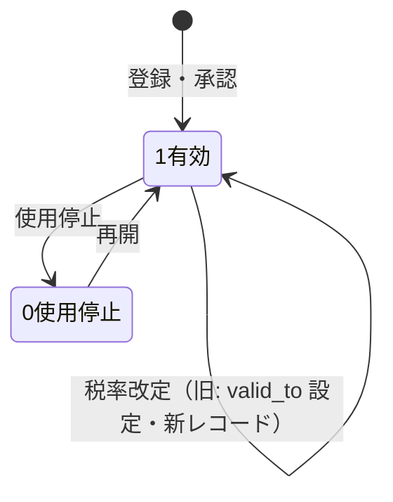
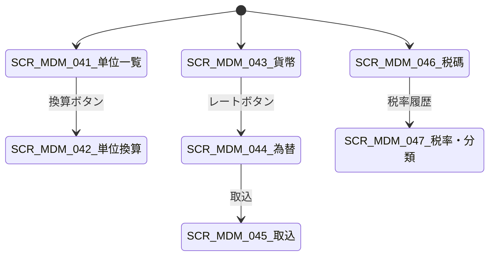

# 计量单位・货币汇率・税码 详细设计书（単位・通貨・税コード 詳細設計書）

| 項目 | 内容 |
|---|---|
| 文書名 | 计量单位・货币汇率・税码 详细设计书（単位・通貨・税コード 詳細設計書） |
| 文書番号 | DSN-MDM-004 |
| 版数 | v1.0 |
| 作成日 | 2026-10-20 |
| 作成者 | mdm-designer |
| 承認者 | 未承認（レビュー待ち） |
| 状態 | ドラフト（レビュー中） |
| 関連文書 | [業務域概要](00-overview.md) / [代码一览](../00-common/06-code-list.md) / [共通項目定義](../00-common/01-common-item-definitions.md) / [共通業務規則](../00-common/08-common-business-rules.md) / [跨域流程](../00-common/09-cross-domain-flow.md) / [DB 設計](90-db-design.md) / [真实资料](../90-data/README.md) |

---

## 1. 機能概要

| 項目 | 内容 |
|---|---|
| 機能 ID | F-MDM-007（計量単位・換算）/ F-MDM-008（通貨・為替レート）/ F-MDM-009（税碼・税率）/ F-MDM-024（標準コード取込） |
| 機能名 | 单位・货币汇率・税码 主数据 |
| 目的 | 提供全業務域共用的「数量の単位」「金額の通貨」「税の区分・税率」の標準マスタ。単位換算により購買単位・販売単位・在庫基本単位を一貫させ、通貨・為替レートにより多通貨取引の換算を可能にし、税碼により中国増値税・附加税・関税・所得税の計算根拠を一元化する。コード値は [06 代码一览](../00-common/06-code-list.md) の実データ（ISO 4217、UN/ECE Rec20、GB/T 3100、現行税制）に準拠する |
| 利用者・ロール | 財務主データ担当（税碼・為替）、系統管理員（単位・通貨）、購買/販売担当（参照） |
| 利用シーン | 新単位の追加、購買/販売単位の換算設定、月次為替レートの取込、税率改定時の新税碼発行、輸出取引の多通貨対応 |
| 優先度 | P0（F-MDM-007/008/009）、P1（F-MDM-024） |
| 画面 ID | SCR-MDM-041〜047 |
| 関連 IF | IF-MDM-001（為替レート取込）、IF-MDM-002（聯行号取込）、IF-MDM-003（標準コード取込）、IF-MDM-006（税コード取込） |

## 2. 業務要件・業務ルール

### 2.1 前提条件

| # | 前提条件 | 成立しない場合の挙動 |
|---|---|---|
| 1 | 会社の記帳本位幣が `CNY`（`mdm_currency.is_base_currency=TRUE` は 1 件のみ） | 保存不可 `MSG-MDM-091` |
| 2 | 単位グループ（`PCS`/`KGM`/`MTR`/`MTQ`/`LTR`/`TIME`）が定義済み | 換算登録不可 |
| 3 | 税碼の基礎税率コード（06 の `VAT13` 等）が存在 | 税碼登録不可 `MSG-MDM-096` |
| 4 | 為替レート取込ファイルの形式がテンプレートに一致 | 取込エラー `MSG-COM-062` |

### 2.2 業務ルール（計量単位）

| # | ルール | 根拠 | 関連項目 |
|---|---|---|---|
| BR-UOM-01 | 単位コードは UN/ECE Recommendation 20 のコードを使用する（例：`C62` 件、`KGM` 千克、`MTR` 米、`MTQ` 立方米、`LTR` 升、`HUR` 小时）。中国国内慣用コード `PCE` は `C62` と同一数量として換算する | 【実データ】UN/ECE Recommendation 20；06 §6 | `uom_code`、`conversion_group` |
| BR-UOM-02 | 単位換算は同一グループ内のみ。グループは 90-data `uom.csv` の `conversion_group` を正とし、`PCS`（C62/PCE/DZN）・`SET`・`BOX`・`PK`・`ROL`・`MASS`（KGM/GRM/TNE/MGM）・`LEN`（MTR/CMT/MMT）・`AREA`（MTK）・`VOL`（MTQ/LTR/MLT）・`TIME`（HUR/DAY）・`ENERGY`（KWH）の 11 群とする。異種グループ間の換算は禁止 | 【実データ】90-data/code-lists/uom.csv；08 第 5 章 | `conversion_group` |
| BR-UOM-02b | 包装単位（BOX/PK/ROL）から基本単位（PCE/KGM 等）への換算は、単位マスタの換算ではなく**物料レベル**の `purchase_conversion_rate`/`sales_conversion_rate`（1 包装単位＝n 基本単位）で定義する。例：QZY-2/180 1 ROL=25 KGM【示例値】、六角螺栓 1 BOX=100 PCE【示例値】 | 08 第 5 章 | `mdm_material.purchase_conversion_rate` |
| BR-UOM-03 | 各グループに基本単位を 1 つ定める（`is_base_uom=TRUE`、`PCS`→`C62`、`MASS`→`KGM`、`LEN`→`MTR`、`AREA`→`MTK`、`VOL`→`MTQ`、`TIME`→`HUR`、`ENERGY`→`KWH`）。換算率は「1 単位 = n 基本単位」で保持し、小数 8 桁 | 08 第 5 章、90-data uom.csv | `conversion_rate` |
| BR-UOM-04 | 数量の保持精度は単位ごとに `decimal_places`（0〜4）で定義する。金額計算時の数量は DB では 4 桁保持し、表示・丸めは単位精度に従う | 01 共通項目定義 第 6 章 | `decimal_places` |
| BR-UOM-05 | 換算率の変更は有効期間付きの新レコードで管理し、既存伝票は登録時点の換算率をスナップショット保持する | 08 第 5 章 | `valid_from`/`valid_to` |
| BR-UOM-06 | 使用中の単位（物料・伝票が参照）は削除不可。使用停止（`status=0`）は新規選択不可、既存参照は可 | 01 共通項目定義 11.2 | `status` |
| BR-UOM-07 | 単位グループの変更は不可（変更は新単位コード発行）。基本単位の変更は全物料・在庫への影響があるため、移行手順を伴う変更申請とする | データ移行の安全確保 | `conversion_group` |

### 2.3 業務ルール（通貨・為替）

| # | ルール | 根拠 | 関連項目 |
|---|---|---|---|
| BR-CUR-01 | 通貨コードは ISO 4217 の 3 文字コード（`CNY`/`USD`/`EUR`/`JPY` 等）。小数桁は ISO 4217 の minor unit に従う（JPY/KRW は 0 桁） | 【実データ】ISO 4217；06 §3 | `currency_code`、`decimal_places` |
| BR-CUR-02 | 記帳本位幣は `CNY`（1 件のみ `is_base_currency=TRUE`）。本位幣の為替レートは常に 1 | 08 第 4 章、企業会計政策 | `is_base_currency` |
| BR-CUR-03 | 為替レートは「1 外貨 = n CNY」の直接标价法（中国の慣行）で保持する。間接标价のデータは取込時に逆算する | 中国外貨市場の表示慣行 | `exchange_rate` |
| BR-CUR-04 | レート種別を持つ：`SPOT`（即期レート、業務日基準）、`PERIOD`（期間レート、月初/期末）、`AVG`（期間平均）。用途は FIN が指定する | 08 第 4 章、企業会計基準の外貨換算 | `rate_type` |
| BR-CUR-05 | 同一通貨ペア・同一レート種別・同一有効日は 1 件のみ（upsert）。有効日は業務日付で、未来日のレートは登録できるが業務日が到来するまで使用しない | 為替管理の慣行 | `effective_date` |
| BR-CUR-06 | レートは小数 8 桁で保持し、金額換算は「外貨金額 × レート → 2 桁丸め（四捨五入）」の順で行う。換算前後の金額を保持する | 01 共通項目定義 6.2、08 第 4 章 | `exchange_rate` |
| BR-CUR-07 | 為替レートの出所（中国外貨交易中心、銀行牌価、社内レート）を `source` に記録する。社内レートは財務の承認が必要 | 監査要件 | `source` |
| BR-CUR-08 | 為替レートの修正は「新レコード追加 + 旧レコード無効化」で行い、既存伝票のレートは変更しない | 08 第 13.1 節 | `is_active` |

### 2.4 業務ルール（税碼・税率）

| # | ルール | 根拠 | 関連項目 |
|---|---|---|---|
| BR-TAX-01 | 税碼は 06 §7 の基礎税率コード **21 件**（`VAT13`/`VAT9`/`VAT6`/`VAT0`/`VAT3`/`VAT1`/`VATEX`/`VAT05`/`SUR7`/`SUR5`/`SUR1`/`EDU3`/`EDU2`/`CIT25`/`CIT15`/`CITSM`/`STAMP03`/`STAMP10`/`STAMP025`/`TARIFF`/`EXCISE`）を `tax_rate_code` で参照し、業務用の具体税碼（`VAT13-OUT`/`VAT13-IN` 等）を `tax_code` に持つ。業務税碼の全件は `90-data/code-lists/mdm-tax-code.csv` を正とし、件数を本設計で固定しない（data-researcher 2026-10-20 追加） | Lead 裁定（06 税码粒度）、06 §7 | `tax_rate_code`、`tax_code` |
| BR-TAX-02 | 增值税税率：13%（貨物販売・加工修理修配・有形動産賃貸）、9%（交通運輸・建築・不動産・農産品等）、6%（現代サービス・金融・無形資産等）、5%（`VAT05` 征收率：不動産販売・賃貸等の簡易計税）、0%（輸出貨物等）、3%/1%（小規模納税人）、免税 | 【実データ】現行増値税政策（財政部・税務総局公告）、06 §7.1 | `tax_rate` |
| BR-TAX-03 | 附加税：城市維護建設税 7%（市区）/5%（県城・鎮）/1%（その他）、教育費附加 3%、地方教育附加 2%（江蘇省）。課税標準は実際に納付する増値税・消費税額 | 【実データ】《城市维护建设税法》《征收教育费附加的暂行规定》及地方規定、06 §7.2 | `tax_rate` |
| BR-TAX-04 | 企業所得税：25%（一般）、15%（高新技術企業）、小型微利企業は年応納税所得額 300 万元以下の部分について実効 5%（減按 25% 計入 × 20% 税率、2027-12-31 まで） | 【実データ】《企业所得税法》及現行小型微利企業優遇政策、06 §7.3 | `tax_rate` |
| BR-TAX-05 | 税碼は「税区分（`tax_type`）」「含税/不含税（`is_tax_included`）」「有効期間（`valid_from`/`valid_to`）」を持ち、税率改定時は旧税碼を期間終了させ、新税碼を発行する。過去伝票の税率は変更しない | 08 第 4.1 節 | `valid_from`/`valid_to` |
| BR-TAX-06 | 単価は税抜を基本とする。税込単価を入力した場合は「税込単価 ÷ (1 + 税率)」で税抜単価に換算（6 桁丸め）して保存し、税込単価も保持する | 08 第 4.2 節 | `is_tax_included` |
| BR-TAX-07 | 税額計算は明細行単位で行い、伝票合計は明細の合計（再丸めしない）。端数は四捨五入（HALF_UP） | 08 第 4.1 節 | — |
| BR-TAX-08 | 税区分（`tax_type`）：`10` 銷項増値税 / `11` 進項増値税 / `20` 附加税 / `30` 関税 / `40` 企業所得税 / `50` その他。SAL/PUR/FIN は税碼を参照するだけで方向を自行判定しない | Lead 裁定（税码粒度）、09 §11 | `tax_type` |
| BR-TAX-09 | 商品和服务税收分类编码（`tax_classification_code`）は発票明細に必須。税碼と整合する分類を選択する（例：電動機は「1090101」等の該当分類） | 【実データ】国家税务总局《商品和服务税收分类编码表》 | `tax_classification_code` |
| BR-TAX-10 | 輸出免税・還付（`VAT0`/輸出還付率）も第一版対象（TODO：設計未作成）。設計確定までは国内取引のみ（`VAT13`/`VAT9`/`VAT6`/`VAT5`/`VAT3`/`VAT1`） | 09 第 5 章の O2C 前提 | `tax_rate` |

> **業務税碼の全件（件数・例）**：基礎税率碼 21 件（06 §7.1〜7.4）から「方向（`-OUT` 销项 / `-IN` 进项）」を派生した業務税碼 **24 件**を `mdm_tax_code` に登録する（全件は `90-data/code-lists/mdm-tax-code.csv` を正とし、本設計では個別件数を固定しない。2026-10-20 時点 24 件、うち税区分 10 销项 6・11 进项 5・20 附加 5・30 关税 1・40 所得税 3・50 その他 4）。**06-code-list v1.4 §7.4 にも同じ 24 件が参考掲載されている（正本は同 CSV）**。例：`VAT13-OUT`/`VAT13-IN`（13%）、`VAT9-OUT`、`VAT6-IN`、`VAT05-OUT`（5% 簡易計税）、`SUR7`/`EDU3`/`EDU2`（附加税）、`CIT25`（所得税）、`STAMP03`/`STAMP10`/`STAMP025`（印花税）、`TARIFF`（関税）、`EXCISE`（消費税・予約）。

### 2.5 計算式・判定式

| # | 対象 | 算式 | 丸め | 例 |
|---|---|---|---|---|
| CALC-UOM-01 | 購買単位→基本単位 | 数量 × `conversion_rate` | 基本単位の精度（4 桁） | 4 巻 × 25 = 100.0000 KGM（QZY-2/180 漆包線）【示例値】 |
| CALC-UOM-02 | 基本単位→販売単位 | 基本単位数量 ÷ `conversion_rate` | 販売単位の精度 | 200 PCE ÷ 100 = 2.0000 BOX |
| CALC-CUR-01 | 外貨→元貨 | 外貨金額 × `exchange_rate` | 2 桁 HALF_UP | USD 1,000.00 × 7.10000000 = CNY 7,100.00【示例値】 |
| CALC-CUR-02 | 元貨→外貨 | 元貨金額 ÷ `exchange_rate` | 外貨の小数桁 | CNY 7,100.00 ÷ 7.10000000 = USD 1,000.00 |
| CALC-TAX-01 | 税抜金額 | 数量 × 税抜単価 | 2 桁 HALF_UP | 120 PCE × 856.500000 = 102,780.00 CNY |
| CALC-TAX-02 | 税額 | 税抜金額 × 税率 | 2 桁 HALF_UP | 102,780.00 × 13% = 13,361.40 CNY |
| CALC-TAX-03 | 税込金額 | 税抜金額 + 税額 | — | 116,141.40 CNY |
| CALC-TAX-04 | 税込→税抜単価 | 税込単価 ÷ (1 + 税率) | 6 桁 HALF_UP | 967.845000 ÷ 1.13 = 856.500000 CNY |
| CALC-TAX-05 | 附加税 | （当期納付増値税 + 消費税）× 附加税率 | 2 桁 HALF_UP | 100,000.00 × 7% = 7,000.00 CNY（城建税） |

### 2.6 状態遷移



| 遷移 | トリガ | 権限 | 更新項目 | メッセージ |
|---|---|---|---|---|
| 登録→1 | 登録 | `mdm:uom:update` / `mdm:currency:update` / `mdm:tax-code:update` | `status=1` | MSG-MDM-090 |
| 1→0 | 使用停止 | 同上（税碼は財務承認） | `status=0` | MSG-MDM-092 |
| 税率改定 | 新税碼登録 | `mdm:tax-code:update` | 旧 `valid_to`、新 `valid_from` | MSG-MDM-097 |

## 3. 関連機能

| 関係 | 機能 ID | 機能名 | 関係内容 |
|---|---|---|---|
| 参照 | F-MDM-002 | 物料主数据 | 基本/購買/販売単位・税碼の既定値 |
| 参照 | F-MDM-010/011 | 価格表・採購価格 | 通貨・税込/税抜・税率 |
| 参照 | F-MDM-012/013 | 結算・銀行 | 通貨・支払条件 |
| 下流 | F-SAL-002/003/005 | 報価・受注・発票 | 販売単位換算・税額計算・通貨換算 |
| 下流 | F-PUR-003/006 | 発注・対照 | 購買単位換算・進項税額 |
| 下流 | F-INV-005 | 原価計算 | 数量精度・金額換算 |
| 下流 | F-FIN-005/006 | 税務・自動仕訳 | 税碼・税率・通貨換算 |
| 下流 | F-INT-002 | 金税/発票 IF | 税收分類编码・税碼 |

**他域との契約**

| 契約項目 | 提供方法 | 利用側 |
|---|---|---|
| 単位換算 | `GET /api/mdm/uoms/{code}`、`GET /api/mdm/uom-conversions?group=PCS` | SAL/PUR/INV/PRD |
| 通貨・レート | `GET /api/mdm/currencies/{code}`、`GET /api/mdm/exchange-rates?from=USD&to=CNY&rateType=SPOT&date=2026-10-20` | SAL/PUR/FIN |
| 税碼 | `GET /api/mdm/tax-codes/{code}`（`tax_rate_code`、`tax_type`、`tax_rate`、`is_tax_included`、`valid_from/to`、`tax_classification_code`） | SAL/PUR/FIN |
| 税計算の責任 | 税率・税区分・含税判定は MDM が保有。SAL/PUR は明細の税額計算を 08 第 4 章に従って実行。FIN は税額の集計・申告。**税碼の方向（销项/进项）を業務側で自行判定しない** | 全域 |
| 変更通知 | 税碼・税率の改定は **E40 `mdm.tax-code.changed`**、為替レートの確定/更新は **E41 `mdm.exchange-rate.changed`** を Outbox に記録して発行（09 第 3 章）。通貨マスタは E41 の対象外で同期参照 + キャッシュ TTL ≤ 5 分 | 全域 |

## 4. 画面設計

### 4.1 画面一覧

| 画面 ID | 画面名 | 類型 | 概要 |
|---|---|---|---|
| SCR-MDM-041 | 计量单位一覧/登録編集 | 一覧検索/登録編集 | 単位 CRUD、基本単位・精度 |
| SCR-MDM-042 | 单位换算组管理 | 登録編集 | 同一グループ内の換算率・有効期間 |
| SCR-MDM-043 | 货币一覧/登録編集 | 一覧検索/登録編集 | ISO 4217 通貨、小数桁 |
| SCR-MDM-044 | 汇率一覧/登録編集 | 一覧検索/登録編集 | レート種別・有効日・レート |
| SCR-MDM-045 | 标准代码・汇率导入 | ウィザード | CSV 取込（検証→実行）、テンプレート配布 |
| SCR-MDM-046 | 税码一覧/登録編集 | 一覧検索/登録編集 | 具体税碼、税区分、含税、有効期間 |
| SCR-MDM-047 | 税率与税收分类编码 | 登録編集 | 基礎税率コード、税收分類编码 |

### 4.2 画面遷移



### 4.3 画面レイアウト

**SCR-MDM-044 汇率一覧**

```
┌──────────────────────────────────────────────────────────────────────────┐
│ パンくず：ホーム > 主数据 > 货币 > 汇率            [新規][取込][エクスポート]│
├──────────────────────────────────────────────────────────────────────────┤
│〔検索条件〕通貨ペア[USD/CNY ▼] レート種別[SPOT ▼] 有効日範囲[____]〜[____] │
├──────────────────────────────────────────────────────────────────────────┤
│〔一覧〕通貨 | レート種別 | 有効日 | レート | 出所 | 有効 | 更新者 | 更新日時│
│        USD/CNY | SPOT | 2026-10-20 | 7.10000000 | 中国外汇交易中心 | 有効│
├──────────────────────────────────────────────────────────────────────────┤
│〔フッタ〕全 4,800 件 1/240 ページ                                        │
└──────────────────────────────────────────────────────────────────────────┘
```

### 4.4 画面項目定義

#### 4.4.1 单位 SCR-MDM-041（一覧・編集）

| No | 項目 ID | 項目名 | 区分 | 種別 | 型/桁 | 必須 | 初期値 | 入力チェック | データソース | DB 項目 | 権限 | 備考 |
|---|---|---|---|---|---|---|---|---|---|---|---|---|
| 1 | `uomCode` | 単位コード | 検索/編集 | テキスト | VARCHAR(16) | ○ | 空 | 大文字英数字・一意 | 入力/06 | uom_code | `mdm:uom:update` | 例 C62/KGM |
| 2 | `uomName` | 単位名称 | 検索/編集 | テキスト | VARCHAR(32) | ○ | 空 | 1〜32 字 | 入力 | uom_name | 同上 | 例 件/千克 |
| 3 | `conversionGroup` | 換算グループ | 検索/編集 | 選択 | VARCHAR(16) | ○ | 空 | PCS/SET/BOX/PK/ROL/MASS/LEN/AREA/VOL/TIME/ENERGY（11 群） | 固定値 | conversion_group | 同上 | グループ変更不可 |
| 4 | `isBaseUom` | 基本単位 | 編集 | チェック | BOOLEAN | — | FALSE | 同一グループ 1 件のみ | 入力 | is_base_uom | 同上 | — |
| 5 | `decimalPlaces` | 小数桁 | 編集 | 数値 | SMALLINT | ○ | 0 | 0〜4 | 入力 | decimal_places | 同上 | 数量精度 |
| 6 | `roundingMode` | 丸め方式 | 編集 | 選択 | VARCHAR(16) | ○ | HALF_UP | HALF_UP/HALF_EVEN/DOWN | 固定値 | rounding_mode | 同上 | 既定 HALF_UP |
| 7 | `status` | 状態 | 編集 | 選択 | SMALLINT | ○ | 1 | 1/0 | 固定値 | status | 同上 | — |
| 8 | `sortNo` | 表示順 | 編集 | 数値 | INT | — | 空 | ≥ 0 | 入力 | sort_no | 同上 | — |
| 9 | `remark` | 備考 | 編集 | テキスト | VARCHAR(500) | — | 空 | ≤ 500 字 | 入力 | remark | 同上 | — |

#### 4.4.2 单位换算 SCR-MDM-042

| No | 項目 ID | 項目名 | 種別 | 型/桁 | 必須 | 初期値 | 入力チェック | DB 項目 | 備考 |
|---|---|---|---|---|---|---|---|---|---|
| 1 | `fromUomCode` | 換算元単位 | 選択 | VARCHAR(16) | ○ | 空 | 有効単位・同一グループ | from_uom_code | — |
| 2 | `toUomCode` | 換算先単位 | 選択 | VARCHAR(16) | ○ | 基本単位 | 有効単位・同一グループ・換算元と異なる | to_uom_code | 通常は基本単位 |
| 3 | `conversionRate` | 換算率 | 数値 | NUMERIC(18,8) | ○ | 1 | > 0 | conversion_rate | 1 換算元 = n 換算先 |
| 4 | `conversionGroup` | グループ | 選択 | VARCHAR(16) | ○ | 自動 | 両単位のグループ一致 | conversion_group | 自動判定 |
| 5 | `validFrom` / `validTo` | 有効期間 | 日付範囲 | DATE | ○/— | 当日/空 | 開始≦終了 | valid_from/to | — |
| 6 | `status` | 状態 | 選択 | SMALLINT | ○ | 1 | 1/0 | status | — |

#### 4.4.3 汇率 SCR-MDM-044（一覧・編集）

| No | 項目 ID | 項目名 | 区分 | 種別 | 型/桁 | 必須 | 初期値 | 入力チェック | データソース | DB 項目 | 権限 | 備考 |
|---|---|---|---|---|---|---|---|---|---|---|---|---|
| 1 | `fromCurrency` | 換算元通貨 | 検索/編集 | 選択 | VARCHAR(3) | ○ | USD | ISO 4217・有効 | マスタ | from_currency_code | `mdm:exchange-rate:update` | — |
| 2 | `toCurrency` | 換算先通貨 | 検索/編集 | 選択 | VARCHAR(3) | ○ | CNY | ISO 4217・有効・換算元と異なる | マスタ | to_currency_code | 同上 | — |
| 3 | `rateType` | レート種別 | 検索/編集 | 選択 | VARCHAR(8) | ○ | SPOT | SPOT/PERIOD/AVG | 固定値 | rate_type | 同上 | — |
| 4 | `effectiveDate` | 有効日 | 検索/編集 | 日付 | DATE | ○ | 当日 | 過去日可・未来日可（未来は未使用） | 入力 | effective_date | 同上 | — |
| 5 | `exchangeRate` | レート | 編集 | 数値 | NUMERIC(18,8) | ○ | 1 | > 0 | 入力/取込 | exchange_rate | 同上 | 1 外貨 = n CNY |
| 6 | `source` | 出所 | 編集 | 選択 | VARCHAR(64) | — | CFETS | 中国外汇交易中心/银行牌价/社内レート | 固定値 | source | 同上 | — |
| 7 | `isActive` | 有効 | 編集 | チェック | BOOLEAN | ○ | TRUE | — | 入力 | is_active | 同上 | 修正時は旧レコード無効化 |
| 8 | `btn_import` | 取込 | ボタン | — | — | — | — | `mdm:exchange-rate:import` | SCR-MDM-045 へ | — |

#### 4.4.4 税码 SCR-MDM-046（一覧・編集）

| No | 項目 ID | 項目名 | 区分 | 種別 | 型/桁 | 必須 | 初期値 | 入力チェック | データソース | DB 項目 | 権限 | 備考 |
|---|---|---|---|---|---|---|---|---|---|---|---|---|
| 1 | `keyword` | 税碼・名称 | 検索 | テキスト | VARCHAR(64) | — | 空 | 部分一致 | 入力 | tax_code/name | 参照可 | — |
| 2 | `taxType` | 税区分 | 検索/編集 | 選択 | SMALLINT | ○ | 10 | 10 銷項/11 進項/20 附加/30 関税/40 所得税/50 その他 | 固定値 | tax_type | `mdm:tax-code:update` | — |
| 3 | `taxCode` | 税碼 | 編集 | テキスト | VARCHAR(32) | ○ | 空 | 大文字・一意 | 入力 | tax_code | 同上 | 例 VAT13-OUT |
| 4 | `taxName` | 税碼名称 | 編集 | テキスト | VARCHAR(100) | ○ | 空 | 1〜100 字 | 入力 | tax_name | 同上 | 例 增值税销项 13% |
| 5 | `taxRateCode` | 基礎税率コード | 編集 | 選択 | VARCHAR(16) | ○ | 空 | 06 の基礎碼存在 | マスタ | tax_rate_code | 同上 | 例 VAT13 |
| 6 | `taxRate` | 税率 | 編集 | 数値 | NUMERIC(7,4) | ○ | 0 | 0〜100 | 入力/基礎碼既定 | tax_rate | 同上 | % |
| 7 | `isTaxIncluded` | 含税フラグ | 編集 | チェック | BOOLEAN | ○ | FALSE | — | 入力 | is_tax_included | 同上 | 単価が税込か |
| 8 | `taxClassificationCode` | 税收分類编码 | 編集 | 選択 | VARCHAR(32) | △ | 空 | 有効分類（発票対象時必須） | マスタ | tax_classification_code | 同上 | — |
| 9 | `validFrom` / `validTo` | 有効期間 | 編集 | 日付範囲 | DATE | ○/— | 当日/空 | 開始≦終了・既存と重複なし | 入力 | valid_from/to | 同上 | — |
| 10 | `status` | 状態 | 編集 | 選択 | SMALLINT | ○ | 1 | 1/0 | 固定値 | status | 同上 | — |
| 11 | `legalBasis` | 法令根拠 | 編集 | テキスト | VARCHAR(200) | — | 空 | ≤ 200 字 | 入力 | legal_basis | 同上 | 公告番号等 |

### 4.5 イベント処理

| No | イベント | トリガ | 処理内容 | 呼出 API | 画面遷移 | 備考 |
|---|---|---|---|---|---|---|
| 1 | グループ選択 | `conversion_group` 変更 | 基本単位・換算候補を絞込 | `GET /api/mdm/uoms?group=` | 同一画面 | — |
| 2 | 基本単位設定 | `is_base_uom` ON | 同グループの他基本単位を OFF（確認後） | `PUT /api/mdm/uoms/{id}/set-base` | 同一画面 | — |
| 3 | レート取込 | 「取込」 | テンプレート検証→プレビュー→実行 | `POST /api/mdm/imports` | SCR-MDM-045 | ドライラン必須 |
| 4 | 税碼保存 | 保存 | 有効期間重複チェック、税率改定時は旧税碼の `valid_to` 更新確認 | `POST/PUT /api/mdm/tax-codes` | 一覧へ | — |
| 5 | 税率履歴 | ボタン | `mdm_tax_rate` の履歴表示 | `GET /api/mdm/tax-codes/{id}/rates` | 同一画面 | 監査用 |

### 4.6 一覧画面仕様（SCR-MDM-044/046 共通）

| 項目 | 内容 |
|---|---|
| 検索条件 | 各画面の 4.4 節。既定：有効データ |
| ソート | 為替：`effective_date DESC`。税碼：`tax_code ASC` |
| ページング | 20/50/100/200（既定 20） |
| 一括操作 | 為替レート一括有効化/無効化、税碼使用停止 |
| エクスポート | Excel、10,000 件まで |
| 印刷 | PRT-MDM-011 汇率一覧、PRT-MDM-012 税码税率一覧 |

## 5. 入力チェック仕様

| No | チェック ID | 対象項目 | 種別 | 条件 | タイミング | メッセージ ID |
|---|---|---|---|---|---|---|
| 1 | CHK-MDM-007-01 | `uom_code` | 形式/一意 | 大文字英数字 1〜16 字、一意 | 保存時 | MSG-MDM-093 |
| 2 | CHK-MDM-007-02 | `is_base_uom` | 一意 | 同一グループ 1 件のみ | 保存時 | MSG-MDM-094 |
| 3 | CHK-MDM-007-03 | `conversion_rate` | 範囲/相関 | > 0、同一グループ、換算元≠先 | 保存時 | MSG-MDM-095 |
| 4 | CHK-MDM-007-04 | `decimal_places` | 範囲 | 0〜4 | 保存時 | MSG-COM-044 |
| 5 | CHK-MDM-008-01 | `currency_code` | 形式/一意 | ISO 4217 の 3 桁、一意 | 保存時 | MSG-MDM-091 |
| 6 | CHK-MDM-008-02 | `is_base_currency` | 一意 | 1 件のみ | 保存時 | MSG-MDM-091 |
| 7 | CHK-MDM-008-03 | 為替レート | 範囲/一意 | > 0、同一ペア+種別+日付で一意 | 保存時 | MSG-MDM-098 |
| 8 | CHK-MDM-008-04 | `effective_date` | 範囲 | 未来日登録可（使用は業務日以降） | 保存時 | MSG-MDM-099（W） |
| 9 | CHK-MDM-009-01 | `tax_code` | 一意 | 大文字、一意 | 保存時 | MSG-MDM-096 |
| 10 | CHK-MDM-009-02 | `tax_rate_code` | コード存在 | 06 の基礎碼 | 保存時 | MSG-MDM-096 |
| 11 | CHK-MDM-009-03 | `tax_rate` | 範囲 | 0〜100 | 保存時 | MSG-COM-044 |
| 12 | CHK-MDM-009-04 | 有効期間 | 相関 | 同一税碼の有効期間が重複しない | 保存時 | MSG-MDM-097 |
| 13 | CHK-MDM-009-05 | `tax_classification_code` | コード存在 | 有効分類（発票対象） | 保存時 | MSG-MDM-100 |
| 14 | CHK-MDM-009-06 | 税率改定 | 業務 | 旧税碼の `valid_to` ≥ 新税碼 `valid_from` − 1 日 | 保存時 | MSG-MDM-097 |

## 6. 処理詳細

### 6.1 処理一覧

| 処理 ID | 処理名 | 契機 | トランザクション | 排他 |
|---|---|---|---|---|
| PRC-MDM-007-01 | 単位登録・更新 | 保存 | 要 | 楽観排他 |
| PRC-MDM-007-02 | 単位換算登録・更新 | 保存 | 要 | 楽観排他 |
| PRC-MDM-008-01 | 通貨登録・更新 | 保存 | 要 | 楽観排他 |
| PRC-MDM-008-02 | 為替レート登録・更新 | 保存 | 要 | upsert（一意制約） |
| PRC-MDM-008-03 | 為替レート取込 | BAT-MDM-001 | 要（全件成功 or 全件失敗） | 一意制約 + 検証 |
| PRC-MDM-009-01 | 税碼登録・税率改定 | 保存 | 要 | 楽観排他 + 期間重複チェック |
| PRC-MDM-024-01 | 標準コード取込 | SCR-MDM-045 | 要（ドライランは不要） | 一意制約 |

### 6.2 処理手順（正常系）

**PRC-MDM-008-03 為替レート取込（BAT-MDM-001）**

1. 取込ファイル（CSV：`from_currency,to_currency,rate_type,effective_date,exchange_rate,source`）を受領する。
2. 件数・ヘッダ・文字コード（UTF-8）・必須列を検証する。エラー時は行番号付きエラー一覧を返し、1 件も登録しない（`MSG-COM-063`）。
3. 通貨コードが `mdm_currency` に存在し有効であることを検証する。
4. レート > 0、有効日が日付形式であることを検証する。
5. 同一ペア・同一種別・同一有効日の既存レコードがあれば **上書き（upsert）**、なければ INSERT する（`source=取込`）。
6. 基準通貨（CNY）のレートは 1 固定のため取込対象外とする。
7. 取込結果（新規 N 件・更新 M 件・エラー 0 件）を `sys_job_result` に記録し、財務担当へ通知する。
8. 取込は再実行可能（同日データの再取込は上書き）。

**PRC-MDM-008-02 為替レート登録・更新（手動）**

1. 権限 `mdm:exchange-rate:update` をチェックする。
2. 同一ペア・種別・有効日の既存レコードを確認し、あれば「更新」、なければ「新規」とする。
3. レート修正の場合は旧レコードを `is_active=FALSE` にし、新レコードを INSERT する（履歴保持）。当日分の訂正で伝票未使用の場合は上書き可（`sys_param`）。
4. 監査ログに前後値（旧レート・新レート・出所）を記録する。

**PRC-MDM-009-01 税碼登録・税率改定**

1. 権限 `mdm:tax-code:update` と財務承認をチェックする。
2. `tax_rate_code`（06 基礎碼）を取得し、税率・税区分・含税判定の整合を確認する。
3. 同一 `tax_code` の有効期間重複をチェックする。改定の場合は旧税碼の `valid_to` を新税碼の `valid_from` − 1 日に更新する。
4. `mdm_tax_code` に INSERT（改定は新レコード）し、`mdm_tax_rate` に税率履歴を INSERT する。
5. 監査ログに税碼・税率・根拠法令を記録し、E40 `mdm.tax-code.changed`（`taxCode, taxRateCode, taxRate, taxType, isTaxIncluded, validFrom, validTo`）を Outbox に INSERT する（同一トランザクション）。SAL/PUR/FIN は購読して取税キャッシュを更新する（既存伝票は登録時税率を保持）。

**（単位換算）数量換算の共通関数仕様**

```
function convertQty(qty, fromUom, toUom):
  if fromUom == toUom: return qty
  from = getUom(fromUom); to = getUom(toUom)
  if from.conversion_group != to.conversion_group: throw MSG-MDM-095
  baseQty = qty * rate(from -> to.base)          # 8 桁保持
  result  = baseQty / rate(to -> to.base)         # 8 桁保持
  return round(result, to.decimal_places, HALF_UP)
```

### 6.3 例外処理

| No | 異常条件 | 検知箇所 | 処理 | ロールバック | メッセージ ID |
|---|---|---|---|---|---|
| 1 | 単位グループ不一致の換算 | 保存時 | エラー | 全体 | MSG-MDM-095 |
| 2 | 基本単位が 2 件 | 保存時 | エラー | 全体 | MSG-MDM-094 |
| 3 | 基準通貨が 2 件 | 保存時 | エラー | 全体 | MSG-MDM-091 |
| 4 | レート 0 以下 | 保存/取込 | エラー | 全体 | MSG-MDM-098 |
| 5 | 税率の有効期間重複 | 保存時 | エラー、期間調整を促す | 全体 | MSG-MDM-097 |
| 6 | 基礎税率コード不存在 | 保存時 | エラー | 全体 | MSG-MDM-096 |
| 5a | 換算率の有効期間重複（同一会社・換算グループ・換算元・換算先、有効行のみ。閉区間、valid_to NULL は無期限） | 登録・更新・再有効化時（DB 23P01） | 422／20077 | 全体 | MSG-MDM-178 |
| 7 | 取込ファイル形式不正 | 取込 | エラー、テンプレート DL 案内 | 全体 | MSG-COM-062 |
| 8 | 未来日レートの使用 | 取引時（SAL/PUR/FIN） | 業務日以前の最新レートを使用（警告） | なし | MSG-MDM-099（W） |

### 6.4 冪等性・再実行

- 為替取込は同一日データの再取込で upsert（冪等）。取込ジョブの実行履歴は `sys_job_result` に残す。
- 税碼・単位・通貨の登録は Idempotency-Key 必須。一意制約で二重登録を防止。
- BAT-MDM-001 は失敗時に再実行可。部分登録はしない（全件成功 or 全件失敗）。

## 7. API 設計

| No | メソッド | パス | 権限 | 概要 | リクエスト | レスポンス |
|---|---|---|---|---|---|---|
| 1 | GET | `/api/mdm/uoms` | `mdm:uom:view` | 単位一覧 | group、keyword | `PageResult<UomDto>` |
| 2 | GET | `/api/mdm/uoms/{code}` | `mdm:uom:view` | 単位照会 | code | `UomDto` |
| 3 | POST/PUT | `/api/mdm/uoms[/{id}]` | `mdm:uom:update` | 単位 CRUD | `UomRequest` | `UomDto` |
| 4 | GET | `/api/mdm/uom-conversions` | `mdm:uom:view` | 換算一覧 | group、date | `List<UomConversionDto>` |
| 5 | POST | `/api/mdm/uom-conversions` | `mdm:uom:update` | 換算登録 | `UomConversionRequest` | `UomConversionDto` |
| 6 | POST | `/api/mdm/uoms/convert` | `mdm:uom:view` | 数量換算（他域共用） | `{qty, fromUom, toUom, date}` | `{convertedQty}` |
| 7 | GET | `/api/mdm/currencies` | `mdm:currency:view` | 通貨一覧 | keyword | `List<CurrencyDto>` |
| 8 | GET | `/api/mdm/currencies/{code}` | `mdm:currency:view` | 通貨照会 | code | `CurrencyDto` |
| 9 | POST/PUT | `/api/mdm/currencies[/{id}]` | `mdm:currency:update` | 通貨 CRUD | `CurrencyRequest` | `CurrencyDto` |
| 10 | GET | `/api/mdm/exchange-rates` | `mdm:exchange-rate:view` | レート一覧 | from、to、rateType、date、dateFrom/dateTo | `PageResult<ExchangeRateDto>` |
| 11 | GET | `/api/mdm/exchange-rates/effective` | `mdm:exchange-rate:view` | 有効レート取得（他域共用） | from、to、rateType、date | `{rate, effectiveDate, source}` |
| 12 | POST/PUT | `/api/mdm/exchange-rates[/{id}]` | `mdm:exchange-rate:update` | レート CRUD | `ExchangeRateRequest` | `ExchangeRateDto` |
| 13 | GET | `/api/mdm/tax-codes` | `mdm:tax-code:view` | 税碼一覧 | taxType、keyword、date | `PageResult<TaxCodeDto>` |
| 14 | GET | `/api/mdm/tax-codes/{code}` | `mdm:tax-code:view` | 税碼照会（他域共用） | code、date | `TaxCodeDto` |
| 15 | POST/PUT | `/api/mdm/tax-codes[/{id}]` | `mdm:tax-code:update` | 税碼 CRUD | `TaxCodeRequest` | `TaxCodeDto` |
| 16 | GET | `/api/mdm/tax-codes/{id}/rates` | `mdm:tax-code:view` | 税率履歴 | id | `List<TaxRateDto>` |
| 17 | GET | `/api/mdm/tax-classifications` | `mdm:tax-code:view` | 税收分類编码一覧 | keyword | `PageResult<TaxClassificationDto>` |
| 18 | POST | `/api/mdm/imports` | `mdm:exchange-rate:import` 等 | 標準コード取込（ドライラン/実行） | multipart + `{importType, mode}` | `ImportResultDto` |
| 19 | GET | `/api/mdm/import-templates/{type}` | 各 import 権限 | 取込テンプレート DL | — | Excel |

### 7.1 リクエスト/レスポンス詳細

**GET /api/mdm/exchange-rates/effective?from=USD&to=CNY&rateType=SPOT&date=2026-10-20**

```json
{
  "code": 0,
  "message": "ok",
  "data": { "fromCurrency": "USD", "toCurrency": "CNY", "rateType": "SPOT", "effectiveDate": "2026-10-20", "exchangeRate": "7.10000000", "source": "CFETS" }
}
```

**GET /api/mdm/tax-codes/VAT13-OUT レスポンス例**

```json
{
  "code": 0,
  "message": "ok",
  "data": {
    "taxCode": "VAT13-OUT",
    "taxName": "增值税销项 13%",
    "taxRateCode": "VAT13",
    "taxType": 10,
    "taxRate": "13.0000",
    "isTaxIncluded": false,
    "taxClassificationCode": "1090101",
    "validFrom": "2026-01-01",
    "validTo": null,
    "status": 1
  }
}
```

**POST /api/mdm/uoms/convert リクエスト/レスポンス例**

```json
{ "qty": "4.0000", "fromUom": "ROL", "toUom": "KGM", "date": "2026-10-20" }
→ { "code": 0, "message": "ok", "data": { "convertedQty": "100.0000", "uom": "KGM" } }
```

## 8. データ更新仕様

| テーブル | 操作 | 更新項目 | 更新条件 | トリガ |
|---|---|---|---|---|
| `mdm_uom` | INSERT/UPDATE | 単位属性、`status` | 登録・更新・停止 | PRC-MDM-007-01 |
| `mdm_uom_conversion` | INSERT/UPDATE | 換算率・有効期間 | 登録・更新 | PRC-MDM-007-02 |
| `mdm_currency` | INSERT/UPDATE | 通貨属性 | 登録・更新 | PRC-MDM-008-01 |
| `mdm_exchange_rate` | INSERT/UPDATE | レート・有効日・出所 | 登録・取込・訂正 | PRC-MDM-008-02/03 |
| `mdm_tax_code` | INSERT/UPDATE | 税碼属性・有効期間 | 登録・改定 | PRC-MDM-009-01 |
| `mdm_tax_rate` | INSERT | 税率履歴 | 税碼登録・改定 | PRC-MDM-009-01 |
| `mdm_tax_classification` | INSERT/UPDATE | 税收分類编码 | 取込・登録 | PRC-MDM-024-01 |
| `sys_job_result` | INSERT | 取込結果（件数・エラー） | 取込 | PRC-MDM-008-03/024-01 |
| `sys_audit_log` | INSERT | CREATE/UPDATE/IMPORT | 全操作 | 全処理 |

## 9. エラー処理・メッセージ

| メッセージ ID | 種別 | 本文 | 発生条件 | 利用者への対処 | ログ |
|---|---|---|---|---|---|
| MSG-MDM-090 | I | 登録しました。 | 単位・通貨・税碼登録 | — | INFO |
| MSG-MDM-091 | E | 通貨コードは ISO 4217 の 3 桁で指定し、記帳本位幣は 1 件のみ設定できます。 | 通貨不正 | 修正 | WARN |
| MSG-MDM-092 | I | 「{0}」を使用停止にしました。既存データの参照は可能です。 | 使用停止 | — | INFO |
| MSG-MDM-093 | E | 単位コードは大文字英数字 1〜16 字で入力してください。 | 形式不正 | 修正 | WARN |
| MSG-MDM-094 | E | 同一換算グループの基本単位は 1 件のみ設定できます。 | 基本単位重複 | 修正 | WARN |
| MSG-MDM-095 | E | 換算元と換算先の単位グループが一致しないか、換算率が不正です。 | 換算不正 | 修正 | WARN |
| MSG-MDM-096 | E | 税碼または基礎税率コードが不正です。コード一覧を確認してください。 | 税碼/基礎碼不正 | 修正 | WARN |
| MSG-MDM-097 | E | 税碼の有効期間が既存レコードと重複しています。期間を調整してください。 | 期間重複 | 調整 | WARN |
| MSG-MDM-098 | E | 為替レートは 0 より大きい値を入力してください。 | レート不正 | 修正 | WARN |
| MSG-MDM-099 | W | 未来日の為替レートは、業務日が到来するまで使用されません。 | 未来日登録/使用 | 確認 | INFO |
| MSG-MDM-100 | E | 税收分类编码が存在しないか有効期限切れです。 | 分類不正 | 修正 | WARN |

> 税計算・税額端数に関するメッセージは [08 共通業務規則](../00-common/08-common-business-rules.md) と SAL/PUR/FIN の設計を正とする。

## 10. 権限・セキュリティ

| 種別 | 内容 |
|---|---|
| 画面権限 | `mdm:uom:view/update`、`mdm:currency:view/update`、`mdm:exchange-rate:view/update/import`、`mdm:tax-code:view/update` |
| 操作権限 | 為替レート取込=`mdm:exchange-rate:import`、税碼改定=`mdm:tax-code:update`（財務承認必須） |
| データ範囲 | 全社共通マスタ。工場で分けない |
| 監査ログ | 登録・更新・取込・税率改定を記録。レート変更は前後値必須 |
| 職務分掌 | 税碼改定は財務担当が起案、財務經理が承認。為替レート取込は財務担当のみ |

## 11. 性能・非機能

| 項目 | 目標値 | 前提 |
|---|---|---|
| 単位・通貨一覧 | 1 秒以内 | 件数少 |
| 為替レート一覧 | 2 秒以内（100 件） | `idx_mdm_exchange_rate_pair_date` |
| レート取込 | 5,000 件 3 分以内 | バッチ INSERT |
| 参照 API | 200ms 以内（キャッシュ 5 分） | 他域からの高頻度参照 |
| 件数 | 単位 100、通貨 30、レート 20,000/年、税碼 60 | — |

## 12. テスト観点

| No | 観点 ID | 分類 | 観点 | 期待結果 |
|---|---|---|---|---|
| 1 | TST-F-MDM-007-01 | 正常系 | 1 巻=25 KGM の換算 | 4 ROL → 100.0000 KGM |
| 2 | TST-F-MDM-007-02 | 異常系 | 異種グループ換算（KGM→PCE） | MSG-MDM-095 |
| 3 | TST-F-MDM-007-03 | 異常系 | 基本単位 2 件設定 | MSG-MDM-094 |
| 4 | TST-F-MDM-008-01 | 正常系 | USD/CNY SPOT 登録 | 有効レート照会で返る |
| 5 | TST-F-MDM-008-02 | 正常系 | レート取込（正常 CSV） | 新規・更新件数が正しい |
| 6 | TST-F-MDM-008-03 | 異常系 | 不正 CSV（通貨不存在） | 全件ロールバック、行番号付きエラー |
| 7 | TST-F-MDM-008-04 | 境界値 | JPY（小数 0 桁）換算 | 金額 0 桁丸め（JPY は 1 円単位） |
| 8 | TST-F-MDM-009-01 | 正常系 | VAT13-OUT 登録 | 税区分 10、税率 13.0000 |
| 9 | TST-F-MDM-009-02 | 正常系 | 税率改定（旧 valid_to 更新） | 期間重複なし、過去伝票の税率不変 |
| 10 | TST-F-MDM-009-03 | 異常系 | 同一税碼の期間重複 | MSG-MDM-097 |
| 11 | TST-F-MDM-009-04 | 計算 | 税込 967.845000 / 1.13 | 税抜 856.500000 |
| 12 | TST-F-MDM-024-01 | 正常系 | 標準コード取込（通貨・単位） | 既存コードは差分更新、新規は追加 |

## 13. 未決事項

| # | 事項 | 理由 | 暫定仕様 | 担当 | 期限 |
|---|---|---|---|---|---|
| 1 | 為替レートの出所・取込形式（中国外汇交易中心の公表形式） | IF-MDM-001 の詳細仕様・利用規約確認待ち | CSV（通貨ペア・種別・日付・レート）を日次取込。出所は `CFETS` を既定 | data-researcher / lead | 2026-10-30 |
| 2 | 小規模納税人 1% の適用期限（2027-12-31 仮） | 税制改正の可能性 | 06 §7.1 の `VAT1` を使用し、有効期間で管理 | data-researcher | 2026-10-27 |
| 3 | 地方教育附加の税率（江蘇省 2% 仮） | 各省で異なる | 2% を既定、`mdm_tax_code` の有効期間で調整 | data-researcher | 2026-10-27 |
| 4 | 輸出免税・還付（VAT0・還付率）の詳細 | 輸出業務の設計が未作成（第一版対象） | 設計確定までは国内のみ。`VAT0` は登録のみ | lead | 2026-11-06 |
| 5 | 通貨換算レートの取用口径（FIN が指定する rate_type の既定） | 財務設計待ち | 既定 `SPOT`（業務日）。期末評価は `PERIOD` を FIN が指定 | lead / FIN 担当 | 2026-10-30 |
| 6 | `mdm_exchange_rate` の履歴保持期間 | 監査要件待ち | 10 年保持（会計帳簿に準拠） | lead | 2026-11-06 |

## 14. 改訂履歴

| 版数 | 日付 | 変更内容 | 変更者 |
|---|---|---|---|
| v1.0 | 2026-10-20 | 初版：単位・通貨・為替・税碼 4 機能 7 画面、税碼粒度（Lead 裁定）、換算・取込・税率改定処理、API、エラー。同日追記（红队第 2 轮 REV-PURDES-001）：BR-TAX-01 の基礎税率コードを 21 件（VAT05・STAMP03/10/025・TARIFF・EXCISE 追加）に拡張、BR-TAX-02 に 5% 征收率を追加、業務税碼全件は `mdm-tax-code.csv` を正とする旨を明記 | mdm-designer |
| v1.1 | 2026-10-20 | 06-code-list **v1.4**（§6 VOL=MTQ、§7 法令根拠、§7.4 業務税碼 24 件）と 90-data 実測に追従。BR-TAX-01 の注記に「06 v1.4 §7.4 にも 24 件が参考掲載、正本は CSV」を追記 | mdm-designer |
| v1.2 | 2026-10-21 | §6.3 に換算率の有効期間重複（20077／MSG-MDM-178）を追加（蓝色大肥鱼 2026-10-21 決定） | 业务分析 |
