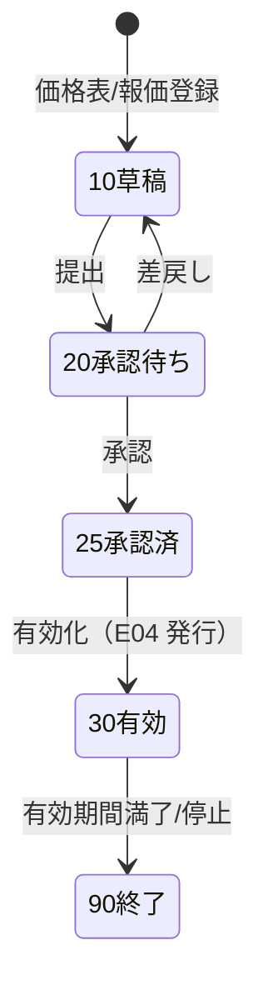
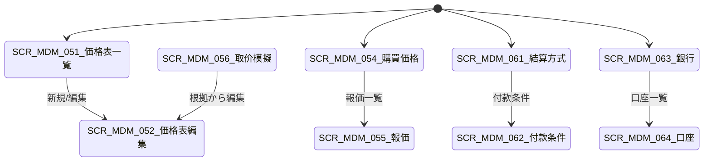

# 价格・结算・银行 详细设计书（価格・決済・銀行 詳細設計書）

| 項目 | 内容 |
|---|---|
| 文書名 | 价格・结算・银行 详细设计书（価格・決済・銀行 詳細設計書） |
| 文書番号 | DSN-MDM-005 |
| 版数 | v1.0 |
| 作成日 | 2026-10-20 |
| 作成者 | mdm-designer |
| 承認者 | 未承認（レビュー待ち） |
| 状態 | ドラフト（レビュー中） |
| 関連文書 | [業務域概要](00-overview.md) / [物料主数据](01-material-master.md) / [取引先](02-business-partner.md) / [代码一览](../00-common/06-code-list.md) / [共通業務規則](../00-common/08-common-business-rules.md) / [跨域流程](../00-common/09-cross-domain-flow.md) / [DB 設計](90-db-design.md) |

---

## 1. 機能概要

| 項目 | 内容 |
|---|---|
| 機能 ID | F-MDM-010（販売価格表・折扣）/ F-MDM-011（購買価格・供應商報価）/ F-MDM-012（結算方式・付款条件）/ F-MDM-013（銀行・聯行号） |
| 機能名 | 销售价格表与折扣・采购价格与供应商报价・结算方式与付款条件・银行账户与联行号 |
| 目的 | 为销售受注/报价与采购发注/比价提供**唯一、可解释、可追溯**的价格来源：销售侧按「客户+物料 > 客户分类+物料 > 物料 > 标准价」的优先级取价，支持阶梯价、含税/不含税、生效期间、币种、折扣；采购侧按「供应商+物料 > 供应商分类+物料 > 物料 > 标准采购价」取价并管理供应商报价与比价。结算方式/付款条件/银行账户为 AR/AP、资金计划、发注支付条件提供基础 |
| 利用者・ロール | 销售价格担当、采购价格担当、财务主数据担当、销售/采购经理（承认）、销售员/采购员（参照） |
| 利用シーン | 年度価格表の改定、顧客別協議価格の登録、数量折扣の設定、供應商見積の比較・採用、支払条件の新設、振込先口座の登録 |
| 優先度 | P0 |
| 画面 ID | SCR-MDM-051〜056（価格）、SCR-MDM-061〜064（結算・銀行） |
| 関連 IF | IF-MDM-002（聯行号取込）、IF-MDM-001（為替レート、多通貨時） |

## 2. 業務要件・業務ルール

### 2.1 前提条件

| # | 前提条件 | 成立しない場合の挙動 |
|---|---|---|
| 1 | 取引先（客户/供应商）、物料が有効 | 価格表行の登録不可 `MSG-COM-049` |
| 2 | 通貨・税碼・単位が有効 | 登録不可 |
| 3 | 価格の承認経路（WF）が配置済み：`businessType=MASTER_DATA_CHANGE`、`variables.masterDataType=MDM_PRICE`、`processKey=APR-PRC`（A19。価格表の有効化時） | 有効化不可 `MSG-COM-073` |
| 4 | 銀行（`mdm_bank`）が登録済み・有効（口座登録時） | 登録不可 `MSG-MDM-130` |

### 2.2 業務ルール（销售价格表）

| # | ルール | 根拠 | 関連項目 |
|---|---|---|---|
| BR-PRC-01 | 価格表はヘッダ（`mdm_price_list`）+ 明細（`mdm_price_list_line`）で構成。ヘッダは適用範囲（全社/客户分類/区域/客户）、通貨、含税フラグ、価格类型（標準/協議/促銷）、有効期間を持つ | 販売価格管理の慣行 | `scope_type`、`price_type` |
| BR-PRC-02 | 明細の適用範囲（`scope_type`）は `10 客户+物料` / `20 客户分類+物料` / `30 物料` / `40 全社標準`。優先順位は 10 > 20 > 30 > 40 | 09 第 11 節、本設計 3.1 | `scope_type` |
| BR-PRC-03 | 同一優先順位内では `min_qty` が大きい（数量帯が一致する）行を優先し、次に `priority`（小さいほど優先）、次に `valid_from`（新しいほど優先）の順で決定する | 段階価格の慣行 | `min_qty`、`priority`、`valid_from` |
| BR-PRC-04 | 阶梯价は `min_qty`（下限、含む）と `max_qty`（上限、含まない。NULL=無制限）で表す。同一スコープ・同一有効期間で数量帯の重複は不可 | 段階価格の慣行 | `min_qty`/`max_qty` |
| BR-PRC-05 | 単価は税抜を基本とし、`is_tax_included=TRUE` の場合は税込単価で保持し、取引時に税抜換算する（6 桁丸め） | 08 第 4.2 節 | `is_tax_included` |
| BR-PRC-06 | 有効期間は両端含む。期間外の価格は新規取引に使用しない。既存伝票は登録時点の価格をスナップショット保持する | 08 第 4.1 節 | `valid_from`/`valid_to` |
| BR-PRC-07 | 価格の変更（既存行の単価変更）は禁止。新行の追加 + 旧行の `valid_to` 設定で行う。変更履歴は `mdm_price_list_line` の有効期間で表現する | 価格監査の要件 | `valid_from`/`valid_to` |
| BR-PRC-08 | 標準価格（`mdm_material.standard_price`）を下回る販売価格の登録、または標準価格から ±5% を超える価格は、価格承認（销售经理→财务总监）を必須とする | 08 第 8.1 節（販売価格承認） | `priority`、承認 |
| BR-PRC-09 | 折扣は `mdm_price_discount` で管理し、適用条件（顧客等級・数量・金額・期間）と折扣类型（率/額）を持つ。単価取価後に適用し、行金額に対して計算する | 販売促進の慣行 | `discount_type`、`discount_value` |
| BR-PRC-10 | 通貨は価格表ヘッダの通貨を正とする。取引通貨と異なる場合は取引日の為替レートで換算する（08 第 4.2 節） | 多通貨対応 | `currency_code` |
| BR-PRC-11 | 消費税（増値税）の税込/税抜表示は税碼（`is_tax_included`）と整合させる。税込価格で登録した場合は税抜換算値を保持し、税額は 08 第 4 章で計算する | 08 第 4 章 | `tax_code` |
| BR-PRC-12 | 価格表の有効化は WF 承認後。有効化時に領域事件 `mdm.price.changed`（E04）を発行する | 09 第 3 章 E04 | — |

### 2.3 業務ルール（采购价格・供应商报价）

| # | ルール | 根拠 | 関連項目 |
|---|---|---|---|
| BR-PURP-01 | 購買価格は「供應商 × 物料」単位で登録し、数量帯・通貨・含税/税抜・有効期間・MOQ を持つ | 購買価格管理の慣行 | `mdm_purchase_price` |
| BR-PURP-02 | 購買価格の優先順位は `10 供應商+物料` > `20 供應商分類+物料` > `30 物料標準購買価格` > `40 標準価格（参考）` | 本設計 3.2 | `scope_type` |
| BR-PURP-03 | 供應商報価（`mdm_supplier_quotation`）は見積の事実記録であり、採用時に購買価格へ反映する（手動または承認後自動）。報価自体は取引価格として直接使用しない | 購買統制の慣行 | `mdm_supplier_quotation` |
| BR-PURP-04 | 比価（3 社以上推奨）は同一物料・同一数量帯・同一通貨・同一納期条件で比較する。通貨が異なる場合は取引日レートで換算比較する | 購買統制の慣行 | — |
| BR-PURP-05 | 購買価格が `mdm_material.standard_cost` を大幅に上回る場合（`sys_param` 閾値）は警告を出す。発注時の価格差異は PUR の三単マッチで処理する | 08 第 6 章 | `standard_cost` |
| BR-PURP-06 | 外注加工費（`supplier_type=30`）は加工費単価として購買価格に登録し、材料支給は在庫取引（`OSI`/`OSR`）で処理する | 09 第 7.1 節 | `price_type` |
| BR-PURP-07 | 購買価格の変更は WF 承認（采购经理→财务经理、大口は财务总监）を必須とする | 08 第 8.1 節 | — |

### 2.4 業務ルール（结算方式・付款条件・银行）

| # | ルール | 根拠 | 関連項目 |
|---|---|---|---|
| BR-SET-01 | 結算方式は 06 §8.1 のコード（`BANK_TRANSFER`/`ACCEPTANCE_BANK`/`ACCEPTANCE_COMMERCIAL`/`CASH`/`CHEQUE`/`LC`/`COLLECTION_DP`/`COLLECTION_DA`/`ONLINE`/`OFFSET`）をそのまま使用する | 【実データ】06 §8.1 | `settlement_method_code` |
| BR-SET-02 | 付款条件は 06 §8.2 のコード（`PREPAY100`/`PREPAY30_AR70`/`NET30`/`NET60`/`NET90`/`COD`/`EOM`/`CUSTOM`）を基本とし、`mdm_payment_term` で「起算日・支払日・分割」をパラメータ化する | 06 §8.2、08 第 4 章 | `payment_term_code` |
| BR-SET-03 | 起算日（`settlement_basis`）：`10 請求書日` / `20 検収日` / `30 出荷日` / `40 月末締め` / `50 発注日`。支払日（`payment_day_type`）：`10 月末` / `20 翌月末` / `30 翌々月末` / `40 固定日` / `50 即時` | 08 第 8 章、06 §8.2 | `settlement_basis`、`payment_day_type` |
| BR-SET-04 | 分割払い（`mdm_payment_term_line`）は比率（合計 100%）・期日区分・トリガ（発注/検収/引渡）を定義する。`PREPAY30_AR70` 等は 2 行で表現する | 06 §8.2 | `installment_ratio` |
| BR-SET-05 | 銀行は 06 の慣行に従い、銀行名称・銀行類別（`bank_category`：10 政策性/20 国有大型/30 股份制/40 城商/50 农商/60 外资）・行別コード（`bank_code`：CNAPS 先頭 3 桁と同値）・CNAPS 行番号を持つ。国内振込は CNAPS 12 桁の聯行号を使用する | 【実データ】人民銀行大口支付系統（CNAPS）行号規則、06 §10/未確定 #3 | `cnaps_code`、`bank_code`、`bank_category` |
| BR-SET-06 | 取引先銀行口座は「取引先 × 銀行」で複数登録でき、`is_default=TRUE` は 1 件のみ。口座変更は重要変更（WF 承認）とする | 08 第 9.2 節 SoD 8 | `mdm_partner_bank_account` |
| BR-SET-07 | 聯行号は 12 桁。内容は「3 桁の**行別コード（銀行識別コード。102=中国工商银行、103=中国农业银行 等）** + 4 桁の都市コード + 4 桁の支店連番 + 1 桁の検証コード」で構成される（人民銀行の規則に従う）。MDM の `bank_category`（銀行類別）は行別コードとは別軸であり、混同しない。実在行番号は取込データを正とし、本設計では形式のみ検証する | 【実データ】CNAPS 行号規則（人民銀行）、红队第 2 轮 REV-FIN-002。個別行番号は【示例値】 | `cnaps_code`、`bank_category` |
| BR-SET-10 | 支払条件の変更は既存取引先の AP 期日に影響するため、変更日以降の新規取引から適用し、既存未払の期日は変更しない | 08 第 4 章 | `valid_from` |
| BR-SET-11 | **数量・納期・過入荷容差パラメータの解決優先順位（MDM 既定。上位が NULL のときのみ下位を採用。0 は明示値として採用し、下位へ進まない）**：①過入荷容差＝PUR `pur_tolerance_rule` の明示設定（業務上書き・理由を監査ログに記録）→ `mdm_material.over_receipt_tolerance_pct`（品目）→ `mdm_material_category.over_receipt_tolerance_pct`（分類）→ `mdm_supplier.over_receipt_tolerance_pct`（仕入先）→ 会社既定 **0.05（5%）**（容差はすべて比率 `NUMERIC(5,4)`。NULL＝次段を継承、0＝明示 0%）。②MOQ＝`mdm_purchase_price.moq` → `mdm_supplier_material.moq` → `mdm_material.min_order_qty`。③購買提前期＝`mdm_purchase_price.lead_time_days` → `mdm_supplier_material.purchase_lead_time_days` → `mdm_supplier.default_lead_time_days` → `mdm_material_factory.purchase_lead_time_days` → `mdm_material.purchase_lead_time_days`。PUR は本表の既定値を参照し、同一パラメータを別途ハードコードしない | 红队第 2 轮 REV-PURDES-013、本設計 | 上記各項目 |

### 2.5 計算式・判定式

| # | 対象 | 算式 | 丸め | 例 |
|---|---|---|---|---|
| CALC-PRC-01 | 税抜単価（税込入力時） | 税込単価 ÷ (1 + 税率) | 6 桁 HALF_UP | 【示例値】967.845000 ÷ 1.13 = 856.500000 |
| CALC-PRC-02 | 行金額 | 数量 × 税抜単価 | 2 桁 HALF_UP | 120 × 856.50 = 102,780.00 CNY |
| CALC-PRC-03 | 行税額 | 行金額 × 税率 | 2 桁 HALF_UP | 102,780.00 × 13% = 13,361.40 CNY |
| CALC-PRC-04 | 行税込金額 | 行金額 + 行税額 | — | 116,141.40 CNY |
| CALC-PRC-05 | 折扣後の行金額 | 行金額 × (1 − `discount_rate`) または 行金額 − `discount_amount` | 2 桁 HALF_UP | 102,780.00 × (1 − 0.02) = 100,724.40 |
| CALC-PRC-06 | 階梯単価選択 | `min_qty ≤ qty < max_qty` を満たす行 | — | 5 T ≦ 8 T < 20 T → 6,500 元/T【示例値】 |
| CALC-PURP-01 | 購買税抜単価 | 税込購買単価 ÷ (1 + 進項税率) | 6 桁 HALF_UP | 【示例値】6,600.000000 ÷ 1.13 = 5,840.707965 |
| CALC-PURP-02 | 比価換算 | 外貨建て報価 × レート | 2 桁 HALF_UP | USD 800.00 × 7.10000000 = CNY 5,680.00【示例値】 |
| CALC-SET-01 | 支払期日 | 起算日 + `net_days`（営業日調整は設定） | 日 | 2026-10-31 締め + 30 日 = 2026-11-30 |
| CALC-SET-02 | 分割支払額 | 契約金額 × `installment_ratio` | 2 桁 HALF_UP | 1,000,000.00 × 30% = 300,000.00 CNY |

### 2.6 状態遷移



| 遷移 | トリガ | 権限 | 更新項目 | メッセージ |
|---|---|---|---|---|
| 10→20 | 提出 | `mdm:price:update` / `mdm:purchase-price:update` | `status=20`、WF | MSG-COM-005 |
| 20→25 | 承認 | `mdm:change:approve` | `status=25` | MSG-MDM-110 |
| 25→30 | 有効化 | システム | `status=30`、E04 発行 | MSG-MDM-111 |
| 30→90 | 期間満了/停止 | `mdm:price:update` | `status=90` | MSG-MDM-112 |

## 3. 取价ロジック（核心）

### 3.1 销售价格取价優先順位

| 順位 | スコープ（`scope_type`） | 条件 | 説明 |
|---|---|---|---|
| 1 | `10 客户+物料` | `customer_id` = 取引先 AND `material_id` = 対象物料 | 顧客別協議価格。最も優先 |
| 2 | `20 客户分類+物料` | 顧客の `customer_grade`（または価格グループ）が `customer_category_code` と一致 AND `material_id` 一致 | 顧客分類別価格（例：A 級顧客） |
| 3 | `30 物料` | `material_id` 一致 | 物料標準販売価格 |
| 4 | `40 全社標準` | すべての顧客・物料に適用 | 標準価格表（`scope_type=40`） |
| 5 | フォールバック | 上記なし | `mdm_material.standard_price`（>0 の場合）を使用。0 の場合は **エラー** `MSG-MDM-113`（手動価格入力を承認フローへ） |

**同一スコープ内の決定順**：① 数量帯一致（`min_qty ≤ qty < max_qty`、`max_qty` NULL は無制限）→ ② `min_qty` 降順（大きい数量帯を優先）→ ③ `priority` 昇順（小さい値優先、既定 100）→ ④ `valid_from` 降順 → ⑤ `id` 昇順。有効期間は `valid_from ≤ 基準日 ≤ COALESCE(valid_to, '9999-12-31')` で判定する。

### 3.2 采购价格取价優先順位

| 順位 | スコープ | 条件 | 説明 |
|---|---|---|---|
| 1 | `10 供應商+物料` | `supplier_id` AND `material_id` | 供應商別協議価格 |
| 2 | `20 供應商分類+物料` | `supplier_category` AND `material_id` | 分類別購買価格 |
| 3 | `30 物料標準購買価格` | `material_id` | 標準購買価格 |
| 4 | `40 標準価格（参考）` | なし | `mdm_material.standard_cost`（参考値、警告付き） |
| 5 | フォールバック | 上記なし | 手動価格（PUR の見積・三者照合へ） |

### 3.3 取价拟似コード（実装可能粒度）

```
# ---------- 销售取价 ----------
function resolveSalesPrice(customerId, materialId, quantity, priceDate, currencyCode, uomCode):
    customer = getCustomer(customerId)                    # status=1 必須、credit_status は別途チェック
    material = getMaterial(materialId)                    # status=1 必須
    qty = convertToBaseUom(quantity, uomCode, material.base_uom_code)

    candidates = query(
      SELECT l.*, p.currency_code AS list_currency, p.is_tax_included AS list_tax_included,
             CASE l.scope_type WHEN 10 THEN 1 WHEN 20 THEN 2 WHEN 30 THEN 3 ELSE 4 END AS scope_rank
      FROM mdm_price_list_line l
      JOIN mdm_price_list p ON p.id = l.price_list_id
      WHERE p.status = 30                                   -- 有効化済
        AND p.valid_from <= :priceDate
        AND (p.valid_to IS NULL OR p.valid_to >= :priceDate)
        AND l.valid_from <= :priceDate
        AND (l.valid_to IS NULL OR l.valid_to >= :priceDate)
        AND (l.material_id = :materialId OR l.material_id IS NULL OR l.scope_type = 40)
        AND (l.scope_type <> 10 OR l.customer_id = :customerId)
        AND (l.scope_type <> 20 OR l.customer_category_code = :customerGrade)
        AND l.min_qty <= :qty
        AND (l.max_qty IS NULL OR :qty < l.max_qty)
      ORDER BY scope_rank ASC, l.min_qty DESC, l.priority ASC, l.valid_from DESC, l.id ASC
    )
    if candidates is empty:
        if material.standard_price > 0: return fallback(material.standard_price, source='MATERIAL_STANDARD')
        else: throw BizException(404, 20036, MSG-MDM-113)   # 無価格 → 404＋20036（SAL は手動入力/承認）

    best = candidates.first()
    unitNet = best.is_tax_included ? round(best.unit_price / (1 + taxRate(best.tax_code)), 6)
                                   : best.unit_price
    if best.list_currency != currencyCode:
        fx = getExchangeRate(best.list_currency, currencyCode, 'SPOT', priceDate)
        unitNet = round(unitNet * fx, 6)

    # 折扣適用（単価ではなく行金額に対して。優先度順に 1 件適用、または累積は設定）
    discounts = findDiscounts(customerId, materialId, qty, priceDate)
    result = {
      materialId: materialId,
      customerId: customerId,
      unitPriceNet: unitNet,
      unitPriceGross: round(unitNet * (1 + taxRate(best.tax_code)), 6),
      currencyCode: currencyCode,
      taxCode: best.tax_code,
      isTaxIncluded: false,
      taxRate: taxRate(best.tax_code),
      discountRate: firstOrZero(discounts).discount_rate,
      validFrom: best.valid_from,
      validTo: best.valid_to,
      priceSource: best.scope_type,        # 10/20/30/40
      priceListLineId: best.id,
      priceListId: best.price_list_id,
      quantityBand: {minQty: best.min_qty, maxQty: best.max_qty}
    }
    return result
```

```
# ---------- 采购取价 ----------
function resolvePurchasePrice(supplierId, materialId, quantity, priceDate, currencyCode):
    supplier = getSupplier(supplierId)                    # admission_status=30 合格 必須
    material = getMaterial(materialId)
    qty = convertToBaseUom(quantity, 'base', material.base_uom_code)
    candidates = queryPurchasePrices(supplierId, materialId, qty, priceDate)
       # 優先順位：supplier+material(1) > supplier_category+material(2) > material(3) > standard(4)
       # 同一スコープ内：min_qty DESC, priority ASC, valid_from DESC
    if empty: return { manual: true, reason: 'NO_PRICE' }  # PUR が手動見積を実施
    best = candidates.first()
    unitNet = best.price_includes_tax ? round(best.unit_price / (1 + taxRate(best.tax_code)), 6)
                                      : best.unit_price
    return { unitPriceNet: unitNet, currencyCode, taxCode: best.tax_code,
             priceSource: best.scope_type, priceListLineId: best.id, moq: best.min_qty }
```

### 3.4 取价例（示例值）

**例 1：顧客別協議価格の優先**

| 候補 | スコープ | 顧客 | 物料 | 数量 | 単価（税抜） | 有効期間 |
|---|---|---|---|---|---|---|
| A | 10 客户+物料 | C000123 | 3001000001 YE3-100L1-4 | 100 PCE〜 | CNY 850.00 | 2026-01-01〜 |
| B | 20 客户分類+物料 | A 級 | 3001000001 | 1 PCE〜 | CNY 870.00 | 2026-01-01〜 |
| C | 30 物料 | — | 3001000001 | 1 PCE〜 | CNY 880.00 | 2026-01-01〜 |
| D | 40 全社標準 | — | — | 1 PCE〜 | CNY 900.00 | 2026-01-01〜 |

取引：C000123（A 級）、3001000001、120 PCE、2026-10-20 → **A（CNY 850.00）を採用**。行金額 120 × 850.00 = 102,000.00、税額 13,260.00、税込 115,260.00 CNY。

**例 2：階梯価格（物料 1001000001 50W470 硅鋼片）**

| 数量帯 | 単価（税抜、元/T） | 備考 |
|---|---|---|
| 1 T ≦ qty < 5 T | 6,800.00 | 【示例値】 |
| 5 T ≦ qty < 20 T | 6,500.00 | 【示例値】 |
| 20 T ≦ qty | 6,200.00 | 【示例値】 |

注文 8 T → 6,500.00 元/T を採用。金額 8 × 6,500.00 = 52,000.00、税額 6,760.00、税込 58,760.00 CNY。

**例 3：税込単価からの換算**

税込単価 967.845000 CNY、税率 13% → 税抜 856.500000（6 桁丸め）。数量 120 → 102,780.00 + 13,361.40 = 116,141.40 CNY。

**例 4：購買比価（3 社、同一物料 4001000001 軸承 6205-2RS、数量 500 PCE）**

| 供應商 | 報価（税込） | 通貨 | 税抜換算 | 納期 | 評価 |
|---|---|---|---|---|---|
| S000045（【示例值】哈轴授权经销） | CNY 12.80 | CNY | 11.327434 | 7 日 | 総合 1 位 |
| S000046（【示例値】瓦轴代理店） | CNY 13.50 | CNY | 11.946903 | 5 日 | 納期優位 |
| S000047（【示例値】洛轴代理店） | USD 1.85 | USD | USD 1.637168 → CNY 11.623894（レート 7.10000000） | 10 日 | — |

> 比価は税抜換算・同一通貨換算後に比較する。採用結果は `mdm_purchase_price` に反映し、報価は事実記録として保持する。金額・単価は【示例値】。

## 4. 画面設計

### 4.1 画面一覧

| 画面 ID | 画面名 | 類型 | 概要 |
|---|---|---|---|
| SCR-MDM-051 | 销售价格表一覧 | 一覧検索 | 価格表ヘッダの検索（適用範囲・通貨・状態・有効日） |
| SCR-MDM-052 | 销售价格表登録編集 | 登録編集 | ヘッダ + 明細（客户/分類/物料/阶梯/含税/期間） |
| SCR-MDM-053 | 折扣规则管理 | 登録編集 | 折扣条件・率/額・期間 |
| SCR-MDM-054 | 采购价格一覧/登録編集 | 一覧検索/登録編集 | 供應商+物料+阶梯+通貨 |
| SCR-MDM-055 | 供应商报价管理 | 登録編集 | 報価ヘッダ + 明細、比価用データ |
| SCR-MDM-056 | 取价模拟与照会 | 照会 | 顧客/物料/数量/基準日を入力して取价結果・根拠を表示 |
| SCR-MDM-061 | 结算方式一覧/登録編集 | 一覧検索/登録編集 | 06 §8.1 の結算方式 |
| SCR-MDM-062 | 付款条件一覧/登録編集 | 一覧検索/登録編集 | 起算日・支払日・分割 |
| SCR-MDM-063 | 银行一覧/登録編集 | 一覧検索/登録編集 | 銀行・CNAPS 行番号 |
| SCR-MDM-064 | 取引先银行账户管理 | 登録編集 | 客户/供应商の口座、検証状態 |

### 4.2 画面遷移



### 4.3 画面レイアウト

**SCR-MDM-052 销售价格表登録編集**

```
┌──────────────────────────────────────────────────────────────────────────┐
│ 価格表コード PL-2026-STD  名称 2026年度標準価格表  状態 有効   [保存][提出]│
├──────────────────────────────────────────────────────────────────────────┤
│ ヘッダ：適用範囲[40 全社標準▼] 通貨[CNY▼] 含税[ ] 価格類型[10 標準▼]      │
│         有効期間[2026-01-01]〜[2026-12-31]  優先度[100]                   │
├──────────────────────────────────────────────────────────────────────────┤
│〔明細〕[追加]  行 | 適用範囲 | 客户/分類 | 物料 | 数量下限 | 数量上限 |    │
│        単価 | 通貨 | 含税 | 税碼 | 優先度 | 有効期間                      │
│        10 | 3001000001 | 100 | - | 850.00 | CNY | 税抜 | VAT13-OUT | ...│
├──────────────────────────────────────────────────────────────────────────┤
│ [取消] [保存] [提出] [取价シミュレーション]                                 │
└──────────────────────────────────────────────────────────────────────────┘
```

### 4.4 画面項目定義

#### 4.4.1 销售价格表明細 SCR-MDM-052（ヘッダ・明細）

| No | 区分 | 項目 ID | 項目名 | 種別 | 型/桁 | 必須 | 初期値 | 入力チェック | データソース | DB 項目 | 権限 | 備考 |
|---|---|---|---|---|---|---|---|---|---|---|---|---|
| 1 | ヘッダ | `price_list_code` | 価格表コード | テキスト | VARCHAR(32) | ○ | 自動採番 | 一意 | 採番 | price_list_code | `mdm:price:update` | 例 PL-2026-STD |
| 2 | ヘッダ | `price_list_name` | 価格表名 | テキスト | VARCHAR(100) | ○ | 空 | 1〜100 字 | 入力 | price_list_name | 同上 | — |
| 3 | ヘッダ | `scope_type` | 適用範囲 | 選択 | SMALLINT | ○ | 40 | 10 全社/20 客户分類/30 区域/40 客户 | 固定値 | scope_type | 同上 | — |
| 4 | ヘッダ | `currency_code` | 通貨 | 選択 | VARCHAR(3) | ○ | CNY | ISO 4217・有効 | マスタ | currency_code | 同上 | — |
| 5 | ヘッダ | `is_tax_included` | 含税 | チェック | BOOLEAN | ○ | FALSE | — | 入力 | is_tax_included | 同上 | — |
| 6 | ヘッダ | `price_type` | 価格類型 | 選択 | SMALLINT | ○ | 10 | 10 標準/20 客户協議/30 促銷 | 固定値 | price_type | 同上 | — |
| 7 | ヘッダ | `valid_from` / `valid_to` | 有効期間 | 日付範囲 | DATE | ○/— | 当日/空 | 開始≦終了 | 入力 | valid_from/to | 同上 | — |
| 8 | ヘッダ | `status` | 状態 | 選択 | SMALLINT | ○ | 10 | 10/20/25/30/90 | 固定値 | status | 同上 | 承認制御 |
| 9 | 明細 | `line_no` | 行番号 | 数値 | INT | — | 自動 10 刻み | — | 自動 | line_no | 同上 | — |
| 10 | 明細 | `scope_type` | 明細適用範囲 | 選択 | SMALLINT | ○ | 40 | 10 客户+物料/20 客户分類+物料/30 物料/40 全社標準 | 固定値 | scope_type | 同上 | — |
| 11 | 明細 | `customer_id` | 客户 | 選択ダイアログ | BIGINT | △ | 空 | scope=10 で必須 | マスタ | customer_id | 同上 | — |
| 12 | 明細 | `customer_category_code` | 客户分類 | 選択 | VARCHAR(32) | △ | 空 | scope=20 で必須 | マスタ | customer_category_code | 同上 | 例 A 級 |
| 13 | 明細 | `material_id` | 物料 | 選択ダイアログ | BIGINT | △ | 空 | scope≠40 で必須 | マスタ | material_id | 同上 | — |
| 14 | 明細 | `min_qty` | 数量下限 | 数値 | NUMERIC(18,4) | ○ | 1 | ≥ 0 | 入力 | min_qty | 同上 | 含む |
| 15 | 明細 | `max_qty` | 数量上限 | 数値 | NUMERIC(18,4) | — | 空 | > min_qty | 入力 | max_qty | 同上 | 含まない |
| 16 | 明細 | `unit_price` | 単価 | 数値 | NUMERIC(18,6) | ○ | 0 | ≥ 0 | 入力 | unit_price | 同上 | 税抜 or 税込（ヘッダ準拠） |
| 17 | 明細 | `currency_code` | 通貨 | 選択 | VARCHAR(3) | ○ | ヘッダ | ISO 4217 | マスタ | currency_code | 同上 | 行単位可 |
| 18 | 明細 | `tax_code` | 税碼 | 選択 | VARCHAR(32) | ○ | VAT13-OUT | 有効税碼・税区分 10 | マスタ | tax_code | 同上 | — |
| 19 | 明細 | `is_tax_included` | 含税 | チェック | BOOLEAN | ○ | ヘッダ | — | 入力 | is_tax_included | 同上 | — |
| 20 | 明細 | `discount_rate` | 折扣率 | 数値 | NUMERIC(7,4) | — | 0 | 0〜100 | 入力 | discount_rate | 同上 | % |
| 21 | 明細 | `priority` | 優先度 | 数値 | INT | — | 100 | 1〜999 | 入力 | priority | 同上 | 小さいほど優先 |
| 22 | 明細 | `valid_from` / `valid_to` | 有効期間 | 日付範囲 | DATE | ○/— | ヘッダ | 開始≦終了・数量帯重複なし | 入力 | valid_from/to | 同上 | — |
| 23 | ボタン | `btn_simulate` | 取价シミュレーション | ボタン | — | — | — | — | — | SCR-MDM-056 | 参照可 | — |

#### 4.4.2 采购价格 SCR-MDM-054

| No | 項目 ID | 項目名 | 種別 | 型/桁 | 必須 | 初期値 | 入力チェック | DB 項目 | 備考 |
|---|---|---|---|---|---|---|---|---|---|
| 1 | `supplier_id` | 供應商 | 選択 | BIGINT | ○ | 空 | 有効・合格供應商 | supplier_id | — |
| 2 | `material_id` | 物料 | 選択 | BIGINT | ○ | 空 | 有効物料 | material_id | — |
| 3 | `scope_type` | 適用範囲 | 選択 | SMALLINT | ○ | 10 | 10 供應商+物料/20 供應商分類+物料/30 物料標準 | scope_type | — |
| 4 | `min_qty` / `max_qty` | 数量帯 | 数値 | NUMERIC(18,4) | ○/— | 1/空 | 下限 < 上限 | min_qty/max_qty | — |
| 5 | `unit_price` | 単価 | 数値 | NUMERIC(18,6) | ○ | 0 | ≥ 0 | unit_price | — |
| 6 | `currency_code` | 通貨 | 選択 | VARCHAR(3) | ○ | CNY | ISO 4217 | currency_code | — |
| 7 | `price_includes_tax` | 税込単価 | チェック | BOOLEAN | ○ | TRUE | — | price_includes_tax | 国内仕入は税込が多い |
| 8 | `tax_code` | 税碼 | 選択 | VARCHAR(32) | ○ | VAT13-IN | 税区分 11 | tax_code | — |
| 9 | `moq` | 最小発注量 | 数値 | NUMERIC(18,4) | — | 0 | ≥ 0 | moq | — |
| 10 | `lead_time_days` | 購買提前期 | 数値 | INT | — | 0 | 0〜365 | lead_time_days | — |
| 11 | `valid_from` / `valid_to` | 有効期間 | 日付範囲 | DATE | ○/— | 当日/空 | 開始≦終了 | valid_from/to | — |
| 12 | `status` | 状態 | 選択 | SMALLINT | ○ | 10 | 10/20/25/30/90 | status | — |

#### 4.4.3 付款条件 SCR-MDM-062

| No | 項目 ID | 項目名 | 種別 | 型/桁 | 必須 | 初期値 | 入力チェック | DB 項目 | 備考 |
|---|---|---|---|---|---|---|---|---|---|
| 1 | `payment_term_code` | 付款条件コード | テキスト | VARCHAR(32) | ○ | 空 | 06 §8.2 のコード or 社内コード・一意 | payment_term_code | 例 NET30 |
| 2 | `payment_term_name` | 名称 | テキスト | VARCHAR(100) | ○ | 空 | 1〜100 字 | payment_term_name | 例 月结 30 天 |
| 3 | `settlement_basis` | 起算日 | 選択 | SMALLINT | ○ | 40 | 10 請求書日/20 検収日/30 出荷日/40 月末/50 発注日 | settlement_basis | — |
| 4 | `net_days` | 支払日数 | 数値 | INT | ○ | 30 | 0〜365 | net_days | — |
| 5 | `payment_day_type` | 支払日区分 | 選択 | SMALLINT | ○ | 20 | 10 月末/20 翌月末/30 翌々月末/40 固定日/50 即時 | payment_day_type | — |
| 6 | `fixed_payment_day` | 固定支払日 | 数値 | SMALLINT | △ | 空 | 1〜31 | fixed_payment_day | `payment_day_type=40` で必須 |
| 7 | `installment_count` | 分割回数 | 数値 | SMALLINT | ○ | 1 | 1〜10 | installment_count | — |
| 8 | `valid_from` / `valid_to` | 有効期間 | 日付範囲 | DATE | ○/— | 当日/空 | 開始≦終了 | valid_from/to | — |
| 9 | `status` | 状態 | 選択 | SMALLINT | ○ | 1 | 1/0 | status | — |
| 10 | `payment_term_line[]` | 分割明細 | 明細 | — | △ | — | 比率合計 100.00 | mdm_payment_term_line | 分割時 |

#### 4.4.4 取引先银行账户 SCR-MDM-064

| No | 項目 ID | 項目名 | 種別 | 型/桁 | 必須 | 初期値 | 入力チェック | DB 項目 | 備考 |
|---|---|---|---|---|---|---|---|---|---|
| 1 | `owner_type` | 取引先種別 | 選択 | VARCHAR(16) | ○ | 呼出元 | CUSTOMER/SUPPLIER | owner_type | — |
| 2 | `owner_id` | 取引先 | 選択 | BIGINT | ○ | 呼出元 | 有効取引先 | owner_id | — |
| 3 | `bank_id` | 銀行 | 選択 | BIGINT | ○ | 空 | 有効銀行 | bank_id | — |
| 4 | `bank_branch_name` | 支店名 | テキスト | VARCHAR(100) | ○ | 空 | 1〜100 字 | bank_branch_name | — |
| 5 | `cnaps_code` | 聯行号 | テキスト | VARCHAR(12) | ○ | 空 | 12 桁数字・形式検証 | cnaps_code | — |
| 6 | `account_type` | 口座種別 | 選択 | SMALLINT | ○ | 10 | 10 基本/20 一般/30 専用/40 臨時 | account_type | — |
| 7 | `account_no` | 口座番号 | テキスト | VARCHAR(32) | ○ | 空 | 数字 8〜32 桁 | account_no | マスキング |
| 8 | `account_name` | 口座名義 | テキスト | VARCHAR(100) | ○ | 取引先名 | 取引先名と一致推奨 | account_name | 不一致は警告 |
| 9 | `currency_code` | 口座通貨 | 選択 | VARCHAR(3) | ○ | CNY | ISO 4217 | currency_code | — |
| 10 | `is_default_account` | 既定口座 | チェック | BOOLEAN | — | FALSE | 取引先 1 件のみ | is_default_account | — |
| 11 | `is_verified` | 検証済み | チェック | BOOLEAN | — | FALSE | 財務のみ変更可 | is_verified | 未検証は支払承認必要 |
| 12 | `change_reason` | 変更理由 | テキスト | VARCHAR(200) | △ | 空 | 変更時必須 | change_reason | 重要変更 WF |

### 4.5 イベント処理

| No | イベント | トリガ | 処理内容 | 呼出 API | 画面遷移 | 備考 |
|---|---|---|---|---|---|---|
| 1 | 明細追加 | 追加ボタン | 行番号採番、ヘッダ値のコピー | — | 同一画面 | 最大 5,000 行 |
| 2 | 数量帯変更 | `min_qty`/`max_qty` 変更 | 同一スコープ内の重複チェックをリアルタイム表示 | — | 同一画面 | 重複は保存時エラー |
| 3 | 取价シミュレーション | ボタン | 顧客・物料・数量・基準日を入力し、取价結果と根拠行を表示 | `POST /api/mdm/prices/sales/simulate` | SCR-MDM-056 | 参照のみ |
| 4 | 価格表有効化 | 承認後 | `status=30`、E04 発行 | `POST /api/mdm/price-lists/{id}/activate` | 一覧へ | 承認必須 |
| 5 | 報価から購買価格へ | ボタン | 採用品目を `mdm_purchase_price` にコピー（承認後） | `POST /api/mdm/supplier-quotations/{id}/adopt` | 価格一覧 | 監査ログ |
| 6 | 口座検証 | 財務操作 | `is_verified=TRUE`、検証方法・日時を記録 | `POST /api/mdm/partner-bank-accounts/{id}/verify` | 同一画面 | 監査ログ |

### 4.6 一覧画面仕様

| 項目 | 内容 |
|---|---|
| 検索条件 | 価格表：適用範囲・通貨・状態・有効日・価格類型。採購価格：供應商・物料・状態。口座：取引先・銀行・通貨・検証状態 |
| ソート | 価格表：`valid_from DESC, price_list_code ASC`。口座：`is_default DESC, bank_name ASC` |
| ページング | 20/50/100/200 |
| 一括操作 | 価格表の一括有効化/終了、採購価格の一括インポート、口座の一括検証 |
| エクスポート | Excel、10,000 件。価格情報は権限者のみ |
| 印刷 | PRT-MDM-009 有効销售价格表、PRT-MDM-010 采购价格・报价比较表 |

### 4.7 表示制御

| 条件 | 対象 | 制御 |
|---|---|---|
| 権限 `mdm:price:view` なし | 価格・原価項目 | 非表示（API も返さない） |
| 権限 `mdm:price:update` なし | 編集・提出・有効化 | 非表示 |
| `status=30`（有効） | 明細編集 | 不可（新行追加のみ可） |
| 口座 `is_verified=FALSE` | 支払先選択 | 警告表示（FIN 側で制御） |
| 他部門の取引先価格 | 一覧 | データ権限で非表示 |

## 5. 入力チェック仕様

| No | チェック ID | 対象項目 | 種別 | 条件 | タイミング | メッセージ ID |
|---|---|---|---|---|---|---|
| 1 | CHK-MDM-010-01 | `price_list_code` | 形式/一意 | 1〜32 字・一意 | 保存時 | MSG-MDM-114 |
| 2 | CHK-MDM-010-02 | 明細スコープ | 相関 | scope=10 で customer 必須、20 で分類必須、30 で物料必須 | 保存時 | MSG-MDM-115 |
| 3 | CHK-MDM-010-03 | 数量帯 | 相関 | min_qty < max_qty、同一スコープ/期間で重複なし | 保存時 | MSG-MDM-116 |
| 4 | CHK-MDM-010-04 | `unit_price` | 範囲 | ≥ 0 | 保存時 | MSG-COM-048 |
| 5 | CHK-MDM-010-05 | `tax_code` | コード存在 | 有効税碼・税区分 10 | 保存時 | MSG-COM-049 |
| 6 | CHK-MDM-010-06 | `valid_from`/`valid_to` | 相関 | 開始≦終了 | 保存時 | MSG-COM-046 |
| 7 | CHK-MDM-010-07 | 標準価格比 | 業務 | ±5% 超は承認必須（警告→WF） | 提出時 | MSG-MDM-117（W） |
| 8 | CHK-MDM-010-08 | 折扣率 | 範囲 | 0〜100 | 保存時 | MSG-MDM-118 |
| 9 | CHK-MDM-011-01 | 採購価格 税込/税抜 | 相関 | `price_includes_tax` と税碼の整合 | 保存時 | MSG-MDM-119 |
| 10 | CHK-MDM-012-01 | 分割比率 | 相関 | 合計 = 100.00 | 保存時 | MSG-MDM-120 |
| 11 | CHK-MDM-012-02 | `fixed_payment_day` | 相関 | `payment_day_type=40` で必須・1〜31 | 保存時 | MSG-MDM-121 |
| 12 | CHK-MDM-013-01 | `cnaps_code` | 形式 | 12 桁数字 | 保存時 | MSG-MDM-122 |
| 13 | CHK-MDM-013-02 | 口座名義 | 相関 | 取引先名と不一致は警告 | 保存時 | MSG-MDM-123（W） |
| 14 | CHK-MDM-013-03 | 既定口座 | 一意 | 取引先 1 件のみ | 保存時 | MSG-MDM-124 |
| 15 | CHK-MDM-013-04 | 口座変更 | 権限 | 変更理由必須・WF 承認 | 変更時 | MSG-MDM-125 |

## 6. 処理詳細

### 6.1 処理一覧

| 処理 ID | 処理名 | 契機 | トランザクション | 排他 |
|---|---|---|---|---|
| PRC-MDM-010-01 | 価格表登録・更新 | 保存 | 要（ヘッダ+明細） | 楽観排他 |
| PRC-MDM-010-02 | 価格表有効化・E04 発行 | 承認後 | 要 | version |
| PRC-MDM-010-03 | 取价照会 | API | 不要（読取） | — |
| PRC-MDM-011-01 | 採購価格登録・更新 | 保存 | 要 | 楽観排他 |
| PRC-MDM-011-02 | 報価登録・採用 | 保存/採用 | 要 | 楽観排他 |
| PRC-MDM-012-01 | 支払期日計算 | API/参照 | 不要 | — |
| PRC-MDM-013-01 | 口座登録・変更 | 保存/変更申請 | 要 | 楽観排他＋行ロック |

### 6.2 処理手順（正常系）

**PRC-MDM-010-02 価格表有効化・E04 発行**

1. WF の最終承認（E32）を受信し、`eventId` で冪等チェックする。
2. 価格表ヘッダを `FOR UPDATE` で取得し、`status=25` を確認する。
3. `status=30`、`activated_at/by` を更新する。
4. 明細の有効期間・スコープ重複を再チェックする（有効化前の最終検証）。エラーがあれば有効化を中止し、承認者へ差戻す。
5. E04 `mdm.price.changed` を Outbox に INSERT する。ペイロード：`priceListId、scopeType、materialId、customerId、price、validFrom、validTo、currency`。
6. 影響する SAL/PUR の取价キャッシュを無効化する（購読側で TTL 5 分）。
7. 監査ログに APPROVE/ACTIVATE を記録する。

**PRC-MDM-010-03 取价照会（sales/simulate）**

1. 入力：`customerId`、`materialId`、`quantity`、`priceDate`、`currencyCode`、`uomCode`。
2. 顧客・物料の有効性をチェックする。
3. 3.3 の拟似コードに従い候補を取得し、優先順位で 1 件決定する。
4. 税込/税抜・通貨換算・折扣を適用する。
5. 結果に「採用した価格表・明細 ID・スコープ・数量帯・税碼・税率・根拠」を含めて返す（画面で根拠を確認できるようにする）。
6. 候補なし・標準価格なしの場合は `MSG-MDM-113` を返し、手動価格入力を促す（SAL 側で承認フロー）。

**PRC-MDM-012-01 支払期日計算**

1. 取引先・付款条件を取得する。
2. 起算日を決定：`settlement_basis=40 月末` なら当月月末、`10 請求書日` なら請求書日、`20 検収日` なら検収日、`30 出荷日` なら出荷日、`50 発注日` なら発注日。
3. `payment_day_type` に応じて支払日を決定：翌月末なら翌月末、固定日なら翌月の固定日。
4. `net_days` を加算する（営業日調整は `sys_param`、中国の営業日カレンダー使用）。
5. 分割がある場合は `mdm_payment_term_line` の比率・期日区分で各回を算出する。
6. 期日が銀行休日の場合は翌営業日とする（設定可）。

**PRC-MDM-013-01 口座登録・変更**

1. 権限 `mdm:supplier:bank:update` / `mdm:customer:bank:update` をチェックする。
2. 新規登録時は口座形式・CNAPS 12 桁・重複（同一取引先・同一口座番号）をチェックし、`is_verified=FALSE` で INSERT する。
3. 変更時は変更理由必須。旧口座を `mdm_partner_bank_account_his` に退避し、WF（采购经理→财务经理→财务总监）を起動する。
4. 承認後に新口座へ更新し、`is_verified=FALSE` に戻す。財務へ通知（站内+メール）し、旧口座の削除フラグを立てる。
5. 監査ログに変更前後（下 4 桁のみ）と理由を記録する。

### 6.3 例外処理

| No | 異常条件 | 検知箇所 | 処理 | ロールバック | メッセージ ID |
|---|---|---|---|---|---|
| 1 | 同一スコープ・数量帯の重複 | 保存時 | エラー、重複行を表示 | 全体 | MSG-MDM-116 |
| 2 | 価格候補なし | 取价 | エラー（標準価格>0 ならフォールバック） | なし | MSG-MDM-113 |
| 3 | 有効な税碼なし | 保存時 | エラー | 全体 | MSG-COM-049 |
| 4 | 分割比率合計≠100 | 保存時 | エラー | 全体 | MSG-MDM-120 |
| 5 | CNAPS 形式不正 | 保存時 | エラー | 全体 | MSG-MDM-122 |
| 6 | 口座名義不一致 | 保存時 | 警告（保存可、承認者判断） | なし | MSG-MDM-123（W） |
| 7 | 承認なしの価格有効化 | API 権限 | 403 | 全体 | MSG-COM-030 |
| 8 | E04 書込失敗 | Outbox INSERT | 全体ロールバック | 全体 | MSG-COM-080 |

### 6.4 冪等性・再実行

- 価格表の登録・有効化は Idempotency-Key 必須。有効化は `status` 再判定で再実行可。
- BAT-MDM-002（有効期間判定）は再実行可（状態から再判定）。
- 報価の採用は同一報価から複数回実行しても、同一購買価格の重複登録を防止する（一意制約 + 上書き確認）。

## 7. API 設計

| No | メソッド | パス | 権限 | 概要 | リクエスト | レスポンス |
|---|---|---|---|---|---|---|
| 1 | GET | `/api/mdm/price-lists` | `mdm:price:view` | 価格表一覧 | scopeType、currency、status、priceDate | `PageResult<PriceListDto>` |
| 2 | GET | `/api/mdm/price-lists/{id}` | `mdm:price:view` | 価格表詳細（明細含む） | id | `PriceListDetailDto` |
| 3 | POST | `/api/mdm/price-lists` | `mdm:price:update` | 価格表登録 | `PriceListRequest` | `PriceListDetailDto` |
| 4 | PUT | `/api/mdm/price-lists/{id}` | `mdm:price:update` | 価格表更新（草稿のみ） | `PriceListRequest` | `PriceListDetailDto` |
| 5 | POST | `/api/mdm/price-lists/{id}/submit` | `mdm:price:update` | 承認提出 | `{version}` | `PriceListDetailDto` |
| 6 | POST | `/api/mdm/price-lists/{id}/activate` | `mdm:change:approve` | 有効化（E04） | `{version}` | `PriceListDetailDto` |
| 7 | GET | `/api/mdm/prices/sales/effective` | `mdm:price:view` | 销售取价（単品） | customerId、materialId、quantity、priceDate、currencyCode、uomCode | `SalesPriceResultDto` |
| 8 | POST | `/api/mdm/prices/sales/effective-batch` | `mdm:price:view` | 销售取价（一括、≤500） | `{lines[]}` | `{lines[]}` |
| 9 | POST | `/api/mdm/prices/sales/simulate` | `mdm:price:view` | 取价シミュレーション | 同上 | `SalesPriceResultDto`（候補一覧含む） |
| 10 | GET | `/api/mdm/prices/purchase/effective` | `mdm:purchase-price:view` | 採購取价 | supplierId、materialId、quantity、priceDate、currencyCode | `PurchasePriceResultDto` |
| 11 | GET | `/api/mdm/purchase-prices` | `mdm:purchase-price:view` | 採購価格一覧 | supplierId、materialId、priceDate | `PageResult<PurchasePriceDto>` |
| 12 | POST/PUT | `/api/mdm/purchase-prices[/{id}]` | `mdm:purchase-price:update` | 採購価格 CRUD | `PurchasePriceRequest` | `PurchasePriceDto` |
| 13 | GET | `/api/mdm/supplier-quotations` | `mdm:supplier-quotation:view` | 報価一覧 | supplierId、materialId、dateFrom/To | `PageResult<QuotationDto>` |
| 14 | POST/PUT | `/api/mdm/supplier-quotations[/{id}]` | `mdm:supplier-quotation:update` | 報価 CRUD | `QuotationRequest` | `QuotationDto` |
| 15 | POST | `/api/mdm/supplier-quotations/{id}/adopt` | `mdm:purchase-price:update` | 報価採用→購買価格反映 | `{lineIds[], effectiveFrom}` | `PurchasePriceDto` |
| 16 | GET | `/api/mdm/price-discounts` | `mdm:price:view` | 折扣規則一覧 | customerId、materialId、date | `List<DiscountDto>` |
| 17 | POST/PUT | `/api/mdm/price-discounts[/{id}]` | `mdm:price:update` | 折扣 CRUD | `DiscountRequest` | `DiscountDto` |
| 18 | GET | `/api/mdm/settlement-methods` | `mdm:settlement:view` | 結算方式一覧 | — | `List<SettlementMethodDto>` |
| 19 | GET | `/api/mdm/payment-terms` | `mdm:payment-term:view` | 付款条件一覧 | status | `List<PaymentTermDto>` |
| 20 | GET | `/api/mdm/payment-terms/{code}` | `mdm:payment-term:view` | 付款条件照会（他域共用） | code | `PaymentTermDto`（明細含む） |
| 21 | POST/PUT | `/api/mdm/payment-terms[/{id}]` | `mdm:payment-term:update` | 付款条件 CRUD | `PaymentTermRequest` | `PaymentTermDto` |
| 22 | POST | `/api/mdm/payment-terms/calc-due-date` | `mdm:payment-term:view` | 支払期日計算 | `{paymentTermCode, baseDate, amount}` | `{dueDate, installments[]}` |
| 23 | GET | `/api/mdm/banks` | `mdm:bank:view` | 銀行一覧 | keyword | `PageResult<BankDto>` |
| 24 | POST/PUT | `/api/mdm/banks[/{id}]` | `mdm:bank:update` | 銀行 CRUD | `BankRequest` | `BankDto` |
| 25 | GET | `/api/mdm/partner-bank-accounts` | `mdm:bank-account:view` | 取引先口座一覧 | ownerType、ownerId | `List<BankAccountDto>`（マスキング） |
| 26 | POST/PUT | `/api/mdm/partner-bank-accounts[/{id}]` | `mdm:bank-account:update` | 口座 CRUD | `BankAccountRequest` | `BankAccountDto` |
| 27 | POST | `/api/mdm/partner-bank-accounts/{id}/verify` | `mdm:bank-account:verify` | 口座検証済み登録 | `{verifyMethod, verifiedAt}` | `BankAccountDto` |

### 7.1 リクエスト/レスポンス詳細

**GET /api/mdm/prices/sales/effective レスポンス例**

```json
{
  "code": 0,
  "message": "ok",
  "data": {
    "customerId": "1845000000000000201",
    "materialId": "1845000000000000103",
    "quantity": "120.0000",
    "priceDate": "2026-10-20",
    "currencyCode": "CNY",
    "unitPriceNet": "850.000000",
    "unitPriceGross": "960.500000",
    "taxCode": "VAT13-OUT",
    "taxRate": "13.0000",
    "priceSource": 10,
    "priceSourceName": "客户+物料",
    "priceListId": "1845000000000000501",
    "priceListLineId": "1845000000000000511",
    "quantityBand": { "minQty": "100.0000", "maxQty": null },
    "discount": { "discountRate": "0.0000", "discountAmount": "0.00" }
  }
}
```

**GET /api/mdm/payment-terms/calc-due-date レスポンス例**

```json
{
  "code": 0,
  "message": "ok",
  "data": {
    "paymentTermCode": "NET30",
    "baseDate": "2026-10-25",
    "settlementBasis": 40,
    "dueDate": "2026-11-30",
    "installments": [ { "seq": 1, "ratio": "100.00", "dueDate": "2026-11-30", "amount": "102780.00" } ]
  }
}
```

## 8. データ更新仕様

| テーブル | 操作 | 更新項目 | 更新条件 | トリガ |
|---|---|---|---|---|
| `mdm_price_list` | INSERT/UPDATE | ヘッダ属性、`status` | 登録・更新・承認・有効化 | PRC-MDM-010-01/02 |
| `mdm_price_list_line` | INSERT/UPDATE | 明細・有効期間 | 登録・更新（新行追加方式） | PRC-MDM-010-01 |
| `mdm_price_discount` | INSERT/UPDATE | 折扣条件 | 登録・更新 | F-MDM-010 |
| `mdm_purchase_price` | INSERT/UPDATE | 購買価格 | 登録・更新・報価採用 | PRC-MDM-011-01/02 |
| `mdm_supplier_quotation` / `_line` | INSERT/UPDATE | 報価ヘッダ・明細 | 登録・更新 | PRC-MDM-011-02 |
| `mdm_settlement_method` | INSERT/UPDATE | 結算方式 | 登録・更新 | F-MDM-012 |
| `mdm_payment_term` / `_line` | INSERT/UPDATE | 付款条件・分割 | 登録・更新 | F-MDM-012 |
| `mdm_bank` | INSERT/UPDATE | 銀行・CNAPS | 登録・更新・取込 | F-MDM-013 |
| `mdm_partner_bank_account` | INSERT/UPDATE | 口座・検証状態 | 登録・変更承認・検証 | PRC-MDM-013-01 |
| `mdm_partner_bank_account_his` | INSERT | 変更前口座 | 口座変更 | PRC-MDM-013-01 |
| `sys_outbox_event` | INSERT | E04 | 価格有効化 | PRC-MDM-010-02 |
| `sys_audit_log` | INSERT | CREATE/UPDATE/APPROVE/VERIFY | 全操作 | 全処理 |

## 9. エラー処理・メッセージ

| メッセージ ID | 種別 | 本文 | 発生条件 | 利用者への対処 | ログ |
|---|---|---|---|---|---|
| MSG-MDM-110 | I | 価格表の承認が完了しました。 | 承認 | — | INFO |
| MSG-MDM-111 | I | 価格表「{0}」を有効化しました。関連業務に反映されます。 | 有効化 | — | INFO |
| MSG-MDM-112 | I | 価格表「{0}」を終了しました。 | 期間満了/停止 | — | INFO |
| MSG-MDM-113 | E | 有効な販売価格が見つかりません。手動で価格を入力し、承認を取得してください。 | 取价失敗 | 手動価格 | WARN |
| MSG-MDM-114 | E | 価格表コードは既に使用されています。 | 重複 | 修正 | WARN |
| MSG-MDM-115 | E | 適用範囲に応じて、客户・客户分類・物料を指定してください。 | スコープ相関不正 | 修正 | WARN |
| MSG-MDM-116 | E | 同一の適用範囲・有効期間で数量帯が重複しています（行 {0}）。 | 数量帯重複 | 修正 | WARN |
| MSG-MDM-117 | W | 標準価格から±5% を超える価格です。承認フローで審査されます。 | 価格乖離 | 承認へ | WARN |
| MSG-MDM-118 | E | 折扣率は 0〜100 の範囲で入力してください。 | 折扣不正 | 修正 | WARN |
| MSG-MDM-119 | E | 税込単価の設定と税碼の税込/税抜設定が矛盾しています。 | 税整合不正 | 修正 | WARN |
| MSG-MDM-120 | E | 分割比率の合計は 100.00% にしてください。 | 分割不正 | 修正 | WARN |
| MSG-MDM-121 | E | 固定支払日を指定してください（1〜31）。 | 支払日不正 | 修正 | WARN |
| MSG-MDM-122 | E | 聯行号（CNAPS）は 12 桁の数字で入力してください。 | CNAPS 不正 | 修正 | WARN |
| MSG-MDM-123 | W | 口座名義が取引先名と一致しません。確認してください。 | 名義不一致 | 確認 | WARN |
| MSG-MDM-124 | E | 既定口座は取引先ごとに 1 件のみ設定できます。 | 既定重複 | 修正 | WARN |
| MSG-MDM-125 | E | 口座変更には変更理由と承認が必要です。 | 変更手続き不備 | WF へ | WARN |
| MSG-MDM-130 | E | 指定した銀行が存在しないか有効ではありません。 | 銀行不正 | 修正 | WARN |

## 10. 権限・セキュリティ

| 種別 | 内容 |
|---|---|
| 画面権限 | `mdm:price:view/update`、`mdm:purchase-price:view/update`、`mdm:supplier-quotation:view/update`、`mdm:settlement:*`、`mdm:payment-term:*`、`mdm:bank:*`、`mdm:bank-account:*` |
| 操作権限 | 価格有効化=`mdm:change:approve`、報価採用=`mdm:purchase-price:update`、口座検証=`mdm:bank-account:verify` |
| 項目権限 | 価格・原価は権限者のみ。口座番号は `mdm:bank-account:view` なしの場合下 4 桁 |
| データ範囲 | 価格は全社共通（工場別価格も第一版対象、TODO：設計未作成）。顧客協議価格は営業担当が参照可 |
| 監査ログ | 価格登録・有効化・報価採用・抽選・口座変更・検証を記録 |
| SoD | 価格登録者と承認者は同一不可。口座変更の申請者と承認者は同一不可 |

## 11. 性能・非機能

| 項目 | 目標値 | 前提 |
|---|---|---|
| 取价 API | 200ms 以内 | インデックス（scope, customer, material, min_qty, valid期間） |
| 価格表一覧 | 2 秒以内（100 件） | `idx_mdm_price_list_status_date` |
| 明細件数 | 1 価格表あたり最大 5,000 行 | 一括登録は非同期推奨 |
| 価格表明細総数 | 300,000 行（5 年） | パーティション不要 |
| 報価 | 20,000 件/年 | 購買先 3〜5 社/案件 |
| 口座 | 3,000 件 | — |

## 12. テスト観点

| No | 観点 ID | 分類 | 観点 | 期待結果 |
|---|---|---|---|---|
| 1 | TST-F-MDM-010-01 | 正常系 | 顧客協議価格が優先される | priceSource=10、単価 850.00 |
| 2 | TST-F-MDM-010-02 | 正常系 | 数量帯で単価が変わる | 8 T → 6,500、25 T → 6,200（【示例値】） |
| 3 | TST-F-MDM-010-03 | 異常系 | 同一スコープ・数量帯の重複 | MSG-MDM-116 |
| 4 | TST-F-MDM-010-04 | 計算 | 税込単価→税抜単価 | 967.845000 → 856.500000 |
| 5 | TST-F-MDM-010-05 | 異常系 | 価格候補なし・標準価格 0 | MSG-MDM-113 |
| 6 | TST-F-MDM-010-06 | 権限 | 権限なしで価格有効化 | 403 |
| 7 | TST-F-MDM-010-07 | 排他 | 同時に価格表有効化 | 409 |
| 8 | TST-F-MDM-011-01 | 正常系 | 報価採用→購買価格反映 | 新価格が有効化、E04 発行 |
| 9 | TST-F-MDM-011-02 | 計算 | 税込購買単価→税抜 | 6,600.000000 → 5,840.707965 |
| 10 | TST-F-MDM-012-01 | 計算 | NET30 期日計算 | 2026-10-31 締め → 2026-11-30 |
| 11 | TST-F-MDM-012-02 | 異常系 | 分割比率合計 90% | MSG-MDM-120 |
| 12 | TST-F-MDM-013-01 | 正常系 | 口座登録→検証 | is_verified=TRUE、監査ログ |
| 13 | TST-F-MDM-013-02 | 異常系 | CNAPS 11 桁 | MSG-MDM-122 |
| 14 | TST-F-MDM-013-03 | マスキング | 権限なしで口座参照 | 下 4 桁のみ |

## 13. 未決事項

| # | 事項 | 理由 | 暫定仕様 | 担当 | 期限 |
|---|---|---|---|---|---|
| 1 | 価格表の適用範囲に「区域」を追加するか | 09/06 に区域コードの定義なし。設計確定までは顧客・分類・物料で十分 | `scope_type=30 区域` は予約（未使用）。第一版で（TODO：設計未作成） `region_code` 追加 | lead | 2026-10-30 |
| 2 | 価格承認の閾値（標準価格 ±5%）と承認経路 | 08 §8.1 は販売価格承認を記載するが金額閾値が未定 | ±5% 超は销售经理→财务总监。`sys_param` で変更可 | lead / sales-designer | 2026-10-30 |
| 3 | 折扣の累積適用可否（複数折扣の併用） | 販促運用の決定待ち | 設計確定までは優先度最上位の 1 件のみ適用。併用も第一版対象（TODO：設計未作成） | lead / sales-designer | 2026-11-06 |
| 4 | 聯行号の全件データと検証方法 | data-researcher の bank.csv 待ち | 形式（12 桁）のみ検証。実在チェックも第一版対象（TODO：設計未作成）（銀企照会） | data-researcher | 2026-10-27 |
| 5 | 税込/税抜の購買価格慣行（国内仕入は税込が主流） | PUR/財務の運用確認待ち | `price_includes_tax=TRUE` を既定、税抜換算値を保持 | lead / PUR/FIN | 2026-10-30 |
| 6 | 報価採用の自動化範囲 | 購買 WF 設計待ち | 設計確定までは手動採用（承認後）。自動反映も第一版対象（TODO：設計未作成） | lead / purchase-designer | 2026-11-06 |

## 14. 改訂履歴

| 版数 | 日付 | 変更内容 | 変更者 |
|---|---|---|---|
| v1.0 | 2026-10-20 | 初版：販売/購買価格・折扣・結算・付款条件・銀行 4 機能 10 画面、取价優先順位と拟似コード・算例、API、エラー、テスト観点。同日追記：WF 提出契約を `MASTER_DATA_CHANGE`＋`MDM_PRICE`＋`APR-PRC`（A19）方式へ変更。第 2 次追記（红队第 2 轮 REV-FIN-002/REV-PURDES-013）：BR-SET-05/07 を「銀行類別 vs 行別コード（CNAPS 先頭 3 桁）」に修正し、BR-SET-11「数量・納期・過入荷容差の解決優先順位」を追加 | mdm-designer |
