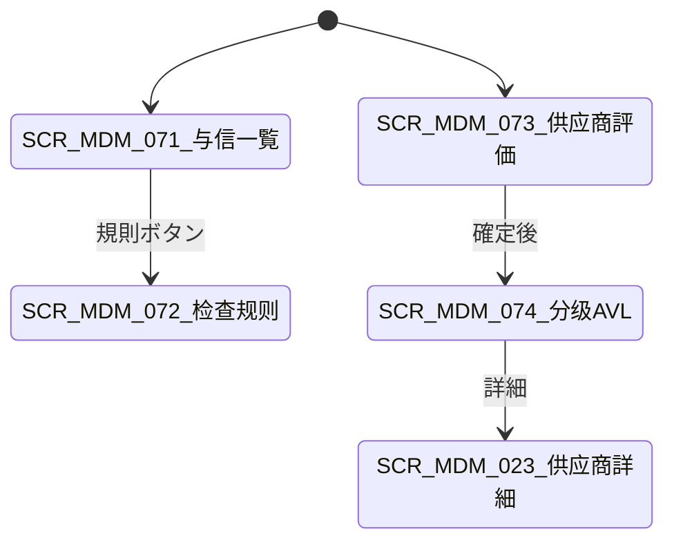

# 客户信用・供应商评估 详细设计书（与信管理・仕入先評価 詳細設計書）

| 項目 | 内容 |
|---|---|
| 文書名 | 客户信用・供应商评估 详细设计书（与信管理・仕入先評価 詳細設計書） |
| 文書番号 | DSN-MDM-006 |
| 版数 | v1.0 |
| 作成日 | 2026-10-20 |
| 作成者 | mdm-designer |
| 承認者 | 未承認（レビュー待ち） |
| 状態 | ドラフト（レビュー中） |
| 関連文書 | [業務域概要](00-overview.md) / [取引先](02-business-partner.md) / [共通業務規則](../00-common/08-common-business-rules.md) / [跨域流程](../00-common/09-cross-domain-flow.md) / [DB 設計](90-db-design.md) |

---

## 1. 機能概要

| 項目 | 内容 |
|---|---|
| 機能 ID | F-MDM-014（客户信用）/ F-MDM-015（供应商准入・评估・分级） |
| 機能名 | 客户信用额度与信用检查规则・供应商准入/评估/分级 |
| 目的 | ① 对客户赊销风险进行「额度 + 规则 + 状态」三层管控：MDM 维护信用额度、检查规则和信用状态，SAL/FIN 在受注・出荷・收款时调用检查接口并维护实际占用。② 对供应商建立「准入 → 合格（AVL）→ 月度评估 → 分级 → 暂停/淘汰」的治理闭环，把质量、交付、价格、服务、技术的客观数据转成可执行的采购策略 |
| 利用者・ロール | 财务主数据担当（信用额度）、财务总监/销售经理（信用承認）、采购经理/品质/财务（供应商评估）、采购员（参照） |
| 利用シーン | 新規顧客の与信設定、与信超過時の受注承認、与信凍結・解除、月末返済後の与信解放、新規仕入先の准入審査、月次評価の確定、D 級供應商の淘汰 |
| 優先度 | P0（信用）、P1（供应商评估） |
| 画面 ID | SCR-MDM-071/072（信用）、SCR-MDM-026/073/074（供应商） |
| 関連 IF | IF-MDM-005（供应商工商信息核验） |

## 2. 業務要件・業務ルール

### 2.1 前提条件

| # | 前提条件 | 成立しない場合の挙動 |
|---|---|---|
| 1 | 顧客が有効（`status=1`）で、`credit_limit_id` が設定済み | 与信チェックは「限度未設定」エラー `MSG-MDM-141` |
| 2 | 与信通貨（`currency_code`）が有効。取引通貨と異なる場合は取引日レートで換算 | 換算不可時はエラー |
| 3 | 供应商が登録済みで、資格（営業執照等）の有効期限が存在 | 准入申請不可 `MSG-MDM-150` |
| 4 | 評価に必要な取引実績データ（IQC 合格率・納期達成率）が PUR/INV/PRD から提供される | 設計確定までは手動評価項目で補完（未決 #2） |
| 5 | 与信変更の承認経路（WF）が配置済み：`businessType=MASTER_DATA_CHANGE`、`variables.masterDataType=MDM_CREDIT`、`processKey=APR-CR`（A20） | 提出時 `MSG-COM-073` |

### 2.2 業務ルール（客户信用）

| # | ルール | 根拠 | 関連項目 |
|---|---|---|---|
| BR-CRD-01 | 与信限度額は顧客ごとに 1 レコード（通貨付き）。总额度（`credit_limit_amount`）と単一受注上限（`single_order_limit_amount`、0=無制限）を持つ | 販売与信管理の慣行 | `mdm_credit_limit` |
| BR-CRD-02 | 与信チェック規則（`mdm_credit_check_rule`）は「チェック時点」「与信占用の範囲」「超限許容比率」「超限時の動作」を定義する。顧客は規則を 1 つ選択する | 与信管理の慣行 | `check_rule_id` |
| BR-CRD-03 | 与信占用額の計算は SAL/FIN が行い、MDM は関与しない。MDM は「残り与信枠」の照会 API を提供しない（占用額の二重管理を避ける） | 09 §11、[00-overview](00-overview.md) 未決 #4 | — |
| BR-CRD-04 | 信用状態（`credit_status`）：`10 正常` / `20 超限`（超限発生中）/ `30 凍結`（新規受注禁止）/ `40 閉鎖`（取引終了）。`30/40` は財務の承認なしに変更不可 | 08 第 9 章、09 第 5.3 節 | `credit_status` |
| BR-CRD-05 | 与信チェック時点（`check_timing`）：`10 受注登録時` / `20 受注承認時` / `30 出荷指示時`。複数指定可（例：受注時点 + 出荷時点）。設定された全時点でチェックを行う | 09 第 5 章 | `check_timing` |
| BR-CRD-06 | 超限動作（`overflow_action`）：`10 ブロック`（登録不可）/ `20 警告`（登録可、記録）/ `30 承認`（WF 承認後に可）。`20` は `credit_status=20` をセットし、経理・営業へ通知する | 09 第 5.3 節 | `overflow_action` |
| BR-CRD-07 | 超限許容比率（`over_limit_ratio`）は与信限度に対する許容超過率（例 0.05 = 5%）。占用額が「限度 × (1 + 比率)」を超えた場合に超限と判定する | 与信管理の慣行 | `over_limit_ratio` |
| BR-CRD-08 | 与信限度の変更（新規・増額・減額）は WF 承認（A20/`APR-CR`：销售总监 → 财务总监（→ 总经理※設定額以上））を必須とし、変更履歴を `mdm_credit_limit_his` に記録する。減額は既存注残に遡及しない | approval-matrix A20、08 第 8.1 節 | `mdm_credit_limit` |
| BR-CRD-09 | 与信状態の凍結・解除は財務のみ。凍結時は受注 API が `MSG-MDM-143` を返し、解除は財務の承認 + 理由必須 | 09 第 5.3 節 | `credit_status` |
| BR-CRD-10 | 与信限度の有効期間（`valid_from`/`valid_to`）を持ち、期間外は「限度なし」として扱う（新規受注は承認必須）。更新は新レコードで行う | 与信審査の年次更新 | `valid_from`/`valid_to` |
| BR-CRD-11 | 顧客の与信状態・限度は `mdm.customer.changed`（E02）で SAL/FIN に通知する。当日の変更は即時反映（キャッシュ TTL 5 分） | 09 第 3 章 E02 | — |
| BR-CRD-12 | 与信限度・与信状態（凍結/解除）の確定変更時に領域事件 **E42 `mdm.credit-limit.changed`** を Outbox に記録して発行する（09 第 3 章）。ペイロード：`customerId, creditLimit, creditStatus, validFrom, reason`。SAL/FIN は与信チェックキャッシュを更新し、超過再判定を行う | 09 第 3 章 E42 | `credit_limit_amount`、`credit_status` |
| BR-CRD-13 | **与信判定結果コード（`credit_check_result`、SAL/FIN 共用の正本）**：`10 正常`（続行可）/ `20 注意`（許容比率内の警告、続行可・記録）/ `30 超限審査中`（WF 承認待ち、出荷保留）/ `40 超限承認済`（承認済、出荷可）/ `90 凍結・閉鎖`（受注・出荷不可）。`credit_status`（10 正常/20 超限/30 凍結/40 閉鎖）とは別軸であり、`credit_status=30/40` は結果 90、`credit_status=20` は結果 20/30 となる。SAL の E06 `creditCheckResult` も本コードに従う | Lead 裁定（红队第 2 轮 REV-003）、本設計 | `credit_status`、E06 payload |

### 2.3 業務ルール（供应商准入・评估）

| # | ルール | 根拠 | 関連項目 |
|---|---|---|---|
| BR-SEV-01 | 准入状態：`10 潜在` → `20 審査中` → `30 合格`（AVL 掲載）/ `40 不合格`。合格後は `50 暂停` / `60 淘汰` へ遷移可 | 購買統制の慣行 | `admission_status` |
| BR-SEV-02 | 准入審査では「営業執照・税号・銀行口座・品質資格（ISO 9001 等）・供給範囲・価格競争力」を確認し、資格の有効期限が 30 日以上残っていることを必須とする | 品質マネジメントの慣行 | `mdm_supplier_qualification` |
| BR-SEV-03 | 合格供应商のみ発注可能（`admission_status=30`）。暂停中は既存発注の受入のみ可、新規発注不可。淘汰は取引終了状態で、再取引は新規准入から | 08 第 11 章 | `admission_status` |
| BR-SEV-04 | 評価は月次（BAT-MDM-004）に「品質 35%・納期 25%・価格 20%・服務 10%・技術 10%」の 5 観点で 0〜100 点を算出し、総合点で分级する | 購買戦略の慣行、[00-overview](00-overview.md) KPIs | `mdm_supplier_evaluation` |
| BR-SEV-05 | 分级基準：A（≥90）、B（80〜89）、C（70〜79）、D（<70）。A は戦略供應商（発注比率増）、C は改善指導、D は准入停止候補として采购经理へ通知する | 購買戦略の慣行 | `supplier_grade` |
| BR-SEV-06 | 品質点の客観データは「IQC 合格率（PUR/PRD の検査結果）」、納期点は「納期達成率（発注納期 vs 受入日）」を使用する。データがない月は「前月値 or 手動評価」で補完し、補完フラグを立てる | 09 第 8 章、データ品質要件 | `eval_source` |
| BR-SEV-07 | 評価結果は確定後に供应商へフィードバックし（設定）、改善要求（CAPA）を発行できる。評価の修正は確定後不可（再評価で対応） | 品質改善の慣行 | — |
| BR-SEV-08 | 評価・分级・准入状態の変更は監査ログに記録し、AVL の変更は PUR へ通知する（E03 の `changedFields` に `admissionStatus`/`supplierGrade` を含める） | 09 第 3 章 E03 | — |
| BR-SEV-09 | 評価の重み・分级基準は `sys_param` で管理し、変更は采购经理の承認を要する（ハードコード禁止） | 設計方針 8 | `sys_param` |
| BR-SEV-10 | サプライヤー品質問題（重大不良）が発生した場合、評価月を待たずに `50 暂停` へ変更できる（采购经理 + 品质经理の承認） | 品質事故対応の慣行 | `admission_status` |

### 2.4 計算式・判定式

| # | 対象 | 算式 | 丸め | 例 |
|---|---|---|---|---|
| CALC-CRD-01 | 与信超過判定 | 与信占用額 > 限度額 × (1 + `over_limit_ratio`) | 2 桁 | 【示例値】占用 520,000 > 500,000 × 1.05 = 525,000 → 非超過（警告なし） |
| CALC-CRD-02 | 単一受注上限判定 | 受注税込金額 > `single_order_limit_amount`（0=無制限） | 2 桁 | 【示例値】210,000 > 200,000 → 超過 |
| CALC-SEV-01 | 総合評価点 | 品質 × 0.35 + 納期 × 0.25 + 価格 × 0.20 + 服務 × 0.10 + 技術 × 0.10 | 2 桁 HALF_UP | 【示例値】90×0.35 + 80×0.25 + 85×0.20 + 88×0.10 + 82×0.10 = 85.60 |
| CALC-SEV-02 | 納期達成率 | 納期内受入行数 ÷ 受入行数 × 100 | 2 桁 | 【示例値】48 ÷ 50 = 96.00% |
| CALC-SEV-03 | IQC 合格率 | 合格ロット数 ÷ 検査ロット数 × 100 | 2 桁 | 【示例値】95 ÷ 100 = 95.00% |
| CALC-SEV-04 | 価格点 | 100 − (当社調達単価 − 市場最安値) ÷ 市場最安値 × 100（下限 0） | 2 桁 | 【示例値】対象 3 社中最安 → 100 |

### 2.5 与信チェックの拟似コード（SAL/FIN が呼び出す契約）

```
function checkCredit(customerId, orderAmountGross, currencyCode, checkPoint):
    # 1) 顧客・与信レコード取得（同期参照：GET /api/mdm/customers/{id}/credit-limit）
    #    戻り値 result は BR-CRD-13 のコード（10正常/20注意/30超限審査中/40超限承認済/90凍結・閉鎖）
    customer = getCustomer(customerId)
    if customer.status != 1: return { result: 90, reason: 'CUSTOMER_INACTIVE' }
    if customer.creditStatus == 30: return { result: 90, reason: 'CREDIT_FROZEN', messageId: 'MSG-MDM-143' }
    if customer.creditStatus == 40: return { result: 90, reason: 'CREDIT_CLOSED' }
    limit = customer.creditLimit
    if limit is null or limit.validTo < today: return { result: 10, reason: 'NO_LIMIT' }

    # 2) 占用額は SAL/FIN が保有（MDM は計算しない）
    exposure = callerProvidedExposure(customerId)       # 受注残 + 出荷済未回収 + 請求済未回収 など規則で定義
    fx = convertCurrency(orderAmountGross, currencyCode, limit.currencyCode, today)
    projected = exposure + fx

    # 3) 判定
    if limit.singleOrderLimitAmount > 0 and fx > limit.singleOrderLimitAmount:
        return { result: 30, reason: 'SINGLE_ORDER_LIMIT', messageId: 'MSG-MDM-145' }
    if projected > limit.creditLimitAmount * (1 + limit.overLimitRatio):
        if limit.overflowAction == 10: return { result: 90, reason: 'OVER_LIMIT', messageId: 'MSG-MDM-142' }
        if limit.overflowAction == 20: return { result: 20, reason: 'OVER_LIMIT', messageId: 'MSG-MDM-144' }
        return { result: 30, reason: 'OVER_LIMIT', messageId: 'MSG-MDM-146' }   # WF 承認後に 40 へ更新
    return { result: 10, exposureAmount: exposure, availableAmount: limit.creditLimitAmount - projected }
```

> 責任分界：**MDM は「限度・規則・状態」を提供し、占用額の計算・保存は SAL/FIN が行う**。MDM は与信占用額を保持しない（[00-overview](00-overview.md) 未決 #4）。

## 3. 画面設計

### 3.1 画面一覧

| 画面 ID | 画面名 | 類型 | 概要 |
|---|---|---|---|
| SCR-MDM-071 | 客户信用额度一覧/登録編集 | 一覧検索/登録編集 | 顧客別の限度額・単一上限・超限動作・有効期間 |
| SCR-MDM-072 | 信用检查规则管理 | 登録編集 | チェック時点・占用範囲・許容比率・動作 |
| SCR-MDM-026 | 供应商准入審査 | ワークフロー | 准入申請内容・資格・審査結果・承認（[02](02-business-partner.md) 4.1） |
| SCR-MDM-073 | 供应商评估 | 一覧検索/登録編集 | 月次評価の入力・集計・確定 |
| SCR-MDM-074 | 供应商分级/AVL | 照会 | 分级一覧、AVL、評価推移 |

### 3.2 画面遷移



### 3.3 画面レイアウト

**SCR-MDM-071 信用额度一覧**

```
┌──────────────────────────────────────────────────────────────────────────┐
│ パンくず：ホーム > 主数据 > 客户 > 信用额度          [新規][一括更新][出力]  │
├──────────────────────────────────────────────────────────────────────────┤
│〔検索条件〕客户[______] 与信状態[▼] 限度額範囲[____]〜[____] 有効日[____]   │
├──────────────────────────────────────────────────────────────────────────┤
│〔一覧〕客户 | 通貨 | 限度額 | 単一上限 | 超限率 | 超限動作 | 状態 | 有効期間│
│  C000123 | CNY | 500,000.00 | 200,000.00 | 5.00% | 承認 | 正常 | 2026-01-01〜│
├──────────────────────────────────────────────────────────────────────────┤
│〔フッタ〕全 1,200 件 1/60 ページ                                          │
└──────────────────────────────────────────────────────────────────────────┘
```

### 3.4 画面項目定義

#### 3.4.1 信用额度 SCR-MDM-071

| No | 項目 ID | 項目名 | 区分 | 種別 | 型/桁 | 必須 | 初期値 | 入力チェック | データソース | DB 項目 | 権限 | 備考 |
|---|---|---|---|---|---|---|---|---|---|---|---|---|
| 1 | `customerId` | 客户 | 検索/編集 | 選択ダイアログ | BIGINT | ○ | 空 | 有効顧客・1 顧客 1 レコード | マスタ | customer_id | `mdm:credit:update` | — |
| 2 | `currency_code` | 通貨 | 検索/編集 | 選択 | VARCHAR(3) | ○ | CNY | ISO 4217 | マスタ | currency_code | 同上 | — |
| 3 | `credit_limit_amount` | 与信限度額 | 編集 | 数値 | NUMERIC(18,2) | ○ | 0 | ≥ 0 | 入力 | credit_limit_amount | 同上 | 0=限度なし |
| 4 | `single_order_limit_amount` | 単一受注上限 | 編集 | 数値 | NUMERIC(18,2) | — | 0 | ≥ 0 | 入力 | single_order_limit_amount | 同上 | 0=無制限 |
| 5 | `over_limit_ratio` | 超限許容率 | 編集 | 数値 | NUMERIC(7,4) | ○ | 0 | 0〜100 | 入力 | over_limit_ratio | 同上 | % |
| 6 | `check_rule_id` | 与信检查规则 | 編集 | 選択 | BIGINT | ○ | 既定規則 | 有効規則 | マスタ | check_rule_id | 同上 | — |
| 7 | `credit_status` | 与信状態 | 編集 | 選択 | SMALLINT | ○ | 10 | 10/20/30/40 | 承認制御 | credit_status | `mdm:credit:update`（凍結は財務） | — |
| 8 | `valid_from` / `valid_to` | 有効期間 | 編集 | 日付範囲 | DATE | ○/— | 当日/空 | 開始≦終了 | 入力 | valid_from/to | `mdm:credit:update` | — |
| 9 | `credit_remark` | 与信理由・特記 | 編集 | テキスト | VARCHAR(500) | — | 空 | ≤ 500 字 | 入力 | credit_remark | 同上 | 審査理由 |
| 10 | `last_review_date` | 直近審査日 | 編集 | 日付 | DATE | — | 空 | — | 入力 | last_review_date | 同上 | 年次審査 |
| 11 | `btn_submit` | 承認提出 | ボタン | — | — | — | — | — | — | — | 同上 | WF `MASTER_DATA_CHANGE`/`MDM_CREDIT`/`APR-CR`（A20） |
| 12 | `btn_freeze` | 凍結 | ボタン | — | — | — | — | 理由必須 | — | — | `mdm:credit:update` | 財務のみ |
| 13 | `col_history` | 変更履歴 | リンク | — | — | — | — | — | — | `mdm_credit_limit_his` | `mdm:change:view` | — |

#### 3.4.2 信用检查规则 SCR-MDM-072

| No | 項目 ID | 項目名 | 種別 | 型/桁 | 必須 | 初期値 | 入力チェック | DB 項目 | 備考 |
|---|---|---|---|---|---|---|---|---|---|
| 1 | `rule_code` | 規則コード | テキスト | VARCHAR(32) | ○ | 空 | 一意 | rule_code | 例 CR-STD |
| 2 | `rule_name` | 規則名称 | テキスト | VARCHAR(100) | ○ | 空 | 1〜100 字 | rule_name | — |
| 3 | `check_timing` | チェック時点 | 複数選択 | SMALLINT[] | ○ | [10,30] | 10 受注登録/20 受注承認/30 出荷指示 | check_timing | JSONB 配列 |
| 4 | `exposure_scope` | 占用範囲 | 複数選択 | SMALLINT[] | ○ | [10,20,30] | 10 受注残/20 出荷済未回収/30 請求済未回収 | exposure_scope | — |
| 5 | `include_open_orders` | 未出荷注文を含む | チェック | BOOLEAN | — | TRUE | — | include_open_orders | — |
| 6 | `over_limit_ratio` | 超限許容率 | 数値 | NUMERIC(7,4) | ○ | 0 | 0〜100 | over_limit_ratio | 規則既定値 |
| 7 | `overflow_action` | 超限動作 | 選択 | SMALLINT | ○ | 30 | 10 ブロック/20 警告/30 承認 | overflow_action | — |
| 8 | `status` | 状態 | 選択 | SMALLINT | ○ | 1 | 1/0 | status | — |

#### 3.4.3 供应商评估 SCR-MDM-073

| No | 項目 ID | 項目名 | 区分 | 種別 | 型/桁 | 必須 | 初期値 | 入力チェック | データソース | DB 項目 | 権限 | 備考 |
|---|---|---|---|---|---|---|---|---|---|---|---|---|
| 1 | `evaluation_period` | 評価期間 | 検索/編集 | 月選択 | VARCHAR(7) | ○ | 前月 | YYYY-MM | 入力 | evaluation_period | `mdm:supplier-eval:update` | — |
| 2 | `supplierId` | 供應商 | 検索 | 選択 | BIGINT | — | 空 | 有効 | マスタ | supplier_id | 参照可 | — |
| 3 | `supplier_grade` | 分级 | 検索 | 選択（複数） | VARCHAR(1) | — | 空 | A/B/C/D | 固定値 | supplier_grade | 参照可 | — |
| 4 | `quality_score` | 品質点 | 編集 | 数値 | NUMERIC(5,2) | ○ | 空 | 0〜100 | IQC 実績 or 手動 | quality_score | 評価者 | 权重 35% |
| 5 | `delivery_score` | 納期点 | 編集 | 数値 | NUMERIC(5,2) | ○ | 空 | 0〜100 | 納期達成率 or 手動 | delivery_score | 同上 | 权重 25% |
| 6 | `price_score` | 価格点 | 編集 | 数値 | NUMERIC(5,2) | ○ | 空 | 0〜100 | 比価/市場価格 | price_score | 同上 | 权重 20% |
| 7 | `service_score` | 服務点 | 編集 | 数値 | NUMERIC(5,2) | ○ | 空 | 0〜100 | 手動評価 | service_score | 同上 | 权重 10% |
| 8 | `technology_score` | 技術点 | 編集 | 数値 | NUMERIC(5,2) | ○ | 空 | 0〜100 | 手動評価 | technology_score | 同上 | 权重 10% |
| 9 | `total_score` | 総合点 | 表示 | 数値 | NUMERIC(5,2) | — | 自動 | 自動計算 | CALC-SEV-01 | total_score | 参照可 | — |
| 10 | `supplier_grade` | 分级結果 | 表示 | バッジ | VARCHAR(1) | — | 自動 | 自動判定 | BR-SEV-05 | supplier_grade | 参照可 | A/B/C/D |
| 11 | `eval_source` | データソース | 表示 | 選択 | SMALLINT | — | 10 自動 | 10 自動/20 手動/30 混在 | — | eval_source | 参照可 | 補完時 20 |
| 12 | `evaluator_comment` | 評価コメント | 編集 | テキスト | VARCHAR(500) | — | 空 | ≤ 500 字 | 入力 | evaluator_comment | 同上 | — |
| 13 | `btn_confirm` | 評価確定 | ボタン | — | — | — | — | 全項目入力済 | — | — | `mdm:supplier-eval:update` | 確定後は修正不可 |
| 14 | `btn_capa` | 改善要求発行 | ボタン | — | — | — | — | C/D 級のみ推奨 | — | — | `mdm:supplier-eval:update` | 第一版連携（TODO：設計未作成） |

### 3.5 イベント処理

| No | イベント | トリガ | 処理内容 | 呼出 API | 画面遷移 | 備考 |
|---|---|---|---|---|---|---|
| 1 | 与信限度保存 | 保存 | 入力チェック→WF 提出 | `POST/PUT /api/mdm/credit-limits` | 一覧へ | 承認必須 |
| 2 | 凍結 | ボタン | 凍結理由必須→`credit_status=30`、E02 発行 | `POST /api/mdm/credit-limits/{id}/freeze` | 同一画面 | 財務のみ |
| 3 | 評価自動計算 | 月次バッチ/ボタン | 品質・納期を PUR/INV から取得して自動計算 | `POST /api/mdm/supplier-evaluations/calculate` | 同一画面 | 失敗時は手動 |
| 4 | 評価確定 | ボタン | 総合点・分级を確定、AVL 更新、E03 発行 | `POST /api/mdm/supplier-evaluations/{id}/confirm` | SCR-MDM-074 | — |
| 5 | 分级基準変更 | 管理画面 | `sys_param` 更新（采购经理承認） | `PUT /api/system/params` | — | SYS 管理 |

### 3.6 一覧画面仕様

| 項目 | 内容 |
|---|---|
| 検索条件 | 与信：顧客・状態・限度額範囲・有効日。評価：期間・供應商・分级 |
| ソート | 与信：`credit_limit_amount DESC`。評価：`total_score DESC` |
| ページング | 20/50/100/200 |
| 一括操作 | 与信：一括有効化（承認後）、評価：一括確定（期間単位） |
| エクスポート | Excel、10,000 件。与信は財務権限のみ |
| 印刷 | PRT-MDM-005 客户信用额度一覧、PRT-MDM-008 供应商评估结果表 |

## 4. 入力チェック仕様

| No | チェック ID | 対象項目 | 種別 | 条件 | タイミング | メッセージ ID |
|---|---|---|---|---|---|---|
| 1 | CHK-MDM-014-01 | `customer_id` | 一意 | 1 顧客 1 レコード（有効期間重複なし） | 保存時 | MSG-MDM-147 |
| 2 | CHK-MDM-014-02 | `credit_limit_amount` | 範囲 | ≥ 0、小数 2 桁 | 保存時 | MSG-COM-048 |
| 3 | CHK-MDM-014-03 | `over_limit_ratio` | 範囲 | 0〜100 | 保存時 | MSG-MDM-148 |
| 4 | CHK-MDM-014-04 | `valid_from`/`valid_to` | 相関 | 開始≦終了 | 保存時 | MSG-COM-046 |
| 5 | CHK-MDM-014-05 | 凍結/解除 | 権限 | 財務のみ・理由必須 | 操作時 | MSG-COM-030 |
| 6 | CHK-MDM-014-06 | 与信チェック | 業務 | 顧客有効・与信状態・限度有効期間 | 取引時（SAL） | MSG-MDM-141〜143 |
| 7 | CHK-MDM-015-01 | 准入申請 | 業務 | 資格有効期限 ≥ 30 日 | 申請時 | MSG-MDM-150 |
| 8 | CHK-MDM-015-02 | 評価点 | 範囲 | 各 0〜100 | 保存時 | MSG-MDM-151 |
| 9 | CHK-MDM-015-03 | 評価確定 | 業務 | 全観点入力済・期間未確定 | 確定時 | MSG-MDM-152 |
| 10 | CHK-MDM-015-04 | 分级変更 | 業務 | D 級→暂停は采购经理承認 | 操作時 | MSG-MDM-153 |

## 5. 処理詳細

### 5.1 処理一覧

| 処理 ID | 処理名 | 契機 | トランザクション | 排他 |
|---|---|---|---|---|
| PRC-MDM-014-01 | 与信限度登録・変更 | 保存・承認 | 要 | 楽観排他 |
| PRC-MDM-014-02 | 与信凍結・解除 | 操作 | 要 | 楽観排他 |
| PRC-MDM-014-03 | 与信チェック（参照） | SAL/FIN 呼出 | 不要（読取） | — |
| PRC-MDM-015-01 | 准入審査・AVL 更新 | 准入承認 | 要 | version |
| PRC-MDM-015-02 | 月次評価計算 | BAT-MDM-004 / 手動 | 要（期間単位） | 期間ロック |
| PRC-MDM-015-03 | 評価確定・分级更新 | 確定 | 要 | version |
| PRC-MDM-015-04 | 暂停・淘汰 | 操作・承認 | 要 | 楽観排他 |

### 5.2 処理手順（正常系）

**PRC-MDM-014-01 与信限度登録・変更**

1. 権限 `mdm:credit:update` をチェックする。
2. 顧客・通貨・規則の有効性、限度額・超限率・有効期間をチェックする。
3. 既存の有効レコードがある場合は「変更」として旧レコードの `valid_to` を新レコード開始日の前日に設定し、新レコードを INSERT する（履歴保持）。
4. WF へ提出する（`businessType=MASTER_DATA_CHANGE`、`variables.masterDataType=MDM_CREDIT`、`processKey=APR-CR`。経路 A20：销售总监 → 财务总监（→ 总经理※設定額以上））。
5. 承認後、`approved_at/by` を記録し、`mdm_credit_limit_his` に前後値を記録する。
6. E02 `mdm.customer.changed` を Outbox に INSERT する（ペイロードに `creditLimit` を含める）。
7. 監査ログに APPROVE を記録する。

**PRC-MDM-014-03 与信チェック（参照 API）**

1. SAL/FIN から `GET /api/mdm/customers/{id}/credit-limit` を呼び出す（同期参照）。
2. MDM は顧客の与信レコード・規則・状態を返す。**占用額は返さない**（呼出側が保有）。
3. 呼出側は 2.5 の拟似コードに従い判定し、結果（PASS/WARN/BLOCK/APPROVE）を業務画面に表示する。
4. 判定結果は SAL/FIN の伝票に `credit_check_result` として記録する（監査用）。

**PRC-MDM-015-02 月次評価計算（BAT-MDM-004）**

1. 対象期間（前月 YYYY-MM）と対象供應商（`admission_status IN (30,50)`）を決定する。
2. 品質点：PUR/PRD から IQC 合格率を取得（`quality_score = 合格率`）。
3. 納期点：PUR から納期達成率を取得（`delivery_score = 達成率`）。
4. 価格点：購買価格と市場参考価格（90-data の公開情報ベース）から算出、または購買担当の手動入力（未取得時）。
5. 服務点・技術点：購買担当・品質担当の手動入力（前月値のコピー可）。
6. 総合点 = Σ（観点点 × 权重）、分级を判定する。
7. `mdm_supplier_evaluation` / `mdm_supplier_eval_item` に INSERT する（`eval_status=10 計算済`）。
8. 購買担当へ確認・確定を促す通知を送る（未確定は翌月 5 日まで）。
9. 再実行は同一期間の `eval_status IN (10,20)` レコードを削除して再計算する（確定済 30 は変更しない）。

**PRC-MDM-015-03 評価確定・分级更新**

1. 評価レコードの `eval_status=10` を確認し、全観点の入力済をチェックする。
2. 総合点・分级を確定し、`eval_status=30`、`confirmed_at/by` を更新する。
3. 供應商の `supplier_grade` を更新し、D 級は `admission_status=50 暂停` の候補として采购经理へ通知する。
4. E03 `mdm.supplier.changed` を Outbox に INSERT する（`changedFields` に `supplierGrade`、`admissionStatus` を含める）。
5. 監査ログに確定・分级を記録する。

### 5.3 例外処理

| No | 異常条件 | 検知箇所 | 処理 | ロールバック | メッセージ ID |
|---|---|---|---|---|---|
| 1 | 与信レコード未設定 | チェック | 承認必須（限度なし） | なし | MSG-MDM-141 |
| 2 | 与信限度超過（ブロック設定） | チェック | 受注不可 | 全体（受注側） | MSG-MDM-142 |
| 3 | 与信凍結中 | チェック | 受注不可 | 全体 | MSG-MDM-143 |
| 4 | 超限警告（警告設定） | チェック | 登録可、`credit_status=20`、通知 | なし | MSG-MDM-144 |
| 5 | 単一受注上限超過 | チェック | 承認フローへ | なし | MSG-MDM-145 |
| 6 | 資格期限切れで准入承認 | 審査 | 承認保留 | 全体 | MSG-MDM-150 |
| 7 | 評価点範囲外 | 保存 | エラー | 全体 | MSG-MDM-151 |
| 8 | 確定済評価の再確定 | 確定 | エラー、再評価を案内 | 全体 | MSG-MDM-152 |
| 9 | 評価データ不足（品質・納期） | バッチ | 手動補完フラグを立てて継続 | なし | MSG-MDM-154（W） |

### 5.4 冪等性・再実行

- 与信チェックは読取のみ（冪等）。
- 月次評価は期間単位で再計算可（確定前のみ）。確定後は再評価レコードを新規作成する。
- 与信限度の WF コールバックは `eventId` で重複排除。
- 准入・暂停・淘汰は状態再判定で再実行可。

## 6. API 設計

| No | メソッド | パス | 権限 | 概要 | リクエスト | レスポンス |
|---|---|---|---|---|---|---|
| 1 | GET | `/api/mdm/credit-limits` | `mdm:credit:view` | 与信一覧 | customerId、status、date | `PageResult<CreditLimitDto>` |
| 2 | GET | `/api/mdm/credit-limits/{id}` | `mdm:credit:view` | 与信詳細 | id | `CreditLimitDto` |
| 3 | GET | `/api/mdm/customers/{customerId}/credit-limit` | `mdm:customer:credit:view` | 顧客与信照会（SAL/FIN 共用） | customerId、date | `CreditLimitDto` |
| 4 | POST/PUT | `/api/mdm/credit-limits[/{id}]` | `mdm:credit:update` | 与信登録・変更 | `CreditLimitRequest` | `CreditLimitDto` |
| 5 | POST | `/api/mdm/credit-limits/{id}/submit` | `mdm:credit:update` | 承認提出 | `{version}` | `CreditLimitDto` |
| 6 | POST | `/api/mdm/credit-limits/{id}/freeze` | `mdm:credit:update` | 凍結 | `{version, reason}` | `CreditLimitDto` |
| 7 | POST | `/api/mdm/credit-limits/{id}/unfreeze` | `mdm:credit:update` | 凍結解除 | `{version, reason}` | `CreditLimitDto` |
| 8 | GET | `/api/mdm/credit-check-rules` | `mdm:credit:view` | 規則一覧 | — | `List<CreditCheckRuleDto>` |
| 9 | POST/PUT | `/api/mdm/credit-check-rules[/{id}]` | `mdm:credit:update` | 規則 CRUD | `CreditCheckRuleRequest` | `CreditCheckRuleDto` |
| 10 | GET | `/api/mdm/supplier-evaluations` | `mdm:supplier-eval:view` | 評価一覧 | period、supplierId、grade | `PageResult<EvaluationDto>` |
| 11 | GET | `/api/mdm/supplier-evaluations/{id}` | `mdm:supplier-eval:view` | 評価詳細 | id | `EvaluationDetailDto` |
| 12 | POST | `/api/mdm/supplier-evaluations/calculate` | `mdm:supplier-eval:update` | 月次計算 | `{period}` | `{count, evaluations[]}` |
| 13 | PUT | `/api/mdm/supplier-evaluations/{id}` | `mdm:supplier-eval:update` | 評価修正（確定前） | `EvaluationRequest` | `EvaluationDto` |
| 14 | POST | `/api/mdm/supplier-evaluations/{id}/confirm` | `mdm:supplier-eval:update` | 評価確定・分级 | `{version, comment}` | `EvaluationDto` |
| 15 | GET | `/api/mdm/suppliers/{id}/evaluations` | `mdm:supplier-eval:view` | 供應商評価履歴 | id、期間 | `List<EvaluationDto>` |
| 16 | GET | `/api/mdm/supplier-avl` | `mdm:supplier-eval:view` | 合格供应商目录（AVL） | categoryCode、date | `List<AvlDto>` |
| 17 | POST | `/api/mdm/suppliers/{id}/suspend` | `mdm:supplier-admission:approve` | 暂停（品質問題等） | `{version, reason, approval}` | `SupplierDetailDto` |

### 6.1 リクエスト/レスポンス詳細

**GET /api/mdm/customers/{customerId}/credit-limit レスポンス例**

```json
{
  "code": 0,
  "message": "ok",
  "data": {
    "creditLimitId": "1845000000000000601",
    "customerId": "1845000000000000201",
    "customerCode": "C000123",
    "currencyCode": "CNY",
    "creditLimitAmount": "500000.00",
    "singleOrderLimitAmount": "200000.00",
    "overLimitRatio": "5.0000",
    "creditStatus": 10,
    "checkRule": {
      "ruleCode": "CR-STD",
      "checkTiming": [10, 30],
      "exposureScope": [10, 20, 30],
      "includeOpenOrders": true,
      "overflowAction": 30
    },
    "validFrom": "2026-01-01",
    "validTo": "2026-12-31",
    "lastReviewDate": "2026-01-10"
  }
}
```

**POST /api/mdm/supplier-evaluations/calculate レスポンス例**

```json
{
  "code": 0,
  "message": "ok",
  "data": {
    "period": "2026-09",
    "count": 48,
    "autoCount": 45,
    "manualCount": 3,
    "evaluations": [
      { "supplierCode": "S000045", "totalScore": "85.60", "supplierGrade": "B", "qualityScore": "90.00", "deliveryScore": "80.00", "priceScore": "85.00", "serviceScore": "88.00", "technologyScore": "82.00" }
    ]
  }
}
```

## 7. データ更新仕様

| テーブル | 操作 | 更新項目 | 更新条件 | トリガ |
|---|---|---|---|---|
| `mdm_credit_limit` | INSERT/UPDATE | 限度額・超限率・状態・有効期間 | 登録・承認・凍結・解除 | PRC-MDM-014-01/02 |
| `mdm_credit_limit_his` | INSERT | 前後値・承認 | 与信変更 | PRC-MDM-014-01/02 |
| `mdm_credit_check_rule` | INSERT/UPDATE | チェック時点・範囲・動作 | 登録・更新 | F-MDM-014 |
| `mdm_supplier_evaluation` | INSERT/UPDATE | 総合点・分级・状態 | 月次計算・確定 | PRC-MDM-015-02/03 |
| `mdm_supplier_eval_item` | INSERT | 観点別点数・データソース | 月次計算・修正 | PRC-MDM-015-02 |
| `mdm_supplier` | UPDATE | `supplier_grade`、`admission_status` | 評価確定・暂停 | PRC-MDM-015-03/04 |
| `mdm_supplier_admission` | INSERT/UPDATE | 准入経過・結果 | 准入申請・承認 | PRC-MDM-015-01 |
| `sys_outbox_event` | INSERT | E02/E03 | 与信変更・評価確定 | PRC-MDM-014-01/015-03 |
| `sys_audit_log` | INSERT | APPROVE/FREEZE/CONFIRM | 全操作 | 全処理 |

## 8. エラー処理・メッセージ

| メッセージ ID | 種別 | 本文 | 発生条件 | 利用者への対処 | ログ |
|---|---|---|---|---|---|
| MSG-MDM-141 | E | 顧客の与信限度が設定されていません。与信設定後に受注してください。 | 与信レコードなし | 財務へ与信申請 | WARN |
| MSG-MDM-142 | E | 与信限度額を超過しています（限度：{0}、占用予定：{1}）。受注できません。 | ブロック設定で超過 | 入金・限度見直し | WARN |
| MSG-MDM-143 | E | 顧客は与信凍結中です。財務部に解除を申請してください。 | 凍結中 | 財務へ解除申請 | WARN |
| MSG-MDM-144 | W | 与信限度額を超過しています（警告）。経理・営業責任者に通知しました。 | 警告設定で超過 | 入金状況確認 | WARN |
| MSG-MDM-145 | W | 単一受注上限を超過しています。承認フローで審査されます。 | 単一上限超過 | 承認へ | WARN |
| MSG-MDM-146 | I | 与信超過の承認申請を送信しました。承認まで出荷できません。 | 承認設定で超過 | 承認待ち | INFO |
| MSG-MDM-147 | E | 該当顧客の有効な与信レコードが既に存在します。変更は履歴保持のため新レコードで行います。 | 重複 | 変更画面を使用 | WARN |
| MSG-MDM-148 | E | 超限許容率は 0〜100% の範囲で入力してください。 | 範囲外 | 修正 | WARN |
| MSG-MDM-150 | E | 有効な資格（営業執照等）が不足しているか、有効期限が 30 日未満です。准入承認できません。 | 資格不足 | 資格更新 | WARN |
| MSG-MDM-151 | E | 評価点は 0〜100 の範囲で入力してください。 | 範囲外 | 修正 | WARN |
| MSG-MDM-152 | E | 確定済みの評価は変更できません。再評価を新規作成してください。 | 確定済変更 | 再評価 | WARN |
| MSG-MDM-153 | W | D 級供應商です。暂停または改善要求（CAPA）の発行を検討してください。 | D 級 | 采购经理判断 | INFO |
| MSG-MDM-154 | W | 品質・納期の実績データが不足しています。一部を手動評価で補完しました。 | データ不足 | データ確認 | INFO |

## 9. 権限・セキュリティ

| 種別 | 内容 |
|---|---|
| 画面権限 | `mdm:credit:view/update`、`mdm:supplier-eval:view/update`、`mdm:supplier-admission:approve` |
| 操作権限 | 与信凍結・解除=`mdm:credit:update`（財務のみ）、評価確定=`mdm:supplier-eval:update`、准入承認=`mdm:supplier-admission:approve` |
| 項目権限 | 与信限度・評価点は営業担当に参照のみ。評価コメントは評価者のみ編集 |
| データ範囲 | 与信は財務・経営層が全社参照。評価は購買・品質・財務が全社参照 |
| 監査ログ | 与信変更・凍結・解除・評価確定・准入・暂停を記録 |
| SoD | 与信申請と承認（A20：销售总监→财务总监）は同一不可。評価入力者と評価確定者は分離する（第一版から強制） |

## 10. 性能・非機能

| 項目 | 目標値 | 前提 |
|---|---|---|
| 与信照会 API | 200ms 以内 | キャッシュ 5 分、顧客 1 件 |
| 与信一覧 | 2 秒以内（100 件） | — |
| 月次評価 | 1,000 供應商 × 5 観点で 5 分以内 | バッチ、PUR/INV 参照は API or 集計テーブル |
| 評価件数 | 50,000 件/年 | — |
| 可用性 | 99.5% | 与信照会は SAL 受注に直結するため重要度高 |

## 11. テスト観点

| No | 観点 ID | 分類 | 観点 | 期待結果 |
|---|---|---|---|---|
| 1 | TST-F-MDM-014-01 | 正常系 | 与信限度 500,000、占用 400,000、受注 50,000 | PASS |
| 2 | TST-F-MDM-014-02 | 正常系 | 超限率 5%、占用 520,000、受注 10,000 | 525,000 以内 → PASS |
| 3 | TST-F-MDM-014-03 | 異常系 | ブロック設定で超過 | MSG-MDM-142、受注不可 |
| 4 | TST-F-MDM-014-04 | 異常系 | 凍結中の受注 | MSG-MDM-143 |
| 5 | TST-F-MDM-014-05 | 境界値 | 占用 = 限度 × 1.05 ちょうど | 超過しない（> 判定） |
| 6 | TST-F-MDM-014-06 | 権限 | 営業担当が与信変更 | 403 |
| 7 | TST-F-MDM-014-07 | 監査 | 与信変更承認後の履歴 | 前後値・承認者・日時が記録 |
| 8 | TST-F-MDM-015-01 | 正常系 | 月次評価計算 | 総合点 85.60、分级 B（【示例值】） |
| 9 | TST-F-MDM-015-02 | 正常系 | 評価確定→分級更新 | 供應商 `supplier_grade=B`、E03 発行 |
| 10 | TST-F-MDM-015-03 | 異常系 | 確定済評価の変更 | MSG-MDM-152 |
| 11 | TST-F-MDM-015-04 | 異常系 | 評価点 101 | MSG-MDM-151 |
| 12 | TST-F-MDM-015-05 | 業務 | 資格期限切れの准入承認 | MSG-MDM-150 |
| 13 | TST-F-MDM-015-06 | バッチ | データ不足時の手動補完 | `eval_source=20`、警告 |

## 12. 未決事項

| # | 事項 | 理由 | 暫定仕様 | 担当 | 期限 |
|---|---|---|---|---|---|
| 1 | 与信占用額の計算式・保有テーブル（SAL/FIN どちらが正か） | 09 未定義。本設計は MDM 非保有 | MDM は限度・規則・状態のみ。占用は SAL の伝票残 + FIN の AR 残で算出し、SAL/FIN の設計で確定 | lead / sales-designer / FIN | 2026-10-24 |
| 2 | 品質・納期の実績データ取得方法（PUR/INV のテーブル直接参照か API か） | 実装方式未定 | 設計確定までは PUR/INV の集計 API を呼び出す想定。未提供時は手動評価 | lead / PUR/INV | 2026-10-30 |
| 3 | 評価の重み・分级基準の初期値（35/25/20/10/10、A≥90 等） | 示例企業の購買方針が未確定 | `sys_param` に初期値を設定し、采购经理の承認で変更 | lead | 2026-10-30 |
| 4 | 与信限度の見直しサイクル（年次 or 半期） | 与信審査規程が未確定 | 年次（`last_review_date` から 12 か月で警告） | lead | 2026-10-30 |
| 5 | 評価結果の供應商フィードバック方法（メール/ポータル） | サプライヤーポータル（第一版対象、TODO） | 設計確定までは帳票出力（PRT-MDM-008）と購買担当の手動連絡 | lead | 2026-11-06 |
| 6 | 信用保険・担保情報の管理要否 | 与信リスク管理の高度化 | 設計確定までは与信限度のみ。担保・保証は `ext_data` で暫定保持 | lead | 2026-11-06 |

## 13. 改訂履歴

| 版数 | 日付 | 変更内容 | 変更者 |
|---|---|---|---|
| v1.0 | 2026-10-20 | 初版：与信限度・检查规则・供应商准入/评估/分级 2 機能 5 画面、与信チェック拟似コード、月次評価処理、API、エラー、テスト観点。同日追記：WF 提出契約を `MASTER_DATA_CHANGE`＋`MDM_CREDIT`＋`APR-CR`（A20）方式へ変更、承認経路を A20 に整合、E42 `mdm.credit-limit.changed` 発行を追記。第 2 次追記（红队第 2 轮 REV-003）：与信判定結果コード BR-CRD-13（10 正常/20 注意/30 超限審査中/40 超限承認済/90 凍結・閉鎖）を新設し、擬似コードの戻り値を同コード体系へ統一 | mdm-designer |
