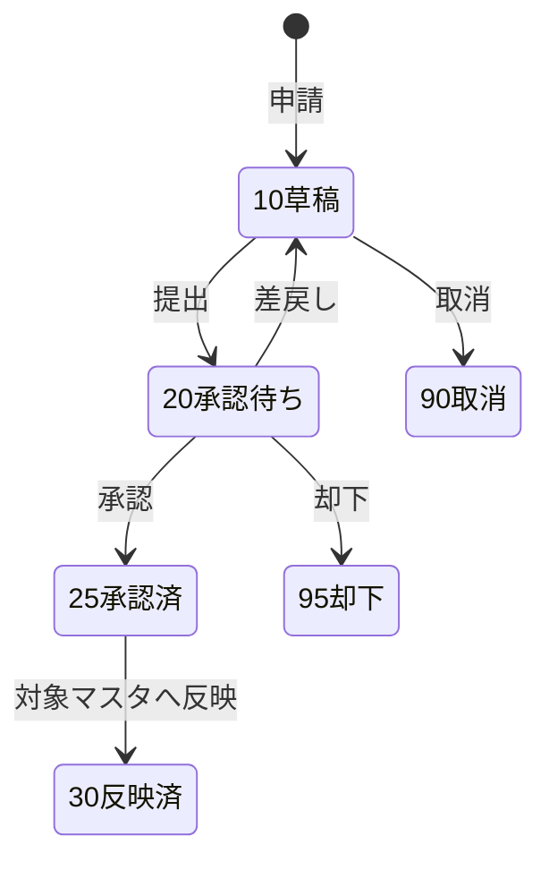
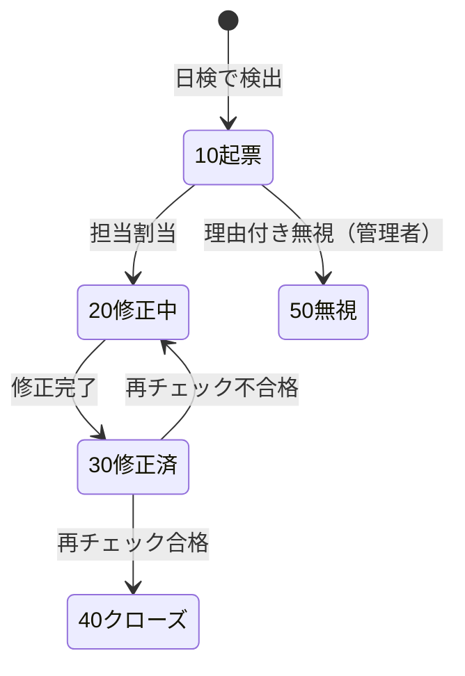
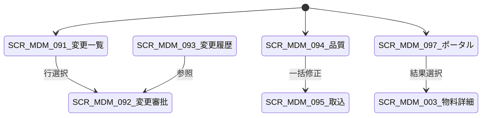

# 物料替代・条码・主数据治理 详细设计书（代替品目・バーコード・マスタガバナンス 詳細設計書）

| 項目 | 内容 |
|---|---|
| 文書名 | 物料替代・条码・主数据治理 详细设计书（代替品目・バーコード・マスタガバナンス 詳細設計書） |
| 文書番号 | DSN-MDM-007 |
| 版数 | v1.0 |
| 作成日 | 2026-10-20 |
| 作成者 | mdm-designer |
| 承認者 | 未承認（レビュー待ち） |
| 状態 | ドラフト（レビュー中） |
| 関連文書 | [業務域概要](00-overview.md) / [物料主数据](01-material-master.md) / [仓库库位](03-warehouse-location.md) / [共通業務規則](../00-common/08-common-business-rules.md) / [跨域流程](../00-common/09-cross-domain-flow.md) / [DB 設計](90-db-design.md) |

---

## 1. 機能概要

| 項目 | 内容 |
|---|---|
| 機能 ID | F-MDM-016（物料替代）/ F-MDM-017（条码規則・标签）/ F-MDM-018（変更審批・版本履歴）/ F-MDM-019（数据质量・批量维护）/ F-MDM-020（数据权限）/ F-MDM-022（主数据检索・门户）/ F-MDM-023（分发・外部同期） |
| 機能名 | 物料替代关系・条码规则・主数据变更审批与版本历史・数据质量校验与批量维护・主数据数据权限・主数据检索 |
| 目的 | 在物料/取引先/价格等主数据之上补齐「治理能力」：① 替代关系让采购、设计、生产在缺料或设计变更时有一致的替代规则；② 条码规则与标签把主数据落到现场（PDA/扫描）；③ 变更审批与版本历史保证关键字段变更可追溯；④ 数据质量校验与批量维护保证主数据长期可用；⑤ 数据权限保证按公司/工厂/部门隔离；⑥ 主数据门户提供跨对象统一检索 |
| 利用者・ロール | 物料主数据担当、质量/技术（替代承認）、仓库（条码印刷）、数据治理担当（数据质量）、系统管理员（数据权限）、全业务用户（检索） |
| 利用シーン | 轴承品牌切换（哈轴↔瓦轴）时的替代登记、缺料时的替代发料、条码标签重新发行、价格/信用/口座的变更审批、月度数据质量检查、库存主数据批量修正、工厂别数据权限设定 |
| 優先度 | P0（F-MDM-018/020）、P1（F-MDM-016/017/019/022）、P2（F-MDM-023） |
| 画面 ID | SCR-MDM-081/082/083/091/092/093/094/095/096/097 |

## 2. 業務要件・業務ルール

### 2.1 前提条件

| # | 前提条件 | 成立しない場合の挙動 |
|---|---|---|
| 1 | 代替元・代替先の物料が有効 | 代替登録不可 `MSG-MDM-171` |
| 2 | 条码規則が有効（条码発行時）。GS1 を使用する場合は会社識別コード（GS1 Company Prefix）の取得が必要 | 発行不可 `MSG-MDM-176` |
| 3 | 変更申請の承認経路（WF）が配置済み | 提出不可 `MSG-COM-073` |
| 4 | データ権限設定（SYS）が完了している | データ参照が全社既定（設定不備は警告） |

### 2.2 業務ルール（物料替代）

| # | ルール | 根拠 | 関連項目 |
|---|---|---|---|
| BR-SUB-01 | 代替関係は「代替元物料（`material_id`）→ 代替先物料（`substitute_material_id`）」の方向を持つ。`is_bidirectional=TRUE` の場合は相互代替として扱う | 設計変更・調達代替の慣行 | `is_bidirectional` |
| BR-SUB-02 | 代替タイプ（`substitute_type`）：`10 完全互換` / `20 条件付き互換`（顧客承認・技術承認が必要）/ `30 一方向`（旧品→新品等）/ `40 緊急代替`（一時的）。条件付き・緊急代替は `approval_required=TRUE` | 品質保証の慣行 | `substitute_type` |
| BR-SUB-03 | 代替優先度（`priority`）は小さいほど優先。同一代替元に複数の代替先がある場合、優先度順に提案する（PRD の BOM 代替、INV の払出代替、PUR の調達代替） | 09 第 6 章、PRD/INV の要件 | `priority` |
| BR-SUB-04 | 代替数量比率（`conversion_ratio`）を定義できる（例：代替先 1 単位 = 代替元 1.2 単位）。0.000001〜1,000,000 の範囲 | 代替時の数量換算 | `conversion_ratio` |
| BR-SUB-05 | 代替関係は有効期間（`valid_from`/`valid_to`）を持ち、期間外は使用しない。設計変更（ECN）に連動する場合は `ecn_no` を記録する | 設計変更管理の慣行 | `valid_from`/`valid_to`、`ecn_no` |
| BR-SUB-06 | 代替関係の登録・変更は WF 承認（技術部長 → 品質部長。顧客要求がある場合は営業も）を必須とする。自己参照（同一物料）・循環参照（A→B→A）は登録不可 | 品質・設計統制 | — |
| BR-SUB-07 | 緊急代替（`40`）は有効期間を最長 90 日とし、期限後は自動的に使用停止する（BAT で状態更新） | 一時的措置の統制 | `valid_to` |
| BR-SUB-08 | 代替関係の削除は論理削除。使用中の代替（未完了の BOM・工単・発注で参照）がある場合は削除不可、使用停止で対応 | 01 共通項目定義 11.2 | `deleted` |

### 2.3 業務ルール（条码規則・标签）

| # | ルール | 根拠 | 関連項目 |
|---|---|---|---|
| BR-BAR-01 | 条码規則は「対象種別（`10 物料` / `20 批次` / `30 库位` / `40 包装箱` / `50 序列号`）+ 条码类型（`10 Code 128` / `20 GS1-128` / `30 QR`）+ 编码段定義 + 校验方式」で構成する | 【実データ】ISO/IEC 15417:2007（Code 128）、GS1 General Specifications（GS1-128） | `barcode_type` |
| BR-BAR-02 | Code 128 は英数字・記号を高密度で表現でき、チェックディジット（モジュラス 103）を必須とする。GS1-128 はアプリケーション識別子（AI）を使用する（例：AI(01) GTIN、AI(10) 批次、AI(21) 序列号） | 【実データ】ISO/IEC 15417、GS1 General Specifications | `check_digit_type` |
| BR-BAR-03 | 物料条码の内容は「物料コード（10 桁）」を基本とし、包装箱は「物料コード + 数量 + 批次」、庫位は「库位コード」を内容とする。条码は一意でなければならない | 現場運用の慣行 | `mdm_material_barcode` |
| BR-BAR-04 | 条码の再発行は可能。旧条码は `is_active=FALSE` で無効化し、履歴を保持する。同一内容の重複発行は防止する | 現場の貼り間違い防止 | `is_active` |
| BR-BAR-05 | ラベルは PDF で出力（A4 シートまたはラベルプリンタ）。印字項目：条码、コード、名称、規格、単位、批次/序列号、数量、製造日/有効期限（該当時）、会社名 | 現場ラベルの要件 | PRT-MDM-003/013 |
| BR-BAR-06 | 条码規則の変更は既存発行済み条码に遡及しない（新規発行分のみ新規則）。規則の削除は使用中条码がある場合不可 | データ整合の確保 | `mdm_barcode_rule` |
| BR-BAR-07 | GS1-128 を使用する場合は、会社識別コード（GS1 Company Prefix）と GTIN の採番体系を事前に決定する（未決 #2）。設計確定までは Code 128 を既定とする | GS1 の運用要件 | `barcode_type` |

### 2.4 業務ルール（変更审批・版本历史）

| # | ルール | 根拠 | 関連項目 |
|---|---|---|---|
| BR-CHG-01 | 変更申請は「対象オブジェクト（`object_type`：MATERIAL/CUSTOMER/SUPPLIER/PRICE/PURCHASE_PRICE/CREDIT/WAREHOUSE/TAX/UOM/CURRENCY/BANK_ACCOUNT）+ 対象 ID + 変更理由 + 変更内容（フィールド単位の before/after）」を持つ | 08 第 11 章 | `mdm_change_request`、`_line` |
| BR-CHG-02 | 変更区分：`10 一般変更`（名称・備考等）/ `20 关键変更`（単位・批次・税碼・会計科目・口座・与信・価格等）。关键変更は WF 承認必須。一般変更は履歴記録のみで即時反映可（設定） | 08 第 11 章、00-overview 2.1 | `change_type` |
| BR-CHG-03 | 承認前の変更は業務データに反映しない。承認後に同一トランザクションで対象マスタを更新し、変更履歴（`mdm_change_request_line` の `before_value`/`after_value`）を確定する | 承認統制 | `status` |
| BR-CHG-04 | バージョン履歴は「変更申請 ID + 変更日時 + 変更者 + 承認者 + 前後値」で保持し、任意時点の値は履歴から復元可能とする（履歴の削除は不可） | 監査要件 | — |
| BR-CHG-05 | 変更申請の取消は承認前のみ可。承認後は「取消申請」ではなく新たな変更申請で戻す（履歴を消さない） | 監査要件 | — |
| BR-CHG-06 | 変更申請の承認は対象オブジェクトの権限者が行う。申請者本人は承認不可（自己承認禁止） | 08 第 8.2 節 | — |
| BR-CHG-07 | 変更申請は対象オブジェクトの `version` を保持し、承認時に楽観排他で整合を確認する。申請中に対象が変更された場合は「再申請」とする | 楽観排他 | `base_version` |

### 2.5 業務ルール（数据质量・批量维护）

| # | ルール | 根拠 | 関連項目 |
|---|---|---|---|
| BR-DQ-01 | 品質規則は「対象オブジェクト・チェック種別・条件・重大度（E エラー/W 警告/I 情報）」で定義する。チェック種別：`10 必須` / `20 形式` / `30 一意` / `40 参照整合` / `50 業務整合`（例：安全在庫 ≦ 再訂正点） | 01 共通項目定義 14.2 | `mdm_data_quality_rule` |
| BR-DQ-02 | 品質チェックは日次（BAT-MDM-005）に実行し、問題を `mdm_data_quality_issue` に起票する。同一対象・同一規則の未解決問題は重複起票しない | データガバナンスの慣行 | `mdm_data_quality_issue` |
| BR-DQ-03 | 問題のライフサイクル：`10 起票` → `20 修正中` → `30 修正済み（再チェック待ち）` → `40 クローズ` / `50 無視（理由必須）`。月次で品質指標（充足率・重複率・ルール違反率）をレポートする | [00-overview](00-overview.md) KPI | `status` |
| BR-DQ-04 | 一括维护（インポート）は「検証（ドライラン）→ 実行」の 2 段階。最大 10,000 行/回。エラー行は CSV でダウンロード可能 | 08 第 13.2 節 | — |
| BR-DQ-05 | 一括维护で关键項目（単位・税碼・会計科目・口座・与信・価格）を変更する場合は、変更申請 + WF 承認を経由する。直接更新は不可 | 08 第 11 章 | — |
| BR-DQ-06 | 一括维护の結果（成功/失敗件数・エラー一覧）を `sys_job_result` に保存し、7 日間ダウンロード可能とする | [03 API 共通規格](../00-common/03-common-api-spec.md) 第 12 章 | — |

### 2.6 業務ルール（数据权限・检索・分发）

| # | ルール | 根拠 | 関連項目 |
|---|---|---|---|
| BR-DP-01 | 主数据的数据权限は SYS のデータ権限（全社/事業部/部門/本人/カスタム）に従い、MDM は対象オブジェクトごとの「権限キー列」を定義する（例：物料＝`factory_id`、顧客＝`sales_department_id`/`owner_user_id`、供应商＝`buyer_id`/`department_id`） | 01 共通項目定義 第 4 章 | `mdm_data_scope_policy` |
| BR-DP-02 | データ権限は SQL に強制注入し、画面の検索条件に表示しない（内部強制条件）。API 単体呼び出しでも必ず適用する | 01 共通項目定義 第 4 章 | — |
| BR-DP-03 | データ権限の設定（`mdm:data-scope:update`）はロールへの範囲付与のみとし、個別データの例外許可は行わない（例外許可も第一版対象、TODO：設計未作成）。設定変更は監査ログに記録 | 08 第 9 章 | — |
| BR-DP-04 | 主数据ポータル（F-MDM-022）は全オブジェクトを横断検索する。各オブジェクトのデータ権限を適用し、参照不可の結果は返さない | 画面共通規格 | — |
| BR-DP-05 | エクスポートは常にデータ権限を適用し、権限外データを含めない。エクスポート操作は監査ログに記録する | 01 共通項目定義 第 12 章 | — |
| BR-DP-06 | 多拠点への主数据分发（F-MDM-023）も第一版対象（TODO：設計未作成）。本社マスタを配布し、拠点固有項目（工廠視図）のみ拠点管理する | README 2.2、08 第 11 章 | — |

### 2.7 状態遷移

**変更申請**



**データ品質問題**



| 遷移 | トリガ | 権限 | 更新項目 | メッセージ |
|---|---|---|---|---|
| 変更 10→20 | 提出 | 対象オブジェクトの update 権限 | `status=20`、WF | MSG-COM-005 |
| 変更 20→25 | 承認 | `mdm:change:approve` | `status=25` | MSG-MDM-180 |
| 変更 25→30 | 反映 | システム | 対象マスタ更新、`status=30` | MSG-MDM-181 |
| 問題 10→20 | 担当割当 | `mdm:data-quality:update` | `assignee_id`、`status=20` | MSG-MDM-190 |

## 3. 画面設計

### 3.1 画面一覧

| 画面 ID | 画面名 | 類型 | 概要 |
|---|---|---|---|
| SCR-MDM-081 | 物料替代关系管理 | 登録編集 | 代替元/先、タイプ、優先度、比率、有効期間 |
| SCR-MDM-082 | 条码规则管理 | 登録編集 | 対象種別・条码类型・编码段・校验 |
| SCR-MDM-083 | 条码标签打印 | 帳票プレビュー | 物料/批次/库位ラベルの一括印刷 |
| SCR-MDM-091 | 主数据变更申请一覧 | 一覧検索 | 申請の検索・状態管理 |
| SCR-MDM-092 | 主数据变更审批/详细 | ワークフロー | 変更内容の比較表示・承認 |
| SCR-MDM-093 | 主数据变更历史照会 | 一覧検索 | オブジェクト別の変更履歴・復元参照 |
| SCR-MDM-094 | 数据质量校验 | 一覧検索 | 品質問題の一覧・担当割当・クローズ |
| SCR-MDM-095 | 主数据批量维护导入 | ウィザード | テンプレート→検証→実行→エラー DL |
| SCR-MDM-096 | 主数据数据权限設定 | 登録編集 | ロール×オブジェクト×範囲の設定 |
| SCR-MDM-097 | 主数据检索（主数据门户） | 一覧検索 | 横断検索、参照不可データの除外 |

### 3.2 画面遷移



### 3.3 画面項目定義

#### 3.3.1 物料替代 SCR-MDM-081

| No | 項目 ID | 項目名 | 種別 | 型/桁 | 必須 | 初期値 | 入力チェック | DB 項目 | 権限 | 備考 |
|---|---|---|---|---|---|---|---|---|---|---|
| 1 | `material_id` | 代替元物料 | 選択ダイアログ | BIGINT | ○ | 空 | 有効物料 | material_id | `mdm:substitute:update` | — |
| 2 | `substitute_material_id` | 代替先物料 | 選択ダイアログ | BIGINT | ○ | 空 | 有効物料・代替元と異なる・循環なし | substitute_material_id | 同上 | — |
| 3 | `substitute_type` | 代替タイプ | 選択 | SMALLINT | ○ | 10 | 10 完全/20 条件付き/30 一方向/40 緊急 | substitute_type | 同上 | 20/40 は承認必須 |
| 4 | `is_bidirectional` | 双方向 | チェック | BOOLEAN | ○ | FALSE | 循環チェック | is_bidirectional | 同上 | — |
| 5 | `priority` | 優先度 | 数値 | INT | ○ | 100 | 1〜999 | priority | 同上 | 小さいほど優先 |
| 6 | `conversion_ratio` | 換算比率 | 数値 | NUMERIC(18,8) | ○ | 1 | 0.000001〜1,000,000 | conversion_ratio | 同上 | 代替先 1 = 代替元 n |
| 7 | `valid_from` / `valid_to` | 有効期間 | 日付範囲 | DATE | ○/— | 当日/空 | 開始≦終了・緊急は ≤ 90 日 | valid_from/to | 同上 | — |
| 8 | `customer_approval_no` | 顧客承認番号 | テキスト | VARCHAR(64) | — | 空 | ≤ 64 字 | customer_approval_no | 同上 | 顧客要求時 |
| 9 | `ecn_no` | 設計変更番号 | テキスト | VARCHAR(64) | — | 空 | ≤ 64 字 | ecn_no | 同上 | 技術部 ECN |
| 10 | `approval_status` | 承認状態 | 表示 | SMALLINT | ○ | 10 | — | approval_status | 参照可 | WF 連動 |
| 11 | `status` | 状態 | 選択 | SMALLINT | ○ | 1 | 1/0 | status | 同上 | — |
| 12 | `reason` | 代替理由 | テキスト | VARCHAR(500) | ○ | 空 | 10〜500 字 | reason | 同上 | 必須 |
| 13 | `col_direction` | 方向 | 表示 | — | — | — | — | is_bidirectional | 参照可 | 双方向/一方向 |
| 14 | `btn_test` | 整合チェック | ボタン | — | — | — | — | — | 同上 | 自己参照・循環・重複のみチェック |

#### 3.3.2 条码规则 SCR-MDM-082

| No | 項目 ID | 項目名 | 種別 | 型/桁 | 必須 | 初期値 | 入力チェック | DB 項目 | 備考 |
|---|---|---|---|---|---|---|---|---|---|
| 1 | `rule_code` | 規則コード | テキスト | VARCHAR(32) | ○ | 空 | 一意 | rule_code | 例 MAT-CODE128 |
| 2 | `rule_name` | 規則名称 | テキスト | VARCHAR(100) | ○ | 空 | 1〜100 字 | rule_name | — |
| 3 | `target_type` | 対象種別 | 選択 | SMALLINT | ○ | 10 | 10 物料/20 批次/30 庫位/40 包装箱/50 序列号 | target_type | — |
| 4 | `barcode_type` | 条码类型 | 選択 | SMALLINT | ○ | 10 | 10 Code128/20 GS1-128/30 QR | barcode_type | 設計確定までは Code128 |
| 5 | `content_pattern` | 内容パターン | テキスト | VARCHAR(200) | ○ | 空 | 使用可能項目（例 `{materialCode}-{batchNo}`） | content_pattern | — |
| 6 | `check_digit_type` | 校验方式 | 選択 | SMALLINT | ○ | 10 | 10 Mod103/20 GS1/30 なし（QR） | check_digit_type | Code128 は Mod103 |
| 7 | `label_template_id` | ラベルテンプレート | 選択 | BIGINT | — | 空 | 有効テンプレート（SYS） | label_template_id | — |
| 8 | `printer_type` | プリンタ種別 | 選択 | SMALLINT | — | 10 | 10 A4シート/20 ラベルプリンタ | printer_type | — |
| 9 | `is_default` | 既定規則 | チェック | BOOLEAN | — | FALSE | 対象種別ごとに 1 件 | is_default | — |
| 10 | `status` | 状態 | 選択 | SMALLINT | ○ | 1 | 1/0 | status | — |

#### 3.3.3 变更申请 SCR-MDM-092（詳細・比較表示）

| No | 項目 ID | 項目名 | 区分 | 種別 | 型/桁 | 必須 | 入力チェック | DB 項目 | 権限 | 備考 |
|---|---|---|---|---|---|---|---|---|---|---|
| 1 | `request_no` | 申請番号 | ヘッダ | テキスト | VARCHAR(32) | — | 自動採番 | request_no | 参照可 | 例 CR2610200001 |
| 2 | `object_type` | 対象種別 | ヘッダ | 選択 | VARCHAR(32) | ○ | 固定値 | object_type | 申請者 | — |
| 3 | `object_id` / `object_code` | 対象 | ヘッダ | 参照 | BIGINT/VARCHAR | ○ | 有効オブジェクト | object_id/code | 申請者 | — |
| 4 | `change_type` | 変更区分 | ヘッダ | 選択 | SMALLINT | ○ | 10 一般/20 关键 | change_type | 申請者 | 关键は WF 必須 |
| 5 | `reason` | 変更理由 | ヘッダ | テキスト | VARCHAR(500) | ○ | 10〜500 字 | reason | 申請者 | — |
| 6 | `base_version` | 基準版数 | ヘッダ | 数値 | INT | ○ | 対象の version | base_version | システム | — |
| 7 | `field_name` | 項目物理名 | 明細 | テキスト | VARCHAR(64) | ○ | 対象オブジェクトの項目 | field_name | システム | — |
| 8 | `before_value` | 変更前 | 明細 | テキスト | VARCHAR(1000) | — | — | before_value | 参照可 | 差分表示 |
| 9 | `after_value` | 変更後 | 明細 | テキスト | VARCHAR(1000) | ○ | 項目定義に従う | after_value | 申請者 | — |
| 10 | `approval_comment` | 承認コメント | フッタ | テキスト | VARCHAR(500) | — | ≤ 500 字 | approval_comment | 承認者 | — |
| 11 | `btn_approve` | 承認 | ボタン | — | — | — | 申請者≠承認者 | — | `mdm:change:approve` | — |
| 12 | `btn_reject` | 却下/差戻し | ボタン | — | — | — | 理由必須 | — | 同上 | — |

#### 3.3.4 数据质量 SCR-MDM-094

| No | 項目 ID | 項目名 | 区分 | 種別 | 型/桁 | 必須 | 初期値 | 入力チェック | DB 項目 | 権限 | 備考 |
|---|---|---|---|---|---|---|---|---|---|---|---|
| 1 | `object_type` | 対象種別 | 検索 | 選択 | VARCHAR(32) | — | 空 | 固定値 | object_type | 参照可 | — |
| 2 | `rule_code` | 品質規則 | 検索 | 選択 | VARCHAR(32) | — | 空 | 有効規則 | rule_code | 参照可 | — |
| 3 | `severity` | 重大度 | 検索 | 選択 | SMALLINT | — | 空 | 10 E/20 W/30 I | severity | 参照可 | — |
| 4 | `status` | 状態 | 検索 | 選択（複数） | SMALLINT | — | [10,20] | 10/20/30/40/50 | status | 参照可 | — |
| 5 | `assigneeId` | 担当者 | 検索 | ユーザ選択 | BIGINT | — | 空 | 有効ユーザ | assignee_id | 参照可 | — |
| 6 | `object_code` | 対象コード | 一覧 | リンク | VARCHAR(64) | — | — | — | object_code | 参照可 | 詳細へリンク |
| 7 | `rule_name` | 規則名 | 一覧 | テキスト | VARCHAR(100) | — | — | — | rule_name | 参照可 | — |
| 8 | `issue_message` | 問題内容 | 一覧 | テキスト | VARCHAR(500) | — | — | — | issue_message | 参照可 | — |
| 9 | `assignee` | 担当者 | 一覧 | テキスト | VARCHAR(64) | — | — | — | assignee_id | 参照可 | — |
| 10 | `detected_at` | 検出日時 | 一覧 | 日時 | ISO 8601 | — | — | — | detected_at | 参照可 | — |
| 11 | `btn_assign` | 担当割当 | ボタン | — | — | — | — | 選択行 | — | `mdm:data-quality:update` | — |
| 12 | `btn_close` | クローズ | ボタン | — | — | — | — | 修正済のみ | — | 同上 | — |
| 13 | `btn_ignore` | 無視 | ボタン | — | — | — | — | 理由必須（管理者） | — | `mdm:data-quality:manage` | — |

### 3.4 イベント処理

| No | イベント | トリガ | 処理内容 | 呼出 API | 画面遷移 | 備考 |
|---|---|---|---|---|---|---|
| 1 | 代替整合チェック | 保存前 | 自己参照・循環・重複・有効期間重複をチェック | `POST /api/mdm/material-substitutes/validate` | 同一画面 | 循環は BFS で検出 |
| 2 | 条码発行 | ボタン | 規則から条码を生成、重複チェック、PDF | `POST /api/mdm/material-barcodes` | プレビュー | — |
| 3 | 変更申請提出 | 提出 | 差分を保存し WF へ | `POST /api/mdm/change-requests/{id}/submit` | 一覧へ | — |
| 4 | 変更承認 | 承認 | 対象マスタ更新 + 履歴確定 + E01〜E04 発行 | `POST /api/mdm/change-requests/{id}/approve` | 一覧へ | 楽観排他 |
| 5 | 品質日検実行 | BAT/手動 | 全規則を実行し問題起票 | `POST /api/mdm/data-quality-runs` | 一覧へ | 非同期 |
| 6 | 一括维护 | ウィザード | テンプレート検証→実行→結果 | `POST /api/mdm/imports` | ジョブ一覧 | ドライラン必須 |
| 7 | ポータル検索 | 検索 | 横断検索 + データ権限 | `GET /api/mdm/search` | 同一画面 | 最大 200 件 |

### 3.5 一覧画面仕様

| 項目 | 内容 |
|---|---|
| 検索条件 | 変更：対象種別・状態・申請者・期間。品質：対象・規則・重大度・状態・担当。ポータル：キーワード・オブジェクト種別 |
| ソート | 変更：`submitted_at DESC`。品質：`severity ASC, detected_at DESC` |
| ページング | 20/50/100/200 |
| 一括操作 | 品質：一括担当割当・一括クローズ。変更：一括承認（上限 100 件） |
| エクスポート | Excel、10,000 件。品質問題は全件可 |
| 印刷 | PRT-MDM-014 变更履历表、PRT-MDM-015 数据质量报告 |

## 4. 入力チェック仕様

| No | チェック ID | 対象項目 | 種別 | 条件 | タイミング | メッセージ ID |
|---|---|---|---|---|---|---|
| 1 | CHK-MDM-016-01 | 代替元/先 | 相関 | 同一物料でない | 保存時 | MSG-MDM-171 |
| 2 | CHK-MDM-016-02 | 循環参照 | 業務 | A→B→…→A が存在しない | 保存時 | MSG-MDM-172 |
| 3 | CHK-MDM-016-03 | 重複 | 一意 | 同一方向・同一期間の代替が重複しない | 保存時 | MSG-MDM-173 |
| 4 | CHK-MDM-016-04 | 緊急代替 | 範囲 | `valid_to` − `valid_from` ≤ 90 日 | 保存時 | MSG-MDM-174 |
| 5 | CHK-MDM-016-05 | 代替理由 | 必須 | 10〜500 字 | 保存時 | MSG-COM-040 |
| 6 | CHK-MDM-017-01 | 条码規則 | 相関 | 対象種別と内容パターンの項目が整合 | 保存時 | MSG-MDM-176 |
| 7 | CHK-MDM-017-02 | 条码一意 | 一意 | `barcode_value` が一意 | 発行時 | MSG-MDM-177 |
| 8 | CHK-MDM-018-01 | 変更申請 | 相関 | `base_version` = 対象の現 version | 提出時 | MSG-MDM-182 |
| 9 | CHK-MDM-018-02 | 自己承認 | 権限 | 申請者 ≠ 承認者 | 承認時 | MSG-MDM-183 |
| 10 | CHK-MDM-019-01 | 取込行数 | 上限 | 1〜10,000 行 | 取込時 | MSG-MDM-191 |
| 11 | CHK-MDM-019-02 | 取込必須列 | 必須 | テンプレート必須列が揃う | 検証時 | MSG-COM-063 |
| 12 | CHK-MDM-020-01 | データ権限設定 | 権限 | `mdm:data-scope:update` | 保存時 | MSG-COM-030 |

## 5. 処理詳細

### 5.1 処理一覧

| 処理 ID | 処理名 | 契機 | トランザクション | 排他 |
|---|---|---|---|---|
| PRC-MDM-016-01 | 代替関係登録・更新（循環チェック） | 保存 | 要 | 楽観排他 |
| PRC-MDM-017-01 | 条码発行 | 発行 | 要 | 一意制約 |
| PRC-MDM-018-01 | 変更申請提出 | 提出 | 要 | 楽観排他（base_version） |
| PRC-MDM-018-02 | 変更承認・反映 | 承認 | 要 | 対象 version + 申請 version |
| PRC-MDM-019-01 | 数据质量日检 | BAT-MDM-005 | 要（対象単位） | 対象+規則の重複起票防止 |
| PRC-MDM-019-02 | 一括维护（ドライラン/実行） | インポート | 要（実行時） | 全件成功 or 全件失敗 |
| PRC-MDM-022-01 | 主数据横断検索 | 検索 | 不要 | — |

### 5.2 処理手順（正常系）

**PRC-MDM-018-02 変更承認・反映**

1. WF の最終承認（E32）を受信し、`eventId` で冪等チェックする。
2. 変更申請を `FOR UPDATE` で取得し、`status=20` を確認する。
3. `base_version` と対象マスタの現在 `version` を比較する。不一致なら「申請中に変更あり」として差戻し（`MSG-MDM-182`）。
4. 変更申請明細（`field_name`、`after_value`）に従い、対象マスタを更新する。关键項目は項目定義の型・制約で再検証する。
5. 対象マスタの `version` を +1 し、変更履歴（`mdm_*_his` または `mdm_change_request_line`）に before/after を確定する。
6. 対象オブジェクトに応じた領域事件（E01〜E04）を Outbox に INSERT する。
7. `mdm_change_request.status=30`（反映済）、`applied_at` を記録する。
8. 監査ログに APPROVE/APPLY を記録する。

**PRC-MDM-016-01 代替関係登録（循環チェック）**

```
function validateSubstitute(materialId, substituteId, bidirectional):
  if materialId == substituteId: throw MSG-MDM-171
  # 既存の有効な代替関係をグラフとして読み込む
  edges = loadActiveSubstituteEdges()          # material -> [substitutes]
  if bidirectional: edges += reverseOf(edges)
  # 自己参照・循環チェック（start から target へ到達可能なら循環）
  if pathExists(edges, substituteId, materialId): throw MSG-MDM-172
  # 重複・期間重複チェック
  if existsOverlapping(materialId, substituteId, validFrom, validTo): throw MSG-MDM-173
  # 緊急代替の期間チェック
  if type == 40 and daysBetween(validFrom, validTo) > 90: throw MSG-MDM-174
```

**PRC-MDM-019-01 数据质量日检（BAT-MDM-005）**

1. 有効な品質規則（`mdm_data_quality_rule`）を対象オブジェクトごとに取得する。
2. オブジェクトごとに SQL を生成し、違反レコードを抽出する（必須・形式・一意・参照整合・業務整合）。
3. 同一対象・同一規則の未解決問題（`status IN (10,20)`）が既にある場合はスキップする（重複起票防止）。
4. 新規問題を `mdm_data_quality_issue` に INSERT する（`detected_at`、`severity`、`issue_message`）。
5. 重大度 E の問題は担当者・データ治理担当へ通知する。
6. 実行結果（対象件数・問題件数・エラー）を `sys_job_result` に記録し、月次レポートの基礎データとする。

### 5.3 例外処理

| No | 異常条件 | 検知箇所 | 処理 | ロールバック | メッセージ ID |
|---|---|---|---|---|---|
| 1 | 代替の循環参照 | 保存時 | エラー、経路を表示 | 全体 | MSG-MDM-172 |
| 2 | 条码重複 | 発行時 | エラー、既存条码を表示 | 全体 | MSG-MDM-177 |
| 3 | 変更申請中に対象更新 | 承認時 | 差戻し、再申請案内 | 全体 | MSG-MDM-182 |
| 4 | 自己承認 | 承認時 | 403 | 全体 | MSG-MDM-183 |
| 5 | データ権限設定の不備 | 参照時 | 全社既定 + 警告 | なし | MSG-MDM-195（W） |
| 6 | 一括维护の中間エラー | 実行時 | 全件ロールバック、エラー CSV 出力 | 全体 | MSG-COM-063 |
| 7 | 品質問題の重複起票 | 日検 | スキップ | なし | — |
| 8 | ポータル検索件数超過 | 検索時 | 条件追加要求 | なし | MSG-COM-052 |

## 6. API 設計

| No | メソッド | パス | 権限 | 概要 | リクエスト | レスポンス |
|---|---|---|---|---|---|---|
| 1 | GET | `/api/mdm/material-substitutes` | `mdm:substitute:view` | 代替一覧 | materialId、status、date | `PageResult<SubstituteDto>` |
| 2 | POST/PUT | `/api/mdm/material-substitutes[/{id}]` | `mdm:substitute:update` | 代替 CRUD | `SubstituteRequest` | `SubstituteDto` |
| 3 | POST | `/api/mdm/material-substitutes/validate` | `mdm:substitute:update` | 整合チェック | `{materialId, substituteId, bidirectional, validFrom, validTo}` | `{valid, errors[]}` |
| 4 | DELETE | `/api/mdm/material-substitutes/{id}` | `mdm:substitute:update` | 論理削除 | id、version | `Result<void>` |
| 5 | GET | `/api/mdm/barcode-rules` | `mdm:barcode-rule:view` | 条码規則一覧 | targetType | `List<BarcodeRuleDto>` |
| 6 | POST/PUT | `/api/mdm/barcode-rules[/{id}]` | `mdm:barcode-rule:update` | 条码規則 CRUD | `BarcodeRuleRequest` | `BarcodeRuleDto` |
| 7 | POST | `/api/mdm/material-barcodes` | `mdm:barcode:print` | 条码発行 | `{ruleCode, materialIds[]/batchNos[], count}` | `{barcodes[]}` |
| 8 | POST | `/api/mdm/material-barcodes/labels` | `mdm:barcode:print` | ラベル PDF | `{barcodeIds[], templateId}` | PDF バイナリ |
| 9 | GET | `/api/mdm/change-requests` | `mdm:change:view` | 変更申請一覧 | objectType、status、期間 | `PageResult<ChangeRequestDto>` |
| 10 | POST/PUT | `/api/mdm/change-requests[/{id}]` | 対象 update 権限 | 変更申請 CRUD | `ChangeRequestRequest` | `ChangeRequestDto` |
| 11 | POST | `/api/mdm/change-requests/{id}/submit` | 対象 update 権限 | 提出 | `{version}` | `ChangeRequestDto` |
| 12 | POST | `/api/mdm/change-requests/{id}/approve` | `mdm:change:approve` | 承認・反映 | `{version, comment}` | `ChangeRequestDto` |
| 13 | POST | `/api/mdm/change-requests/{id}/reject` | `mdm:change:approve` | 却下/差戻し | `{version, reason, mode}` | `ChangeRequestDto` |
| 14 | GET | `/api/mdm/change-histories` | `mdm:change:view` | 変更履歴 | objectType、objectId、期間 | `PageResult<ChangeHistoryDto>` |
| 15 | GET | `/api/mdm/data-quality-rules` | `mdm:data-quality:view` | 品質規則一覧 | objectType | `List<DataQualityRuleDto>` |
| 16 | POST | `/api/mdm/data-quality-runs` | `mdm:data-quality:update` | 品質チェック実行 | `{objectTypes[]}` | `{runId, issueCount}`（202） |
| 17 | GET | `/api/mdm/data-quality-issues` | `mdm:data-quality:view` | 問題一覧 | objectType、rule、severity、status | `PageResult<QualityIssueDto>` |
| 18 | PUT | `/api/mdm/data-quality-issues/{id}` | `mdm:data-quality:update` | 担当割当・状態更新 | `{assigneeId, status, comment}` | `QualityIssueDto` |
| 19 | POST | `/api/mdm/imports` | 各 import 権限 | 一括维护（ドライラン/実行） | multipart + `{importType, mode}` | `ImportResultDto` |
| 20 | GET | `/api/mdm/imports/{jobId}/errors` | 各 import 権限 | エラー CSV DL | jobId | CSV |
| 21 | GET/PUT | `/api/mdm/data-scope-policies[/{id}]` | `mdm:data-scope:update` | データ権限ポリシー | `DataScopePolicyRequest`（SYS 連携） | `DataScopePolicyDto` |
| 22 | GET | `/api/mdm/search` | `mdm:portal:view` | 主数据横断検索 | keyword、objectTypes、pageNum/pageSize | `PageResult<SearchResultDto>` |

### 6.1 リクエスト/レスポンス詳細

**POST /api/mdm/material-substitutes/validate レスポンス例**

```json
{ "code": 0, "message": "ok", "data": { "valid": false, "errors": [
  { "code": "CYCLE", "message": "循環参照があります：3001000001 → 4001000001 → 3001000001", "path": ["3001000001","4001000001"] }
] } }
```

**GET /api/mdm/search?keyword=6205&objectTypes=MATERIAL,SUPPLIER レスポンス例**

```json
{
  "code": 0,
  "message": "ok",
  "data": {
    "list": [
      { "objectType": "MATERIAL", "objectId": "1845000000000000901", "code": "4001000001", "name": "深沟球轴承 6205-2RS", "extra": "品牌：哈轴（示例）" },
      { "objectType": "SUPPLIER", "objectId": "1845000000000000801", "code": "S000045", "name": "【示例值】哈尔滨轴承授权经销商", "extra": "准入：合格" }
    ],
    "total": 2, "pageNum": 1, "pageSize": 20, "pages": 1
  }
}
```

## 7. データ更新仕様

| テーブル | 操作 | 更新項目 | 更新条件 | トリガ |
|---|---|---|---|---|
| `mdm_material_substitute` | INSERT/UPDATE | 代替関係・優先度・期間 | 登録・更新・停止 | PRC-MDM-016-01 |
| `mdm_barcode_rule` | INSERT/UPDATE | 条码規則 | 登録・更新 | F-MDM-017 |
| `mdm_material_barcode` | INSERT/UPDATE | 条码内容・有効 | 発行・無効化 | PRC-MDM-017-01 |
| `mdm_change_request` / `_line` | INSERT/UPDATE | 申請・差分・状態 | 申請・承認・却下 | PRC-MDM-018-01/02 |
| 対象マスタ（`mdm_*`） | UPDATE | 変更後値、`version+1` | 変更承認 | PRC-MDM-018-02 |
| `mdm_data_quality_rule` | INSERT/UPDATE | 品質規則 | 登録・更新 | F-MDM-019 |
| `mdm_data_quality_issue` | INSERT/UPDATE | 問題・担当・状態 | 日検・手動更新 | PRC-MDM-019-01 |
| `mdm_data_scope_policy` | INSERT/UPDATE | データ権限キー定義 | 設定 | F-MDM-020 |
| `sys_job_result` | INSERT | 取込・品質チェック結果 | ジョブ実行 | PRC-MDM-019-01/02 |
| `sys_outbox_event` | INSERT | E01〜E04 | 変更反映 | PRC-MDM-018-02 |
| `sys_audit_log` | INSERT | APPLY/APPROVE/IMPORT/EXPORT/PRINT | 全操作 | 全処理 |

## 8. エラー処理・メッセージ

| メッセージ ID | 種別 | 本文 | 発生条件 | 利用者への対処 | ログ |
|---|---|---|---|---|---|
| MSG-MDM-171 | E | 代替元と代替先には異なる物料を指定してください。 | 自己参照 | 修正 | WARN |
| MSG-MDM-172 | E | 代替関係に循環参照があります（{0}）。 | 循環 | 経路確認・修正 | WARN |
| MSG-MDM-173 | E | 同一方向・同一有効期間の代替関係が既に登録されています。 | 重複 | 修正 | WARN |
| MSG-MDM-174 | E | 緊急代替の有効期間は 90 日以内に設定してください。 | 期間超過 | 修正 | WARN |
| MSG-MDM-176 | E | 条码規則が対象種別・内容パターンと整合していません。 | 規則不正 | 修正 | WARN |
| MSG-MDM-177 | E | 同一内容の条码が既に存在します。再発行は既存条码を無効化して行ってください。 | 条码重複 | 無効化して再発行 | WARN |
| MSG-MDM-180 | I | 変更申請を承認しました。対象マスタへ反映します。 | 承認 | — | INFO |
| MSG-MDM-181 | I | 変更内容を反映しました。関連業務に通知されます。 | 反映 | — | INFO |
| MSG-MDM-182 | E | 申請後にデータが更新されています。最新情報を確認して再申請してください。 | base_version 不一致 | 再申請 | WARN |
| MSG-MDM-183 | E | 申請者本人は承認できません。他の承認者に依頼してください。 | 自己承認 | 他者へ | WARN |
| MSG-MDM-190 | I | 品質問題を担当者に割り当てました。 | 割当 | — | INFO |
| MSG-MDM-191 | E | 一括维护の行数は 1〜10,000 行の範囲で指定してください。 | 行数超過 | 分割 | WARN |
| MSG-MDM-195 | W | データ権限が未設定のため全社データを表示しています。管理者に設定を依頼してください。 | 権限未設定 | 管理者へ | INFO |

## 9. 権限・セキュリティ

| 種別 | 内容 |
|---|---|
| 画面権限 | `mdm:substitute:*`、`mdm:barcode-rule:*`、`mdm:barcode:print`、`mdm:change:view/approve`、`mdm:data-quality:view/update/manage`、`mdm:data-scope:update`、`mdm:portal:view` |
| 操作権限 | 変更承認=`mdm:change:approve`、品質無視=`mdm:data-quality:manage`、データ権限設定=`mdm:data-scope:update` |
| データ範囲 | 全オブジェクトに SYS データ権限を強制適用。ポータル検索・エクスポートも同様 |
| 監査ログ | 変更申請・承認・反映・条码発行・一括维护・データ権限設定を記録 |
| SoD | 変更申請と承認の分離。データ権限設定者は主データ担当と兼任不可 |

## 10. 性能・非機能

| 項目 | 目標値 | 前提 |
|---|---|---|
| 代替一覧 | 1 秒以内 | 件数少（2,000） |
| 条码発行 | 500 枚 1 分以内 | 非同期ジョブ |
| 品質日検 | 全 8,000 物料 + 2,000 取引先で 10 分以内 | バッチ、対象ごと SQL |
| 一括维护 | 10,000 行 5 分以内 | 非同期ジョブ |
| 横断検索 | 1 秒以内（200 件） | pg_trgm + 種別インデックス |
| データ量 | 変更申請 20,000/年、品質問題 100,000/年 | — |

## 11. テスト観点

| No | 観点 ID | 分類 | 観点 | 期待結果 |
|---|---|---|---|---|
| 1 | TST-F-MDM-016-01 | 正常系 | 代替登録（一方向） | 登録され、PRD/INV 参照可 |
| 2 | TST-F-MDM-016-02 | 正常系 | 双方向代替登録 | 逆方向も参照可 |
| 3 | TST-F-MDM-016-03 | 異常系 | A→B→A の循環 | MSG-MDM-172 |
| 4 | TST-F-MDM-016-04 | 異常系 | 緊急代替 91 日 | MSG-MDM-174 |
| 5 | TST-F-MDM-017-01 | 正常系 | Code128 条码発行 | チェックディジット正しい |
| 6 | TST-F-MDM-017-02 | 異常系 | 同一内容の再発行 | MSG-MDM-177 |
| 7 | TST-F-MDM-018-01 | 正常系 | 一般変更（名称） | 即時反映 + 履歴 |
| 8 | TST-F-MDM-018-02 | 正常系 | 关键変更（税碼） | WF 承認後に反映、E01 発行 |
| 9 | TST-F-MDM-018-03 | 異常系 | 申請後にマスタ更新 | MSG-MDM-182 |
| 10 | TST-F-MDM-019-01 | 正常系 | 品質日検 | 問題が起票、重複なし |
| 11 | TST-F-MDM-019-02 | 正常系 | 一括维护 1,000 行 | 全件成功、監査ログ |
| 12 | TST-F-MDM-019-03 | 異常系 | 一括维护にエラー行 | 全件ロールバック、エラー CSV |
| 13 | TST-F-MDM-020-01 | 権限 | 工場限定ユーザの横断検索 | 他工場データが返らない |
| 14 | TST-F-MDM-022-01 | 性能 | 横断検索 200 件 | 1 秒以内 |

## 12. 未決事項

| # | 事項 | 理由 | 暫定仕様 | 担当 | 期限 |
|---|---|---|---|---|---|
| 1 | 代替関係の INV/PRD での利用方法（払出時の代替提案・BOM 代替の優先順位） | INV/PRD 設計待ち | MDM は代替関係を提供。利用側で「代替可否・承認」を判定 | lead / INV/PRD | 2026-10-30 |
| 2 | GS1 Company Prefix / GTIN の取得と採番体系 | GS1 中国への加盟・採番が必要。第一版で対応要 | 設計確定までは Code 128（社内コード）を使用。GS1-128 も第一版対象（TODO：設計未作成） | lead | 2026-11-06 |
| 3 | データ権限ポリシーを MDM で持つか SYS で一元管理するか | SYS のデータ権限実装待ち | MDM は「対象オブジェクトの権限キー定義」のみ持ち、実装は SYS のインターセプタに委ねる | lead / system-workflow | 2026-10-24 |
| 4 | 一括维护の承認フロー（关键項目を含む場合） | 08 §13.2 は「検証→実行」を定めるが承認は未定義 | 关键項目を含む一括维护は WF 承認を必須とする。一般項目は実行のみ | lead | 2026-10-30 |
| 5 | 主数据分发（F-MDM-023）の対象と方式 | 第一版対象。多拠点展開の要件未定 | 第一版で（TODO：設計未作成）日次差分抽出（BAT-MDM-009）を設計 | lead | 2026-11-13 |
| 6 | 変更履歴の保存期間 | 監査要件待ち | 10 年（会計関連は 30 年） | lead | 2026-11-06 |

## 13. 改訂履歴

| 版数 | 日付 | 変更内容 | 変更者 |
|---|---|---|---|
| v1.0 | 2026-10-20 | 初版：代替・条码・変更審批・品質・権限・ポータル 7 機能 10 画面、循環チェック・変更反映・品質日検処理、API、エラー | mdm-designer |
