# 主数据管理 DB 设计书（主数据管理 DB 設計書）

| 項目 | 内容 |
|---|---|
| 文書名 | 主数据管理 DB 设计书（主数据管理 DB 設計書） |
| 文書番号 | DSN-MDM-090 |
| 版数 | v1.0 |
| 作成日 | 2026-10-20 |
| 作成者 | mdm-designer |
| 承認者 | 未承認（レビュー待ち） |
| 状態 | ドラフト（レビュー中） |
| 関連文書 | [業務域概要](00-overview.md) / [DB 共通規格](../00-common/04-common-db-spec.md) / [共通項目定義](../00-common/01-common-item-definitions.md) / [各機能文書](00-overview.md) / [跨域流程](../00-common/09-cross-domain-flow.md) |

---

## 1. 適用範囲・読者

本文書は MDM 域が所有する 53 テーブルの物理設計を定義する。対象 DBMS は PostgreSQL 18.6、マイグレーションは Flyway（[04 DB 共通規格](../00-common/04-common-db-spec.md) 第 10 章）。実装者・レビュー者・テスト設計者が対象。**本文書の DDL が正**であり、実装と差異が出た場合は設計書を更新する。

## 2. 設計方針

### 2.1 データモデル概要

MDM は「基準マスタ（単位・通貨・税・分類）」→「取引先・物料・倉庫」→「価格・結算・信用・評価」→「治理（変更・品質・条码）」の 4 層で構成する。更新責任はすべて MDM に一元化し、他域は同期参照・イベント購読のみ（[09 §11](../00-common/09-cross-domain-flow.md)）。

```mermaid
erDiagram
    mdm_material_category ||--o{ mdm_material : "category_id"
    mdm_material ||--o{ mdm_material_factory : "material_id"
    mdm_material ||--o{ mdm_material_substitute : "material_id/substitute_id"
    mdm_material ||--o{ mdm_material_barcode : "material_id"
    mdm_material ||--o{ mdm_price_list_line : "material_id"
    mdm_material ||--o{ mdm_purchase_price : "material_id"
    mdm_customer ||--o{ mdm_customer_contact : "customer_id"
    mdm_customer ||--o{ mdm_customer_address : "customer_id"
    mdm_customer ||--o| mdm_credit_limit : "customer_id"
    mdm_supplier ||--o{ mdm_supplier_contact : "supplier_id"
    mdm_supplier ||--o{ mdm_supplier_qualification : "supplier_id"
    mdm_supplier ||--o{ mdm_supplier_material : "supplier_id"
    mdm_supplier ||--o{ mdm_supplier_evaluation : "supplier_id"
    mdm_partner_bank_account }o--|| mdm_bank : "bank_id"
    mdm_warehouse ||--o{ mdm_warehouse_zone : "warehouse_id"
    mdm_warehouse_zone ||--o{ mdm_warehouse_bin : "zone_id"
    mdm_warehouse ||--o{ mdm_warehouse_bin : "warehouse_id"
    mdm_price_list ||--o{ mdm_price_list_line : "price_list_id"
    mdm_payment_term ||--o{ mdm_payment_term_line : "payment_term_id"
    mdm_supplier_quotation ||--o{ mdm_supplier_quotation_line : "quotation_id"
    mdm_change_request ||--o{ mdm_change_request_line : "request_id"
    mdm_supplier_evaluation ||--o{ mdm_supplier_eval_item : "evaluation_id"
    mdm_tax_code ||--o{ mdm_tax_rate : "tax_code_id"
    mdm_uom_conversion }o--|| mdm_uom : "from/to_uom_code"
    mdm_exchange_rate }o--|| mdm_currency : "from/to_currency_code"
```



### 2.2 共通列セット（全テーブル付与）

[01 共通項目定義](../00-common/01-common-item-definitions.md) 第 2 章に従い、本域の全テーブルに次の共通列を付与する。以下各表の DDL では業務列のみ記述し、末尾に「共通列セット」を明記する（実装時は Flyway の DDL に展開する）。

**セット A（マスタ・現在値テーブル）**

| 物理名 | 型 | NULL | 既定値 | 説明 |
|---|---|---|---|---|
| `id` | BIGINT | NOT NULL | アプリ採番 | 雪花 ID（PK） |
| `tenant_id` | BIGINT | NOT NULL | 0 | 租户（首期 0） |
| `company_id` | BIGINT | NOT NULL | 1 | 公司 ID |
| `created_at` | TIMESTAMPTZ | NOT NULL | now() | 作成日時 |
| `created_by` | BIGINT | NOT NULL | 0 | 作成者 |
| `updated_at` | TIMESTAMPTZ | NOT NULL | now() | 更新日時 |
| `updated_by` | BIGINT | NOT NULL | 0 | 更新者 |
| `version` | INT | NOT NULL | 0 | 楽観排他版数 |
| `deleted` | BOOLEAN | NOT NULL | FALSE | 論理削除 |
| `remark` | VARCHAR(500) | NULL | NULL | 備考 |
| `ext_data` | JSONB | NULL | NULL | 拡張項目 |

**セット B（履歴・追記専用テーブル）**：`id`、`tenant_id`、`company_id`、`created_at`、`created_by` のみ（更新・削除・版数なし）。

**セット C（明細・子テーブル）**：セット A から `remark`/`ext_data` を除いたもの（`deleted` は論理削除対象の子テーブルのみ）。

### 2.3 命名・制約の方針

- テーブル接頭辞 `mdm_`、単数形。履歴は `_his`、明細は `_line`、関連は `{entity1}_{entity2}`（[04 第 2 章](../00-common/04-common-db-spec.md)）。
- 業務キーの一意制約は部分一意 `WHERE deleted = FALSE`。多公司は `company_id` を含める。
- FK は同一 DB 内の親子・マスタ参照に張る（`ON DELETE RESTRICT`）。参照先が論理削除の場合は FK を張らずアプリ検証（[04 第 6 章](../00-common/04-common-db-spec.md)）。
- 金額 `NUMERIC(18,2)`、単価 `NUMERIC(18,6)`、数量 `NUMERIC(18,4)`、換算率/為替 `NUMERIC(18,8)`、率 `NUMERIC(7,4)`。`FLOAT`/`DOUBLE` 禁止。
- 状態・区分は `SMALLINT` + コメント。名称は保存しない。
- 監査・履歴は追記専用。更新・削除の API を提供しない。

## 3. テーブル一覧（53 テーブル）

| # | 物理名 | 論理名 | 種別 | 更新元 | 初期件数 | 年間増加 | 5 年後 |
|---|---|---|---|---|---|---|---|
| 1 | `mdm_material_category` | 物料分类 | マスタ | F-MDM-001 | 300 | 20 | 400 |
| 2 | `mdm_material` | 物料主数据 | マスタ | F-MDM-002 | 8,000 | 1,000 | 13,000 |
| 3 | `mdm_material_factory` | 物料工厂视图 | マスタ | F-MDM-021 | 16,000 | 2,000 | 26,000 |
| 4 | `mdm_material_his` | 物料变更历史 | 履歴 | F-MDM-018 | — | 50,000 | 250,000 |
| 5 | `mdm_material_substitute` | 物料替代关系 | マスタ | F-MDM-016 | 500 | 300 | 2,000 |
| 6 | `mdm_material_barcode` | 物料条码 | マスタ | F-MDM-017 | 2,000 | 2,000 | 12,000 |
| 7 | `mdm_code_rule` | 编码规则 | 設定 | F-MDM-003 | 30 | 5 | 55 |
| 8 | `mdm_ext_field` | 扩展字段定义 | 設定 | F-MDM-002 等 | 500 | 50 | 750 |
| 9 | `mdm_customer` | 客户 | マスタ | F-MDM-004 | 1,200 | 100 | 1,700 |
| 10 | `mdm_customer_contact` | 客户联系人 | マスタ | F-MDM-004 | 3,000 | 300 | 4,500 |
| 11 | `mdm_customer_address` | 客户收货地址 | マスタ | F-MDM-004 | 2,500 | 250 | 3,750 |
| 12 | `mdm_customer_his` | 客户变更历史 | 履歴 | F-MDM-018 | — | 10,000 | 50,000 |
| 13 | `mdm_supplier` | 供应商 | マスタ | F-MDM-005 | 800 | 50 | 1,050 |
| 14 | `mdm_supplier_contact` | 供应商联系人 | マスタ | F-MDM-005 | 2,000 | 150 | 2,750 |
| 15 | `mdm_supplier_address` | 供应商地址 | マスタ | F-MDM-005 | 1,200 | 100 | 1,700 |
| 16 | `mdm_supplier_qualification` | 供应商资质 | マスタ | F-MDM-005/015 | 2,500 | 300 | 4,000 |
| 17 | `mdm_supplier_material` | 供应商供货范围 | マスタ | F-MDM-005/011 | 10,000 | 2,000 | 20,000 |
| 18 | `mdm_supplier_his` | 供应商变更历史 | 履歴 | F-MDM-018 | — | 8,000 | 40,000 |
| 19 | `mdm_partner_bank_account` | 取引先银行账户 | マスタ | F-MDM-013 | 1,500 | 150 | 2,250 |
| 20 | `mdm_partner_bank_account_his` | 银行账户变更历史 | 履歴 | F-MDM-013 | — | 500 | 2,500 |
| 21 | `mdm_factory` | 工厂 | マスタ | F-MDM-025（Lead 裁定：MDM 所有） | 2 | 0 | 2 |
| 22 | `mdm_warehouse` | 仓库 | マスタ | F-MDM-006 | 10 | 1 | 15 |
| 23 | `mdm_warehouse_zone` | 库区 | マスタ | F-MDM-006 | 60 | 2 | 70 |
| 24 | `mdm_warehouse_bin` | 库位 | マスタ | F-MDM-006 | 20,000 | 1,000 | 25,000 |
| 25 | `mdm_uom` | 计量单位 | マスタ | F-MDM-007 | 100 | 5 | 125 |
| 26 | `mdm_uom_conversion` | 单位换算 | マスタ | F-MDM-007 | 300 | 20 | 400 |
| 27 | `mdm_currency` | 货币 | マスタ | F-MDM-008 | 30 | 0 | 30 |
| 28 | `mdm_exchange_rate` | 汇率 | マスタ | F-MDM-008/024 | 4,800 | 4,800 | 24,000 |
| 29 | `mdm_tax_code` | 税码 | マスタ | F-MDM-009 | 24 | 6 | 54 |
| 30 | `mdm_tax_rate` | 税率历史 | 履歴 | F-MDM-009 | 200 | 50 | 450 |
| 31 | `mdm_tax_classification` | 税收分类编码 | マスタ | F-MDM-009/024 | 100 | 50 | 350 |
| 32 | `mdm_price_list` | 价格表 | マスタ | F-MDM-010 | 300 | 50 | 550 |
| 33 | `mdm_price_list_line` | 价格表明细 | マスタ | F-MDM-010 | 50,000 | 50,000 | 300,000 |
| 34 | `mdm_price_discount` | 折扣规则 | マスタ | F-MDM-010 | 500 | 200 | 1,500 |
| 35 | `mdm_purchase_price` | 采购价格 | マスタ | F-MDM-011 | 20,000 | 15,000 | 95,000 |
| 36 | `mdm_supplier_quotation` | 供应商报价 | 履歴 | F-MDM-011 | 5,000 | 20,000 | 105,000 |
| 37 | `mdm_supplier_quotation_line` | 供应商报价明细 | 履歴 | F-MDM-011 | 20,000 | 80,000 | 420,000 |
| 38 | `mdm_settlement_method` | 结算方式 | マスタ | F-MDM-012 | 20 | 1 | 25 |
| 39 | `mdm_payment_term` | 付款条件 | マスタ | F-MDM-012 | 50 | 5 | 75 |
| 40 | `mdm_payment_term_line` | 付款条件分期 | マスタ | F-MDM-012 | 100 | 10 | 150 |
| 41 | `mdm_bank` | 银行 | マスタ | F-MDM-013 | 100 | 5 | 125 |
| 42 | `mdm_credit_limit` | 客户信用额度 | マスタ | F-MDM-014 | 1,200 | 100 | 1,700 |
| 43 | `mdm_credit_limit_his` | 信用额度变更历史 | 履歴 | F-MDM-014 | — | 2,500 | 12,500 |
| 44 | `mdm_credit_check_rule` | 信用检查规则 | 設定 | F-MDM-014 | 20 | 2 | 30 |
| 45 | `mdm_supplier_admission` | 供应商准入 | 履歴 | F-MDM-015 | 800 | 100 | 1,300 |
| 46 | `mdm_supplier_evaluation` | 供应商评估 | 履歴 | F-MDM-015 | — | 10,000 | 50,000 |
| 47 | `mdm_supplier_eval_item` | 供应商评估明细 | 履歴 | F-MDM-015 | — | 50,000 | 250,000 |
| 48 | `mdm_barcode_rule` | 条码规则 | 設定 | F-MDM-017 | 20 | 5 | 45 |
| 49 | `mdm_change_request` | 主数据变更申请 | 履歴 | F-MDM-018 | — | 20,000 | 100,000 |
| 50 | `mdm_change_request_line` | 变更申请明细 | 履歴 | F-MDM-018 | — | 200,000 | 1,000,000 |
| 51 | `mdm_data_quality_rule` | 数据质量规则 | 設定 | F-MDM-019 | 100 | 20 | 200 |
| 52 | `mdm_data_quality_issue` | 数据质量问题 | 履歴 | F-MDM-019 | — | 100,000 | 500,000 |
| 53 | `mdm_data_scope_policy` | 数据权限策略 | 設定 | F-MDM-020 | 30 | 5 | 55 |

## 4. テーブル定義

> 記法：`NOT NULL`/`NULL` は NULL 可否、`DEFAULT` は既定値、行末コメントは論理名。共通列セットは 2.2 を参照。索引は代表的なもののみ掲載し、全 FK に索引を張る。

### 4.1 物料系

#### 4.1.1 mdm_material_category（物料分类）

| 項目 | 内容 |
|---|---|
| テーブル論理名 | 物料分类 |
| 種別 | マスタ |
| 更新元機能 | F-MDM-001 |
| 保存期間 | 無期限 |
| 備考 | 多階分類樹。`category_code` 4 桁（大 2＋中 2） |

```sql
CREATE TABLE mdm_material_category (
    id              BIGINT       NOT NULL,
    tenant_id       BIGINT       NOT NULL DEFAULT 0,
    company_id      BIGINT       NOT NULL DEFAULT 1,
    category_code   VARCHAR(4)   NOT NULL,             -- 分类编码（4位：大类2+中类2）
    category_name   VARCHAR(100) NOT NULL,             -- 分类名称
    parent_id       BIGINT       NULL,                 -- 父分类ID（根为NULL）
    category_path   VARCHAR(500) NOT NULL,             -- 分类路径（/10/1001/）
    category_level  SMALLINT     NOT NULL,             -- 层级（1起）
    material_type   SMALLINT     NULL,                 -- 默认物料类型
    default_uom_code VARCHAR(16) NULL,                 -- 默认基本单位
    over_receipt_tolerance_pct NUMERIC(7,4) NULL,      -- 過入荷容差%（分類既定。品目>分類>仕入先>会社の優先順、05 §2.4）
    attribute_template JSONB     NULL,                 -- 分类属性模板（扩展字段定义）
    is_leaf         BOOLEAN      NOT NULL DEFAULT FALSE, -- 是否末级
    sort_no         INT          NOT NULL DEFAULT 0,   -- 显示顺序
    status          SMALLINT     NOT NULL DEFAULT 1,   -- 1有效/0停止
    created_at      TIMESTAMPTZ  NOT NULL DEFAULT now(),
    created_by      BIGINT       NOT NULL DEFAULT 0,
    updated_at      TIMESTAMPTZ  NOT NULL DEFAULT now(),
    updated_by      BIGINT       NOT NULL DEFAULT 0,
    version         INT          NOT NULL DEFAULT 0,
    deleted         BOOLEAN      NOT NULL DEFAULT FALSE,
    remark          VARCHAR(500) NULL,
    ext_data        JSONB        NULL,
    CONSTRAINT pk_mdm_material_category PRIMARY KEY (id),
    CONSTRAINT fk_mdm_material_category_parent FOREIGN KEY (parent_id) REFERENCES mdm_material_category (id)
);
CREATE UNIQUE INDEX uk_mdm_material_category_code ON mdm_material_category (company_id, category_code) WHERE deleted = FALSE;
CREATE INDEX idx_mdm_material_category_parent ON mdm_material_category (parent_id);
CREATE INDEX gin_mdm_material_category_name ON mdm_material_category USING gin (category_name gin_trgm_ops);
```

#### 4.1.2 mdm_material（物料主数据）

| 項目 | 内容 |
|---|---|
| テーブル論理名 | 物料主数据（多视图） |
| 種別 | マスタ |
| 更新元機能 | F-MDM-002/021 |
| 保存期間 | 無期限 |
| 備考 | 項目定義は [01-material-master.md](01-material-master.md) 2.5 を正とする。約 80 業務列 |

```sql
CREATE TABLE mdm_material (
    id                    BIGINT       NOT NULL,
    tenant_id             BIGINT       NOT NULL DEFAULT 0,
    company_id            BIGINT       NOT NULL DEFAULT 1,
    material_code         VARCHAR(10)  NOT NULL,       -- 物料编码（分类4+流水6）
    material_name         VARCHAR(200) NOT NULL,       -- 物料名称
    material_short_name   VARCHAR(100) NULL,           -- 简称
    material_type         SMALLINT     NOT NULL,       -- 类型 10成品/20半成品/30原材料/40外购件/50包装/60低值易耗品/70委外/80服务
    category_id           BIGINT       NOT NULL,       -- 物料分类ID
    spec                  VARCHAR(200) NOT NULL,       -- 规格型号
    material_grade        VARCHAR(100) NULL,           -- 材质牌号
    drawing_no            VARCHAR(64)  NULL,           -- 图号
    standard_code         VARCHAR(100) NULL,           -- 执行标准
    brand                 VARCHAR(100) NULL,           -- 品牌
    product_series        VARCHAR(64)  NULL,           -- 产品系列
    unit_weight           NUMERIC(18,6) NULL,          -- 单位重量KGM
    gross_weight          NUMERIC(18,6) NULL,          -- 毛重KGM
    volume                NUMERIC(18,6) NULL,          -- 体积MTQ
    origin_country_code   VARCHAR(2)   NULL,           -- 原产国ISO3166
    base_uom_code         VARCHAR(16)  NOT NULL,       -- 基本单位
    is_key_material       BOOLEAN      NOT NULL DEFAULT FALSE, -- 关键件
    is_customer_supplied  BOOLEAN      NOT NULL DEFAULT FALSE, -- 客供品
    is_consumable         BOOLEAN      NOT NULL DEFAULT FALSE, -- 消耗品
    -- 采购视图
    purchase_uom_code     VARCHAR(16)  NULL,           -- 采购单位
    purchase_conversion_rate NUMERIC(18,8) NULL,       -- 采购换算率
    purchase_lead_time_days  INT       NULL,           -- 采购提前期（日）
    min_order_qty         NUMERIC(18,4) NULL,          -- 最小订购量
    order_multiple        NUMERIC(18,4) NULL,          -- 订购倍数
    default_supplier_id   BIGINT       NULL,           -- 默认供应商
    supplier_material_no  VARCHAR(64)  NULL,           -- 供应商物料号
    purchase_tax_code     VARCHAR(32)  NULL,           -- 采购税码
    over_receipt_tolerance_pct NUMERIC(7,4) NULL,      -- 超收容差%
    buyer_id              BIGINT       NULL,           -- 采购担当
    is_purchase_stopped   BOOLEAN      NOT NULL DEFAULT FALSE, -- 采购停止
    -- 销售视图
    sales_uom_code        VARCHAR(16)  NULL,           -- 销售单位
    sales_conversion_rate NUMERIC(18,8) NULL,          -- 销售换算率
    sales_tax_code        VARCHAR(32)  NULL,           -- 销售税码
    sales_price_group_code VARCHAR(32) NULL,           -- 销售价格组
    min_sales_qty         NUMERIC(18,4) NULL,          -- 最小销售量
    sales_lead_time_days  INT          NULL,           -- 可销售天数
    return_limit_days     INT          NULL,           -- 退货期限（日）
    is_sales_stopped      BOOLEAN      NOT NULL DEFAULT FALSE, -- 销售停止
    -- 库存视图
    default_warehouse_id  BIGINT       NULL,           -- 默认仓库
    default_bin_id        BIGINT       NULL,           -- 默认库位
    is_batch_managed      BOOLEAN      NOT NULL DEFAULT FALSE, -- 批次管理
    batch_rule_code       VARCHAR(32)  NULL,           -- 批次规则码
    is_serial_managed     BOOLEAN      NOT NULL DEFAULT FALSE, -- 序列号管理
    serial_rule_code      VARCHAR(32)  NULL,           -- 序列号规则码
    shelf_life_days       INT          NULL,           -- 保质期（日）
    expiry_warning_days   INT          NULL,           -- 失效预警（日）
    safety_stock_qty      NUMERIC(18,4) NULL,          -- 安全库存
    reorder_point_qty     NUMERIC(18,4) NULL,          -- 再订货点
    max_stock_qty         NUMERIC(18,4) NULL,          -- 最大库存
    abc_class             VARCHAR(1)   NULL,           -- ABC分类
    cycle_count_cycle     VARCHAR(16)  NULL,           -- 盘点周期
    storage_condition     VARCHAR(32)  NULL,           -- 保管条件
    is_negative_stock_allowed BOOLEAN NOT NULL DEFAULT FALSE, -- 允许负库存
    is_hazardous          BOOLEAN      NOT NULL DEFAULT FALSE, -- 危险品
    -- 生产视图
    is_manufactured       BOOLEAN      NOT NULL DEFAULT FALSE, -- 制造品
    is_outsourced         BOOLEAN      NOT NULL DEFAULT FALSE, -- 委外品
    bom_required_flag     BOOLEAN      NOT NULL DEFAULT FALSE, -- 需要BOM
    default_bom_code      VARCHAR(64)  NULL,           -- 默认BOM（PRD）
    default_routing_code  VARCHAR(64)  NULL,           -- 默认工艺路线（PRD）
    is_backflush          BOOLEAN      NOT NULL DEFAULT FALSE, -- 倒冲
    backflush_warehouse_id BIGINT      NULL,           -- 倒冲仓库
    default_work_center_id BIGINT      NULL,           -- 默认工作中心
    yield_rate            NUMERIC(7,4) NULL,           -- 良品率%
    mrp_type              SMALLINT     NULL,           -- 10MTS/20MTO
    planning_policy       SMALLINT     NULL,           -- 10MRP/20ROP/30手动
    manufacturing_lead_time_days INT    NULL,          -- 制造提前期（日）
    -- 财务视图
    inventory_account_code VARCHAR(32) NULL,           -- 存货科目
    revenue_account_code  VARCHAR(32)  NULL,           -- 收入科目
    cogs_account_code     VARCHAR(32)  NULL,           -- 销售成本科目
    cost_category         SMALLINT     NULL,           -- 成本分类
    cost_method           SMALLINT     NOT NULL DEFAULT 1, -- 成本核算方法 1品种法/2分批法（FIN直接参照）
    valuation_method      SMALLINT     NULL,           -- 10移动平均/20标准成本
    standard_cost         NUMERIC(18,6) NULL,          -- 标准成本
    standard_price        NUMERIC(18,6) NULL,          -- 标准销售价（参考）
    tax_classification_code VARCHAR(32) NULL,          -- 税收分类编码
    -- 质量视图
    inspection_stage      SMALLINT     NOT NULL DEFAULT 0, -- 00免检/10IQC/20IPQC/30FQC/40全工程
    inspection_standard_id BIGINT      NULL,           -- 检验标准（PRD）
    certificate_required  BOOLEAN      NOT NULL DEFAULT FALSE, -- 材质证明
    quality_grade         VARCHAR(8)   NULL,           -- 质量等级
    -- 状态
    status                SMALLINT     NOT NULL DEFAULT 0, -- 1有效/0使用停止
    approval_status       SMALLINT     NOT NULL DEFAULT 10, -- 10草稿/20审批中/25批准/95驳回/90废止
    submitted_at          TIMESTAMPTZ  NULL,
    approved_at           TIMESTAMPTZ  NULL,
    approved_by           BIGINT       NULL,
    effective_at          TIMESTAMPTZ  NULL,
    deactivate_reason     VARCHAR(500) NULL,
    -- 共通列セットA
    created_at            TIMESTAMPTZ  NOT NULL DEFAULT now(),
    created_by            BIGINT       NOT NULL DEFAULT 0,
    updated_at            TIMESTAMPTZ  NOT NULL DEFAULT now(),
    updated_by            BIGINT       NOT NULL DEFAULT 0,
    version               INT          NOT NULL DEFAULT 0,
    deleted               BOOLEAN      NOT NULL DEFAULT FALSE,
    remark                VARCHAR(500) NULL,
    ext_data              JSONB        NULL,
    CONSTRAINT pk_mdm_material PRIMARY KEY (id),
    CONSTRAINT fk_mdm_material_category FOREIGN KEY (category_id) REFERENCES mdm_material_category (id),
    CONSTRAINT ck_mdm_material_stage CHECK (inspection_stage IN (0,10,20,30,40)),
    CONSTRAINT ck_mdm_material_cost_method CHECK (cost_method IN (1,2)),
    CONSTRAINT ck_mdm_material_status CHECK (status IN (0,1))
);
CREATE UNIQUE INDEX uk_mdm_material_company_code ON mdm_material (company_id, material_code) WHERE deleted = FALSE;
CREATE INDEX idx_mdm_material_category ON mdm_material (category_id);
CREATE INDEX idx_mdm_material_type_status ON mdm_material (material_type, status);
CREATE INDEX idx_mdm_material_batch ON mdm_material (is_batch_managed, status);
CREATE INDEX gin_mdm_material_name ON mdm_material USING gin (material_name gin_trgm_ops);
CREATE INDEX gin_mdm_material_spec ON mdm_material USING gin (spec gin_trgm_ops);
CREATE INDEX gin_mdm_material_ext ON mdm_material USING gin (ext_data jsonb_path_ops);
```

**项目定义补足（01 との対応）**：各列の論理名・必須・入力チェックは [01-material-master.md](01-material-master.md) 2.5.1〜2.5.7 を正とする。DB では `material_type`=10〜80、`inspection_stage`=0〜40、`approval_status`=10/20/25/90/95、`status`=0/1。`default_bom_code`/`default_routing_code`/`inspection_standard_id` は PRD 域のマスタをコード/ID 参照（FK は張らない）。

**`material_type` 中文→码值对照（分類碼 06 §11 とは別次元）**

| 碼值 | 中文 | 典型例 |
|---|---|---|
| 10 | 成品 | 3001000001 YE3-100L1-4 |
| 20 | 半成品 | 2001000002 定子铁心 |
| 30 | 原材料 | 1001000001 50W470、1002000001 45#、1003000001 HT200、1004000001 QZY-2/180 |
| 40 | 外购件 | 4001000001 6205-2RS、4002000001 GB/T 5782 螺栓、4005000001 风扇 |
| 50 | 包装材料 | 5001000001 木托盘、5002000001 瓦楞纸箱 |
| 60 | 低值易耗品 | 6002000001 冲片模具 |
| 70 | 委外加工件 | Phase 2 委外件（Phase 1 按外购件管理） |
| 80 | 服务 | Phase 2 加工/维修服务 |

> 注意：物料分類碼（06 §11：10/20/30/40/50/60/70/90）と `material_type`（10〜80）は別次元。分類は調達・材質の区分、類型は製造/販売/在庫の扱いを表す。

#### 4.1.3 mdm_material_factory（物料工厂视图）

| 項目 | 内容 |
|---|---|
| テーブル論理名 | 物料工厂视图参数 |
| 種別 | マスタ（関連） |
| 更新元機能 | F-MDM-021 |
| 保存期間 | 無期限 |
| 備考 | 公司共通属性を上書きしない。NULL=公司值を使用 |

```sql
CREATE TABLE mdm_material_factory (
    id                  BIGINT       NOT NULL,
    tenant_id           BIGINT       NOT NULL DEFAULT 0,
    company_id          BIGINT       NOT NULL DEFAULT 1,
    material_id         BIGINT       NOT NULL,        -- 物料ID
    factory_id          BIGINT       NOT NULL,        -- 工厂ID
    default_warehouse_id BIGINT      NULL,            -- 工厂默认仓库
    default_bin_id      BIGINT       NULL,            -- 工厂默认库位
    safety_stock_qty    NUMERIC(18,4) NULL,           -- 工厂安全库存
    reorder_point_qty   NUMERIC(18,4) NULL,           -- 工厂再订货点
    max_stock_qty       NUMERIC(18,4) NULL,           -- 工厂最大库存
    purchase_lead_time_days INT      NULL,            -- 工厂采购提前期
    manufacturing_lead_time_days INT NULL,            -- 工厂制造提前期
    mrp_type            SMALLINT     NULL,            -- 工厂MRP类型
    planning_policy     SMALLINT     NULL,            -- 工厂补充方式
    lot_size_rule       SMALLINT     NULL,            -- 10Lot-for-Lot/20固定/30期间
    is_active           BOOLEAN      NOT NULL DEFAULT TRUE, -- 展开有效
    created_at          TIMESTAMPTZ  NOT NULL DEFAULT now(),
    created_by          BIGINT       NOT NULL DEFAULT 0,
    updated_at          TIMESTAMPTZ  NOT NULL DEFAULT now(),
    updated_by          BIGINT       NOT NULL DEFAULT 0,
    version             INT          NOT NULL DEFAULT 0,
    deleted             BOOLEAN      NOT NULL DEFAULT FALSE,
    remark              VARCHAR(500) NULL,
    ext_data            JSONB        NULL,
    CONSTRAINT pk_mdm_material_factory PRIMARY KEY (id),
    CONSTRAINT fk_mdm_material_factory_material FOREIGN KEY (material_id) REFERENCES mdm_material (id)
);
CREATE UNIQUE INDEX uk_mdm_material_factory ON mdm_material_factory (material_id, factory_id) WHERE deleted = FALSE;
CREATE INDEX idx_mdm_material_factory_factory ON mdm_material_factory (factory_id);
```

#### 4.1.4 mdm_material_his（物料变更历史）

| 項目 | 内容 |
|---|---|
| テーブル論理名 | 物料变更历史（追記専用） |
| 種別 | 履歴 |
| 更新元機能 | F-MDM-018 |
| 保存期間 | 10 年（会計関連 30 年） |
| 備考 | 前後の全項目 JSON を保持。復元は本テーブルから可能 |

```sql
CREATE TABLE mdm_material_his (
    id               BIGINT       NOT NULL,
    tenant_id        BIGINT       NOT NULL DEFAULT 0,
    company_id       BIGINT       NOT NULL DEFAULT 1,
    material_id      BIGINT       NOT NULL,          -- 物料ID
    operation_type   VARCHAR(16)  NOT NULL,          -- CREATE/UPDATE/APPROVE/DEACTIVATE/REACTIVATE
    change_request_id BIGINT      NULL,              -- 变更申请ID
    before_data      JSONB        NULL,              -- 变更前（CREATE时为NULL）
    after_data       JSONB        NULL,              -- 变更后
    change_reason    VARCHAR(1000) NULL,             -- 变更理由
    created_at       TIMESTAMPTZ  NOT NULL DEFAULT now(),
    created_by       BIGINT       NOT NULL DEFAULT 0,
    CONSTRAINT pk_mdm_material_his PRIMARY KEY (id)
);
CREATE INDEX idx_mdm_material_his_material ON mdm_material_his (material_id, created_at DESC);
CREATE INDEX idx_mdm_material_his_request ON mdm_material_his (change_request_id);
```

#### 4.1.5 mdm_material_substitute（物料替代关系）

```sql
CREATE TABLE mdm_material_substitute (
    id                   BIGINT      NOT NULL,
    tenant_id            BIGINT      NOT NULL DEFAULT 0,
    company_id           BIGINT      NOT NULL DEFAULT 1,
    material_id          BIGINT      NOT NULL,       -- 替代源物料
    substitute_material_id BIGINT    NOT NULL,       -- 替代目标物料
    substitute_type      SMALLINT    NOT NULL,       -- 10完全/20条件/30单向/40紧急
    is_bidirectional     BOOLEAN     NOT NULL DEFAULT FALSE, -- 双向
    priority             INT         NOT NULL DEFAULT 100,   -- 优先级（小优先）
    conversion_ratio     NUMERIC(18,8) NOT NULL DEFAULT 1,   -- 替代换算比
    valid_from           DATE        NOT NULL,       -- 有效开始
    valid_to             DATE        NULL,           -- 有效结束
    customer_approval_no VARCHAR(64) NULL,           -- 客户承认编号
    ecn_no               VARCHAR(64) NULL,           -- 设计变更号
    approval_status      SMALLINT    NOT NULL DEFAULT 10, -- 审批状态
    status               SMALLINT    NOT NULL DEFAULT 1,  -- 1有效/0停止
    reason               VARCHAR(500) NOT NULL,      -- 替代理由
    created_at           TIMESTAMPTZ NOT NULL DEFAULT now(),
    created_by           BIGINT      NOT NULL DEFAULT 0,
    updated_at           TIMESTAMPTZ NOT NULL DEFAULT now(),
    updated_by           BIGINT      NOT NULL DEFAULT 0,
    version              INT         NOT NULL DEFAULT 0,
    deleted              BOOLEAN     NOT NULL DEFAULT FALSE,
    remark               VARCHAR(500) NULL,
    ext_data             JSONB       NULL,
    CONSTRAINT pk_mdm_material_substitute PRIMARY KEY (id),
    CONSTRAINT fk_mdm_substitute_material FOREIGN KEY (material_id) REFERENCES mdm_material (id),
    CONSTRAINT fk_mdm_substitute_target FOREIGN KEY (substitute_material_id) REFERENCES mdm_material (id),
    CONSTRAINT ck_mdm_substitute_diff CHECK (material_id <> substitute_material_id),
    CONSTRAINT ck_mdm_substitute_type CHECK (substitute_type IN (10,20,30,40)),
    CONSTRAINT ck_mdm_substitute_ratio CHECK (conversion_ratio > 0)
);
CREATE UNIQUE INDEX uk_mdm_substitute ON mdm_material_substitute (material_id, substitute_material_id, valid_from) WHERE deleted = FALSE;
CREATE INDEX idx_mdm_substitute_target ON mdm_material_substitute (substitute_material_id, status);
```

#### 4.1.6 mdm_material_barcode（物料条码）

```sql
CREATE TABLE mdm_material_barcode (
    id              BIGINT       NOT NULL,
    tenant_id       BIGINT       NOT NULL DEFAULT 0,
    company_id      BIGINT       NOT NULL DEFAULT 1,
    material_id     BIGINT       NOT NULL,          -- 物料ID
    barcode_rule_code VARCHAR(32) NOT NULL,         -- 条码规则
    barcode_value   VARCHAR(128) NOT NULL,          -- 条码内容
    barcode_type    SMALLINT     NOT NULL,          -- 10Code128/20GS1-128/30QR
    batch_no        VARCHAR(64)  NULL,              -- 批次号（批次条码）
    label_qty       NUMERIC(18,4) NULL,             -- 包装数量
    print_count     INT          NOT NULL DEFAULT 0,-- 打印次数
    printed_at      TIMESTAMPTZ  NULL,              -- 最后打印时间
    is_active       BOOLEAN      NOT NULL DEFAULT TRUE, -- 有效
    created_at      TIMESTAMPTZ  NOT NULL DEFAULT now(),
    created_by      BIGINT       NOT NULL DEFAULT 0,
    updated_at      TIMESTAMPTZ  NOT NULL DEFAULT now(),
    updated_by      BIGINT       NOT NULL DEFAULT 0,
    version         INT          NOT NULL DEFAULT 0,
    deleted         BOOLEAN      NOT NULL DEFAULT FALSE,
    CONSTRAINT pk_mdm_material_barcode PRIMARY KEY (id),
    CONSTRAINT fk_mdm_barcode_material FOREIGN KEY (material_id) REFERENCES mdm_material (id)
);
CREATE UNIQUE INDEX uk_mdm_material_barcode_value ON mdm_material_barcode (barcode_value) WHERE deleted = FALSE;
CREATE INDEX idx_mdm_material_barcode_material ON mdm_material_barcode (material_id, is_active);
```

#### 4.1.7 mdm_code_rule（主数据编码规则）

```sql
CREATE TABLE mdm_code_rule (
    id              BIGINT       NOT NULL,
    tenant_id       BIGINT       NOT NULL DEFAULT 0,
    company_id      BIGINT       NOT NULL DEFAULT 1,
    object_type     VARCHAR(32)  NOT NULL,          -- MATERIAL/CUSTOMER/SUPPLIER/WAREHOUSE/BIN...
    rule_code       VARCHAR(32)  NOT NULL,          -- 规则编码
    rule_name       VARCHAR(100) NOT NULL,          -- 规则名称
    code_pattern    VARCHAR(200) NOT NULL,          -- 编码模板（例 {categoryCode}{serial:6}）
    prefix          VARCHAR(16)  NULL,              -- 前缀（C/S/WH）
    serial_length   SMALLINT     NOT NULL,          -- 流水位数
    sequence_key_template VARCHAR(100) NOT NULL,    -- 序列键模板
    reset_cycle     VARCHAR(16)  NOT NULL DEFAULT 'NONE', -- NONE/DAILY/MONTHLY
    allow_manual    BOOLEAN      NOT NULL DEFAULT FALSE,  -- 允许手工指定
    status          SMALLINT     NOT NULL DEFAULT 1,
    created_at      TIMESTAMPTZ  NOT NULL DEFAULT now(),
    created_by      BIGINT       NOT NULL DEFAULT 0,
    updated_at      TIMESTAMPTZ  NOT NULL DEFAULT now(),
    updated_by      BIGINT       NOT NULL DEFAULT 0,
    version         INT          NOT NULL DEFAULT 0,
    deleted         BOOLEAN      NOT NULL DEFAULT FALSE,
    remark          VARCHAR(500) NULL,
    CONSTRAINT pk_mdm_code_rule PRIMARY KEY (id)
);
CREATE UNIQUE INDEX uk_mdm_code_rule_object ON mdm_code_rule (company_id, object_type, rule_code) WHERE deleted = FALSE;
```

#### 4.1.8 mdm_ext_field（扩展字段定义）

```sql
CREATE TABLE mdm_ext_field (
    id              BIGINT       NOT NULL,
    tenant_id       BIGINT       NOT NULL DEFAULT 0,
    company_id      BIGINT       NOT NULL DEFAULT 1,
    object_type     VARCHAR(32)  NOT NULL,          -- MATERIAL/CUSTOMER/SUPPLIER...
    field_code      VARCHAR(64)  NOT NULL,          -- 字段代码（JSON key）
    field_name      VARCHAR(100) NOT NULL,          -- 字段名称
    data_type       VARCHAR(16)  NOT NULL,          -- STRING/NUMBER/DATE/BOOLEAN/ENUM
    is_required     BOOLEAN      NOT NULL DEFAULT FALSE,
    enum_options    JSONB        NULL,              -- 选择项（ENUM）
    validation_expression VARCHAR(500) NULL,        -- 校验正则/表达式
    display_order   INT          NOT NULL DEFAULT 0,
    status          SMALLINT     NOT NULL DEFAULT 1,
    created_at      TIMESTAMPTZ  NOT NULL DEFAULT now(),
    created_by      BIGINT       NOT NULL DEFAULT 0,
    updated_at      TIMESTAMPTZ  NOT NULL DEFAULT now(),
    updated_by      BIGINT       NOT NULL DEFAULT 0,
    version         INT          NOT NULL DEFAULT 0,
    deleted         BOOLEAN      NOT NULL DEFAULT FALSE,
    remark          VARCHAR(500) NULL,
    CONSTRAINT pk_mdm_ext_field PRIMARY KEY (id)
);
CREATE UNIQUE INDEX uk_mdm_ext_field ON mdm_ext_field (company_id, object_type, field_code) WHERE deleted = FALSE;
```

### 4.2 取引先系

#### 4.2.1 mdm_customer（客户）

> 種別: マスタ / 更新元: F-MDM-004 / 保存: 無期限 / 備考: 開票情報・信用は SAL/FIN のスナップショット源

```sql
CREATE TABLE mdm_customer (
    id                    BIGINT       NOT NULL,
    tenant_id             BIGINT       NOT NULL DEFAULT 0,
    company_id            BIGINT       NOT NULL DEFAULT 1,
    customer_code         VARCHAR(8)   NOT NULL,       -- 客户编码（C+6位）
    customer_name         VARCHAR(200) NOT NULL,       -- 客户名称
    short_name            VARCHAR(100) NULL,           -- 简称
    customer_type         SMALLINT     NOT NULL,       -- 10企业/20经销商/30个人/40出口
    customer_grade        VARCHAR(1)   NULL,           -- 客户等级 A/B/C/D
    industry_code         VARCHAR(16)  NULL,           -- 行业代码（GB/T 4754）
    tax_no                VARCHAR(18)  NOT NULL,       -- 统一社会信用代码（18位）
    legal_rep             VARCHAR(64)  NULL,           -- 法定代表人
    registered_address    VARCHAR(200) NULL,           -- 注册地址
    office_address        VARCHAR(200) NULL,           -- 办公地址
    phone                 VARCHAR(32)  NULL,           -- 代表电话
    website               VARCHAR(200) NULL,           -- 网站
    sales_department_id   BIGINT       NULL,           -- 所辖部门
    owner_user_id         BIGINT       NOT NULL,       -- 销售担当
    price_list_id         BIGINT       NULL,           -- 默认价格表
    price_group_code      VARCHAR(32)  NULL,           -- 价格组
    tax_code              VARCHAR(32)  NULL,           -- 默认税码（销项）
    payment_term_code     VARCHAR(32)  NOT NULL,       -- 付款条件
    settlement_method_code VARCHAR(32) NOT NULL,       -- 结算方式
    currency_code         VARCHAR(3)   NOT NULL DEFAULT 'CNY', -- 交易币种
    credit_limit_id       BIGINT       NULL,           -- 信用额度ID
    credit_status         SMALLINT     NOT NULL DEFAULT 10, -- 10正常/20超限/30冻结/40关闭
    ar_account_code       VARCHAR(32)  NULL,           -- 应收账款科目
    delivery_address      VARCHAR(200) NULL,           -- 默认收货地址
    return_limit_days     INT          NULL,           -- 退货期限（日）
    invoice_type          SMALLINT     NULL,           -- 10专票/20普票/30数电专票/40数电普票/50红字发票
    invoice_title         VARCHAR(200) NULL,           -- 发票抬头
    invoice_tax_no        VARCHAR(18)  NULL,           -- 发票税号
    invoice_address_phone VARCHAR(200) NULL,           -- 发票地址电话
    invoice_bank_name     VARCHAR(100) NULL,           -- 发票开户行
    invoice_bank_account  VARCHAR(64)  NULL,           -- 发票账号（加密推奨）
    status                SMALLINT     NOT NULL DEFAULT 0, -- 1有效/0停止
    approval_status       SMALLINT     NOT NULL DEFAULT 10, -- 10/20/25/90/95
    submitted_at          TIMESTAMPTZ  NULL,
    approved_at           TIMESTAMPTZ  NULL,
    approved_by           BIGINT       NULL,
    -- 共通列セットA
    created_at TIMESTAMPTZ NOT NULL DEFAULT now(), created_by BIGINT NOT NULL DEFAULT 0,
    updated_at TIMESTAMPTZ NOT NULL DEFAULT now(), updated_by BIGINT NOT NULL DEFAULT 0,
    version INT NOT NULL DEFAULT 0, deleted BOOLEAN NOT NULL DEFAULT FALSE,
    remark VARCHAR(500) NULL, ext_data JSONB NULL,
    CONSTRAINT pk_mdm_customer PRIMARY KEY (id),
    CONSTRAINT ck_mdm_customer_type CHECK (customer_type IN (10,20,30,40)),
    CONSTRAINT ck_mdm_customer_status CHECK (status IN (0,1))
);
CREATE UNIQUE INDEX uk_mdm_customer_code ON mdm_customer (company_id, customer_code) WHERE deleted = FALSE;
CREATE UNIQUE INDEX uk_mdm_customer_tax_no ON mdm_customer (company_id, tax_no) WHERE deleted = FALSE;
CREATE INDEX idx_mdm_customer_owner ON mdm_customer (owner_user_id, status);
CREATE INDEX idx_mdm_customer_credit ON mdm_customer (credit_status);
CREATE INDEX gin_mdm_customer_name ON mdm_customer USING gin (customer_name gin_trgm_ops);
```

#### 4.2.2 客户子表（連絡先・住所・履歴）

```sql
CREATE TABLE mdm_customer_contact (
    id BIGINT NOT NULL, tenant_id BIGINT NOT NULL DEFAULT 0, company_id BIGINT NOT NULL DEFAULT 1,
    customer_id BIGINT NOT NULL,                       -- 客户ID
    contact_name VARCHAR(64) NOT NULL,                 -- 姓名
    contact_position VARCHAR(64) NULL,                 -- 职位
    contact_phone VARCHAR(32) NULL,                    -- 电话
    contact_email VARCHAR(128) NULL,                   -- 邮箱
    contact_wechat VARCHAR(64) NULL,                   -- 微信/其他
    is_default_contact BOOLEAN NOT NULL DEFAULT FALSE, -- 默认联系人
    status SMALLINT NOT NULL DEFAULT 1,
    created_at TIMESTAMPTZ NOT NULL DEFAULT now(), created_by BIGINT NOT NULL DEFAULT 0,
    updated_at TIMESTAMPTZ NOT NULL DEFAULT now(), updated_by BIGINT NOT NULL DEFAULT 0,
    version INT NOT NULL DEFAULT 0, deleted BOOLEAN NOT NULL DEFAULT FALSE, remark VARCHAR(500) NULL,
    CONSTRAINT pk_mdm_customer_contact PRIMARY KEY (id),
    CONSTRAINT fk_mdm_customer_contact_customer FOREIGN KEY (customer_id) REFERENCES mdm_customer (id)
);
CREATE INDEX idx_mdm_customer_contact_customer ON mdm_customer_contact (customer_id, deleted);

CREATE TABLE mdm_customer_address (
    id BIGINT NOT NULL, tenant_id BIGINT NOT NULL DEFAULT 0, company_id BIGINT NOT NULL DEFAULT 1,
    customer_id BIGINT NOT NULL,                       -- 客户ID
    address_name VARCHAR(100) NOT NULL,                -- 地址名称
    receiver_name VARCHAR(64) NOT NULL,                -- 收货人
    receiver_phone VARCHAR(32) NOT NULL,               -- 收货电话
    address_detail VARCHAR(200) NOT NULL,              -- 详细地址
    region_code VARCHAR(12) NULL,                      -- 行政区划（GB/T 2260）
    delivery_window VARCHAR(64) NULL,                  -- 收货时间窗
    is_default_address BOOLEAN NOT NULL DEFAULT FALSE, -- 默认地址
    status SMALLINT NOT NULL DEFAULT 1,
    created_at TIMESTAMPTZ NOT NULL DEFAULT now(), created_by BIGINT NOT NULL DEFAULT 0,
    updated_at TIMESTAMPTZ NOT NULL DEFAULT now(), updated_by BIGINT NOT NULL DEFAULT 0,
    version INT NOT NULL DEFAULT 0, deleted BOOLEAN NOT NULL DEFAULT FALSE, remark VARCHAR(500) NULL,
    CONSTRAINT pk_mdm_customer_address PRIMARY KEY (id),
    CONSTRAINT fk_mdm_customer_address_customer FOREIGN KEY (customer_id) REFERENCES mdm_customer (id)
);
CREATE INDEX idx_mdm_customer_address_customer ON mdm_customer_address (customer_id, deleted);

CREATE TABLE mdm_customer_his (
    id BIGINT NOT NULL, tenant_id BIGINT NOT NULL DEFAULT 0, company_id BIGINT NOT NULL DEFAULT 1,
    customer_id BIGINT NOT NULL,                       -- 客户ID
    operation_type VARCHAR(16) NOT NULL,               -- CREATE/UPDATE/APPROVE/DEACTIVATE
    change_request_id BIGINT NULL,                     -- 变更申请ID
    before_data JSONB NULL, after_data JSONB NULL,     -- 变更前后
    change_reason VARCHAR(1000) NULL,
    created_at TIMESTAMPTZ NOT NULL DEFAULT now(), created_by BIGINT NOT NULL DEFAULT 0,
    CONSTRAINT pk_mdm_customer_his PRIMARY KEY (id)
);
CREATE INDEX idx_mdm_customer_his_customer ON mdm_customer_his (customer_id, created_at DESC);
```

#### 4.2.3 mdm_supplier（供应商）

> 種別: マスタ / 更新元: F-MDM-005 / 保存: 無期限

```sql
CREATE TABLE mdm_supplier (
    id BIGINT NOT NULL, tenant_id BIGINT NOT NULL DEFAULT 0, company_id BIGINT NOT NULL DEFAULT 1,
    supplier_code VARCHAR(8) NOT NULL,                 -- 供应商编码（S+6位）
    supplier_name VARCHAR(200) NOT NULL,               -- 供应商名称
    short_name VARCHAR(100) NULL,                      -- 简称
    supplier_type SMALLINT NOT NULL,                   -- 10制造商/20经销商/30外注/40服务
    supplier_grade VARCHAR(1) NULL,                    -- 分级 A/B/C/D
    tax_no VARCHAR(18) NOT NULL,                       -- 统一社会信用代码
    legal_rep VARCHAR(64) NULL,                        -- 法定代表人
    registered_address VARCHAR(200) NULL,              -- 注册地址
    office_address VARCHAR(200) NULL,                  -- 办公地址
    contact_phone VARCHAR(32) NULL,                    -- 代表电话
    buyer_id BIGINT NOT NULL,                          -- 采购担当
    default_lead_time_days INT NULL,                   -- 标准采购提前期
    over_receipt_tolerance_pct NUMERIC(7,4) NULL,      -- 過入荷容差%（仕入先既定。品目>分類>仕入先>会社の優先順、05 §2.4）
    currency_code VARCHAR(3) NOT NULL DEFAULT 'CNY',   -- 交易币种
    admission_status SMALLINT NOT NULL DEFAULT 10,     -- 10潜在/20审查中/30合格/40不合格/50暂停/60淘汰
    admitted_at TIMESTAMPTZ NULL, admitted_by BIGINT NULL,
    payment_term_code VARCHAR(32) NOT NULL,            -- 付款条件
    settlement_method_code VARCHAR(32) NOT NULL,       -- 结算方式
    tax_code VARCHAR(32) NULL,                         -- 默认税码（进项）
    ap_account_code VARCHAR(32) NULL,                  -- 应付账款科目
    advance_payment_allowed BOOLEAN NOT NULL DEFAULT FALSE, -- 允许预付款
    vmi_flag BOOLEAN NOT NULL DEFAULT FALSE,           -- VMI对象（Phase2）
    status SMALLINT NOT NULL DEFAULT 0,                -- 1有效/0停止
    approval_status SMALLINT NOT NULL DEFAULT 10,
    submitted_at TIMESTAMPTZ NULL, approved_at TIMESTAMPTZ NULL, approved_by BIGINT NULL,
    -- 共通列セットA
    created_at TIMESTAMPTZ NOT NULL DEFAULT now(), created_by BIGINT NOT NULL DEFAULT 0,
    updated_at TIMESTAMPTZ NOT NULL DEFAULT now(), updated_by BIGINT NOT NULL DEFAULT 0,
    version INT NOT NULL DEFAULT 0, deleted BOOLEAN NOT NULL DEFAULT FALSE,
    remark VARCHAR(500) NULL, ext_data JSONB NULL,
    CONSTRAINT pk_mdm_supplier PRIMARY KEY (id),
    CONSTRAINT ck_mdm_supplier_type CHECK (supplier_type IN (10,20,30,40)),
    CONSTRAINT ck_mdm_supplier_admission CHECK (admission_status IN (10,20,30,40,50,60))
);
CREATE UNIQUE INDEX uk_mdm_supplier_code ON mdm_supplier (company_id, supplier_code) WHERE deleted = FALSE;
CREATE UNIQUE INDEX uk_mdm_supplier_tax_no ON mdm_supplier (company_id, tax_no) WHERE deleted = FALSE;
CREATE INDEX idx_mdm_supplier_admission ON mdm_supplier (admission_status, supplier_grade);
CREATE INDEX idx_mdm_supplier_buyer ON mdm_supplier (buyer_id);
CREATE INDEX gin_mdm_supplier_name ON mdm_supplier USING gin (supplier_name gin_trgm_ops);
```

#### 4.2.4 供应商子表（連絡先・住所・資格・供給範囲・履歴）

```sql
CREATE TABLE mdm_supplier_contact (
    id BIGINT NOT NULL, tenant_id BIGINT NOT NULL DEFAULT 0, company_id BIGINT NOT NULL DEFAULT 1,
    supplier_id BIGINT NOT NULL, contact_name VARCHAR(64) NOT NULL,
    contact_position VARCHAR(64) NULL, contact_phone VARCHAR(32) NULL,
    contact_email VARCHAR(128) NULL, is_default_contact BOOLEAN NOT NULL DEFAULT FALSE,
    status SMALLINT NOT NULL DEFAULT 1,
    created_at TIMESTAMPTZ NOT NULL DEFAULT now(), created_by BIGINT NOT NULL DEFAULT 0,
    updated_at TIMESTAMPTZ NOT NULL DEFAULT now(), updated_by BIGINT NOT NULL DEFAULT 0,
    version INT NOT NULL DEFAULT 0, deleted BOOLEAN NOT NULL DEFAULT FALSE,
    CONSTRAINT pk_mdm_supplier_contact PRIMARY KEY (id),
    CONSTRAINT fk_mdm_supplier_contact_supplier FOREIGN KEY (supplier_id) REFERENCES mdm_supplier (id)
);
CREATE INDEX idx_mdm_supplier_contact_supplier ON mdm_supplier_contact (supplier_id, deleted);

CREATE TABLE mdm_supplier_address (
    id BIGINT NOT NULL, tenant_id BIGINT NOT NULL DEFAULT 0, company_id BIGINT NOT NULL DEFAULT 1,
    supplier_id BIGINT NOT NULL, address_type SMALLINT NOT NULL DEFAULT 10, -- 10送货/20开票/30注册
    address_name VARCHAR(100) NOT NULL, address_detail VARCHAR(200) NOT NULL,
    contact_name VARCHAR(64) NULL, contact_phone VARCHAR(32) NULL,
    is_default_address BOOLEAN NOT NULL DEFAULT FALSE, status SMALLINT NOT NULL DEFAULT 1,
    created_at TIMESTAMPTZ NOT NULL DEFAULT now(), created_by BIGINT NOT NULL DEFAULT 0,
    updated_at TIMESTAMPTZ NOT NULL DEFAULT now(), updated_by BIGINT NOT NULL DEFAULT 0,
    version INT NOT NULL DEFAULT 0, deleted BOOLEAN NOT NULL DEFAULT FALSE,
    CONSTRAINT pk_mdm_supplier_address PRIMARY KEY (id),
    CONSTRAINT fk_mdm_supplier_address_supplier FOREIGN KEY (supplier_id) REFERENCES mdm_supplier (id)
);
CREATE INDEX idx_mdm_supplier_address_supplier ON mdm_supplier_address (supplier_id, deleted);

CREATE TABLE mdm_supplier_qualification (
    id BIGINT NOT NULL, tenant_id BIGINT NOT NULL DEFAULT 0, company_id BIGINT NOT NULL DEFAULT 1,
    supplier_id BIGINT NOT NULL, qualification_type VARCHAR(32) NOT NULL, -- BUSINESS_LICENSE/ISO9001/ISO14001/CCC/EXPROOF/OTHER
    qualification_no VARCHAR(64) NOT NULL, issuer VARCHAR(100) NULL,
    valid_from DATE NOT NULL, valid_to DATE NULL,      -- 有效期
    attachment_id BIGINT NULL,                          -- 附件（SYS）
    status SMALLINT NOT NULL DEFAULT 1,
    created_at TIMESTAMPTZ NOT NULL DEFAULT now(), created_by BIGINT NOT NULL DEFAULT 0,
    updated_at TIMESTAMPTZ NOT NULL DEFAULT now(), updated_by BIGINT NOT NULL DEFAULT 0,
    version INT NOT NULL DEFAULT 0, deleted BOOLEAN NOT NULL DEFAULT FALSE, remark VARCHAR(500) NULL,
    CONSTRAINT pk_mdm_supplier_qualification PRIMARY KEY (id),
    CONSTRAINT fk_mdm_supplier_qualification_supplier FOREIGN KEY (supplier_id) REFERENCES mdm_supplier (id)
);
CREATE INDEX idx_mdm_supplier_qual_supplier ON mdm_supplier_qualification (supplier_id, valid_to);
CREATE INDEX idx_mdm_supplier_qual_expiry ON mdm_supplier_qualification (valid_to) WHERE deleted = FALSE;

CREATE TABLE mdm_supplier_material (
    id BIGINT NOT NULL, tenant_id BIGINT NOT NULL DEFAULT 0, company_id BIGINT NOT NULL DEFAULT 1,
    supplier_id BIGINT NOT NULL, material_id BIGINT NULL,       -- 物料ID（或分类）
    category_code VARCHAR(4) NULL,                              -- 物料分类（物料为空时使用）
    priority INT NOT NULL DEFAULT 100,                          -- 优先级
    is_preferred BOOLEAN NOT NULL DEFAULT FALSE,                -- 推荐供应商
    moq NUMERIC(18,4) NULL,                                     -- 最小発注量（供給範囲単位。未設定時は mdm_material.min_order_qty）
    purchase_lead_time_days INT NULL,                           -- 購買提前期（供給範囲単位。未設定時は mdm_supplier.default_lead_time_days）
    is_active BOOLEAN NOT NULL DEFAULT TRUE,
    created_at TIMESTAMPTZ NOT NULL DEFAULT now(), created_by BIGINT NOT NULL DEFAULT 0,
    updated_at TIMESTAMPTZ NOT NULL DEFAULT now(), updated_by BIGINT NOT NULL DEFAULT 0,
    version INT NOT NULL DEFAULT 0, deleted BOOLEAN NOT NULL DEFAULT FALSE, remark VARCHAR(500) NULL,
    CONSTRAINT pk_mdm_supplier_material PRIMARY KEY (id),
    CONSTRAINT fk_mdm_supplier_material_supplier FOREIGN KEY (supplier_id) REFERENCES mdm_supplier (id),
    CONSTRAINT ck_mdm_supplier_material_target CHECK (material_id IS NOT NULL OR category_code IS NOT NULL)
);
CREATE INDEX idx_mdm_supplier_material_material ON mdm_supplier_material (material_id, is_active);
CREATE INDEX idx_mdm_supplier_material_supplier ON mdm_supplier_material (supplier_id, is_active);

CREATE TABLE mdm_supplier_his (
    id BIGINT NOT NULL, tenant_id BIGINT NOT NULL DEFAULT 0, company_id BIGINT NOT NULL DEFAULT 1,
    supplier_id BIGINT NOT NULL, operation_type VARCHAR(16) NOT NULL,
    change_request_id BIGINT NULL, before_data JSONB NULL, after_data JSONB NULL,
    change_reason VARCHAR(1000) NULL,
    created_at TIMESTAMPTZ NOT NULL DEFAULT now(), created_by BIGINT NOT NULL DEFAULT 0,
    CONSTRAINT pk_mdm_supplier_his PRIMARY KEY (id)
);
CREATE INDEX idx_mdm_supplier_his_supplier ON mdm_supplier_his (supplier_id, created_at DESC);
```

#### 4.2.5 mdm_partner_bank_account / _his（取引先银行账户）

> 種別: マスタ＋履歴 / 更新元: F-MDM-013 / 口座番号は暗号化推奨（[01 第 15 章](../00-common/01-common-item-definitions.md)）

```sql
CREATE TABLE mdm_partner_bank_account (
    id BIGINT NOT NULL, tenant_id BIGINT NOT NULL DEFAULT 0, company_id BIGINT NOT NULL DEFAULT 1,
    owner_type VARCHAR(16) NOT NULL,                   -- CUSTOMER/SUPPLIER
    owner_id BIGINT NOT NULL,                          -- 客户/供应商ID
    bank_id BIGINT NOT NULL,                           -- 银行ID
    bank_branch_name VARCHAR(100) NOT NULL,            -- 支行名称
    cnaps_code VARCHAR(12) NOT NULL,                   -- 联行号（CNAPS 12位）
    account_type SMALLINT NOT NULL DEFAULT 10,         -- 10基本/20一般/30专用/40临时
    account_no VARCHAR(64) NOT NULL,                   -- 账号（暗号化推奨）
    account_name VARCHAR(100) NOT NULL,                -- 账户名
    currency_code VARCHAR(3) NOT NULL DEFAULT 'CNY',   -- 账户币种
    is_default_account BOOLEAN NOT NULL DEFAULT FALSE, -- 默认账户
    is_verified BOOLEAN NOT NULL DEFAULT FALSE,        -- 已验证
    verified_at TIMESTAMPTZ NULL, verify_method VARCHAR(32) NULL,
    change_reason VARCHAR(200) NULL,
    status SMALLINT NOT NULL DEFAULT 1,
    created_at TIMESTAMPTZ NOT NULL DEFAULT now(), created_by BIGINT NOT NULL DEFAULT 0,
    updated_at TIMESTAMPTZ NOT NULL DEFAULT now(), updated_by BIGINT NOT NULL DEFAULT 0,
    version INT NOT NULL DEFAULT 0, deleted BOOLEAN NOT NULL DEFAULT FALSE, remark VARCHAR(500) NULL,
    CONSTRAINT pk_mdm_partner_bank_account PRIMARY KEY (id),
    CONSTRAINT fk_mdm_bank_account_bank FOREIGN KEY (bank_id) REFERENCES mdm_bank (id),
    CONSTRAINT ck_mdm_bank_account_type CHECK (account_type IN (10,20,30,40))
);
CREATE INDEX idx_mdm_bank_account_owner ON mdm_partner_bank_account (owner_type, owner_id, deleted);
CREATE UNIQUE INDEX uk_mdm_bank_account_owner_no ON mdm_partner_bank_account (owner_type, owner_id, account_no) WHERE deleted = FALSE;

CREATE TABLE mdm_partner_bank_account_his (
    id BIGINT NOT NULL, tenant_id BIGINT NOT NULL DEFAULT 0, company_id BIGINT NOT NULL DEFAULT 1,
    account_id BIGINT NOT NULL,                        -- 原账户ID
    owner_type VARCHAR(16) NOT NULL, owner_id BIGINT NOT NULL,
    before_data JSONB NULL, after_data JSONB NULL,     -- 变更前后（账号下4桁のみ保持）
    change_request_id BIGINT NULL, reason VARCHAR(500) NULL,
    created_at TIMESTAMPTZ NOT NULL DEFAULT now(), created_by BIGINT NOT NULL DEFAULT 0,
    CONSTRAINT pk_mdm_partner_bank_account_his PRIMARY KEY (id)
);
CREATE INDEX idx_mdm_bank_account_his_account ON mdm_partner_bank_account_his (account_id, created_at DESC);
```

### 4.3 倉庫系

#### 4.3.1 mdm_factory（工厂）

> 種別: マスタ / 更新元: F-MDM-025（Lead 裁定 2026-10-20：工厂主数据归 MDM。SYS F-SYS-014 は公司/工厂组织设置のみで本表を所有しない） / 備考: SYS は参照のみ

```sql
CREATE TABLE mdm_factory (
    id BIGINT NOT NULL, tenant_id BIGINT NOT NULL DEFAULT 0, company_id BIGINT NOT NULL DEFAULT 1,
    factory_code VARCHAR(8) NOT NULL,                  -- 工厂编码（CZ01/WX01）
    factory_name VARCHAR(100) NOT NULL,                -- 工厂名称
    address VARCHAR(200) NULL,                         -- 地址
    manager_user_id BIGINT NULL,                       -- 负责人
    plant_type SMALLINT NULL,                          -- 10总装/20零部件/30其他
    is_active BOOLEAN NOT NULL DEFAULT TRUE,
    created_at TIMESTAMPTZ NOT NULL DEFAULT now(), created_by BIGINT NOT NULL DEFAULT 0,
    updated_at TIMESTAMPTZ NOT NULL DEFAULT now(), updated_by BIGINT NOT NULL DEFAULT 0,
    version INT NOT NULL DEFAULT 0, deleted BOOLEAN NOT NULL DEFAULT FALSE, remark VARCHAR(500) NULL,
    CONSTRAINT pk_mdm_factory PRIMARY KEY (id)
);
CREATE UNIQUE INDEX uk_mdm_factory_code ON mdm_factory (company_id, factory_code) WHERE deleted = FALSE;
```

#### 4.3.2 mdm_warehouse / zone / bin

```sql
CREATE TABLE mdm_warehouse (
    id BIGINT NOT NULL, tenant_id BIGINT NOT NULL DEFAULT 0, company_id BIGINT NOT NULL DEFAULT 1,
    warehouse_code VARCHAR(8) NOT NULL,                -- 仓库编码（WH+2位）
    warehouse_name VARCHAR(100) NOT NULL,              -- 仓库名称
    warehouse_type SMALLINT NOT NULL,                  -- 10原料/20半成品/30成品/40待检/50不合格/60寄售/70在途/80委外
    factory_id BIGINT NOT NULL,                        -- 工厂ID
    address VARCHAR(200) NULL, manager_user_id BIGINT NULL, phone VARCHAR(32) NULL,
    is_physical BOOLEAN NOT NULL DEFAULT TRUE,         -- 物理仓库
    is_consignment BOOLEAN NOT NULL DEFAULT FALSE,     -- 寄售（Phase2）
    allow_negative_stock BOOLEAN NOT NULL DEFAULT FALSE,
    storage_condition VARCHAR(32) NULL,                -- 保管条件
    default_receiving_bin_id BIGINT NULL,              -- 默认入库库位
    default_issue_bin_id BIGINT NULL,                  -- 默认出库库位
    area_m2 NUMERIC(18,2) NULL,                        -- 面积
    status SMALLINT NOT NULL DEFAULT 1,
    created_at TIMESTAMPTZ NOT NULL DEFAULT now(), created_by BIGINT NOT NULL DEFAULT 0,
    updated_at TIMESTAMPTZ NOT NULL DEFAULT now(), updated_by BIGINT NOT NULL DEFAULT 0,
    version INT NOT NULL DEFAULT 0, deleted BOOLEAN NOT NULL DEFAULT FALSE, remark VARCHAR(500) NULL,
    CONSTRAINT pk_mdm_warehouse PRIMARY KEY (id),
    CONSTRAINT fk_mdm_warehouse_factory FOREIGN KEY (factory_id) REFERENCES mdm_factory (id),
    CONSTRAINT ck_mdm_warehouse_type CHECK (warehouse_type IN (10,20,30,40,50,60,70,80))
);
CREATE UNIQUE INDEX uk_mdm_warehouse_code ON mdm_warehouse (company_id, warehouse_code) WHERE deleted = FALSE;

CREATE TABLE mdm_warehouse_zone (
    id BIGINT NOT NULL, tenant_id BIGINT NOT NULL DEFAULT 0, company_id BIGINT NOT NULL DEFAULT 1,
    warehouse_id BIGINT NOT NULL, zone_code VARCHAR(8) NOT NULL, zone_name VARCHAR(100) NOT NULL,
    zone_type SMALLINT NOT NULL DEFAULT 10,            -- 10保管/20拣货/30入库/40出库/50待检/60冻结/70不合格/80退货
    floor_no SMALLINT NULL, area_m2 NUMERIC(18,2) NULL,
    is_picking_zone BOOLEAN NOT NULL DEFAULT FALSE, status SMALLINT NOT NULL DEFAULT 1,
    created_at TIMESTAMPTZ NOT NULL DEFAULT now(), created_by BIGINT NOT NULL DEFAULT 0,
    updated_at TIMESTAMPTZ NOT NULL DEFAULT now(), updated_by BIGINT NOT NULL DEFAULT 0,
    version INT NOT NULL DEFAULT 0, deleted BOOLEAN NOT NULL DEFAULT FALSE, remark VARCHAR(500) NULL,
    CONSTRAINT pk_mdm_warehouse_zone PRIMARY KEY (id),
    CONSTRAINT fk_mdm_warehouse_zone_warehouse FOREIGN KEY (warehouse_id) REFERENCES mdm_warehouse (id)
);
CREATE UNIQUE INDEX uk_mdm_warehouse_zone_code ON mdm_warehouse_zone (warehouse_id, zone_code) WHERE deleted = FALSE;

CREATE TABLE mdm_warehouse_bin (
    id BIGINT NOT NULL, tenant_id BIGINT NOT NULL DEFAULT 0, company_id BIGINT NOT NULL DEFAULT 1,
    warehouse_id BIGINT NOT NULL, zone_id BIGINT NOT NULL,
    bin_code VARCHAR(64) NOT NULL,                     -- 库位编码（WH01-A-01-02-03）
    bin_name VARCHAR(100) NULL,
    shelf_code VARCHAR(8) NOT NULL, level_no SMALLINT NOT NULL, position_no SMALLINT NOT NULL,
    bin_type SMALLINT NOT NULL DEFAULT 10,             -- 10保管/20拣货/30入库/40出库/50待检/60冻结/70不合格
    max_weight_kg NUMERIC(18,4) NULL, max_volume_mtq NUMERIC(18,6) NULL,
    length_mm INT NULL, width_mm INT NULL, height_mm INT NULL,
    abc_class VARCHAR(1) NULL,                         -- ABC分类
    is_mixed_material_allowed BOOLEAN NOT NULL DEFAULT FALSE,
    is_mixed_batch_allowed BOOLEAN NOT NULL DEFAULT FALSE,
    storage_condition VARCHAR(32) NULL,
    bin_barcode VARCHAR(100) NULL,                     -- 库位条码
    is_active BOOLEAN NOT NULL DEFAULT TRUE,
    created_at TIMESTAMPTZ NOT NULL DEFAULT now(), created_by BIGINT NOT NULL DEFAULT 0,
    updated_at TIMESTAMPTZ NOT NULL DEFAULT now(), updated_by BIGINT NOT NULL DEFAULT 0,
    version INT NOT NULL DEFAULT 0, deleted BOOLEAN NOT NULL DEFAULT FALSE, remark VARCHAR(500) NULL,
    CONSTRAINT pk_mdm_warehouse_bin PRIMARY KEY (id),
    CONSTRAINT fk_mdm_warehouse_bin_warehouse FOREIGN KEY (warehouse_id) REFERENCES mdm_warehouse (id),
    CONSTRAINT fk_mdm_warehouse_bin_zone FOREIGN KEY (zone_id) REFERENCES mdm_warehouse_zone (id)
);
CREATE UNIQUE INDEX uk_mdm_warehouse_bin_code ON mdm_warehouse_bin (company_id, bin_code) WHERE deleted = FALSE;
CREATE INDEX idx_mdm_warehouse_bin_warehouse ON mdm_warehouse_bin (warehouse_id, zone_id, is_active);
CREATE UNIQUE INDEX uk_mdm_warehouse_bin_barcode ON mdm_warehouse_bin (bin_barcode) WHERE deleted = FALSE AND bin_barcode IS NOT NULL;
```

### 4.4 単位・通貨・税

```sql
CREATE TABLE mdm_uom (
    id BIGINT NOT NULL, tenant_id BIGINT NOT NULL DEFAULT 0, company_id BIGINT NOT NULL DEFAULT 1,
    uom_code VARCHAR(16) NOT NULL,                     -- 单位代码（UN/ECE Rec20）
    uom_name VARCHAR(32) NOT NULL, uom_name_en VARCHAR(64) NULL,
    conversion_group VARCHAR(16) NOT NULL,             -- 换算组（uom.csv の 11 群：PCS/SET/BOX/PK/ROL/MASS/LEN/AREA/VOL/TIME/ENERGY）
    is_base_uom BOOLEAN NOT NULL DEFAULT FALSE,        -- 基本单位
    decimal_places SMALLINT NOT NULL DEFAULT 0,        -- 小数位（0-4）
    rounding_mode VARCHAR(16) NOT NULL DEFAULT 'HALF_UP',
    sort_no INT NOT NULL DEFAULT 0, status SMALLINT NOT NULL DEFAULT 1,
    created_at TIMESTAMPTZ NOT NULL DEFAULT now(), created_by BIGINT NOT NULL DEFAULT 0,
    updated_at TIMESTAMPTZ NOT NULL DEFAULT now(), updated_by BIGINT NOT NULL DEFAULT 0,
    version INT NOT NULL DEFAULT 0, deleted BOOLEAN NOT NULL DEFAULT FALSE, remark VARCHAR(500) NULL,
    CONSTRAINT pk_mdm_uom PRIMARY KEY (id)
);
CREATE UNIQUE INDEX uk_mdm_uom_code ON mdm_uom (company_id, uom_code) WHERE deleted = FALSE;
CREATE UNIQUE INDEX uk_mdm_uom_base ON mdm_uom (conversion_group) WHERE is_base_uom = TRUE AND deleted = FALSE;

CREATE TABLE mdm_uom_conversion (
    id BIGINT NOT NULL, tenant_id BIGINT NOT NULL DEFAULT 0, company_id BIGINT NOT NULL DEFAULT 1,
    conversion_group VARCHAR(16) NOT NULL, from_uom_code VARCHAR(16) NOT NULL, to_uom_code VARCHAR(16) NOT NULL,
    conversion_rate NUMERIC(18,8) NOT NULL,            -- 1 from = n to
    valid_from DATE NOT NULL, valid_to DATE NULL, status SMALLINT NOT NULL DEFAULT 1,
    created_at TIMESTAMPTZ NOT NULL DEFAULT now(), created_by BIGINT NOT NULL DEFAULT 0,
    updated_at TIMESTAMPTZ NOT NULL DEFAULT now(), updated_by BIGINT NOT NULL DEFAULT 0,
    version INT NOT NULL DEFAULT 0, deleted BOOLEAN NOT NULL DEFAULT FALSE, remark VARCHAR(500) NULL,
    CONSTRAINT pk_mdm_uom_conversion PRIMARY KEY (id),
    CONSTRAINT ck_mdm_uom_conversion_rate CHECK (conversion_rate > 0)
);
CREATE INDEX idx_mdm_uom_conversion_group ON mdm_uom_conversion (conversion_group, valid_from DESC);

CREATE TABLE mdm_currency (
    id BIGINT NOT NULL, tenant_id BIGINT NOT NULL DEFAULT 0, company_id BIGINT NOT NULL DEFAULT 1,
    currency_code VARCHAR(3) NOT NULL,                 -- ISO 4217
    currency_name VARCHAR(64) NOT NULL, symbol VARCHAR(8) NULL,
    decimal_places SMALLINT NOT NULL DEFAULT 2, is_base_currency BOOLEAN NOT NULL DEFAULT FALSE,
    rounding_mode VARCHAR(16) NOT NULL DEFAULT 'HALF_UP', status SMALLINT NOT NULL DEFAULT 1,
    created_at TIMESTAMPTZ NOT NULL DEFAULT now(), created_by BIGINT NOT NULL DEFAULT 0,
    updated_at TIMESTAMPTZ NOT NULL DEFAULT now(), updated_by BIGINT NOT NULL DEFAULT 0,
    version INT NOT NULL DEFAULT 0, deleted BOOLEAN NOT NULL DEFAULT FALSE, remark VARCHAR(500) NULL,
    CONSTRAINT pk_mdm_currency PRIMARY KEY (id)
);
CREATE UNIQUE INDEX uk_mdm_currency_code ON mdm_currency (company_id, currency_code) WHERE deleted = FALSE;
CREATE UNIQUE INDEX uk_mdm_currency_base ON mdm_currency (company_id) WHERE is_base_currency = TRUE AND deleted = FALSE;

CREATE TABLE mdm_exchange_rate (
    id BIGINT NOT NULL, tenant_id BIGINT NOT NULL DEFAULT 0, company_id BIGINT NOT NULL DEFAULT 1,
    from_currency_code VARCHAR(3) NOT NULL, to_currency_code VARCHAR(3) NOT NULL,
    rate_type VARCHAR(8) NOT NULL DEFAULT 'SPOT',       -- SPOT/PERIOD/AVG
    effective_date DATE NOT NULL, exchange_rate NUMERIC(18,8) NOT NULL,
    source VARCHAR(64) NULL,                           -- 来源
    is_active BOOLEAN NOT NULL DEFAULT TRUE,
    created_at TIMESTAMPTZ NOT NULL DEFAULT now(), created_by BIGINT NOT NULL DEFAULT 0,
    updated_at TIMESTAMPTZ NOT NULL DEFAULT now(), updated_by BIGINT NOT NULL DEFAULT 0,
    version INT NOT NULL DEFAULT 0, deleted BOOLEAN NOT NULL DEFAULT FALSE, remark VARCHAR(500) NULL,
    CONSTRAINT pk_mdm_exchange_rate PRIMARY KEY (id),
    CONSTRAINT ck_mdm_exchange_rate_positive CHECK (exchange_rate > 0),
    CONSTRAINT ck_mdm_exchange_rate_type CHECK (rate_type IN ('SPOT','PERIOD','AVG'))
);
CREATE UNIQUE INDEX uk_mdm_exchange_rate ON mdm_exchange_rate (from_currency_code, to_currency_code, rate_type, effective_date) WHERE deleted = FALSE;
CREATE INDEX idx_mdm_exchange_rate_pair_date ON mdm_exchange_rate (from_currency_code, to_currency_code, rate_type, effective_date DESC);

CREATE TABLE mdm_tax_code (
    id BIGINT NOT NULL, tenant_id BIGINT NOT NULL DEFAULT 0, company_id BIGINT NOT NULL DEFAULT 1,
    tax_code VARCHAR(32) NOT NULL,                     -- 具体税码（VAT13-OUT/VAT13-IN...）
    tax_name VARCHAR(100) NOT NULL,
    tax_rate_code VARCHAR(16) NOT NULL,                -- 06基础税率码（VAT13...）
    tax_type SMALLINT NOT NULL,                        -- 10销项/11进项/20附加/30关税/40所得税/50其他
    tax_rate NUMERIC(7,4) NOT NULL,                    -- 税率%
    is_tax_included BOOLEAN NOT NULL DEFAULT FALSE,    -- 含税标志（既定 FALSE＝税抜。税込単価は換算して保持：BR-TAX-06）
    tax_classification_code VARCHAR(32) NULL,          -- 税收分类编码
    valid_from DATE NOT NULL, valid_to DATE NULL, legal_basis VARCHAR(200) NULL,
    status SMALLINT NOT NULL DEFAULT 1,
    created_at TIMESTAMPTZ NOT NULL DEFAULT now(), created_by BIGINT NOT NULL DEFAULT 0,
    updated_at TIMESTAMPTZ NOT NULL DEFAULT now(), updated_by BIGINT NOT NULL DEFAULT 0,
    version INT NOT NULL DEFAULT 0, deleted BOOLEAN NOT NULL DEFAULT FALSE, remark VARCHAR(500) NULL,
    CONSTRAINT pk_mdm_tax_code PRIMARY KEY (id),
    CONSTRAINT ck_mdm_tax_code_type CHECK (tax_type IN (10,11,20,30,40,50))
);
CREATE UNIQUE INDEX uk_mdm_tax_code ON mdm_tax_code (company_id, tax_code, valid_from) WHERE deleted = FALSE;
CREATE INDEX idx_mdm_tax_code_type ON mdm_tax_code (tax_type, status);

CREATE TABLE mdm_tax_rate (
    id BIGINT NOT NULL, tenant_id BIGINT NOT NULL DEFAULT 0, company_id BIGINT NOT NULL DEFAULT 1,
    tax_code_id BIGINT NOT NULL, tax_rate NUMERIC(7,4) NOT NULL,
    effective_from DATE NOT NULL, effective_to DATE NULL, legal_basis VARCHAR(200) NULL,
    created_at TIMESTAMPTZ NOT NULL DEFAULT now(), created_by BIGINT NOT NULL DEFAULT 0,
    CONSTRAINT pk_mdm_tax_rate PRIMARY KEY (id),
    CONSTRAINT fk_mdm_tax_rate_code FOREIGN KEY (tax_code_id) REFERENCES mdm_tax_code (id)
);
CREATE INDEX idx_mdm_tax_rate_code ON mdm_tax_rate (tax_code_id, effective_from DESC);

CREATE TABLE mdm_tax_classification (
    id BIGINT NOT NULL, tenant_id BIGINT NOT NULL DEFAULT 0, company_id BIGINT NOT NULL DEFAULT 1,
    classification_code VARCHAR(32) NOT NULL,          -- 商品和服务税收分类编码
    classification_name VARCHAR(200) NOT NULL,
    goods_service_type SMALLINT NULL,                  -- 10货物/20服务/30无形资产/40不动产
    tax_rate_hint NUMERIC(7,4) NULL,                   -- 参考税率
    status SMALLINT NOT NULL DEFAULT 1,
    created_at TIMESTAMPTZ NOT NULL DEFAULT now(), created_by BIGINT NOT NULL DEFAULT 0,
    updated_at TIMESTAMPTZ NOT NULL DEFAULT now(), updated_by BIGINT NOT NULL DEFAULT 0,
    version INT NOT NULL DEFAULT 0, deleted BOOLEAN NOT NULL DEFAULT FALSE, remark VARCHAR(500) NULL,
    CONSTRAINT pk_mdm_tax_classification PRIMARY KEY (id)
);
CREATE UNIQUE INDEX uk_mdm_tax_classification ON mdm_tax_classification (company_id, classification_code) WHERE deleted = FALSE;
```

### 4.5 価格・結算

#### 4.5.1 mdm_price_list / mdm_price_list_line（价格表）

> 種別: マスタ / 更新元: F-MDM-010 / 備考: 取价優先順位は [05](05-price-settlement.md) 3.1、状態 10/20/25/30/90

```sql
CREATE TABLE mdm_price_list (
    id BIGINT NOT NULL, tenant_id BIGINT NOT NULL DEFAULT 0, company_id BIGINT NOT NULL DEFAULT 1,
    price_list_code VARCHAR(32) NOT NULL, price_list_name VARCHAR(100) NOT NULL,
    scope_type SMALLINT NOT NULL DEFAULT 40,           -- 10全社/20客户分类/30区域/40客户
    currency_code VARCHAR(3) NOT NULL DEFAULT 'CNY',
    is_tax_included BOOLEAN NOT NULL DEFAULT FALSE,    -- 含税标志
    price_type SMALLINT NOT NULL DEFAULT 10,           -- 10标准/20客户协议/30促销
    valid_from DATE NOT NULL, valid_to DATE NULL,
    status SMALLINT NOT NULL DEFAULT 10,               -- 10草稿/20审批中/25批准/30有效/90终止
    activated_at TIMESTAMPTZ NULL, activated_by BIGINT NULL,
    created_at TIMESTAMPTZ NOT NULL DEFAULT now(), created_by BIGINT NOT NULL DEFAULT 0,
    updated_at TIMESTAMPTZ NOT NULL DEFAULT now(), updated_by BIGINT NOT NULL DEFAULT 0,
    version INT NOT NULL DEFAULT 0, deleted BOOLEAN NOT NULL DEFAULT FALSE, remark VARCHAR(500) NULL, ext_data JSONB NULL,
    CONSTRAINT pk_mdm_price_list PRIMARY KEY (id)
);
CREATE UNIQUE INDEX uk_mdm_price_list_code ON mdm_price_list (company_id, price_list_code) WHERE deleted = FALSE;
CREATE INDEX idx_mdm_price_list_status_date ON mdm_price_list (status, valid_from, valid_to);

CREATE TABLE mdm_price_list_line (
    id BIGINT NOT NULL, tenant_id BIGINT NOT NULL DEFAULT 0, company_id BIGINT NOT NULL DEFAULT 1,
    price_list_id BIGINT NOT NULL, line_no INT NOT NULL,
    scope_type SMALLINT NOT NULL,                      -- 10客户+物料/20客户分类+物料/30物料/40全社标准
    customer_id BIGINT NULL, customer_category_code VARCHAR(32) NULL,
    material_id BIGINT NULL, material_category_id BIGINT NULL,
    min_qty NUMERIC(18,4) NOT NULL DEFAULT 1, max_qty NUMERIC(18,4) NULL,
    unit_price NUMERIC(18,6) NOT NULL,
    currency_code VARCHAR(3) NOT NULL DEFAULT 'CNY',
    tax_code VARCHAR(32) NOT NULL,
    is_tax_included BOOLEAN NOT NULL DEFAULT FALSE,
    discount_rate NUMERIC(7,4) NULL,                   -- 行折扣率%
    priority INT NOT NULL DEFAULT 100,                 -- 优先级（小优先）
    valid_from DATE NOT NULL, valid_to DATE NULL,
    created_at TIMESTAMPTZ NOT NULL DEFAULT now(), created_by BIGINT NOT NULL DEFAULT 0,
    updated_at TIMESTAMPTZ NOT NULL DEFAULT now(), updated_by BIGINT NOT NULL DEFAULT 0,
    version INT NOT NULL DEFAULT 0, deleted BOOLEAN NOT NULL DEFAULT FALSE, remark VARCHAR(500) NULL,
    CONSTRAINT pk_mdm_price_list_line PRIMARY KEY (id),
    CONSTRAINT fk_mdm_price_line_list FOREIGN KEY (price_list_id) REFERENCES mdm_price_list (id),
    CONSTRAINT ck_mdm_price_line_qty CHECK (min_qty >= 0 AND (max_qty IS NULL OR max_qty > min_qty)),
    CONSTRAINT ck_mdm_price_line_scope CHECK (
        (scope_type = 10 AND customer_id IS NOT NULL AND material_id IS NOT NULL) OR
        (scope_type = 20 AND customer_category_code IS NOT NULL AND material_id IS NOT NULL) OR
        (scope_type = 30 AND material_id IS NOT NULL) OR (scope_type = 40))
);
CREATE UNIQUE INDEX uk_mdm_price_line_no ON mdm_price_list_line (price_list_id, line_no) WHERE deleted = FALSE;
CREATE INDEX idx_mdm_price_line_lookup ON mdm_price_list_line (scope_type, customer_id, material_id, min_qty, valid_from);
CREATE INDEX idx_mdm_price_line_material ON mdm_price_list_line (material_id, valid_from DESC);
```

#### 4.5.2 mdm_price_discount（折扣规则）

```sql
CREATE TABLE mdm_price_discount (
    id BIGINT NOT NULL, tenant_id BIGINT NOT NULL DEFAULT 0, company_id BIGINT NOT NULL DEFAULT 1,
    discount_code VARCHAR(32) NOT NULL, discount_name VARCHAR(100) NOT NULL,
    apply_scope SMALLINT NOT NULL,                     -- 10客户/20客户分类/30物料/40全社
    customer_id BIGINT NULL, customer_category_code VARCHAR(32) NULL, material_id BIGINT NULL,
    condition_type SMALLINT NOT NULL,                  -- 10金额/20数量/30等级
    min_amount NUMERIC(18,2) NULL, min_qty NUMERIC(18,4) NULL,
    discount_type SMALLINT NOT NULL,                   -- 10率/20额
    discount_value NUMERIC(18,6) NOT NULL,
    priority INT NOT NULL DEFAULT 100,
    valid_from DATE NOT NULL, valid_to DATE NULL, status SMALLINT NOT NULL DEFAULT 1,
    created_at TIMESTAMPTZ NOT NULL DEFAULT now(), created_by BIGINT NOT NULL DEFAULT 0,
    updated_at TIMESTAMPTZ NOT NULL DEFAULT now(), updated_by BIGINT NOT NULL DEFAULT 0,
    version INT NOT NULL DEFAULT 0, deleted BOOLEAN NOT NULL DEFAULT FALSE, remark VARCHAR(500) NULL,
    CONSTRAINT pk_mdm_price_discount PRIMARY KEY (id)
);
CREATE UNIQUE INDEX uk_mdm_price_discount_code ON mdm_price_discount (company_id, discount_code) WHERE deleted = FALSE;
```

#### 4.5.3 mdm_purchase_price（采购价格）・mdm_supplier_quotation / _line（供应商报价）

```sql
CREATE TABLE mdm_purchase_price (
    id BIGINT NOT NULL, tenant_id BIGINT NOT NULL DEFAULT 0, company_id BIGINT NOT NULL DEFAULT 1,
    supplier_id BIGINT NOT NULL, material_id BIGINT NOT NULL,
    scope_type SMALLINT NOT NULL DEFAULT 10,           -- 10供应商+物料/20供应商分类+物料/30物料标准
    supplier_category VARCHAR(32) NULL,
    min_qty NUMERIC(18,4) NOT NULL DEFAULT 1, max_qty NUMERIC(18,4) NULL,
    unit_price NUMERIC(18,6) NOT NULL, currency_code VARCHAR(3) NOT NULL DEFAULT 'CNY',
    price_includes_tax BOOLEAN NOT NULL DEFAULT TRUE, tax_code VARCHAR(32) NOT NULL,
    moq NUMERIC(18,4) NULL, lead_time_days INT NULL,
    valid_from DATE NOT NULL, valid_to DATE NULL, status SMALLINT NOT NULL DEFAULT 10,
    created_at TIMESTAMPTZ NOT NULL DEFAULT now(), created_by BIGINT NOT NULL DEFAULT 0,
    updated_at TIMESTAMPTZ NOT NULL DEFAULT now(), updated_by BIGINT NOT NULL DEFAULT 0,
    version INT NOT NULL DEFAULT 0, deleted BOOLEAN NOT NULL DEFAULT FALSE, remark VARCHAR(500) NULL,
    CONSTRAINT pk_mdm_purchase_price PRIMARY KEY (id),
    CONSTRAINT fk_mdm_purchase_price_supplier FOREIGN KEY (supplier_id) REFERENCES mdm_supplier (id),
    CONSTRAINT fk_mdm_purchase_price_material FOREIGN KEY (material_id) REFERENCES mdm_material (id)
);
CREATE INDEX idx_mdm_purchase_price_lookup ON mdm_purchase_price (supplier_id, material_id, min_qty, valid_from);
CREATE INDEX idx_mdm_purchase_price_material ON mdm_purchase_price (material_id, status);

CREATE TABLE mdm_supplier_quotation (
    id BIGINT NOT NULL, tenant_id BIGINT NOT NULL DEFAULT 0, company_id BIGINT NOT NULL DEFAULT 1,
    quotation_no VARCHAR(32) NOT NULL, supplier_id BIGINT NOT NULL, rfq_no VARCHAR(32) NULL,
    quotation_date DATE NOT NULL, valid_from DATE NOT NULL, valid_to DATE NOT NULL,
    currency_code VARCHAR(3) NOT NULL DEFAULT 'CNY', payment_term_code VARCHAR(32) NULL,
    delivery_terms VARCHAR(100) NULL, total_amount NUMERIC(18,2) NULL,
    status SMALLINT NOT NULL DEFAULT 10,               -- 10登记/20比价中/30采用/90无效
    created_at TIMESTAMPTZ NOT NULL DEFAULT now(), created_by BIGINT NOT NULL DEFAULT 0,
    updated_at TIMESTAMPTZ NOT NULL DEFAULT now(), updated_by BIGINT NOT NULL DEFAULT 0,
    version INT NOT NULL DEFAULT 0, deleted BOOLEAN NOT NULL DEFAULT FALSE, remark VARCHAR(500) NULL,
    CONSTRAINT pk_mdm_supplier_quotation PRIMARY KEY (id),
    CONSTRAINT fk_mdm_quotation_supplier FOREIGN KEY (supplier_id) REFERENCES mdm_supplier (id)
);
CREATE UNIQUE INDEX uk_mdm_quotation_no ON mdm_supplier_quotation (company_id, quotation_no) WHERE deleted = FALSE;
CREATE INDEX idx_mdm_quotation_supplier ON mdm_supplier_quotation (supplier_id, quotation_date DESC);

CREATE TABLE mdm_supplier_quotation_line (
    id BIGINT NOT NULL, tenant_id BIGINT NOT NULL DEFAULT 0, company_id BIGINT NOT NULL DEFAULT 1,
    quotation_id BIGINT NOT NULL, line_no INT NOT NULL, material_id BIGINT NOT NULL,
    quantity NUMERIC(18,4) NULL, uom_code VARCHAR(16) NULL,
    unit_price NUMERIC(18,6) NOT NULL, currency_code VARCHAR(3) NOT NULL DEFAULT 'CNY',
    tax_code VARCHAR(32) NULL, moq NUMERIC(18,4) NULL, lead_time_days INT NULL,
    created_at TIMESTAMPTZ NOT NULL DEFAULT now(), created_by BIGINT NOT NULL DEFAULT 0,
    updated_at TIMESTAMPTZ NOT NULL DEFAULT now(), updated_by BIGINT NOT NULL DEFAULT 0,
    version INT NOT NULL DEFAULT 0, deleted BOOLEAN NOT NULL DEFAULT FALSE, remark VARCHAR(500) NULL,
    CONSTRAINT pk_mdm_supplier_quotation_line PRIMARY KEY (id),
    CONSTRAINT fk_mdm_quotation_line_quotation FOREIGN KEY (quotation_id) REFERENCES mdm_supplier_quotation (id),
    CONSTRAINT fk_mdm_quotation_line_material FOREIGN KEY (material_id) REFERENCES mdm_material (id)
);
CREATE UNIQUE INDEX uk_mdm_quotation_line_no ON mdm_supplier_quotation_line (quotation_id, line_no) WHERE deleted = FALSE;
```

#### 4.5.4 結算・支払条件・銀行

```sql
CREATE TABLE mdm_settlement_method (
    id BIGINT NOT NULL, tenant_id BIGINT NOT NULL DEFAULT 0, company_id BIGINT NOT NULL DEFAULT 1,
    settlement_method_code VARCHAR(32) NOT NULL,       -- 06 §8.1（BANK_TRANSFER...）
    settlement_method_name VARCHAR(100) NOT NULL,
    settlement_type SMALLINT NOT NULL,                 -- 10现金/20转账/30票据/40信用证/50其他
    description VARCHAR(200) NULL, is_default BOOLEAN NOT NULL DEFAULT FALSE,
    status SMALLINT NOT NULL DEFAULT 1,
    created_at TIMESTAMPTZ NOT NULL DEFAULT now(), created_by BIGINT NOT NULL DEFAULT 0,
    updated_at TIMESTAMPTZ NOT NULL DEFAULT now(), updated_by BIGINT NOT NULL DEFAULT 0,
    version INT NOT NULL DEFAULT 0, deleted BOOLEAN NOT NULL DEFAULT FALSE, remark VARCHAR(500) NULL,
    CONSTRAINT pk_mdm_settlement_method PRIMARY KEY (id)
);
CREATE UNIQUE INDEX uk_mdm_settlement_code ON mdm_settlement_method (company_id, settlement_method_code) WHERE deleted = FALSE;

CREATE TABLE mdm_payment_term (
    id BIGINT NOT NULL, tenant_id BIGINT NOT NULL DEFAULT 0, company_id BIGINT NOT NULL DEFAULT 1,
    payment_term_code VARCHAR(32) NOT NULL,            -- 06 §8.2（NET30...）
    payment_term_name VARCHAR(100) NOT NULL,
    settlement_basis SMALLINT NOT NULL DEFAULT 40,     -- 10发票日/20验收日/30发货日/40月末/50订单日
    net_days INT NOT NULL DEFAULT 30,
    payment_day_type SMALLINT NOT NULL DEFAULT 20,     -- 10月末/20次月末/30再次月末/40固定日/50即时
    fixed_payment_day SMALLINT NULL,
    installment_count SMALLINT NOT NULL DEFAULT 1,
    valid_from DATE NOT NULL, valid_to DATE NULL, status SMALLINT NOT NULL DEFAULT 1,
    created_at TIMESTAMPTZ NOT NULL DEFAULT now(), created_by BIGINT NOT NULL DEFAULT 0,
    updated_at TIMESTAMPTZ NOT NULL DEFAULT now(), updated_by BIGINT NOT NULL DEFAULT 0,
    version INT NOT NULL DEFAULT 0, deleted BOOLEAN NOT NULL DEFAULT FALSE, remark VARCHAR(500) NULL,
    CONSTRAINT pk_mdm_payment_term PRIMARY KEY (id)
);
CREATE UNIQUE INDEX uk_mdm_payment_term_code ON mdm_payment_term (company_id, payment_term_code) WHERE deleted = FALSE;

CREATE TABLE mdm_payment_term_line (
    id BIGINT NOT NULL, tenant_id BIGINT NOT NULL DEFAULT 0, company_id BIGINT NOT NULL DEFAULT 1,
    payment_term_id BIGINT NOT NULL, seq_no SMALLINT NOT NULL,
    installment_ratio NUMERIC(7,4) NOT NULL,           -- 分期比率%（合计100）
    due_type SMALLINT NOT NULL,                        -- 10固定日/20相对日
    trigger_event SMALLINT NOT NULL,                   -- 10订单/20验收/30发货/40发票
    created_at TIMESTAMPTZ NOT NULL DEFAULT now(), created_by BIGINT NOT NULL DEFAULT 0,
    updated_at TIMESTAMPTZ NOT NULL DEFAULT now(), updated_by BIGINT NOT NULL DEFAULT 0,
    version INT NOT NULL DEFAULT 0, deleted BOOLEAN NOT NULL DEFAULT FALSE, remark VARCHAR(500) NULL,
    CONSTRAINT pk_mdm_payment_term_line PRIMARY KEY (id),
    CONSTRAINT fk_mdm_payment_term_line_term FOREIGN KEY (payment_term_id) REFERENCES mdm_payment_term (id)
);
CREATE UNIQUE INDEX uk_mdm_payment_term_line ON mdm_payment_term_line (payment_term_id, seq_no) WHERE deleted = FALSE;

CREATE TABLE mdm_bank (
    id BIGINT NOT NULL, tenant_id BIGINT NOT NULL DEFAULT 0, company_id BIGINT NOT NULL DEFAULT 1,
    bank_code VARCHAR(16) NOT NULL,                    -- 银行行别代码（CNAPS 先頭 3 桁と同値。例 102=中国工商银行）
    bank_name VARCHAR(100) NOT NULL, bank_short_name VARCHAR(64) NULL,
    bank_category SMALLINT NULL,                       -- 銀行類別（10政策性/20国有大型/30股份制/40城商/50农商/60外资。CNAPS 行別コードとは別軸）
    status SMALLINT NOT NULL DEFAULT 1,
    created_at TIMESTAMPTZ NOT NULL DEFAULT now(), created_by BIGINT NOT NULL DEFAULT 0,
    updated_at TIMESTAMPTZ NOT NULL DEFAULT now(), updated_by BIGINT NOT NULL DEFAULT 0,
    version INT NOT NULL DEFAULT 0, deleted BOOLEAN NOT NULL DEFAULT FALSE, remark VARCHAR(500) NULL,
    CONSTRAINT pk_mdm_bank PRIMARY KEY (id)
);
CREATE UNIQUE INDEX uk_mdm_bank_code ON mdm_bank (company_id, bank_code) WHERE deleted = FALSE;
CREATE INDEX idx_mdm_bank_name ON mdm_bank (bank_name);
```

### 4.6 信用・評価

```sql
CREATE TABLE mdm_credit_limit (
    id BIGINT NOT NULL, tenant_id BIGINT NOT NULL DEFAULT 0, company_id BIGINT NOT NULL DEFAULT 1,
    customer_id BIGINT NOT NULL,                       -- 客户ID（1客户1有效记录）
    currency_code VARCHAR(3) NOT NULL DEFAULT 'CNY',
    credit_limit_amount NUMERIC(18,2) NOT NULL DEFAULT 0,     -- 信用额度
    single_order_limit_amount NUMERIC(18,2) NULL,             -- 单笔上限（0/空=无限）
    over_limit_ratio NUMERIC(7,4) NOT NULL DEFAULT 0,         -- 超限容许率%
    check_rule_id BIGINT NOT NULL,                     -- 检查规则
    credit_status SMALLINT NOT NULL DEFAULT 10,        -- 10正常/20超限/30冻结/40关闭
    valid_from DATE NOT NULL, valid_to DATE NULL,
    credit_remark VARCHAR(500) NULL, last_review_date DATE NULL,
    approval_status SMALLINT NOT NULL DEFAULT 10,
    created_at TIMESTAMPTZ NOT NULL DEFAULT now(), created_by BIGINT NOT NULL DEFAULT 0,
    updated_at TIMESTAMPTZ NOT NULL DEFAULT now(), updated_by BIGINT NOT NULL DEFAULT 0,
    version INT NOT NULL DEFAULT 0, deleted BOOLEAN NOT NULL DEFAULT FALSE, remark VARCHAR(500) NULL,
    CONSTRAINT pk_mdm_credit_limit PRIMARY KEY (id),
    CONSTRAINT fk_mdm_credit_limit_customer FOREIGN KEY (customer_id) REFERENCES mdm_customer (id),
    CONSTRAINT fk_mdm_credit_limit_rule FOREIGN KEY (check_rule_id) REFERENCES mdm_credit_check_rule (id)
);
CREATE INDEX idx_mdm_credit_limit_customer ON mdm_credit_limit (customer_id, valid_from DESC);
CREATE INDEX idx_mdm_credit_limit_status ON mdm_credit_limit (credit_status);

CREATE TABLE mdm_credit_limit_his (
    id BIGINT NOT NULL, tenant_id BIGINT NOT NULL DEFAULT 0, company_id BIGINT NOT NULL DEFAULT 1,
    credit_limit_id BIGINT NOT NULL, customer_id BIGINT NOT NULL,
    before_data JSONB NULL, after_data JSONB NULL, change_request_id BIGINT NULL,
    change_reason VARCHAR(1000) NULL,
    created_at TIMESTAMPTZ NOT NULL DEFAULT now(), created_by BIGINT NOT NULL DEFAULT 0,
    CONSTRAINT pk_mdm_credit_limit_his PRIMARY KEY (id)
);
CREATE INDEX idx_mdm_credit_limit_his_customer ON mdm_credit_limit_his (customer_id, created_at DESC);

CREATE TABLE mdm_credit_check_rule (
    id BIGINT NOT NULL, tenant_id BIGINT NOT NULL DEFAULT 0, company_id BIGINT NOT NULL DEFAULT 1,
    rule_code VARCHAR(32) NOT NULL, rule_name VARCHAR(100) NOT NULL,
    check_timing JSONB NOT NULL,                       -- [10,30] 检查时点
    exposure_scope JSONB NOT NULL,                     -- [10,20,30] 占用范围
    include_open_orders BOOLEAN NOT NULL DEFAULT TRUE,
    over_limit_ratio NUMERIC(7,4) NOT NULL DEFAULT 0,
    overflow_action SMALLINT NOT NULL DEFAULT 30,      -- 10阻断/20警告/30审批
    status SMALLINT NOT NULL DEFAULT 1,
    created_at TIMESTAMPTZ NOT NULL DEFAULT now(), created_by BIGINT NOT NULL DEFAULT 0,
    updated_at TIMESTAMPTZ NOT NULL DEFAULT now(), updated_by BIGINT NOT NULL DEFAULT 0,
    version INT NOT NULL DEFAULT 0, deleted BOOLEAN NOT NULL DEFAULT FALSE, remark VARCHAR(500) NULL,
    CONSTRAINT pk_mdm_credit_check_rule PRIMARY KEY (id)
);
CREATE UNIQUE INDEX uk_mdm_credit_check_rule ON mdm_credit_check_rule (company_id, rule_code) WHERE deleted = FALSE;

CREATE TABLE mdm_supplier_admission (
    id BIGINT NOT NULL, tenant_id BIGINT NOT NULL DEFAULT 0, company_id BIGINT NOT NULL DEFAULT 1,
    admission_no VARCHAR(32) NOT NULL, supplier_id BIGINT NOT NULL,
    apply_date DATE NOT NULL, apply_type SMALLINT NOT NULL DEFAULT 10, -- 10新规/20再准入/30范围扩大
    reviewer_id BIGINT NULL, review_result SMALLINT NULL, -- 10通过/20驳回
    review_comment VARCHAR(500) NULL, approved_by BIGINT NULL, approved_at TIMESTAMPTZ NULL,
    status SMALLINT NOT NULL DEFAULT 10,               -- 10申请/20审查中/30通过/40驳回
    created_at TIMESTAMPTZ NOT NULL DEFAULT now(), created_by BIGINT NOT NULL DEFAULT 0,
    updated_at TIMESTAMPTZ NOT NULL DEFAULT now(), updated_by BIGINT NOT NULL DEFAULT 0,
    version INT NOT NULL DEFAULT 0, deleted BOOLEAN NOT NULL DEFAULT FALSE, remark VARCHAR(500) NULL,
    CONSTRAINT pk_mdm_supplier_admission PRIMARY KEY (id),
    CONSTRAINT fk_mdm_admission_supplier FOREIGN KEY (supplier_id) REFERENCES mdm_supplier (id)
);
CREATE UNIQUE INDEX uk_mdm_admission_no ON mdm_supplier_admission (company_id, admission_no) WHERE deleted = FALSE;

CREATE TABLE mdm_supplier_evaluation (
    id BIGINT NOT NULL, tenant_id BIGINT NOT NULL DEFAULT 0, company_id BIGINT NOT NULL DEFAULT 1,
    supplier_id BIGINT NOT NULL, evaluation_period VARCHAR(7) NOT NULL, -- YYYY-MM
    quality_score NUMERIC(5,2) NULL, delivery_score NUMERIC(5,2) NULL,
    price_score NUMERIC(5,2) NULL, service_score NUMERIC(5,2) NULL, technology_score NUMERIC(5,2) NULL,
    total_score NUMERIC(5,2) NULL, supplier_grade VARCHAR(1) NULL,
    eval_source SMALLINT NOT NULL DEFAULT 10,          -- 10自动/20手动/30混在
    eval_status SMALLINT NOT NULL DEFAULT 10,          -- 10计算/20待确认/30确定
    evaluator_comment VARCHAR(500) NULL,
    calculated_at TIMESTAMPTZ NULL, confirmed_at TIMESTAMPTZ NULL, confirmed_by BIGINT NULL,
    created_at TIMESTAMPTZ NOT NULL DEFAULT now(), created_by BIGINT NOT NULL DEFAULT 0,
    updated_at TIMESTAMPTZ NOT NULL DEFAULT now(), updated_by BIGINT NOT NULL DEFAULT 0,
    version INT NOT NULL DEFAULT 0, deleted BOOLEAN NOT NULL DEFAULT FALSE, remark VARCHAR(500) NULL,
    CONSTRAINT pk_mdm_supplier_evaluation PRIMARY KEY (id),
    CONSTRAINT fk_mdm_evaluation_supplier FOREIGN KEY (supplier_id) REFERENCES mdm_supplier (id)
);
CREATE UNIQUE INDEX uk_mdm_evaluation ON mdm_supplier_evaluation (supplier_id, evaluation_period) WHERE deleted = FALSE;
CREATE INDEX idx_mdm_evaluation_period ON mdm_supplier_evaluation (evaluation_period, total_score DESC);

CREATE TABLE mdm_supplier_eval_item (
    id BIGINT NOT NULL, tenant_id BIGINT NOT NULL DEFAULT 0, company_id BIGINT NOT NULL DEFAULT 1,
    evaluation_id BIGINT NOT NULL, dimension_code VARCHAR(32) NOT NULL, -- QUALITY/DELIVERY/PRICE/SERVICE/TECH
    score NUMERIC(5,2) NOT NULL, weight NUMERIC(7,4) NOT NULL,
    data_source SMALLINT NOT NULL DEFAULT 10,          -- 10系统/20手动
    created_at TIMESTAMPTZ NOT NULL DEFAULT now(), created_by BIGINT NOT NULL DEFAULT 0,
    CONSTRAINT pk_mdm_supplier_eval_item PRIMARY KEY (id),
    CONSTRAINT fk_mdm_eval_item_evaluation FOREIGN KEY (evaluation_id) REFERENCES mdm_supplier_evaluation (id)
);
CREATE UNIQUE INDEX uk_mdm_eval_item ON mdm_supplier_eval_item (evaluation_id, dimension_code);
```

### 4.7 治理（条码・变更・品質・権限）

```sql
CREATE TABLE mdm_barcode_rule (
    id BIGINT NOT NULL, tenant_id BIGINT NOT NULL DEFAULT 0, company_id BIGINT NOT NULL DEFAULT 1,
    rule_code VARCHAR(32) NOT NULL, rule_name VARCHAR(100) NOT NULL,
    target_type SMALLINT NOT NULL,                     -- 10物料/20批次/30库位/40包装箱/50序列号
    barcode_type SMALLINT NOT NULL DEFAULT 10,         -- 10Code128/20GS1-128/30QR
    content_pattern VARCHAR(200) NOT NULL,             -- 内容模板
    check_digit_type SMALLINT NOT NULL DEFAULT 10,     -- 10Mod103/20GS1/30无
    label_template_id BIGINT NULL, printer_type SMALLINT NULL,
    is_default BOOLEAN NOT NULL DEFAULT FALSE, status SMALLINT NOT NULL DEFAULT 1,
    created_at TIMESTAMPTZ NOT NULL DEFAULT now(), created_by BIGINT NOT NULL DEFAULT 0,
    updated_at TIMESTAMPTZ NOT NULL DEFAULT now(), updated_by BIGINT NOT NULL DEFAULT 0,
    version INT NOT NULL DEFAULT 0, deleted BOOLEAN NOT NULL DEFAULT FALSE, remark VARCHAR(500) NULL,
    CONSTRAINT pk_mdm_barcode_rule PRIMARY KEY (id)
);
CREATE UNIQUE INDEX uk_mdm_barcode_rule ON mdm_barcode_rule (company_id, rule_code) WHERE deleted = FALSE;

CREATE TABLE mdm_change_request (
    id BIGINT NOT NULL, tenant_id BIGINT NOT NULL DEFAULT 0, company_id BIGINT NOT NULL DEFAULT 1,
    request_no VARCHAR(32) NOT NULL,                   -- CR2610200001
    object_type VARCHAR(32) NOT NULL,                  -- MATERIAL/CUSTOMER/SUPPLIER/PRICE/CREDIT...
    object_id BIGINT NOT NULL, object_code VARCHAR(64) NULL,
    change_type SMALLINT NOT NULL DEFAULT 10,          -- 10一般/20关键
    reason VARCHAR(500) NOT NULL, base_version INT NOT NULL,
    status SMALLINT NOT NULL DEFAULT 10,               -- 10草稿/20审批中/25批准/30反映/90取消/95驳回
    applicant_id BIGINT NOT NULL, submitted_at TIMESTAMPTZ NULL,
    approved_by BIGINT NULL, approved_at TIMESTAMPTZ NULL, approval_comment VARCHAR(500) NULL,
    applied_at TIMESTAMPTZ NULL,
    created_at TIMESTAMPTZ NOT NULL DEFAULT now(), created_by BIGINT NOT NULL DEFAULT 0,
    updated_at TIMESTAMPTZ NOT NULL DEFAULT now(), updated_by BIGINT NOT NULL DEFAULT 0,
    version INT NOT NULL DEFAULT 0, deleted BOOLEAN NOT NULL DEFAULT FALSE, remark VARCHAR(500) NULL,
    CONSTRAINT pk_mdm_change_request PRIMARY KEY (id)
);
CREATE UNIQUE INDEX uk_mdm_change_request_no ON mdm_change_request (company_id, request_no) WHERE deleted = FALSE;
CREATE INDEX idx_mdm_change_request_object ON mdm_change_request (object_type, object_id, status);
CREATE INDEX idx_mdm_change_request_status ON mdm_change_request (status, submitted_at);

CREATE TABLE mdm_change_request_line (
    id BIGINT NOT NULL, tenant_id BIGINT NOT NULL DEFAULT 0, company_id BIGINT NOT NULL DEFAULT 1,
    request_id BIGINT NOT NULL, line_no INT NOT NULL,
    field_name VARCHAR(64) NOT NULL,                   -- 字段物理名
    field_label VARCHAR(100) NULL, before_value VARCHAR(1000) NULL, after_value VARCHAR(1000) NULL,
    before_data JSONB NULL, after_data JSONB NULL,     -- 复杂值（JSON）
    created_at TIMESTAMPTZ NOT NULL DEFAULT now(), created_by BIGINT NOT NULL DEFAULT 0,
    CONSTRAINT pk_mdm_change_request_line PRIMARY KEY (id),
    CONSTRAINT fk_mdm_change_line_request FOREIGN KEY (request_id) REFERENCES mdm_change_request (id)
);
CREATE UNIQUE INDEX uk_mdm_change_line_no ON mdm_change_request_line (request_id, line_no);

CREATE TABLE mdm_data_quality_rule (
    id BIGINT NOT NULL, tenant_id BIGINT NOT NULL DEFAULT 0, company_id BIGINT NOT NULL DEFAULT 1,
    rule_code VARCHAR(32) NOT NULL, rule_name VARCHAR(100) NOT NULL,
    object_type VARCHAR(32) NOT NULL, check_type SMALLINT NOT NULL, -- 10必须/20格式/30唯一/40参照/50业务
    severity SMALLINT NOT NULL DEFAULT 20,             -- 10E/20W/30I
    condition_expression TEXT NOT NULL,                -- SQL 条件/表达式
    message_template VARCHAR(500) NOT NULL, is_active BOOLEAN NOT NULL DEFAULT TRUE,
    created_at TIMESTAMPTZ NOT NULL DEFAULT now(), created_by BIGINT NOT NULL DEFAULT 0,
    updated_at TIMESTAMPTZ NOT NULL DEFAULT now(), updated_by BIGINT NOT NULL DEFAULT 0,
    version INT NOT NULL DEFAULT 0, deleted BOOLEAN NOT NULL DEFAULT FALSE, remark VARCHAR(500) NULL,
    CONSTRAINT pk_mdm_data_quality_rule PRIMARY KEY (id)
);
CREATE UNIQUE INDEX uk_mdm_data_quality_rule ON mdm_data_quality_rule (company_id, rule_code) WHERE deleted = FALSE;

CREATE TABLE mdm_data_quality_issue (
    id BIGINT NOT NULL, tenant_id BIGINT NOT NULL DEFAULT 0, company_id BIGINT NOT NULL DEFAULT 1,
    object_type VARCHAR(32) NOT NULL, object_id BIGINT NOT NULL, object_code VARCHAR(64) NULL,
    rule_id BIGINT NOT NULL, severity SMALLINT NOT NULL, issue_message VARCHAR(500) NOT NULL,
    assignee_id BIGINT NULL, status SMALLINT NOT NULL DEFAULT 10, -- 10起票/20修正中/30修正済/40关闭/50无视
    detected_at TIMESTAMPTZ NOT NULL DEFAULT now(), resolved_at TIMESTAMPTZ NULL,
    resolve_comment VARCHAR(500) NULL,
    created_at TIMESTAMPTZ NOT NULL DEFAULT now(), created_by BIGINT NOT NULL DEFAULT 0,
    updated_at TIMESTAMPTZ NOT NULL DEFAULT now(), updated_by BIGINT NOT NULL DEFAULT 0,
    version INT NOT NULL DEFAULT 0, deleted BOOLEAN NOT NULL DEFAULT FALSE,
    CONSTRAINT pk_mdm_data_quality_issue PRIMARY KEY (id),
    CONSTRAINT fk_mdm_dq_issue_rule FOREIGN KEY (rule_id) REFERENCES mdm_data_quality_rule (id)
);
CREATE INDEX idx_mdm_dq_issue_object ON mdm_data_quality_issue (object_type, object_id, status);
CREATE INDEX idx_mdm_dq_issue_status ON mdm_data_quality_issue (status, severity, detected_at DESC);

CREATE TABLE mdm_data_scope_policy (
    id BIGINT NOT NULL, tenant_id BIGINT NOT NULL DEFAULT 0, company_id BIGINT NOT NULL DEFAULT 1,
    object_type VARCHAR(32) NOT NULL,                  -- MATERIAL/CUSTOMER/SUPPLIER...
    scope_key_column VARCHAR(64) NOT NULL,             -- 权限键列（factory_id/owner_user_id/sales_department_id）
    scope_type VARCHAR(16) NOT NULL,                   -- FACTORY/DEPARTMENT/OWNER/CUSTOM
    description VARCHAR(200) NULL, is_active BOOLEAN NOT NULL DEFAULT TRUE,
    created_at TIMESTAMPTZ NOT NULL DEFAULT now(), created_by BIGINT NOT NULL DEFAULT 0,
    updated_at TIMESTAMPTZ NOT NULL DEFAULT now(), updated_by BIGINT NOT NULL DEFAULT 0,
    version INT NOT NULL DEFAULT 0, deleted BOOLEAN NOT NULL DEFAULT FALSE, remark VARCHAR(500) NULL,
    CONSTRAINT pk_mdm_data_scope_policy PRIMARY KEY (id)
);
CREATE UNIQUE INDEX uk_mdm_data_scope_policy ON mdm_data_scope_policy (company_id, object_type, scope_key_column) WHERE deleted = FALSE;
```

## 5. インデックス方針・主要索引一覧

| # | 索引名 | テーブル | 種別 | 対象列 | 目的 |
|---|---|---|---|---|---|
| 1 | `uk_mdm_material_company_code` | mdm_material | UNIQUE | (company_id, material_code) WHERE deleted=FALSE | 物料編碼一意 |
| 2 | `idx_mdm_material_category` | mdm_material | B-Tree | (category_id) | 分類別一覧 |
| 3 | `idx_mdm_material_type_status` | mdm_material | B-Tree | (material_type, status) | 類型・状態検索 |
| 4 | `gin_mdm_material_name` | mdm_material | GIN | (material_name gin_trgm_ops) | 名称曖昧検索 |
| 5 | `gin_mdm_material_spec` | mdm_material | GIN | (spec gin_trgm_ops) | 規格検索 |
| 6 | `gin_mdm_material_ext` | mdm_material | GIN | (ext_data jsonb_path_ops) | 拡張項目検索 |
| 7 | `uk_mdm_customer_tax_no` | mdm_customer | UNIQUE | (company_id, tax_no) WHERE deleted=FALSE | 税号一意 |
| 8 | `uk_mdm_supplier_tax_no` | mdm_supplier | UNIQUE | (company_id, tax_no) WHERE deleted=FALSE | 税号一意 |
| 9 | `idx_mdm_customer_owner` | mdm_customer | B-Tree | (owner_user_id, status) | 担当者別 |
| 10 | `idx_mdm_warehouse_bin_warehouse` | mdm_warehouse_bin | B-Tree | (warehouse_id, zone_id, is_active) | 庫位検索 |
| 11 | `uk_mdm_exchange_rate` | mdm_exchange_rate | UNIQUE | (pair, rate_type, effective_date) WHERE deleted=FALSE | レート一意 |
| 12 | `uk_mdm_price_line_no` | mdm_price_list_line | UNIQUE | (price_list_id, line_no) WHERE deleted=FALSE | 明細行一意 |
| 13 | `idx_mdm_price_line_lookup` | mdm_price_list_line | B-Tree | (scope_type, customer_id, material_id, min_qty, valid_from) | 取价 |
| 14 | `idx_mdm_purchase_price_lookup` | mdm_purchase_price | B-Tree | (supplier_id, material_id, min_qty, valid_from) | 購買取价 |
| 15 | `uk_mdm_evaluation` | mdm_supplier_evaluation | UNIQUE | (supplier_id, evaluation_period) WHERE deleted=FALSE | 月次評価一意 |
| 16 | `idx_mdm_dq_issue_status` | mdm_data_quality_issue | B-Tree | (status, severity, detected_at DESC) | 品質問題一覧 |
| 17 | `idx_mdm_supplier_qual_expiry` | mdm_supplier_qualification | B-Tree | (valid_to) WHERE deleted=FALSE | 期限切れ警告 |

- 索引は 1 テーブル 5 本以内を目安（[04 第 7 章](../00-common/04-common-db-spec.md)）。追加時は想定 SQL を本文に書く。
- `pg_trgm` 拡張を有効化する（`CREATE EXTENSION IF NOT EXISTS pg_trgm;`）。Phase 1 の初期マイグレーションに含める。

## 6. 制約・整合性

| 制約 ID | 内容 | 実現方法 | エラーメッセージ |
|---|---|---|---|
| CK-MDM-01 | 物料類型 10〜80 | `ck_mdm_material_type`（実装時に追加） | MSG-COM-044 |
| CK-MDM-02 | 批次/序列号の同時 TRUE 不可 | アプリ検証（DB CHECK は設けない。批次管理あり得るため） | MSG-MDM-016 |
| CK-MDM-03 | 安全在庫 ≦ 再訂貨点 ≦ 最大在庫（0=未設定） | アプリ検証 | MSG-MDM-017 |
| CK-MDM-04 | 代替元 ≠ 代替先、比率 > 0 | `ck_mdm_substitute_diff` / `ck_mdm_substitute_ratio` | MSG-MDM-171 |
| CK-MDM-05 | 価格明細の適用範囲と顧客/物料の整合 | `ck_mdm_price_line_scope` | MSG-MDM-115 |
| CK-MDM-06 | 数量帯 min < max | `ck_mdm_price_line_qty` | MSG-MDM-116 |
| CK-MDM-07 | 為替レート > 0 | `ck_mdm_exchange_rate_positive` | MSG-MDM-098 |
| CK-MDM-08 | 単位換算率 > 0 | `ck_mdm_uom_conversion_rate` | MSG-MDM-095 |
| FK-MDM-01 | 物料 → 分類 | FK | MSG-COM-049 |
| FK-MDM-02 | 物料工厂 → 物料 | FK | MSG-COM-049 |
| FK-MDM-03 | 価格明細 → 価格表 | FK | MSG-COM-049 |
| FK-MDM-04 | 評価明細 → 評価 | FK | MSG-COM-049 |
| FK-MDM-05 | 変更明細 → 変更申請 | FK | MSG-COM-049 |
| APP-MDM-01 | 変更申請の `base_version` = 対象 version | 承認時アプリ検証 | MSG-MDM-182 |
| APP-MDM-02 | 一意制約（業務キー）は `WHERE deleted=FALSE` | 部分一意索引 | MSG-MDM-014/050/051 |

## 7. データ量見積・保存期間

| テーブル群 | 初期 | 年間増加 | 5 年後 | 保存期間 | 備考 |
|---|---|---|---|---|---|
| 物料・分類・工厂視図 | 24,300 | 3,020 | 39,400 | 無期限 | — |
| 客户・供应商・子表 | 10,700 | 1,050 | 16,950 | 無期限 | 個人情報は 5 年でマスク |
| 価格・報価 | 76,500 | 145,000 | 800,000 | 10 年 | 過去価格は参照用に保持 |
| 変更・履歴 | 0 | 280,000 | 1,400,000 | 10 年（会計関連 30 年） | パーティションは Phase 2 |
| 評価・品質問題 | 0 | 160,000 | 800,000 | 10 年 | 月次でアーカイブ検討 |
| 合計 | 約 11 万 | 約 59 万/年 | 約 305 万 | — | 単一 DB で十分 |

## 8. 更新タイミング一覧

| テーブル | INSERT | UPDATE | DELETE（論理） | 主な契機 |
|---|---|---|---|---|
| `mdm_material` | F-MDM-002 | F-MDM-002/021/018 | F-MDM-002 | 登録・変更承認・使用停止 |
| `mdm_customer` / `mdm_supplier` | F-MDM-004/005 | 同 + F-MDM-018 | 同 | 登録・変更承認・使用停止 |
| `mdm_price_list(_line)` | F-MDM-010 | 同上（新行方式） | — | 登録・有効化・期間終了 |
| `mdm_exchange_rate` | F-MDM-008/024、BAT-MDM-001 | 訂正時新レコード | — | 日次取込・手動 |
| `mdm_credit_limit` | F-MDM-014 | F-MDM-014（新レコード） | — | 与信変更・凍結 |
| `mdm_supplier_evaluation` | BAT-MDM-004 | F-MDM-015（確定） | — | 月次計算・確定 |
| `mdm_change_request` | F-MDM-018 | F-MDM-018 | — | 申請・承認・反映 |
| `mdm_data_quality_issue` | BAT-MDM-005 | F-MDM-019 | — | 日検・修正 |
| `mdm_warehouse_bin` | F-MDM-006 | F-MDM-006 | F-MDM-006 | 登録・一括生成 |
| `mdm_factory` | F-MDM-025 | F-MDM-025 | —（`is_active=FALSE` で停止） | 工厂登録・変更（SYS 組織設定と分離） |
| 履歴系（`*_his`） | 各更新処理 | なし（追記専用） | なし | — |

## 9. 実装上の注意・未決事項

1. **Flyway**：`mdm/V{yyyyMMdd}02{NN}__mdm_{description}.sql`（[04](../00-common/04-common-db-spec.md) 10.2、ドメインコード `02`）。初期作成は 01〜05（基準マスタ）→ 06〜15（物料・取引先）→ 16〜25（価格・結算）→ 26〜30（信用・評価）→ 31〜35（治理）の順。`pg_trgm` は最初のスクリプトで有効化する。
2. **口座番号の暗号化**：`mdm_partner_bank_account.account_no` は AES-256 で暗号化保存（鍵は環境変数）。検索は下 4 桁のハッシュ列（`account_no_hash`）を追加するか、アプリ側で復号比較とする。Phase 1 は暗号化 + 下 4 桁のみ表示。
3. **JSONB の容量**：`mdm_material_his.before_data/after_data` は全列 JSON のため 1 行最大 8KB 程度。年間 5 万行で 400MB 以内。
4. **未決事項**：批次/序列号規則の実体（#6）は DB 設計に影響するため、決定後に本節を更新する。工厂テーブル帰属（00-overview #3）は Lead 裁定済み（MDM 所有・`mdm_factory` 維持）、信用占用の保有域（#4）は Lead 裁定済み（MDM 非保有）で本節に反映済み。
5. **初期データ**：`90-data/material-master.csv`（54 件）、`90-data/code-lists/mdm-tax-code.csv`（業務税码の全件・件数は同 CSV を正とする）、`06-code-list.md` の通貨・単位・税码・決済条件を `R__seed_mdm_*.sql` で投入する（[04 第 10.2 節](../00-common/04-common-db-spec.md)）。

## 10. 改訂履歴

| 版数 | 日付 | 変更内容 | 変更者 |
|---|---|---|---|
| v1.0 | 2026-10-20 | 初版：53 テーブル定義（DDL・索引・制約・容量・更新タイミング）、共通列セット A/B/C、ER 図。同日追記：Lead 裁定により工厂主数据を MDM 所有（F-MDM-025）へ変更、単位換算グループを uom.csv の 11 群へ整合、`mdm_material.cost_method`（1品種法/2分批法、既定1）と CHECK 制約を追加。第 2 次追記（红队第 2 轮）：`mdm_supplier_material` に `moq`/`purchase_lead_time_days`、`mdm_material_category`/`mdm_supplier` に `over_receipt_tolerance_pct` を追加、`mdm_bank` の行別コード・銀行類別の区別を明記、`invoice_type` に 50 紅字発票を追加、税码件数を CSV 正とし、初期データ件数を 54 件に修正 | mdm-designer |


