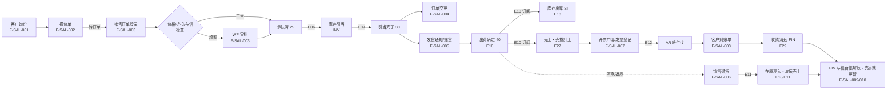
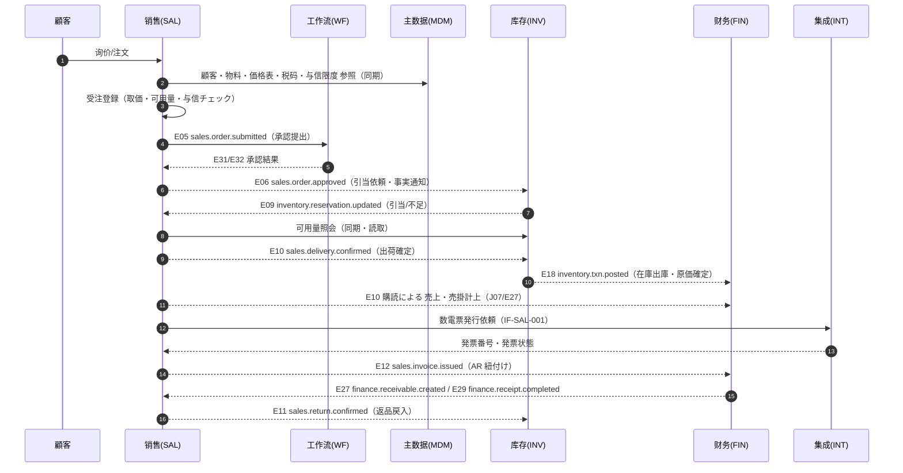

# 销售管理业务域概要书（販売管理業務概要書）

| 項目 | 内容 |
|---|---|
| 文書名 | 销售管理业务域概要书（販売管理業務概要書） |
| 文書番号 | DSN-SAL-000 |
| 版数 | v1.1 |
| 作成日 | 2026-10-20 |
| 作成者 | sales-designer（销售域担当） |
| 承認者 | 未承認（レビュー待ち） |
| 状態 | ドラフト（レビュー中） |
| 関連文書 | [体系总览](../README.md) / [共通项目定义](../00-common/01-common-item-definitions.md) / [共通业务规则](../00-common/08-common-business-rules.md) / [跨域流程](../00-common/09-cross-domain-flow.md) / [主数据域概要](../02-mdm/00-overview.md) / [库存域概要](../05-inventory/00-overview.md) / [财务域概要](../07-finance/00-overview.md) / [工作流域概要](../08-workflow/00-overview.md) |

> **記述規約**：本文書は日本企业「詳細設計書」の文書構成に従い、**正文は中文**で記述する。章見出し・文書情報のみ「詳細設計書／概要書」等の日本 IT 用語を併記する。中国法定名称（増値税専用発票、数电票、企业会计准则等）は中文正式名称をそのまま用いる。

---

## 1. 業務概要

### 1.1 目的

销售管理域（SAL）是 O2C（受注→回収）主链的起点与业务责任域，负责从**客户询价、报价、销售订单受注、订单变更、发货指示与拣货、出荷确定、销售退货、开票申请与发票登记、客户对账单、应收款查询/账龄、信用管控、价格与特价审批、订单执行跟踪**的全过程业务规则与单据管理。

本域的业务目标：

1. 将客户需求（询价/订单）以**可执行、可追溯、可审批**的方式固化为销售订单，并同步触发库存引当（E06）、与信判定（FIN 与信台帳）、生产/采购需求。
2. 在**出荷基准（09 章 7.3）**下，明确「销售域确定出荷事实（E10）→ 库存域出库（E18）→ 财务域计上売上・売掛（E27）」的责任分界，保证销售、库存、财务三域数据一致。
3. 把价格（MDM 价格表）、信用（MDM 额度 + FIN 与信台帳）、可用量（INV 现存量−引当−待检）三项约束前置到受注环节，避免接单后无法交付、无法回款。
4. 提供从受注到回款的完整跟踪与报表，支撑销售 KPI 管理。

### 1.2 適用範囲

| 項目 | 内容 |
|---|---|
| 対象会社・拠点 | 华东精密电机股份有限公司（虚拟示例主体）/ 常州总装厂・无锡零部件厂・销售总部（详见 [90-data/demo-company.md](../90-data/demo-company.md)） |
| 対象機能範囲 | 询价 → 报价 → 受注 → 订单变更 → 引当联动 → 发货通知/拣货 → 出荷确定 → 销售退货 → 开票申请/发票登记 → 客户对账单 → 应收款/账龄 → 信用管控 → 价格与特价审批 → 订单执行跟踪 → 销售预测/换货/报表（含出口销售 第一版 预留） |
| 対象外 | ① 库存数量・成本的最终记账（INV 域负责，本域只发事件与只读查询）；② 应收账款/收款/核销的记账与凭证（FIN 域负责）；③ 客户/物料/价格表/信用额度/税码主数据的维护（MDM 域负责）；④ 审批流程引擎（WF 域负责，本域只提交业务单据与接收回调）；⑤ 增值税发票的税控开具与数电票平台交互（INT 域负责，第一版）；⑥ 跨域汇总分析报表（RPT 域负责，本域只提供明细与域内报表） |
| 前提 | ① MDM 客户/物料/价格表/信用额度/税码/付款条件/仓库已生效；② INV 提供可用量照会与引当能力；③ SYS 提供用户/角色/组织/采番；④ WF 提供审批流程定义；⑤ FIN 提供会计期间状态照会。 |

### 1.3 業務上の狙い（KPI）

| KPI | 定義・算式 | 目標値 | 実現する機能 ID |
|---|---|---|---|
| 受注〜出荷リードタイム | AVG(初回出荷確定日 − 受注日)、営業日ベース | 3 営業日以内 | F-SAL-003 / F-SAL-005 / F-SAL-012 |
| 受注登録リードタイム | 受注登録〜承認完了の平均時間 | 4 時間以内 | F-SAL-003 |
| 引当充足率 | 引当済数量 ÷ 承認済受注数量 | 95% 以上 | F-SAL-003 / F-SAL-012 |
| 欠品（バックオーダー）件数 | 引当不足が発生した受注明細数／月 | 前月比 −10% | F-SAL-012 |
| 出荷〜売上計上リードタイム | 出荷確定〜売掛計上完了（E27 受信） | 当日中（0 営業日） | F-SAL-005 / F-SAL-009 |
| 請求書発行リードタイム | 出荷確定〜発票登録完了の平均日数 | 3 営業日以内 | F-SAL-007 |
| 売掛回収日数（DSO） | **平均売掛残高 ÷ 当期売上高 × 当期日数**（FIN 定義。SAL は表示のみ） | 60 日以内 | F-SAL-008 / F-SAL-009 |
| 与信超過発生率 | 与信超過発生受注件数 ÷ 受注件数 | 2% 未満 | F-SAL-010 |
| 返品率 | 返品金額 ÷ 出荷金額 | 1% 未満 | F-SAL-006 |
| 価格差異（標準価格比 ±5% 超）件数 | 承認済を除く逸脱件数／月 | 0 件 | F-SAL-011 |

> 目標値は【示例値】（示例企業の社内目標）。実運用では顧客企業の経営目標に合わせて設定する。

## 2. 組織とロール

| ロール | 所属 | 主な操作 | 関連機能 ID | 権限コード（代表） |
|---|---|---|---|---|
| 销售员（営業担当） | 销售部 | 询价、报价、受注登録、订单变更申请、发货指示、开票申请、退货申请 | F-SAL-001〜007 | `sales:inquiry:*`、`sales:quotation:*`、`sales:order:create/update/submit`、`sales:delivery:create`、`sales:invoice-application:create` |
| 销售经理（営業經理） | 销售部 | 报价・订单一级承认（±5% 以内折扣）、订单执行确认、催款 | F-SAL-002/003/012 | `sales:order:approve`、`sales:quotation:approve` |
| 销售总监（営業総監） | 销售部 | 折扣 5〜10% 承认、与信超過一次承认、特价承认 | F-SAL-003/010/011 | `sales:order:approve`、`sales:price-override:approve` |
| 财务信用专员（与信管理） | 财务部 | 与信额度照会、FIN 与信台帳の照合、超限审批の審査補佐、客户对账单确认 | F-SAL-008/009/010 | `sales:credit:view`、`sales:statement:confirm` |
| 财务经理（財務経理） | 财务部 | 销售退货・赤伝・开票の承認、对账单确认、与信超過審査 | F-SAL-006/007/008/010 | `sales:return:approve`、`sales:invoice:approve` |
| 财务总监 | 财务部 | 与信超過最终承认（销售总监→财务总监→总经理路径）、发票类型确认 | F-SAL-007/010 | `sales:credit:approve`、`sales:invoice:approve` |
| 总经理 | 経営層 | 与信超過・10% 超折扣・大額特价最终承认 | F-SAL-003/010/011 | `sales:order:approve`（高額） |
| 仓管员（倉管） | 仓库（常州/无锡） | 发货通知确认、拣货（批次指定/扫码）、出荷确定、退货受入与在庫戻入指示 | F-SAL-005/006 | `sales:delivery:pick/confirm`、`sales:return:receive` |
| 质检员（品質） | 质量部 | 退货检验（合格/不良/特採判定） | F-SAL-006 | `sales:return:inspect` |
| 会计（会計） | 财务部 | 发票登记、与 AR 紐付け确认、客户对账单发行 | F-SAL-007/008 | `sales:invoice:create`、`sales:statement:create` |
| 系统管理员 | 信息部 | 权限・参数・采番・数据字典配置 | — | `system:*` |

### 2.1 承認経路

销售域の承認対象と経路は [共通业务规则 第 8 章](../00-common/08-common-business-rules.md)（DSN-CMN-008）及び [90-data/approval-matrix.md](../90-data/approval-matrix.md) を正とする。本域で関係する経路を抜粋する（金額は税込、示例企業の社内規程＝【示例値】）。

| 対象 | 条件 | 承認経路 | 方式 | 業務 Type |
|---|---|---|---|---|
| 报价单（特价含む） | 標準価格の ±5% 以内 | 销售经理 | 或签 | `SALES_QUOTATION` |
| 报价单（特价含む） | 折扣 5〜10% / ±5% 超 | 销售总监 | 或签 | `SALES_QUOTATION` |
| 报价单（特价含む） | 折扣 10% 超 | 销售总监 → 财务总监 | 順送 | `SALES_QUOTATION` |
| 销售订单 | 標準価格の ±5% 以内 | 销售经理 | 或签 | `SALES_ORDER` |
| 销售订单 | 折扣 5〜10% | 销售总监 | 或签 | `SALES_ORDER` |
| 销售订单 | 折扣 10% 超 / 与信超過 | 销售总监 → 财务总监 → 总经理 | 順送 | `SALES_ORDER` |
| 销售订单变更 | 金額増加または納期変更 | 変更後金額で上記に準じる | — | `SALES_ORDER_CHANGE` |
| 销售退货 | 全額 | 销售经理 → 财务经理 | 順送 | `SALES_RETURN` |
| 特价申请（単価特批） | 全件 | 销售总监 → 财务总监（限价割れ時は総経理） | 順送 | `SALES_PRICE_OVERRIDE` |
| 信用超限受注 | 与信使用額 > 限度額 | 销售总监 → 财务总监 → 总经理 | 順送 | `SALES_ORDER` |
| 开票申请（赤伝含む） | 全件 | 财务经理（赤伝は財務総監） | 順送 | `SALES_INVOICE` |

> 承認経路はハードコードせず `wf_approval_matrix` と WF 流程定義で管理する（[08 第 8.2 章](../00-common/08-common-business-rules.md)）。自己承認禁止・差戻し・撤回・代理承認の共通ルールは同章に従う。

## 3. 業務フロー

### 3.1 全体フロー

### 3.2 処理手順（O2C 全体）

| # | 手順 | 実施者 | システム処理 | 入力 | 出力 | 異常時 |
|---|---|---|---|---|---|---|
| 1 | 引合登録 | 销售员 | 顧客・品目・数量・希望納期を記録、見積可能判定（顧客有効・与信停止でない） | 顧客、仕様、数量 | 询价单（INQ） | 顧客無効 `MSG-SAL-002` |
| 2 | 見積作成 | 销售员 | MDM 価格表から取価、有効期限設定、版数管理 | 引合、価格表 | 报价单（QT） | 取価不能 `MSG-SAL-012` |
| 3 | 見積提示・承認 | 销售员/主管 | 特価・折扣時は WF 承認。PDF 出力・メール送付 | 报价单 | 承認済报价单 | 承認却下 `MSG-SAL-015` |
| 4 | 受注登録 | 销售员 | 取価（特価→顧客別→階梯→標準）、与信チェック、可用量チェック、納期回答、採番 | 顧客発注書、报价单 | 销售订单（SO，10） | 与信超過 `MSG-SAL-020`、在庫不足は警告 `MSG-SAL-030` |
| 5 | 受注承認 | 主管/总监/财务/总经理 | WF 承認。確定時に E06 発行、FIN が与信台帳コミット（SAL は投影） | — | SO 25 承認済 | 却下 95 |
| 6 | 在庫引当 | INV（自動） | E06 購読 → 引当 → E09 返信。不足分はバックオーダー化 | E06 | E09、SO 30 | 引当不足 `MSG-SAL-030`（警告） |
| 7 | 出荷指示 | 销售员/仓管 | SO の未出荷数量から DN 作成、出荷日・倉庫・数量確定 | SO | DN（25） | 出荷可能数量超過 `MSG-SAL-036` |
| 8 | ピッキング | 仓管 | 批次指定（手工/FIFO/FEFO）、庫位・数量確定、引当引落 | DN、在庫批次 | 拣货明细、DN 30 | 在庫不足 `MSG-SAL-037` |
| 9 | 出荷確定 | 仓管 | 出荷実績確定 → E10 発行、SO 出荷済更新、送り状出力 | DN | E10、SDO（INV）、DN 40/35 | 出荷数量不整合 `MSG-SAL-039` |
| 10 | 売上・売掛計上 | FIN（自動） | E10 購読 → AR 計上・売上計上（J07）→ E27。E18 購読 → 売上原価（J06） | E10/E18 | AR、E27、証憑 | 計上失敗は Outbox 再送・照合バッチ |
| 11 | 開票申請 | 销售员 | 出荷確定済・未開票明細を集約、税区分・発票種別確定、WF 承認 | AR/出荷明細 | 开票申请（IVA） | 請求金額不一致 `MSG-SAL-052` |
| 12 | 発票登録 | 会计 | 金税/数電票で発行した発票を登録、E12 発行、AR 紐付け | 発票情報 | 销售发票（SIV）、E12 | 発票番号重複 `MSG-SAL-156`、金額相違 `MSG-SAL-158` |
| 13 | 対账单 | 会计 | 期間内の売上・入金・残高を顧客別に集計、発行 | AR、入金 | 对账单（STM） | 残高不一致 `MSG-SAL-160` |
| 14 | 入金・消込 | FIN 出納 | 入金登録、AR 消込、E29 発行 | 銀行明細 | RCP、E29 | 過入金・部分入金（FIN 側で処理） |
| 15 | 与信解放 | FIN（台帳）／SAL（投影） | FIN が E29 購読で与信台帳を解放、SAL は投影更新・与信再判定 | E29 | FIN 与信台帳更新 | 不整合は日次バッチで検出 |
| 16 | 返品処理 | 销售员/倉管/质检 | 返品受付（期限チェック）→ 承認 → 受入検品 → E11 → 在庫戻入・赤伝売上・AR 戻し | 顧客返品連絡、元出荷 | 退货单（SRT）、E11 | 期限超過 `MSG-SAL-121`、赤伝不可 `MSG-SAL-124` |

### 3.3 関連業務域との連携

| 相手域 | 連携内容 | 方式（同期/イベント） | 契約 |
|---|---|---|---|
| MDM | 顧客・物料・価格表・税码・与信限度・付款条件・通貨・倉庫・单位 | 同期参照（読取）+ E40/E42 購読 | [09 第 11 章](../00-common/09-cross-domain-flow.md) |
| WF | 报价单・受注・订单变更・退货・特价・开票申请・信用超限の承認 | 非同期イベント（E05/E31/E32） | [09 第 9 章](../00-common/09-cross-domain-flow.md) |
| INV | 引当（E06/E07/E08 → E09）、出荷出庫（E10 → E18）、返品戻入（E11 → E18）、可用量照会 | 同期参照 + 非同期イベント | [09 第 3 章 E06〜E11、第 5 章](../00-common/09-cross-domain-flow.md) |
| FIN | 売上・売掛計上（E10 → E27）、発票紐付け（E12）、入金（E29）、与信残高照会、会計期間状態 | 非同期イベント + 同期参照 | [09 第 3 章 E10/E12/E27/E29、7.3](../00-common/09-cross-domain-flow.md) |
| INT | 数電票/金税発票連携、物流送り状連携 | 外部 IF | 09-integration（予定） |
| SYS | 用户・権限・組織・数据範囲・采番・監査ログ・添付・通知 | 同期 | 00-common 02/03/05 |
| RPT | 売上明細・毛利・顧客排名・帳齢の集計データ提供（読取専用） | 同期参照/抽出 | 10-analytics（予定） |

> 09 §3 追補（2026-10-20）：**E40** `mdm.tax-code.changed`・**E42** `mdm.credit-limit.changed` を購読し、取税キャッシュ・与信チェックキャッシュを更新する。売上予測の確定は **E43 `sales.forecast.updated`**で PRD へ通知する（[03-sales/07](07-tracking-reports.md) 未決 #1 参照）。

### 3.4 共通ステータスとの対応表

本域の伝票別ステータスは [共通业务规则 3.2](../00-common/08-common-business-rules.md) に完全準拠する。状態コードの意味を他域と共有しない。

| 伝票 | 使用ステータス | 意味（本域） | 遷移条件（要約） |
|---|---|---|---|
| 询价单 INQ | 10 / 30 / 40 / 90 | 10 起票中 / 30 回答済（見積作成可）/ 40 报价作成済 / 90 取消 | 10→30→40、10/30→90 |
| 报价单 QT | 10 / 30 / 35 / 90 | 10 作成中 / 30 有效（有効期限内）/ 35 已转订单（全部/一部）/ 90 失效 | 10→30、30→35、30→90（期限切れバッチ含む） |
| 销售订单 SO | 10 / 20 / 25 / 30 / 35 / 40 / 90 / 95 | 10 草稿 / 20 承認待ち / 25 承認済（引当待ち）/ 30 引当済（出荷可能）/ 35 部分出荷 / 40 全数出荷・完了 / 90 取消 / 95 却下 | 10→20→25→30→35→40（08 準拠） |
| 订单变更（版） | 10 / 20 / 25 / 40 / 90 | 10 変更内容作成中 / 20 変更承認待ち / 25 変更確定 / 40 変更適用済 / 90 変更取消 | 版単位で管理。確定後 E07 |
| 发货通知 DN | 25 / 30 / 35 / 40 / 90 | 25 承認済（作成直後、引当済）/ 30 ピッキング中 / 35 一部出庫 / 40 全数出庫 / 90 取消 | 08 準拠（承認不要・SO 承認済前提） |
| 销售退货 SRT | 10 / 20 / 25 / 30 / 40 / 90 / 95 | 10 返品受付（草稿）/ 20 承認待ち / 25 承認済（受入待ち）/ 30 受入・検品完了（E11 発行）/ 40 在庫戻入・赤伝完了 / 90 取消 / 95 却下 | 08 準拠 |
| 开票申请 IVA | 10 / 20 / 25 / 30 / 40 / 90 / 95 | 10 草稿 / 20 承認待ち / 25 承認済 / 30 発票発行済（登録待ち）/ 40 完了（AR 紐付け済）/ 90 取消 / 95 却下 | 本域拡張（08 未定義、§12 未決事項） |
| 销售发票 SIV | 10 / 30 / 40 / 90 | 10 発票登録済（未交付）/ 30 交付済 / 40 完了（AR 紐付け済）/ 90 赤伝発行済 | 本域拡張（08 未定義、§12 未決事項） |
| 客户对账单 STM | 10 / 30 / 40 | 10 作成中 / 30 発行済 / 40 顧客確認済 | 本域拡張 |
| 销售预测 FCST | 10 / 25 / 40 / 90 | 10 入力中 / 25 確定 / 40 実績照合済 / 90 取消 | 第一版対象（TODO：詳細設計が未作成） |

## 4. 機能一覧

| 機能 ID | 機能名 | 概要 | 画面 ID | 種別 | 優先度 | 状態 | 詳細設計書 |
|---|---|---|---|---|---|---|---|
| F-SAL-001 | 客户询价管理 | 引合の登録・照会・回答、报价作成への引継ぎ | SCR-SAL-001〜003 | 登録/一覧/照会 | P0 | 設計済 | [01-quotation.md](01-quotation.md) |
| F-SAL-002 | 报价单管理 | 报价作成（版数・有効期限）、承認、PDF 出力、受注転換 | SCR-SAL-004〜007 | 登録/一覧/照会 | P0 | 設計済 | [01-quotation.md](01-quotation.md) |
| F-SAL-003 | 销售订单登录 | 受注登録、取価、折扣、納期、可用量チェック、与信チェック、提出・承認、E06 | SCR-SAL-008〜011 | 登録/一覧/照会 | P0 | 設計済 | [02-sales-order.md](02-sales-order.md) |
| F-SAL-004 | 订单变更 | 承認済受注の数量・納期・価格変更、版数管理、再承認、E07、引当増減 | SCR-SAL-012〜013 | 登録/一覧 | P0 | 設計済 | [02-sales-order.md](02-sales-order.md) |
| F-SAL-005 | 发货通知与拣货 | DN 作成、批次指定（FIFO/FEFO/手工）、部分出荷、出荷確定（E10）、送り状 | SCR-SAL-014〜018 | 登録/一覧/作業 | P0 | 設計済 | [03-delivery-picking.md](03-delivery-picking.md) |
| F-SAL-006 | 销售退货管理 | 返品受付、期限チェック、承認、受入検品、E11、在庫戻入、赤伝売上/AR 戻し、原価戻し | SCR-SAL-019〜022 | 登録/一覧/検品 | P0 | 設計済 | [04-sales-return.md](04-sales-return.md) |
| F-SAL-007 | 销售发票与开票申请 | 开票申请（集約・税区分）、承認、发票登记（专票/普票/数电票）、赤伝、E12、AR 紐付け、金税 IF 第一版 | SCR-SAL-023〜027 | 登録/一覧/照会 | P0（金税 IF は P2） | 設計済 | [05-invoice-receivable.md](05-invoice-receivable.md) |
| F-SAL-008 | 客户对账单 | 期間集計、対账单生成・発行・顧客確認 | SCR-SAL-028〜029 | 帳票/照会 | P1 | 設計済 | [05-invoice-receivable.md](05-invoice-receivable.md) |
| F-SAL-009 | 应收款查询与账龄 | 应收明細・残高・帳齢・回収予定の照会（FIN 契約に基づく投影） | SCR-SAL-030〜031 | 照会/集計 | P1 | 設計済 | [05-invoice-receivable.md](05-invoice-receivable.md) |
| F-SAL-010 | 信用管控 | 与信限度照会、FIN 与信台帳照会、与信判定、超限判定・承認連携 | SCR-SAL-032〜034 | 照会/承認 | P0 | 設計済 | [06-credit-pricing.md](06-credit-pricing.md) |
| F-SAL-011 | 价格与促销 | MDM 価格表参照、取価シミュレーション、特価/折扣申請・承認 | SCR-SAL-035〜037 | 照会/登録 | P0（促销 P2） | 設計済 | [06-credit-pricing.md](06-credit-pricing.md) |
| F-SAL-012 | 订单执行跟踪 | 受注残、引当/欠品、出荷予定、納期遅延、齐套状况の可視化 | SCR-SAL-038〜039 | 照会/看板 | P1 | 設計済 | [07-tracking-reports.md](07-tracking-reports.md) |
| F-SAL-013 | 销售预测 | 月度予測入力・確定、MRP 連携（第一版対象。TODO：詳細設計が未作成） | SCR-SAL-040〜041 | 登録/一覧 | P2 | 設計済（概要） | [07-tracking-reports.md](07-tracking-reports.md) |
| F-SAL-014 | 换货管理 | 返品＋再出荷の組合せ、差額精算、関連付け | SCR-SAL-042 | 登録 | P2 | 設計済（概要） | [04-sales-return.md](04-sales-return.md) |
| F-SAL-015 | 销售报表 | 销售明细、毛利分析、客户排名（域内报表，RPT 連携） | SCR-SAL-043〜045 | 帳票/集計 | P1 | 設計済 | [07-tracking-reports.md](07-tracking-reports.md) |
| F-SAL-016 | 出口销售预留 | 外貨・Incoterms・通関情報の項目予約（第一版対象。TODO：概要のみ、詳細設計が未作成） | SCR-SAL-046 | 登録（予約） | P2 | 設計済（概要） | [07-tracking-reports.md](07-tracking-reports.md) |
| F-SAL-017 | 销售订单取消与关闭 | 受注の取消（E08）、残数量クローズ、バックオーダー取消 | SCR-SAL-010（操作） | 状態操作 | P0 | 設計済 | [02-sales-order.md](02-sales-order.md) |
| F-SAL-018 | 出荷实绩照会 | 出荷実績・送り状・未出荷残の照会、再出力 | SCR-SAL-047 | 照会/一覧 | P1 | 設計済 | [03-delivery-picking.md](03-delivery-picking.md) |

> 優先度：P0（第一版 MVP）/ P1（第一版.5）/ P2。状態：未設計/設計中/設計済/レビュー済/承認済。機能の粒度は「利用者から見た 1 つの業務行為」（[设计方针 6.2](../00-common/00-design-principles.md)）。

## 5. 画面一覧

| 画面 ID | 画面名 | 類型 | 機能 ID | 権限コード | 遷移元 | 遷移先 |
|---|---|---|---|---|---|---|
| SCR-SAL-001 | 询价一覧 | LIST | F-SAL-001 | `sales:inquiry:view` | 菜单 | SCR-SAL-002/003 |
| SCR-SAL-002 | 询价登録編集 | EDIT | F-SAL-001 | `sales:inquiry:create` | SCR-SAL-001/003 | SCR-SAL-001 |
| SCR-SAL-003 | 询价参照詳細 | VIEW | F-SAL-001 | `sales:inquiry:view` | SCR-SAL-001 | SCR-SAL-002/005 |
| SCR-SAL-004 | 报价单一覧 | LIST | F-SAL-002 | `sales:quotation:view` | 菜单 | SCR-SAL-005/006 |
| SCR-SAL-005 | 报价单登録編集 | EDIT | F-SAL-002 | `sales:quotation:create` | SCR-SAL-004/006 | SCR-SAL-004 |
| SCR-SAL-006 | 报价单参照詳細 | VIEW | F-SAL-002 | `sales:quotation:view` | SCR-SAL-004 | SCR-SAL-005/007/009 |
| SCR-SAL-007 | 报价单版本比較 | VIEW | F-SAL-002 | `sales:quotation:view` | SCR-SAL-006 | SCR-SAL-006 |
| SCR-SAL-008 | 销售订单一覧 | LIST | F-SAL-003 | `sales:order:view` | 菜单 | SCR-SAL-009/010 |
| SCR-SAL-009 | 销售订单登録編集 | EDIT | F-SAL-003 | `sales:order:create` | SCR-SAL-008/010 | SCR-SAL-010 |
| SCR-SAL-010 | 销售订单参照詳細 | VIEW | F-SAL-003 | `sales:order:view` | SCR-SAL-008 | SCR-SAL-009/012/014/015/024 |
| SCR-SAL-011 | 订单承认画面（WF） | WF | F-SAL-003 | `sales:order:approve` | 待办中心 | SCR-SAL-010 |
| SCR-SAL-012 | 订单变更ウィザード | WIZ | F-SAL-004 | `sales:order:update` | SCR-SAL-010 | SCR-SAL-010 |
| SCR-SAL-013 | 订单变更履歴 | VIEW | F-SAL-004 | `sales:order:view` | SCR-SAL-010 | SCR-SAL-010 |
| SCR-SAL-014 | 发货通知一覧 | LIST | F-SAL-005 | `sales:delivery:view` | 菜单 | SCR-SAL-015/016/017/018 |
| SCR-SAL-015 | 发货通知登録編集 | EDIT | F-SAL-005 | `sales:delivery:create` | SCR-SAL-014/010 | SCR-SAL-016 |
| SCR-SAL-016 | 拣货作业 | EDIT | F-SAL-005 | `sales:delivery:pick` | SCR-SAL-014/015 | SCR-SAL-017 |
| SCR-SAL-017 | 出荷確定 | EDIT | F-SAL-005 | `sales:delivery:confirm` | SCR-SAL-014/016 | SCR-SAL-014/018 |
| SCR-SAL-018 | 送货单预览 | PRINT | F-SAL-005 | `sales:delivery:print` | SCR-SAL-014/017/047 | — |
| SCR-SAL-019 | 退货单一覧 | LIST | F-SAL-006 | `sales:return:view` | 菜单 | SCR-SAL-020/021/022 |
| SCR-SAL-020 | 退货单登録編集 | EDIT | F-SAL-006 | `sales:return:create` | SCR-SAL-019/010 | SCR-SAL-019 |
| SCR-SAL-021 | 退货检验 | EDIT | F-SAL-006 | `sales:return:inspect` | SCR-SAL-019/022 | SCR-SAL-022 |
| SCR-SAL-022 | 退货单参照詳細 | VIEW | F-SAL-006 | `sales:return:view` | SCR-SAL-019 | SCR-SAL-020/021 |
| SCR-SAL-023 | 开票申请一覧 | LIST | F-SAL-007 | `sales:invoice-application:view` | 菜单 | SCR-SAL-024 |
| SCR-SAL-024 | 开票申请登録編集 | EDIT | F-SAL-007 | `sales:invoice-application:create` | SCR-SAL-023/010/030 | SCR-SAL-023 |
| SCR-SAL-025 | 发票登记一覧 | LIST | F-SAL-007 | `sales:invoice:view` | 菜单 | SCR-SAL-026/027 |
| SCR-SAL-026 | 发票登记編集 | EDIT | F-SAL-007 | `sales:invoice:create` | SCR-SAL-025 | SCR-SAL-027 |
| SCR-SAL-027 | 发票参照詳細（赤伝） | VIEW | F-SAL-007 | `sales:invoice:view` | SCR-SAL-025 | SCR-SAL-026 |
| SCR-SAL-028 | 对账单生成 | WIZ | F-SAL-008 | `sales:statement:create` | 菜单 | SCR-SAL-029 |
| SCR-SAL-029 | 对账单照会 | VIEW | F-SAL-008 | `sales:statement:view` | SCR-SAL-028 | SCR-SAL-027 |
| SCR-SAL-030 | 应收款查询 | LIST | F-SAL-009 | `sales:receivable:view` | 菜单 | SCR-SAL-031/024 |
| SCR-SAL-031 | 账龄分析 | DASH | F-SAL-009 | `sales:receivable:view` | SCR-SAL-030 | SCR-SAL-030 |
| SCR-SAL-032 | 信用额度照会 | DASH | F-SAL-010 | `sales:credit:view` | 菜单 | SCR-SAL-033/034 |
| SCR-SAL-033 | 与信台帳明細（FIN 投影） | LIST | F-SAL-010 | `sales:credit:view` | SCR-SAL-032 | SCR-SAL-010 |
| SCR-SAL-034 | 信用超限审批申请 | EDIT | F-SAL-010 | `sales:credit:submit` | SCR-SAL-009/032 | SCR-SAL-010 |
| SCR-SAL-035 | 价格表照会 | LIST | F-SAL-011 | `sales:price:view` | 菜单 | SCR-SAL-036 |
| SCR-SAL-036 | 特价申请一覧 | LIST | F-SAL-011 | `sales:price-override:view` | 菜单 | SCR-SAL-037 |
| SCR-SAL-037 | 特价申请登録編集 | EDIT | F-SAL-011 | `sales:price-override:create` | SCR-SAL-036/005/009 | SCR-SAL-036 |
| SCR-SAL-038 | 订单执行跟踪 | DASH | F-SAL-012 | `sales:tracking:view` | 菜单 | SCR-SAL-010/039 |
| SCR-SAL-039 | 欠货・交期迟延一覧 | LIST | F-SAL-012 | `sales:tracking:view` | SCR-SAL-038 | SCR-SAL-010 |
| SCR-SAL-040 | 销售预测一覧 | LIST | F-SAL-013 | `sales:forecast:view` | 菜单 | SCR-SAL-041 |
| SCR-SAL-041 | 销售预测登録編集 | EDIT | F-SAL-013 | `sales:forecast:create` | SCR-SAL-040 | SCR-SAL-040 |
| SCR-SAL-042 | 换货申请登録 | EDIT | F-SAL-014 | `sales:exchange:create` | SCR-SAL-019/010 | SCR-SAL-024 |
| SCR-SAL-043 | 销售明细报表 | VIEW | F-SAL-015 | `sales:report:view` | 菜单 | — |
| SCR-SAL-044 | 毛利分析 | DASH | F-SAL-015 | `sales:report:view` | SCR-SAL-043 | SCR-SAL-043 |
| SCR-SAL-045 | 客户排名 | VIEW | F-SAL-015 | `sales:report:view` | SCR-SAL-043 | SCR-SAL-010 |
| SCR-SAL-046 | 出口销售信息 | EDIT | F-SAL-016 | `sales:export:update` | SCR-SAL-010 | SCR-SAL-010 |
| SCR-SAL-047 | 出荷实绩照会 | LIST | F-SAL-018 | `sales:delivery:view` | 菜单 | SCR-SAL-018/010 |

> 画面 ID は一度発番したら変更しない（[设计方针 6.3](../00-common/00-design-principles.md)）。承認画面（SCR-SAL-011）は WF 域の共通承認画面を業務 Type 別に呼び出す。

## 6. 帳票一覧

| 帳票 ID | 帳票名 | 出力タイミング | 帳票種別 | 機能 ID | 詳細 |
|---|---|---|---|---|---|
| PRT-SAL-001 | 报价单（見積書） | 承認後/手動 | 伝票 | F-SAL-002 | [92](92-report-batch-design.md) |
| PRT-SAL-002 | 销售订单确认书（注文請書） | 承認後/手動 | 伝票 | F-SAL-003 | [92](92-report-batch-design.md) |
| PRT-SAL-003 | 发货通知单・拣货单 | DN 作成/拣货指示時 | 伝票 | F-SAL-005 | [92](92-report-batch-design.md) |
| PRT-SAL-004 | 送货单（納品書・送り状） | 出荷確定時 | 伝票 | F-SAL-005 | [92](92-report-batch-design.md) |
| PRT-SAL-005 | 销售出库单（SDO） | INV 出庫確定時 | 伝票 | F-SAL-005 / INV | [92](92-report-batch-design.md) |
| PRT-SAL-006 | 销售退货单（返品受付票） | 退货承認後 | 伝票 | F-SAL-006 | [92](92-report-batch-design.md) |
| PRT-SAL-007 | 开票申请单 | 申请提出時 | 伝票 | F-SAL-007 | [92](92-report-batch-design.md) |
| PRT-SAL-008 | 销售发票（増値税専用発票/普通発票/数电票 PDF） | 発票登録後 | 法定帳票 | F-SAL-007 | [92](92-report-batch-design.md) |
| PRT-SAL-009 | 客户对账单 | 月次/手動 | 一覧表 | F-SAL-008 | [92](92-report-batch-design.md) |
| PRT-SAL-010 | 应收账龄表 | 手動/月次 | 集計表 | F-SAL-009 | [92](92-report-batch-design.md) |
| PRT-SAL-011 | 销售明细表 | 手動/月次 | 集計表 | F-SAL-015 | [92](92-report-batch-design.md) |
| PRT-SAL-012 | 毛利分析表 | 手動/月次 | 集計表 | F-SAL-015 | [92](92-report-batch-design.md) |
| PRT-SAL-013 | 客户排名表 | 手動/月次 | 集計表 | F-SAL-015 | [92](92-report-batch-design.md) |
| PRT-SAL-014 | 订单执行跟踪表（受注残・欠品一覧） | 日次/手動 | 一覧表 | F-SAL-012 | [92](92-report-batch-design.md) |
| PRT-SAL-015 | 信用额度使用状况表 | 手動/月次 | 集計表 | F-SAL-010 | [92](92-report-batch-design.md) |
| PRT-SAL-016 | 特价审批单 | 特価申請時 | 伝票 | F-SAL-011 | [92](92-report-batch-design.md) |
| PRT-SAL-017 | 销售预测表 | 月次 | 集計表 | F-SAL-013 | [92](92-report-batch-design.md) |
| PRT-SAL-018 | 出口发票・装箱单 | 出荷確定時 | 法定帳票 | F-SAL-016 | [92](92-report-batch-design.md) |

> 帳票は PDF を既定とし、サーバ側で生成する（[画面共通规格 14](../00-common/02-common-screen-spec.md)）。法定帳票（PRT-SAL-008）は税務要件のレイアウトを維持し、改版は財務責任者の承認を要する。

## 7. バッチ一覧

| バッチ ID | バッチ名 | 起動方式 | 実行時間帯 | 処理概要 | 冪等性 |
|---|---|---|---|---|---|
| BAT-SAL-001 | 报价单有效期到期处理 | 日次 | 01:00 | 有効期限切れ QT を 90:失效 へ。失効予告通知（7 日前） | 再実行可 |
| BAT-SAL-002 | 受注引当不足再引当 | 日次 | 02:00 | 承認済・引当不足 SO を再引当（E06 再通知/INV 照会） | 再実行可 |
| BAT-SAL-003 | 交期迟延检出与通知 | 日次 | 03:00 | 出荷予定日超過・引当遅延を検出、営業/計画へ通知 | 再実行可 |
| BAT-SAL-004 | 与信台帳照合 | 日次 | 03:30 | FIN 与信台帳と SAL 投影・受注残の突合、差異アラート（金額は変更しない） | 再実行可 |
| BAT-SAL-005 | 销售订单自动关闭 | 日次 | 04:00 | 全数出荷済 SO の完了確定、残数量 0 のクローズ | 再実行可 |
| BAT-SAL-006 | 客户对账单生成与送付 | 月次 | 月初 1 日 05:00 | 前月分の顧客別対账单を生成（PRT-SAL-009）・配信 | 条件付き（未発行のみ） |
| BAT-SAL-007 | 账龄・回款预测スナップショット | 日次 | 05:30 | FIN `ar-aging` API と FIN 定義 DSO（平均残高口径）を取得し `sal_receivable_snapshot` 更新（SAL は算式を持たない） | 再実行可 |
| BAT-SAL-008 | 出荷済・未計上照合 | 日次/月結前 | 06:00 | E10 発行済 vs FIN 売上・AR（E27）突合、未計上を検出 | 再実行可 |
| BAT-SAL-009 | 发票与 AR 紐付け照合 | 日次 | 06:30 | SIV（E12）と FIN AR の紐付け漏れ検出、通知 | 再実行可 |
| BAT-SAL-010 | 退货期限超过提醒 | 日次 | 07:00 | 出荷後返品期限間近の案件を営業へ通知（任意） | 再実行可 |
| BAT-SAL-011 | 销售数据抽出（RPT 連携） | 日次 | 07:30 | 売上明細・毛利・顧客別集計を抽出テーブルへ | 再実行可（日付単位全削除→再作成） |
| BAT-SAL-012 | 数电票状态同步 | 日次/イベント | 08:00 | INT 経由で発票交付状態・赤伝状態を同期 | 再実行可 |
| BAT-SAL-013 | 销售预测与实际差异分析 | 月次 | 月初 2 日 05:00 | 予測 vs 実績の差異集計 | 再実行可 |

## 8. テーブル一覧

| 物理名 | 論理名 | 種別 | 主な用途 | 更新元機能 ID | データ量見積 |
|---|---|---|---|---|---|
| `sal_inquiry` | 询价单 | 伝票ヘッダ | 引合管理 | F-SAL-001 | 初期 2 万 / 年 1.2 万 / 5 年 8 万 |
| `sal_inquiry_line` | 询价明细 | 伝票明細 | 引合明細 | F-SAL-001 | 年 3 万 / 5 年 18 万 |
| `sal_quotation` | 报价单 | 伝票ヘッダ | 見積管理・版数 | F-SAL-002 | 年 2.4 万 / 5 年 14 万 |
| `sal_quotation_line` | 报价明细 | 伝票明細 | 見積明細 | F-SAL-002 | 年 7 万 / 5 年 40 万 |
| `sal_quotation_version` | 报价单版本 | 履歴 | 見積改訂履歴 | F-SAL-002 | 年 3 万 / 5 年 16 万 |
| `sal_sales_order` | 销售订单 | 伝票ヘッダ | 受注管理 | F-SAL-003/004/017 | 初期 6 万 / 年 3.6 万 / 5 年 24 万 |
| `sal_sales_order_line` | 销售订单明细 | 伝票明細 | 受注明細・引当/出荷実績 | F-SAL-003/004/005 | 初期 30 万 / 年 18 万 / 5 年 120 万 |
| `sal_sales_order_version` | 销售订单版本 | 履歴 | 受注変更版管理 | F-SAL-004 | 年 1.2 万 / 5 年 6.6 万 |
| `sal_sales_order_line_version` | 销售订单明细版本 | 履歴 | 変更前後明細スナップショット | F-SAL-004 | 年 6 万 / 5 年 33 万 |
| `sal_delivery_note` | 发货通知 | 伝票ヘッダ | 出荷指示 | F-SAL-005 | 年 3.6 万 / 5 年 20 万 |
| `sal_delivery_note_line` | 发货通知明细 | 伝票明細 | 出荷予定・実績 | F-SAL-005 | 年 18 万 / 5 年 100 万 |
| `sal_pick_detail` | 拣货明细 | 明細 | 批次・庫位別拣货実績 | F-SAL-005 | 年 36 万 / 5 年 190 万 |
| `sal_delivery_serial` | 发货序列号 | 明細 | 序列号別出荷・返品トレース | F-SAL-005/006 | 年 36 万 / 5 年 190 万 |
| `sal_sales_return` | 销售退货单 | 伝票ヘッダ | 返品管理 | F-SAL-006/014 | 年 3,600 / 5 年 2 万 |
| `sal_sales_return_line` | 销售退货明细 | 伝票明細 | 返品明細 | F-SAL-006 | 年 1.2 万 / 5 年 7 万 |
| `sal_return_inspection` | 退货检验 | 明細 | 返品検品結果 | F-SAL-006 | 年 1.2 万 / 5 年 7 万 |
| `sal_invoice_application` | 开票申请 | 伝票ヘッダ | 開票申請 | F-SAL-007 | 年 2.4 万 / 5 年 13 万 |
| `sal_invoice_application_line` | 开票申请明细 | 伝票明細 | 対象出荷・AR 明細 | F-SAL-007 | 年 12 万 / 5 年 66 万 |
| `sal_invoice` | 销售发票 | 伝票ヘッダ | 発票登録・赤伝 | F-SAL-007 | 年 2.6 万 / 5 年 14 万 |
| `sal_invoice_line` | 发票明细 | 伝票明細 | 発票明細・税区分 | F-SAL-007 | 年 13 万 / 5 年 70 万 |
| `sal_invoice_relation` | 发票关联 | 関連 | 元発票/AR/出荷/受注との紐付け | F-SAL-007 | 年 10 万 / 5 年 52 万 |
| `sal_statement` | 客户对账单 | 伝票ヘッダ | 対账单 | F-SAL-008 | 年 1.4 万 / 5 年 7 万 |
| `sal_statement_line` | 对账单明细 | 伝票明細 | 対账明細 | F-SAL-008 | 年 42 万 / 5 年 220 万 |
| `sal_credit_ledger_snapshot` | 与信台帳投影（FIN 台帳の読取） | 残高 | FIN 与信台帳のコミット/解放（SAL は投影のみ） | F-SAL-003/004/010 | 初期 8 万 / 年 6 万 / 5 年 38 万 |
| `sal_credit_check_log` | 与信检查日志 | ログ | 与信判定履歴 | F-SAL-003/010 | 年 10 万 / 5 年 52 万 |
| `sal_receivable_snapshot` | 应收投影 | 残高 | FIN AR の読取投影 | F-SAL-009 | 初期 8,000 / 年 1.2 万 / 5 年 7 万 |
| `sal_special_price` | 特价申请 | 伝票ヘッダ | 単価特批・期限 | F-SAL-011 | 年 2,000 / 5 年 1.2 万 |
| `sal_sales_forecast` | 销售预测 | 伝票ヘッダ | 月次予測 | F-SAL-013 | 年 120 / 5 年 700 |
| `sal_sales_forecast_line` | 销售预测明细 | 伝票明細 | 品目別予測 | F-SAL-013 | 年 6,000 / 5 年 3.3 万 |

> 全テーブルに [共通项目定义 第 2 章](../00-common/01-common-item-definitions.md) の共通カラムを付与する（明細は `company_id` を親で保持）。物理設計は [90-db-design.md](90-db-design.md) を正とする。

## 9. 外部 IF 一覧

| IF ID | 名称 | 相手先 | 方向 | 方式 | 頻度 | 契機 |
|---|---|---|---|---|---|---|
| IF-SAL-001 | 数电票/金税发票开具接口 | 国家税务总局电子发票服务平台（経由：INT 域） | 送信/受信 | REST（。INT 域が実装） | リアルタイム | 开票申请承認後の発票発行・赤伝発行 |
| IF-SAL-002 | 发票交付状态同步 | 电子发票服务平台（経由：INT） | 受信 | REST/ファイル | 日次 | 発票交付状態・受領確認の反映 |
| IF-SAL-003 | 客户 EDI 订单接入 | 顧客（EDI/邮件） | 受信 | CSV/XML（INT 域） | 随時 | 顧客発注データの受注取込 |
| IF-SAL-004 | 物流/快递面单接口 | 物流会社（経由：INT） | 送信/受信 | REST | 出荷確定時 | 送り状番号取得・配送追跡 |
| IF-SAL-005 | 出口报关数据接口 | 报关行/单一窗口（経由：INT） | 送信 | ファイル/EDI | 出荷時 | 輸出申告データ |
| IF-SAL-006 | 客户对账单电子送付 | メール/客户ポータル | 送信 | SMTP/ファイル | 月次 | 対账单 PDF 配信（P1） |

> 域間（内部）連携は IF ID を使わず、[09 第 3 章](../00-common/09-cross-domain-flow.md) の領域事件（E05〜E12、E27、E29、E31、E32）で管理する。上記 IF-SAL-001/002 の具体エンドポイント・認証・電文仕様は 第一版 で INT 域（09-integration（予定） 予定）が確定する。本域は接続形態と必要項目を [05-invoice-receivable.md](05-invoice-receivable.md) 第 7 章に定義する（**具体 URL・証明書等は設計時点で確定しない**）。

## 10. 権限一覧

| 権限コード | 対象機能 | 対象データ範囲 | 付与ロール |
|---|---|---|---|
| `sales:inquiry:view` | F-SAL-001 | 自部門/担当顧客 | 销售员/主管 |
| `sales:inquiry:create` / `:update` | F-SAL-001 | 本人作成 | 销售员 |
| `sales:quotation:view` | F-SAL-002 | 自部門/担当顧客 | 销售员/主管/财务信用专员 |
| `sales:quotation:create` / `:update` | F-SAL-002 | 本人作成 | 销售员 |
| `sales:quotation:approve` | F-SAL-002 | 承認経路該当者 | 主管/总监/财务总监 |
| `sales:quotation:convert` | F-SAL-002 | 有効报价单 | 销售员 |
| `sales:order:view` | F-SAL-003/004/017/018 | 自部門（主管は全部門） | 销售员/主管/仓管/财务 |
| `sales:order:create` / `:update` | F-SAL-003 | 本人担当顧客 | 销售员 |
| `sales:order:submit` / `:withdraw` | F-SAL-003 | 本人作成 | 销售员 |
| `sales:order:approve` / `:reject` | F-SAL-003 | 承認経路該当者 | 主管/总监/财务总监/总经理 |
| `sales:order:cancel` | F-SAL-017 | 承認済・未出荷 | 主管 |
| `sales:order:change` | F-SAL-004 | 承認済受注 | 销售员（申請）/主管（承認） |
| `sales:order:export` | F-SAL-003/012/015 | データ範囲内 | 销售员/主管 |
| `sales:delivery:view` | F-SAL-005/018 | 自工場倉庫・担当顧客 | 仓管/销售员 |
| `sales:delivery:create` / `:update` | F-SAL-005 | 担当受注 | 销售员 |
| `sales:delivery:pick` | F-SAL-005 | 倉庫担当範囲 | 仓管员 |
| `sales:delivery:confirm` | F-SAL-005 | 倉庫担当範囲 | 仓管员 |
| `sales:delivery:cancel` | F-SAL-005 | 未出荷 DN | 主管 |
| `sales:delivery:print` | F-SAL-005/018 | データ範囲内 | 销售员/仓管 |
| `sales:return:view` / `:create` | F-SAL-006/014 | 担当顧客 | 销售员/仓管/质检 |
| `sales:return:approve` | F-SAL-006 | 承認経路該当者 | 主管/财务经理 |
| `sales:return:receive` | F-SAL-006 | 倉庫担当範囲 | 仓管员 |
| `sales:return:inspect` | F-SAL-006 | 品質担当 | 质检员 |
| `sales:invoice-application:view` / `:create` | F-SAL-007 | 担当顧客・未開票明細 | 销售员/会计 |
| `sales:invoice:view` / `:create` | F-SAL-007 | 全社（会計） | 会计/财务经理 |
| `sales:invoice:approve` | F-SAL-007 | 承認経路該当者 | 财务经理/财务总监 |
| `sales:invoice:red` | F-SAL-007 | 発票済 | 财务经理 |
| `sales:statement:create` / `:view` / `:confirm` | F-SAL-008 | 担当顧客 | 会计/信用专员 |
| `sales:receivable:view` | F-SAL-009 | 担当顧客/全社（財務） | 销售员/会计/信用专员 |
| `sales:credit:view` | F-SAL-010 | 担当顧客/全社（財務） | 销售员/信用专员 |
| `sales:credit:submit` | F-SAL-010 | 超限案件 | 销售员 |
| `sales:credit:approve` | F-SAL-010 | 承認経路該当者 | 财务总监/总经理 |
| `sales:price:view` | F-SAL-011 | 全社（読取） | 销售员/主管 |
| `sales:price-override:view` / `:create` | F-SAL-011 | 担当顧客 | 销售员 |
| `sales:price-override:approve` | F-SAL-011 | 承認経路該当者 | 销售总监/财务总监 |
| `sales:tracking:view` | F-SAL-012 | 自部門/全社（主管） | 销售员/主管/计划 |
| `sales:forecast:view` / `:create` | F-SAL-013 | 自部門 | 销售员/主管 |
| `sales:exchange:create` | F-SAL-014 | 担当顧客 | 销售员 |
| `sales:report:view` / `:export` | F-SAL-015 | データ範囲内 | 销售员/主管/财务 |
| `sales:export:update` | F-SAL-016 |  | 销售员/主管 |

> データ範囲（行レベル）は SYS の数据权限（全社/事業部/部門/本人）で強制注入する（[01 第 4 章](../00-common/01-common-item-definitions.md)）。画面の表示制御は UX 目的であり、API 側で必ず再チェックする。

## 11. 用語（本域固有）

| 用語 | 説明 | 対応英語/日文 |
|---|---|---|
| 询价 | 顧客の見積依頼。引合番号で管理 | Inquiry / 引合 |
| 报价单 | 顧客へ提示する見積。版数・有効期限を持つ | Quotation / 見積書 |
| 销售订单 | 顧客注文の受注伝票。O2C の起点 | Sales Order / 受注 |
| 订单变更 | 承認済受注の内容変更。版数で管理し E07 を発行 | Order Change / 受注変更 |
| 可用量 | 現有量 − 引当済量 − 待検量。受注可否判定に使用 | Available Qty / 引当可能量 |
| 与信占用 | 承認済受注が将来の売掛として与信枠を占有している状態。**台帳は FIN が所有**し、SAL は判定用の読取投影を持つ | Credit Occupation / 与信コミット |
| 与信解放 | 出荷・入金・取消により与信枠を戻すこと | Credit Release / 与信解放 |
| 发货通知（DN） | 受注から生成する出荷指示伝票 | Delivery Note / 出荷指示 |
| 拣货 | 指示数量を庫位・批次から引き当てる作業 | Picking / ピッキング |
| 出荷確定 | 出荷実績の確定。E10 を発行し在庫出庫・売上計上の起点 | Shipment Confirmation / 出荷確定 |
| 部分出荷 | 受注数量の一部を先行出荷すること。残数量はバックオーダー | Partial Shipment / 部分出荷 |
| 销售退货 | 顧客返品。返品受付→検品→在庫戻入→赤伝 | Sales Return / 売上返品 |
| 赤伝 | マイナス伝票による売上・売掛・発票の訂正 | Red-letter Reversal / 赤伝 |
| 开票申请 | 出荷済・未開票明細を集約して発票発行を申請する伝票 | Billing Request / 請求申請 |
| 数电票 | 全面数字化电子发票（中国の電子インボイス） | Fully Digitalized E-invoice / 数電票 |
| 客户对账单 | 顧客との売上・入金・残高の照合書 | Statement of Account / 対账单 |
| 账龄 | 売掛発生からの経過期間区分（30/60/90/180 日超） | Aging / 帳齢 |
| 特价 | 標準価格表と異なる単価の適用。承認と有効期限を要す | Special Price / 特価 |
| 折扣 | 標準価格に対する率・額の値引 | Discount / 割引 |
| 换货 | 返品と再出荷を組合せた交換処理 | Exchange / 交換 |
| 出口销售 | 海外向け販売（外貨・Incoterms・通関）。第一版 | Export Sales / 輸出販売 |

## 12. 未決事項

### 12.1 契約確定事項（参考・未決ではない）

以下は設計期間中に Lead・他域担当との間で確定した契約であり、本文はこの内容に準拠している（変更時は Lead 経由で全域へ通知）。

| # | 事項 | 確定内容 | 確定日・根拠 |
|---|---|---|---|
| C-1 | 物料编码 | 10 位 = 分類 4 桁 + 流水 6 桁。YE3-100L1-4 = `3001000001` | 2026-10-20 Lead 裁定（06-code-list §11） |
| C-2 | 税碼 | 基礎税碼 `VAT13`（13%）に対し、業務税碼は銷項 `VAT13-OUT`／進項 `VAT13-IN`。SAL は銷項方向のみ使用し、稅率をハードコードしない | 2026-10-20 Lead 通知 |
| C-3 | MDM 価格契約 | `mdm_price_list`／`mdm_price_list_line`／`mdm_price_discount`、取價 API `GET /api/mdm/prices/sales/effective` と一括 `POST .../effective-batch` | 2026-10-20 mdm-designer 回答 |
| C-4 | MDM 與信契約 | 額度は `mdm_credit_limit`、検査ルールは `mdm_credit_check_rule`。與信コミット台帳は FIN が唯一所有し、SAL は読取投影＋判定のみ（Lead 裁定 2026-10-20） | 2026-10-20 mdm-designer 回答・Lead 裁定 |
| C-5 | FIN 應收契約 | 應收/売上の計上は FIN が E10 を購読して実行し `fin_receivable` に計上・E27 発行。SAL は E27/E29 の投影のみ | 2026-10-20 finance-designer 回答 |
| C-6 | E12 紐付け | FIN が E12 を購読し銷項發票台帳・AR 紐付けを更新（金額不変）。SAL は AR を直接更新しない | 2026-10-20 finance-designer 回答・Lead 承認 |
| C-7 | 與信使用額 | = FIN 與信台帳の使用額（應收未收殘高（含逾期）＋受注コミット殘−前受金未核銷。`GET /api/finance/customers/{id}/credit-usage` が権威、FIN 側コミット項目は拡張待ち＝未決 #5） | 2026-10-20 finance-designer 合意・Lead 裁定 |
| C-8 | 帳齡 | FIN が權威。SAL は `GET /api/finance/ar-aging` を照会するのみ（独自口徑を持たない） | 2026-10-20 finance-designer 合意 |
| C-9 | INV 引當契約 | `inv_reservation`／`inv_reservation_line`、E09 `status` は `RESERVED`/`PARTIAL`/`SHORTAGE`/`RELEASED`、可用量 = 現有 − 引當 − 待検 − 凍結 − 不合格 | 2026-10-20 inventory-designer 回答 |
| C-10 | INV 出庫契約 | SDO は INV が採番し E10 購読で `inv_stock_txn`（`txn_type=SI`）を登録、E18 で通知。在庫状態コード 10/20/30/40/50 | 2026-10-20 inventory-designer 回答 |
| C-11 | イベント payload 追加 | E10 に header `amount`/`taxAmount`・lines `taxRate`/`amount`/`taxAmount`、E12 に `deliveryIds[]`/`taxRate`/`totalAmount`/`invoiceCode`/`invoiceKind`、E29 に `receiptDate`/`method`/`unappliedAmount`/`matched[]` を追加（後方互換、eventVersion=1） | 2026-10-20 Lead 更新（09 §3） |
| C-12 | 06-code-list・90-data | 基線版が刊行済み。顧客 C000001〜C000012、物料 `3001000001` 等、稅碼・通貨・單位・付款條件・承認マトリクスの實値を引用可能 | 2026-10-20 data-researcher 通知 |

### 12.2 未決事項

| # | 事項 | 理由 | 暫定仕様 | 担当 | 期限 |
|---|---|---|---|---|---|
| 1 | FIN 與信台帳の受注コミット項目（`orderCommitmentAmount`）の提供 | Lead 裁定で與信台帳は FIN が唯一所有。FIN は現在、應收殘高・前受金のみ提供 | 未提供の間は SAL 投影＋FIN 應收殘で判定。FIN API 拡張後に投影を照合専用へ移行 | finance-designer | 2026-10-31 |
| 2 | 报价单の承認要否 | 08 の承認マトリクスに报价单が明記されていない | 特価・標準価格 ±5% 超・折扣 5% 超の場合のみ WF 承認、以内は承認不要（無状態） | Lead | 2026-10-23 |
| 3 | 出荷の過不足許容（over/under shipment） | 業務慣行の確認が必要 | 受注数量の ±0%（不足は部分出荷で許容、超過は不可）。設定 `sales_over_shipment_tolerance` で変更可能 | Lead / 業務 | 2026-10-27 |
| 4 | 返品期限の既定値 | 社内規程が未提示 | 出荷日から 30 日【示例値】。`sales_return_deadline_days` で設定（顧客/物料の設定が優先） | Lead / 業務 | 2026-10-27 |
| 5 | 與信使用額に「出荷済・未請求（AR 未計上）」を含めるか | FIN は E10 で計上するため通常発生しないが、E10→E27 遅延時の取扱い | FIN 與信台帳の使用額を正とし、遅延は BAT-SAL-008 で検出・補正（SAL は再計算しない） | finance-designer | 2026-10-24 |
| 6 | 承認経路の呼称 | 08 は「销售经理」、本域のロール表は「销售经理」に統一済み | 08 の名称を正とする | Lead | 2026-10-23 |
| 7 | 换货の差額精算方法 | 返品＋再出荷の差額を AR 調整とするか入出金とするか | 差額は AR 調整（赤伝＋新規売上）とし、入出金は FIN の通常消込で処理 | finance-designer / sales-designer | 2026-10-30 |
| 8 | 数电票 IF の接続方式・認証・電文仕様 | INT 域 第一版 設計待ち | IF-SAL-001/002 の必要項目のみ定義し、接続詳細は INT 域に委譲（具體 URL は記載しない） | integration-designer / Lead | 2026-11-15 |
| 9 | 出口销售（Incoterms/外貨/通関）の詳細設計 | 第一版 | 項目予約のみ（SO ヘッダの予約項目）。第一版 で 01-system/09-integration と共同設計 | sales-designer | 第一版 |
| 10 | 销售预测の算法（移動平均/手工/受注ベース）と MRP 連携方式 | 第一版。09 v1.1 で E43 `sales.forecast.updated` は定義済、実装は 第一版 | 当面は手工入力・CSV 取込のみ。E43 の 第一版 実装時に MRP 需要源へ接続 | sales-designer / production-designer | 第一版 |
| 11 | 客户对账单の電子確認（顧客ポータル/電子署名） | 第一版 | 当面は PDF 送付＋社内確認記録のみ | sales-designer | 第一版 |
| 12 | 销售折让・返利（売上値引・リベート）の設計 | 本域 05/06 に折让・返利の勘定・伝票設計がない（REV-PRD-012） | 当面は「値引＝明細折扣」で処理し、折让・返利は 第一版.5 で 05-invoice に追加（FIN と共同） | sales-designer / finance-designer | 2026-11-30 |
| 13 | 09 §7.2 J07 の発生元表記（E12 vs E10） | 09 の仕訳表は J07 発生元を E12、本文は出荷基準（E10）としており矛盾（REV-PRD-003） | 本域は E10 基準で設計。00-common/09 の修正を待つ（他域のため本タスク対象外） | Lead / system-workflow | 2026-10-31 |

## 13. 改訂履歴

| 版数 | 日付 | 変更内容 | 変更者 |
|---|---|---|---|
| v1.0 | 2026-10-20 | 初版作成：業務概要、組織/ロール、O2C 業務フロー、機能一覧 18 件、画面一覧 47 件、帳票 18 件、バッチ 13 件、テーブル 29 件、IF 6 件、権限一覧、未決事項 11 件 | sales-designer |
| v1.1 | 2026-10-20 | 紅隊修復第 2 輪（REV-mdm-001/002/003/004/005/006/008/009/011/012、REV-PRD-006/013）：與信台帳の権威を FIN に統一（SAL は読取投影＋判定）、與信コードを 10 正常/20 注意/30 超限審査中/40 超限承認済/90 凍結・閉鎖へ統一、DSO を平均残高口径（FIN 定義）に統一、E05/E06 金額口徑・`qty` 統一、正本サンプル SO2610200001（120 PCE×856.50＝102,780/13,361.40/116,141.40）へ統一、J06 原価 93,384.00 へ整合 | sales-designer |

