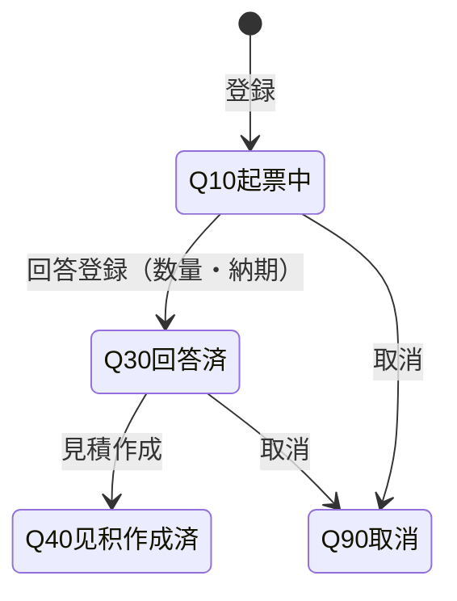
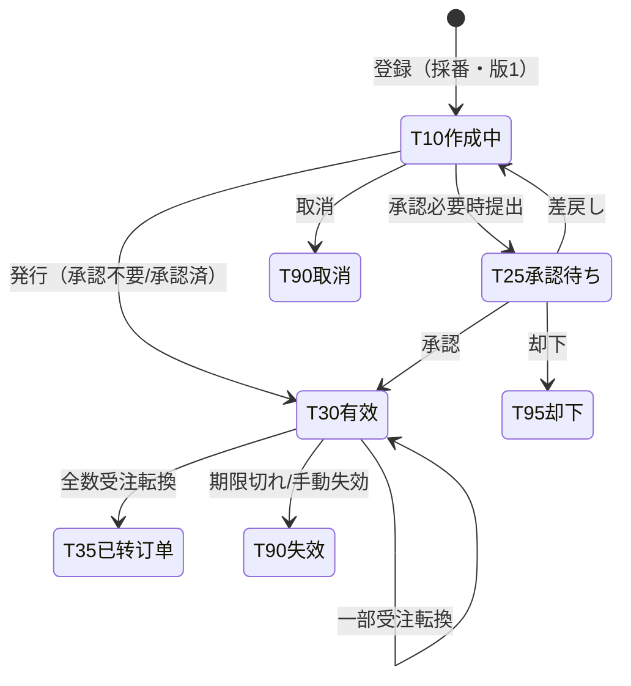
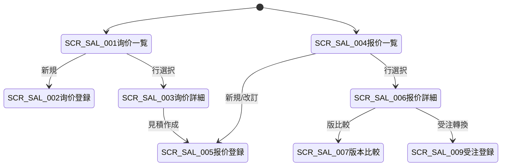

# 询价・报价单 详细设计书（引合・見積書 詳細設計書）

| 項目 | 内容 |
|---|---|
| 文書名 | 询价・报价单 详细设计书（引合・見積書 詳細設計書） |
| 文書番号 | DSN-SAL-001 |
| 版数 | v1.1 |
| 作成日 | 2026-10-20 |
| 作成者 | sales-designer（销售域担当） |
| 承認者 | 未承認（レビュー待ち） |
| 状態 | ドラフト（レビュー中） |
| 関連文書 | [業務域概要](00-overview.md) / [销售订单](02-sales-order.md) / [信用管控・価格](06-credit-pricing.md) / [共通業務規則](../00-common/08-common-business-rules.md) / [跨域流程](../00-common/09-cross-domain-flow.md) / [主データ域 価格](../02-mdm/05-price-settlement.md) |

---

## 1. 機能概要

| 項目 | 内容 |
|---|---|
| 機能 ID | F-SAL-001（客户询价）/ F-SAL-002（报价单） |
| 機能名 | 引合管理、見積作成・承認・版数管理・有効期限管理・受注転換 |
| 目的 | 顧客の引合（仕様・数量・納期）を記録し、MDM 価格表と特価に基づく見積を版數・有効期限付きで提示する。有効な見積から受注へ転換し、O2C の起点データを引き継ぐ |
| 利用者・ロール | 銷售員（引合・見積作成）、銷售經理（見積承認・±5% 以內）、銷售總監（5〜10%）、財務總監（10% 超） |
| 利用シーン | ① 顧客からの引合受付 ② 見積作成・改訂（版數） ③ 見積の承認・PDF 送付 ④ 有効期限管理 ⑤ 見積から受注への転換 |
| 優先度 | P0（第一版 MVP） |
| 画面 ID | SCR-SAL-001（询价一覧）、SCR-SAL-002（询价登録編集）、SCR-SAL-003（询价参照詳細）、SCR-SAL-004（报价单一覧）、SCR-SAL-005（报价单登録編集）、SCR-SAL-006（报价单参照詳細）、SCR-SAL-007（报价单版本比較） |
| 関連 IF | MDM 価格/物料/顧客照会 API、WF（`SALES_QUOTATION`、特価時）、F-SAL-003（受注転換）、E05/E31/E32（承認時のみ） |

## 2. 業務要件・業務ルール

### 2.1 前提条件

| # | 前提条件 | 成立しない場合の挙動 |
|---|---|---|
| 1 | 顧客が有効（MDM `status=1`）。與信凍結中でも引合・見積は可（受注時に判定） | 顧客無効は登録不可（`MSG-SAL-002`） |
| 2 | 物料が有効かつ販売停止でない | 明細追加不可（`MSG-SAL-006`） |
| 3 | 有効な価格表または特価が存在する、または手動単価（要承認） | 取價不能（`MSG-SAL-012`） |
| 4 | 見積の有効期限が設定されている | 未設定は保存不可（`MSG-SAL-170`） |
| 5 | 見積の承認が必要な場合（特価・標準價 ±5% 超/折扣 5% 超）は WF 承認済 | 承認待ちでは「有効」にできない（`MSG-SAL-171`） |
| 6 | 轉換先の受注は F-SAL-003 の前提條件を満たす | 轉換時にエラー（受注側のメッセージ） |

### 2.2 業務ルール

| # | ルール | 根拠 | 関連項目 |
|---|---|---|---|
| BR-QT-01 | 引合（INQ）は顧客・仕様・數量・希望納期・見積希望日を記錄する。引合は見積作成のインプットであり、金額を持たない（参考金額は任意） | 業務慣行 | `inquiry_status` |
| BR-QT-02 | 見積番號は `QT{YYMMDD}{4桁}`（08 §2.1）。版數は `revision_no` で管理し、改訂ごとに +1 する（傳票番號は変えない） | 08 §2.1 | `quotation_no`、`revision_no` |
| BR-QT-03 | 見積は明細行を持ち、各行に取價（F-SAL-011 の優先順位）を適用する。手動單價の場合は理由と承認要フラグを立てる | F-SAL-011 | `price_source` |
| BR-QT-04 | 見積の承認要否：標準價 ±5% 以內かつ折扣 5% 以內は承認不要（営業が発行可）。±5% 超/折扣 5% 超は WF 承認（`SALES_QUOTATION`）。承認済の版のみ「30 有效」にできる | 08 §8.1 | `approval_status` |
| BR-QT-05 | 見積には有効期限（`valid_from`/`valid_to`）を必須とする。既定は発行日 + 30 日【示例値】。期限切れは BAT-SAL-001 で「90 失效」へ更新し、7 日前に営業へ通知する | 本設計 | `valid_to` |
| BR-QT-06 | 見積の改訂は「新規版の作成」で行う。発行済（30）の見積を直接変更してはならない。旧版は履歴として保持する | 共通業務規則 3.3 | `sal_quotation_version` |
| BR-QT-07 | 見積から受注への転換は、明細を選択して行う（部分轉換可）。轉換數量 ≤ 見積數量 − 既轉換數量。全明細が轉換済になると見積は「35 已轉訂單」 | 本設計 | `converted_qty` |
| BR-QT-08 | 轉換後の受注は見積の單價・稅率・納期を引き継ぎ、`source_type=QUOTATION`、`source_id` を保持する。轉換時に再度取價は行わない（見積單價を尊重） | 02-sales-order | `quotation_id` |
| BR-QT-09 | 見積の有効期限が切れた場合、受注への轉換は不可（新規見積の作成を案内）。期限內でも與信・可用量チェックは受注時に行う | 本設計 | — |
| BR-QT-10 | 見積金額は稅抜單價×數量で計算し、稅額・稅込金額を明細單位で計算する。端數は HALF_UP 2 桁 | 共通業務規則 4 | — |
| BR-QT-11 | 見積の印刷（PRT-SAL-001）は承認済または承認不要の場合のみ可能。PDF を顧客へ送付し、送付日時を記錄する | 業務慣行 | `sent_at` |
| BR-QT-12 | 見積の取消（90）は未轉換の場合のみ可能。轉換済の見積は取消不可（受注が存在するため） | 共通業務規則 3.3 | — |
| BR-QT-13 | 引合のステータス：10 起票中/30 回答済/40 見積作成済/90 取消。見積作成時に引合を 40 に更新する | 本設計 | — |
| BR-QT-14 | 見積の承認履歴・版數履歴は監査対象。誰がいつどの版を承認・送付したかを保持する | 共通項目定義 12 | — |
| BR-QT-15 | 為替・外貨は 第一版。当面は CNY のみ。輸出向け見積は Incoterms 項目の予約のみ | 出口銷售 F-SAL-016 | `currency_code` |
| BR-QT-16 | 見積の有効期限は最長 180 日。延長は新規版作成で行う | 社内規程（仮定） | — |

### 2.3 計算式・判定式

| # | 対象 | 算式 | 丸め | 例 |
|---|---|---|---|---|
| CALC-QT-01 | 見積明細金額（稅抜） | 見積數量 × 稅抜單價 | HALF_UP 2 桁 | 120 × 856.50 = 102,780.00 |
| CALC-QT-02 | 見積明細稅額 | 明細金額 × 稅率 | HALF_UP 2 桁 | 102,780.00 × 13% = 13,361.40 |
| CALC-QT-03 | 見積稅込金額 | 明細金額 + 稅額 | — | 116,141.40 |
| CALC-QT-04 | 見積合計 | Σ 明細金額 / Σ 稅額 / 稅抜+稅額 | — | — |
| CALC-QT-05 | 轉換可能數量 | 見積數量 − 既轉換數量 | 4 桁 | 120 − 40 = 80 PCE |
| CALC-QT-06 | 有效期限 | 發行日 + 有效日數（既定 30 日） | — | 2026-10-20 + 30 = 2026-11-19 |
| CALC-QT-07 | 標準價比 | (見積單價 − 標準價) ÷ 標準價 | 4 桁（%） | (856.50 − 900.00) ÷ 900.00 = −4.83% |
| CALC-QT-08 | 折扣率 | (1 − 見積單價 ÷ 標準價) × 100 | 4 桁（%） | (1 − 856.50 ÷ 900.00) × 100 = 4.83% |

**見積例（【示例値】）**

| 項目 | 明細 10 | 備考 |
|---|---|---|
| 物料 | YE3-100L1-4（3001000001） | 120 PCE |
| 標準價（稅抜） / 見積單價（稅抜） | 900.000000 / 856.500000 | 標準價比 −4.83%（±5% 以内） |
| 明細金額（稅抜） | 102,780.00 | 120 × 856.50 |
| 稅額（13%） | 13,361.40 | CALC-QT-02 |
| 稅込金額 | 116,141.40 | CALC-QT-03 |

> 數量・單價は【示例値】。物料の実在仕様は [90-data/material-master.csv](../90-data/material-master.csv) を參照。

### 2.4 状態遷移

#### 2.4.1 询价（INQ）



| 遷移 | トリガ | 権限 | 更新項目 | メッセージ |
|---|---|---|---|---|
| 新規→10 | 引合登録 | `sales:inquiry:create` | `inquiry_status=10`、採番 `INQ{YYMMDD}{4桁}` | `MSG-SAL-172` |
| 10→30 | 回答登録 | `sales:inquiry:update` | `inquiry_status=30`、回答日・納期回答 | `MSG-SAL-173` |
| 30→40 | 見積作成 | `sales:quotation:create` | `inquiry_status=40`、`quotation_id` | `MSG-SAL-174` |
| 10/30→90 | 取消 | `sales:inquiry:update` | `inquiry_status=90` | `MSG-SAL-175` |

#### 2.4.2 报价单（QT）



| 遷移 | トリガ | 権限 | 更新項目 | メッセージ／イベント |
|---|---|---|---|---|
| 新規→10 | 見積登録 | `sales:quotation:create` | INSERT（`quotation_no` 採番、`revision_no=1`、`quotation_status=10`） | `MSG-SAL-176` |
| 10→25 | 承認提出 | `sales:quotation:create` | `quotation_status=25`、WF（`SALES_QUOTATION`） | E05、`MSG-COM-005` |
| 25→10 | 差戻し | `sales:quotation:approve` | `quotation_status=10` | `MSG-SAL-016` |
| 25→95 | 却下 | `sales:quotation:approve` | `quotation_status=95` | `MSG-SAL-015` |
| 25→30 | 承認 | `sales:quotation:approve` | `quotation_status=30`、`approved_at/by` | `MSG-SAL-177` |
| 10→30 | 発行（承認不要） | `sales:quotation:create` | `quotation_status=30`、`issued_at`、`valid_from/to` | `MSG-SAL-177` |
| 30→30 | 改訂 | `sales:quotation:create` | `revision_no+1`、`sal_quotation_version` INSERT、舊版スナップショット | `MSG-SAL-178` |
| 30→35 | 全數受注轉換 | `sales:quotation:convert` | `quotation_status=35`、`converted_at`、明細 `converted_qty` | `MSG-SAL-179` |
| 30→90 | 期限切れ/失効 | BAT-SAL-001 / `sales:quotation:create` | `quotation_status=90`、`invalidated_at` | `MSG-SAL-180` |
| 10→90 | 取消 | `sales:quotation:create` | `quotation_status=90`、`cancel_reason` | `MSG-SAL-181` |

> 見積は承認不要の場合「10 作成中→30 有效」へ直接発行できる。承認が必要な場合のみ 25（承認待ち）を経由する。08 章の承認マトリクスに報價單が明記されていないため、本域は「特価・±5% 超・折扣 5% 超の場合のみ承認」と定義する（[00-overview §12.2 #2](00-overview.md)）。

## 3. 関連機能

| 関係 | 機能 ID | 機能名 | 関係內容 |
|---|---|---|---|
| 上流 | MDM | 顧客・物料・價格表・稅碼 | 同期參照 |
| 上流 | F-SAL-011 | 價格与促销 | 取價・特価適用 |
| 下流 | F-SAL-003 | 销售订单 | 見積から受注へ轉換（`source_type=QUOTATION`） |
| 下流 | F-SAL-012 | 訂單執行跟蹤 | 見積轉換率の集計 |
| イベント | E05/E31/E32 | WF 承認（特価・高折扣時） | 09 §9 |
| 外部 | — | PDF 送付（メール） | SYS 通知 |

## 4. 画面設計

### 4.1 画面一覧

| 画面 ID | 画面名 | 類型 | 概要 |
|---|---|---|---|
| SCR-SAL-001 | 询价一覧 | LIST | 引合の検索・状態確認 |
| SCR-SAL-002 | 询价登録編集 | EDIT | 引合の登録・回答登録 |
| SCR-SAL-003 | 询价参照詳細 | VIEW | 引合詳細、見積作成への導線 |
| SCR-SAL-004 | 报价单一覧 | LIST | 見積の検索・有効期限・轉換狀況 |
| SCR-SAL-005 | 报价单登録編集 | EDIT | 見積作成・取價・改訂 |
| SCR-SAL-006 | 报价单参照詳細 | VIEW | 見積詳細、版數・承認・送付履歴、受注轉換 |
| SCR-SAL-007 | 报价单版本比較 | VIEW | 版數間の差分比較 |

### 4.2 画面遷移



### 4.3 画面レイアウト

**SCR-SAL-005 报价单登録編集**

```
┌──────────────────────────────────────────────────────────────────────────────┐
│ パンくず：ホーム > 販売管理 > 見積管理 > 見積作成                              │
├──────────────────────────────────────────────────────────────────────────────┤
│〔ヘッダ〕見積番号[自動] 版数[1] 状態[10 作成中]                              │
│ 顧客[C000001 江蘇恒立液壓▼] 引合番号[INQ2610180001] 担当[E000123]             │
│ 発行日[2026-10-20] 有效期限[2026-11-19] 通貨[CNY] 付款條件[NET30▼]            │
│ 見積條件[納品先/納期回答] 與信參考[OK] 標準價比最大[-4.83%]                   │
├──────────────────────────────────────────────────────────────────────────────┤
│〔明細〕[引合取込][追加][取價]                                                │
│ No|物料|品名|數量|單位|標準價|單價|標準價比|折扣%|金額|稅率|稅額|納期         │
│ 10|3001000001|YE3-100L1-4|120|PCE|900.00|856.50|-4.83%|0.0|102,780.00|13%|…  │
├──────────────────────────────────────────────────────────────────────────────┤
│〔合計〕稅抜 CNY 102,780.00 稅額 CNY 13,361.40 稅込 CNY 116,141.40            │
│〔フッタ〕[保存][提出（承認要）][発行][PDF プレビュー PRT-SAL-001][戻る]        │
└──────────────────────────────────────────────────────────────────────────────┘
```

### 4.4 画面項目定義

#### 4.4.1 SCR-SAL-002 询价ヘッダ

| No | 項目 ID | 項目名 | 種別 | 型/桁 | 必須 | 初期值 | 入力チェック | データソース | DB 項目 | 備考 |
|---|---|---|---|---|---|---|---|---|---|---|
| 1 | `inquiryNo` | 引合番號 | テキスト | VARCHAR(32) | ○ | 自動採番 | `INQ+YYMMDD+4桁` | SYS | `inquiry_no` | 參照のみ |
| 2 | `customerId/Code/Name` | 顧客 | 選択 | BIGINT/VARCHAR | ○ | — | 有効顧客 | MDM | `customer_id/code/name` | — |
| 3 | `contactName/Phone` | 連絡先 | テキスト | VARCHAR(50/30) | △ | MDM | 桁數 | MDM | `contact_name/phone` | マスキング |
| 4 | `inquiryDate` | 引合日 | 日付 | DATE | ○ | 當日 | 未來日不可 | — | `inquiry_date` | — |
| 5 | `inquirySource` | 引合區分 | 選択 | SMALLINT | ○ | 10 | 10 電話/20 メール/30 訪問/40 既存取引/50 その他 | 固定値 | `inquiry_source` | — |
| 6 | `requiredDate` | 希望納期 | 日付 | DATE | △ | — | 引合日以降 | — | `required_date` | — |
| 7 | `ownerUserId` | 営業擔當 | 選択 | BIGINT | ○ | ログインユーザ | 有効ユーザ | SYS | `owner_user_id` | — |
| 8 | `inquiryStatus` | 狀態 | 表示 | SMALLINT | — | 10 | — | — | `inquiry_status` | 10/30/40/90 |
| 9 | `answeredAt` | 回答日 | 日付 | DATE | △ | — | — | — | `answered_at` | — |
| 10 | `answerNote` | 回答內容 | テキスト | VARCHAR(1000) | △ | — | 1000 桁 | 手入力 | `answer_note` | — |
| 11 | `quotationId` | 見積 ID | 表示 | BIGINT | — | — | — | — | `quotation_id` | — |
| 12 | `remark` | 備考 | テキスト | VARCHAR(500) | △ | — | 500 桁 | 手入力 | `remark` | — |

#### 4.4.2 SCR-SAL-002 询价明細

| No | 項目 ID | 項目名 | 種別 | 型/桁 | 必須 | 初期值 | 入力チェック | DB 項目 |
|---|---|---|---|---|---|---|---|---|
| 1 | `lineNo` | 行番號 | 數値 | INT | — | 10 刻み | — | `line_no` |
| 2 | `materialId/Code/Name` | 物料 | 選択 | BIGINT/VARCHAR | ○ | — | 有効・販売可 | `material_id/material_code/material_name` |
| 3 | `spec` | 仕様・要求 | テキスト | VARCHAR(500) | △ | 物料既定 | 500 桁 | `spec` |
| 4 | `qty` | 希望數量 | 數値 | NUMERIC(18,4) | ○ | — | > 0、4 桁 | `qty` |
| 5 | `uomCode` | 單位 | 選択 | VARCHAR(10) | ○ | 物料既定 | 有効單位 | `uom_code` |
| 6 | `requiredDate` | 希望納期 | 日付 | DATE | △ | — | 引合日以降 | `required_date` |
| 7 | `customerMaterialNo` | 顧客品番 | テキスト | VARCHAR(100) | △ | — | 100 桁 | `customer_material_no` |
| 8 | `lineRemark` | 明細備考 | テキスト | VARCHAR(500) | △ | — | 500 桁 | `line_remark` |

#### 4.4.3 SCR-SAL-005 报价单ヘッダ

| No | 項目 ID | 項目名 | 種別 | 型/桁 | 必須 | 初期值 | 入力チェック | データソース | DB 項目 | 備考 |
|---|---|---|---|---|---|---|---|---|---|---|
| 1 | `quotationNo` | 見積番號 | テキスト | VARCHAR(32) | ○ | 自動採番 | `QT+YYMMDD+4桁` | SYS | `quotation_no` | 參照のみ |
| 2 | `revisionNo` | 版數 | 表示 | INT | — | 1 | — | — | `revision_no` | 改訂で +1 |
| 3 | `inquiryId` | 引合 | 選択 | BIGINT | △ | — | 有効引合 | SAL | `inquiry_id` | — |
| 4 | `customerId/Code/Name` | 顧客 | 選択 | BIGINT/VARCHAR | ○ | — | 有効顧客 | MDM | `customer_id/code/name` | — |
| 5 | `customerTaxNo` | 顧客稅號 | テキスト | VARCHAR(30) | △ | MDM | 18 桁 | MDM | `customer_tax_no` | スナップショット |
| 6 | `deliveryAddress` | 納品先 | テキスト | VARCHAR(500) | ○ | MDM | 500 桁 | MDM | `delivery_address` | — |
| 7 | `ownerUserId` | 営業擔當 | 選択 | BIGINT | ○ | ログインユーザ | 有効ユーザ | SYS | `owner_user_id` | — |
| 8 | `issueDate` | 発行日 | 日付 | DATE | ○ | 當日 | 未來日不可 | — | `issue_date` | — |
| 9 | `validFrom` / `validTo` | 有效期限 | 日付 | DATE | ○ | 發行日/發行日+30 | from ≤ to、180 日以內 | 手入力 | `valid_from/to` | 【示例値】30 日 |
| 10 | `currencyCode` | 通貨 | 選択 | VARCHAR(3) | ○ | CNY | 当面 CNY のみ（多币种第一版対象） | MDM | `currency_code` | — |
| 11 | `priceListId` | 價格表 | 選択 | BIGINT | △ | 顧客既定 | 有効 | MDM | `price_list_id` | — |
| 12 | `paymentTermCode` | 付款條件 | 選択 | VARCHAR(20) | ○ | 顧客既定 | コード存在 | MDM | `payment_term_code` | — |
| 13 | `quotationStatus` | 狀態 | 表示 | SMALLINT | — | 10 | — | — | `quotation_status` | 10/25/30/35/90/95 |
| 14 | `approvalStatus` | 承認狀態 | 表示 | SMALLINT | — | — | — | — | `approval_status` | 10 不要/20 承認待ち/25 承認済 |
| 15 | `totalAmount` | 稅抜合計 | 數値 | NUMERIC(18,2) | — | 自動 | — | 計算 | `total_amount` | — |
| 16 | `taxAmount` | 稅額合計 | 數値 | NUMERIC(18,2) | — | 自動 | — | 計算 | `tax_amount` | — |
| 17 | `grandTotal` | 稅込合計 | 數値 | NUMERIC(18,2) | — | 自動 | — | 計算 | `grand_total` | — |
| 18 | `sentAt` | 送付日時 | 表示 | TIMESTAMPTZ | — | — | — | — | `sent_at` | PDF 送付時に設定 |
| 19 | `convertedAt` | 轉換日時 | 表示 | TIMESTAMPTZ | — | — | — | — | `converted_at` | — |
| 20 | `remark` | 備考 | テキスト | VARCHAR(500) | △ | — | 500 桁 | 手入力 | `remark` | — |

#### 4.4.4 SCR-SAL-005 报价单明細

| No | 項目 ID | 項目名 | 種別 | 型/桁 | 必須 | 初期值 | 入力チェック | 計算 | DB 項目 |
|---|---|---|---|---|---|---|---|---|---|
| 1 | `lineNo` | 行番號 | 數値 | INT | — | 10 刻み | — | — | `line_no` |
| 2 | `materialId/Code/Name` | 物料 | 選択 | BIGINT/VARCHAR | ○ | — | 有効・販売可 | — | `material_id/code/name` |
| 3 | `spec` | 仕様 | テキスト | VARCHAR(200) | △ | 自動 | — | — | `spec` |
| 4 | `qty` | 見積數量 | 數値 | NUMERIC(18,4) | ○ | — | > 0、4 桁 | — | `qty` |
| 5 | `uomCode` | 單位 | 選択 | VARCHAR(10) | ○ | 物料既定 | 有効單位 | — | `uom_code` |
| 6 | `listPrice` | 標準價 | 數値 | NUMERIC(18,6) | — | MDM | — | — | `list_price` |
| 7 | `unitPrice` | 見積單價（稅抜） | 數値 | NUMERIC(18,6) | ○ | 取價 | ≥ 0、6 桁 | — | `unit_price` |
| 8 | `priceSource` | 取價区分 | 表示 | SMALLINT | — | — | — | 10 顧客+物料/20 顧客分類+物料/30 物料/40 全社標準/90 特價(SAL)/99 手動 | `price_source` |
| 9 | `discountRate` | 折扣率 | 數値 | NUMERIC(7,4) | △ | 0 | 0〜100、5% 超は承認 | — | `discount_rate` |
| 10 | `taxCode` | 稅碼 | 選択 | VARCHAR(20) | ○ | 物料既定 | 有効（销项） | — | `tax_code` |
| 11 | `taxRate` | 稅率 | 數値 | NUMERIC(7,4) | ○ | 13.0000 | 0〜100 | — | `tax_rate` |
| 12 | `lineAmount` | 明細金額（稅抜） | 數値 | NUMERIC(18,2) | — | 自動 | — | CALC-QT-01 | `line_amount` |
| 13 | `taxAmount` | 稅額 | 數値 | NUMERIC(18,2) | — | 自動 | — | CALC-QT-02 | `tax_amount` |
| 14 | `totalAmount` | 稅込金額 | 數値 | NUMERIC(18,2) | — | 自動 | — | CALC-QT-03 | `total_amount` |
| 15 | `deliveryDate` | 回答納期 | 日付 | DATE | ○ | 發行日+LT | 發行日以降 | — | `delivery_date` |
| 16 | `convertedQty` | 轉換済數量 | 表示 | NUMERIC(18,4) | — | 0 | — | — | `converted_qty` |
| 17 | `lineRemark` | 明細備考 | テキスト | VARCHAR(500) | △ | — | 500 桁 | — | `line_remark` |

### 4.5 イベント処理

| No | イベント | トリガ | 処理內容 | 呼出 API / 処理 ID | 畫面遷移 | 備考 |
|---|---|---|---|---|---|---|
| 1 | 引合登録 | 保存 | 引合 INSERT、採番 | POST /api/sales/inquiries | 一覧へ | — |
| 2 | 回答登録 | 保存 | 回答日・納期回答、狀態 30 | PUT /api/sales/inquiries/{id} | — | — |
| 3 | 見積作成 | ボタン | 引合から見積へコピー | POST /api/sales/quotations | SCR-SAL-005 | 引合 40 |
| 4 | 明細取込 | ボタン | 引合・前回版から明細コピー | — | — | — |
| 5 | 取價 | ボタン | F-SAL-011 の取價（特價→MDM） | POST /api/mdm/prices/sales/effective-batch | — | — |
| 6 | 金額再計算 | 數量・單價改變 | CALC-QT-01〜04 | フロント計算 | — | サーバ再計算 |
| 7 | 保存 | 保存ボタン | 入力チェック→INSERT/UPDATE | POST/PUT /api/sales/quotations | 一覧へ | Idempotency-Key |
| 8 | 提出（承認要） | ボタン | WF（`SALES_QUOTATION`）→狀態 25 | POST /api/sales/quotations/{id}/submit | 一覧へ | — |
| 9 | 發行 | ボタン | 承認不要/承認済→狀態 30、有效期限設定 | POST /api/sales/quotations/{id}/issue | 詳細へ | — |
| 10 | 改訂 | ボタン | 新規版作成（`revision_no+1`）、舊版スナップショット | POST /api/sales/quotations/{id}/revise | SCR-SAL-005 | — |
| 11 | PDF 送付 | ボタン | PRT-SAL-001 生成、送付日時記錄、メール送付（SYS） | POST /api/sales/quotations/{id}/print | プレビュー | — |
| 12 | 受注轉換 | ボタン | 明細選択→受注作成（F-SAL-003）、`converted_qty` 更新 | POST /api/sales/quotations/{id}/convert | SCR-SAL-009 | 全數で 35 |
| 13 | 版比較 | ボタン | 2 版の明細差異を表示 | GET /api/sales/quotations/{id}/versions | SCR-SAL-007 | — |
| 14 | 失効 | BAT-SAL-001 | 期限切れを 90 に更新、通知 | — | — | — |
| 15 | エクスポート | ボタン | Excel 最大 10,000 件 | POST /api/sales/exports | — | — |

### 4.6 一覧畫面仕様

| 画面 | 検索條件 | 既定 | 列 |
|---|---|---|---|
| SCR-SAL-001 询价一覧 | 引合番號、引合日、顧客、営業擔當、狀態 | 當月 | 引合番號、引合日、顧客、狀態、希望納期、見積作成有無 |
| SCR-SAL-004 报价单一覧 | 見積番號、発行日、有效期限、顧客、狀態、轉換狀況 | 有効のみ・當月 | 見積番號、版數、顧客、發行日、有效期限、稅込合計、狀態、轉換狀況 |
| 共通 | ページング 20/50/100/200、Excel エクスポート最大 10,000 件 | — | — |

### 4.7 表示制御

| 條件 | 対象 | 制御 |
|---|---|---|
| 見積狀態 30/35/90/95 | 編集ボタン | 非表示（改訂のみ） |
| 見積狀態 25 | 編集・發行ボタン | 非表示（承認待ち） |
| 有效期限切れ | 見積行 | 赤表示・轉換ボタン非活性 |
| 校正不要（承認不要） | 提出ボタン | 非表示、發行ボタン表示 |
| 權利なし | 承認・轉換 | 非表示・API 403 |
| 他擔當顧客 | 見積金額 | 非表示（データ範囲） |

## 5. 入力チェック仕様

| No | チェック ID | 対象項目 | 種別 | 條件 | タイミング | メッセージ ID |
|---|---|---|---|---|---|---|
| 1 | CHK-SAL-001-01 | 顧客 | 必須/コード存在 | 有効顧客 | 保存時 | MSG-COM-049 |
| 2 | CHK-SAL-001-02 | 引合日 | 必須/範囲 | 未來日不可 | 保存時 | MSG-COM-043 |
| 3 | CHK-SAL-001-03 | 物料 | 必須/コード存在 | 有効・販売可 | 保存時 | MSG-SAL-006 |
| 4 | CHK-SAL-001-04 | 希望數量 | 必須/範囲 | > 0、4 桁 | 保存時 | MSG-COM-047 |
| 5 | CHK-SAL-001-05 | 狀態 | 業務 | 10/30 のみ編集可 | 保存時 | MSG-COM-034 |
| 6 | CHK-SAL-001-06 | 明細行數 | 範囲 | 1〜1,000 行 | 保存時 | MSG-COM-047 |
| 7 | CHK-SAL-001-07 | 有効期限 | 必須/相関 | from ≤ to、180 日以內 | 保存時 | MSG-SAL-170 |
| 8 | CHK-SAL-001-08 | 見積單價 | 必須/範囲 | ≥ 0、6 桁、0 はサンプル承認要 | 保存時 | MSG-SAL-182 |
| 9 | CHK-SAL-001-09 | 標準價比/折扣 | 業務 | ±5% 超・5% 超は承認要（警告） | 提出/發行時 | MSG-SAL-023 |
| 10 | CHK-SAL-001-10 | 承認狀態 | 業務 | 承認要の場合 25 承認済のみ發行可 | 發行時 | MSG-SAL-171 |
| 11 | CHK-SAL-001-11 | 轉換數量 | 範囲 | > 0、≤ 見積數量 − 轉換済 | 轉換時 | MSG-SAL-183 |
| 12 | CHK-SAL-001-12 | 轉換期限 | 業務 | 有效期限內のみ | 轉換時 | MSG-SAL-184 |
| 13 | CHK-SAL-001-13 | 狀態 | 業務 | 30 のみ轉換可 | 轉換時 | MSG-COM-034 |
| 14 | CHK-SAL-001-14 | 取消 | 業務 | 未轉換のみ取消可 | 取消時 | MSG-SAL-185 |
| 15 | CHK-SAL-001-15 | 樂観排他 | 排他 | `version` 一致 | 保存/狀態操作時 | MSG-COM-033 |
| 16 | CHK-SAL-001-16 | 承認者 | 職務分掌 | 作成者と承認者が同一でない | 承認時 | MSG-SAL-018 |
| 17 | CHK-SAL-001-17 | 版數 | 一意 | 同一見積の版數重複なし | 改訂時 | MSG-COM-050 |
| 18 | CHK-SAL-001-18 | 引合 | 相関 | 引合の顧客・明細と整合 | 見積作成時 | MSG-SAL-174 |

## 6. 処理詳細

### 6.1 処理一覧

| 処理 ID | 処理名 | 契機 | トランザクション | 排他 |
|---|---|---|---|---|
| PRC-SAL-001-01 | 引合登録・回答 | 保存 | 要（引合・明細・採番） | 採番行ロック |
| PRC-SAL-001-02 | 見積作成 | 保存（新規） | 要（見積・明細・版・採番） | 採番行ロック |
| PRC-SAL-001-03 | 見積改訂 | 改訂 | 要（新版・舊版スナップショット） | 樂観排他 |
| PRC-SAL-001-04 | 見積承認提出 | 提出 | 要（狀態 + E05） | 樂観排他 |
| PRC-SAL-001-05 | 見積發行 | 發行 | 要（狀態・有效期限） | 樂観排他 |
| PRC-SAL-001-06 | 受注轉換 | 轉換 | 要（受注作成・見積更新） | 見積明細ロック |
| PRC-SAL-001-07 | 有效期限失効 | BAT-SAL-001 | 要 | — |

### 6.2 処理手順（正常系）

**PRC-SAL-001-02 見積作成**

1. 引合または直接入力から顧客・明細を取得し、入力チェック（CHK-SAL-001-01〜07）を実行する。
2. 明細ごとに取價（F-SAL-011、特價→MDM 有效價格）を行い、`price_source`・標準價比を設定する。取價不能は手動單價（承認要）。
3. 金額・稅額・合計を計算する（CALC-QT-01〜04）。
4. 有効期限を設定する（既定 發行日+30 日）。承認要否を判定する（標準價 ±5% 超・折扣 5% 超・手動單價・0 円）。
5. `QT{YYMMDD}{4桁}` を採番し、`sal_quotation`（`revision_no=1`、`quotation_status=10`、`approval_status=10/20`）・`sal_quotation_line`・`sal_quotation_version`（版 1 スナップショット）を INSERT する。
6. 引合から作成した場合は引合を `40 見積作成済`、`quotation_id` を設定する。
7. `MSG-SAL-176` を返す。

**PRC-SAL-001-05 見積發行**

1. 狀態 10、承認要の場合は承認済（25）であることを確認する。
2. 有効期限が未來日であること、明細が 1 行以上であることを確認する。
3. `quotation_status=30`、`issued_at`、`valid_from/to` を更新する。版スナップショットを最新化する。
4. PDF（PRT-SAL-001）の出力可否を有効化する。`MSG-SAL-177` を返す。

**PRC-SAL-001-06 受注轉換**

1. 見積（狀態 30）を `FOR UPDATE` で取得し、有效期限內であることを確認する。
2. 轉換する明細・數量を検証する（CHK-SAL-001-11〜13）。
3. 受注を作成する（F-SAL-003 の PRC-002-01 を呼び出す）。`source_type=QUOTATION`、`source_id`、`source_no` を設定し、單價・稅率・納期を引き継ぐ。轉換時に取價は行わない。
4. 見積明細の `converted_qty` を加算し、全明細が轉換済なら `quotation_status=35`、`converted_at` を設定する（一部なら 30 のまま）。
5. 監査ログを記錄し、受注 ID を返す。`MSG-SAL-179` を返す。

**PRC-SAL-001-07 有効期限失効（BAT-SAL-001）**

1. `quotation_status=30` かつ `valid_to < 當日` の見積を抽出する。
2. 狀態 90（失効）、`invalidated_at` を更新する。再実行しても既に 90 のものは対象外（冪等）。
3. 期限 7 日前の見積を抽出し、営業へ通知する（站内）。
4. 実行件数を `sys_job_log` に記錄する。

### 6.3 例外処理

| No | 異常條件 | 検知箇所 | 処理 | ロールバック | メッセージ ID |
|---|---|---|---|---|---|
| 1 | 顧客無効 | 保存 | エラー | 全體 | MSG-SAL-002 |
| 2 | 物料販売停止 | 保存 | エラー | 全體 | MSG-SAL-006 |
| 3 | 有効期限不備 | 保存 | エラー | 全體 | MSG-SAL-170 |
| 4 | 承認なしで發行 | 發行 | エラー | 全體 | MSG-SAL-171 |
| 5 | 期限切れで轉換 | 轉換 | エラー | 全體 | MSG-SAL-184 |
| 6 | 轉換數量超過 | 轉換 | エラー | 全體 | MSG-SAL-183 |
| 7 | 轉換済見積の取消 | 取消 | エラー | 全體 | MSG-SAL-185 |
| 8 | 樂観排他競合 | 保存 | 409 | 全體 | MSG-COM-033 |
| 9 | WF 送信失敗 | 提出 | ロールバック | 全體 | MSG-COM-073 |
| 10 | 取價不能 | 取價 | 手動單價（承認要） | — | MSG-SAL-012 |

### 6.4 冪等性・再実行

- 引合・見積の登録、提出、發行、改訂、轉換は `Idempotency-Key` 必須。
- 轉換 API は二重実行しても受注を重複作成しないよう、`quotation_id + revision_no + lines` の轉換記錄（`sal_quotation_conversion` 相當の関連）で冪等チェックする。※ 本域では見積明細の `converted_qty` と受注の `source_type/source_id` の一意制約で防止する。
- BAT-SAL-001 は冪等（既に 90 のものは対象外）。

## 7. API 設計

### 7.1 API 一覧

| No | メソッド | パス | 権限 | 概要 | 主なエラー |
|---|---|---|---|---|---|
| 1 | GET | `/api/sales/inquiries` | `sales:inquiry:view` | 引合一覧 | 3001 |
| 2 | GET | `/api/sales/inquiries/{id}` | `sales:inquiry:view` | 引合詳細 | 4001 |
| 3 | POST | `/api/sales/inquiries` | `sales:inquiry:create` | 引合登録 | 1001 |
| 4 | PUT | `/api/sales/inquiries/{id}` | `sales:inquiry:update` | 引合更新（回答含む） | 4002/4003 |
| 5 | POST | `/api/sales/inquiries/{id}/cancel` | `sales:inquiry:update` | 引合取消 | 4002 |
| 6 | GET | `/api/sales/quotations` | `sales:quotation:view` | 見積一覧 | 3001 |
| 7 | GET | `/api/sales/quotations/{id}` | `sales:quotation:view` | 見積詳細 | 4001 |
| 8 | POST | `/api/sales/quotations` | `sales:quotation:create` | 見積作成 | 1001、30013 |
| 9 | PUT | `/api/sales/quotations/{id}` | `sales:quotation:create` | 見積更新（10 のみ） | 4002/4003 |
| 10 | POST | `/api/sales/quotations/{id}/submit` | `sales:quotation:create` | 承認提出 | 4002 |
| 11 | POST | `/api/sales/quotations/{id}/approve` | `sales:quotation:approve` | 承認 | 3001 |
| 12 | POST | `/api/sales/quotations/{id}/issue` | `sales:quotation:create` | 發行（有効化） | 4002 |
| 13 | POST | `/api/sales/quotations/{id}/revise` | `sales:quotation:create` | 改訂（新版） | 4002 |
| 14 | GET | `/api/sales/quotations/{id}/versions` | `sales:quotation:view` | 版數一覧・比較 | 4001 |
| 15 | POST | `/api/sales/quotations/{id}/convert` | `sales:quotation:convert` | 受注轉換 | 30014 |
| 16 | POST | `/api/sales/quotations/{id}/print` | `sales:quotation:view` | 見積書 PDF（PRT-SAL-001） | 4001 |
| 17 | POST | `/api/sales/quotations/{id}/cancel` | `sales:quotation:create` | 見積取消・失効 | 4002 |

### 7.2 リクエスト／レスポンス詳細

**POST /api/sales/quotations → 201**

```json
{
  "inquiryId": "1845111000000000001",
  "customerId": "1845000000000000001",
  "deliveryAddress": "江苏省常州市武进区***（示例地址）",
  "ownerUserId": "1844000000000000101",
  "issueDate": "2026-10-20",
  "validFrom": "2026-10-20",
  "validTo": "2026-11-19",
  "currencyCode": "CNY",
  "priceListId": "1846000000000000001",
  "paymentTermCode": "NET30",
  "remark": "10月度見積",
  "lines": [
    {
      "materialId": "1845000000000000101",
      "qty": "120.0000",
      "uomCode": "PCE",
      "unitPrice": "856.500000",
      "taxCode": "VAT13-OUT",
      "discountRate": "0.0000",
      "deliveryDate": "2026-10-30"
    },

  ]
}
```

```json
{
  "code": 0,
  "message": "ok",
  "data": {
    "id": "1845222000000000001",
    "quotationNo": "QT2610200001",
    "revisionNo": 1,
    "quotationStatus": 10,
    "statusName": "作成中",
    "approvalStatus": 20,
    "approvalRequired": true,
    "approvalReason": "標準價比 −4.83%（±5% 以内）・折扣なし → 承認不要。示例は承認要フラグの表示構造を示すためのもの",
    "validFrom": "2026-10-20",
    "validTo": "2026-11-19",
    "totalAmount": "102780.00",
    "taxAmount": "13361.40",
    "grandTotal": "116141.40",
    "version": 0,
    "lines": [
      {
        "lineNo": 10,
        "materialCode": "3001000001",
        "qty": "120.0000",
        "listPrice": "900.000000",
        "unitPrice": "856.500000",
        "priceSource": 10,
        "priceSourceName": "客户+物料",
        "standardPriceRatio": "-0.0483",
        "lineAmount": "102780.00",
        "taxRate": "13.0000",
        "taxAmount": "13361.40"
      }
    ]
  }
}
```

> 上記 `approvalRequired` は説明用。實際は取價結果に基づきサーバが判定する（±5% 超・折扣 5% 超・手動單價・0 円の場合に `true`）。

**POST /api/sales/quotations/{id}/convert → 200**

```json
{
  "version": 2,
  "lines": [
    { "lineId": "1845222000000000101", "convertQty": "120.0000" }
  ],
  "salesOrderDraft": {
    "orderDate": "2026-10-20",
    "deliveryDate": "2026-10-30",
    "warehouseId": "1847000000000000011"
  }
}
```

```json
{
  "code": 0,
  "message": "ok",
  "data": {
    "quotationNo": "QT2610200001",
    "quotationStatus": 35,
    "statusName": "已转订单",
    "convertedAt": "2026-10-20T15:00:00+08:00",
    "salesOrders": [
      { "id": "1845678901234567890", "salesOrderNo": "SO2610200001", "orderStatus": 10 }
    ]
  }
}
```

**エラー例（有効期限切れで轉換）**

```json
{
  "code": 30014,
  "message": "报价单已过有效期，不能转为销售订单。请重新创建报价单。",
  "data": {
    "errorDetail": {
      "quotationNo": "QT2610200001",
      "validTo": "2026-11-19",
      "today": "2026-11-25",
      "messageId": "MSG-SAL-184"
    }
  }
}
```

## 8. データ更新仕様

| テーブル | 操作 | 更新項目 | 更新條件 | トリガ |
|---|---|---|---|---|
| `sys_sequence` | UPDATE | `SALES_INQUIRY` / `SALES_QUOTATION` | — | 登録 |
| `sal_inquiry` | INSERT/UPDATE | 全項目、`inquiry_status`、`answered_at`、`quotation_id` | 登録/回答/見積作成 | PRC-SAL-001-01/02 |
| `sal_inquiry_line` | INSERT | 明細 | 登録 | PRC-SAL-001-01 |
| `sal_quotation` | INSERT/UPDATE | 全項目、`quotation_status`、`approval_status`、`revision_no`、`sent_at`、`converted_at`、`invalidated_at` | 作成/提出/承認/發行/改訂/轉換/失効 | PRC-SAL-001-02〜07 |
| `sal_quotation_line` | INSERT/UPDATE | 明細、`converted_qty` | 作成/改訂/轉換 | 同上 |
| `sal_quotation_version` | INSERT/UPDATE | 版スナップショット、`revision_no`、`total_amount`、`valid_from/to`、`status` | 作成/改訂/發行 | PRC-SAL-001-02/03/05 |
| `sys_outbox_event` | INSERT | E05 | 承認提出 | — |
| `sys_audit_log` | INSERT | 登録/發行/改訂/轉換/印刷 | 各処理 | — |

## 9. エラー処理・メッセージ

| メッセージ ID | 種別 | 本文 | 発生條件 | 利用者への対処 | ログ |
|---|---|---|---|---|---|
| MSG-SAL-170 | E | 有效期不能为空，且开始日不能晚于结束日，最长 180 天。 | 期限不備 | 期限修正 | WARN |
| MSG-SAL-171 | E | 报价单尚未审批通过，不能发行。 | 承認未了 | 承認を先に | WARN |
| MSG-SAL-172 | I | 询价单已创建（{0}）。 | 引合登録 | — | INFO |
| MSG-SAL-173 | I | 询价回答已登记。 | 回答登録 | — | INFO |
| MSG-SAL-174 | I | 报价单已创建（{0}），请确认价格与有效期后发行。 | 見積作成 | — | INFO |
| MSG-SAL-175 | I | 询价单已取消。 | 引合取消 | — | INFO |
| MSG-SAL-176 | I | 报价单已保存（{0} 版 {1}）。 | 見積保存 | — | INFO |
| MSG-SAL-177 | I | 报价单已发行，有效期至 {0}。 | 發行 | — | INFO |
| MSG-SAL-178 | I | 已创建新版本（版 {0}），旧版本保留。 | 改訂 | — | INFO |
| MSG-SAL-179 | I | 已转为销售订单（{0}）。 | 轉換 | — | INFO |
| MSG-SAL-180 | I | 报价单已失效（超过有效期）。 | 失効 | 新規見積作成 | INFO |
| MSG-SAL-181 | I | 报价单已取消。 | 取消 | — | INFO |
| MSG-SAL-182 | E | 报价单价必须大于等于 0 且最多 6 位小数；0 元需样品审批。 | 單價不正 | 單價修正 | WARN |
| MSG-SAL-183 | E | 转订单数量不能超过可转数量 {0}。 | 轉換數量超過 | 數量修正 | WARN |
| MSG-SAL-184 | E | 报价单已过有效期，不能转为销售订单。 | 期限切れ | 新規見積作成 | WARN |
| MSG-SAL-185 | E | 已转订单的报价单不能取消。 | 轉換済取消 | 受注側で処理 | WARN |

## 10. 権限・セキュリティ

| 種別 | 內容 |
|---|---|
| 画面権限 | `sales:inquiry:view/create/update`、`sales:quotation:view/create/approve/convert/print` |
| 操作権限 | 見積作成=営業、承認=銷售經理/銷售總監/財務總監（金額・折扣別）、發行=営業（承認不要時）、轉換=営業 |
| 項目権限 | 原價・與信は非表示、見積金額は擔當顧客のみ |
| データ範囲 | 営業=擔當顧客、主管=自部門 |
| 監査ログ | 登録・提出・承認・發行・改訂・轉換・印刷を記錄（金額・版數は before/after） |

## 11. 性能・非機能

| 項目 | 目標値 | 前提 |
|---|---|---|
| 見積一覧 | 2 秒以内（100 件） | `idx_sal_quotation_status_valid` |
| 見積作成 | 3 秒以内（明細 50 行） | 取價 API 含む |
| 受注轉換 | 3 秒以内 | 受注作成含む |
| 見積件數 | 年 24,000 件 | [00-overview 8 章](00-overview.md) |
| 同時実行 | 30 ユーザ | 楽観排他 |

## 12. テスト観点

| No | 観点 ID | 分類 | 観点 | 期待結果 |
|---|---|---|---|---|
| 1 | TST-F-SAL-001-01 | 正常系 | 引合登録→回答→見積作成 | 狀態 10→30→40、`quotation_id` 連携 |
| 2 | TST-F-SAL-001-02 | 異常系 | 引合日の未來日 | エラー（MSG-COM-043） |
| 3 | TST-F-SAL-001-03 | 権限 | 擔當外引合の参照 | 403 |
| 4 | TST-F-SAL-002-01 | 正常系 | 見積作成（承認不要） | 狀態 10、`approval_status=10` |
| 5 | TST-F-SAL-002-02 | 正常系 | 見積發行 | 狀態 30、有效期設定、PDF 出力可 |
| 6 | TST-F-SAL-002-03 | 正常系 | 承認要見積の提出・承認・發行 | 狀態 25→30 |
| 7 | TST-F-SAL-002-04 | 正常系 | 改訂（新版） | `revision_no+1`、舊版保持 |
| 8 | TST-F-SAL-002-05 | 正常系 | 全數受注轉換 | 見積 35、`converted_qty` 一致 |
| 9 | TST-F-SAL-002-06 | 正常系 | 部分轉換 | 見積 30 のまま、殘數量正確 |
| 10 | TST-F-SAL-002-07 | 異常系 | 期限切れ轉換 | エラー（MSG-SAL-184） |
| 11 | TST-F-SAL-002-08 | 異常系 | 轉換數量超過 | エラー（MSG-SAL-183） |
| 12 | TST-F-SAL-002-09 | 異常系 | 承認なし發行 | エラー（MSG-SAL-171） |
| 13 | TST-F-SAL-002-10 | 異常系 | 轉換済見積の取消 | エラー（MSG-SAL-185） |
| 14 | TST-F-SAL-002-11 | 境界値 | 有效期 180 日ちょうど | 正常 |
| 15 | TST-F-SAL-002-12 | 境界値 | 標準價比 ±5% ちょうど | 承認不要 |
| 16 | TST-F-SAL-002-13 | 排他 | 同一見積の同時改訂 | 1 件のみ成功 |
| 17 | TST-F-SAL-002-14 | 冪等 | 同一 Idempotency-Key で二重轉換 | 受注 1 件のみ |
| 18 | TST-F-SAL-002-15 | バッチ | 有效期失効バッチ | 期限切れが 90、再実行で重複なし |
| 19 | TST-F-SAL-002-16 | 権限 | 承認者以外の承認 | 403 |
| 20 | TST-F-SAL-002-17 | 連携 | 見積→受注の項目引継ぎ | 單價・稅率・納期・`source_type` 一致 |

## 13. 未決事項

| # | 事項 | 理由 | 暫定仕様 | 担当 | 期限 |
|---|---|---|---|---|---|
| 1 | 報價單の承認要否（08 に明記なし） | 08 の承認マトリクスに報價單がない | 特価・±5% 超・折扣 5% 超のみ承認（[00-overview §12.2 #2](00-overview.md)） | Lead | 2026-10-23 |
| 2 | 見積の有效期限既定値（30 日） | 社内規程が未提示 | 30 日【示例値】。`sys_param` で変更可 | Lead / 業務 | 2026-10-27 |
| 3 | 見積の版數管理と顧客への提示版の特定 | 版數が複数ある場合、どの版が顧客提示版か | 發行時に `sent_at` を記錄し、最新發行版を提示版とする | sales-designer | 2026-10-27 |
| 4 | 見積→受注の部分轉換時の單價按分 | 數量按分時の端數処理 | 見積單價をそのまま適用（按分なし） | sales-designer | 2026-10-27 |
| 5 | 引合の見積未作成理由（失注理由）管理 | 営業分析に必要 | 第一版 で失注理由コードを追加 | sales-designer | 第一版 |

## 14. 改訂履歴

| 版数 | 日付 | 変更內容 | 変更者 |
|---|---|---|---|
| v1.0 | 2026-10-20 | 初版作成：引合（INQ）・見積（QT）の狀態遷移、取價、承認要否、版數管理、有效期限・失効バッチ、受注轉換（部分可）、畫面 7 件、API 17 件、テスト観点 20 件 | sales-designer |
| v1.1 | 2026-10-20 | 紅隊修復第 2 輪（REV-mdm-002/004）：見積正本を YE3 120 PCE×856.50（102,780/13,361.40/116,141.40）の 1 明細へ統一。`qty` 項目名・MDM 取價 `priceSource` コードを新契約へ更新 | sales-designer |


