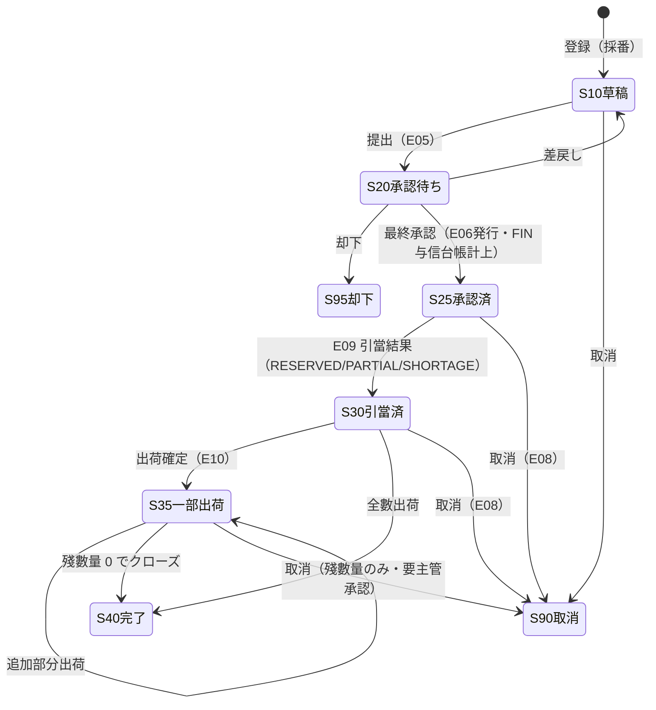
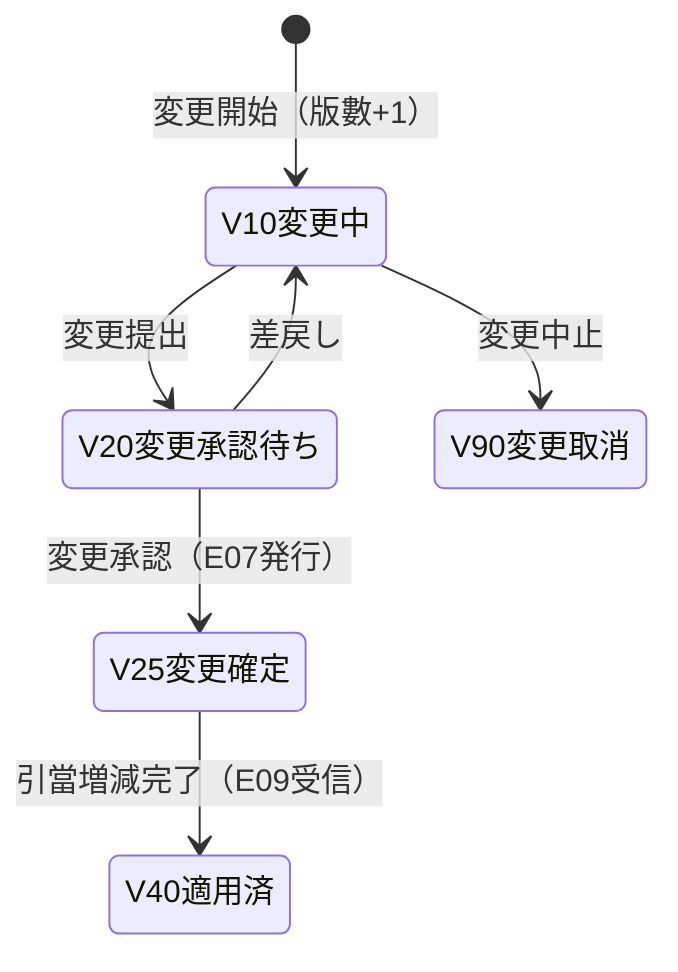
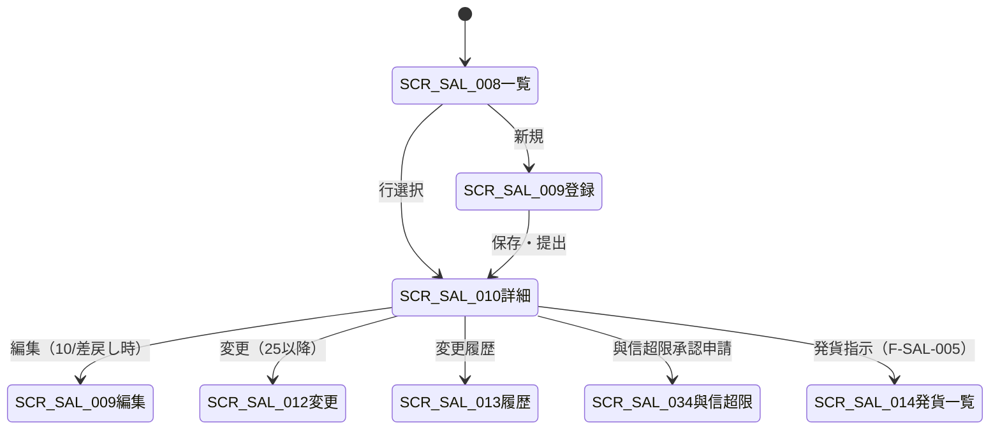

# 销售订单・订单变更 详细设计书（受注・受注変更 詳細設計書）

| 項目 | 内容 |
|---|---|
| 文書名 | 销售订单・订单变更 详细设计书（受注・受注変更 詳細設計書） |
| 文書番号 | DSN-SAL-002 |
| 版数 | v1.2 |
| 作成日 | 2026-10-20 |
| 作成者 | sales-designer（销售域担当） |
| 承認者 | 未承認（レビュー待ち） |
| 状態 | ドラフト（レビュー中） |
| 関連文書 | [業務域概要](00-overview.md) / [共通項目定義](../00-common/01-common-item-definitions.md) / [画面共通規格](../00-common/02-common-screen-spec.md) / [API 共通規格](../00-common/03-common-api-spec.md) / [共通業務規則](../00-common/08-common-business-rules.md) / [跨域流程](../00-common/09-cross-domain-flow.md) / [主データ域 価格](../02-mdm/05-price-settlement.md) / [主データ域 与信](../02-mdm/06-credit-supplier-eval.md) / [在庫域 引当](../05-inventory/06-reservation-barcode-close.md) / [財務域 应收](../07-finance/04-ar-receipt.md) |

---

## 1. 機能概要

| 項目 | 内容 |
|---|---|
| 機能 ID | F-SAL-003（銷售訂單登録）/ F-SAL-004（訂單変更）/ F-SAL-017（訂單取消・關閉） |
| 機能名 | 銷售訂單登録・承認、訂單変更、取消/關閉 |
| 目的 | 顧客注文を、価格・與信・可用量の 3 チェックを経て実行可能な受注として確定し、在庫引當（E06）、與信占有、賣上計上（E10 起点）へ引き渡す。承認済受注の変更は版數で管理し、引當増減（E07）と再承認を保証する |
| 利用者・ロール | 銷售員（登録・提出）、銷售經理/銷售總監/財務總監/總經理（承認）、信用専員（與信確認）、倉管（引當・出荷狀況参照） |
| 利用シーン | ① 顧客から注文書/注文メールを受領した時 ② 報價單から受注へ転換する時 ③ 承認済受注の數量・納期・価格変更 ④ 受注の取消・殘數量クローズ |
| 優先度 | P0（第一版 MVP） |
| 畫面 ID | SCR-SAL-008（一覧）、SCR-SAL-009（登録編集）、SCR-SAL-010（參照詳細）、SCR-SAL-011（承認・WF）、SCR-SAL-012（変更ウィザード）、SCR-SAL-013（変更履歴）、SCR-SAL-034（與信超限承認申請） |
| 関連 IF | E05/E06/E07/E08（発行）、E09/E31/E32（購読）、MDM 価格・與信參照 API、INV 可用量照會 API |

### 1.1 機能構成（本文件が擔當する処理）

| 機能 ID | 機能名 | 概要 | 優先度 |
|---|---|---|---|
| F-SAL-003 | 銷售訂單登録 | 受注ヘッダ・明細の登録/更新/削除、取價、折扣、納期、可用量チェック、與信チェック、提出、承認、取消前の狀態管理 | P0 |
| F-SAL-004 | 訂單変更 | 承認済受注の明細変更（數量・納期・価格・追加/削除）、版數管理、再承認、E07 発行、引當増減 | P0 |
| F-SAL-017 | 訂單取消・關閉 | 受注取消（E08）、殘數量クローズ、バックオーダー取消 | P0 |

## 2. 業務要件・業務ルール

### 2.1 前提條件

| # | 前提條件 | 成立しない場合の挙動 |
|---|---|---|
| 1 | 顧客が MDM で有効（`status=1`）かつ與信狀態（`credit_status`）が 10 正常/20 超限 のいずれか | `credit_status=30 凍結/40 閉鎖` は登録不可（`MSG-SAL-002`） |
| 2 | 物料が有効かつ販売停止でない（`is_sales_stopped=false`） | 明細追加不可（`MSG-SAL-006`） |
| 3 | 有効な価格表または特價が存在する、または手動単価入力（要承認） | 取價不可（`MSG-SAL-012`） |
| 4 | 販売單位と基本單位の換算率が有効（`sales_conversion_rate`） | 換算不可（`MSG-SAL-008`） |
| 5 | 會計期間が OPEN（`fin_period.status`） | 登録・変更不可（`MSG-COM-071`、code=4004） |
| 6 | 承認済（25）以降の変更是、訂單変更機能のみ可能 | 直接更新は 422（`MSG-SAL-048`） |
| 7 | ユーザに擔當顧客のデータ範圍がある | 403（`MSG-COM-031`） |

### 2.2 業務ルール

| # | ルール | 根拠（法令・社内規程・業務慣行） | 関連項目 |
|---|---|---|---|
| BR-01 | 受注はヘッダ 1 件以上・明細 1 行以上で構成し、明細は 1,000 行を上限とする | 畫面共通規格 5.2 | `lines` |
| BR-02 | 單價は**稅抜單價**を保存する。稅込單價を入力した場合は `稅込 ÷ (1 + 稅率)` で稅抜換算し 6 桁丸め、入力值と稅込/稅抜區別を保持する | 共通業務規則 4.1 | `unit_price`、`is_tax_included_input` |
| BR-03 | 取價優先順位：① 有効な特價（`sal_special_price`）② MDM 顧客+物料 ③ 顧客分類+物料 ④ 物料 ⑤ 全社標準價。同層は `min_qty` が大きく `priority` が小さい行を採用 | 主データ域 05-price-settlement | `price_source`、`price_list_line_id` |
| BR-04 | 標準価格（MDM 物料詳細 API 拡張項目 `standardPrice`、未提供時は `mdm_material.standard_price`）比 ±5% 超、または折扣 5% 超の明細を含む受注は、提出時に WF 承認を必須とする。折扣 10% 超または與信超限は 銷售總監 → 財務總監 → 總經理 の順送 | 共通業務規則 8.1 | `discount_rate`、`list_price` |
| BR-05 | 可用量 = 現有量 − 引當量 − 待檢量 − 凍結量 − 不合格量（INV 域唯一口徑、[09 §11](../00-common/09-cross-domain-flow.md)）。受注登録時に不足でも**受注は許可**し、警告とバックオーダー表示を行う（多品種小批量の受注を落とさない） | 在庫域 06-reservation | `available_qty` |
| BR-06 | 與信使用額 = **FIN 與信台帳の使用額（FIN が唯一の台帳所有。應收未收殘高（含逾期）＋受注コミット殘−前受金未核銷額を FIN が算出）**。SAL は FIN `GET /api/finance/customers/{id}/credit-usage` を照会し、自らコミット台帳を持たない。與信限度額・單筆上限・超限比率は MDM `mdm_credit_limit` / `mdm_credit_check_rule` を正とする | 財務域 04-ar-receipt、主データ域 06、Lead 裁定 2026-10-20 | `credit_used_amount`、`credit_over_amount` |
| BR-07 | 與信判定：`credit_used + order_total <= credit_limit` なら **10 正常**。`credit_limit < 使用額 <= credit_limit × (1 + over_limit_ratio)` なら **20 注意**（提出可、WF 承認経路で承認）。`single_order_limit` 超過または比率超過は **30 超限審査中**（承認待ち）とし、`overflow_action=10 阻断` の場合は **90 凍結・閉鎖**として提出不可。承認完了で **40 超限承認済** となり出荷可能。コードは `credit_check_result` と MDM `credit_status` で同一体系（10 正常/20 注意/30 超限審査中/40 超限承認済/90 凍結・閉鎖） | 主データ域 `mdm_credit_check_rule.check_timing`、Lead 裁定 2026-10-20 | `credit_check_result` |
| BR-08 | `credit_status`（MDM 顧客状態）は 10 正常/20 超限/30 凍結/40 閉鎖。`30/40` は受注・出荷とも不可（判定結果 90）。`20 超限` の顧客は判定結果 20 注意または 30 超限審査中となり、超限承認済（判定結果 40）の受注のみ出荷可能。判定結果コードは MDM BR-CRD-13 と同一（10 正常/20 注意/30 超限審査中/40 超限承認済/90 凍結・閉鎖・閉鎖） | 主データ域 06 BR-CRD-04/13、Lead 裁定 2026-10-20 | `credit_status`、`credit_check_result` |
| BR-09 | 受注の最終承認時に E06 を発行する。**與信コミットの台帳計上は FIN が E06 を購読して行う**（SAL は台帳を更新しない）。引當は INV が非同期で実行し、E09 受信で SO を 25→30 へ進める。引當不足は `shortage_qty` として保持しバックオーダーとする | 09 §5.2、Lead 裁定 2026-10-20 | `status`、`reserved_qty` |
| BR-10 | 承認済（25）以降の內容変更は訂單変更機能のみ。変更確定には再承認を要し、確定時に E07 を発行。変更前後の差分を `sal_sales_order_line_version` に保存する | 共通業務規則 3.3 | `version_no` |
| BR-11 | 明細の安定キーは `line_no`（10 刻み）。削除した明細は物理削除せず `line_status=90` とし、変更差分に記錄する | 共通規則 3.3 | `line_no`、`line_status` |
| BR-12 | 受注殘數量 = 受注數量 − 出荷済數量 − 取消數量。受注完了は殘數量 0 かつ全明細が 40/90 のとき自動クローズ（BAT-SAL-005）または手動クローズ | 09 §5.2 | `ordered_qty`、`shipped_qty` |
| BR-13 | 部分出荷時は SO を 35（一部実行）とし、全數出荷で 40（完了）。40 からの再開は禁止（追加出荷は新規受注） | 共通業務規則 3.3 | `status` |
| BR-14 | 納期は登録時に「受注日 + 物料販売リードタイム（`sales_lead_time_days`）」を初期值とし、営業が調整可能。引當不足時は入荷/完成予定日を `expected_available_date` に記録 | 業務慣行 | `delivery_date` |
| BR-15 | 取消は出荷実績がない場合のみ可能。取消時に E08 を発行し、**FIN が E08 を購読して與信台帳のコミットを解放する**（SAL は解放処理を行わない）。出荷済の場合は返品処理（F-SAL-006）で対応する | 共通業務規則 3.3、Lead 裁定 2026-10-20 | `status=90` |
| BR-16 | 稅額は**明細行単位**で計算し、伝票合計は明細の合計とする（伝票全體での再丸め禁止）。端數は四捨五入（HALF_UP）2 桁 | 共通業務規則 4.2 | `tax_amount` |
| BR-17 | 顧客名・稅號・住所・連絡先・物料名・仕様・單位・單價・稅率・為替レートは**登録時點のスナップショット**を保持する（マスタ変更の影響を受けない） | 共通項目定義 13 | 各 `*_name`、`*_code` |
| BR-18 | 第一版 の通貨は CNY のみ。外貨・Incoterms・通関情報は SO ヘッダの予約項目に保存できるが、業務チェックは行わない | 出口銷售 F-SAL-016 | `currency_code`、`incoterms_code` |
| BR-19 | 承認済金額・數量は監査ログの `before_data`/`after_data` に必ず記錄する | 共通項目定義 12 | `sys_audit_log` |
| BR-20 | 與信チェックは「登録時（注意表示）」「提出時（判定）」「最終承認時（再判定）」「出荷時（再判定）」の 4 回行う。判定は FIN 與信台帳の使用額を照会して行い、判定根拠を `sal_credit_check_log` に記録する（コミットの更新は FIN が実施）。承認時に他傳票で與信が悪化した場合は承認を保留し、超限承認へ差し戻す | 與信規程、Lead 裁定 2026-10-20 | `credit_check_log` |
| BR-21 | 與信コミットの解放は **FIN 與信台帳の責任**：① 出荷確定（E10）時に出荷分を解放（同時に FIN 應收が増加）② 入金（E29）時に應收減少分を解放 ③ 取消・却下（E08）時に全額解放。SAL は台帳を更新せず、必要に応じて `sal_credit_ledger_snapshot`（FIN 台帳の読取投影）を照会する | 09 §5.2、Lead 裁定 2026-10-20 | `sal_credit_ledger_snapshot` |
| BR-22 | 承認者は作成者と同一人物であってはならない（自己承認禁止）。代理承認は WF の代理設定に従う | 共通業務規則 8.2 | — |
| BR-23 | 承認待ち（20）中の編集は禁止。差戻し（20→10）後にのみ編集できる | 共通規則 3.3 | `status` |
| BR-24 | 引當済（30）以降の受注は、引當數量の範圍內でのみ出荷指示できる。引當不足分の出荷は主管承認（例外出荷）を必要とする | 在庫域 06 | `reserved_qty` |
| BR-25 | 受注番號は `SO{YYMMDD}{4桁日序}`（共通業務規則 2.1）。取消・再作成でも新しい番號を採番する | 共通業務規則 2 | `sales_order_no` |
| BR-26 | 受注変更で數量を減らす場合、変更後の基本単位數量（`ordered_qty × conversion_rate`）は `completed_qty`（已完工）以上かつ `shipped_base_qty`（已出库）以上でなければならない。下限は `max(completed_qty, shipped_base_qty)`。違反時は HTTP 422・業務コード `30022`・`MSG-SAL-056`（販売単位の已出荷チェック `MSG-SAL-054` と併用可）。跨表ロックは受注行を先に `FOR UPDATE`（[04 §11.1](../00-common/04-common-db-spec.md)）。 | G2-08/#24、G2-18 | `ordered_qty`、`completed_qty`、`shipped_base_qty` |

### 2.3 計算式・判定式

| # | 対象 | 算式 | 丸め | 例 |
|---|---|---|---|---|
| CALC-01 | 明細金額（稅抜） | 數量 × 稅抜單價 | HALF_UP 2 桁 | 120 × 856.500000 = 102,780.00 |
| CALC-02 | 明細稅額 | 明細金額（稅抜）× 稅率 | HALF_UP 2 桁 | 102,780.00 × 13% = 13,361.40 |
| CALC-03 | 明細稅込金額 | 明細金額 + 明細稅額 | — | 116,141.40 |
| CALC-04 | 折扣後明細金額 | 明細金額 × (1 − `discount_rate`) または 明細金額 − `discount_amount` | HALF_UP 2 桁 | 102,780.00 × (1−2%) = 100,724.40 |
| CALC-05 | 伝票值引按分 | 值引額 × 行金額 ÷ 稅抜合計。差額は最終明細へ寄せ `rounding_target_line_no` に記錄 | HALF_UP 2 桁 | — |
| CALC-06 | 伝票稅抜合計 | Σ 明細金額（折扣後） | — | — |
| CALC-07 | 伝票稅額合計 | Σ 明細稅額 | — | — |
| CALC-08 | 伝票稅込合計 | 稅抜合計 + 稅額合計 | — | — |
| CALC-09 | 與信使用額 | FIN 與信台帳の使用額（應收未收殘高（含逾期）＋受注コミット殘−前受金未核銷額。FIN が算出し SAL は照会） | HALF_UP 2 桁 | 2,800,000 + 1,200,000 − 100,000 = 3,900,000 |
| CALC-10 | 與信餘力 | 與信限度額 − 與信使用額 | 2 桁 | 5,000,000 − 3,900,000 = 1,100,000 |
| CALC-11 | 超限金額 | MAX(0, 與信使用額 + 本次受注稅込額 − 與信限度額) | 2 桁 | — |
| CALC-12 | 可用量 | 現有量 − 引當量 − 待檢量 − 凍結量 − 不合格量（INV 照會值を使用。自域では再計算しない） | 4 桁 | 500 − 320 − 30 − 0 − 0 = 150 PCE |
| CALC-13 | 受注殘 | 受注數量 − 出荷済數量 − 取消數量 | 4 桁 | 120 − 40 − 0 = 80 PCE |
| CALC-14 | 標準價比 | (稅抜單價 − MDM 標準價) ÷ MDM 標準價 | 4 桁（%） | (856.50 − 900.00) ÷ 900.00 = −4.83% |
| CALC-15 | 返品期限日 | 出荷日 + `return_limit_days`（MDM 客戶/物料、既定 30 日【示例値】） | — | 2026-10-20 + 30 = 2026-11-19 |

**計算例（YE3-100L1-4、稅率 13%）【示例値】**

**正本サンプル（SO2610200001）**：YE3-100L1-4 120 PCE × 856.500000（稅抜、標準價 900.000000、行折扣なし）

| 項目 | 明細 10 | 備考 |
|---|---|---|
| 物料 | YE3-100L1-4 三相異步電動機 2.2kW 4極（`3001000001`） | 數量 120 PCE |
| 標準價 / 稅抜單價 | CNY 900.000000 / CNY 856.500000 | 標準價比 −4.83%（特價/価格承認の対象） |
| 明細金額（稅抜） | CNY 102,780.00 | 120 × 856.50（CALC-01） |
| 稅額（13%） | CNY 13,361.40 | CALC-02 |
| 稅込金額 | CNY 116,141.40 | CALC-03 |
| 出荷・請求への引継 | 部分出荷 80＋40 PCE（合計 102,780.00 / 13,361.40 / 116,141.40） | [03](03-delivery-picking.md)・[05](05-invoice-receivable.md) と同一正本 |

**折扣例（別伝票 SO2610200002）**：同品目 120 PCE × 856.50、行折扣 2% の場合、稅抜金額 100,724.40、稅額 13,094.17、稅込 113,818.57（CALC-01/02/04）。**SO2610200001 には適用しない**（正本サンプルに折扣を混在させない）。

> 上記單價・數量は【示例値】（設計検証用）。物料の実在仕様は [90-data/material-master.csv](../90-data/material-master.csv) を參照。

### 2.4 狀態遷移

#### 2.4.1 受注（SO）



| 遷移 | トリガ | 権限 | 更新項目 | メッセージ／イベント |
|---|---|---|---|---|
| 10→20 | 提出ボタン | `sales:order:submit` | `order_status=20`、`submitted_at`、`submitted_by` | E05 発行、`MSG-COM-005` |
| 20→10 | 承認者が差戻し | `sales:order:approve` | `order_status=10`、`reject_reason`、`returned_at` | `MSG-SAL-016` |
| 20→95 | 承認者が却下 | `sales:order:approve` | `order_status=95`、`reject_reason`、與信佔用解放 | `MSG-SAL-015` |
| 20→25 | 最終承認 | `sales:order:approve` | `order_status=25`、`approved_at`、`approved_by`、`credit_check_result`（FIN が與信台帳計上） | E06 発行、`MSG-SAL-017` |
| 25→30 | E09 受信（RESERVED/PARTIAL/SHORTAGE） | システム | `order_status=30`、明細 `reserved_qty`、`shortage_qty` | `MSG-SAL-031/032` |
| 30→35 | 出荷確定（E10） | システム（F-SAL-005） | `order_status=35`、明細 `shipped_qty` | E10 発行（F-SAL-005） |
| 30/35→40 | 全數出荷/クローズ | システム/`sales:order:close` | `order_status=40`、`closed_at`、`closed_by` | `MSG-SAL-041` |
| 10→90 | 取消 | `sales:order:cancel` | `order_status=90`、`cancel_reason`、`cancelled_at` | `MSG-SAL-045` |
| 25/30→90 | 取消 | `sales:order:cancel` | 同上 + 與信解放 | E08 発行、`MSG-SAL-046` |
| 35→90 | 殘數量取消 | `sales:order:cancel` | 殘數量 `cancelled_qty`、狀態 90（出荷済分は返品扱い） | E08 発行、`MSG-SAL-047` |
| 20→20 | 承認タスク処理（途中承認） | `sales:order:approve` | `wf_task` のみ（業務狀態不変） | E31 受信 |

#### 2.4.2 訂單変更版（`sal_sales_order_version`）



| 遷移 | トリガ | 権限 | 更新項目 | メッセージ／イベント |
|---|---|---|---|---|
| 新規→V10 | 変更開始 | `sales:order:change` | `sal_sales_order_version` INSERT（`version_no=現行+1`、`change_status=10`）、現行明細を `sal_sales_order_line_version` へスナップショット | `MSG-SAL-050` |
| V10→V20 | 変更提出 | `sales:order:submit` | `change_status=20`、E05（`businessType=SALES_ORDER_CHANGE`） | `MSG-COM-005` |
| V20→V25 | 変更承認（最終） | `sales:order:approve` | `change_status=25`、`sal_sales_order.version_no` 更新、明細反映、E07 | `MSG-SAL-051`、E07 |
| V20→V10 | 差戻し | `sales:order:approve` | `change_status=10` | `MSG-SAL-016` |
| V10/V20→V90 | 変更中止 | `sales:order:change` | `change_status=90`、明細を現行版へ戻す | `MSG-SAL-052` |
| V25→V40 | 引當増減完了 | システム（E09） | `change_status=40`、`applied_at` | — |

> 訂單変更は新しい伝票番號を採番しない（同一 SO の版數管理）。`version_no` は業務版數であり、楽観排他の `version` カラムとは別物である（共通項目定義 2.1）。

## 3. 関連機能

| 関係 | 機能 ID | 機能名 | 関係內容 |
|---|---|---|---|
| 上流 | F-SAL-001/002 | 詢價・報價單 | 報價單から明細・單價・納期を引き継ぐ（`source_type=QUOTATION`） |
| 上流 | MDM | 顧客・物料・價格表・稅碼・與信限度 | 同期參照（キャッシュ TTL ≤ 5 分） |
| 下流 | F-SAL-005 | 発貨通知・揀貨 | 未出荷殘から DN を作成 |
| 下流 | F-SAL-007 | 開票申請 | 出荷確定済・未開票明細を集約 |
| 下流 | F-SAL-008/009 | 對賬單・應收 | 與信・應收投影に反映 |
| 下流 | F-SAL-010/011 | 與信・價格 | 與信超限、特價/折扣の承認連攜 |
| 下流 | F-SAL-012 | 訂單執行跟蹤 | 受注殘・引當・欠品の可視化 |
| イベント | E05 | `sales.order.submitted` | WF へ承認提出 |
| イベント | E06 | `sales.order.approved` | INV へ引當依頼、FIN へ與信台帳計上を通知 |
| イベント | E07 | `sales.order.changed` | INV へ引當増減 |
| イベント | E08 | `sales.order.cancelled` | INV/FIN へ引當解除・與信解放 |
| イベント | E09 | `inventory.reservation.updated` | INV から引當結果を受信 |
| イベント | E31/E32 | `workflow.task.completed` / `workflow.process.completed` | WF から承認結果を受信 |

## 4. 畫面設計

### 4.1 畫面一覧

| 畫面 ID | 畫面名 | 類型 | 概要 |
|---|---|---|---|
| SCR-SAL-008 | 銷售訂單一覧 | 一覧検索 | 受注の検索・一括操作・エクスポート。受注殘・引當・出荷狀況を表示 |
| SCR-SAL-009 | 銷售訂單登録編集 | 登録編集 | ヘッダ + 明細の登録・更新。取價・可用量・與信チェックをリアルタイム表示 |
| SCR-SAL-010 | 銷售訂單參照詳細 | 參照詳細 | ヘッダ、明細、承認履歴、変更履歴、関連伝票、添付、コメント |
| SCR-SAL-011 | 訂單承認畫面（WF） | ワークフロー | WF 共通承認畫面を `businessType=SALES_ORDER` で呼出 |
| SCR-SAL-012 | 訂單変更ウィザード | ウィザード | 変更內容入力 → 差分確認 → 変更理由 → 再承認提出 |
| SCR-SAL-013 | 訂單変更履歴 | 参照詳細 | 版數ごとの変更前後・変更者・理由・承認者 |
| SCR-SAL-034 | 與信超限承認申請 | 登録編集 | 超限受注の承認申請（F-SAL-010 と共用） |

### 4.2 畫面遷移



### 4.3 畫面レイアウト（SCR-SAL-009 登録編集）

```
┌──────────────────────────────────────────────────────────────────────────────┐
│ ヘッダ：会社名 / ユーザ名 / 通知 / ログアウト                                  │
├──────────────────────────────────────────────────────────────────────────────┤
│ パンくず：ホーム > 販売管理 > 銷售訂單 > 登録                                  │
├──────────────────────────────────────────────────────────────────────────────┤
│〔基本情報〕 受注番号[自動] 受注日[2026-10-20] 注文種別[▼標準] 状態[10 草稿]    │
│ 顧客[C000001▼] 担当[E000123] 部門[D010▼] 顧客注文番号[____]                   │
│ 通貨[CNY] 為替[1.00000000] 價格表[PL-STD-2026▼] 付款條件[NET30▼]               │
│ 納期[2026-10-30] 出荷倉[WH01▼] 與信餘力[CNY 1,100,000.00] 與信判定[OK]        │
├──────────────────────────────────────────────────────────────────────────────┤
│〔明細〕[追加][挿入][削除][コピー]                    [取價][可用量チェック]     │
│ No|物料|品名|數量|單位|標準價|單價|折扣%|金額|稅率|稅額|納期|引當|出荷済|狀態  │
│ 10|3001000001|YE3-100L1-4|120|PCE|900.00|856.50|0.0|102,780.00|13%|13,361.40│
├──────────────────────────────────────────────────────────────────────────────┤
│〔合計〕 稅抜 CNY 102,780.00 稅額 CNY 13,361.40 稅込 CNY 116,141.40            │
│〔フッタ〕[保存][保存して継続][提出][プレビュー(PRT-SAL-002)][戻る]            │
└──────────────────────────────────────────────────────────────────────────────┘
```

### 4.4 畫面項目定義

#### 4.4.1 ヘッダ項目（SCR-SAL-009 / 010）

| No | 項目 ID | 項目名 | 種別 | 型/桁 | 必須 | 初期值 | 入力チェック | データソース | DB 項目 | 備考 |
|---|---|---|---|---|---|---|---|---|---|---|
| 1 | `salesOrderNo` | 受注番號 | テキスト | VARCHAR(32) | ○ | 自動採番 | 形式 `SO+YYMMDD+4桁` | SYS 採番 | `sales_order_no` | 參照のみ |
| 2 | `orderType` | 注文種別 | 選択 | SMALLINT | ○ | 10 | 値域 10/20/30/40/50 | 固定値 | `order_type` | 10 標準/20 備貨/30 出口/40 換貨/50 樣品 |
| 3 | `orderDate` | 受注日 | 日付 | DATE | ○ | 當日 | 過去日可（當月〜3 ヶ月前まで）、未來日不可 | — | `order_date` | 與信判定基準日 |
| 4 | `customerId` | 顧客 | 選択 | BIGINT | ○ | — | コード存在・有効・販売可 | MDM 顧客 | `customer_id` | 選択ダイアログ |
| 5 | `customerCode` | 顧客コード | テキスト | VARCHAR(20) | ○ | 自動表示 | — | MDM | `customer_code` | 參照のみ |
| 6 | `customerName` | 顧客名 | テキスト | VARCHAR(200) | ○ | 自動表示 | — | MDM | `customer_name` | スナップショット |
| 7 | `customerTaxNo` | 顧客稅號 | テキスト | VARCHAR(30) | △ | 自動表示 | 18 桁/形式 | MDM | `customer_tax_no` | スナップショット。專票時必須 |
| 8 | `contactName` / `contactPhone` | 連絡先/電話 | テキスト | VARCHAR(50)/(30) | △ | MDM | 桁數 | MDM 連絡先 | `contact_name` / `contact_phone` | 個人情報マスキング |
| 9 | `deliveryAddress` | 納品先住所 | テキスト | VARCHAR(500) | ○ | MDM 既定 | 桁數 | MDM 住所 | `delivery_address` | スナップショット |
| 10 | `externalNo` | 顧客注文番號 | テキスト | VARCHAR(100) | △ | — | 桁數。同一顧客で重複警告 | 手入力 | `external_no` | 重複は警告のみ |
| 11 | `salesDepartmentId` | 販売部門 | 選択 | BIGINT | ○ | ユーザ既定 | 組織存在 | SYS 組織 | `sales_department_id` | データ範圍 |
| 12 | `ownerUserId` | 営業擔當 | 選択 | BIGINT | ○ | ログインユーザ | 有効ユーザ | SYS ユーザ | `owner_user_id` | — |
| 13 | `currencyCode` | 通貨 | 選択 | VARCHAR(3) | ○ | CNY | 当面 CNY のみ（多币种第一版対象） | MDM 通貨 | `currency_code` |  外貨 |
| 14 | `exchangeRate` | 為替レート | 數値 | NUMERIC(18,8) | △ | 1.00000000 | > 0 | MDM レート | `exchange_rate` | CNY は 1 |
| 15 | `priceListId` | 價格表 | 選択 | BIGINT | △ | 顧客既定 | 有効 | MDM 價格表 | `price_list_id` | 未指定時は標準價 |
| 16 | `paymentTermCode` | 付款條件 | 選択 | VARCHAR(20) | ○ | 顧客既定 | コード存在 | MDM | `payment_term_code` | 應收予定日算出 |
| 17 | `settlementMethodCode` | 決済方法 | 選択 | VARCHAR(20) | △ | 顧客既定 | コード存在 | MDM | `settlement_method_code` | — |
| 18 | `deliveryDate` | 納期（最終） | 日付 | DATE | ○ | 明細最大納期 | 受注日以降 | — | `delivery_date` | 明細から自動 |
| 19 | `warehouseId` | 出荷倉 | 選択 | BIGINT | ○ | 顧客既定/物料既定 | 倉庫存在・有効 | MDM 倉庫 | `warehouse_id` | 明細個別指定可 |
| 20 | `invoiceType` | 発票種別（予定） | 選択 | SMALLINT | △ | 顧客既定 | 10/20/30/40 | MDM 顧客 | `invoice_type` | 10 專票/20 普票/30 數電專/40 數電普 |
| 21 | `invoiceTitle` | 発票抬頭 | テキスト | VARCHAR(200) | △ | MDM | 桁數 | MDM | `invoice_title` | スナップショット |
| 22 | `creditCheckResult` | 與信判定結果 | 表示 | SMALLINT | — | 登録時判定 | — | FIN 與信台帳照会 | `credit_check_result` | 10 正常/20 注意/30 超限審査中/40 超限承認済/90 凍結・閉鎖・閉鎖（MDM BR-CRD-13） |
| 23 | `creditUsedAmount` | 與信使用額 | 數値 | NUMERIC(18,2) | — | 判定時 | — | FIN + SAL | `credit_used_amount` | 參照のみ |
| 24 | `creditOverAmount` | 超限金額 | 數値 | NUMERIC(18,2) | — | 判定時 | — | SAL | `credit_over_amount` | 0 なら超過なし |
| 25 | `listAmount` | 標準價合計 | 數値 | NUMERIC(18,2) | — | 自動 | — | 計算 | `list_amount` | 折扣承認判定 |
| 26 | `totalAmount` | 稅抜合計 | 數値 | NUMERIC(18,2) | — | 自動 | — | 計算 | `total_amount` | — |
| 27 | `taxAmount` | 稅額合計 | 數値 | NUMERIC(18,2) | — | 自動 | — | 計算 | `tax_amount` | — |
| 28 | `grandTotal` | 稅込合計 | 數値 | NUMERIC(18,2) | — | 自動 | — | 計算 | `grand_total` | 與信判定に使用 |
| 29 | `orderStatus` | 狀態 | 表示 | SMALLINT | — | 10 | — | — | `order_status` | 共通バッジ |
| 30 | `versionNo` | 業務版數 | 表示 | INT | — | 1 | — | — | `version_no` | 変更で +1 |
| 31 | `remark` | 備考 | テキスト | VARCHAR(500) | △ | — | 500 桁 | 手入力 | `remark` | — |
| 32 | `incotermsCode` | Incoterms | 選択 | VARCHAR(10) | △ | — |  | MDM | `incoterms_code` | 予約項目 |
| 33 | `incotermsPlace` | 引渡場所 | テキスト | VARCHAR(100) | △ | — |  | 手入力 | `incoterms_place` | 予約項目 |

#### 4.4.2 明細項目（SCR-SAL-009 明細）

| No | 項目 ID | 項目名 | 種別 | 型/桁 | 必須 | 初期值 | 入力チェック | 計算 | DB 項目 |
|---|---|---|---|---|---|---|---|---|---|
| 1 | `lineNo` | 行番號 | 數値 | INT | — | 10 刻み | — | — | `line_no` |
| 2 | `materialId` | 物料 | 選択 | BIGINT | ○ | — | 有効・販売可・顧客取引可 | — | `material_id` |
| 3 | `materialCode` | 物料コード | テキスト | VARCHAR(20) | ○ | 自動 | — | — | `material_code` |
| 4 | `materialName` | 品名 | テキスト | VARCHAR(200) | ○ | 自動 | — | — | `material_name` |
| 5 | `spec` | 仕様 | テキスト | VARCHAR(200) | △ | 自動 | — | — | `spec` |
| 6 | `qty` | 數量 | 數値 | NUMERIC(18,4) | ○ | 空 | > 0、最小販売數量以上、4 桁 | — | `ordered_qty` |
| 7 | `uomCode` | 販売單位 | 選択 | VARCHAR(10) | ○ | 物料既定 | 有効單位 | — | `uom_code` |
| 8 | `baseUomCode` | 基本單位 | 表示 | VARCHAR(10) | — | 自動 | — | — | `base_uom_code` |
| 9 | `conversionRate` | 換算率 | 數値 | NUMERIC(18,8) | — | 自動 | > 0 | — | `conversion_rate` |
| 10 | `baseQty` | 基本單位數量 | 數値 | NUMERIC(18,4) | — | 自動 | — | 數量 × 換算率 | `base_qty` |
| 11 | `listPrice` | 標準價（稅抜） | 數値 | NUMERIC(18,6) | — | 取價 | ≥ 0 | MDM `standardPrice`（物料詳細拡張）snp | `list_price` |
| 12 | `unitPrice` | 單價（稅抜） | 數値 | NUMERIC(18,6) | ○ | 取價 | ≥ 0、6 桁 | 稅込時は換算 | `unit_price` |
| 13 | `isTaxIncludedInput` | 稅込入力フラグ | チェック | BOOLEAN | — | false | — | — | `is_tax_included_input` |
| 14 | `taxCode` | 稅碼 | 選択 | VARCHAR(20) | ○ | 物料既定 | 有効 | — | `tax_code` |
| 15 | `taxRate` | 稅率 | 數値 | NUMERIC(7,4) | ○ | 13.0000 | 0〜100 | MDM 稅碼 snp | `tax_rate` |
| 16 | `priceSource` | 取價区分 | 表示 | SMALLINT | — | — | — | 10 顧客+物料/20 顧客分類+物料/30 物料/40 全社標準/90 特價(SAL)/99 手動 | `price_source` |
| 17 | `priceListLineId` | 價格表行 ID | 表示 | BIGINT | — | — | — | — | `price_list_line_id` |
| 18 | `specialPriceId` | 特價 ID | 表示 | BIGINT | — | — | — | — | `special_price_id` |
| 19 | `discountRate` | 折扣率 | 數値 | NUMERIC(7,4) | △ | 0 | 0〜100（%）、5% 超は承認 | — | `discount_rate` |
| 20 | `discountAmount` | 折扣額 | 數値 | NUMERIC(18,2) | △ | 0 | ≥ 0、≤ 明細金額 | — | `discount_amount` |
| 21 | `lineAmount` | 明細金額（稅抜） | 數値 | NUMERIC(18,2) | — | 自動 | — | CALC-01/04 | `line_amount` |
| 22 | `taxAmount` | 稅額 | 數値 | NUMERIC(18,2) | — | 自動 | — | CALC-02 | `tax_amount` |
| 23 | `totalAmount` | 稅込金額 | 數値 | NUMERIC(18,2) | — | 自動 | — | CALC-03 | `total_amount` |
| 24 | `deliveryDate` | 納期 | 日付 | DATE | ○ | 受注日+LT | 受注日以降 | — | `delivery_date` |
| 25 | `warehouseId` | 出荷倉 | 選択 | BIGINT | ○ | ヘッダ既定 | 倉庫存在 | — | `warehouse_id` |
| 26 | `reservedQty` | 引當済數量 | 表示 | NUMERIC(18,4) | — | 0 | — | E09 反映 | `reserved_qty` |
| 27 | `shippedQty` | 出荷済數量（販売単位） | 表示 | NUMERIC(18,4) | — | 0 | — | E10 反映 | `shipped_qty` |
| 27b | `shippedBaseQty` | 出荷済數量（基本単位） | 表示 | NUMERIC(18,4) | — | 0 | — | E10 反映（`shipped_qty × conversion_rate` 累計） | `shipped_base_qty` |
| 27c | `conversionRate` | 換算率（スナップショット） | 表示 | NUMERIC(18,8) | — | 1 | — | 確定時固定 | `conversion_rate` |
| 28 | `cancelledQty` | 取消數量 | 表示 | NUMERIC(18,4) | — | 0 | — | — | `cancelled_qty` |
| 29 | `remainingQty` | 受注殘 | 表示 | NUMERIC(18,4) | — | 自動 | — | CALC-13 | 計算のみ |
| 30 | `shortageQty` | 引當不足 | 表示 | NUMERIC(18,4) | — | 0 | — | E09 反映 | `shortage_qty` |
| 31 | `expectedAvailableDate` | 入荷/完成予定日 | 日付 | DATE | △ | — | — | PRD/PUR 照會（当面は手入力可。TODO：自動連係） | `expected_available_date` |
| 32 | `customerMaterialNo` | 顧客品番 | テキスト | VARCHAR(100) | △ | — | 桁數 | — | `customer_material_no` |
| 33 | `lineStatus` | 明細狀態 | 表示 | SMALLINT | — | 10 | — | 10 未引當/30 引當済/35 一部出荷/40 完了/90 取消 | `line_status` |
| 34 | `lineRemark` | 明細備考 | テキスト | VARCHAR(500) | △ | — | 500 桁 | — | `line_remark` |

### 4.5 イベント処理

| No | イベント | トリガ | 処理內容 | 呼出 API / 処理 ID | 畫面遷移 | 備考 |
|---|---|---|---|---|---|---|
| 1 | 初期表示（新規） | 畫面オープン | 採番取得、當日・通貨 CNY・部門既定を初期化 | GET /api/system/sequences/SALES_ORDER | 同一 | 採番は保存時に確定でも可 |
| 2 | 顧客選択 | 顧客改變 | MDM 顧客取得、與信限度・殘高照會、價格表・付款條件・出荷倉・発票情報を自動セット、與信判定 | GET /api/mdm/customers/{id}、GET /api/finance/customers/{id}/credit-usage | 同一 | 與信停止はエラー |
| 3 | 明細追加 | 追加ボタン | 空行追加、行番號採番（末尾+10） | — | — | 最大 1,000 行 |
| 4 | 物料選択 | 物料改變 | MDM 物料取得、販売單位・稅碼・標準價・LT・批次要否をセット | GET /api/mdm/materials/{id} | — | 販売停止はエラー |
| 5 | 取價 | 取價ボタン/物料・數量改變（フォーカスアウト） | 特價 → MDM 取價 API（顧客/分類/物料/標準）→ 單價・價格來源をセット。批次取價 API で全明細一括も可 | POST /api/mdm/prices/sales/effective-batch | — | 取價不能は `MSG-SAL-012` |
| 6 | 數量・單價改變 | フォーカスアウト | 金額・稅額・合計を再計算、標準價比・折扣を再判定 | フロント計算 + サーバ再計算 | — | サーバ値を正とする |
| 7 | 可用量チェック | ボタン/明細保存時 | INV 可用量照會、不足は行に警告とバックオーダー表示 | GET /api/inventory/stock-balances/available | — | 阻止しない |
| 8 | 與信判定 | 與信判定ボタン/提出時 | FIN 與信使用額取得 + SAL 受注コミット殘から判定、結果バッジ表示 | GET /api/sales/orders/{id}/credit-check | — | 超限は承認経路へ |
| 9 | 保存 | 保存ボタン | 入力チェック→登録/更新→採番→合計再計算→與信チェックログ記錄 | POST/PUT /api/sales/sales-orders | 詳細へ | Idempotency-Key 必須 |
| 10 | 保存して継続 | 保存後継続 | 保存後、ヘッダ一部・明細をクリアし連続採番 | 同上 | 同一 | — |
| 11 | 提出 | 提出ボタン | 保存→業務チェック→E05 発行→狀態 20 | POST /api/sales/sales-orders/{id}/submit | 一覧へ | 承認経路決定 |
| 12 | 承認（WF） | 承認ボタン | E31 受信→最終承認なら E06 発行（FIN が與信台帳計上）→狀態 25 | POST /api/sales/sales-orders/{id}/approve | 待办へ | 承認者本人のみ |
| 13 | 差戻し | 差戻しボタン | 理由必須→狀態 10 | POST /api/sales/sales-orders/{id}/return | 待办へ | — |
| 14 | 却下 | 却下ボタン | 理由必須→狀態 95・與信解放 | POST /api/sales/sales-orders/{id}/reject | 待办へ | 終端 |
| 15 | 撤回 | 撤回ボタン | 未處理タスクのみ→狀態 10 | POST /api/sales/sales-orders/{id}/withdraw | 詳細へ | — |
| 16 | 編集 | 編集ボタン | 狀態 10/差戻しのみ編集可 | — | SCR-SAL-009 | 25 以降は変更 |
| 17 | 複製 | 複製ボタン | ヘッダ・明細コピー、採番は保存時 | — | SCR-SAL-009 | — |
| 18 | 変更 | 変更ボタン | 狀態 25/30 のみ。ウィザード起動 | — | SCR-SAL-012 | — |
| 19 | 取消 | 取消ボタン | 理由必須・確認ダイアログ・E08 発行 | POST /api/sales/sales-orders/{id}/cancel | 詳細へ | 出荷済は不可 |
| 20 | クローズ | クローズボタン | 殘數量 0 または強制クローズ（主管） | POST /api/sales/sales-orders/{id}/close | 詳細へ | — |
| 21 | 明細削除 | 削除ボタン | 狀態 10 のみ。確認後 `line_status=90` | — | — | 最終行削除可（0 行保存不可） |
| 22 | 帳票プレビュー | プレビュー | PRT-SAL-002 注文請書 PDF 生成 | POST /api/sales/sales-orders/{id}/print | プレビュー | 承認後のみ |
| 23 | エクスポート | エクスポート | 検索條件で Excel（10,000 件超は非同期） | POST /api/sales/exports | — | — |

### 4.6 一覧畫面仕様（SCR-SAL-008）

| 項目 | 內容 |
|---|---|
| 検索條件 | 受注番號（前方一致）、受注日（範圍）、顧客（コード/名稱）、営業擔當、狀態（複數）、注文種別、納期（範圍）、出荷狀況（未出荷/一部/完了）、與信判定（超限のみ） |
| 既定検索條件 | 受注日 = 當月、狀態 = 10,20,25,30,35（未完了） |
| ソート | 既定：受注日降順 → 受注番號降順。複數キー可 |
| ページング | 20/50/100/200（既定 20） |
| 一括操作 | 提出（10 のみ）、承認（20・承認者のみ）、エクスポート、與信再判定 |
| エクスポート | Excel、最大 10,000 件。超過は非同期ジョブ（MSG-COM-004） |
| 列 | 受注番號、受注日、顧客、注文種別、狀態、稅込合計、引當狀況、出荷狀況、納期、営業擔當、與信判定、版數 |
| 行操作 | 詳細、編集（10）、変更（25/30）、取消（25/30）、帳票 |

### 4.7 表示制御

| 條件 | 対象項目/ボタン | 制御 |
|---|---|---|
| 狀態 ≠ 10（草稿） | 編集・削除・保存ボタン | 非表示（差戻し後は表示） |
| 狀態 20 | 全部編集項目 | 參照のみ（WF 項目権限がある場合のみ例外） |
| 狀態 25/30 | 直接編集 | 不可。変更ボタンのみ表示 |
| 狀態 30/35 | 取消ボタン | 表示（出荷済分がある場合は殘數量取消の確認） |
| 狀態 35/40 | 変更・取消 | 変更不能（40）、取消は殘數量のみ |
| 権限なし | 金額・原價項目 | 非表示・API 非返却 |
| 與信 `credit_status=30 凍結/40 閉鎖` | 新規登録 | 顧客選択時にエラー表示・保存不可 |
| `is_sales_stopped=true` | 物料 | 明細追加不可・既存行は警告 |
| 承認者以外 | 承認・却下・差戻し | 非表示 |

## 5. 入力チェック仕様

| No | チェック ID | 対象項目 | 種別 | 條件 | タイミング | メッセージ ID |
|---|---|---|---|---|---|---|
| 1 | CHK-SAL-002-01 | 受注日 | 必須 | 空でない | 保存時 | MSG-COM-040 |
| 2 | CHK-SAL-002-02 | 受注日 | 範圍 | 當日〜3 ヶ月前の範圍內、未來日不可 | 保存時 | MSG-SAL-004 |
| 3 | CHK-SAL-002-03 | 顧客 | 必須/コード存在 | 有効顧客、與信狀態 10/20 | 選択時・保存時 | MSG-SAL-002 |
| 4 | CHK-SAL-002-04 | 納品先住所 | 必須 | 空でない | 保存時 | MSG-COM-040 |
| 5 | CHK-SAL-002-05 | 營業擔當 | 必須 | 有効ユーザ | 保存時 | MSG-COM-049 |
| 6 | CHK-SAL-002-06 | 付款條件 | 必須/コード存在 | 有効コード | 保存時 | MSG-COM-049 |
| 7 | CHK-SAL-002-07 | 明細行數 | 範圍 | 1〜1,000 行 | 保存時 | MSG-SAL-005 |
| 8 | CHK-SAL-002-08 | 物料 | 必須/コード存在 | 有効・`is_sales_stopped=false` | 保存時 | MSG-SAL-006 |
| 9 | CHK-SAL-002-09 | 數量 | 必須/範圍 | > 0、小數 4 桁、≥ `min_sales_qty` | 保存時 | MSG-SAL-007 |
| 10 | CHK-SAL-002-10 | 販売單位 | コード存在 | 單位グループが基本單位と一致 | 保存時 | MSG-SAL-008 |
| 11 | CHK-SAL-002-11 | 單價 | 必須/範圍 | ≥ 0、小數 6 桁 | 保存時 | MSG-SAL-009 |
| 12 | CHK-SAL-002-12 | 稅碼/稅率 | 必須/コード存在 | 有効稅碼、稅率 0〜100 | 保存時 | MSG-SAL-010 |
| 13 | CHK-SAL-002-13 | 折扣率 | 範圍 | 0〜100、5% 超は承認必要警告 | 保存時 | MSG-SAL-013 |
| 14 | CHK-SAL-002-14 | 納期 | 必須/相関 | 受注日以降、明細納期 ≤ ヘッダ納期 | 保存時 | MSG-SAL-014 |
| 15 | CHK-SAL-002-15 | 明細合計 | 相関 | ヘッダ合計 = Σ明細（サーバ再計算値と一致） | 保存時 | MSG-COM-051 |
| 16 | CHK-SAL-002-16 | 顧客注文番號 | 重複 | 同一顧客で重複は警告（登録可） | 保存時 | MSG-SAL-011 |
| 17 | CHK-SAL-002-17 | 出荷倉 | コード存在 | 有効倉庫 | 保存時 | MSG-COM-049 |
| 18 | CHK-SAL-002-18 | 會計期間 | 業務 | `fin_period.status=OPEN` | 保存/提出時 | MSG-COM-071 |
| 19 | CHK-SAL-002-19 | 與信 | 業務 | `credit_status=30/40` は不可、`single_order_limit` 超過は判定結果 90（阻斷） | 提出時 | MSG-SAL-020/021 |
| 20 | CHK-SAL-002-20 | 與信 | 業務 | 超限（30 超限審査中）は WF 承認経路必須（注意・続行可、承認後に 40） | 提出時 | MSG-SAL-022 |
| 21 | CHK-SAL-002-21 | 可用量 | 業務 | 不足時警告（バックオーダー、登録可） | 保存時 | MSG-SAL-030 |
| 22 | CHK-SAL-002-22 | 標準價比 | 業務 | ±5% 超は承認必要（提出時に判定） | 提出時 | MSG-SAL-023 |
| 23 | CHK-SAL-002-23 | 狀態 | 業務 | 編集可能狀態 10 のみ | 保存時 | MSG-COM-034 |
| 24 | CHK-SAL-002-24 | 樂観排他 | 排他 | `version` 一致 | 保存/狀態操作時 | MSG-COM-033 |
| 25 | CHK-SAL-002-25 | 承認者 | 職務分掌 | 作成者と承認者が同一でない | 承認時 | MSG-SAL-018 |
| 26 | CHK-SAL-002-26 | 変更可能狀態 | 業務 | 変更は 25/30 のみ | 変更開始時 | MSG-SAL-048 |
| 27 | CHK-SAL-002-27 | 変更理由 | 必須 | 変更理由が空でない | 変更確定時 | MSG-SAL-049 |
| 28 | CHK-SAL-002-28 | 取消可否 | 業務 | 出荷済數量 = 0（一部出荷時は殘數量のみ） | 取消時 | MSG-SAL-046/047 |
| 29 | CHK-SAL-002-29 | 変更數量 | 相関 | 変更後數量 ≥ 出荷済 + 引當済でない場合は引當調整警告 | 変更提出時 | MSG-SAL-053 |
| 30 | CHK-SAL-002-30 | 稅込入力 | 相関 | 稅込入力時、換算後單價 6 桁再計算一致 | 保存時 | MSG-COM-042 |
| 31 | CHK-SAL-002-31 | 添付 | 形式/サイズ | PDF/Excel/画像、20MB、20 件 | アップロード時 | MSG-COM-060/061 |
| 32 | CHK-SAL-002-32 | 提出 | 業務 | 明細 1 行以上、與信判定済 | 提出時 | MSG-SAL-019 |

## 6. 処理詳細

### 6.1 処理一覧

| 処理 ID | 処理名 | 契機 | トランザクション | 排他 |
|---|---|---|---|---|
| PRC-SAL-002-01 | 受注登録 | 保存（新規） | 要（受注・明細・與信ログ・採番） | 採番行ロック、樂観排他 |
| PRC-SAL-002-02 | 受注更新 | 保存（編集） | 要 | 樂観排他（version） |
| PRC-SAL-002-03 | 與信判定 | 保存/提出/承認/ボタン | 不要（読取） | — |
| PRC-SAL-002-04 | 受注提出 | 提出 | 要（狀態更新 + Outbox E05） | 樂観排他 |
| PRC-SAL-002-05 | 受注承認（最終） | WF 承認コールバック | 要（狀態・Outbox E06。與信台帳は FIN） | 樂観排他 |
| PRC-SAL-002-06 | 引當結果反映 | E09 受信 | 要（狀態・引當數量） | Idempotency（eventId） |
| PRC-SAL-002-07 | 受注変更（版作成） | 変更ウィザード | 要（版・明細スナップショット） | 樂観排他 |
| PRC-SAL-002-08 | 変更確定（E07） | 変更承認 | 要（明細反映・版更新・Outbox E07） | 樂観排他 + 引當ロック |
| PRC-SAL-002-09 | 受注取消（E08） | 取消 | 要（狀態・與信解放・Outbox E08） | 樂観排他 |
| PRC-SAL-002-10 | 受注クローズ | クローズ/バッチ | 要 | 樂観排他 |
| PRC-SAL-002-11 | 與信台帳投影更新 | E06/E07/E08/E10/E29 購読（FIN 台帳の読取投影） | 要（`sal_credit_ledger_snapshot`） | Idempotency（eventId） |

### 6.2 処理手順（正常系）

**PRC-SAL-002-01 受注登録**

1. 入力チェック（第 5 章 CHK-01〜32 のうち保存時対象）を実行する。
2. 権限チェック（`sales:order:create`）とデータ範圍チェック（顧客の擔當者/部門）を行う。
3. 會計期間狀態を FIN へ照會し、OPEN 以外は `MSG-COM-071`（code=4004）で中止する。
4. MDM から顧客・物料・稅碼・價格表・付款條件・與信限度・倉庫を取得し、各スナップショット値を明細・ヘッダに設定する（キャッシュ TTL 5 分）。
5. 明細ごとに取價（BR-03）と金額計算（CALC-01〜08）を行い、サーバ計算値を正とする。MDM `effective` API から `unitPriceNet`/`unitPriceGross`/`isTaxIncluded`/`discountRate`/`validFrom`/`validTo` を取得し、取價不能（HTTP 404＋コード 20036）明細は `price_source=99`（手動）とし、承認必須フラグを立てる。
6. INV 可用量照會 API で明細の可用量を取得し、不足時は `shortage_qty` と警告を返す（登録は続行）。
7. 與信判定（PRC-SAL-002-03）を実行し、`credit_check_result`・`credit_used_amount`・`credit_over_amount` を記録する。`credit_check_log` に判定根拠（FIN 殘高、受注コミット殘、限度額、判定結果、判定者）を INSERT する。
8. `sys_sequence` から `SAL_SALES_ORDER`（SO + YYMMDD + 4 桁）を採番する。採番はトランザクション內で行い、失敗時は全ロールバックする。
9. `sal_sales_order`・`sal_sales_order_line` を INSERT する（`order_status=10`、`version_no=1`、`credit_check_result` 設定、スナップショット項目含む）。
10. 明細の `line_status=10`（未引當）、`reserved_qty=0`、`shipped_qty=0`、`cancelled_qty=0` を初期化する。
11. 監査ログ（CREATE、before/after）を記錄し、作成した受注詳細を返す。警告（可用量不足・與信警告・価格承認要）がある場合は `data.warnings[]` に返す。

**PRC-SAL-002-04 受注提出**

1. 狀態 = 10（草稿）であることを確認する（それ以外は `MSG-COM-034`）。
2. 保存時チェックに加え、與信再判定（PRC-SAL-002-03）と価格承認要否判定（BR-04）を行う。
3. `single_order_limit` 超過または與信 `credit_status=30 凍結/40 閉鎖` → 中止（`MSG-SAL-021`）。與信超過（比率內）→ `credit_check_result=30 超限審査中`（超限承認要）とし、WF 承認経路（銷售總監→財務總監→總經理）を決定する。`overflow_action=10 阻断` の場合は 90 凍結・閉鎖として中止。
4. 標準價比 ±5% 超または折扣 5% 超 → 価格承認要として WF 経路に反映する。
5. WF へ `businessType=SALES_ORDER`、`businessId`、`businessNo`、`variables`（金額、部門、與信超過フラグ、折扣率、與信使用額、與信限度額）、`formSnapshot` を送信する（同期コマンド。失敗時はロールバック）。
6. `order_status=20`、`submitted_at`、`submitted_by` を更新し、Outbox に E05 `sales.order.submitted` を INSERT する。
7. `MSG-COM-005` を返す。

**PRC-SAL-002-05 受注承認（最終承認）**

1. WF から E31/E32 を受信する。`eventId` で冪等チェックし、處理済なら無視する。
2. `businessType=SALES_ORDER`、`businessId` の受注を `FOR UPDATE` で取得し、狀態 = 20 を確認する。
3. 承認者 = 作成者でないことを確認する（自己承認禁止、`MSG-SAL-018`）。
4. 與信再判定（PRC-SAL-002-03）を行う。前回判定より使用額が増加し限度超過した場合は、狀態を 20 のまま保留し、超限承認タスクを追加（WF へ差戻し）し、`MSG-SAL-022` を返す。
5. `order_status=25`、`approved_at`、`approved_by`、`credit_check_result` を更新する。
6. 與信コミットの台帳計上は FIN が E06 を購読して実行する（SAL は台帳行を INSERT しない）。SAL は `sal_credit_ledger_snapshot`（FIN 台帳の読取投影）を E06/E07/E08/E10/E29 受信時に更新する。
7. Outbox に E06 `sales.order.approved` を INSERT する。payload は第 7.3 節の通り（`warehouseId` は 09 v1.1 契約項目）。
8. 監査ログ（APPROVE）を記錄し、`MSG-SAL-017` を返す。

**PRC-SAL-002-06 引當結果反映（E09 受信）**

1. E09 payload の `sourceType=SALES_ORDER`、`sourceId=受注 ID` を確認し、`eventId` で冪等チェックする。
2. `sal_sales_order` を取得し、狀態 25（または変更確定後の 25）であることを確認する。それ以外（取消済等）は無視してログを殘す。
3. 明細ごとに `reserved_qty`・`shortage_qty` を更新する（E09 の `reservedQty`/`shortageQty` を正とする）。`reservation_id` を保存する。
4. 明細 `line_status` を更新する：全部引當 → 30、一部/不足 → 30（`shortage_qty>0` を保持）。
5. 受注全體の狀態を 30（引當済）へ更新する。`status=SHORTAGE`（全量不足）でも 30 とし、バックオーダーとして扱う（`credit_check_result` は変更しない）。
6. 與信台帳は変更しない（引當では與信は減少しない。出荷時に FIN が解放）。
7. 不足がある場合、`MSG-SAL-032` を営業・計画へ通知（站内）し、`expected_available_date` の入力を促す。

**PRC-SAL-002-08 変更確定（E07 発行）**

1. 変更版（`change_status=25`）と現行 SO を取得し、狀態 25/30 を確認する（35 は変更不能、`MSG-SAL-048`）。
2. 変更差分を計算する：追加行（INSERT）、削除行（`line_status=90`）、數量・納期・価格変更（UPDATE）。変更前値を `sal_sales_order_line_version` に保存する。
3. 変更後金額で與信再判定（FIN 與信台帳照会）を行い、増加時は E07 発行後に FIN が台帳の差分コミットを更新する（SAL は判定のみ）。超過時は承認保留。
4. `sal_sales_order.version_no` を +1、`sal_sales_order_version` を `change_status=25`、合計を更新する。
5. 數量整合チェック：変更後の基本単位數量（`ordered_qty × conversion_rate`）≥ `max(completed_qty, shipped_base_qty)`。未満なら HTTP 422・`30022`・`MSG-SAL-056` で拒否。販売単位では変更後數量 ≥ `shipped_qty`（`MSG-SAL-054`）。引當済を下回る場合は INV へ E07 で減算指示。
6. Outbox に E07 `sales.order.changed` を INSERT する。payload は第 7.3 節の通り（差分明細、version）。
7. E07 を発行し（FIN が與信台帳の差額を更新）、`MSG-SAL-051` を返す。E09 受信で `change_status=40` に更新する。

**PRC-SAL-002-09 受注取消（E08 発行）**

1. 狀態 10/25/30/35 であることを確認する（40 は不可、`MSG-COM-034`）。
2. 出荷済數量 > 0 の場合：殘數量のみ取消可（`cancelled_qty` 更新、明細 `line_status=90`、SO は 90）。全數出荷済の場合は取消不可、返品処理へ案内（`MSG-SAL-047`）。
3. 與信解放は FIN が E08 を購読して台帳を更新する（SAL は `sal_credit_ledger_snapshot` の投影を E08 受信で更新する）。
4. `order_status=90`、`cancel_reason`、`cancelled_at`、`cancelled_by` を更新する。
5. Outbox に E08 `sales.order.cancelled` を INSERT する。INV は引當を全解放し E09（`RELEASED`）を返す。
6. `MSG-SAL-046` を返す。

### 6.3 例外処理

| No | 異常條件 | 検知箇所 | 処理 | ロールバック | メッセージ ID |
|---|---|---|---|---|---|
| 1 | 顧客が與信停止/關閉 | 顧客選択・保存 | エラー終了 | 全體 | MSG-SAL-002 |
| 2 | 物料が販売停止 | 明細保存 | エラー終了 | 全體 | MSG-SAL-006 |
| 3 | 取價不能（價格表未設定） | 取價処理 | 警告・手動單價（承認要） | なし | MSG-SAL-012 |
| 4 | 可用量不足 | 可用量チェック | 警告・登録續行（バックオーダー） | なし | MSG-SAL-030 |
| 5 | 與信超限 | 提出/承認 | 警告・WF 承認経路（又は阻斷） | 提出時は全體 | MSG-SAL-020/021/022 |
| 6 | 承認時に與信が悪化 | 承認コールバック | 承認保留・超限承認タスク追加 | 承認更新のみ | MSG-SAL-022 |
| 7 | 自己承認 | 承認 | エラー終了 | 承認更新のみ | MSG-SAL-018 |
| 8 | 會計期間締切 | 保存/提出 | エラー終了 | 全體 | MSG-COM-071 |
| 9 | 樂観排他競合 | UPDATE | エラー終了（409） | 全體 | MSG-COM-033 |
| 10 | 採番失敗 | 採番 | エラー終了・番號消費なし | 全體 | MSG-COM-080 |
| 11 | WF 送信失敗 | 提出 | ロールバック（又は Outbox 再送設定） | 全體 | MSG-COM-073 |
| 12 | E06 配信失敗 | Outbox | リトライ・デッドレター・アラート | なし（業務データは確定済） | MSG-COM-080 |
| 13 | E09 未到達（引當されない） | 日次照合 BAT-SAL-002 | 再通知・手動引當依頼 | なし | MSG-SAL-031 |
| 14 | 変更後の數量が出荷済を下回る | 変更確定 | エラー終了 | 全體 | MSG-SAL-054 |
| 15 | 二重提出 | 提出 | エラー（4005） | — | MSG-COM-075 |

### 6.4 冪等性・再実行

- 登録・提出・承認・取消・変更の各 API は `Idempotency-Key` を必須とし、24 時間同一キーの再送は初回結果を返す（[API 共通規格 9](../00-common/03-common-api-spec.md)）。
- イベント購読（E09/E31/E32）は `eventId`（又は `taskId+result`）で重複排除し、`aggregateVersion` が古いイベントは無視する（[09 第 3 章](../00-common/09-cross-domain-flow.md)）。
- 與信台帳投影は `(source_type, source_id, release_seq)` の一意制約と `eventId` 冪等で二重更新を防止する（台帳は FIN）。
- `BAT-SAL-002`（再引當）は「狀態 25/30 かつ `reserved_qty + shortage_qty < ordered_qty`」の受注を対象とし、再実行しても引當數量が重複しないよう E06 再送キー（`eventId=orderId+version+retry`）で管理する。

## 7. API 設計

### 7.1 API 一覧

| No | メソッド | パス | 権限 | 概要 | 主なエラーコード |
|---|---|---|---|---|---|
| 1 | GET | `/api/sales/sales-orders` | `sales:order:view` | 受注一覧（ページング） | 3001 |
| 2 | GET | `/api/sales/sales-orders/{id}` | `sales:order:view` | 受注詳細（明細・履歴含む） | 4001 |
| 3 | POST | `/api/sales/sales-orders` | `sales:order:create` | 受注登録 | 1001、30001、50001 |
| 4 | PUT | `/api/sales/sales-orders/{id}` | `sales:order:update` | 受注更新（10 のみ） | 4002、4003 |
| 5 | POST | `/api/sales/sales-orders/{id}/submit` | `sales:order:submit` | 提出（E05） | 4002、30001 |
| 6 | POST | `/api/sales/sales-orders/{id}/approve` | `sales:order:approve` | 承認（最終承認で E06） | 3001、30002 |
| 7 | POST | `/api/sales/sales-orders/{id}/return` | `sales:order:approve` | 差戻し | 4002 |
| 8 | POST | `/api/sales/sales-orders/{id}/reject` | `sales:order:approve` | 却下 | 4002 |
| 9 | POST | `/api/sales/sales-orders/{id}/withdraw` | `sales:order:submit` | 撤回 | 4002 |
| 10 | POST | `/api/sales/sales-orders/{id}/cancel` | `sales:order:cancel` | 取消（E08） | 4002、40072 |
| 11 | POST | `/api/sales/sales-orders/{id}/close` | `sales:order:close` | クローズ | 4002 |
| 12 | POST | `/api/sales/sales-orders/{id}/changes` | `sales:order:change` | 変更開始（版作成） | 4002 |
| 13 | PUT | `/api/sales/sales-orders/{id}/changes/{versionNo}` | `sales:order:change` | 変更內容保存 | 4003 |
| 14 | POST | `/api/sales/sales-orders/{id}/changes/{versionNo}/submit` | `sales:order:submit` | 変更提出 | 4002 |
| 15 | POST | `/api/sales/sales-orders/{id}/changes/{versionNo}/approve` | `sales:order:approve` | 変更承認（E07） | 4002 |
| 16 | GET | `/api/sales/sales-orders/{id}/credit-check` | `sales:credit:view` | 與信再判定 | 4001 |
| 17 | GET | `/api/sales/sales-orders/{id}/changes` | `sales:order:view` | 変更履歴 | 4001 |
| 18 | POST | `/api/sales/sales-orders/{id}/print` | `sales:order:print` | 注文請書 PDF（PRT-SAL-002） | 4001 |
| 19 | POST | `/api/sales/sales-orders/batch-submit` | `sales:order:submit` | 一括提出（上限 1,000） | 4005 |

### 7.2 リクエスト／レスポンス詳細（受注登録）

**POST /api/sales/sales-orders**

```json
{
  "orderType": 10,
  "orderDate": "2026-10-20",
  "customerId": "1845000000000000001",
  "externalNo": "PO-CUS-20261018-001",
  "salesDepartmentId": "1844000000000000010",
  "ownerUserId": "1844000000000000101",
  "currencyCode": "CNY",
  "exchangeRate": "1.00000000",
  "priceListId": "1846000000000000001",
  "paymentTermCode": "NET30",
  "settlementMethodCode": "BANK_TRANSFER",
  "deliveryDate": "2026-10-30",
  "warehouseId": "1847000000000000001",
  "invoiceType": 30,
  "invoiceTitle": "江苏恒立液压股份有限公司",
  "remark": "10 月度受注分",
  "lines": [
    {
      "lineNo": 10,
      "materialId": "1845000000000000101",
      "qty": "120.0000",
      "uomCode": "PCE",
      "unitPrice": "856.500000",
      "isTaxIncludedInput": false,
      "taxCode": "VAT13-OUT",
      "discountRate": "0.0000",
      "deliveryDate": "2026-10-30",
      "warehouseId": "1847000000000000001",
      "customerMaterialNo": "PUMP-MTR-2.2"
    }
  ]
}
```

```json
{
  "code": 0,
  "message": "ok",
  "data": {
    "id": "1845678901234567890",
    "salesOrderNo": "SO2610200001",
    "orderStatus": 10,
    "statusName": "草稿",
    "creditCheckResult": 10,
    "creditUsedAmount": "3900000.00",
    "creditLimitAmount": "5000000.00",
    "creditOverAmount": "0.00",
    "currencyCode": "CNY",
    "isTaxIncluded": false,
    "listAmount": "108000.00",
    "totalAmount": "102780.00",
    "taxAmount": "13361.40",
    "grandTotal": "116141.40",
    "version": 0,
    "versionNo": 1,
    "warnings": [
      { "code": "MSG-SAL-030", "message": "物料 3001000001 可用量不足（可用 150 PCE，本次受注 120 PCE）" }
    ],
    "lines": [
      {
        "lineNo": 10,
        "materialCode": "3001000001",
        "materialName": "YE3-100L1-4 三相异步电动机 2.2kW 4极",
        "qty": "120.0000",
        "uomCode": "PCE",
        "listPrice": "900.000000",
        "unitPrice": "856.500000",
        "unitPriceNet": "856.500000",
        "unitPriceGross": "967.845000",
        "priceSource": 10,
        "priceSourceName": "客户+物料",
        "priceListLineId": "1846000000000000101",
        "discountRate": "0.0000",
        "lineAmount": "102780.00",
        "taxRate": "13.0000",
        "taxAmount": "13361.40",
        "reservedQty": "0.0000",
        "shippedQty": "0.0000",
        "availableQty": "150.0000"
      }
    ]
  }
}
```

**POST /api/sales/sales-orders/{id}/submit**

```json
{ "version": 0, "comment": "10月度分、納期10/30" }
```

**エラー例（與信超限・阻斷）**

```json
{
  "code": 30001,
  "message": "与信限度額を超過しています。超限承認申請を行ってください。",
  "data": {
    "fieldErrors": [],
    "errorDetail": {
      "creditLimit": "5000000.00",
      "creditUsed": "4980000.00",
      "orderAmount": "116141.40",
      "overAmount": "96141.40",
      "action": "CREDIT_APPROVAL_REQUIRED",
      "messageId": "MSG-SAL-021"
    }
  }
}
```

### 7.3 イベントペイロード（本域発行）

**E05 `sales.order.submitted`**（09 §3 契約。金額は稅抜 `amount`＋`taxAmount`＋`totalAmount`、`isTaxIncluded=false`）

```json
{
  "eventType": "sales.order.submitted",
  "eventVersion": 1,
  "source": "erp-sales",
  "aggregateType": "sales_order",
  "aggregateId": "1845678901234567890",
  "aggregateNo": "SO2610200001",
  "aggregateVersion": 0,
  "payload": {
    "orderId": "1845678901234567890",
    "orderNo": "SO2610200001",
    "customerId": "1845000000000000001",
    "amount": "102780.00",
    "taxAmount": "13361.40",
    "totalAmount": "116141.40",
    "currencyCode": "CNY",
    "isTaxIncluded": false,
    "businessType": "SALES_ORDER",
    "businessId": "1845678901234567890",
    "businessNo": "SO2610200001",
    "departmentId": "1844000000000000010",
    "applicantId": "1844000000000000101"
  }
}
```

**E06 `sales.order.approved`**（09 §3 契約。明細は `qty`。金額は E05 と同一口徑＝稅抜）

```json
{
  "eventType": "sales.order.approved",
  "eventVersion": 1,
  "occurredAt": "2026-10-20T14:30:00+08:00",
  "source": "erp-sales",
  "aggregateType": "sales_order",
  "aggregateId": "1845678901234567890",
  "aggregateNo": "SO2610200001",
  "aggregateVersion": 3,
  "payload": {
    "orderId": "1845678901234567890",
    "orderNo": "SO2610200001",
    "customerId": "1845000000000000001",
    "currencyCode": "CNY",
    "isTaxIncluded": false,
    "amount": "102780.00",
    "taxAmount": "13361.40",
    "totalAmount": "116141.40",
    "creditCheckResult": 10,
    "lines": [
      {
        "lineNo": 10,
        "materialId": "1845000000000000101",
        "qty": "120.0000",
        "uom": "PCE",
        "deliveryDate": "2026-10-30",
        "warehouseId": "1847000000000000001"
      }
    ]
  }
}
```

**E07 `sales.order.changed`**

```json
{
  "eventType": "sales.order.changed",
  "eventVersion": 1,
  "payload": {
    "orderId": "1845678901234567890",
    "orderNo": "SO2610200001",
    "version": 2,
    "changeReason": "顧客納期前倒し",
    "lines": [
      {
        "lineNo": 10,
        "changeType": "QTY_CHANGE",
        "materialId": "1845000000000000101",
        "oldQty": "120.0000",
        "newQty": "150.0000",
        "oldDeliveryDate": "2026-10-30",
        "newDeliveryDate": "2026-10-25",
        "warehouseId": "1847000000000000001"
      },
      {
        "lineNo": 30,
        "changeType": "LINE_ADD",
        "materialId": "1845000000000000103",
        "newQty": "20.0000",
        "newDeliveryDate": "2026-10-25",
        "warehouseId": "1847000000000000001"
      }
    ]
  }
}
```

**E08 `sales.order.cancelled`**

```json
{
  "eventType": "sales.order.cancelled",
  "eventVersion": 1,
  "payload": {
    "orderId": "1845678901234567890",
    "orderNo": "SO2610200001",
    "reason": "顧客都合キャンセル",
    "cancelledQty": "120.0000"
  }
}
```

### 7.4 イベント購読（本域受信）

| イベント | 発行者 | 本域の処理 | 冪等キー |
|---|---|---|---|
| E09 `inventory.reservation.updated` | INV | 引當結果を明細へ反映、SO 25→30 | `eventId` + `reservationId` |
| E31/E32 `workflow.task.completed` / `workflow.process.completed` | WF | 承認・差戻し・却下の狀態反映、E06 発行 | `taskId` + `result` |
| E27 `finance.receivable.created` | FIN | 應收投影更新、與信使用額の再計算 | `receivableId` |
| E29 `finance.receipt.completed` | FIN | 與信解放（應收減少分）、投影更新 | `receiptId` |

> E09 の `status` は文字列列挙 `RESERVED` / `PARTIAL` / `SHORTAGE` / `RELEASED`（INV 契約）。E27/E29 の追加項目は [05-invoice-receivable.md](05-invoice-receivable.md) 第 7 章に定義する。

## 8. データ更新仕様

| テーブル | 操作 | 更新項目 | 更新條件 | トリガ |
|---|---|---|---|---|
| `sys_sequence` | UPDATE | `current_value` | `sequence_key='SALES_SALES_ORDER'`、`sequence_date=當日` | 登録 |
| `sal_sales_order` | INSERT | 全項目 | — | 登録 |
| `sal_sales_order` | UPDATE | `order_status`、`approved_at`、`approved_by`、`credit_check_result`、`credit_used_amount`、`credit_over_amount`、`total_amount`、`tax_amount`、`grand_total`、`version_no` | 状態遷移・変更 | 提出/承認/変更/取消 |
| `sal_sales_order_line` | INSERT/UPDATE | `ordered_qty`、`unit_price`、`line_amount`、`tax_amount`、`total_amount`、`delivery_date`、`reserved_qty`、`shipped_qty`、`cancelled_qty`、`shortage_qty`、`line_status`、`line_version` | 状態遷移・E09/E10 反映 | 登録/変更/引當/出荷 |
| `sal_sales_order_version` | INSERT/UPDATE | `version_no`、`change_status`、變更前後スナップショット、`change_reason`、`approved_at` | 変更 | 変更 |
| `sal_sales_order_line_version` | INSERT | 変更前後明細スナップショット | 変更 | 変更 |
| `sal_credit_ledger_snapshot` | INSERT/UPDATE | `amount`、`released_amount`、`status`、`released_at`、`release_reason` | E06/E07/E08/E10/E29 購読（FIN 台帳の投影。SAL 業務処理からの直接更新禁止） | PRC-SAL-002-11 |
| `sal_credit_check_log` | INSERT | 判定根拠・結果 | 判定実施 | PRC-SAL-002-03 |
| `sys_outbox_event` | INSERT | E05/E06/E07/E08 | 各イベント発行 | 提出/承認/変更確定/取消 |
| `sys_audit_log` | INSERT | 操作・before/after | 登録/更新/承認/取消 | 各処理 |

## 9. エラー処理・メッセージ

| メッセージ ID | 種別 | 本文 | 発生條件 | 利用者への対処 | ログ |
|---|---|---|---|---|---|
| MSG-SAL-001 | I | 销售订单已保存（{0}）。 | 保存成功 | 詳細へ遷移 | INFO |
| MSG-SAL-002 | E | 该客户已停止交易或信用冻结，不能受理订单。 | 顧客無効・與信凍結 | 顧客マスタ確認・與信解除申請 | WARN |
| MSG-SAL-004 | E | 受注日は当日から 3 ヶ月前までの日付を指定してください。 | 日付範圍外 | 日付修正 | WARN |
| MSG-SAL-005 | E | 明細は 1 行以上 1,000 行以内で登録してください。 | 行數不正 | 行數修正 | WARN |
| MSG-SAL-006 | E | 物料「{0}」已停止销售，不能添加到订单。 | 販売停止 | 物料変更 | WARN |
| MSG-SAL-007 | E | 数量必须大于 0，且不能低于最小销售数量 {0}。 | 數量不正 | 數量修正 | WARN |
| MSG-SAL-008 | E | 销售单位与基本单位不属于同一换算组，不能换算。 | 單位不正 | 單位修正 | WARN |
| MSG-SAL-009 | E | 单价必须大于等于 0，且最多 6 位小数。 | 單價不正 | 單價修正 | WARN |
| MSG-SAL-010 | E | 税码无效或税率超出范围。 | 稅碼不正 | 稅碼修正 | WARN |
| MSG-SAL-011 | W | 该客户订单号已存在，是否继续？ | 重複警告 | 確認して續行 | INFO |
| MSG-SAL-012 | W | 未找到有效价格，已切换为手工单价，需提交价格审批。 | 取價不能 | 單價入力・特價申請 | WARN |
| MSG-SAL-013 | W | 折扣率 {0}% 超过 5%，提交时需要审批。 | 折扣超過 | 承認申請 | INFO |
| MSG-SAL-014 | E | 明细交期不能晚于订单交期，且不能早于受注日。 | 納期不整合 | 納期修正 | WARN |
| MSG-SAL-015 | E | 审批已驳回：{0}。 | 却下 | 內容修正・再作成 | INFO |
| MSG-SAL-016 | I | 已退回申请人修改。 | 差戻し | 修正・再提出 | INFO |
| MSG-SAL-017 | I | 销售订单 {0} 已审批通过。 | 最終承認 | — | INFO |
| MSG-SAL-018 | E | 不能审批自己创建的订单。 | 自己承認 | 別の承認者へ | WARN |
| MSG-SAL-019 | E | 订单明细为空或尚未完成与信判定，不能提交。 | 提出前提不足 | 明細追加・判定 | WARN |
| MSG-SAL-020 | W | 与信使用额超过信用额度，需提交超限审批。 | 與信超限 | 超限承認申請 | WARN |
| MSG-SAL-021 | E | 本次订单金额超过单笔限额 {0}，不能提交。 | 單筆上限超過 | 分割受注・超限承認 | WARN |
| MSG-SAL-022 | W | 与信额度不足。审批通过前不能发货。 | 超限承認待ち | 承認完了を待つ | WARN |
| MSG-SAL-023 | W | 单价偏离标准价格 {0}%，需提交价格审批。 | 價格差異 | 特價申請・承認 | INFO |
| MSG-SAL-030 | W | 物料「{0}」可用量不足（可用 {1}，受注 {2}），将作为欠货处理。 | 可用量不足 | 納期回答・入荷待ち | INFO |
| MSG-SAL-031 | W | 受注引当が未完了です。在庫引当の実行狀況を確認してください。 | E09 未着 | 再引當・INV 照会 | WARN |
| MSG-SAL-032 | W | 引当不足：{0} 行（不足数量 {1}），已转为欠货。 | 引當不足 | 納期再回答・バックオーダー管理 | INFO |
| MSG-SAL-036 | E | 出荷数量超过引当数量／受注残数量。 | 出荷指示超過 | 數量修正 | WARN |
| MSG-SAL-041 | I | 订单已全部出荷并关闭。 | 全數出荷 | — | INFO |
| MSG-SAL-045 | I | 订单已取消。 | 取消完了 | — | INFO |
| MSG-SAL-046 | E | 该订单已存在出荷实绩，不能取消；请使用销售退货处理。 | 出荷済取消 | 返品処理へ | WARN |
| MSG-SAL-047 | W | 已出荷部分不能取消，将仅取消剩余数量。 | 殘數量取消 | 確認して續行 | INFO |
| MSG-SAL-048 | E | 当前状态不允许变更订单。承认済（25/30）のみ変更可。 | 状態不正 | 状態確認 | WARN |
| MSG-SAL-049 | E | 变更理由不能为空。 | 変更理由なし | 理由入力 | WARN |
| MSG-SAL-050 | I | 已创建变更版本 v{0}，请编辑后提交。 | 変更開始 | 變更ウィザードへ | INFO |
| MSG-SAL-051 | I | 订单变更已确定（v{0}），引当数量将同步调整。 | 変更確定 | — | INFO |
| MSG-SAL-052 | I | 变更已中止。 | 変更中止 | — | INFO |
| MSG-SAL-053 | W | 变更后的引当数量将减少 {0}，已通知库存域释放引当。 | 引當減 | — | INFO |
| MSG-SAL-054 | E | 变更后数量不能小于已出荷数量 {0}。 | 変更數量不正 | 數量修正 | WARN |
| MSG-SAL-056 | E | 变更后数量（基本单位）不能小于已完工数量或已出库数量 {0}。 | 変更後基本単位數量 < `completed_qty` または < `shipped_base_qty` | 數量修正（≥ max(已完工, 已出库)） | WARN |
| MSG-SAL-055 | W | 本次变更金额增加 {0}，超出与信余力，需要重新审批。 | 変更改信 | 再承認 | WARN |

## 10. 権限・セキュリティ

| 種別 | 內容 |
|---|---|
| 画面権限 | `sales:order:view/create/update/submit/approve/cancel/close/change/print/export` |
| 操作権限 | 提出=作成者のみ、承認=承認経路該当者・自己承認禁止、取消=主管以上、クローズ=主管以上 |
| 項目権限 | 原價・粗利は営業に非表示（`cost_amount` は F-SAL-015 のみ）。與信使用額は営業に表示可、他顧客は不可 |
| データ範囲 | 営業は擔當顧客のみ、主管は自部門、財務/信用専員は全社、倉管は自倉庫相關 |
| 監査ログ | 登録・更新・提出・承認・差戻し・却下・取消・変更・印刷を `sys_audit_log` に記錄（金額・狀態は before/after 必須） |
| 機密 | 顧客連絡先は個人情報マスキング、與信限度額は営業以外非表示推奨 |

## 11. 性能・非機能

| 項目 | 目標値 | 前提 |
|---|---|---|
| 一覧検索 | 2 秒以内（100 件） | `idx_sal_sales_order_status_date`、`idx_sal_sales_order_customer` |
| 詳細取得 | 1 秒以内 | 明細・履歴含む |
| 登録・更新 | 3 秒以内 | 採番・與信照會含む |
| 與信判定 | 1 秒以内 | FIN API + ローカル台帳（キャッシュ 1 分） |
| 同時実行 | 50 ユーザ（営業 40・倉庫 10） | 樂観排他 + 採番行ロック |
| 最大明細 | 1,000 行/受注 | — |
| 月間受注件數 | 3,000 件/月（年 36,000 件） | [04 DB 共通規格 13](../00-common/04-common-db-spec.md) |

## 12. テスト観点

| No | 観点 ID | 分類 | 観点 | 期待結果 |
|---|---|---|---|---|
| 1 | TST-F-SAL-003-01 | 正常系 | 標準的な受注登録 | 採番・金額・稅額・合計が正しく保存される |
| 2 | TST-F-SAL-003-02 | 正常系 | 稅込入力から稅抜換算 | 單價 6 桁で換算され、金額一致 |
| 3 | TST-F-SAL-003-03 | 正常系 | 階梯價格・顧客別價格の取價 | 優先順位通りに單價が決まる |
| 4 | TST-F-SAL-003-04 | 正常系 | 引當結果 E09（全量）受信 | 狀態 30、`reserved_qty` = 受注數量 |
| 5 | TST-F-SAL-003-05 | 正常系 | 引當不足（PARTIAL）受信 | 狀態 30、`shortage_qty` 保持、警告通知 |
| 6 | TST-F-SAL-003-06 | 異常系 | 必須漏れ（顧客・明細・數量） | 項目エラー、登録されない |
| 7 | TST-F-SAL-003-07 | 異常系 | 與信凍結顧客 | 受注不可（MSG-SAL-002） |
| 8 | TST-F-SAL-003-08 | 異常系 | 單筆限額超過 | 提出不可（MSG-SAL-021） |
| 9 | TST-F-SAL-003-09 | 異常系 | 承認時に與信悪化 | 承認保留・超限承認追加 |
| 10 | TST-F-SAL-003-10 | 境界値 | 數量 0 / 負數 / 4 桁超 | エラー |
| 11 | TST-F-SAL-003-11 | 境界値 | 明細 0 行 / 1,001 行 | エラー |
| 12 | TST-F-SAL-003-12 | 境界値 | 稅率 0%（免税品目） | 稅額 0 で登録可 |
| 13 | TST-F-SAL-003-13 | 排他 | 同時更新（version 不一致） | 409、最新再取得 |
| 14 | TST-F-SAL-003-14 | 排他 | 同時承認 | 1 件のみ成功、他は狀態エラー |
| 15 | TST-F-SAL-003-15 | 権限 | 権限なしユーザの登録 | 403、ボタン非表示 |
| 16 | TST-F-SAL-003-16 | 権限 | 自己承認 | 拒否（MSG-SAL-018） |
| 17 | TST-F-SAL-003-17 | 連携 | E06 発行內容 | payload 項目・金額・明細が 09 契約と一致 |
| 18 | TST-F-SAL-003-18 | 連携 | E06 配信失敗 | Outbox リトライ・業務データは確定 |
| 19 | TST-F-SAL-003-19 | 冪等 | 同一 Idempotency-Key で二重登録 | 1 件のみ登録、同一結果返却 |
| 20 | TST-F-SAL-003-20 | 會計 | 締切期間での登録 | エラー（MSG-COM-071） |
| 21 | TST-F-SAL-004-01 | 正常系 | 數量増の変更 | 版數 +1、E07 発行、與信差額コミット |
| 22 | TST-F-SAL-004-02 | 正常系 | 納期変更のみの変更 | E07 に納期差分、金額不変 |
| 23 | TST-F-SAL-004-03 | 正常系 | 明細追加・削除 | 追加行 INSERT・削除行 `line_status=90` |
| 24 | TST-F-SAL-004-04 | 異常系 | 出荷済明細の數量減 | エラー（MSG-SAL-054） |
| 25 | TST-F-SAL-004-05 | 異常系 | 変更不能狀態（10/35/40） | エラー（MSG-SAL-048） |
| 26 | TST-F-SAL-004-06 | 正常系 | 変更後の E09 受信 | `change_status=40`、引當數調整 |
| 27 | TST-F-SAL-017-01 | 正常系 | 25 での取消 | E08 発行、與信解放、狀態 90 |
| 28 | TST-F-SAL-017-02 | 異常系 | 出荷済受注の取消 | 拒否（MSG-SAL-046） |
| 29 | TST-F-SAL-017-03 | 正常系 | 部分出荷後の殘數量取消 | 殘數量取消、E08、狀態 90 |
| 30 | TST-F-SAL-017-04 | 正常系 | 自動クローズ（全數出荷） | 狀態 40、`closed_at` セット |

## 13. 未決事項

| # | 事項 | 理由 | 暫定仕様 | 担当 | 期限 |
|---|---|---|---|---|---|
| 1 | 與信使用額に「出荷済・未請求（AR 未計上）」を含めるか | FIN は E10 で AR 計上するため通常は発生しないが、E10→E27 遅延時の取扱い | AR 計上済のみ使用額に含める（E27 受信ベース）。遅延時は日次照合で補正 | finance-designer | 2026-10-24 |
| 2 | 出荷の過不足許容の既定値 | 業務慣行の確認待ち | 超過 0%・不足は部分出荷で許容。`sales_over_shipment_tolerance` で変更可 | Lead | 2026-10-27 |
| 3 | 訂單変更のうち「數量減のみ」の承認要否 | 08 は金額別承認のみ規定 | 金額減少かつ與信内なら主管承認のみ、それ以外は金額別経路 | Lead | 2026-10-24 |
| 4 | E09 の `reservationId` を SO 明細に保持するかヘッダに保持するか | INV は `inv_reservation_line` 単位で返す | ヘッダに最新 `reservation_id`、明細に `reservation_line_id` を保持（列追加は 90-db で定義） | inventory-designer | 2026-10-24 |
| 5 | 受注日の遡及登録上限（3 ヶ月） | 社内規程が未提示 | 3 ヶ月を暫定値とし `sys_param` で変更可 | Lead | 2026-10-27 |

## 14. 改訂履歴

| 版数 | 日付 | 変更內容 | 変更者 |
|---|---|---|---|
| v1.0 | 2026-10-20 | 初版作成：受注登録・承認（E05/E06）、引當連携（E09）、與信判定（FIN 契約）、取價（MDM 契約）、訂單変更（E07）、取消（E08）、狀態遷移、畫面項目定義、入力チェック 32 件、API 19 件、テスト観点 30 件 | sales-designer |
| v1.1 | 2026-10-20 | 紅隊修復第 2 輪（REV-mdm-001/002/003/009）：E05/E06 明細 `qty`・金額口徑（amount 稅抜＋taxAmount＋totalAmount）を統一。正本サンプル SO2610200001＝120 PCE×856.50（102,780/13,361.40/116,141.40）、折扣例を別伝票へ分離。與信判定コード 10/20/30/40/90、與信台帳は FIN 権威・SAL 投影へ変更。E06 payload を 09 v1.1 契約に一致 | sales-designer |
| v1.2 | 2026-10-21 | HTTP 409 を `version` 競合（4003）専用とし、状態不整合（4002）・二重処理/処理中（4005）・同時実行・確定済変更不可・二重実行等の 409 も 422 に統一し、409 は `version` 競合（4003）のみとする（蓝色大肥鱼 2026-10-21 決定）。対象：:48 | 业务分析 |


