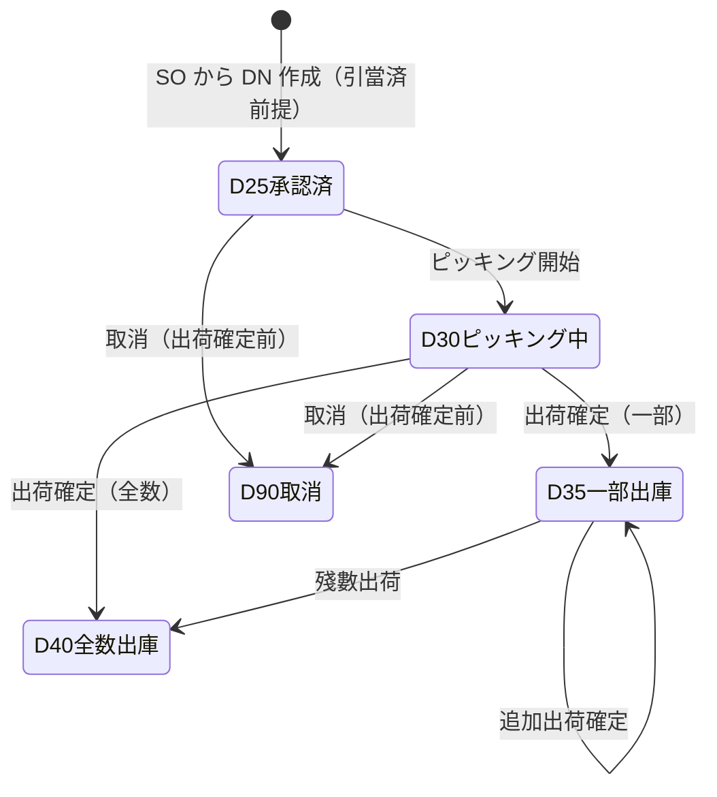
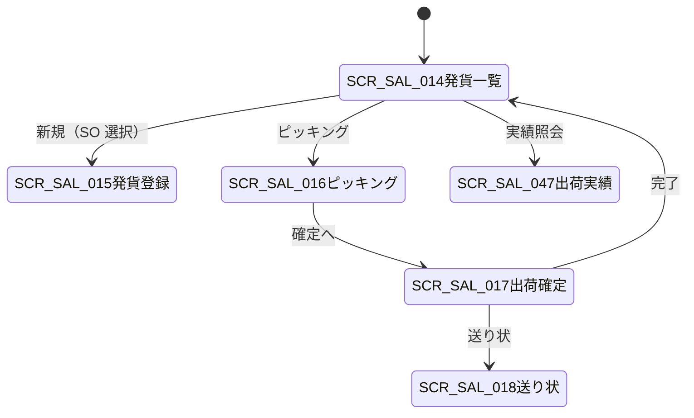

# 发货通知・拣货・出荷确定 详细设计书（出荷指示・ピッキング・出荷確定 詳細設計書）

| 項目 | 内容 |
|---|---|
| 文書名 | 发货通知・拣货・出荷确定 详细设计书（出荷指示・ピッキング・出荷確定 詳細設計書） |
| 文書番号 | DSN-SAL-003 |
| 版数 | v1.1 |
| 作成日 | 2026-10-20 |
| 作成者 | sales-designer（销售域担当） |
| 承認者 | 未承認（レビュー待ち） |
| 状態 | ドラフト（レビュー中） |
| 関連文書 | [業務域概要](00-overview.md) / [销售订单](02-sales-order.md) / [信用管控](06-credit-pricing.md) / [共通業務規則](../00-common/08-common-business-rules.md) / [跨域流程](../00-common/09-cross-domain-flow.md) / [在庫域 予約/出庫](../05-inventory/06-reservation-barcode-close.md) / [財務域 应收](../07-finance/04-ar-receipt.md) |

---

## 1. 機能概要

| 項目 | 内容 |
|---|---|
| 機能 ID | F-SAL-005（発貨通知与揀貨・出荷確定）/ F-SAL-018（出荷実績照会） |
| 機能名 | 発貨通知（DN）作成、ピッキング、出荷確定、送り状、出荷実績照会 |
| 目的 | 承認済受注から出荷指示（DN）を作成し、引當在庫を批次/序列號単位でピッキングして出荷を確定する。出荷確定時に **E10 `sales.delivery.confirmed`** を発行し、在庫域の出庫（E18）と財務域の売上・売掛計上（E27）を起動する。O2C における「出荷事実の確定責任」は本域が持つ |
| 利用者・ロール | 銷售員（DN 作成・出荷指示）、倉管員（ピッキング・出荷確定・送り状出力）、銷售經理（例外出荷承認）、経理（計上狀況確認） |
| 利用シーン | ① 受注の納期に合わせた出荷指示 ② 倉庫でのピッキング（バーコード/批次/序列號） ③ 部分出荷 ④ 送り状・納品書の出力 ⑤ 出荷実績・未出荷残の照会 |
| 優先度 | P0（第一版 MVP） |
| 画面 ID | SCR-SAL-014（発貨通知一覧）、SCR-SAL-015（発貨通知登録編集）、SCR-SAL-016（ピッキング作業）、SCR-SAL-017（出荷確定）、SCR-SAL-018（送り状プレビュー）、SCR-SAL-047（出荷実績照会） |
| 関連 IF | E10（発行）、E09（引當結果参照）、E18（購読・出庫確認）、E27（購読・売掛計上確認）、INV 可用量/批次照会 API、E31（例外出荷承認） |

## 2. 業務要件・業務ルール

### 2.1 前提条件

| # | 前提条件 | 成立しない場合の挙動 |
|---|---|---|
| 1 | 受注が 25（承認済）または 30/35 で、未出荷殘 > 0 | DN 作成不可（`MSG-SAL-100`） |
| 2 | 受注が與信超限承認済または與信餘力內（出荷時再判定） | 出荷保留（`MSG-SAL-085`） |
| 3 | 引當が存在する（E09 受信済）。引當なしの出荷は主管承認（例外出荷）が必要 | 引當なしは出荷確定不可（`MSG-SAL-101`） |
| 4 | 出荷數量 ≤ 引當殘 − 出荷済、かつ受注殘以下 | 超過はエラー（`MSG-SAL-036`） |
| 5 | 倉庫が有効、物料が出荷可能狀態（販売停止でない） | DN 作成不可（`MSG-SAL-102`） |
| 6 | 會計期間が OPEN、出荷日が在庫最終取引日以降 | 出荷確定不可（`MSG-COM-071`、`MSG-INV-xxx`） |
| 7 | 序列號管理物料は序列號を指定できる | 序列號不足はエラー（`MSG-SAL-104`） |

### 2.2 業務ルール

| # | ルール | 根拠 | 関連項目 |
|---|---|---|---|
| BR-DN-01 | DN は受注明細（未出荷殘）から生成し、1 受注に対して複数 DN（部分出荷）を許容する。DN 番號は `DN{YYMMDD}{4桁}`（08 §2.1） | 08 §2.1 | `delivery_no` |
| BR-DN-02 | DN の初期狀態は 25（承認済）。DN 自体は WF 承認を要さない（SO 承認済が前提）。作成後は 30（ピッキング中）へ | 08 §3.2 | `delivery_status` |
| BR-DN-03 | 出荷數量は「引當殘 − 出荷済」を上限とし、既定は受注殘全量。部分出荷の分割は営業が行う | 09 §5.2 | `planned_qty` |
| BR-DN-04 | ピッキングは引當在庫（`inv_reservation_line`）を対象とし、批次・序列號・庫位を指定する。指定ルール：效期管理物料は **FEFO（先到期先出）**、それ以外は **FIFO（先入先出）**、手動指定も可。既定はシステムパラメータ `sales_picking_rule`（既定 FEFO） | 在庫域 06、本設計 | `picking_rule` |
| BR-DN-05 | 批次管理物料は批次番號必須。序列號管理物料（YE3 成品等）は序列號を數量分指定する。両方管理の場合は両方指定する | 在庫域 04 | `batch_no`、`serial_no` |
| BR-DN-06 | ピッキングは在庫域の「指定批次が可用か」チェックを必須とし、不可用・期限切れ・凍結・不合格の批次はエラー（`MSG-SAL-103`） | 在庫域契約 | — |
| BR-DN-07 | 出荷確定は DN 明細のピッキング實績（`picked_qty`）を確定し、受注の出荷済數量を増加させる。全明細確定時に DN 40、SO の殘數量が 0 なら SO 40 | 09 §5.2 | `shipped_qty` |
| BR-DN-08 | 出荷確定時に E10 を発行する。**在庫の出庫（SDO/SI）は在庫域が E10 を購読して実行し、本域は在庫殘高を直接更新しない**。財務の売上・売掛は財務域が E10 を購読して計上する（出荷基準、09 §7.3） | 09 §5.2/§7.3 | — |
| BR-DN-09 | 出荷確定前に與信再判定を行う。與信超限未承認の場合は出荷を保留し、営業・財務へ通知する | F-SAL-010、09 §5.3 | — |
| BR-DN-10 | 出荷數量は受注數量を超えてはならない（超過出荷禁止）。不足出荷（部分出荷）は許容し、殘數量をバックオーダーとして保持する。設定 `sales_over_shipment_tolerance`（既定 0%）は將來拡張用 | 08 §5.3、本設計 | `planned_qty` |
| BR-DN-11 | DN 取消は出荷確定前のみ可能。引當は解除せず受注に戻す（受注は 30 のまま）。出荷確定後の取消は返品処理（F-SAL-006） | 共通業務規則 3.3 | `delivery_status=90` |
| BR-DN-12 | 送り状（納品書）は出荷確定後に PRT-SAL-004 を出力する。再出力可能。送り状番號は外部（物流）連携時のみ保持し、当面は自社採番の DN 番號を表示する | 業務慣行 | `carrier_no` |
| BR-DN-13 | 出荷確定後の修正は禁止。誤出荷は返品→再出荷で処理する | 共通業務規則 3.3 | — |
| BR-DN-14 | 出荷日は「出荷確定日」を既定とし、過去日は在庫域の最終取引日以降のみ許可する。未來日は不可 | 共通業務規則 6.1 | `delivery_date` |
| BR-DN-15 | 出荷明細の単價・稅率は受注明細のスナップショットを使用する（再取價しない） | 共通項目定義 13 | `unit_price`、`tax_rate` |
| BR-DN-16 | E10 の header `amount`（稅抜合計）・`taxAmount`（稅額合計）と lines の `amount`/`taxAmount`/`taxRate` を必ず設定する（FIN が J07 計上に使用。09 契約） | 09 §3 E10 | — |
| BR-DN-17 | E10 の lines には `warehouseId`、`batchNo`（批次管理のみ）、`unitPrice`、`taxRate`、`amount`、`taxAmount`、`costAmount`（任意）、序列號は **09 v1.1 契約項目 `serialNos[]`** で設定する | 09 §3 E10 + 追加項目 | — |
| BR-DN-18 | 出荷確定後、INV の E18（`inventory.txn.posted`、`txn_type=SI`、`source_type=SALES_DELIVERY`）を受信して `cost_amount` を更新し、売上原価の確定を記録する。E18 未着は日次照合で検出する | 09 §3 E18 | `cost_amount` |
| BR-DN-19 | 出荷実績の照会は受注・顧客・品目・期間・倉庫・批次/序列號で可能とする。序列號から顧客・受注への逆引きを提供する（トレーサビリティ） | 09 §8 | — |
| BR-DN-20 | 出荷確定後の DN は 40（完了）。一部出荷の DN は 35（一部出庫）とし、殘數量は新規 DN で出荷する | 08 §3.2 | — |
| BR-DN-21 | 出荷確定時に受注の `shipped_qty` を更新し、`line_status=35/40` を更新する。SO 全明細が 40/90 かつ殘 0 なら SO を 40 に自動更新（または BAT-SAL-005） | 08 §3.2 | — |
| BR-DN-22 | ピッキング作業は PDA/Web 両対応とし、バーコードスキャンで批次・序列號・庫位を検証する。スキャン値と指示値が不一致の場合はエラー | 共通画面規格 | — |
| BR-DN-23 | 例外出荷（引當なし・與信未承認）は銷售經理の承認を要し、`exception_approval_id` に承認履歴を保持する。例外出荷は月次で一覧化する | 社内規程（仮定） | `is_exception` |
| BR-DN-24 | 同一起算で複数の DN を同時確定する場合、引當殘の取り合いを防ぐため受注明細単位の悲観ロック（`FOR UPDATE`）を使用する | 共通 DB 規格 11 | — |
| BR-DN-25 | 出荷確定 API は `Idempotency-Key` 必須。E10 は Outbox に業務トランザクションと同一コミットで記錄する | 09 §10.1 | — |

### 2.3 計算式・判定式

| # | 対象 | 算式 | 丸め | 例 |
|---|---|---|---|---|
| CALC-DN-01 | 出荷可能數量 | MIN(引當殘 − 出荷済, 受注殘, DN 指示殘) | 4 桁 | MIN(120 − 0, 120 − 0, 80) = 80 PCE |
| CALC-DN-02 | 引當殘 | `reserved_qty` − `shipped_qty`（同一受注明細） | 4 桁 | 120 − 40 = 80 PCE |
| CALC-DN-03 | 出荷明細金額（稅抜） | 出荷數量 × 受注稅抜單價 | HALF_UP 2 桁 | 80 × 856.50 = 68,520.00 |
| CALC-DN-04 | 出荷明細稅額 | 出荷金額（稅抜）× 受注稅率 | HALF_UP 2 桁 | 68,520.00 × 13% = 8,907.60 |
| CALC-DN-05 | DN 稅抜合計 | Σ 明細金額 | — | — |
| CALC-DN-06 | DN 稅額合計 | Σ 明細稅額 | — | — |
| CALC-DN-07 | 出荷時與信判定 | FIN 與信台帳の使用額＋今回出荷額 − 限度額 > 0 かつ未承認 → 保留（SAL は台帳を更新しない） | 2 桁 | — |
| CALC-DN-08 | 出荷差異（照合） | E10 數量 vs E18 數量。差異 ≠ 0 は警告・日次照合対象 | 4 桁 | 80 − 80 = 0 |
| CALC-DN-09 | 送り状ページ數 | CEIL(明細行數 ÷ 20) | — | 3 行 → 1 ページ |

**部分出荷例（【示例値】）**

| 回 | DN 番號 | 出荷日 | 數量 | 稅抜金額 | 稅額 | 狀態 | SO 狀態 |
|---|---|---|---|---|---|---|---|
| 1 | DN2610200001 | 2026-10-24 | 80 PCE | 68,520.00 | 8,907.60 | 40 完了 | 35 一部出荷 |
| 2 | DN2610200002 | 2026-10-30 | 40 PCE | 34,260.00 | 4,453.80 | 40 完了 | 40 完了 |
| 合計 | — | — | 120 PCE | 102,780.00 | 13,361.40 | — | — |

### 2.4 状態遷移

#### 2.4.1 発貨通知（DN）



| 遷移 | トリガ | 権限 | 更新項目 | メッセージ／イベント |
|---|---|---|---|---|
| 新規→25 | DN 作成 | `sales:delivery:create` | INSERT（`delivery_no` 採番、`delivery_status=25`） | `MSG-SAL-105` |
| 25→30 | ピッキング開始 | `sales:delivery:pick` | `delivery_status=30`、`pick_started_at` | `MSG-SAL-106` |
| 30/35→35 | 出荷確定（一部） | `sales:delivery:confirm` | `delivery_status=35`、明細 `picked_qty/shipped_qty`、E10 | `MSG-SAL-107` |
| 30/35→40 | 出荷確定（全數） | `sales:delivery:confirm` | `delivery_status=40`、`confirmed_at`、E10 | `MSG-SAL-108` |
| 25/30→90 | 取消 | `sales:delivery:cancel` | `delivery_status=90`、`cancel_reason`、明細ピッキング解除 | `MSG-SAL-109` |

#### 2.4.2 SO 側の連動

| SO 狀態 | トリガ | 更新內容 |
|---|---|---|
| 30 → 35 | 初回の部分出荷確定（E10） | `order_status=35`、明細 `shipped_qty` 加算 |
| 30 → 40 | 全數出荷確定 | `order_status=40`、`closed_at` |
| 35 → 40 | 殘數出荷確定 | `order_status=40`、`closed_at` |

> SO 狀態更新は F-SAL-005 の出荷確定トランザクション內で行う（本域が受注狀態の更新責任を持つ）。E10 は SO 更新後に Outbox へ INSERT する。

### 2.5 責任分界（O2C 出荷〜売上計上）

| # | 事象 | 銷售域（SAL） | 庫存域（INV） | 財務域（FIN） | データ傳達 |
|---|---|---|---|---|---|
| 1 | 可用量照会 | 受注・出荷指示時に呼出 | 現有−引當−待検−凍結−不合格 を返す | — | 同期 API |
| 2 | 引當 | E06 発行（承認時） | 引當実行、E09 返信 | — | E06/E09 |
| 3 | ピッキング | 指示・実績記録（批次/序列號） | 批次可用チェック | — | 同期 API |
| 4 | **出荷確定** | **DN 確定・E10 発行・SO 出荷済更新** | — | — | **E10** |
| 5 | 在庫出庫 | E18 購読で原價・出庫番號を記録 | E10 購読で SDO/SI 登録、原價確定、E18 発行 | — | E10→E18 |
| 6 | 売上・売掛計上 | E27 購読で應收投影・FIN 與信台帳の解放 | — | E10 購読で J07（借 1122 / 貸 6001・2221）計上、E27 発行 | E10→E27 |
| 7 | 売上原価 | — | E18 発行 | E18 購読で J06（借 6401 / 貸 1405）計上 | E18 |
| 8 | 出荷照合 | E10 数量 vs E18 数量・E27 金額の日次照合 | E18 | E27 | BAT-SAL-008 |

> 「出荷数量・金額の確定」は SAL、「在庫數量・原價の確定」は INV、「売上・売掛金額の確定」は FIN が責任を持つ。同一データを 2 域が更新しない（[09 §2.2](../00-common/09-cross-domain-flow.md)）。

### 2.6 データ傳達項目（E10）

| E10 フィールド | 型 | 必須 | 來源（SAL） | 利用先 | 備考 |
|---|---|---|---|---|---|
| `deliveryId` | string | ○ | `sal_delivery_note.id` | INV/FIN 冪等キー | — |
| `deliveryNo` | string | ○ | `delivery_no` | SDO 紐付け | `DN+YYMMDD+4桁` |
| `orderId` | string | ○ | `sales_order_id` | AR 補助核算 | — |
| `customerId` | string | ○ | `customer_id` | AR 計上 | — |
| `amount` | string | ○ | DN 稅抜合計 | FIN 売上計上 | 2 桁 |
| `taxAmount` | string | ○ | DN 稅額合計 | FIN 銷項稅 | 2 桁 |
| `deliveryDate` | date | ○ | `delivery_date` | 売上日・原價日 | — |
| `lines[].materialId` | string | ○ | `material_id` | 在庫出庫 | — |
| `lines[].qty` | string | ○ | `shipped_qty` | 在庫出庫・売上 | 4 桁 |
| `lines[].uom` | string | ○ | `uom_code` | 在庫換算 | 基本單位換算は INV |
| `lines[].warehouseId` | string | ○ | `warehouse_id` | 在庫出庫 | — |
| `lines[].batchNo` | string | △ | ピッキング批次 | 在庫出庫・トレース | 批次管理物料のみ |
| `lines[].serialNos` | string[] | △ | ピッキング序列號 | 在庫出庫・トレース | 序列號管理物料（09 v1.1 契約項目） |
| `lines[].unitPrice` | string | ○ | 受注稅抜單價 | FIN 売上 | 6 桁 |
| `lines[].taxRate` | string | ○ | 受注稅率 | FIN 稅額検証 | 4 桁（%表記） |
| `lines[].amount` | string | ○ | 明細稅抜金額 | FIN 売上 | 2 桁 |
| `lines[].taxAmount` | string | ○ | 明細稅額 | FIN 銷項稅 | 2 桁 |
| `lines[].costAmount` | string | △ | E18 で補完 | FIN 原價參考 | 出荷時は未確定（null 可） |

## 3. 関連機能

| 関係 | 機能 ID | 機能名 | 関係內容 |
|---|---|---|---|
| 上流 | F-SAL-003/004 | 受注・訂單変更 | 未出荷殘・引當數量を引き継ぐ |
| 上流 | F-SAL-010 | 信用管控 | 出荷前の與信再判定 |
| 上流 | INV | 引當（E09）・可用量・批次/序列號 | 同期參照 |
| 下流 | INV | 出庫（E10→E18） | イベント |
| 下流 | FIN | 売上・売掛（E10→E27）、原價（E18） | イベント |
| 下流 | F-SAL-006 | 返品 | 出荷実績を元に返品受付（期限チェック） |
| 下流 | F-SAL-007 | 開票申請 | 出荷確定済・未開票明細を集約 |
| 下流 | F-SAL-009 | 應收 | E27 投影に反映 |
| 下流 | F-SAL-018 | 出荷実績照会 | 送り状再出力・トレーサビリティ |

## 4. 画面設計

### 4.1 画面一覧

| 画面 ID | 画面名 | 類型 | 概要 |
|---|---|---|---|
| SCR-SAL-014 | 発貨通知一覧 | LIST | DN の検索・状態確認・一括確定 |
| SCR-SAL-015 | 発貨通知登録編集 | EDIT | SO から DN を作成、出荷數量・倉庫・出荷日指定 |
| SCR-SAL-016 | ピッキング作業 | EDIT | 批次/序列號/庫位の指定、バーコード検証、引當引落 |
| SCR-SAL-017 | 出荷確定 | EDIT | 出荷実績の確認・確定（E10 発行）、與信再判定 |
| SCR-SAL-018 | 送り状プレビュー | PRINT | PRT-SAL-004 送り状・納品書 PDF プレビュー |
| SCR-SAL-047 | 出荷実績照会 | LIST | 出荷実績・送り状・未出荷殘・トレース |

### 4.2 画面遷移



### 4.3 画面レイアウト

**SCR-SAL-015 発貨通知登録編集**

```
┌──────────────────────────────────────────────────────────────────────────────┐
│ パンくず：ホーム > 販売管理 > 出荷管理 > 発貨通知登録                          │
├──────────────────────────────────────────────────────────────────────────────┤
│〔ヘッダ〕DN番号[自動] 状態[25 承認済] 受注番号[SO2610200001▼] 顧客[C000001]   │
│ 出荷日[2026-10-24] 出荷倉[WH03 成品倉▼] 與信判定[OK] 與信餘力[CNY 1,100,000]  │
│ 受注納期[2026-10-30] 引當狀況[引當済] 備考[____]                              │
├──────────────────────────────────────────────────────────────────────────────┤
│〔明細〕[SO明細取込]                                                          │
│ No|物料|品名|受注數量|引當殘|出荷済|今回出荷|單位|稅抜金額|稅額|批次/序列號     │
│ 10|3001000001|YE3-100L1-4|120|120|40|80|PCE|68,520.00|8,907.60|SN 80 件指定  │
├──────────────────────────────────────────────────────────────────────────────┤
│〔合計〕 稅抜 CNY 68,520.00 稅額 CNY 8,907.60 稅込 CNY 77,427.60               │
│〔フッタ〕[保存][ピッキングへ][出荷確定へ][取消][戻る]                          │
└──────────────────────────────────────────────────────────────────────────────┘
```

**SCR-SAL-016 ピッキング作業（PDA/Web）**

```
┌──────────────────────────────────────────────────────────────────────────────┐
│ DN2610200001 / SO2610200001 / 江蘇恒立液壓 / 出荷日 2026-10-24               │
├──────────────────────────────────────────────────────────────────────────────┤
│〔指示行 10〕YE3-100L1-4 出荷指示 80 PCE / 引當 120 PCE                       │
│  庫位 [WH03-A-01-02▼] 批次[—] 序列號[スキャン/手入力]                        │
│  スキャン履歴: SN-YE3-2610-0001 ✓ / SN-YE3-2610-0002 ✓ / …（72/80）           │
│  [自動割当(FEFO/FIFO)] [行確定] [差異登録]                                    │
├──────────────────────────────────────────────────────────────────────────────┤
│〔進捗〕 80/80 PCE 完了  次の行へ / 出荷確定へ                                 │
└──────────────────────────────────────────────────────────────────────────────┘
```

### 4.4 画面項目定義

#### 4.4.1 SCR-SAL-015 発貨通知ヘッダ

| No | 項目 ID | 項目名 | 種別 | 型/桁 | 必須 | 初期值 | 入力チェック | データソース | DB 項目 | 備考 |
|---|---|---|---|---|---|---|---|---|---|---|
| 1 | `deliveryNo` | DN 番號 | テキスト | VARCHAR(32) | ○ | 自動採番 | `DN+YYMMDD+4桁` | SYS 採番 | `delivery_no` | 參照のみ |
| 2 | `salesOrderId` | 受注 | 選択 | BIGINT | ○ | — | 狀態 25/30/35・未出荷殘あり | SAL | `sales_order_id` | 選択ダイアログ |
| 3 | `salesOrderNo` | 受注番號 | テキスト | VARCHAR(32) | — | 自動 | — | SAL | `sales_order_no` | スナップショット |
| 4 | `customerId/Code/Name` | 顧客 | 表示 | BIGINT/VARCHAR | — | 自動 | — | MDM | `customer_id/code/name` | スナップショット |
| 5 | `deliveryDate` | 出荷日 | 日付 | DATE | ○ | 當日 | 過去日可（在庫最終取引日以降）、未來日は 7 日先まで | — | `delivery_date` | — |
| 6 | `warehouseId` | 出荷倉 | 選択 | BIGINT | ○ | SO 既定 | 有効倉庫 | MDM | `warehouse_id` | — |
| 7 | `deliveryStatus` | 狀態 | 表示 | SMALLINT | — | 25 | — | — | `delivery_status` | 25/30/35/40/90 |
| 8 | `pickingRule` | ピッキングルール | 選択 | VARCHAR(10) | — | FEFO | FEFO/FIFO/MANUAL | sys_param | `picking_rule` | — |
| 9 | `carrierCode` | 運送會社 | 選択 | VARCHAR(20) | △ | — |  | MDM | `carrier_code` | — |
| 10 | `carrierNo` | 送り状番號 | テキスト | VARCHAR(50) | △ | — |  | 手入力 | `carrier_no` | — |
| 11 | `creditCheckResult` | 與信判定 | 表示 | SMALLINT | — | 出荷時判定 | — | FIN 與信台帳照会 | `credit_check_result` | 10 正常/20 注意/30 超限審査中/40 超限承認済/90 凍結・閉鎖 |
| 12 | `isException` | 例外出荷 | チェック | BOOLEAN | — | false | 主管承認要 | — | `is_exception` | — |
| 13 | `exceptionApprovalId` | 例外承認 ID | テキスト | VARCHAR(32) | △ | — | — | WF | `exception_approval_id` | — |
| 14 | `remark` | 備考 | テキスト | VARCHAR(500) | △ | — | 500 桁 | 手入力 | `remark` | — |
| 15 | `confirmedAt/By` | 出荷確定日時/者 | 表示 | TIMESTAMPTZ/BIGINT | — | — | — | — | `confirmed_at/by` | 出荷確定時に設定 |

#### 4.4.2 SCR-SAL-015/016/017 明細・ピッキング項目

| No | 項目 ID | 項目名 | 種別 | 型/桁 | 必須 | 初期值 | 入力チェック | 計算 | DB 項目 |
|---|---|---|---|---|---|---|---|---|---|
| 1 | `lineNo` | 行番號 | 數値 | INT | — | 10 刻み | — | — | `line_no` |
| 2 | `salesOrderLineId` | 受注明細 ID | 表示 | BIGINT | ○ | 自動 | — | — | `sales_order_line_id` |
| 3 | `materialId/Code/Name` | 物料 | 表示 | BIGINT/VARCHAR | ○ | 自動 | — | — | `material_id/material_code/material_name` |
| 4 | `uomCode` | 單位 | 表示 | VARCHAR(10) | ○ | 受注 | — | — | `uom_code` |
| 5 | `orderedQty` | 受注數量 | 表示 | NUMERIC(18,4) | — | 自動 | — | — | `ordered_qty` |
| 6 | `reservedQty` | 引當殘 | 表示 | NUMERIC(18,4) | — | 自動 | — | CALC-DN-02 | `reserved_qty` |
| 7 | `shippedQty` | 出荷済 | 表示 | NUMERIC(18,4) | — | 自動 | — | — | `shipped_qty` |
| 8 | `plannedQty` | 今回出荷數量 | 數値 | NUMERIC(18,4) | ○ | 引當殘 | > 0、≤ 引當殘 − 出荷済、4 桁 | CALC-DN-01 | `planned_qty` |
| 9 | `pickedQty` | ピッキング數量 | 數値 | NUMERIC(18,4) | ○ | 0 | 合計 = plannedQty（出荷確定時） | — | `picked_qty` |
| 10 | `warehouseId` | 出荷倉 | 選択 | BIGINT | ○ | ヘッダ | 有効倉庫 | — | `warehouse_id` |
| 11 | `locationCode` | 庫位 | 選択 | VARCHAR(50) | △ | — | 倉庫內存在 | — | `location_code` |
| 12 | `batchNo` | 批次番號 | テキスト | VARCHAR(50) | △ | 自動候補 | 批次管理時必須・可用チェック | — | `batch_no` |
| 13 | `serialNos` | 序列號 | タグ | JSONB | △ | — | 序列號管理時、數量分必須 | — | `serial_nos` |
| 14 | `unitPrice` | 稅抜單價 | 表示 | NUMERIC(18,6) | — | 受注 | — | — | `unit_price` |
| 15 | `taxRate` | 稅率 | 表示 | NUMERIC(7,4) | — | 受注 | — | — | `tax_rate` |
| 16 | `lineAmount` | 稅抜金額 | 數値 | NUMERIC(18,2) | — | 自動 | — | CALC-DN-03 | `line_amount` |
| 17 | `taxAmount` | 稅額 | 數値 | NUMERIC(18,2) | — | 自動 | — | CALC-DN-04 | `tax_amount` |
| 18 | `totalAmount` | 稅込金額 | 數値 | NUMERIC(18,2) | — | 自動 | — | — | `total_amount` |
| 19 | `stockStatus` | 在庫狀態 | 表示 | SMALLINT | — | — | — | INV 照会 | `stock_status` | 10 可用/20 待檢/30 凍結/40 不合格/50 報廢 |
| 20 | `lineStatus` | 明細狀態 | 表示 | SMALLINT | — | 25 | — | — | `line_status` | 25/30/35/40 |
| 21 | `pickRemark` | ピッキング備考 | テキスト | VARCHAR(200) | △ | — | 200 桁 | — | `pick_remark` |
| 22 | `costAmount` | 出庫原價 | 數値 | NUMERIC(18,2) | — | — | E18 で更新 | — | `cost_amount` |

### 4.5 イベント処理

| No | イベント | トリガ | 処理內容 | 呼出 API / 処理 ID | 畫面遷移 | 備考 |
|---|---|---|---|---|---|---|
| 1 | SO 明細取込 | SO 選択 | 未出荷殘の明細を DN 明細へコピー（引當・出荷済・單價・稅率） | GET /api/sales/sales-orders/{id} | — | 引當なし行は警告 |
| 2 | 保存 | 保存ボタン | 入力チェック→DN INSERT/UPDATE→採番 | POST/PUT /api/sales/delivery-notes | 一覧へ | Idempotency-Key |
| 3 | ピッキング開始 | ボタン | DN を 30 へ、ピッキング畫面へ | POST /api/sales/delivery-notes/{id}/start-picking | SCR-SAL-016 | — |
| 4 | 自動割当 | ボタン | INV 批次可用明細取得→FEFO/FIFO で批次・序列號を自動割当 | GET /api/inventory/stock-balances/available-batches | — | 引當範圍內のみ |
| 5 | バーコードスキャン | スキャン | 批次/序列號を検証し、數量を加算 | GET /api/inventory/serials/{serialNo} | — | 不一致はエラー |
| 6 | 行確定 | 行確定ボタン | pickedQty 確定、庫位・批次/序列號保存 | PUT /api/sales/delivery-notes/{id}/lines/{lineId}/pick | — | — |
| 7 | 出荷確定 | 確定ボタン | 與信再判定→在庫引當チェック→DN/SO 更新→E10 発行 | POST /api/sales/delivery-notes/{id}/confirm | 一覧へ | 冪等キー必須 |
| 8 | 出荷一部確定 | チェック | 出荷數量 < 指示數量で部分確定 | 同上 | 一覧へ | DN 35 |
| 9 | 與信再判定 | 自動（確定時） | FIN 與信使用額 + 今次出荷額 → 判定、超過は保留 | GET /api/sales/credits/{customerId}/check | — | MSG-SAL-085 |
| 10 | 送り状出力 | ボタン | PRT-SAL-004 PDF 生成・再出力 | POST /api/sales/delivery-notes/{id}/print | SCR-SAL-018 | — |
| 11 | DN 取消 | 取消ボタン | 理由必須・出荷確定前のみ | POST /api/sales/delivery-notes/{id}/cancel | 一覧へ | — |
| 12 | 品質保留 | ボタン | OQC（任意）で出荷保留フラグ | — | — |  |
| 13 | 實績照会 | 一覧 | 出荷実績を検索・CSV/Excel 出力 | GET /api/sales/shipments | SCR-SAL-047 | — |
| 14 | トレース照会 | 序列號入力 | 序列號→DN→SO→顧客の逆引き | GET /api/sales/shipments/trace?serialNo= | 同一 | — |

### 4.6 一覧畫面仕様（SCR-SAL-014）

| 項目 | 內容 |
|---|---|
| 検索條件 | DN 番號、出荷日（範圍）、受注番號、顧客、狀態（25/30/35/40/90）、倉庫、運送會社、例外出荷のみ |
| 既定検索條件 | 出荷日 = 當月、狀態 = 25,30,35,40 |
| ソート | 出荷日降順 → DN 番號降順 |
| ページング | 20/50/100/200（既定 20） |
| 一括操作 | 一括出荷確定（30/35 かつ権限あり）、送り状一括出力、エクスポート |
| エクスポート | Excel 最大 10,000 件 |
| 列 | DN 番號、出荷日、受注番號、顧客、狀態、出荷數量、稅込金額、倉庫、送り状番號、確定日時 |

### 4.7 表示制御

| 條件 | 対象 | 制御 |
|---|---|---|
| DN 狀態 35/40/90 | 編集・ピッキング・取消ボタン | 非表示 |
| DN 狀態 30 | 保存（數量変更） | 非表示（ピッキングのみ） |
| 與信超過未承認 | 出荷確定ボタン | 非活性＋警告表示 |
| 例外出荷 | 出荷確定ボタン | 主管承認後のみ活性 |
| 序列號管理物料 | 批次欄 | 非表示（序列號欄を表示） |
| バッチ管理外物料 | 批次欄 | 非表示 |
| 権限なし | 出荷確定・送り状 | 非表示・API 403 |

## 5. 入力チェック仕様

| No | チェック ID | 対象項目 | 種別 | 條件 | タイミング | メッセージ ID |
|---|---|---|---|---|---|---|
| 1 | CHK-SAL-003-01 | 受注 | 必須/業務 | 狀態 25/30/35・未出荷殘 > 0 | DN 作成時 | MSG-SAL-100 |
| 2 | CHK-SAL-003-02 | 出荷日 | 必須/範圍 | 當日〜7 日先、在庫最終取引日以降 | 保存時 | MSG-SAL-110 |
| 3 | CHK-SAL-003-03 | 出荷倉 | 必須/コード存在 | 有効倉庫 | 保存時 | MSG-COM-049 |
| 4 | CHK-SAL-003-04 | 出荷數量 | 必須/範圍 | > 0、≤ 引當殘 − 出荷済、4 桁 | 保存時 | MSG-SAL-036 |
| 5 | CHK-SAL-003-05 | 受注殘 | 業務 | 出荷數量 ≤ 受注殘 | 保存時 | MSG-SAL-036 |
| 6 | CHK-SAL-003-06 | 引當 | 業務 | 引當が存在する（例外出荷は承認要） | 保存・確定時 | MSG-SAL-101 |
| 7 | CHK-SAL-003-07 | 批次 | 必須/コード存在 | 批次管理時、INV に存在し可用 | ピッキング時 | MSG-SAL-103 |
| 8 | CHK-SAL-003-08 | 序列號 | 必須/一意 | 序列號管理時、數量分、重複なし、INV に存在 | ピッキング時 | MSG-SAL-104 |
| 9 | CHK-SAL-003-09 | 庫位 | コード存在 | 倉庫內に存在 | ピッキング時 | MSG-COM-049 |
| 10 | CHK-SAL-003-10 | ピッキング數量 | 相関 | Σ pickedQty = plannedQty（確定時） | 出荷確定時 | MSG-SAL-111 |
| 11 | CHK-SAL-003-11 | 與信 | 業務 | 出荷時與信判定 OK または超限承認済 | 出荷確定時 | MSG-SAL-085 |
| 12 | CHK-SAL-003-12 | 會計期間 | 業務 | OPEN | 出荷確定時 | MSG-COM-071 |
| 13 | CHK-SAL-003-13 | 出荷日 | 業務 | 在庫最終取引日以降（遡及禁止） | 出荷確定時 | MSG-SAL-110 |
| 14 | CHK-SAL-003-14 | 狀態 | 業務 | DN 25/30/35 のみ編集・確定可 | 各操作時 | MSG-COM-034 |
| 15 | CHK-SAL-003-15 | 取消 | 業務 | 出荷確定前のみ | 取消時 | MSG-SAL-109 |
| 16 | CHK-SAL-003-16 | 樂観排他 | 排他 | `version` 一致 | 保存/確定時 | MSG-COM-033 |
| 17 | CHK-SAL-003-17 | 二重確定 | 冪等 | 狀態 40 は再確定不可 | 出荷確定時 | MSG-COM-075 |
| 18 | CHK-SAL-003-18 | 送り状 | 業務 | 出荷確定後のみ出力可 | 印刷時 | MSG-SAL-112 |
| 19 | CHK-SAL-003-19 | 例外出荷 | 権限 | 主管承認 or `sales:delivery:confirm`（例外権限） | 確定時 | MSG-COM-030 |
| 20 | CHK-SAL-003-20 | 明細行數 | 範圍 | 1〜1,000 行 | 保存時 | MSG-COM-047 |

## 6. 処理詳細

### 6.1 処理一覧

| 処理 ID | 処理名 | 契機 | トランザクション | 排他 |
|---|---|---|---|---|
| PRC-SAL-003-01 | DN 作成 | 保存（新規） | 要（DN・明細・採番） | 採番行ロック |
| PRC-SAL-003-02 | DN 更新 | 保存（編集） | 要 | 樂観排他 |
| PRC-SAL-003-03 | ピッキング確定 | 行確定 | 要（ピッキング明細） | 在庫引當行ロック |
| PRC-SAL-003-04 | 出荷確定 | 確定ボタン | 要（DN・明細・SO・E10 Outbox） | 受注明細 `FOR UPDATE` |
| PRC-SAL-003-05 | DN 取消 | 取消 | 要（狀態・ピッキング解除） | 樂観排他 |
| PRC-SAL-003-06 | E18 受信 | E18 購読 | 要（`cost_amount` 更新） | 冪等 |
| PRC-SAL-003-07 | 出荷照合 | BAT-SAL-008 | 不要（照会） | — |
| PRC-SAL-003-08 | 送り状出力 | 印刷 | 不要（PDF 生成） | — |

### 6.2 処理手順（正常系）

**PRC-SAL-003-01 DN 作成**

1. 受注を取得し、狀態 25/30/35・未出荷殘 > 0・與信超限未承認でないことを確認する。
2. SO 明細から引當殘（`reserved_qty − shipped_qty`）と受注殘を算出し、DN 明細を作成する。既定出荷數量 = 引當殘（全量引當の場合）。
3. 出荷倉は明細の `warehouse_id`、出荷日は當日を初期設定する。
4. `sys_sequence` から `SAL_DELIVERY_NOTE`（DN + YYMMDD + 4 桁）を採番する。
5. `sal_delivery_note`（`delivery_status=25`）・`sal_delivery_note_line` を INSERT する。單價・稅率・金額は受注スナップショットから設定する。
6. `MSG-SAL-105` を返す。

**PRC-SAL-003-04 出荷確定（E10 発行）**

1. DN を `FOR UPDATE` で取得し、狀態 25/30/35 を確認する（それ以外は `MSG-COM-034`）。
2. 出荷明細ごとに、ピッキング數量 = 指示數量であることを確認する（部分確定の場合は明細単位で確定）。
3. 受注明細を `FOR UPDATE` でロックし、引當殘 − 出荷済 ≥ 出荷數量、在庫可用量（INV 照会）≥ 出荷數量を検証する。批次/序列號が指定されている場合は INV で可用性を再検証する。
4. 與信再判定（PRC-SAL-006-01 の出荷判定）を実行する。超過かつ超限承認なし → 出荷保留（`MSG-SAL-085`、ロールバック）。例外出荷の場合は例外承認を確認する。
5. 會計期間 OPEN、出荷日が在庫最終取引日以降であることを確認する。
6. DN 明細の `shipped_qty`（= `picked_qty`）、`line_status`、DN の `delivery_status`（全數なら 40、一部なら 35）、`confirmed_at/by` を更新する。
7. SO 明細の `shipped_qty`（販売単位）と `shipped_base_qty`（基本単位、`+= 今回出荷販売数量 × conversion_rate`）・`line_status`・`shortage_qty` を**同時に**更新し、SO の `order_status` を 35/40 に更新する（BR-DN-21）。`shipped_base_qty` の更新漏れは不可。
8. 出荷額分の與信台帳解放は FIN が実施する（SAL は `sal_credit_ledger_snapshot` 投影を E10 購読で更新、`RELEASE_SHIP`）。
9. Outbox に **E10 `sales.delivery.confirmed`** を INSERT する（第 2.6 節の項目、header `amount`・`taxAmount`、lines `taxRate`・`amount`・`taxAmount`、`serialNos[]` 追加）。
10. 監査ログ（出荷確定、DN 番號、SO 番號、金額、與信判定結果）を記錄し、`MSG-SAL-107/108` を返す。
11. INV が E10 を購読して SDO/SI を登録し E18 を発行する。SAL は E18 受信で `cost_amount` を更新する（BR-DN-18）。FIN が E10 を購読して J07・E27 を計上する。

**PRC-SAL-003-03 ピッキング確定**

1. DN を 30 へ更新する（初回のみ）。
2. 明細ごとに批次/序列號/庫位を指定する。自動割当の場合は INV `GET /api/inventory/stock-balances/available-batches?materialId&warehouseId&sort=FEFO|FIFO` を呼び、先頭から數量分を割り当てる。
3. 手動指定の場合は INV に批次・序列號の可用性を照会し、不可用・期限切れ・凍結・不合格はエラー（`MSG-SAL-103`／`MSG-INV-015`）。
4. `sal_pick_detail` に批次・序列號・庫位・數量を INSERT する。序列號は `sal_delivery_serial` に展開保存する。
5. 明細 `picked_qty` を更新する。全明細のピッキングが完了したら出荷確定可能とする。

**PRC-SAL-003-05 DN 取消**

1. 狀態 25/30 のみ取消可（35/40 は不可、`MSG-SAL-109`）。
2. 理由必須。`delivery_status=90`、`cancel_reason`、`cancelled_at` を更新する。
3. ピッキング済みの場合は `sal_pick_detail` を取消（`status=90`）し、引當は解除しない（受注に戻す）。
4. 監査ログを記錄する。

**PRC-SAL-003-06 E18 受信**

1. `eventId` で冪等チェックする。
2. `source_type=SALES_DELIVERY`、`source_id=deliveryId` で DN を特定する。
3. 明細ごとに `unit_cost`・`cost_amount` を更新し、`inv_txn_no`（SDO 番號）を保存する。
4. 出荷數量と E18 數量の差異をチェックし、差異があれば警告ログ・アラート（BAT-SAL-008）。

### 6.3 例外処理

| No | 異常條件 | 検知箇所 | 処理 | ロールバック | メッセージ ID |
|---|---|---|---|---|---|
| 1 | 受注が未承認/全數出荷済 | DN 作成 | エラー | 全體 | MSG-SAL-100 |
| 2 | 引當なし | DN 作成・確定 | エラー（例外承認時のみ可） | 全體 | MSG-SAL-101 |
| 3 | 出荷數量超過 | 保存・確定 | エラー | 全體 | MSG-SAL-036 |
| 4 | 在庫不足（引當後の變動） | 出荷確定 | エラー・再引當案内 | 全體 | MSG-SAL-037 |
| 5 | 批次/序列號不可用 | ピッキング | エラー | 全體 | MSG-SAL-103/104 |
| 6 | 與信超過未承認 | 出荷確定 | 出荷保留 | 全體 | MSG-SAL-085 |
| 7 | 會計期間締切 | 出荷確定 | エラー | 全體 | MSG-COM-071 |
| 8 | 遡及日付 | 出荷確定 | エラー | 全體 | MSG-SAL-110 |
| 9 | 二重出荷確定 | 確定 | エラー（4005） | — | MSG-COM-075 |
| 10 | E10 配信失敗 | Outbox | リトライ・アラート、業務は確定 | — | MSG-COM-080 |
| 11 | E18 未着 | BAT-SAL-008 | 検出・アラート・再処理 | — | MSG-SAL-113 |
| 12 | 送り状出力失敗 | 印刷 | エラー・再出力 | — | MSG-SAL-112 |
| 13 | 樂観排他競合 | 保存/確定 | 409 | 全體 | MSG-COM-033 |

### 6.4 冪等性・再実行

- 出荷確定 API は `Idempotency-Key` 必須。同一キーの再送は初回結果を返す。
- E10 は Outbox に同一トランザクションで INSERT し、`eventId` で購読側の重複を防止する。再送は Outbox 配信バッチが行う。
- E18 の受信は `eventId` + `txnId` で冪等。二重に `cost_amount` を更新しない。
- BAT-SAL-008（出荷済・未計上照合）は何度実行してもログのみで金額を変更しない。

## 7. API 設計

### 7.1 API 一覧

| No | メソッド | パス | 権限 | 概要 | 主なエラー |
|---|---|---|---|---|---|
| 1 | GET | `/api/sales/delivery-notes` | `sales:delivery:view` | DN 一覧 | 3001 |
| 2 | GET | `/api/sales/delivery-notes/{id}` | `sales:delivery:view` | DN 詳細（明細・ピッキング含む） | 4001 |
| 3 | POST | `/api/sales/delivery-notes` | `sales:delivery:create` | DN 作成 | 1001、30002 |
| 4 | PUT | `/api/sales/delivery-notes/{id}` | `sales:delivery:update` | DN 更新（25 のみ） | 4002、4003 |
| 5 | POST | `/api/sales/delivery-notes/{id}/start-picking` | `sales:delivery:pick` | ピッキング開始（25→30） | 4002 |
| 6 | PUT | `/api/sales/delivery-notes/{id}/lines/{lineId}/pick` | `sales:delivery:pick` | ピッキング明細確定（批次/序列號/庫位） | 1001、30004 |
| 7 | POST | `/api/sales/delivery-notes/{id}/confirm` | `sales:delivery:confirm` | 出荷確定（E10 発行） | 30005、50001 |
| 8 | POST | `/api/sales/delivery-notes/{id}/cancel` | `sales:delivery:cancel` | DN 取消 | 4002 |
| 9 | POST | `/api/sales/delivery-notes/{id}/print` | `sales:delivery:print` | 送り状 PDF（PRT-SAL-004） | 4001 |
| 10 | POST | `/api/sales/delivery-notes/batch-confirm` | `sales:delivery:confirm` | 一括出荷確定（上限 200） | 4005 |
| 11 | GET | `/api/sales/shipments` | `sales:delivery:view` | 出荷実績照会 | 3001 |
| 12 | GET | `/api/sales/shipments/trace` | `sales:delivery:view` | 序列號トレース（serialNo） | 4001 |
| 13 | GET | `/api/inventory/stock-balances/available` | `sales:delivery:view` | 可用量照会（INV） | 50001 |
| 14 | GET | `/api/inventory/stock-balances/available-batches` | `sales:delivery:pick` | 批次可用明細（INV、FEFO/FIFO） | 50001 |
| 15 | GET | `/api/inventory/stock-txns?sourceType=SALES_DELIVERY&sourceId=` | `sales:delivery:view` | 出庫過帳狀況（INV） | 50001 |

### 7.2 リクエスト／レスポンス詳細

**POST /api/sales/delivery-notes → 201**

```json
{
  "salesOrderId": "1845678901234567890",
  "deliveryDate": "2026-10-24",
  "warehouseId": "1847000000000000011",
  "pickingRule": "FEFO",
  "remark": "10月度分 第1回出荷",
  "lines": [
    {
      "salesOrderLineId": "1845678901234567900",
      "materialId": "1845000000000000101",
      "plannedQty": "80.0000",
      "uomCode": "PCE",
      "warehouseId": "1847000000000000011"
    }
  ]
}
```

```json
{
  "code": 0,
  "message": "ok",
  "data": {
    "id": "1845777000000000001",
    "deliveryNo": "DN2610200001",
    "deliveryStatus": 25,
    "statusName": "承認済",
    "salesOrderNo": "SO2610200001",
    "customerName": "江苏恒立液压股份有限公司",
    "deliveryDate": "2026-10-24",
    "totalAmount": "68520.00",
    "taxAmount": "8907.60",
    "grandTotal": "77427.60",
    "version": 0,
    "lines": [
      {
        "lineNo": 10,
        "materialCode": "3001000001",
        "materialName": "YE3-100L1-4 三相异步电动机 2.2kW 4极",
        "reservedQty": "120.0000",
        "shippedQty": "40.0000",
        "plannedQty": "80.0000",
        "uomCode": "PCE",
        "unitPrice": "856.500000",
        "taxRate": "13.0000",
        "lineAmount": "68520.00",
        "taxAmount": "8907.60"
      }
    ]
  }
}
```

**PUT /api/sales/delivery-notes/{id}/lines/{lineId}/pick**

```json
{
  "version": 1,
  "pickedQty": "80.0000",
  "picks": [
    {
      "warehouseId": "1847000000000000011",
      "locationCode": "WH03-A-01-02",
      "batchNo": null,
      "serialNos": [
        "SN-YE3-2610-0001",
        "SN-YE3-2610-0002"
      ],
      "pickQty": "2.0000"
    }
  ]
}
```

> 序列號管理物料（YE3-100L1-4）は 80 PCE に対し 80 個の序列號を指定する。示例では 2 件のみ記載。批次管理物料は `batchNo` を必須とし、`serialNos` は null とする。

**POST /api/sales/delivery-notes/{id}/confirm**

```json
{
  "version": 2,
  "deliveryDate": "2026-10-24",
  "lines": [
    { "lineId": "1845777000000000101", "shippedQty": "80.0000" }
  ],
  "comment": "第1回出荷確定"
}
```

```json
{
  "code": 0,
  "message": "ok",
  "data": {
    "deliveryNo": "DN2610200001",
    "deliveryStatus": 40,
    "statusName": "完了",
    "salesOrderStatus": 35,
    "salesOrderStatusName": "一部出荷",
    "eventType": "sales.delivery.confirmed",
    "eventId": "6f2f0a8e-3c7d-4b2a-9e11-2f3a4b5c6d7e",
    "creditCheckResult": 10,
    "lines": [
      {
        "materialCode": "3001000001",
        "shippedQty": "80.0000",
        "amount": "68520.00",
        "taxAmount": "8907.60",
        "costAmount": null
      }
    ]
  }
}
```

**E10 ペイロード（Outbox → INV/FIN）**

```json
{
  "eventId": "6f2f0a8e-3c7d-4b2a-9e11-2f3a4b5c6d7e",
  "eventType": "sales.delivery.confirmed",
  "eventVersion": 1,
  "occurredAt": "2026-10-24T10:30:00+08:00",
  "source": "erp-sales",
  "aggregateType": "sales_delivery",
  "aggregateId": "1845777000000000001",
  "aggregateNo": "DN2610200001",
  "payload": {
    "deliveryId": "1845777000000000001",
    "deliveryNo": "DN2610200001",
    "orderId": "1845678901234567890",
    "customerId": "1845000000000000001",
    "amount": "68520.00",
    "taxAmount": "8907.60",
    "deliveryDate": "2026-10-24",
    "lines": [
      {
        "materialId": "1845000000000000101",
        "qty": "80.0000",
        "uom": "PCE",
        "warehouseId": "1847000000000000011",
        "batchNo": null,
        "serialNos": ["SN-YE3-2610-0001", "SN-YE3-2610-0002"],
        "unitPrice": "856.500000",
        "taxRate": "13.0000",
        "amount": "68520.00",
        "taxAmount": "8907.60",
        "costAmount": null
      }
    ]
  }
}
```

> E18 受信後に `costAmount` を求める場合、SAL は E18 の明細を `sal_delivery_note_line.cost_amount` に反映する（E10 の再送は行わない）。FIN は E18（J06）で原價を計上する。

### 7.3 イベント連携

| イベント | 方向 | 処理 |
|---|---|---|
| E10 `sales.delivery.confirmed` | 発行 | INV が出庫（SDO/SI）、FIN が売上・売掛（J07）計上 |
| E18 `inventory.txn.posted` | 購読 | `cost_amount`・`inv_txn_no` 更新、E10 数量との照合 |
| E27 `finance.receivable.created` | 購読 | 應收投影更新（F-SAL-009） |
| E09 `inventory.reservation.updated` | 購読 | 引當殘の更新（F-SAL-003） |
| E31/E32 | 購読/発行 | 例外出荷の承認、與信超限承認 |

## 8. データ更新仕様

| テーブル | 操作 | 更新項目 | 更新條件 | トリガ |
|---|---|---|---|---|
| `sys_sequence` | UPDATE | `current_value` | `SAL_DELIVERY_NOTE` | DN 作成 |
| `sal_delivery_note` | INSERT | 全項目 | — | DN 作成 |
| `sal_delivery_note` | UPDATE | `delivery_status`、`confirmed_at/by`、`cancel_reason`、`credit_check_result`、`is_exception` | 狀態遷移 | ピッキング/確定/取消 |
| `sal_delivery_note_line` | INSERT/UPDATE | `planned_qty`、`picked_qty`、`shipped_qty`、`batch_no`、`serial_nos`、`line_amount`、`tax_amount`、`total_amount`、`cost_amount`、`inv_txn_no`、`line_status` | 作成/ピッキング/確定/E18 | PRC-SAL-003-01/03/04/06 |
| `sal_pick_detail` | INSERT/UPDATE | 庫位、批次、數量、狀態 | ピッキング | PRC-SAL-003-03 |
| `sal_delivery_serial` | INSERT | 序列號、狀態、出荷日 | ピッキング/確定 | PRC-SAL-003-03/04 |
| `sal_sales_order` | UPDATE | `order_status`、`closed_at` | 出荷確定連動 | PRC-SAL-003-04 |
| `sal_sales_order_line` | UPDATE | `shipped_qty`、`shipped_base_qty`、`line_status`、`shortage_qty` | 出荷確定連動（両数量を同時更新） | PRC-SAL-003-04 |
| `sal_credit_ledger_snapshot` | UPDATE | 出荷分解放（投影） | E10 受信 | PRC-SAL-006-02 |
| `sys_outbox_event` | INSERT | E10 | 出荷確定 | PRC-SAL-003-04 |
| `sys_audit_log` | INSERT | 出荷確定・取消・印刷 | 各処理 | — |

## 9. エラー処理・メッセージ

| メッセージ ID | 種別 | 本文 | 発生條件 | 利用者への対処 | ログ |
|---|---|---|---|---|---|
| MSG-SAL-100 | E | 该订单当前状态不能创建发货通知（需承认済且存在未出荷数量）。 | 受注狀態不正 | 受注確認 | WARN |
| MSG-SAL-101 | E | 未找到有效的库存引当，不能确定出荷；如需例外出荷请提交主管审批。 | 引當なし | 引當依頼・例外承認 | WARN |
| MSG-SAL-102 | E | 仓库或物料不可出荷，请确认主数据状态。 | 倉庫/物料無効 | マスタ確認 | WARN |
| MSG-SAL-103 | E | 指定批次不可用（状态：{0}），请重新选择批次。 | 批次不可用 | 批次変更 | WARN |
| MSG-SAL-104 | E | 序列号不足或重复，请确认出荷数量与序列号。 | 序列號不正 | 序列號修正 | WARN |
| MSG-SAL-105 | I | 发货通知已创建（{0}）。 | DN 作成 | — | INFO |
| MSG-SAL-106 | I | 拣货作业已开始（{0}）。 | ピッキング開始 | — | INFO |
| MSG-SAL-107 | I | 出荷已确定（部分），订单状态更新为 35。 | 部分出荷確定 | — | INFO |
| MSG-SAL-108 | I | 出荷已全部确定（{0}），订单状态更新为 40。 | 全數出荷確定 | — | INFO |
| MSG-SAL-109 | E | 该发货通知已确定出荷或已取消，不能取消。 | DN 取消不可 | 返品処理へ | WARN |
| MSG-SAL-110 | E | 出荷日必须在库存最终交易日之后且不超过 7 天。 | 出荷日不正 | 日付修正 | WARN |
| MSG-SAL-111 | E | 拣货数量与指示数量不一致，请完成拣货后再确定出荷。 | ピッキング不足 | ピッキング完了 | WARN |
| MSG-SAL-112 | E | 尚未确定出荷，不能输出送货单。 | 出荷前印刷 | 出荷確定を先に | WARN |
| MSG-SAL-113 | W | 出荷已确定但库存出库尚未完成（E18 未受信），请稍后确认。 | E18 未着 | 在庫照会・再処理 | WARN |
| MSG-SAL-114 | W | 本次出荷数量低于指示数量，将按部分出荷处理。 | 部分出荷 | 確認して續行 | INFO |
| MSG-SAL-115 | E | 该序列号已被其他出荷使用，不能重复出荷。 | 序列號重複 | 序列號変更 | WARN |

## 10. 権限・セキュリティ

| 種別 | 內容 |
|---|---|
| 画面権限 | `sales:delivery:view/create/update/pick/confirm/cancel/print` |
| 操作権限 | DN 作成=営業、ピッキング・出荷確定=倉管（自倉庫）、取消=主管、例外出荷=主管承認 |
| 項目権限 | 原價（`cost_amount`）は倉管・営業に非表示（原價権限者のみ）、與信判定結果は表示 |
| データ範囲 | 営業=擔當顧客、倉管=自倉庫、主管=自部門 |
| 監査ログ | DN 作成・ピッキング・出荷確定・取消・送り状出力を記錄（數量・金額・狀態を before/after） |

## 11. 性能・非機能

| 項目 | 目標値 | 前提 |
|---|---|---|
| DN 一覧 | 2 秒以内（100 件） | `idx_sal_delivery_note_date_status` |
| 出荷確定 | 3 秒以内（明細 50 行） | 受注ロック・INV 照会含む |
| ピッキング（PDA） | 1 操作 500ms 以内 | 批次照会はキャッシュなし |
| 送り状 PDF | 5 秒以内（1 DN） | 非同期ジョブは 1 分以内 |
| 出荷実績照会 | 2 秒以内（1 万件/月） | 期間+顧客索引 |
| 同時実行 | 20 倉管・30 営業 | 受注明細ロック |

## 12. テスト観点

| No | 観点 ID | 分類 | 観点 | 期待結果 |
|---|---|---|---|---|
| 1 | TST-F-SAL-005-01 | 正常系 | SO 全量出荷 | DN 40、SO 40、E10 発行 |
| 2 | TST-F-SAL-005-02 | 正常系 | 部分出荷（80/120） | DN 80 PCE、SO 35、E10 金額 68,520.00 |
| 3 | TST-F-SAL-005-03 | 正常系 | 2 回目出荷（40） | SO 40、合計金額一致 |
| 4 | TST-F-SAL-005-04 | 正常系 | FEFO 自動割当 | 先到期批次から割当 |
| 5 | TST-F-SAL-005-05 | 正常系 | FIFO 自動割当 | 先入荷批次から割当 |
| 6 | TST-F-SAL-005-06 | 正常系 | 批次手動指定 | 指定批次でピッキング |
| 7 | TST-F-SAL-005-07 | 正常系 | 序列號 80 件指定 | `sal_delivery_serial` に 80 件登録 |
| 8 | TST-F-SAL-005-08 | 正常系 | 送り状出力 | PRT-SAL-004 PDF 生成・再出力 |
| 9 | TST-F-SAL-005-09 | 異常系 | 引當なしで出荷確定 | エラー（MSG-SAL-101） |
| 10 | TST-F-SAL-005-10 | 異常系 | 出荷數量超過 | エラー（MSG-SAL-036） |
| 11 | TST-F-SAL-005-11 | 異常系 | 不可用批次指定 | エラー（MSG-SAL-103） |
| 12 | TST-F-SAL-005-12 | 異常系 | 序列號重複 | エラー（MSG-SAL-115） |
| 13 | TST-F-SAL-005-13 | 異常系 | 與信超限未承認で出荷 | 保留（MSG-SAL-085） |
| 14 | TST-F-SAL-005-14 | 異常系 | 締切期間での出荷 | エラー（MSG-COM-071） |
| 15 | TST-F-SAL-005-15 | 境界値 | 引當殘ちょうど出荷 | 正常 |
| 16 | TST-F-SAL-005-16 | 境界値 | 数量 0 / 負數 | エラー |
| 17 | TST-F-SAL-005-17 | 排他 | 同一起算で同時出荷確定 | 1 件のみ成功（引當取り合い防止） |
| 18 | TST-F-SAL-005-18 | 冪等 | 同一 Idempotency-Key で二重確定 | 1 回のみ E10 発行 |
| 19 | TST-F-SAL-005-19 | 連携 | E10 payload 項目 | 09 v1.1 契約（`serialNos` 含む）と一致 |
| 20 | TST-F-SAL-005-20 | 連携 | E18 受信 | `cost_amount` 更新、数量差異なし |
| 21 | TST-F-SAL-005-21 | 権限 | 擔當外 DN の確定 | 403 |
| 22 | TST-F-SAL-005-22 | 正常系 | DN 取消（ピッキング前/後） | 狀態 90、引當維持 |
| 23 | TST-F-SAL-018-01 | 正常系 | 序列號トレース | 序列號→DN→SO→顧客が逆引きできる |
| 24 | TST-F-SAL-018-02 | 正常系 | 出荷実績の期間集計 | 數量・金額が E10 と一致 |
| 25 | TST-F-SAL-018-03 | 異常系 | 存在しない序列號 | 4001 |

## 13. 未決事項

| # | 事項 | 理由 | 暫定仕様 | 担当 | 期限 |
|---|---|---|---|---|---|
| 1 | 出荷確定日（業務日付）と在庫取引日の関係 | INV は「最終取引日以降」制約、SAL は出荷確定日 | 出荷日=出荷確定日を既定。倉庫都合で遡及が必要な場合は主管承認 + INV と協議 | inventory-designer | 2026-10-27 |
| 2 | 送り状番號の採番主体（自社/物流） | 当面は自社、第一版 で物流 IF | 当面は DN 番號を送り状番號として表示 | Lead | 第一版 |
| 3 | OQC（出荷検査）要否と出荷保留の連携 | 09 §8 に OQC 任意と記載 | 当面は任意フラグのみ。品質域と詳細設計 | production-designer | 2026-11-01 |
| 4 | 一括出荷確定の上限件數（200 件） | 性能目標から暫定 | 200 件。超過は非同期ジョブ | sales-designer | 2026-10-27 |
| 5 | 運送會社・送り状 IF の詳細 | 第一版 | `carrier_code`/`carrier_no` の予約項目のみ | integration-designer | 第一版 |
| 6 | シリアル管理物料の返品時の序列號指定 | 返品設計（04-sales-return）と整合 | 返品明細に序列號を保持し、在庫戻入時に同一序列號を指定 | inventory-designer | 2026-10-30 |

## 14. 改訂履歴

| 版数 | 日付 | 変更內容 | 変更者 |
|---|---|---|---|
| v1.0 | 2026-10-20 | 初版作成：DN 作成・ピッキング（FEFO/FIFO/手動、批次/序列號）、部分出荷、出荷確定（E10）、責任分界（SAL/INV/FIN）、E18 原價反映、送り状、畫面 6 件、API 15 件、テスト観点 25 件 | sales-designer |
| v1.1 | 2026-10-20 | 紅隊修復第 2 輪（REV-mdm-008 / REV-PRD-013）：E10 の `serialNos` を 09 v1.1 契約項目へ、與信判定コード 10/20/30/40/90、與信台帳解放は FIN・SAL は投影更新へ統一。出荷サンプル 80+40 PCE の金額を正本（102,780/13,361.40/116,141.40）に一致 | sales-designer |


