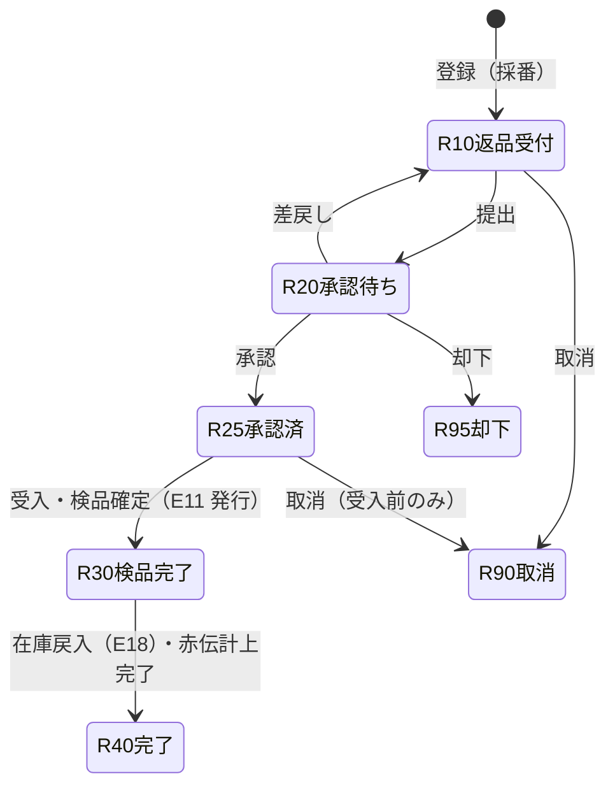
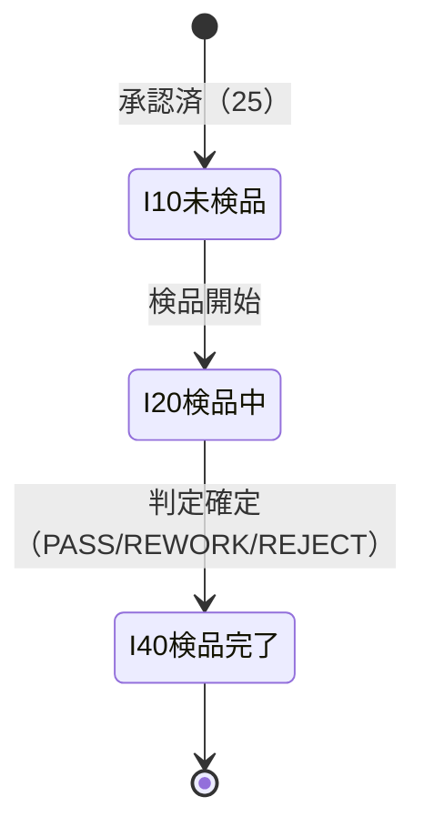
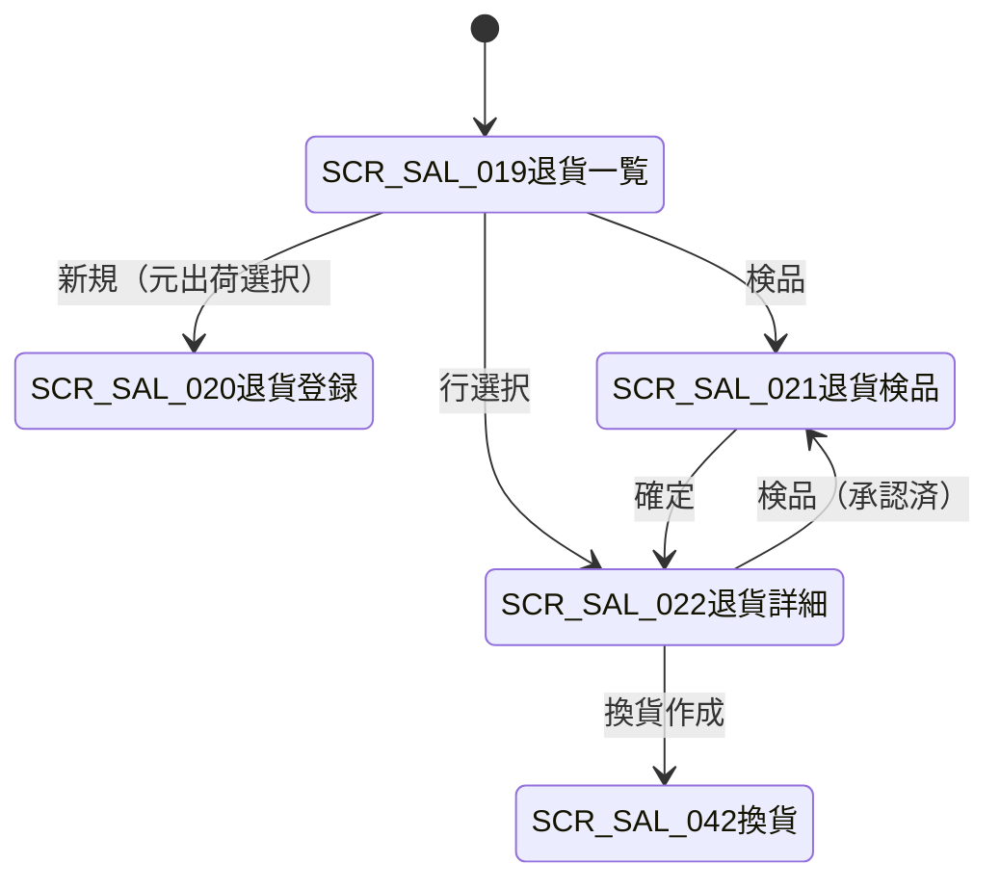

# 销售退货・换货 详细设计书（売上返品・交換 詳細設計書）

| 項目 | 内容 |
|---|---|
| 文書名 | 销售退货・换货 详细设计书（売上返品・交換 詳細設計書） |
| 文書番号 | DSN-SAL-004 |
| 版数 | v1.1 |
| 作成日 | 2026-10-20 |
| 作成者 | sales-designer（销售域担当） |
| 承認者 | 未承認（レビュー待ち） |
| 状態 | ドラフト（レビュー中） |
| 関連文書 | [業務域概要](00-overview.md) / [出荷詳細](03-delivery-picking.md) / [開票・應收](05-invoice-receivable.md) / [共通業務規則](../00-common/08-common-business-rules.md) / [跨域流程](../00-common/09-cross-domain-flow.md) / [在庫域 入出庫](../05-inventory/02-inbound-outbound.md) / [財務域 应收](../07-finance/04-ar-receipt.md) |

---

## 1. 機能概要

| 項目 | 内容 |
|---|---|
| 機能 ID | F-SAL-006（销售退货管理）/ F-SAL-014（換貨管理） |
| 機能名 | 返品受付、返品承認、受入検品、在庫戻入、赤伝売上・AR 戻し、返品期限管理、換貨 |
| 目的 | 顧客からの返品を「受付→承認→受入検品→在庫戻入→赤伝売上/AR 戻し」の流れで処理し、在庫・財務と整合させる。返品期限・返品可能數量・原価戻しの根拠を保持し、O2C の例外処理を統制する |
| 利用者・ロール | 銷售員（返品受付）、銷售經理・財務經理（返品承認）、倉管員（受入・在庫戻入）、質検員（検品判定）、経理（赤伝・AR 戻し） |
| 利用シーン | ① 品質不良・数量差異・誤発注・仕様相違による返品 ② 返品期限內の返品処理 ③ 返品品の再販/不良品処理 ④ 交換（返品＋再出荷） ⑤ 返品期限超過の例外承認 |
| 優先度 | P0（返品本体）／P2（換貨の詳細、返品運賃精算） |
| 画面 ID | SCR-SAL-019（退貨一覧）、SCR-SAL-020（退貨登録編集）、SCR-SAL-021（退貨検品）、SCR-SAL-022（退貨参照詳細）、SCR-SAL-042（換貨申請登録） |
| 関連 IF | E11（発行）、E18（購読・在庫戻入原価確認）、E27/E29（AR 連携）、E31/E32（承認）、INV 原出荷照会/在庫狀態 API、E12（赤伝発票、F-SAL-007 経由） |

## 2. 業務要件・業務ルール

### 2.1 前提条件

| # | 前提条件 | 成立しない場合の挙動 |
|---|---|---|
| 1 | 元出荷（DN/SDO）が確定済（40）で、受注・出荷明細が特定できる | 返品受付不可（`MSG-SAL-120`） |
| 2 | 返品日が返品期限内（出荷日 + 返品期限日數） | 期限超過は財務經理の例外承認を要す（`MSG-SAL-121`） |
| 3 | 返品數量 ≤ 元出荷數量 − 既返品數量 | 超過はエラー（`MSG-SAL-122`） |
| 4 | 顧客が有効、與信狀態が返品処理可能（30/40 でも返品は可。與信解放のため） | 顧客無効は不可（`MSG-SAL-002`） |
| 5 | 返品品の在庫狀態（可用/待検/不合格）を決定できる | 検品未完了は在庫戻入不可（`MSG-SAL-123`） |
| 6 | 會計期間が OPEN（返品日） | 締切期間は不可（`MSG-COM-071`） |
| 7 | 赤伝発票が必要な場合、元発票が特定できる（F-SAL-007） | 元発票なしは赤伝不可（`MSG-SAL-124`） |

### 2.2 業務ルール

| # | ルール | 根拠 | 関連項目 |
|---|---|---|---|
| BR-RT-01 | 返品は元出荷明細（`delivery_id`/`delivery_line_id`）に必ず紐付ける。元出荷のない返品（返品のみ）は不可 | トレーサビリティ | `original_delivery_id` |
| BR-RT-02 | 返品期限 = 出荷日 + 返品期限日數。返品期限日數は MDM 顧客（`return_limit_days`）と物料（`return_limit_days`）のうち**小さい方**を採用し、未設定時はシステムパラメータ `sales_return_deadline_days`（既定 30 日【示例値】）を使用する | 主データ域、社内規程（仮定） | `return_deadline_date` |
| BR-RT-03 | 返品理由コード：`QUALITY`（品質不良）、`QTY_DIFF`（数量差異）、`LATE`（納期遅延）、`WRONG_ORDER`（誤発注）、`SPEC_DIFF`（仕様相違）、`OTHER`（その他）。`OTHER` は理由詳細必須 | 業務慣行 | `return_reason_code` |
| BR-RT-04 | 返品は承認制。全額の返品は 銷售經理 → 財務經理 の順送承認（08 §8.1）。返品期限超過・返品金額が閾値超の場合は上位承認を追加する | 08 §8.1 | — |
| BR-RT-05 | 返品可能數量 = 元出荷數量 − 既返品數量（同一出荷明細）。既返品には処理中の返品（10/20/25/30）を含める | 本設計 | `returnable_qty` |
| BR-RT-06 | 返品金額は元出荷明細の單價・稅率をスナップショット使用する（再取價しない）。**赤伝金額 = 返品數量 × 元出荷單價**、稅額は明細単位で再計算する | 共通業務規則 4.2 | `unit_price`、`tax_rate` |
| BR-RT-07 | 受入検品の判定：`PASS`（合格・再販可）→ 在庫狀態 10 可用、`REWORK`（手直し可）→ 20 待検、`REJECT`（不合格・廃棄/返品）→ 40 不合格。判定は質検員のみ | 在庫領域 04、09 §8 | `inventory_status` |
| BR-RT-08 | 在庫戻入は**検品完了後**に E11 を発行して実行する。SAL は在庫を直接更新しない（INV が E11 購読で `RT_IN`/`ST_IN` を登録し E18 を発行） | 09 §3 E11/§5.3 | — |
| BR-RT-09 | 赤伝売上・AR 戻しは財務域が E11 を購読して計上する（J22 借 6001/2221・貸 1122、J23 借 1405・貸 6401）。SAL は赤伝發票の登録（F-SAL-007）と AR 紐付けのみを行う | 09 §7.2、財務契約 | — |
| BR-RT-10 | 原価戻しは「元出荷の出庫原価」を使用する。元出荷の `cost_amount`（E18 より取得）を E11 追加項目で INV へ渡し、INV は `RT_IN` の原價として使用する。取得不能時は INV が原销售出库原价を照会して決定する | 在庫契約、09 §7.1 | `cost_amount` |
| BR-RT-11 | 返品製品がシリアル管理物料の場合、元出荷の序列號を指定して戻入する（同一序列號の再利用を可能とする）。序列號の重複・不一致はエラー | 在庫領域 04 | `serial_nos` |
| BR-RT-12 | 返品運賃の負担区分を記錄する：`COMPANY`（品質不良・自社負担）/`CUSTOMER`（顧客都合）/`SHARED`（折半）。運賃の実際の精算は財務域（費用または売掛調整）で行う | 業務慣行 | `freight_bearer` |
| BR-RT-13 | 返品明細は元出荷數量を超えない範囲で分割返品できる。複数出荷をまとめた返品は 1 返品單に複数明細（元出荷明細ごと）で記錄する | 本設計 | — |
| BR-RT-14 | 返品承認済（25）後の明細変更は禁止。変更は取消→再作成とする | 共通業務規則 3.3 | — |
| BR-RT-15 | 返品取消（90）は受入検品前のみ可能。検品後（30 以降）は在庫戻入・赤伝の逆処理が必要なため、返品取消ではなく別途修正伝票で処理する | 共通業務規則 13.1 | — |
| BR-RT-16 | 返品確定（30）で E11 を発行し、INV の戻入完了（E18）と FIN の赤伝計上（J22/J23）を確認して 40（完了）へ進める。未完了の場合は 30 のまま保留し、日次照合で検出する | 09 §5.3 | — |
| BR-RT-17 | 元発票が発行済の場合、返品確定後に赤伝発票を発行する（F-SAL-007、`invoiceKind=RED`）。赤伝発票は元発票と 1:1 で紐付ける（部分赤伝は金額按分） | 税務要件 | `red_invoice_id` |
| BR-RT-18 | 換貨（F-SAL-014）は「返品（`return_type=EXCHANGE`）＋新規受注（`order_type=40`）」で構成する。差額は赤伝売上と新規売上の差として AR に反映し、入出金は通常の消込で処理する | 本設計 | `exchange_order_id` |
| BR-RT-19 | 返品データは監査ログ・保存期間（10 年）の対象。返品理由・検品結果・元出荷・赤伝の関連を保持する | 共通業務規則 12 | — |
| BR-RT-20 | 返品による與信解放：FIN の AR 減少（J22）に伴い、SAL の與信使用額は自動的に減少する（E29 ではなく E11/E27 連動の AR 投影更新）。SAL は與信コミットを追加解放しない（二重解放防止） | F-SAL-010 | — |

### 2.3 計算式・判定式

| # | 対象 | 算式 | 丸め | 例 |
|---|---|---|---|---|
| CALC-RT-01 | 返品期限日 | 出荷日 + 返品期限日數（顧客/物料の小さい方、未設定 30 日） | — | 2026-10-24 + 30 = 2026-11-23 |
| CALC-RT-02 | 返品可能數量 | 元出荷數量 − 既返品數量（処理中含む） | 4 桁 | 80 − 10 = 70 PCE |
| CALC-RT-03 | 返品明細金額（稅抜） | 返品數量 × 元出荷稅抜單價 | HALF_UP 2 桁 | 10 × 856.50 = 8,565.00 |
| CALC-RT-04 | 返品明細稅額 | 返品金額（稅抜）× 元出荷稅率 | HALF_UP 2 桁 | 8,565.00 × 13% = 1,113.45 |
| CALC-RT-05 | 返品稅抜合計 | Σ 明細金額 | — | — |
| CALC-RT-06 | 返品稅額合計 | Σ 明細稅額 | — | — |
| CALC-RT-07 | 原價戻し額 | 返品數量 × 元出荷原價（`cost_amount` ÷ 元出荷數量） | HALF_UP 2 桁 | 10 × 778.20 = 7,782.00 |
| CALC-RT-08 | 期限超過日數 | 返品日 − 返品期限日 | — | 2026-11-25 − 2026-11-23 = 2 日 |
| CALC-RT-09 | 換貨差額 | 新規受注金額（稅込）− 返品金額（稅込） | 2 桁 | 116,141.40 − 9,678.45 = 106,462.95 |

**返品例（【示例値】）**

| 項目 | 明細 10 | 説明 |
|---|---|---|
| 元出荷 | DN2610200001 / SDO2610200001 | 2026-10-24 出荷 80 PCE |
| 元受注 | SO2610200001 | 江蘇恒立液壓股份有限公司（C000001） |
| 返品數量 | 10 PCE | 品質不良（軸承異音） |
| 元單價（稅抜） | CNY 856.500000 | 受注スナップショット |
| 返品金額（稅抜） | CNY 8,565.00 | CALC-RT-03 |
| 返品稅額（13%） | CNY 1,113.45 | CALC-RT-04 |
| 返品稅込 | CNY 9,678.45 | — |
| 返品期限 | 2026-11-23 | CALC-RT-01 |
| 検品結果 | `REWORK` → 在庫狀態 20 待検 | 手直し後再販 |
| 原價戻し | CNY 7,782.00 | CALC-RT-07（元出荷原價 778.20/PCE） |

### 2.4 状態遷移

#### 2.4.1 销售退货（SRT）



| 遷移 | トリガ | 権限 | 更新項目 | メッセージ／イベント |
|---|---|---|---|---|
| 新規→10 | 返品受付 | `sales:return:create` | INSERT（`return_no` 採番、`return_status=10`） | `MSG-SAL-125` |
| 10→20 | 提出 | `sales:return:create` | `return_status=20`、WF 送信 | E05 発行、`MSG-COM-005` |
| 20→10 | 差戻し | `sales:return:approve` | `return_status=10` | `MSG-SAL-016` |
| 20→25 | 承認 | `sales:return:approve` | `return_status=25`、`approved_at/by` | `MSG-SAL-126` |
| 20→95 | 却下 | `sales:return:approve` | `return_status=95` | `MSG-SAL-015` |
| 25→30 | 受入・検品確定 | `sales:return:receive` | `return_status=30`、検品結果、E11 Outbox | `MSG-SAL-127`、E11 |
| 30→40 | E18・赤伝計上完了 | システム | `return_status=40`、`completed_at` | `MSG-SAL-128` |
| 10/25→90 | 取消 | `sales:return:cancel` | `return_status=90`、`cancel_reason` | `MSG-SAL-129` |

#### 2.4.2 返品検品（`sal_return_inspection`）



| 遷移 | トリガ | 権限 | 更新項目 | メッセージ |
|---|---|---|---|---|
| 新規→10 | 承認済 | — | INSERT（`inspection_status=10`） | — |
| 10→20 | 検品開始 | `sales:return:inspect` | `inspection_status=20`、`inspected_by` | `MSG-SAL-130` |
| 20→40 | 判定確定 | `sales:return:inspect` | `inspection_status=40`、`inspection_result`、`inventory_status`、不良理由 | `MSG-SAL-131` |

#### 2.4.3 検品結果と在庫狀態の対応

| 検品結果 | 意味 | 在庫狀態（INV コード） | 在庫戻入 | 備考 |
|---|---|---|---|---|
| `PASS` | 合格・再販可 | 10 可用 | `RT_IN` | そのまま販売可能 |
| `REWORK` | 手直し后可 | 20 待検 | `ST_IN`（状態変換）→ 後続で可用化 | 生産/品質と連携（Phase 2） |
| `REJECT` | 不合格・廃棄/仕入先返品 | 40 不合格 | `RT_IN`（不合格狀態） | 廃棄は INV の `SC_OUT`、仕入先返品は PUR |
| `CONCESSION` | 特採（顧客了承） | 10 可用 | `RT_IN` | 再出荷時の値引を記録 |

### 2.5 責任分界（返品〜赤伝）

| # | 事象 | 銷售域（SAL） | 庫存域（INV） | 財務域（FIN） | データ傳達 |
|---|---|---|---|---|---|
| 1 | 返品受付・承認 | 受付・期限チェック・WF | — | — | — |
| 2 | 受入検品 | 検品結果・在庫狀態決定 | 檢品場所提供（必要時） | — | — |
| 3 | **返品確定** | **狀態 30・E11 発行** | — | — | **E11** |
| 4 | 在庫戻入 | E18 購読で原價戻し額を記錄 | E11 購読で `RT_IN`/`ST_IN`、E18 発行 | — | E11→E18 |
| 5 | 赤伝売上・AR 戻し | 赤伝発票登録（F-SAL-007、E12） | — | E11 購読で J22/J23 計上、AR 減少 | E11→J22/J23 |
| 6 | 與信 | AR 投影更新（E27/E29） | — | AR 減少を E27（金額変更）で連携 | E27 |
| 7 | 照合 | 返品數量・金額と E18/E27 の照合 | E18 | E27 | BAT-SAL-008 拡張 |

### 2.6 データ傳達項目（E11）

| E11 フィールド | 型 | 必須 | 來源（SAL） | 利用先 | 備考 |
|---|---|---|---|---|---|
| `returnId` | string | ○ | `sal_sales_return.id` | INV/FIN 冪等キー | — |
| `returnNo` | string | ○ | `return_no` | 伝票紐付け | `SRT+YYMMDD+4桁` |
| `orderId` | string | ○ | `sales_order_id` | AR 補助核算 | — |
| `customerId` | string | ○ | `customer_id` | AR 計上 | — |
| `returnDate` | date | ○ | `return_date` | 赤伝計上日 | — |
| `lines[].materialId` | string | ○ | `material_id` | 在庫戻入 | — |
| `lines[].qty` | string | ○ | `return_qty` | 在庫戻入 | 4 桁 |
| `lines[].uom` | string | ○ | `uom_code` | 在庫換算 | — |
| `lines[].inventoryStatus` | number | ○ | 検品結果対応（10/20/40） | 在庫狀態 | INV コード 10 可用/20 待檢/30 凍結/40 不合格/50 報廢待 |
| `lines[].originalDeliveryId` | string | ○ | `original_delivery_id` | 元出荷照会（原價） | 追加項目 |
| `lines[].originalDeliveryLineId` | string | ○ | `original_delivery_line_id` | 元出荷明細 | 追加項目 |
| `lines[].batchNo` | string | △ | 元出荷批次 | 在庫戻入 | 追加項目（批次管理） |
| `lines[].serialNos` | string[] | △ | 元出荷序列號 | 在庫戻入 | 追加項目（序列號管理） |
| `lines[].unitPrice` | string | ○ | 元出荷稅抜單價 | 赤伝売上 | 09 v1.1 契約項目（FIN 計上用） |
| `lines[].taxRate` | string | ○ | 元出荷稅率 | 赤伝稅額 | 09 v1.1 契約項目 |
| `lines[].amount` | string | ○ | 返品稅抜金額 | 赤伝売上 | 09 v1.1 契約項目 |
| `lines[].taxAmount` | string | ○ | 返品稅額 | 赤伝銷項稅 | 09 v1.1 契約項目 |
| `lines[].costAmount` | string | ○ | 元出荷原價按分 | 原價戻し | 09 v1.1 契約項目（取得不能時 null） |
| `returnType` | string | ○ | `return_type` | NORMAL/EXCHANGE | 追加項目 |
| `reasonCode` | string | ○ | `return_reason_code` | 集計・品質分析 | 追加項目 |
| `redInvoiceRequired` | boolean | ○ | 元発票有無 | 赤伝要否 | 追加項目 |

## 3. 関連機能

| 関係 | 機能 ID | 機能名 | 関係內容 |
|---|---|---|---|
| 上流 | F-SAL-005 | 出荷 | 元出荷（DN/SDO）・原價・序列號を參照 |
| 上流 | F-SAL-003 | 受注 | 元受注・顧客・單價を參照 |
| 上流 | F-SAL-007 | 開票 | 元発票の特定・赤伝発票登録 |
| 下流 | INV | 在庫戻入（E11→E18） | イベント |
| 下流 | FIN | 赤伝売上・AR 戻し（E11→J22/J23、E27） | イベント |
| 下流 | F-SAL-009 | 應收 | AR 投影・與信使用額の更新 |
| 下流 | F-SAL-014 | 換貨 | 返品＋新規受注の連携 |
| 参照 | MDM | 顧客・物料の返品期限日數 | 同期參照 |

## 4. 画面設計

### 4.1 画面一覧

| 画面 ID | 画面名 | 類型 | 概要 |
|---|---|---|---|
| SCR-SAL-019 | 退貨一覧 | LIST | 返品の検索・狀態確認・期限表示 |
| SCR-SAL-020 | 退貨登録編集 | EDIT | 元出荷から返品明細を作成、理由・數量・返品日入力 |
| SCR-SAL-021 | 退貨検品 | EDIT | 受入數量・検品結果・在庫狀態・不良理由の入力 |
| SCR-SAL-022 | 退貨参照詳細 | VIEW | 返品詳細、検品結果、E11/E18/赤伝の関連、履歴 |
| SCR-SAL-042 | 換貨申請登録 | EDIT | 返品＋新規受注の同時作成、差額表示 |

### 4.2 画面遷移



### 4.3 画面レイアウト

**SCR-SAL-020 退貨登録編集**

```
┌──────────────────────────────────────────────────────────────────────────────┐
│ 返品番号[自動] 状態[10 返品受付] 元出荷[DN2610200001▼] 受注[SO2610200001]    │
│ 顧客[C000001 江蘇恒立液壓] 返品日[2026-10-28] 返品期限[2026-11-23] 期限判定[○]│
│ 返品理由[品質不良▼] 理由詳細[軸承異音、顧客検査で不合格________________]     │
│ 運賃負担[自社▼] 赤伝要否[要（元発票 SIV2610240001）] 與信再判定[OK]          │
├──────────────────────────────────────────────────────────────────────────────┤
│〔明細〕[元出荷明細取込]                                                      │
│ No|物料|品名|元出荷數量|既返品|返品可能|今回返品|單位|元単価|返品金額|稅額    │
│ 10|3001000001|YE3-100L1-4|80|0|80|10|PCE|856.50|8,565.00|1,113.45             │
├──────────────────────────────────────────────────────────────────────────────┤
│〔合計〕稅抜 CNY 8,565.00 稅額 CNY 1,113.45 稅込 CNY 9,678.45                  │
│ 添付[検査報告書...] [保存][提出][取消][戻る]                                 │
└──────────────────────────────────────────────────────────────────────────────┘
```

**SCR-SAL-021 退貨検品**

```
┌──────────────────────────────────────────────────────────────────────────────┐
│ SRT2610280001 / DN2610200001 / 江蘇恒立液壓 / 返品日 2026-10-28              │
├──────────────────────────────────────────────────────────────────────────────┤
│ 明細 10 YE3-100L1-4 返品 10 PCE                                             │
│ 受入數量[20] 検品結果[○PASS ●REWORK ○REJECT ○CONCESSION]                     │
│ 在庫状態[20 待検] 不良内容[軸承異音] 処置[手直し→再検査] 検査者[E000201]     │
│ 備考[______________________________________________] [行確定]                │
├──────────────────────────────────────────────────────────────────────────────┤
│〔フッタ〕[検品確定（E11 発行）][戻る]                                        │
└──────────────────────────────────────────────────────────────────────────────┘
```

### 4.4 画面項目定義

#### 4.4.1 SCR-SAL-020 返品ヘッダ

| No | 項目 ID | 項目名 | 種別 | 型/桁 | 必須 | 初期值 | 入力チェック | データソース | DB 項目 | 備考 |
|---|---|---|---|---|---|---|---|---|---|---|
| 1 | `returnNo` | 返品番號 | テキスト | VARCHAR(32) | ○ | 自動採番 | `SRT+YYMMDD+4桁` | SYS 採番 | `return_no` | 參照のみ |
| 2 | `returnType` | 返品区分 | 選択 | SMALLINT | ○ | 10 | 10 通常/20 換貨 | 固定値 | `return_type` | — |
| 3 | `originalDeliveryId/No` | 元出荷 | 選択 | BIGINT/VARCHAR | ○ | — | 出荷確定済・未返品殘あり | SAL | `original_delivery_id/no` | 選択ダイアログ |
| 4 | `salesOrderId/No` | 元受注 | 表示 | BIGINT/VARCHAR | ○ | 自動 | — | SAL | `sales_order_id/no` | スナップショット |
| 5 | `customerId/Code/Name` | 顧客 | 表示 | BIGINT/VARCHAR | ○ | 自動 | — | MDM | `customer_id/code/name` | スナップショット |
| 6 | `returnDate` | 返品日 | 日付 | DATE | ○ | 當日 | 出荷日以降・當日以前 | — | `return_date` | — |
| 7 | `returnDeadlineDate` | 返品期限日 | 表示 | DATE | — | 自動 | — | 計算 | `return_deadline_date` | CALC-RT-01 |
| 8 | `isOverdue` | 期限超過 | 表示 | BOOLEAN | — | 自動 | 超過時は例外承認要 | — | `is_overdue` | — |
| 9 | `returnReasonCode` | 返品理由 | 選択 | VARCHAR(20) | ○ | — | 固定値 | 手入力 | `return_reason_code` | — |
| 10 | `returnReason` | 理由詳細 | テキスト | VARCHAR(500) | △ | — | OTHER 時必須・500 桁 | 手入力 | `return_reason` | — |
| 11 | `freightBearer` | 運賃負担 | 選択 | SMALLINT | ○ | 10 | 10 自社/20 顧客/30 折半 | 手入力 | `freight_bearer` | — |
| 12 | `redInvoiceRequired` | 赤伝要否 | チェック | BOOLEAN | — | 元発票有無 | — | FIN/SAL | `red_invoice_required` | — |
| 13 | `redInvoiceId` | 赤伝発票 ID | 表示 | BIGINT | △ | — | — | SAL | `red_invoice_id` | F-SAL-007 |
| 14 | `returnStatus` | 狀態 | 表示 | SMALLINT | — | 10 | — | — | `return_status` | 10/20/25/30/40/90/95 |
| 15 | `totalAmount` | 稅抜合計 | 數値 | NUMERIC(18,2) | — | 自動 | — | 計算 | `total_amount` | — |
| 16 | `taxAmount` | 稅額合計 | 數値 | NUMERIC(18,2) | — | 自動 | — | 計算 | `tax_amount` | — |
| 17 | `grandTotal` | 稅込合計 | 數値 | NUMERIC(18,2) | — | 自動 | — | 計算 | `grand_total` | — |
| 18 | `exchangeOrderId` | 換貨受注 ID | 表示 | BIGINT | △ | — | 換貨時 | SAL | `exchange_order_id` | F-SAL-014 |
| 19 | `remark` | 備考 | テキスト | VARCHAR(500) | △ | — | 500 桁 | 手入力 | `remark` | — |
| 20 | `attachmentIds` | 添付 | 添付 | ARRAY | △ | — | 20MB×20 | SYS | — | 検査報告書等 |

#### 4.4.2 SCR-SAL-020/021 返品明細・検品項目

| No | 項目 ID | 項目名 | 種別 | 型/桁 | 必須 | 初期值 | 入力チェック | 計算 | DB 項目 |
|---|---|---|---|---|---|---|---|---|---|
| 1 | `lineNo` | 行番號 | 數値 | INT | — | 10 刻み | — | — | `line_no` |
| 2 | `originalDeliveryLineId` | 元出荷明細 ID | 表示 | BIGINT | ○ | 自動 | — | — | `original_delivery_line_id` |
| 3 | `materialId/Code/Name` | 物料 | 表示 | BIGINT/VARCHAR | ○ | 自動 | — | — | `material_id/material_code/material_name` |
| 4 | `uomCode` | 單位 | 表示 | VARCHAR(10) | ○ | 元出荷 | — | — | `uom_code` |
| 5 | `originalQty` | 元出荷數量 | 表示 | NUMERIC(18,4) | — | 自動 | — | — | `original_qty` |
| 6 | `returnedQty` | 既返品數量 | 表示 | NUMERIC(18,4) | — | 自動 | — | — | `returned_qty` |
| 7 | `returnableQty` | 返品可能數量 | 表示 | NUMERIC(18,4) | — | 自動 | — | CALC-RT-02 | `returnable_qty` |
| 8 | `returnQty` | 今回返品數量 | 數値 | NUMERIC(18,4) | ○ | 返品可能 | > 0、≤ 返品可能數量、4 桁 | — | `return_qty` |
| 9 | `unitPrice` | 元出荷稅抜單價 | 表示 | NUMERIC(18,6) | — | 元出荷 | — | — | `unit_price` |
| 10 | `taxRate` | 稅率 | 表示 | NUMERIC(7,4) | — | 元出荷 | — | — | `tax_rate` |
| 11 | `lineAmount` | 返品金額（稅抜） | 數値 | NUMERIC(18,2) | — | 自動 | — | CALC-RT-03 | `line_amount` |
| 12 | `taxAmount` | 稅額 | 數値 | NUMERIC(18,2) | — | 自動 | — | CALC-RT-04 | `tax_amount` |
| 13 | `totalAmount` | 稅込金額 | 數値 | NUMERIC(18,2) | — | 自動 | — | — | `total_amount` |
| 14 | `costAmount` | 元出荷原價 | 表示 | NUMERIC(18,2) | — | E18 より | — | — | `cost_amount` |
| 15 | `batchNo` | 元批次 | 表示 | VARCHAR(50) | △ | 元出荷 | — | 元出荷批次 | `batch_no` |
| 16 | `serialNos` | 元序列號 | 表示 | JSONB | △ | 元出荷 | 返品數量分指定 | — | `serial_nos` |
| 17 | `inspectionResult` | 検品結果 | 選択 | VARCHAR(20) | ○ | — | PASS/REWORK/REJECT/CONCESSION | — | `inspection_result` |
| 18 | `inventoryStatus` | 在庫狀態 | 選択 | SMALLINT | ○ | — | 10/20/40 | — | `inventory_status` |
| 19 | `inspectedQty` | 受入數量 | 數値 | NUMERIC(18,4) | ○ | returnQty | = returnQty（部分受入は要承認） | — | `inspected_qty` |
| 20 | `defectReason` | 不良內容 | テキスト | VARCHAR(500) | △ | — | REJECT/REWORK 時必須 | — | `defect_reason` |
| 21 | `inspectionRemark` | 検品備考 | テキスト | VARCHAR(500) | △ | — | 500 桁 | — | `inspection_remark` |
| 22 | `lineStatus` | 明細狀態 | 表示 | SMALLINT | — | 10 | — | — | `line_status` |

### 4.5 イベント処理

| No | イベント | トリガ | 処理內容 | 呼出 API / 処理 ID | 畫面遷移 | 備考 |
|---|---|---|---|---|---|---|
| 1 | 元出荷選択 | 選択 | 出荷明細・返品可能數量・返品期限を取得 | GET /api/sales/delivery-notes/{id} | — | 期限超過は警告 |
| 2 | 明細取込 | ボタン | 元出荷明細を返品明細へコピー（單價・稅率・批次・序列號） | 同上 | — | — |
| 3 | 返品數量改變 | フォーカスアウト | 返品金額・稅額・合計再計算 | フロント計算 | — | サーバ再計算 |
| 4 | 保存 | 保存ボタン | 入力チェック→INSERT/UPDATE→採番 | POST/PUT /api/sales/returns | 一覧へ | Idempotency-Key |
| 5 | 提出 | 提出ボタン | WF 送信（`SALES_RETURN`）、狀態 20 | POST /api/sales/returns/{id}/submit | 一覧へ | 期限超過は上位承認 |
| 6 | 承認 | WF コールバック | E31 受信→狀態 25、検品レコード作成 | POST /api/sales/returns/{id}/approve | 待办へ | — |
| 7 | 検品開始 | ボタン | 狀態 25→検品中（`inspection_status=20`） | POST /api/sales/returns/{id}/inspection/start | SCR-SAL-021 | — |
| 8 | 検品確定 | ボタン | 検品結果→狀態 30→E11 発行 | POST /api/sales/returns/{id}/inspection/confirm | 詳細へ | 在庫戻入開始 |
| 9 | 赤伝発票 | ボタン | F-SAL-007 の赤伝登録画面へ（元発票紐付け） | — | SCR-SAL-026 | — |
| 10 | 取消 | 取消ボタン | 理由必須・検品前のみ | POST /api/sales/returns/{id}/cancel | 一覧へ | — |
| 11 | 換貨作成 | ボタン | 返品から新規受注（`order_type=40`）を作成 | POST /api/sales/exchanges | SCR-SAL-009 | Phase2 詳細 |
| 12 | 帳票 | プレビュー | PRT-SAL-006 返品受付票 | POST /api/sales/returns/{id}/print | プレビュー | — |
| 13 | エクスポート | ボタン | Excel 最大 10,000 件 | POST /api/sales/exports | — | — |

### 4.6 一覧畫面仕様（SCR-SAL-019）

| 項目 | 內容 |
|---|---|
| 検索條件 | 返品番號、返品日（範圍）、元出荷番號、受注番號、顧客、狀態、返品理由、期限超過のみ |
| 既定検索條件 | 返品日 = 當月、狀態 = 10,20,25,30（未完了） |
| ソート | 返品日降順 → 返品番號降順 |
| ページング | 20/50/100/200 |
| 一括操作 | 承認（承認者のみ）、エクスポート |
| 列 | 返品番號、返品日、元出荷番號、顧客、狀態、返品理由、返品金額（稅込）、期限判定、検品結果、赤伝狀態 |
| 行操作 | 詳細、検品（25）、取消（10/25）、帳票 |

### 4.7 表示制御

| 條件 | 対象 | 制御 |
|---|---|---|
| 狀態 ≠ 10 | 編集・削除 | 非表示 |
| 狀態 25 | 検品ボタン | 表示（質検権限者のみ） |
| 狀態 30/40 | 検品ボタン・取消 | 非表示 |
| 期限超過 | 返品日・期限項目 | 赤表示・例外承認必須 |
| 元発票なし | 赤伝要否 | 「不要」固定・赤伝ボタン非表示 |
| 権限なし | 承認・検品・赤伝 | 非表示・API 403 |

## 5. 入力チェック仕様

| No | チェック ID | 対象項目 | 種別 | 條件 | タイミング | メッセージ ID |
|---|---|---|---|---|---|---|
| 1 | CHK-SAL-004-01 | 元出荷 | 必須/業務 | 出荷確定済・返品可能數量 > 0 | 作成時 | MSG-SAL-120 |
| 2 | CHK-SAL-004-02 | 返品日 | 必須/相関 | 出荷日以降・當日以前 | 保存時 | MSG-SAL-132 |
| 3 | CHK-SAL-004-03 | 返品期限 | 業務 | 期限內または例外承認済 | 提出時 | MSG-SAL-121 |
| 4 | CHK-SAL-004-04 | 返品數量 | 必須/範圍 | > 0、≤ 返品可能數量、4 桁 | 保存時 | MSG-SAL-122 |
| 5 | CHK-SAL-004-05 | 返品理由 | 必須 | 固定値、OTHER は詳細必須 | 保存時 | MSG-COM-040 |
| 6 | CHK-SAL-004-06 | 運賃負担 | 必須 | 10/20/30 | 保存時 | MSG-COM-040 |
| 7 | CHK-SAL-004-07 | 明細行數 | 範圍 | 1〜500 行 | 保存時 | MSG-COM-047 |
| 8 | CHK-SAL-004-08 | 受入數量 | 相関 | = 返品數量（部分受入は要承認） | 検品確定時 | MSG-SAL-133 |
| 9 | CHK-SAL-004-09 | 検品結果 | 必須 | PASS/REWORK/REJECT/CONCESSION | 検品確定時 | MSG-COM-040 |
| 10 | CHK-SAL-004-10 | 在庫狀態 | 必須 | 10/20/40 | 検品確定時 | MSG-COM-040 |
| 11 | CHK-SAL-004-11 | 不良內容 | 必須 | REJECT/REWORK 時 | 検品確定時 | MSG-SAL-134 |
| 12 | CHK-SAL-004-12 | 序列號 | 相関 | 序列號管理時、數量分・元出荷と一致 | 検品確定時 | MSG-SAL-104 |
| 13 | CHK-SAL-004-13 | 元発票 | 業務 | 赤伝要の場合、元発票が存在 | 赤伝登録時 | MSG-SAL-124 |
| 14 | CHK-SAL-004-14 | 會計期間 | 業務 | OPEN | 返品確定時 | MSG-COM-071 |
| 15 | CHK-SAL-004-15 | 狀態 | 業務 | 10/20/25 のみ編集可 | 各操作時 | MSG-COM-034 |
| 16 | CHK-SAL-004-16 | 取消 | 業務 | 検品前のみ | 取消時 | MSG-SAL-129 |
| 17 | CHK-SAL-004-17 | 樂観排他 | 排他 | `version` 一致 | 保存/狀態操作時 | MSG-COM-033 |
| 18 | CHK-SAL-004-18 | 既返品 | 一意 | 元出荷明細 + 未完了返品の重複なし | 保存時 | MSG-SAL-135 |
| 19 | CHK-SAL-004-19 | 承認者 | 職務分掌 | 作成者と承認者が同一でない | 承認時 | MSG-SAL-018 |
| 20 | CHK-SAL-004-20 | 添付 | 形式/サイズ | 20MB×20 件 | アップロード時 | MSG-COM-060/061 |

## 6. 処理詳細

### 6.1 処理一覧

| 処理 ID | 処理名 | 契機 | トランザクション | 排他 |
|---|---|---|---|---|
| PRC-SAL-004-01 | 返品登録 | 保存（新規） | 要（返品・明細・採番） | 採番行ロック |
| PRC-SAL-004-02 | 返品提出 | 提出 | 要（狀態 + Outbox E05） | 樂観排他 |
| PRC-SAL-004-03 | 返品承認 | WF コールバック | 要（狀態・検品レコード） | 樂観排他 |
| PRC-SAL-004-04 | 受入検品確定 | 検品確定 | 要（狀態 30 + E11 Outbox） | 樂観排他、出荷明細ロック |
| PRC-SAL-004-05 | 返品完了 | E18/赤伝完了 | 要（狀態 40） | 冪等 |
| PRC-SAL-004-06 | 返品取消 | 取消 | 要 | 樂観排他 |
| PRC-SAL-004-07 | 換貨作成 | 換貨 | 要（返品 + 新規 SO） | 出荷明細ロック |
| PRC-SAL-004-08 | 返品期限超過通知 | BAT-SAL-010 | 不要（通知） | — |

### 6.2 処理手順（正常系）

**PRC-SAL-004-01 返品登録**

1. 元出荷を取得し、出荷確定済であること、返品可能數量 > 0、返品期限を算出する（CALC-RT-01）。
2. 元出荷明細から返品明細を作成する（單價・稅率・批次・序列號・原價をスナップショット）。
3. `SRT{YYMMDD}{4桁}` を採番し、`sal_sales_return`（`return_status=10`）・`sal_sales_return_line` を INSERT する。
4. 返品金額・稅額・合計を計算する（CALC-RT-03〜06）。
5. 期限超過の場合は `is_overdue=true` とし、確認ダイアログを表示する。
6. `MSG-SAL-125` を返す。

**PRC-SAL-004-02 返品提出**

1. 狀態 10 を確認し、入力チェック（CHK-SAL-004-01〜07）を実行する。
2. 期限超過・高額返品の場合は承認経路に上位承認を追加する（08 §8.1）。
3. WF へ `businessType=SALES_RETURN`、`businessId`、`businessNo`、`variables`（返品金額、元出荷、理由、期限超過フラグ）を送信する。
4. `return_status=20`、`submitted_at/by` を更新し、Outbox に E05 を INSERT する。
5. `MSG-COM-005` を返す。

**PRC-SAL-004-04 受入検品確定（E11 発行）**

1. 返品を `FOR UPDATE` で取得し、狀態 25 を確認する。
2. 検品レコードを取得し、検品結果・在庫狀態・受入數量を検証する（CHK-SAL-004-08〜12）。
3. 元出荷明細を `FOR UPDATE` でロックし、返品數量 ≤ 返品可能數量を再検証する（同時返品の取り合い防止）。
4. `sal_return_inspection` を `inspection_status=40` に更新し、`return_status=30`、`confirmed_at` を設定する。
5. 明細の `inventory_status`・`inspection_result`・`inspected_qty`・`defect_reason` を保存する。
6. Outbox に **E11 `sales.return.confirmed`** を INSERT する（第 2.6 節の項目、`inventoryStatus` は INV コード 10/20/40）。
7. INV が E11 を購読して `RT_IN`/`ST_IN` を登録し E18 を発行する。FIN が E11 を購読して J22/J23 を計上する。
8. 監査ログを記錄し、`MSG-SAL-127` を返す。

**PRC-SAL-004-05 返品完了**

1. E18 受信で在庫戻入完了を確認し、`return_line.cost_return_amount`・`inv_txn_no` を更新する。
2. 赤伝発票が必要な場合、F-SAL-007 で赤伝発票が登録され E12 が発行されていることを確認する。
3. 両方が完了したら `return_status=40`、`completed_at` を更新する（E18 と赤伝の完了イベントはそれぞれ冪等に処理し、最後の完了で 40 へ）。
4. 與信投影を更新する（AR 減少は FIN の J22 と E27 反映による）。
5. `MSG-SAL-128` を返す。

**PRC-SAL-004-07 換貨作成**

1. 返品（`return_type=20`）を承認済（25）まで進める。
2. 新規受注（`order_type=40` 換貨）を作成し、返品明細の物料・數量・單價を引き継ぐ。差額（CALC-RT-09）を表示する。
3. 返品の `exchange_order_id` と受注の `source_type=EXCHANGE`/`source_id=return_id` を相互に設定する。
4. 新規受注は通常の受注フロー（與信・引當・承認）を通す。返品確定（E11）と新規出荷（E10）は独立して実行し、差額は AR 上で相殺される（赤伝＋新規売上）。
5. Phase 2 で返品運賃・差額精算の詳細を設計する。

### 6.3 例外処理

| No | 異常條件 | 検知箇所 | 処理 | ロールバック | メッセージ ID |
|---|---|---|---|---|---|
| 1 | 元出荷なし・未確定 | 返品登録 | エラー | 全體 | MSG-SAL-120 |
| 2 | 返品期限超過 | 提出 | 例外承認必須（警告） | — | MSG-SAL-121 |
| 3 | 返品數量超過 | 保存/検品 | エラー | 全體 | MSG-SAL-122 |
| 4 | 同時返品競合 | 検品確定 | ロック待ち・エラー | 全體 | MSG-COM-035 |
| 5 | 検品未完了で戻入 | 在庫戻入 | エラー | — | MSG-SAL-123 |
| 6 | 元発票なしで赤伝 | 赤伝登録 | エラー | — | MSG-SAL-124 |
| 7 | 在庫戻入先の狀態不正 | INV | INV 側でエラー（MSG-INV-xxx） | E11 購読側でリトライ | — |
| 8 | E11 配信失敗 | Outbox | リトライ・アラート | 業務は 30 で保留 | MSG-COM-080 |
| 9 | E18 未着 | BAT-SAL-008 | 検出・アラート | — | MSG-SAL-113 |
| 10 | 赤伝計上失敗 | FIN | 返品 40 へ進めない・アラート | — | MSG-SAL-136 |
| 11 | 會計期間締切 | 検品確定 | エラー | 全體 | MSG-COM-071 |
| 12 | 樂観排他競合 | 保存/確定 | 409 | 全體 | MSG-COM-033 |

### 6.4 冪等性・再実行

- 返品登録・提出・検品確定・取消は `Idempotency-Key` 必須。
- E11 は Outbox に同一トランザクションで INSERT し、`eventId` で購読側の重複を防止する。
- E18 受信は `eventId` + `txnId` で冪等。二重に原價戻し額を更新しない。
- 返品 40 への更新は E18 と赤伝完了の両方を確認してから行い、片方の再受信でも重複更新しない（`return_status` を確認）。

## 7. API 設計

### 7.1 API 一覧

| No | メソッド | パス | 権限 | 概要 | 主なエラー |
|---|---|---|---|---|---|
| 1 | GET | `/api/sales/returns` | `sales:return:view` | 返品一覧 | 3001 |
| 2 | GET | `/api/sales/returns/{id}` | `sales:return:view` | 返品詳細（検品・関連含む） | 4001 |
| 3 | POST | `/api/sales/returns` | `sales:return:create` | 返品登録 | 1001、30006 |
| 4 | PUT | `/api/sales/returns/{id}` | `sales:return:create` | 返品更新（10 のみ） | 4002、4003 |
| 5 | POST | `/api/sales/returns/{id}/submit` | `sales:return:create` | 返品提出 | 4002 |
| 6 | POST | `/api/sales/returns/{id}/approve` | `sales:return:approve` | 返品承認 | 3001 |
| 7 | POST | `/api/sales/returns/{id}/inspection/start` | `sales:return:inspect` | 検品開始 | 4002 |
| 8 | POST | `/api/sales/returns/{id}/inspection/confirm` | `sales:return:inspect` | 検品確定（E11 発行） | 4002、30007 |
| 9 | POST | `/api/sales/returns/{id}/cancel` | `sales:return:cancel` | 返品取消 | 4002 |
| 10 | POST | `/api/sales/returns/{id}/print` | `sales:return:view` | 返品受付票（PRT-SAL-006） | 4001 |
| 11 | GET | `/api/sales/returns/returnable-lines` | `sales:return:view` | 返品可能明細照会（元出荷指定） | 4001 |
| 12 | POST | `/api/sales/exchanges` | `sales:exchange:create` | 換貨作成（返品＋新規受注） | 30008 |
| 13 | GET | `/api/sales/delivery-notes/{id}/serials` | `sales:return:view` | 元出荷序列號照会 | 4001 |

### 7.2 リクエスト／レスポンス詳細

**GET /api/sales/returns/returnable-lines?deliveryId=1845777000000000001 → 200**

```json
{
  "code": 0,
  "message": "ok",
  "data": [
    {
      "deliveryLineId": "1845777000000000101",
      "materialId": "1845000000000000101",
      "materialCode": "3001000001",
      "materialName": "YE3-100L1-4 三相异步电动机 2.2kW 4极",
      "originalQty": "80.0000",
      "returnedQty": "0.0000",
      "returnableQty": "80.0000",
      "uomCode": "PCE",
      "unitPrice": "856.500000",
      "taxRate": "13.0000",
      "costAmount": "62256.00",
      "batchNo": null,
      "serialNos": ["SN-YE3-2610-0001","SN-YE3-2610-0002","SN-YE3-2610-0003","SN-YE3-2610-0004","SN-YE3-2610-0005","SN-YE3-2610-0006","SN-YE3-2610-0007","SN-YE3-2610-0008","SN-YE3-2610-0009","SN-YE3-2610-0010"],
      "deliveryDate": "2026-10-24",
      "returnDeadlineDate": "2026-11-23",
      "isOverdue": false
    }
  ]
}
```

**POST /api/sales/returns → 201**

```json
{
  "returnType": 10,
  "originalDeliveryId": "1845777000000000001",
  "returnDate": "2026-10-28",
  "returnReasonCode": "QUALITY",
  "returnReason": "轴承异音，顾客检验不合格",
  "freightBearer": 10,
  "redInvoiceRequired": true,
  "remark": "更换新品后重新出荷",
  "lines": [
    {
      "originalDeliveryLineId": "1845777000000000101",
      "returnQty": "10.0000",
      "serialNos": ["SN-YE3-2610-0001","SN-YE3-2610-0002","SN-YE3-2610-0003","SN-YE3-2610-0004","SN-YE3-2610-0005","SN-YE3-2610-0006","SN-YE3-2610-0007","SN-YE3-2610-0008","SN-YE3-2610-0009","SN-YE3-2610-0010"]
    }
  ]
}
```

```json
{
  "code": 0,
  "message": "ok",
  "data": {
    "id": "1845888000000000001",
    "returnNo": "SRT2610280001",
    "returnStatus": 10,
    "statusName": "返品受付",
    "returnDeadlineDate": "2026-11-23",
    "isOverdue": false,
    "totalAmount": "8565.00",
    "taxAmount": "1113.45",
    "grandTotal": "9678.45",
    "redInvoiceRequired": true,
    "version": 0,
    "lines": [
      {
        "lineNo": 10,
        "materialCode": "3001000001",
        "returnQty": "10.0000",
        "unitPrice": "856.500000",
        "taxRate": "13.0000",
        "lineAmount": "8565.00",
        "taxAmount": "1113.45",
        "returnableQty": "80.0000"
      }
    ]
  }
}
```

**POST /api/sales/returns/{id}/inspection/confirm → 200**

```json
{
  "version": 2,
  "lines": [
    {
      "lineId": "1845888000000000101",
      "inspectedQty": "10.0000",
      "inspectionResult": "REWORK",
      "inventoryStatus": 20,
      "defectReason": "轴承异音，需更换轴承后复检",
      "serialNos": ["SN-YE3-2610-0001", "SN-YE3-2610-0002"]
    }
  ],
  "inspectionRemark": "手直し後、再検査で合格見込み"
}
```

```json
{
  "code": 0,
  "message": "ok",
  "data": {
    "returnNo": "SRT2610280001",
    "returnStatus": 30,
    "statusName": "検品完了",
    "eventType": "sales.return.confirmed",
    "eventId": "9a8b7c6d-5e4f-4a3b-2c1d-0e9f8a7b6c5d",
    "inventoryStatusSummary": { "10": "0.0000", "20": "10.0000", "40": "0.0000" },
    "nextActions": ["在庫戻入（E18）待ち", "赤伝発票の登録（F-SAL-007）"]
  }
}
```

**E11 ペイロード（Outbox → INV/FIN）**

```json
{
  "eventId": "9a8b7c6d-5e4f-4a3b-2c1d-0e9f8a7b6c5d",
  "eventType": "sales.return.confirmed",
  "eventVersion": 1,
  "occurredAt": "2026-10-28T16:00:00+08:00",
  "source": "erp-sales",
  "aggregateType": "sales_return",
  "aggregateId": "1845888000000000001",
  "aggregateNo": "SRT2610280001",
  "payload": {
    "returnId": "1845888000000000001",
    "returnNo": "SRT2610280001",
    "orderId": "1845678901234567890",
    "customerId": "1845000000000000001",
    "returnDate": "2026-10-28",
    "returnType": "NORMAL",
    "reasonCode": "QUALITY",
    "redInvoiceRequired": true,
    "lines": [
      {
        "materialId": "1845000000000000101",
        "qty": "10.0000",
        "uom": "PCE",
        "inventoryStatus": 20,
        "originalDeliveryId": "1845777000000000001",
        "originalDeliveryLineId": "1845777000000000101",
        "batchNo": null,
        "serialNos": ["SN-YE3-2610-0001","SN-YE3-2610-0002","SN-YE3-2610-0003","SN-YE3-2610-0004","SN-YE3-2610-0005","SN-YE3-2610-0006","SN-YE3-2610-0007","SN-YE3-2610-0008","SN-YE3-2610-0009","SN-YE3-2610-0010"],
        "unitPrice": "856.500000",
        "taxRate": "13.0000",
        "amount": "8565.00",
        "taxAmount": "1113.45",
        "costAmount": "7782.00"
      }
    ]
  }
}
```

### 7.3 イベント連携

| イベント | 方向 | 処理 |
|---|---|---|
| E11 `sales.return.confirmed` | 発行 | INV が `RT_IN`/`ST_IN`、FIN が J22/J23（赤伝売上・AR 戻し） |
| E18 `inventory.txn.posted` | 購読 | 原價戻し額・SDO 番號の記録、返品 40 判定 |
| E12 `sales.invoice.issued` | 発行（赤伝時） | FIN が赤伝発票を AR に紐付け |
| E27 `finance.receivable.created` | 購読 | AR 投影更新（返品による減少） |
| E31/E32 | 購読/発行 | 返品承認（`SALES_RETURN`） |

## 8. データ更新仕様

| テーブル | 操作 | 更新項目 | 更新條件 | トリガ |
|---|---|---|---|---|
| `sys_sequence` | UPDATE | `SAL_SALES_RETURN` | — | 返品登録 |
| `sal_sales_return` | INSERT | 全項目 | — | 返品登録 |
| `sal_sales_return` | UPDATE | `return_status`、`approved_at/by`、`confirmed_at`、`completed_at`、`cancel_reason`、`red_invoice_id`、`exchange_order_id`、合計金額 | 狀態遷移 | 提出/承認/検品/完了/取消 |
| `sal_sales_return_line` | INSERT/UPDATE | `return_qty`、`inspected_qty`、`inspection_result`、`inventory_status`、`line_amount`、`tax_amount`、`total_amount`、`cost_return_amount`、`inv_txn_no`、`line_status`、`serial_nos` | 作成/検品/E18 | PRC-SAL-004-01/04/05 |
| `sal_return_inspection` | INSERT/UPDATE | `inspection_status`、`inspected_by`、`inspection_result`、`inventory_status`、`defect_reason`、`inspected_at` | 検品 | PRC-SAL-004-04 |
| `sal_delivery_note_line`（元出荷） | UPDATE | `returned_qty` 加算 | 返品確定 | 参照整合 |
| `sys_outbox_event` | INSERT | E05/E11 | 提出/検品確定 | — |
| `sys_audit_log` | INSERT | 登録・承認・検品・取消・印刷 | 各処理 | — |

## 9. エラー処理・メッセージ

| メッセージ ID | 種別 | 本文 | 発生條件 | 利用者への対処 | ログ |
|---|---|---|---|---|---|
| MSG-SAL-120 | E | 未找到可退货的出荷记录，或该出荷已全部退货。 | 元出荷なし | 出荷番號確認 | WARN |
| MSG-SAL-121 | W | 已超过退货期限（{0}），需要财务经理例外审批。 | 期限超過 | 例外承認申請 | INFO |
| MSG-SAL-122 | E | 退货数量不能超过可退货数量 {0}。 | 數量超過 | 數量修正 | WARN |
| MSG-SAL-123 | E | 尚未完成退货检验，不能执行库存退回。 | 検品未完了 | 検品実施 | WARN |
| MSG-SAL-124 | E | 未找到原发票，不能开具红字发票；请先确认发票信息。 | 元発票なし | 発票確認 | WARN |
| MSG-SAL-125 | I | 退货单已创建（{0}）。 | 返品登録 | — | INFO |
| MSG-SAL-126 | I | 退货单已审批通过，等待收货检验。 | 承認完了 | 検品実施 | INFO |
| MSG-SAL-127 | I | 退货检验完成，已通知库存退回并生成红字应收。 | 検品確定 | — | INFO |
| MSG-SAL-128 | I | 退货处理已完成（库存退回・红字计上）。 | 返品完了 | — | INFO |
| MSG-SAL-129 | E | 该退货单已进入检验/退回流程，不能取消。 | 取消不可 | 修正伝票で対応 | WARN |
| MSG-SAL-130 | I | 退货检验已开始。 | 検品開始 | — | INFO |
| MSG-SAL-131 | I | 退货检验已确定：{0}。 | 検品完了 | — | INFO |
| MSG-SAL-132 | E | 退货日必须在出荷日之后且不能晚于当天。 | 日付不正 | 日付修正 | WARN |
| MSG-SAL-133 | E | 受入数量与退货数量不一致，如需部分受入请先获得审批。 | 受入數量不符 | 數量修正・承認 | WARN |
| MSG-SAL-134 | E | 檢驗結果為不合格/返修时必须填写不良内容。 | 不良內容なし | 內容入力 | WARN |
| MSG-SAL-135 | W | 该出荷明细已存在未完成的退货单，请确认是否重复。 | 既返品重複 | 既存返品確認 | INFO |
| MSG-SAL-136 | E | 红字计上尚未完成，退货单保持「検品完了」状态，请稍后确认。 | FIN 赤伝未完了 | 照会・再確認 | WARN |

## 10. 権限・セキュリティ

| 種別 | 內容 |
|---|---|
| 画面権限 | `sales:return:view/create/approve/receive/inspect/cancel`、`sales:exchange:create` |
| 操作権限 | 返品受付=営業、承認=銷售經理→財務經理、受入=倉管（自倉庫）、検品=質検員、赤伝=経理 |
| 項目権限 | 原價（`cost_amount`）は営業に非表示、検品結果は質検・倉管・財務が閲覧可 |
| データ範囲 | 営業=擔當顧客、倉管=自倉庫、質検=全社の返品検品 |
| 監査ログ | 登録・提出・承認・検品・取消・印刷を記錄（數量・金額・在庫狀態を before/after） |

## 11. 性能・非機能

| 項目 | 目標値 | 前提 |
|---|---|---|
| 返品一覧 | 2 秒以内（100 件） | `idx_sal_sales_return_date_status` |
| 返品可能明細照会 | 1 秒以内 | 元出荷明細 + 既返品集計 |
| 検品確定 | 3 秒以内 | E11 Outbox 含む |
| 返品件數 | 年 3,600 件（返品率 1% 未満） | [00-overview 8 章](00-overview.md) |
| 同時実行 | 20 ユーザ | 出荷明細ロック |

## 12. テスト観点

| No | 観点 ID | 分類 | 観点 | 期待結果 |
|---|---|---|---|---|
| 1 | TST-F-SAL-006-01 | 正常系 | 全数返品（PASS） | E11 発行、在庫 10 可用、赤伝計上 |
| 2 | TST-F-SAL-006-02 | 正常系 | 部分返品（10/80） | 返品金額 8,565.00、殘 70 返品可能 |
| 3 | TST-F-SAL-006-03 | 正常系 | REWORK 判定 | 在庫 20 待検、E11 `inventoryStatus=20` |
| 4 | TST-F-SAL-006-04 | 正常系 | REJECT 判定 | 在庫 40 不合格 |
| 5 | TST-F-SAL-006-05 | 正常系 | 返品完了（E18 + 赤伝） | 狀態 40、原價戻し額一致 |
| 6 | TST-F-SAL-006-06 | 正常系 | 赤伝発票登録 | 元発票と紐付け、E12 |
| 7 | TST-F-SAL-006-07 | 異常系 | 期限超過で提出 | 例外承認経路 |
| 8 | TST-F-SAL-006-08 | 異常系 | 返品數量超過 | エラー（MSG-SAL-122） |
| 9 | TST-F-SAL-006-09 | 異常系 | 元出荷なし | エラー（MSG-SAL-120） |
| 10 | TST-F-SAL-006-10 | 異常系 | 検品未完了で戻入 | エラー（MSG-SAL-123） |
| 11 | TST-F-SAL-006-11 | 境界値 | 返品期限ちょうど | 期限內（OK） |
| 12 | TST-F-SAL-006-12 | 境界値 | 返品數量 = 元出荷數量 | 返品可能 0、再返品不可 |
| 13 | TST-F-SAL-006-13 | 排他 | 同一出荷明細の同時返品 | 1 件のみ成功 |
| 14 | TST-F-SAL-006-14 | 冪等 | E11 再送 | 在庫戻入が重複しない |
| 15 | TST-F-SAL-006-15 | 連携 | E11 payload 項目 | 09 契約 + 追加項目一致 |
| 16 | TST-F-SAL-006-16 | 連携 | E18 受信 | 原價戻し額・SDO 番號が更新 |
| 17 | TST-F-SAL-006-17 | 會計 | 締切期間での検品確定 | エラー（MSG-COM-071） |
| 18 | TST-F-SAL-006-18 | 権限 | 検品権限なし | 403 |
| 19 | TST-F-SAL-014-01 | 正常系 | 換貨作成（返品＋新規 SO） | 相互リンク、差額表示 |
| 20 | TST-F-SAL-014-02 | 正常系 | 換貨の赤伝＋新規売上 | AR 上で差額相殺 |

## 13. 未決事項

| # | 事項 | 理由 | 暫定仕様 | 担当 | 期限 |
|---|---|---|---|---|---|
| 1 | 返品期限日數の既定値（30 日）と顧客/物料の優先順位 | 社内規程が未提示 | 顧客・物料の小さい方を採用、未設定は 30 日【示例値】 | Lead / 業務 | 2026-10-27 |
| 2 | 部分受入（受入數量 < 返品數量）の取扱い | 輸送中の破損等で発生し得る | Phase 1 は不可（全量受入）。必要時は返品數量を修正して再作成 | Lead | 2026-10-30 |
| 3 | 返品運賃の精算方法（売掛調整/費用計上） | FIN と費用負担区分の合意が必要 | 運賃負担区分のみ保持し、精算は FIN の費用/売掛調整で処理 | finance-designer | 2026-11-01 |
| 4 | 不良品の手直し（REWORK）から可用化までの業務フロー | 生産・品質域との連携が必要 | Phase 1 は在庫狀態 20 待検で保持し、品質域の検査後に INV が可用化 | production-designer | 2026-11-01 |
| 5 | 換貨の差額精算と入出金の扱い | Phase 2 | AR 上で赤伝＋新規売上として相殺。入出金は通常消込 | finance-designer | Phase 2 |
| 6 | 赤伝発票の部分赤伝（按分）ルール | 税務要件の確認が必要 | 元発票金額を超えない範囲で按分。端数は最終赤伝に寄せる | finance-designer | 2026-11-01 |

## 14. 改訂履歴

| 版数 | 日付 | 変更內容 | 変更者 |
|---|---|---|---|
| v1.0 | 2026-10-20 | 初版作成：返品受付・期限・承認、受入検品（PASS/REWORK/REJECT/CONCESSION）、E11、在庫戻入、赤伝売上/AR 戻し、原価戻し、返品可能數量管理、換貨概要、畫面 5 件、API 13 件、テスト観点 20 件 | sales-designer |
| v1.1 | 2026-10-20 | 紅隊修復第 2 輪（REV-mdm-006 / REV-PRD-006）：E11 に 09 v1.1 金額項目（unitPrice/taxRate/amount/taxAmount/costAmount）を送出、返品を 10 PCE（8,565.00/1,113.45/9,678.45、原價 7,782.00）に変更し J22/J23 と一致。赤伝・與信投影の記述を更新 | sales-designer |


