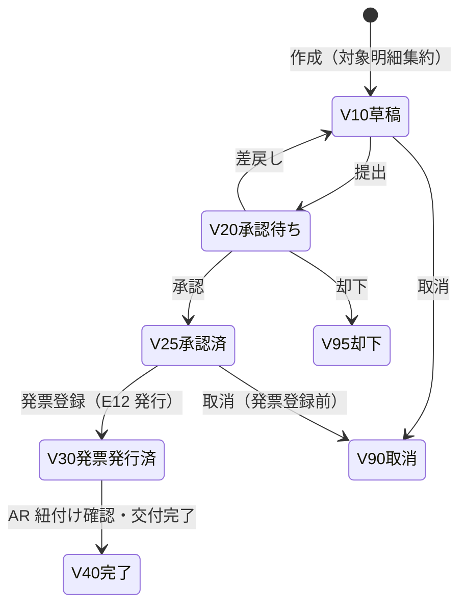
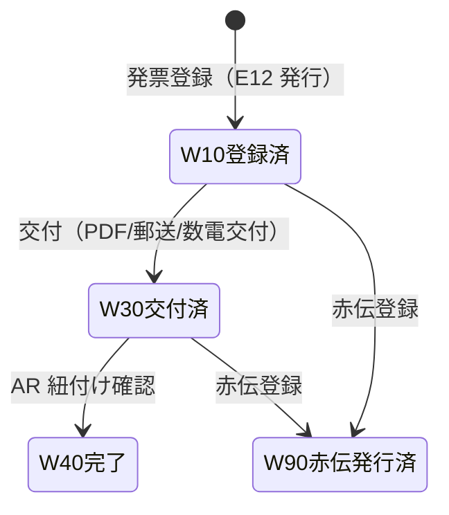
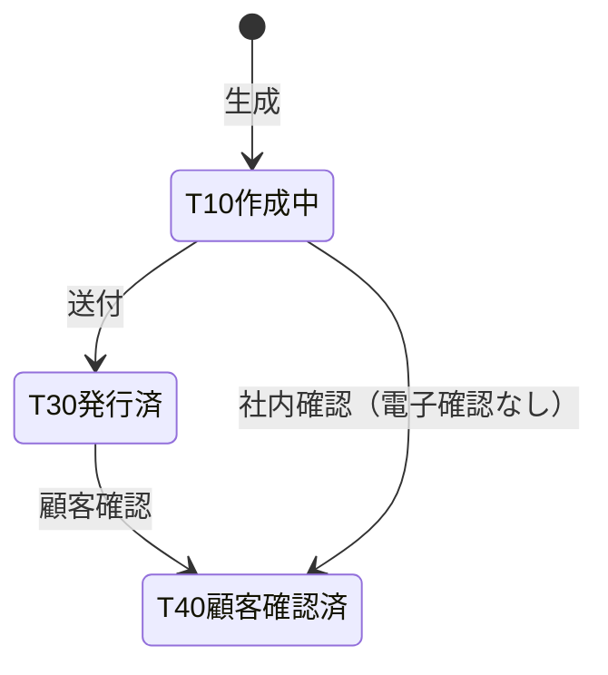
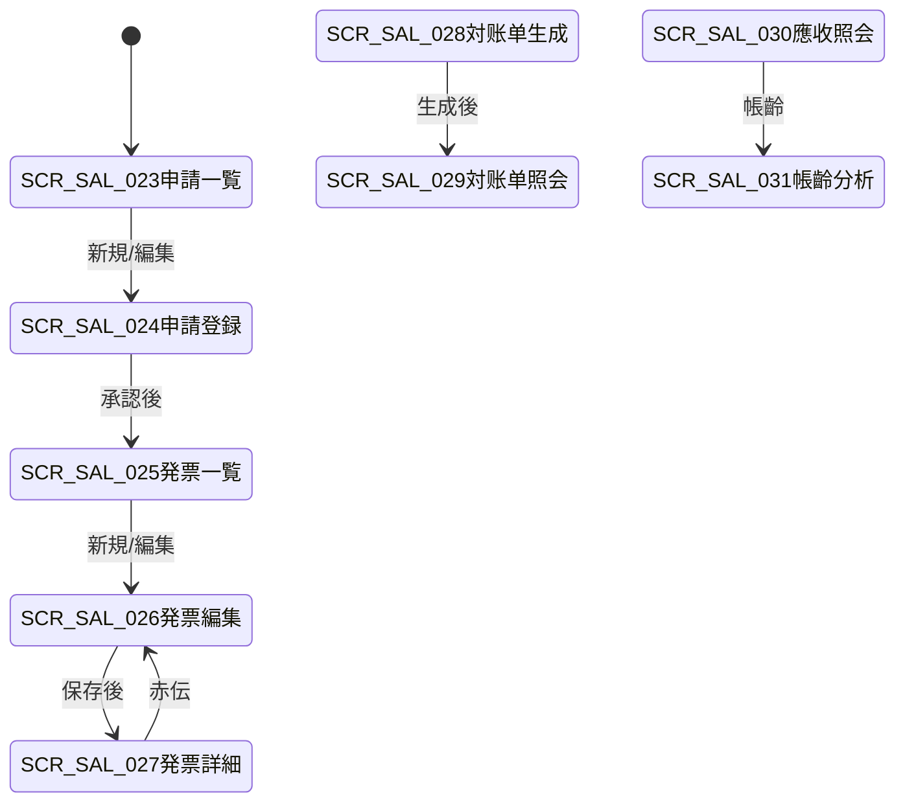

# 开票・应收・客户对账单 详细设计书（請求・売掛・対账单 詳細設計書）

| 項目 | 内容 |
|---|---|
| 文書名 | 开票・应收・客户对账单 详细设计书（請求・売掛・対账单 詳細設計書） |
| 文書番号 | DSN-SAL-005 |
| 版数 | v1.1 |
| 作成日 | 2026-10-20 |
| 作成者 | sales-designer（销售域担当） |
| 承認者 | 未承認（レビュー待ち） |
| 状態 | ドラフト（レビュー中） |
| 関連文書 | [業務域概要](00-overview.md) / [出荷詳細](03-delivery-picking.md) / [退货詳細](04-sales-return.md) / [信用管控](06-credit-pricing.md) / [共通業務規則](../00-common/08-common-business-rules.md) / [跨域流程](../00-common/09-cross-domain-flow.md) / [財務域 应收/收款](../07-finance/04-ar-receipt.md) / 09-integration（予定） / [コード一覧](../00-common/06-code-list.md) |

---

## 1. 機能概要

| 項目 | 内容 |
|---|---|
| 機能 ID | F-SAL-007（销售发票与开票申请）/ F-SAL-008（客户对账单）/ F-SAL-009（应收款查询与账龄） |
| 機能名 | 开票申请（增值税专用发票/普通发票/数电票）、发票登记・交付、赤伝発票、客户对账单、应收款/账龄查询（FIN 权威数据的投影与照会） |
| 目的 | ① 出荷基準（09 §7.3）で計上済の売上・應收に対し、税務要件を満たす発票を発行・登録・交付し、FIN の應收と紐付ける。② 顧客との月次対账を自動化し、売掛残の一致を確認する。③ FIN の應收・帳齡を SAL の営業活動（回収・與信）に提供する |
| 利用者・ロール | 銷售員（開票申請）、経理（発票登録・赤伝・対账单）、財務經理/財務總監（開票・赤伝承認）、信用専員（應收・帳齡照会）、銷售經理（回収状況確認） |
| 利用シーン | ① 出荷確定後の月次請求 ② 数電票/専票/普票の発行と交付 ③ 返品・誤発票の赤伝処理 ④ 月次対账单の生成・送付・顧客確認 ⑤ 應收残・帳齡・回収予定の照会 ⑥ 部分入金・前受金の確認（FIN 連携） |
| 優先度 | F-SAL-007：P0（発票登録・開票申請）／紫票 IF は P2。F-SAL-008：P1。F-SAL-009：P1 |
| 画面 ID | SCR-SAL-023（開票申請一覧）、SCR-SAL-024（開票申請登録編集）、SCR-SAL-025（発票登録一覧）、SCR-SAL-026（発票登録編集）、SCR-SAL-027（発票参照詳細・赤伝）、SCR-SAL-028（対账单生成）、SCR-SAL-029（対账单照会）、SCR-SAL-030（應收款照会）、SCR-SAL-031（帳齡分析） |
| 関連 IF | E10（購読元・出荷基準）、E12（発行）、E27/E29（購読）、E11（返品・赤伝）、IF-SAL-001/002（金税・数電票、Phase2）、FIN 應收/帳齡 API |

## 2. 業務要件・業務ルール

### 2.1 前提条件

| # | 前提条件 | 成立しない場合の挙動 |
|---|---|---|
| 1 | 出荷確定済（E10 発行済）で、FIN の應收（E27 受信済）が存在する | 開票申請の対象外（`MSG-SAL-140`） |
| 2 | 顧客の請求先情報（発票抬頭・税號・住所電話・銀行口座）が MDM に整備されている | 専票発行不可（`MSG-SAL-141`） |
| 3 | 會計期間が OPEN | 発票登録不可（`MSG-COM-071`） |
| 4 | 開票申請が承認済（25）である（発票登録の前提。数電票自動発行の場合は連携結果で更新） | 発票登録不可（`MSG-SAL-142`） |
| 5 | 赤伝の場合、元発票が登録済で未赤伝である | 赤伝不可（`MSG-SAL-124`） |
| 6 | 対账单の場合、対象期間の應收・入金データが FIN に存在する | 対账单生成不可（`MSG-SAL-143`） |
| 7 | FIN の應收照会 API が応答する | 應收照会不可（`MSG-SAL-081`） |

### 2.2 業務ルール（開票）

| # | ルール | 根拠 | 関連項目 |
|---|---|---|---|
| BR-IV-01 | 開票申請は「出荷確定済・未開票」の受注明細を顧客・請求先・稅区分単位で集約して作成する。対象は E10/E27 受信済の應收明細とし、出荷のみで AR 未計上の明細は含めない | 09 §7.3、財務契約 | `invoiceable_amount` |
| BR-IV-02 | 発票種別は MDM 顧客の `invoice_type` を既定とし、営業が変更可能（変更は財務承認を要す）。`10 増値税専用発票`、`20 増値税普通発票`、`30 数電専用発票`、`40 数電普通発票` | 06-code-list、税務要件 | `invoice_type` |
| BR-IV-03 | 単價は稅抜を基本とし、発票金額は「稅抜金額 + 稅額」で計算する。稅率は受注明細のスナップショット（`VAT13-OUT` 等の業務税碼）を使用し、**登録時点の稅率を保持**する | 共通業務規則 4、稅碼裁定 | `tax_code`、`tax_rate` |
| BR-IV-04 | 発票金額は対応する應收（AR）金額と一致させる。差額が生じる場合は理由を記錄し、財務經理の承認を要す | 稅務・會計要件 | `amount_diff` |
| BR-IV-05 | 開票申請は WF 承認制（`SALES_INVOICE`）。赤伝を含む場合は財務總監の承認を追加する | 08 §8、社内規程 | — |
| BR-IV-06 | 発票登録は経理が行う。発票番號・発票コード・開票日・交付日・交付方法を記錄し、登録時に E12 `sales.invoice.issued` を発行する | 09 §3 E12 | `invoice_no`、`invoice_code` |
| BR-IV-07 | E12 payload は `invoiceId`、`invoiceNo`、`invoiceCode`、`invoiceKind`（`SPECIAL`/`NORMAL`/`E_INVOICE`）、`customerId`、`orderId`、`deliveryIds[]`、`amount`、`taxAmount`、`taxRate`、`totalAmount`、`invoiceType`、`issuedAt` を設定する（09 更新済み契約） | 09 §3 E12 | — |
| BR-IV-08 | AR と発票の紐付けは**財務域が E12 を購読して行う**。SAL は AR を直接更新しない（FIN 契約 2026-10-20）。FIN は `deliveryIds[]` で應收明細を特定し、`invoice_status`/`invoiced_amount`/`invoice_id` を更新する（金額不変） | 財務契約 | — |
| BR-IV-09 | 発票種別と `invoiceKind` の対応：`10 専票`→`SPECIAL`、`20 普票`→`NORMAL`、`30 数電専票`・`40 数電普票`→`E_INVOICE`。数電票は発票番號（20 桁）を保持し、発票コードは「—」とする | 稅務要件（数電票） | `invoice_kind` |
| BR-IV-10 | 発票の交付（PDF/OFD/郵送）を記錄する。交付後の発票は金額変更不可。誤りの場合は赤伝→再発行とする | 稅務要件 | `delivery_status` |
| BR-IV-11 | 赤伝は元発票と 1:1（部分赤伝は金額按分）で紐付ける。赤伝登録時に E12（`invoiceKind=RED`）を発行し、FIN が赤伝売上・AR 戻しを計上する。赤伝は元発票の稅率・單價を引き継ぐ | 09 §5.3、稅務要件 | `original_invoice_id` |
| BR-IV-12 | 返品（F-SAL-006）による赤伝は返品の E11 に基づき、返品金額と一致させる。返品金額を超える赤伝は不可 | 04-sales-return | — |
| BR-IV-13 | 発票の再発行（紛失・汚損）は元発票を無効化せず、寫しの交付として記錄する（再発行回數を保持） | 稅務要件 | `reissue_count` |
| BR-IV-14 | 金税/数電票プラットフォーム連携（IF-SAL-001/002、Phase 2）は INT 域が実装する。SAL は「發票発行依頼データ」と「受信する発票結果データ」の項目を定義し、接続方式・認証・エンドポイントは INT 域に委譲する（虛構の URL を書かない） | IF 方針 | — |
| BR-IV-15 | 開票申請の取消は発票登録前のみ可能。発票登録後の取消は赤伝で処理する | 共通業務規則 13.1 | — |
| BR-IV-16 | 発票データは法定保存期間（現行実務 10 年、稅務要件に従う）保持する。PDF/OFD/XML は SYS の添付基盤に保存する | 08 §12 | — |

### 2.3 業務ルール（対账单・應收）

| # | ルール | 根拠 | 関連項目 |
|---|---|---|---|
| BR-ST-01 | 対账单は顧客別・月次で生成する。対象は前月 1 日〜末日に出荷確定・計上された應收明細と、同期間の入金・前受金・赤伝 | 業務慣行 | `statement_period` |
| BR-ST-02 | 対账单の殘高 = 前月末殘高 + 當期売上（稅込）− 當期入金 − 當期赤伝。FIN の應收殘高と一致しなければならない | 會計要件 | `closing_balance` |
| BR-ST-03 | 対账单は「照会のみ」の内部文書とし、仕訳・應收の金額を変更しない。顧客との差異は原因を記錄し、修正が必要な場合は元伝票（返品・入金）で修正する | 會計要件 | — |
| BR-ST-04 | 対账单の送付方法（PDF メール/郵送/ポータル）と送付日時を記錄する。顧客確認（回答）を記錄し、未回答は督促対象とする | 業務慣行 | `send_method`、`confirm_status` |
| BR-ST-05 | 應收の權威データは FIN が保持する。SAL は `sal_receivable_snapshot`（E27/E29 購読の投影）と FIN API により照会する。SAL 側で殘高を再計算しない | 財務契約 | — |
| BR-ST-06 | 帳齡は FIN の `GET /api/finance/ar-aging` を正とする（基準日 = レポート日、既定は**到期日**ベース、区分：未到期/1-30/31-60/61-90/91-180/181-360/360 超）。SAL は独自の帳齡口徑を持たない | 財務契約 | — |
| BR-ST-07 | 部分入金・前受金・過入金は FIN が処理し、E29 `matched[].matchedAmount`・`unappliedAmount` で SAL に通知する。SAL は入金按分を行わない | 09 §3 E29、財務契約 | — |
| BR-ST-08 | 回収遅延の督促は SAL 営業が行う（FIN は帳齡データを提供）。督促履歴をコメント・添付で保持する | 業務慣行 | — |
| BR-ST-09 | 與信使用額は E27/E29 による應收投影の更新に連動して再計算される（F-SAL-010） | 06-credit-pricing | — |
| BR-ST-10 | 對账单の再生成は同一期間・同一顧客で可能（版數を保持し、以前の版を無効化しない） | 會計要件 | `statement_version` |

### 2.4 計算式・判定式

| # | 対象 | 算式 | 丸め | 例 |
|---|---|---|---|---|
| CALC-IV-01 | 開票対象金額（稅抜） | Σ 対象應收明細（`amount`） | 2 桁 | 68,520.00 |
| CALC-IV-02 | 開票稅額 | Σ 明細稅額（行単位計算の合計） | 2 桁 | 8,907.60 |
| CALC-IV-03 | 開票稅込金額 | 稅抜 + 稅額 | 2 桁 | 77,427.60 |
| CALC-IV-04 | 發票金額差 | 開票金額 − 應收金額 | 2 桁 | 0.00 |
| CALC-IV-05 | 赤伝金額 | 元発票金額 × 赤伝比率（部分赤伝）、端數は最終行へ | 2 桁 HALF_UP | 9,678.45（部分赤伝・返品 10 PCE） |
| CALC-IV-06 | 對账单殘高 | 前月末殘 + 當期売上 − 當期入金 − 當期赤伝 | 2 桁 | 2,600,000 + 116,141.40 − 146,462.95 − 9,678.45 = 2,560,000.00 |
| CALC-IV-07 | 逾期日數 | レポート日 − 到期日（>0 が逾期） | 日 | 2026-10-20 − 2026-10-01 = 19 日 |
| CALC-IV-08 | DSO（應收周轉天數） | **平均應收餘額 ÷ 營業收入 × 期間日數**（FIN 定義。平均＝(期初+期末)÷2、SAL は表示のみ） | 2 桁 | 2,600,000 ÷ 4,200,000 × 31 = 19.2 日 |
| CALC-IV-09 | 應收殘高 | 應收金額 − 已核銷金額 − 赤伝金額 | 2 桁 | 116,141.40 − 80,000.00 = 36,141.40 |

**開票例（【示例値】）**

| 項目 | 明細 10 | 明細 20 | 合計 |
|---|---|---|---|
| 元出荷 | DN2610200001（80 PCE） | DN2610200002（40 PCE） | — |
| 稅抜金額 | 68,520.00 | 34,260.00 | 102,780.00 |
| 稅率 | 13% | 13% | — |
| 稅額 | 8,907.60 | 4,453.80 | 13,361.40 |
| 稅込金額 | 77,427.60 | 38,713.80 | 116,141.40 |
| 発票種別 | 30 数電専用発票 | — | — |
| 開票申請 | IVA2610240001 | — | — |

**對账单例（【示例値】、江蘇恒立液壓 C000001、2026-09 月次）**

| 區分 | 金額（CNY） |
|---|---|
| 前月末殘高 | 2,600,000.00 |
| 當期売上（稅込） | 116,141.40 |
| 當期赤伝（返品 10 PCE） | 9,678.45 |
| 當期入金 | 146,462.95 |
| 月末殘高 | 2,560,000.00 |
| うち逾期 | 200,000.00 |

### 2.5 状態遷移

#### 2.5.1 開票申請（`sal_invoice_application`）



| 遷移 | トリガ | 権限 | 更新項目 | メッセージ／イベント |
|---|---|---|---|---|
| 新規→10 | 開票申請作成 | `sales:invoice-application:create` | INSERT（採番 `SIV` ではなく申請番號 `IVA{YYMMDD}{4桁}`） | `MSG-SAL-144` |
| 10→20 | 提出 | `sales:invoice-application:create` | `application_status=20`、WF（`SALES_INVOICE`） | E05、`MSG-COM-005` |
| 20→10 | 差戻し | `sales:invoice:approve` | `application_status=10` | `MSG-SAL-016` |
| 20→25 | 承認 | `sales:invoice:approve` | `application_status=25`、`approved_at/by` | `MSG-SAL-145` |
| 20→95 | 却下 | `sales:invoice:approve` | `application_status=95` | `MSG-SAL-015` |
| 25→30 | 発票登録 | `sales:invoice:create` | `application_status=30`、`invoice_id` | E12 |
| 30→40 | AR 紐付け確認・交付 | システム/経理 | `application_status=40`、`completed_at` | `MSG-SAL-146` |
| 10/25→90 | 取消 | `sales:invoice-application:create` | `application_status=90`、`cancel_reason` | `MSG-SAL-147` |

#### 2.5.2 発票（`sal_invoice`）



| 遷移 | トリガ | 権限 | 更新項目 | メッセージ／イベント |
|---|---|---|---|---|
| 新規→10 | 発票登録 | `sales:invoice:create` | INSERT（`invoice_no`、`invoice_code`、`issued_at`）、E12 | `MSG-SAL-148` |
| 10→30 | 交付 | `sales:invoice:create` | `delivery_status=30`、`delivered_at/method` | `MSG-SAL-149` |
| 30→40 | AR 紐付け確認 | システム（E12 購読後の FIN 照会） | `invoice_status=40`、`ar_link_status=40` | `MSG-SAL-150` |
| 10/30→90 | 赤伝登録 | `sales:invoice:red` | `invoice_status=90`、`red_invoice_id` | `MSG-SAL-151` |

#### 2.5.3 対账单（`sal_statement`）



| 遷移 | トリガ | 権限 | 更新項目 | メッセージ |
|---|---|---|---|---|
| 新規→10 | 対账单生成 | `sales:statement:create` | INSERT（`statement_no`、明細） | `MSG-SAL-152` |
| 10→30 | 送付 | `sales:statement:create` | `statement_status=30`、`sent_at/method` | `MSG-SAL-153` |
| 30/10→40 | 顧客確認 | `sales:statement:confirm` | `statement_status=40`、`confirmed_at/by`、差異コメント | `MSG-SAL-154` |

## 3. 関連機能

| 関係 | 機能 ID | 機能名 | 関係內容 |
|---|---|---|---|
| 上流 | F-SAL-005 | 出荷 | E10 出荷事実・明細（開票対象の源泉） |
| 上流 | F-SAL-006 | 返品 | E11 返品確定・赤伝発票対象 |
| 上流 | FIN | 應收計上（E27）・入金（E29） | AR の權威データ |
| 上流 | MDM | 顧客請求先・税號・発票種別・税碼 | 同期參照 |
| 下流 | FIN | E12 による銷項發票台帳・AR 紐付け | イベント |
| 下流 | F-SAL-009 | 應收投影 | E27/E29 |
| 下流 | F-SAL-010 | 與信 | AR 殘高・逾期 |
| 下流 | F-SAL-012 | 訂單執行跟蹤 | 回収狀況 |
| 外部 | INT | IF-SAL-001/002 金税・数電票（Phase2） | 発票発行依頼・結果受信 |

## 4. 画面設計

### 4.1 画面一覧

| 画面 ID | 画面名 | 類型 | 概要 |
|---|---|---|---|
| SCR-SAL-023 | 開票申請一覧 | LIST | 申請の検索・狀態確認・承認狀況 |
| SCR-SAL-024 | 開票申請登録編集 | EDIT | 出荷確定済・未開票明細を集約、発票種別・稅区分確定 |
| SCR-SAL-025 | 発票登録一覧 | LIST | 発票の検索・交付狀況・赤伝狀況 |
| SCR-SAL-026 | 発票登録編集 | EDIT | 発票番號等の登録、交付、赤伝登録、E12 発行 |
| SCR-SAL-027 | 発票参照詳細・赤伝 | VIEW | 発票詳細、元発票・返品・AR 紐付け、再発行履歴 |
| SCR-SAL-028 | 対账单生成 | WIZ | 期間・顧客指定→差額確認→生成・送付 |
| SCR-SAL-029 | 対账单照会 | VIEW | 対账单の照会・再出力・顧客確認記錄 |
| SCR-SAL-030 | 應收款照会 | LIST | 應收明細・殘高・逾期・入金狀況（FIN 投影） |
| SCR-SAL-031 | 帳齡分析 | DASH | 帳齡區分・DSO・顧客別分析（FIN 數據） |

### 4.2 画面遷移



### 4.3 画面レイアウト

**SCR-SAL-024 開票申請登録編集**

```
┌──────────────────────────────────────────────────────────────────────────────┐
│ パンくず：ホーム > 販売管理 > 請求管理 > 開票申請登録                          │
├──────────────────────────────────────────────────────────────────────────────┤
│〔ヘッダ〕申請番号[自動] 状態[10 草稿] 顧客[C000001 江蘇恒立液壓▼]            │
│ 請求期間[2026-10-01]〜[2026-10-31] 発票種別[30 数電専用発票▼]                 │
│ 発票抬頭[江蘇恒立液壓股份有限公司] 納税者番号[9132****XXXX]                   │
│ 住所電話[江蘇省常州市***] 銀行[***] 交付方法[PDF メール▼]                    │
│ 開票金額[稅抜 102,780.00 / 稅額 13,361.40 / 稅込 116,141.40] 差額[0.00]       │
├──────────────────────────────────────────────────────────────────────────────┤
│〔対象明細〕[未開票明細取込]                                                  │
│ No|出荷番号|出荷日|物料|數量|稅抜金額|稅率|稅額|發票種別|狀態                  │
│ 10|DN2610200001|2026-10-24|YE3-100L1-4|80|68,520.00|13%|8,907.60|数電専票|未開票│
│ 20|DN2610200002|2026-10-30|YE3-100L1-4|40|34,260.00|13%|4,453.80|数電専票|未開票│
├──────────────────────────────────────────────────────────────────────────────┤
│〔フッタ〕[保存][提出][取消][プレビュー PRT-SAL-007][戻る]                      │
└──────────────────────────────────────────────────────────────────────────────┘
```

**SCR-SAL-026 発票登録編集**

```
┌──────────────────────────────────────────────────────────────────────────────┐
│ 発票登録：申請 IVA2610240001 / 状態[25 承認済]                                │
│ 発票種別[30 数電専用発票▼] 発票番号[26XXXXXXXXXXXX12345678]（20 桁）           │
│ 発票コード[—]（数電票は無し） 開票日[2026-10-31] 交付日[2026-10-31]            │
│ 交付方法[PDF メール▼] 購入方[江蘇恒立液壓股份有限公司] 納税者番号[9132****XXXX] │
│ 金額[稅抜 102,780.00] 稅額[13,361.40] 稅込[116,141.40] 稅率[13%]              │
│ 関連出荷[DN2610200001 / DN2610200002] 関連應收[AR2610240001]                 │
│ [發票 PDF 添付][登録（E12 発行）][赤伝登録][戻る]                             │
└──────────────────────────────────────────────────────────────────────────────┘
```

### 4.4 画面項目定義

#### 4.4.1 SCR-SAL-024 開票申請ヘッダ

| No | 項目 ID | 項目名 | 種別 | 型/桁 | 必須 | 初期值 | 入力チェック | データソース | DB 項目 | 備考 |
|---|---|---|---|---|---|---|---|---|---|---|
| 1 | `applicationNo` | 申請番號 | テキスト | VARCHAR(32) | ○ | 自動採番 | `IVA+YYMMDD+4桁` | SYS 採番 | `application_no` | 參照のみ |
| 2 | `customerId/Code/Name` | 顧客 | 選択 | BIGINT/VARCHAR | ○ | — | 有効顧客 | MDM | `customer_id/code/name` | — |
| 3 | `periodFrom/To` | 請求期間 | 日付 | DATE | ○ | 當月 1 日〜末日 | from ≤ to、締切期間不可 | 手入力 | `period_from/to` | — |
| 4 | `invoiceType` | 発票種別 | 選択 | SMALLINT | ○ | 顧客既定 | 10/20/30/40 | MDM | `invoice_type` | 変更は財務承認 |
| 5 | `invoiceTitle` | 発票抬頭 | テキスト | VARCHAR(200) | ○ | MDM | 200 桁 | MDM | `invoice_title` | スナップショット |
| 6 | `invoiceTaxNo` | 納税者番号 | テキスト | VARCHAR(30) | ○ | MDM | 18 桁（統一社会信用コード） | MDM | `invoice_tax_no` | 専票時必須 |
| 7 | `invoiceAddressPhone` | 住所・電話 | テキスト | VARCHAR(300) | △ | MDM | 300 桁 | MDM | `invoice_address_phone` | 専票時必須 |
| 8 | `invoiceBankName/Account` | 銀行・口座 | テキスト | VARCHAR(200/50) | △ | MDM | 200/50 桁 | MDM | `invoice_bank_name/account` | 専票時必須・マスキング |
| 9 | `deliveryMethod` | 交付方法 | 選択 | SMALLINT | ○ | PDF_EMAIL | 10 PDF メール/20 郵送/30 ポータル/40 数電交付 | `sys_dict` | `delivery_method` | — |
| 10 | `totalAmount` | 稅抜合計 | 數値 | NUMERIC(18,2) | — | 自動 | — | 計算 | `total_amount` | — |
| 11 | `taxAmount` | 稅額合計 | 數値 | NUMERIC(18,2) | — | 自動 | — | 計算 | `tax_amount` | — |
| 12 | `grandTotal` | 稅込合計 | 數値 | NUMERIC(18,2) | — | 自動 | — | 計算 | `grand_total` | — |
| 13 | `amountDiff` | 金額差（AR 比） | 數値 | NUMERIC(18,2) | — | 自動 | 0 以外は理由必須 | 計算 | `amount_diff` | — |
| 14 | `diffReason` | 差額理由 | テキスト | VARCHAR(500) | △ | — | amountDiff ≠ 0 時必須 | 手入力 | `diff_reason` | — |
| 15 | `applicationStatus` | 狀態 | 表示 | SMALLINT | — | 10 | — | — | `application_status` | 10/20/25/30/40/90/95 |
| 16 | `invoiceId` | 発票 ID | 表示 | BIGINT | — | — | — | — | `invoice_id` | 発票登録後 |
| 17 | `remark` | 備考 | テキスト | VARCHAR(500) | △ | — | 500 桁 | 手入力 | `remark` | — |

#### 4.4.2 SCR-SAL-024 開票申請明細

| No | 項目 ID | 項目名 | 種別 | 型/桁 | 必須 | 初期值 | 入力チェック | 計算 | DB 項目 |
|---|---|---|---|---|---|---|---|---|---|
| 1 | `lineNo` | 行番號 | 數値 | INT | — | 10 刻み | — | — | `line_no` |
| 2 | `deliveryId/No` | 出荷 | 表示 | BIGINT/VARCHAR | ○ | 自動 | 出荷確定済 | — | `delivery_id/delivery_no` |
| 3 | `receivableId/No` | 應收 | 表示 | BIGINT/VARCHAR | ○ | 自動 | E27 受信済 | — | `receivable_id/receivable_no` |
| 4 | `materialId/Code/Name` | 物料 | 表示 | BIGINT/VARCHAR | ○ | 自動 | — | — | `material_id/material_code/material_name` |
| 5 | `qty` | 數量 | 表示 | NUMERIC(18,4) | — | 自動 | — | — | `qty` |
| 6 | `uomCode` | 單位 | 表示 | VARCHAR(10) | — | 自動 | — | — | `uom_code` |
| 7 | `unitPrice` | 稅抜單價 | 表示 | NUMERIC(18,6) | — | 自動 | — | — | `unit_price` |
| 8 | `taxCode` | 稅碼 | 表示 | VARCHAR(20) | ○ | 自動 | 有効稅碼 | — | `tax_code` |
| 9 | `taxRate` | 稅率 | 表示 | NUMERIC(7,4) | — | 自動 | — | — | `tax_rate` |
| 10 | `lineAmount` | 稅抜金額 | 數値 | NUMERIC(18,2) | — | 自動 | — | CALC-IV-01 | `line_amount` |
| 11 | `taxAmount` | 稅額 | 數値 | NUMERIC(18,2) | — | 自動 | — | CALC-IV-02 | `tax_amount` |
| 12 | `totalAmount` | 稅込金額 | 數値 | NUMERIC(18,2) | — | 自動 | — | — | `total_amount` |
| 13 | `invoiceStatus` | 開票狀態（SAL） | 表示 | SMALLINT | — | 10 | — | — | `invoice_status` | 10 未開票/30 開票済/40 紐付け済（FIN `fin_receivable.invoice_status` は 0/1/2 のため別項目） |
| 14 | `lineRemark` | 明細備考 | テキスト | VARCHAR(200) | △ | — | 200 桁 | — | `line_remark` |

#### 4.4.3 SCR-SAL-026 発票ヘッダ

| No | 項目 ID | 項目名 | 種別 | 型/桁 | 必須 | 初期值 | 入力チェック | データソース | DB 項目 | 備考 |
|---|---|---|---|---|---|---|---|---|---|---|
| 1 | `invoiceNo` | 発票番號 | テキスト | VARCHAR(50) | ○ | — | 数電票 20 桁、紙票は 8 桁 | 手入力/IF | `invoice_no` | 一意 |
| 2 | `invoiceCode` | 発票コード | テキスト | VARCHAR(20) | △ | — | 紙票 10/12 桁。数電票は「—」 | 手入力/IF | `invoice_code` | — |
| 3 | `invoiceKind` | 発票種別区分 | 表示 | VARCHAR(20) | — | 自動 | SPECIAL/NORMAL/E_INVOICE/RED | 計算 | `invoice_kind` | E12 用 |
| 4 | `invoiceType` | 発票種別 | 表示 | SMALLINT | — | 申請から | 10/20/30/40 | — | `invoice_type` | — |
| 5 | `issuedAt` | 開票日 | 日付 | DATE | ○ | 當日 | 過去日可 | 手入力/IF | `issued_at` | — |
| 6 | `deliveredAt` | 交付日 | 日付 | DATE | △ | — | 開票日以降 | 手入力/IF | `delivered_at` | — |
| 7 | `deliveryStatus` | 交付狀態 | 表示 | SMALLINT | — | 10 | — | — | `delivery_status` | 10 未交付/30 交付済 |
| 8 | `buyerName` | 購入方名稱 | テキスト | VARCHAR(200) | ○ | 申請から | 200 桁 | MDM | `buyer_name` | スナップショット |
| 9 | `buyerTaxNo` | 購入方納税者番号 | テキスト | VARCHAR(30) | ○ | 申請から | 18 桁 | MDM | `buyer_tax_no` | 専票時必須 |
| 10 | `amount` | 稅抜金額 | 數値 | NUMERIC(18,2) | ○ | 申請から | ≥ 0 | 計算 | `amount` | — |
| 11 | `taxAmount` | 稅額 | 數値 | NUMERIC(18,2) | ○ | 申請から | ≥ 0 | 計算 | `tax_amount` | — |
| 12 | `totalAmount` | 稅込金額 | 數値 | NUMERIC(18,2) | ○ | 申請から | ≥ 0 | 計算 | `total_amount` | — |
| 13 | `originalInvoiceId` | 元発票 ID | 選択 | BIGINT | △ | — | 赤伝時必須・未赤伝 | 選択 | `original_invoice_id` | — |
| 14 | `redReason` | 赤伝理由 | テキスト | VARCHAR(500) | △ | — | 赤伝時必須 | 手入力 | `red_reason` | — |
| 15 | `arLinkStatus` | AR 紐付け狀態 | 表示 | SMALLINT | — | 10 | — | FIN 照会 | `ar_link_status` | 10 未/40 済 |
| 16 | `reissueCount` | 再発行回數 | 表示 | INT | — | 0 | — | — | `reissue_count` | — |
| 17 | `attachmentIds` | 発票 PDF/OFD | 添付 | ARRAY | △ | — | PDF/OFD/XML、20MB | SYS | — | 法定保存 |

### 4.5 イベント処理

| No | イベント | トリガ | 処理內容 | 呼出 API / 処理 ID | 畫面遷移 | 備考 |
|---|---|---|---|---|---|---|
| 1 | 未開票明細取込 | ボタン | E27 受信済・未開票の應收明細を取得し、申請明細へコピー | GET /api/sales/invoice-applications/invoiceable | — | 期間・顧客で絞込 |
| 2 | 金額差チェック | 保存時 | 申請金額 vs 應收金額の差を計算、差額理由を要求 | フロント計算 | — | — |
| 3 | 保存 | 保存ボタン | 入力チェック→INSERT/UPDATE→採番 | POST/PUT /api/sales/invoice-applications | 一覧へ | Idempotency-Key |
| 4 | 提出 | 提出ボタン | WF（`SALES_INVOICE`）→狀態 20 | POST /api/sales/invoice-applications/{id}/submit | 一覧へ | — |
| 5 | 承認 | WF コールバック | E31 受信→狀態 25 | POST /api/sales/invoice-applications/{id}/approve | 待办へ | — |
| 6 | 発票登録 | 登録ボタン | 発票情報入力→E12 発行→申請 30 | POST /api/sales/invoices | 発票詳細 | 一意チェック |
| 7 | 交付 | 交付ボタン | PDF 生成・送付記錄→狀態 30 | POST /api/sales/invoices/{id}/deliver | — | — |
| 8 | 赤伝登録 | 赤伝ボタン | 元発票選択→赤伝情報→E12（RED） | POST /api/sales/invoices/{id}/red | 詳細 | 財務總監承認 |
| 9 | 再発行 | ボタン | 寫し交付記錄（`reissue_count` 加算） | POST /api/sales/invoices/{id}/reissue | — | — |
| 10 | 對账单生成 | ウィザード | 期間・顧客指定→應收・入金集計→生成 | POST /api/sales/statements/generate | 對账单照会 | — |
| 11 | 對账单送付 | ボタン | PDF 生成・メール送付記錄→30 | POST /api/sales/statements/{id}/send | — | — |
| 12 | 顧客確認 | ボタン | 確認日・回答・差異コメント→40 | POST /api/sales/statements/{id}/confirm | — | — |
| 13 | 應收照会 | 検索 | FIN 投影 + FIN API で應收一覧 | GET /api/sales/receivables | — | — |
| 14 | 帳齡分析 | 検索 | FIN `GET /api/finance/ar-aging` の結果を表示 | GET /api/sales/receivables/aging | — | 独自計算しない |
| 15 | 印刷 | ボタン | PRT-SAL-007/008/009 PDF | POST .../print | プレビュー | — |

### 4.6 一覧畫面仕様

| 画面 | 検索條件 | 既定 | 列 |
|---|---|---|---|
| SCR-SAL-023 開票申請一覧 | 申請番號、期間、顧客、狀態、発票種別 | 當月・未完了 | 申請番號、顧客、期間、発票種別、稅込金額、狀態、承認者 |
| SCR-SAL-025 発票登録一覧 | 発票番號、開票日、顧客、種別、交付狀態、赤伝有無 | 當月 | 発票番號、発票コード、開票日、顧客、種別、稅込金額、交付狀態、AR 紐付け、赤伝 |
| SCR-SAL-030 應收款照会 | 顧客、到期日、逾期のみ、狀態 | 未回収（殘高 > 0） | 應收番號、顧客、出荷日、到期日、金額、入金額、殘高、逾期日數、帳齡區分 |
| 共通 | ページング 20/50/100/200、Excel エクスポート最大 10,000 件 | — | — |

### 4.7 表示制御

| 條件 | 対象 | 制御 |
|---|---|---|
| 申請狀態 ≠ 10 | 編集・取消 | 非表示 |
| 発票狀態 90（赤伝済） | 赤伝ボタン | 非表示 |
| 発票未交付 | 交付ボタン | 表示 |
| AR 紐付け未完了 | 完了ボタン | 非活性（FIN 照会で確認） |
| 銀行口座・稅號 | 一覧 | マスキング（下 4 桁等） |
| 権限なし | 発票登録・赤伝 | 非表示・API 403 |

## 5. 入力チェック仕様

| No | チェック ID | 対象項目 | 種別 | 條件 | タイミング | メッセージ ID |
|---|---|---|---|---|---|---|
| 1 | CHK-SAL-005-01 | 顧客 | 必須/コード存在 | 有効顧客 | 保存時 | MSG-COM-049 |
| 2 | CHK-SAL-005-02 | 請求期間 | 必須/相関 | from ≤ to、締切期間不可 | 保存時 | MSG-COM-046 |
| 3 | CHK-SAL-005-03 | 対象明細 | 必須 | 1 行以上、E27 受信済・未開票 | 保存時 | MSG-SAL-140 |
| 4 | CHK-SAL-005-04 | 発票種別 | 必須 | 10/20/30/40 | 保存時 | MSG-COM-040 |
| 5 | CHK-SAL-005-05 | 発票抬頭 | 必須 | 空でない・200 桁 | 保存時 | MSG-COM-040 |
| 6 | CHK-SAL-005-06 | 納税者番号 | 必須/形式 | 18 桁（統一社会信用コード） | 専票時 | MSG-SAL-141 |
| 7 | CHK-SAL-005-07 | 住所電話・銀行 | 必須 | 専票時 | 保存時 | MSG-SAL-141 |
| 8 | CHK-SAL-005-08 | 金額差 | 相関 | 0 以外は差額理由必須 | 保存時 | MSG-SAL-155 |
| 9 | CHK-SAL-005-09 | 発票番號 | 必須/一意 | 重複なし | 登録時 | MSG-SAL-156 |
| 10 | CHK-SAL-005-10 | 発票コード | 形式 | 紙票 10/12 桁、数電票は空 | 登録時 | MSG-SAL-157 |
| 11 | CHK-SAL-005-11 | 開票日 | 必須/範囲 | 締切期間外・未來日不可 | 登録時 | MSG-COM-043 |
| 12 | CHK-SAL-005-12 | 発票金額 | 相関 | 申請金額と一致（差額承認時を除く） | 登録時 | MSG-SAL-158 |
| 13 | CHK-SAL-005-13 | 元発票 | 必須/業務 | 赤伝時、登録済・未赤伝・金額以内 | 赤伝時 | MSG-SAL-124 |
| 14 | CHK-SAL-005-14 | 赤伝理由 | 必須 | 赤伝時 | 赤伝時 | MSG-COM-040 |
| 15 | CHK-SAL-005-15 | 狀態 | 業務 | 申請 25 のみ発票登録可 | 登録時 | MSG-SAL-142 |
| 16 | CHK-SAL-005-16 | 二重開票 | 一意 | 同一應收明細の重複開票なし | 登録時 | MSG-SAL-159 |
| 17 | CHK-SAL-005-17 | 對账单期間 | 必須 | 締切済期間のみ（前月以前） | 生成時 | MSG-SAL-143 |
| 18 | CHK-SAL-005-18 | 對账单殘高 | 業務 | FIN 應收殘高と一致（差異は記錄） | 生成時 | MSG-SAL-160 |
| 19 | CHK-SAL-005-19 | 樂観排他 | 排他 | `version` 一致 | 保存/狀態操作時 | MSG-COM-033 |
| 20 | CHK-SAL-005-20 | 承認者 | 職務分掌 | 作成者と承認者が同一でない | 承認時 | MSG-SAL-018 |
| 21 | CHK-SAL-005-21 | 添付 | 形式/サイズ | PDF/OFD/XML、20MB | 登録時 | MSG-COM-060/061 |
| 22 | CHK-SAL-005-22 | 交付日 | 相関 | 開票日以降 | 交付時 | MSG-COM-045 |

## 6. 処理詳細

### 6.1 処理一覧

| 処理 ID | 処理名 | 契機 | トランザクション | 排他 |
|---|---|---|---|---|
| PRC-SAL-005-01 | 開票申請作成 | 保存（新規） | 要（申請・明細・採番） | 採番行ロック |
| PRC-SAL-005-02 | 開票申請提出・承認 | 提出/承認 | 要（狀態 + Outbox E05） | 樂観排他 |
| PRC-SAL-005-03 | 発票登録（E12） | 登録 | 要（発票・明細・申請狀態・Outbox E12） | 発票番號一意、樂観排他 |
| PRC-SAL-005-04 | 赤伝登録（E12 RED） | 赤伝 | 要（赤伝発票・元発票狀態・Outbox E12） | 元発票ロック |
| PRC-SAL-005-05 | 対账单生成 | ウィザード | 要（対账单・明細） | 顧客・期間一意（版數） |
| PRC-SAL-005-06 | 対账单送付・確認 | 送付/確認 | 要 | 樂観排他 |
| PRC-SAL-005-07 | 應收投影更新 | E27/E29 購読 | 要（`sal_receivable_snapshot`） | 冪等 |
| PRC-SAL-005-08 | 発票・AR 紐付け照合 | BAT-SAL-009 | 不要（照会） | — |
| PRC-SAL-005-09 | 数電票/金税連携（Phase2） | IF-SAL-001/002 | 要（依頼・結果） | 外部 IF ログ |

### 6.2 処理手順（正常系）

**PRC-SAL-005-01 開票申請作成**

1. 顧客・請求期間を指定し、E27 受信済かつ `invoice_status=10 未開票` の應收明細を取得する（FIN API または投影から）。
2. 出荷明細（E10）の數量・單價・稅率・金額と照合し、申請明細を作成する。稅額は明細単位で計算する（CALC-IV-01〜03）。
3. 発票種別・請求先情報を MDM から取得してスナップショットする。
4. 申請金額と應收金額の差（CALC-IV-04）を計算し、0 以外は差額理由を必須とする。
5. `IVA{YYMMDD}{4桁}` を採番し、`sal_invoice_application`（`application_status=10`）・`sal_invoice_application_line` を INSERT する。
6. `MSG-SAL-144` を返す。

**PRC-SAL-005-03 発票登録（E12 発行）**

1. 開票申請（狀態 25）を取得し、申請明細と發票金額の一致を確認する（差異は承認済理由を記錄）。
2. 発票番號・発票コード・開票日の一意性・形式をチェックする（CHK-SAL-005-09〜12）。
3. `sal_invoice`・`sal_invoice_line` を INSERT する（`invoice_kind` を種別から決定、`invoice_status=10`、`ar_link_status=10`）。
4. 申請を `application_status=30`、`invoice_id` を設定する。申請明細の `invoice_status=30` に更新する。
5. Outbox に **E12 `sales.invoice.issued`** を INSERT する（第 7.3 節の通り。`deliveryIds[]`、`taxRate`、`totalAmount`、`invoiceCode`、`invoiceKind`）。
6. FIN が E12 を購読し、銷項發票台帳（`fin_invoice`）と AR の `invoice_status`/`invoiced_amount` を更新する（金額不変）。
7. SAL は後続で FIN の AR 紐付け狀態を照会し、`ar_link_status=40`・`invoice_status=40`・申請 40 に更新する（BAT-SAL-009 で照合）。
8. `MSG-SAL-148` を返す。

**PRC-SAL-005-04 赤伝登録（E12 RED）**

1. 元発票を `FOR UPDATE` で取得し、未赤伝（`invoice_status≠90`）・金額が赤伝可能額以內であることを確認する。
2. 赤伝理由・赤伝種別（全額/部分）・返回対象（返品 ID または手動）を記錄する。返品の場合は E11 の金額と一致させる。
3. 赤伝発票を INSERT する（`invoice_type` は元発票と同じ、`invoice_kind=RED`、金額はマイナスで保持、`original_invoice_id` 設定）。
4. 元発票の `invoice_status=90`、`red_invoice_id` を設定する（部分赤伝の場合は殘額を保持し、複数赤伝を許容）。
5. Outbox に E12 を INSERT する（`invoiceKind=RED`、`deliveryIds[]` は元発票の対象出荷、金額は赤伝額）。
6. FIN が E12 を購読し、赤伝売上・AR 戻し（J22/J23）を計上する。FIN の AR 紐付けは元應收に対して行う。
7. `MSG-SAL-151` を返す。

**PRC-SAL-005-05 対账单生成**

1. 顧客・期間（締切済の前月以前）を指定する。
2. FIN の應收・入金・前受金データを取得する（FIN API）。前月末殘高は前期間の対账单または FIN 殘高から取得する。
3. 當期売上（稅込）・當期赤伝・當期入金を集計し、CALC-IV-06 で當月末殘高を計算する。
4. FIN の應收殘高と照合し、差異があれば差異理由を記錄する（金額は変更しない）。
5. `STM{YYMMDD}{4桁}` を採番し、`sal_statement`（`statement_status=10`、`statement_version=1`）・`sal_statement_line` を INSERT する。
6. 同一顧客・期間の既存対账单がある場合は版數 +1 とし、舊版は保持する（BR-ST-10）。
7. `MSG-SAL-152` を返す。

**PRC-SAL-005-07 應收投影更新（E27/E29）**

1. E27 受信：`receivableId` をキーに `sal_receivable_snapshot` を UPSERT する（`amount`、`tax_amount`、`total_amount`、`due_date`、`receivable_date`、`invoice_status`、`source_no`、`currency_code`）。
2. E29 受信：`matched[].receivableId` ごとに `received_amount` を加算し、`balance_amount` を再計算する。`unappliedAmount` は前受金として保持する。
3. 與信使用額の再計算トリガを発行する（F-SAL-010）。
4. `eventId` で冪等チェックする（`sys_event_consume_log`）。
5. 金額の再計算は SAL では行わず、FIN の値をそのまま投影する（BR-ST-05）。

### 6.3 例外処理

| No | 異常條件 | 検知箇所 | 処理 | ロールバック | メッセージ ID |
|---|---|---|---|---|---|
| 1 | 未開票明細なし | 申請作成 | エラー | 全體 | MSG-SAL-140 |
| 2 | 請求先情報不足（専票） | 申請作成 | エラー | 全體 | MSG-SAL-141 |
| 3 | 金額差（AR 比） | 申請作成 | 差額理由必須・財務承認 | 全體 | MSG-SAL-155 |
| 4 | 発票番號重複 | 発票登録 | エラー | 全體 | MSG-SAL-156 |
| 5 | 発票コード形式不正 | 発票登録 | エラー | 全體 | MSG-SAL-157 |
| 6 | 二重開票 | 発票登録 | エラー | 全體 | MSG-SAL-159 |
| 7 | 元発票なし・赤伝済 | 赤伝 | エラー | 全體 | MSG-SAL-124 |
| 8 | 赤伝金額超過 | 赤伝 | エラー | 全體 | MSG-SAL-161 |
| 9 | AR 紐付け未完了 | 申請完了 | 保留・照合バッチ | — | MSG-SAL-162 |
| 10 | 対账单残高不一致 | 生成 | 差異記錄・警告 | — | MSG-SAL-160 |
| 11 | FIN API 障害 | 應收・対账单 | 中止（安全側） | 全體 | MSG-SAL-081 |
| 12 | 會計期間締切 | 発票登録 | エラー | 全體 | MSG-COM-071 |
| 13 | 数電票 IF 失敗（Phase2） | IF | リトライ・エラーファイル・手動補正 | — | IF-SAL-001 エラー |
| 14 | 樂観排他競合 | 保存/登録 | 409 | 全體 | MSG-COM-033 |

### 6.4 冪等性・再実行

- 開票申請・発票登録・赤伝・対账单生成は `Idempotency-Key` 必須。
- E12 は Outbox に同一トランザクションで INSERT し、`eventId` で購読側の重複を防止する。発票番號の一意制約で二重登録も防止する。
- E27/E29 の投影更新は `eventId`/`receivableId` で冪等。
- BAT-SAL-009（発票・AR 紐付け照合）は何度実行しても状態を変更せず、差分をログ出力するのみ（自動修正しない）。

## 7. API 設計

### 7.1 API 一覧

| No | メソッド | パス | 権限 | 概要 | 主なエラー |
|---|---|---|---|---|---|
| 1 | GET | `/api/sales/invoice-applications` | `sales:invoice-application:view` | 開票申請一覧 | 3001 |
| 2 | GET | `/api/sales/invoice-applications/invoiceable` | `sales:invoice-application:view` | 未開票明細照会 | 3001 |
| 3 | POST | `/api/sales/invoice-applications` | `sales:invoice-application:create` | 開票申請作成 | 30009 |
| 4 | PUT | `/api/sales/invoice-applications/{id}` | `sales:invoice-application:create` | 申請更新（10 のみ） | 4002/4003 |
| 5 | POST | `/api/sales/invoice-applications/{id}/submit` | `sales:invoice-application:create` | 提出 | 4002 |
| 6 | POST | `/api/sales/invoice-applications/{id}/approve` | `sales:invoice:approve` | 承認 | 3001 |
| 7 | GET | `/api/sales/invoices` | `sales:invoice:view` | 発票一覧 | 3001 |
| 8 | GET | `/api/sales/invoices/{id}` | `sales:invoice:view` | 発票詳細 | 4001 |
| 9 | POST | `/api/sales/invoices` | `sales:invoice:create` | 発票登録（E12） | 30010 |
| 10 | POST | `/api/sales/invoices/{id}/deliver` | `sales:invoice:create` | 交付 | 4002 |
| 11 | POST | `/api/sales/invoices/{id}/red` | `sales:invoice:red` | 赤伝登録（E12 RED） | 30011 |
| 12 | POST | `/api/sales/invoices/{id}/reissue` | `sales:invoice:create` | 再発行（寫し） | 4002 |
| 13 | POST | `/api/sales/invoices/{id}/print` | `sales:invoice:view` | 発票 PDF（PRT-SAL-008） | 4001 |
| 14 | POST | `/api/sales/statements/generate` | `sales:statement:create` | 対账单生成 | 30012 |
| 15 | GET | `/api/sales/statements` | `sales:statement:view` | 対账单一覧 | 3001 |
| 16 | GET | `/api/sales/statements/{id}` | `sales:statement:view` | 対账单詳細（明細含む） | 4001 |
| 17 | POST | `/api/sales/statements/{id}/send` | `sales:statement:create` | 対账单送付 | 4002 |
| 18 | POST | `/api/sales/statements/{id}/confirm` | `sales:statement:confirm` | 顧客確認 | 4002 |
| 19 | POST | `/api/sales/statements/{id}/print` | `sales:statement:view` | 対账单 PDF（PRT-SAL-009） | 4001 |
| 20 | GET | `/api/sales/receivables` | `sales:receivable:view` | 應收一覧（投影 + FIN API） | 3001 |
| 21 | GET | `/api/sales/receivables/aging` | `sales:receivable:view` | 帳齡分析（FIN API） | 3001 |
| 22 | POST | `/api/sales/exports` | `sales:report:export` | 非同期エクスポート | 4005 |

### 7.2 リクエスト／レスポンス詳細

**POST /api/sales/invoice-applications → 201**

```json
{
  "customerId": "1845000000000000001",
  "periodFrom": "2026-10-01",
  "periodTo": "2026-10-31",
  "invoiceType": 30,
  "invoiceTitle": "江苏恒立液压股份有限公司",
  "invoiceTaxNo": "9132**************",
  "invoiceAddressPhone": "江苏省常州市**************",
  "invoiceBankName": "中国工商银行常州分行",
  "invoiceBankAccount": "**** **** **** 1234",
  "deliveryMethod": 10,
  "diffReason": null,
  "lines": [
    { "receivableId": "1845999000000000101", "deliveryId": "1845777000000000001" },
    { "receivableId": "1845999000000000102", "deliveryId": "1845777000000000002" }
  ]
}
```

```json
{
  "code": 0,
  "message": "ok",
  "data": {
    "id": "1846111000000000001",
    "applicationNo": "IVA2610240001",
    "applicationStatus": 10,
    "statusName": "草稿",
    "invoiceType": 30,
    "invoiceKind": "E_INVOICE",
    "totalAmount": "102780.00",
    "taxAmount": "13361.40",
    "grandTotal": "116141.40",
    "amountDiff": "0.00",
    "version": 0,
    "lines": [
      {
        "lineNo": 10,
        "deliveryNo": "DN2610200001",
        "receivableNo": "AR2610240001",
        "materialCode": "3001000001",
        "qty": "80.0000",
        "unitPrice": "856.500000",
        "taxRate": "13.0000",
        "lineAmount": "68520.00",
        "taxAmount": "8907.60"
      }
    ]
  }
}
```

**POST /api/sales/invoices → 201**

```json
{
  "applicationId": "1846111000000000001",
  "invoiceNo": "26322000000012345678",
  "invoiceCode": null,
  "invoiceType": 30,
  "issuedAt": "2026-10-31",
  "deliveryMethod": 10,
  "buyerName": "江苏恒立液压股份有限公司",
  "buyerTaxNo": "9132**************",
  "attachmentId": "1846222000000000001"
}
```

```json
{
  "code": 0,
  "message": "ok",
  "data": {
    "id": "1846333000000000001",
    "invoiceNo": "26322000000012345678",
    "invoiceCode": null,
    "invoiceKind": "E_INVOICE",
    "invoiceStatus": 10,
    "invoiceStatusName": "登録済",
    "amount": "102780.00",
    "taxAmount": "13361.40",
    "totalAmount": "116141.40",
    "applicationNo": "IVA2610240001",
    "deliveryIds": ["1845777000000000001", "1845777000000000002"],
    "arLinkStatus": 10,
    "eventType": "sales.invoice.issued",
    "eventId": "3c2d1e0f-9a8b-4c7d-8e6f-5a4b3c2d1e0f"
  }
}
```

**E12 ペイロード（Outbox → FIN）**

```json
{
  "eventId": "3c2d1e0f-9a8b-4c7d-8e6f-5a4b3c2d1e0f",
  "eventType": "sales.invoice.issued",
  "eventVersion": 1,
  "occurredAt": "2026-10-31T15:00:00+08:00",
  "source": "erp-sales",
  "aggregateType": "sales_invoice",
  "aggregateId": "1846333000000000001",
  "aggregateNo": "26322000000012345678",
  "payload": {
    "invoiceId": "1846333000000000001",
    "invoiceNo": "26322000000012345678",
    "invoiceCode": null,
    "invoiceKind": "E_INVOICE",
    "customerId": "1845000000000000001",
    "orderId": "1845678901234567890",
    "deliveryIds": ["1845777000000000001", "1845777000000000002"],
    "amount": "102780.00",
    "taxAmount": "13361.40",
    "taxRate": "13.0000",
    "totalAmount": "116141.40",
    "invoiceType": 30,
    "issuedAt": "2026-10-31"
  }
}
```

**POST /api/sales/statements/generate → 201**

```json
{
  "customerId": "1845000000000000001",
  "periodCode": "2026-09",
  "includeZeroBalance": false,
  "sendAfterGenerate": false
}
```

```json
{
  "code": 0,
  "message": "ok",
  "data": {
    "id": "1846444000000000001",
    "statementNo": "STM2610050001",
    "statementVersion": 1,
    "periodCode": "2026-09",
    "openingBalance": "2600000.00",
    "periodSalesAmount": "116141.40",
    "periodReturnAmount": "9678.45",
    "periodReceiptAmount": "146462.95",
    "closingBalance": "2560000.00",
    "overdueAmount": "200000.00",
    "finBalance": "2560000.00",
    "balanceDiff": "0.00",
    "lineCount": 42,
    "statementStatus": 10
  }
}
```

**GET /api/sales/receivables/aging?asOf=2026-10-20&customerId=C000001 → 200**

```json
{
  "code": 0,
  "message": "ok",
  "data": {
    "asOf": "2026-10-20",
    "basis": "DUE_DATE",
    "customerId": "1845000000000000001",
    "customerCode": "C000001",
    "totalBalance": "2800000.00",
    "overdueAmount": "200000.00",
    "buckets": [
      { "bucket": "NOT_DUE", "label": "未到期", "amount": "1800000.00" },
      { "bucket": "D1_30", "label": "1-30 天", "amount": "800000.00" },
      { "bucket": "D31_60", "label": "31-60 天", "amount": "0.00" },
      { "bucket": "D61_90", "label": "61-90 天", "amount": "0.00" },
      { "bucket": "D91_180", "label": "91-180 天", "amount": "200000.00" },
      { "bucket": "D181_360", "label": "181-360 天", "amount": "0.00" },
      { "bucket": "OVER_360", "label": "360 天以上", "amount": "0.00" }
    ],
    "dso": "19.20",
    "source": "FIN",
    "messageId": null
  }
}
```

**金税/数電票 IF-SAL-001 項目（Phase 2、インタフェース形態のみ）**

| 区分 | 項目 | 型/桁 | 必須 | 説明 |
|---|---|---|---|---|
| 送信 | `requestId` | VARCHAR(64) | ○ | 冪等キー（開票申請番號 + 版數） |
| 送信 | `invoiceType` | SMALLINT | ○ | 10 専票/20 普票/30 数電専票/40 数電普票 |
| 送信 | `buyerName` / `buyerTaxNo` | VARCHAR(200)/(30) | ○ | 購入方情報 |
| 送信 | `buyerAddressPhone` | VARCHAR(300) | △ | 専票時 |
| 送信 | `buyerBankName` / `buyerBankAccount` | VARCHAR(200)/(50) | △ | 専票時 |
| 送信 | `lines[].itemName` | VARCHAR(200) | ○ | 貨物或應稅勞務、服務名稱 |
| 送信 | `lines[].spec` / `uom` / `qty` / `unitPrice` | — | ○ | 明細情報 |
| 送信 | `lines[].amount` / `taxRate` / `taxAmount` | NUMERIC | ○ | 金額・稅率・稅額（`VAT13-OUT` 等） |
| 送信 | `totalAmount` | NUMERIC(18,2) | ○ | 價稅合計 |
| 送信 | `remark` | VARCHAR(500) | △ | 備註 |
| 送信 | `taxClassificationCode` | VARCHAR(20) | △ | 稅收分類編碼（MDM 稅碼保有） |
| 受信 | `invoiceNo` | VARCHAR(50) | ○ | 数電票 20 桁 / 紙票 8 桁 |
| 受信 | `invoiceCode` | VARCHAR(20) | △ | 紙票のみ |
| 受信 | `issuedAt` | DATE | ○ | 開票日 |
| 受信 | `invoiceFileUrl` | VARCHAR(500) | △ | PDF/OFD/XML の保存先（署名付き URL） |
| 受信 | `status` | VARCHAR(20) | ○ | SUCCESS/FAILED/PROCESSING |
| 受信 | `errorCode` / `errorMessage` | VARCHAR(50)/(500) | △ | 失敗時 |

> 接続方式・認証（税務プラットフォームの認証情報）・エンドポイントは INT 域が Phase 2 で確定する。本域は依頼/結果の項目と業務上の扱い（成功→発票登録、失敗→申請を 25 に戻す）のみ定義する（虛構の接続先を記載しない）。

### 7.3 イベント連携

| イベント | 方向 | 処理 |
|---|---|---|
| E12 `sales.invoice.issued` | 発行 | FIN が銷項發票台帳・AR 紐付けを更新（`invoiceKind=RED` は赤伝） |
| E27 `finance.receivable.created` | 購読 | 應收投影 UPSERT、與信再計算 |
| E29 `finance.receipt.completed` | 購読 | 入金投影・`unappliedAmount`、與信解放 |
| E10 `sales.delivery.confirmed` | 購読（自身の発行を記録） | 開票対象の源泉（出荷確定日・金額） |
| E11 `sales.return.confirmed` | 発行（F-SAL-006） | 赤伝発票の対象 |
| E05/E31/E32 | 発行/購読 | 開票申請の WF 承認 |

## 8. データ更新仕様

| テーブル | 操作 | 更新項目 | 更新條件 | トリガ |
|---|---|---|---|---|
| `sys_sequence` | UPDATE | `SALES_INVOICE_APPLICATION` / `SALES_INVOICE` / `SALES_STATEMENT` | — | 各作成 |
| `sal_invoice_application` | INSERT/UPDATE | 全項目、`application_status`、`approved_at/by`、`invoice_id` | 作成/承認/発票登録 | PRC-SAL-005-01/02/03 |
| `sal_invoice_application_line` | INSERT/UPDATE | `invoice_status`、`line_amount`、`tax_amount`、`total_amount` | 作成/発票登録 | 同上 |
| `sal_invoice` | INSERT/UPDATE | 全項目、`invoice_status`、`delivery_status`、`ar_link_status`、`red_invoice_id`、`reissue_count` | 登録/交付/赤伝/紐付け | PRC-SAL-005-03/04 |
| `sal_invoice_line` | INSERT | 明細、稅額 | 発票登録 | PRC-SAL-005-03 |
| `sal_invoice_relation` | INSERT | 元発票・出荷・受注・應收の関連 | 発票登録/赤伝 | 同上 |
| `sal_statement` | INSERT/UPDATE | 全項目、`statement_status`、`sent_at`、`confirmed_at` | 生成/送付/確認 | PRC-SAL-005-05/06 |
| `sal_statement_line` | INSERT | 対账明細 | 生成 | PRC-SAL-005-05 |
| `sal_receivable_snapshot` | INSERT/UPDATE | `amount`、`received_amount`、`balance_amount`、`due_date`、`invoice_status`、`unapplied_amount` | E27/E29 | PRC-SAL-005-07 |
| `sys_outbox_event` | INSERT | E05/E12 | 提出/発票登録/赤伝 | — |
| `sys_audit_log` | INSERT | 申請・発票・赤伝・対账单・出力 | 各処理 | — |

## 9. エラー処理・メッセージ

| メッセージ ID | 種別 | 本文 | 発生條件 | 利用者への対処 | ログ |
|---|---|---|---|---|---|
| MSG-SAL-140 | E | 没有可开票的出荷明細（需出荷確定且应收取入済）。 | 未開票なし | 出荷・應收確認 | WARN |
| MSG-SAL-141 | E | 客户开票信息不完整（抬头/税号/地址电话/银行），不能开具专用发票。 | 請求先不足 | MDM 補完 | WARN |
| MSG-SAL-142 | E | 开票申请尚未审批通过，不能登记发票。 | 申請未承認 | 承認を先に | WARN |
| MSG-SAL-143 | E | 对账单期间必须是已结账的月份以前。 | 期間不正 | 期間変更 | WARN |
| MSG-SAL-144 | I | 开票申请已创建（{0}）。 | 申請作成 | — | INFO |
| MSG-SAL-145 | I | 开票申请已审批通过。 | 承認 | — | INFO |
| MSG-SAL-146 | I | 开票申请已完成（与应收纽付け完毕）。 | 完了 | — | INFO |
| MSG-SAL-147 | I | 开票申请已取消。 | 取消 | — | INFO |
| MSG-SAL-148 | I | 发票已登记（{0}），已通知财务域纽付け应收。 | 発票登録 | — | INFO |
| MSG-SAL-149 | I | 发票已交付（{0}）。 | 交付 | — | INFO |
| MSG-SAL-150 | I | 发票与应收已完成纽付け。 | AR 紐付け | — | INFO |
| MSG-SAL-151 | I | 红字发票已登记（{0}）。 | 赤伝 | — | INFO |
| MSG-SAL-152 | I | 对账单已生成（{0}）。 | 生成 | — | INFO |
| MSG-SAL-153 | I | 对账单已发送（{0}）。 | 送付 | — | INFO |
| MSG-SAL-154 | I | 对账单已完成顾客确认。 | 確認 | — | INFO |
| MSG-SAL-155 | E | 开票金额与应收金额存在差异，请填写差额理由并提交财务审批。 | 金額差 | 理由入力 | WARN |
| MSG-SAL-156 | E | 发票号码已存在，请确认是否重复登记。 | 番號重複 | 番號確認 | WARN |
| MSG-SAL-157 | E | 发票代码格式不正确（纸票为 10/12 位，数电票无代码）。 | 形式不正 | 形式修正 | WARN |
| MSG-SAL-158 | E | 发票金额与开票申请金额不一致。 | 金額不一致 | 金額修正 | WARN |
| MSG-SAL-159 | E | 该应收明细已开票，不能重复开票。 | 二重開票 | 既存発票確認 | WARN |
| MSG-SAL-160 | W | 对账单余额与财务应收余额不一致（差异 {0}），已记录差异原因。 | 殘高不一致 | 差異原因記録 | WARN |
| MSG-SAL-161 | E | 红字发票金额不能超过原发票可红冲金额。 | 赤伝超過 | 金額修正 | WARN |
| MSG-SAL-162 | W | 发票已登记，但应收纽付け尚未确认，请稍后确认。 | 紐付け未完了 | 照会・再確認 | WARN |
| MSG-SAL-163 | E | 发票尚未交付，不能执行该操作。 | 交付前操作 | 交付を先に | WARN |

## 10. 権限・セキュリティ

| 種別 | 內容 |
|---|---|
| 画面権限 | `sales:invoice-application:view/create`、`sales:invoice:view/create/approve/red`、`sales:statement:view/create/confirm`、`sales:receivable:view` |
| 操作権限 | 開票申請=営業、承認=財務經理（赤伝は財務總監）、発票登録・交付・赤伝=経理、対账单=経理 |
| 項目権限 | 銀行口座はマスキング、納税者番号は下 4 桁以外マスク、與信・應收は擔當顧客のみ |
| データ範囲 | 営業=擔當顧客、経理=全社、財務經理=全社 |
| 監査ログ | 開票申請・承認・発票登録・交付・赤伝・対账单生成/送付/確認・印刷を記錄（金額・狀態は before/after） |

## 11. 性能・非機能

| 項目 | 目標値 | 前提 |
|---|---|---|
| 開票申請一覧 | 2 秒以内（100 件） | `idx_sal_invoice_application_status` |
| 未開票明細照会 | 2 秒以内（月 3,000 件） | FIN API + 投影 |
| 発票登録 | 3 秒以内 | E12 Outbox 含む |
| 対账单生成 | 5 秒以内（1 顧客・月 200 明細） | FIN API |
| 帳齡分析 | 3 秒以内 | FIN API（SAL 側で再集計しない） |
| 発票件數 | 年 26,000 件 | [00-overview 8 章](00-overview.md) |
| 同時実行 | 30 ユーザ | 楽観排他 |

## 12. テスト観点

| No | 観点 ID | 分類 | 観点 | 期待結果 |
|---|---|---|---|---|
| 1 | TST-F-SAL-007-01 | 正常系 | 開票申請作成（数電専票） | 金額・稅額・合計一致、申請番號採番 |
| 2 | TST-F-SAL-007-02 | 正常系 | 未開票明細の集約 | E27 受信済のみ対象 |
| 3 | TST-F-SAL-007-03 | 正常系 | 発票登録（E12） | `invoiceKind=E_INVOICE`、`deliveryIds[]` 一致 |
| 4 | TST-F-SAL-007-04 | 正常系 | 発票交付・再発行 | 交付記錄、`reissue_count` 加算 |
| 5 | TST-F-SAL-007-05 | 正常系 | 赤伝登録（全額） | 元発票 90、E12 RED、金額一致 |
| 6 | TST-F-SAL-007-06 | 正常系 | 部分赤伝 | 元発票に殘額、赤伝額按分 |
| 7 | TST-F-SAL-007-07 | 異常系 | 請求先情報不足（専票） | エラー（MSG-SAL-141） |
| 8 | TST-F-SAL-007-08 | 異常系 | 二重開票 | エラー（MSG-SAL-159） |
| 9 | TST-F-SAL-007-09 | 異常系 | 発票番號重複 | エラー（MSG-SAL-156） |
| 10 | TST-F-SAL-007-10 | 異常系 | 赤伝金額超過 | エラー（MSG-SAL-161） |
| 11 | TST-F-SAL-007-11 | 境界値 | 金額差 0.01 | 差額理由必須 |
| 12 | TST-F-SAL-007-12 | 連携 | E12 payload 項目 | 09 契約（deliveryIds/taxRate/totalAmount/invoiceCode/invoiceKind）一致 |
| 13 | TST-F-SAL-007-13 | 連携 | FIN AR 紐付け | FIN 側 `invoice_status` 更新、SAL は AR 不変 |
| 14 | TST-F-SAL-007-14 | 排他 | 同時発票登録 | 1 件のみ成功 |
| 15 | TST-F-SAL-007-15 | 冪等 | 同一 Idempotency-Key | 1 件のみ登録 |
| 16 | TST-F-SAL-008-01 | 正常系 | 対账单生成 | 殘高 = 前期末+売上−入金−赤伝 |
| 17 | TST-F-SAL-008-02 | 正常系 | 対账单送付・確認 | 狀態 30/40、送付記錄 |
| 18 | TST-F-SAL-008-03 | 異常系 | 締切前期間指定 | エラー（MSG-SAL-143） |
| 19 | TST-F-SAL-008-04 | 正常系 | 殘高差異記錄 | 警告・差異理由保存（金額不変） |
| 20 | TST-F-SAL-009-01 | 正常系 | 應收投影更新（E27/E29） | 殘高・入金額一致 |
| 21 | TST-F-SAL-009-02 | 正常系 | 帳齡分析（FIN API） | 區分・DSO が FIN と一致 |
| 22 | TST-F-SAL-009-03 | 異常系 | FIN API 障害 | エラー（MSG-SAL-081） |
| 23 | TST-F-SAL-009-04 | 権限 | 擔當外顧客の應收参照 | 403 |
| 24 | TST-F-SAL-009-05 | 連携 | E29 部分核銷 | `received_amount` 加算・`unappliedAmount` 保持 |

## 13. 未決事項

| # | 事項 | 理由 | 暫定仕様 | 担当 | 期限 |
|---|---|---|---|---|---|
| 1 | 数電票/金税 IF の接続仕様（認証・エンドポイント・XML 形式） | INT 域 Phase 2 設計待ち | SAL は依頼/結果項目のみ定義。接続は INT 域が実装 | integration-designer | 2026-11-15 |
| 2 | 数電票の交付方法（税務プラットフォーム/自社メール） | 税務実務の確認が必要 | `delivery_method` で記錄、PDF/OFD を添付保存 | Lead / 財務 | 2026-11-01 |
| 3 | 専票の「三流一致」（資金・発票・貨物）チェック要否 | 税務リスク管理の社内方針が未確定 | Phase 1 は請求先と出荷先の一致を警告のみ。厳格化は Phase 2 | finance-designer | 2026-11-15 |
| 4 | 対账单の顧客電子確認（ポータル/電子署名） | Phase 2 | Phase 1 は PDF 送付 + 社内確認記錄 | sales-designer | Phase 2 |
| 5 | 帳齡の基準日（到期日 vs 出荷日）の顧客別設定 | FIN は既定到期日、顧客別設定は未提供 | FIN の既定（到期日）に従う | finance-designer | 2026-11-01 |
| 6 | 過入金・前受金の返金処理 | FIN 側の設計待ち | FIN が処理し E29 `unappliedAmount` で通知。SAL は表示のみ | finance-designer | 2026-11-15 |
| 7 | 発票の再発行（寫し）の税務上の扱い | 税務実務の確認が必要 | `reissue_count` を記錄し、原本は無効化しない | finance-designer | 2026-11-15 |

## 14. 改訂履歴

| 版数 | 日付 | 変更內容 | 変更者 |
|---|---|---|---|
| v1.0 | 2026-10-20 | 初版作成：開票申請（専票/普票/数電票）、発票登録・交付（E12 更新契約）、赤伝、対账单、應收投影（E27/E29）、帳齡（FIN 權威）、金税/数電票 IF 項目（Phase2）、畫面 9 件、API 22 件、テスト観点 24 件 | sales-designer |
| v1.1 | 2026-10-20 | 紅隊修復第 2 輪（REV-mdm-012 / REV-PRD-006）：対账单を正本（売上 116,141.40・入金 146,462.95・赤伝 9,678.45・月末 2,560,000.00）へ、赤伝 9,678.45（返品 10 PCE）、DSO を平均残高口径（FIN 定義）に統一。帳齡は FIN `ar-aging` を正とすることを明記 | sales-designer |


