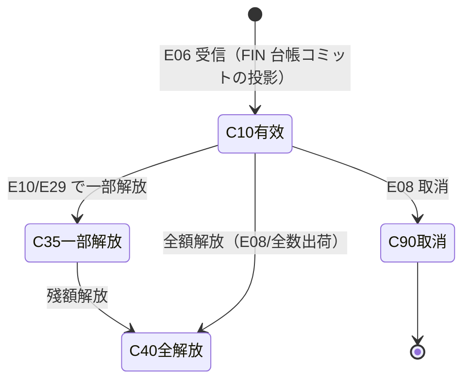
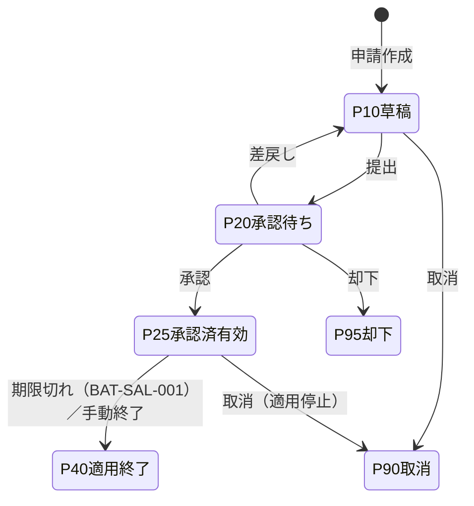
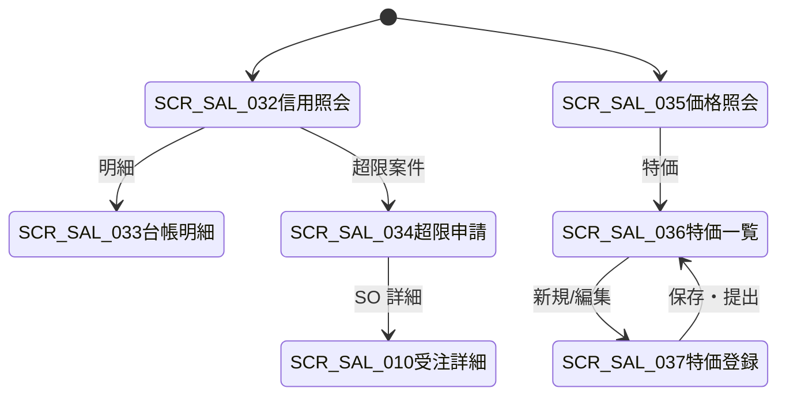

# 信用管控・价格与促销 详细设计书（与信管理・価格/特価 詳細設計書）

| 項目 | 内容 |
|---|---|
| 文書名 | 信用管控・价格与促销 详细设计书（与信管理・価格/特価 詳細設計書） |
| 文書番号 | DSN-SAL-006 |
| 版数 | v1.1 |
| 作成日 | 2026-10-20 |
| 作成者 | sales-designer（销售域担当） |
| 承認者 | 未承認（レビュー待ち） |
| 状態 | ドラフト（レビュー中） |
| 関連文書 | [業務域概要](00-overview.md) / [销售订单詳細](02-sales-order.md) / [共通業務規則](../00-common/08-common-business-rules.md) / [跨域流程](../00-common/09-cross-domain-flow.md) / [主データ域 価格](../02-mdm/05-price-settlement.md) / [主データ域 与信](../02-mdm/06-credit-supplier-eval.md) / [財務域 应收/与信](../07-finance/04-ar-receipt.md) / [コード一覧](../00-common/06-code-list.md) |

---

## 1. 機能概要

| 項目 | 内容 |
|---|---|
| 機能 ID | F-SAL-010（信用管控）/ F-SAL-011（价格与促销） |
| 機能名 | 信用管控（FIN 与信台帳照会・与信判定・超限判定・承認連携）、价格与促销（MDM 価格表参照・取価・特価/折扣承認） |
| 目的 | ① 受注〜回収の全期間で顧客與信を可視化し、與信限度を超える受注・出荷を承認制で制御する。② MDM 価格表と特価を単一の取価ルールで適用し、標準価格からの逸脱を承認制で統制する |
| 利用者・ロール | 銷售員（與信照会・特価申請）、銷售經理/銷售總監（価格承認）、財務信用専員（與信照会・超限審査）、財務總監・總經理（超限承認）、経理（価格表参照） |
| 利用シーン | ① 受注登録・提出・承認時の與信判定 ② 出荷前の與信再判定 ③ 入金・取消による與信解放 ④ 日次の與信モニタリング ⑤ 受注・報價時の取価 ⑥ 標準価格から外れる特価・折扣の承認 |
| 優先度 | P0（與信判定・取価・特価承認）。プロモーション機能は P2 |
| 画面 ID | SCR-SAL-032（信用額度照会）、SCR-SAL-033（与信台帳明細・FIN 投影）、SCR-SAL-034（與信超限承認申請）、SCR-SAL-035（価格表照会）、SCR-SAL-036（特価申請一覧）、SCR-SAL-037（特価申請登録編集） |
| 関連 IF | MDM 価格/與信/稅碼照会 API、FIN 與信使用額/應收照会 API、E06/E10/E27/E29 連携、WF（`SALES_PRICE_OVERRIDE`、`SALES_ORDER` 與信超限） |

## 2. 業務要件・業務ルール

### 2.1 前提条件

| # | 前提条件 | 成立しない場合の挙動 |
|---|---|---|
| 1 | 顧客に有効な `mdm_credit_limit` が存在し、`credit_status`（MDM 顧客状態：10 正常/20 超限/30 凍結/40 閉鎖）が 10 または 20 | 與信限度未設定は與信チェック不可（`MSG-SAL-080`）。登録は可、提出不可。`30 凍結/40 閉鎖` は登録不可（`MSG-SAL-002`） |
| 2 | MDM に有効な売上価格表（`mdm_price_list`）または特価が存在する | 取価不能（`MSG-SAL-012`、手動単価＝要承認） |
| 3 | FIN の與信台帳照会 API（`credit-usage`）が応答する | 與信使用額の算出不可（`MSG-SAL-081`、処理中止） |
| 4 | 會計期間が OPEN | 與信解放・特価の適用登録は不可（`MSG-COM-071`） |
| 5 | 特価は WF 承認済かつ有効期間内である | 適用外（標準価格へ戻す） |
| 6 | 通貨は Phase 1 では CNY のみ（與信限度も CNY） | 外貨受注は Phase 2（`MSG-SAL-082`） |

### 2.2 業務ルール（與信）

| # | ルール | 根拠 | 関連項目 |
|---|---|---|---|
| BR-CR-01 | 與信限度額・單筆上限・超限許容比率・與信チェックルールは MDM（`mdm_credit_limit` / `mdm_credit_check_rule`）を唯一の定義源とする。本域は値を保持せず、判定のみ行う | 主データ域 06 | `credit_limit_amount`、`single_order_limit_amount` |
| BR-CR-02 | 與信使用額は **FIN の與信台帳が唯一の権威**（FIN が應收未收殘高（含逾期）＋受注コミット殘−前受金未核銷額を算出）。SAL は FIN `GET /api/finance/customers/{id}/credit-usage` を照会し、自ら使用額を再計算しない。FIN 側に受注コミットが未実装の間は `sal_credit_ledger_snapshot` 投影＋FIN 應收殘高で判定し、差異は日次照合で検出する（未決 #4） | 財務域契約（Lead 裁定 2026-10-20） | `receivable_balance`、`order_commitment` |
| BR-CR-03 | `sal_credit_ledger_snapshot` は **FIN 與信台帳の読取投影**（SAL 専用台帳ではない）。E06（承認）・E07（変更）・E08（取消）・E10（出荷）・E29（入金）を受信して投影を更新し、SAL から直接 INSERT/UPDATE しない。金額は稅込（`amount`＝`grand_total`） | 09 §3、Lead 裁定 2026-10-20 | `sal_credit_ledger_snapshot` |
| BR-CR-04 | **2 軸を区別する**：①`credit_status`（MDM 顧客状態）= 10 正常/20 超限/30 凍結/40 閉鎖。30/40 は受注・出荷不可。②`credit_check_result`（SAL/FIN 共用の判定結果、MDM BR-CRD-13）= 10 正常/20 注意/30 超限審査中/40 超限承認済/90 凍結・閉鎖・閉鎖。`credit_status=30/40` → 結果 90、`credit_status=20` → 結果 20 または 30 | 主データ域 06 BR-CRD-04/13、Lead 裁定 2026-10-20 | `credit_status`、`credit_check_result` |
| BR-CR-05 | 判定は「登録時（注意表示）」「提出時（判定・承認要否決定）」「最終承認時（再判定。FIN が E06 で台帳コミット）」「出荷時（再判定・超過時は出荷保留）」の 4 時点（MDM の `check_timing` は 10 下單/30 出荷。本域は承認時にも再判定を追加）で行う | 08 §8、業務規程 | `check_timing` |
| BR-CR-06 | 判定結果コード（MDM BR-CRD-13 と同一。`credit_status` とは別軸）：`10 正常`、`20 注意（注意表示・提出可）`、`30 超限審査中（承認待ち）`、`40 超限承認済（出荷可）`、`90 凍結・閉鎖・閉鎖（阻斷：credit_status=30/40・單筆上限超過・比率超過で overflow_action=10）`。判定は最も厳しい結果を採用する | 本設計、MDM BR-CRD-13、Lead 裁定 2026-10-20（REV-mdm-003） | `credit_check_result` |
| BR-CR-07 | 與信コミットの台帳計上・解放は **FIN の責務**：最終承認 E06 で FIN が台帳へコミット、E10 で出荷額を解放、E29 で應收減少額を解放、E08 で全額解放。SAL は購読イベントに基づき `sal_credit_ledger_snapshot` 投影を更新する（`RELEASE_SHIP`/`RELEASE_RECEIPT`/`RELEASE_CANCEL`） | 09 §3、Lead 裁定 2026-10-20 | `released_amount`、`release_reason` |
| BR-CR-08 | 與信台帳投影の二重更新を防止するため、`(source_type, source_id, release_seq)` に一意制約を設け、イベント `eventId` を冪等キーとして保存する | 共通項目定義 11 | — |
| BR-CR-09 | 超限承認経路：銷售總監 → 財務總監 → 總經理（順送）。判定結果 `30 超限審査中` の受注は、超限承認済（`credit_check_result=40`）がない限り出荷不可 | 08 §8.1 | — |
| BR-CR-10 | 與信限度額の変更は MDM の変更承認フローで行う（本域では変更不可）。超限承認は「受注単位の例外」であり、限度額そのものは変更しない | 共通業務規則 11 | — |
| BR-CR-11 | 與信チェック時の判定根拠（FIN 殘高、受注コミット、前受金、限度額、判定結果、判定者）を `sal_credit_check_log` に不含個人情報で保存する（保存 10 年） | 監査要件 | — |
| BR-CR-12 | 日次バッチ BAT-SAL-004 で「FIN 與信台帳（credit-usage）vs SAL 投影（`sal_credit_ledger_snapshot`）」を照合し、差異（FIN 側のコミット未実装・E27/E29 未着）をアラートする。差異があっても自動で金額を書き換えない（FIN が台帳権威） | 09 §10.2、Lead 裁定 2026-10-20 | — |
| BR-CR-13 | 出荷時の與信判定で超過が判明した場合、出荷を保留（`MSG-SAL-085`）し、営業・財務へ通知する。超限承認済の場合は出荷可 | 09 §5.3 | — |
| BR-CR-14 | 與信チェックは顧客單位で行い、複数受注の合計で判定する。判定は読取（FIN 台帳照会）であり SAL 側ロックは不要。投影更新はイベント冪等（`eventId`＋`release_seq` 一意）で行い、アドバイザリロックは使用しない | 共通 DB 規格 11、Lead 裁定 2026-10-20 | — |
| BR-CR-15 | 與信使用額の照会結果は 5 分間キャッシュ可。ただし提出・承認・出荷の判定時はキャッシュを使用しない | 09 §11 | — |
| BR-CR-16 | 前受金（FIN 預收未核銷）は與信使用額の減算項目とする。前受金の計上は FIN が行い、本域は照会のみ | 財務契約 | `unapplied_amount` |
| BR-CR-17 | 與信情報は営業に自擔當顧客のみ表示する。他擔當・他部門の與信は表示しない（データ範囲） | 共通項目定義 4 | — |
| BR-CR-18 | 與信限度額・使用額・超限金額は金額項目として 2 桁丸めで表示し、丸めは HALF_UP とする | 共通業務規則 4 | — |

### 2.3 業務ルール（価格・特価）

| # | ルール | 根拠 | 関連項目 |
|---|---|---|---|
| BR-PR-01 | 売上單價の取價は MDM `GET /api/mdm/prices/sales/effective`（§3.3）を呼び出す。取價優先順位：① 有効特價（SAL `sal_special_price`）② MDM 顧客+物料 ③ 顧客分類+物料 ④ 物料 ⑤ 全社標準價。MDM の戻り `priceSource` は 10 顧客+物料/20 顧客分類+物料/30 物料/40 全社標準。SAL 保存時は特價＝`90`、手動＝`99` を追加し、MDM の値はそのまま保持する | 主データ域 05、MDM 91 §3.3 | `price_source` |
| BR-PR-02 | 特價（`sal_special_price`）は WF 承認済（`status=25`）かつ `valid_from <= 受注日 <= valid_to` の場合のみ適用する。期限切れは適用しない（BAT-SAL-001 で失効処理） | 本設計 | `special_price_id` |
| BR-PR-03 | 特價の適用範囲は「顧客 × 物料」単位。數量條件（`min_qty`）を任意で設定できる。同條件の特價が複数ある場合は `valid_from` が最新のものを採用する | 本設計 | `min_qty` |
| BR-PR-04 | 標準価格比 ±5% 以內の値引は主管承認のみ、5〜10% は銷售總監、10% 超は銷售總監 → 財務總監（→ 總經理）の承認を要する（08 §8.1） | 08 §8.1 | `discount_rate` |
| BR-PR-05 | 折扣は明細行（率 or 額）と伝票值引の 2 種類を許容する。伝票值引は明細按分し、差額は最終明細へ寄せる（08 §4.2） | 08 §4.2 | `discount_amount` |
| BR-PR-06 | 特價申請時の判斷材料として、標準價・直近取引價・標準原價・粗利率を表示する。粗利率 = (特價 − 原價) ÷ 特價。粗利率 < 0 の場合は財務總監 + 總經理承認を必須とする | 社内原價管理 | `gross_margin_rate` |
| BR-PR-07 | 特價は受注・報價の取價時にのみ適用し、既存受注明細の單價を事後変更しない（変更は訂單変更 + 再承認） | 共通業務規則 3.3 | — |
| BR-PR-08 | 税込單價で入力された場合は `稅込 ÷ (1 + 稅率)` で稅抜換算（6 桁 HALF_UP）。稅率は MDM 稅碼を正とし、既定は `VAT13-OUT`（13%） | 08 §4.2 | `tax_code`、`tax_rate` |
| BR-PR-09 | 価格表・特價は有效期間（`valid_from`/`valid_to`）で管理し、期間外は新規適用しない。既存伝票は登録時點の單價を保持する | 共通業務規則 11 | — |
| BR-PR-10 | プロモーション（`mdm_price_discount`）は Phase 2。Phase 1 は手動折扣との併用禁止（併用時はエラー `MSG-SAL-090`） | 本設計 | — |
| BR-PR-11 | 特價の有効期限は最長 12 ヶ月。延長は新規申請とする（承認履歴の改竄防止） | 社内規程（仮定） | `valid_to` |
| BR-PR-12 | 特價申請が卻下（95）・取消（90）の場合、取價時は標準價格へフォールバックする | 本設計 | — |
| BR-PR-13 | 同一顧客・同一物料の有効特價が重複して存在してはならない（アプリチェック + 部分一意索引） | 共通 DB 規格 6 | — |
| BR-PR-14 | 価格表・特價の参照は全営業が可能だが、他擔當顧客の「契約單價」はデータ範囲により非表示とする（特價は自擔當顧客のみ） | 共通項目定義 4 | — |
| BR-PR-15 | 為替換算（Phase 2）は `mdm_exchange_rate` の SPOT レートを適用し、傳票にレートを保持する。Phase 1 は CNY のみのため換算しない | 共通業務規則 4.2 | `exchange_rate` |
| BR-PR-16 | 標準価格・標準原価は **MDM 物料詳細 API の拡張項目 `standardPrice` / `standardCost`**（`mdm_material` の `standard_price`/`standard_cost`）を参照し、取價時の比較基準として傳票にスナップショット保持する。MDM API に未実装の間は当該項目を NULL として標準価比判定をスキップする（未決 #1） | 共通項目定義 13、REV-mdm-005 | `list_price` |
| BR-PR-17 | 特價・折扣の承認結果は WF の `SALES_PRICE_OVERRIDE` / `SALES_ORDER` フローで確定し、本域は E31/E32 受信で狀態を更新する | 09 §9 | — |
| BR-PR-18 | 見積・受注の單價が 0 以下の場合は登録不可。無償提供（サンプル）は `order_type=50` かつ主管承認を要する | 本設計 | `order_type` |

### 2.4 計算式・判定式

| # | 対象 | 算式 | 丸め | 例 |
|---|---|---|---|---|
| CALC-CR-01 | 與信使用額 | FIN 與信台帳の使用額（應收未收殘高＋受注コミット殘−前受金未核銷額。FIN が算出） | HALF_UP 2 桁 | 2,800,000.00 + 1,200,000.00 − 100,000.00 = 3,900,000.00 |
| CALC-CR-02 | 與信餘力 | 與信限度額 − 與信使用額 | 2 桁 | 5,000,000.00 − 3,900,000.00 = 1,100,000.00 |
| CALC-CR-03 | 超限金額 | MAX(0, 與信使用額 + 本次受注稅込額 − 與信限度額) | 2 桁 | 3,900,000 + 116,141.40 − 5,000,000 = 0.00（餘力內） |
| CALC-CR-04 | 超限比率 | 超限金額 ÷ 與信限度額 | 4 桁（%） | 0.00% |
| CALC-CR-05 | 單筆上限判定 | 本次受注稅込額 > `single_order_limit_amount` なら 90 凍結・閉鎖（阻斷） | — | 116,141.40 ≤ 2,000,000.00 → OK |
| CALC-CR-06 | 判定結果決定 | ① `credit_status=30/40` → 90 凍結・閉鎖・閉鎖（阻斷） ② 單筆上限超過 → 90 凍結・閉鎖・閉鎖（阻斷） ③ 使用額+受注 ≤ 限度 → 10 正常 ④ ≤ 限度×(1+比率) → 20 注意（承認要） ⑤ それ以外 → 30 超限審査中（承認要） | — | — |
| CALC-CR-07 | 取價比較（標準價比） | (取價單價 − 標準價) ÷ 標準價 | 4 桁（%） | (856.50 − 900.00) ÷ 900.00 = −4.83% |
| CALC-CR-08 | 折扣後單價 | 標準價 × (1 − 折扣率) | 6 桁 | 900.00 × (1−2%) = 882.00 |
| CALC-CR-09 | 稅抜換算 | 稅込單價 ÷ (1 + 稅率) | 6 桁 HALF_UP | 967.845 ÷ 1.13 = 856.500000 |
| CALC-CR-10 | 粗利率 | (特價 − 原價) ÷ 特價 | 4 桁（%） | (856.50 − 780.00) ÷ 856.50 = 8.93% |
| CALC-CR-11 | 與信台帳投影殘 | `amount` − `released_amount` | 2 桁 | 116,141.40 − 40,000.00 = 76,141.40 |
| CALC-CR-12 | 出荷時解放額 | 出荷明細の稅込金額（E10 header `amount + taxAmount`。FIN が台帳解放、SAL は投影更新） | 2 桁 | — |

**與信判定例（【示例値】）**

| 項目 | 金額（CNY） | 説明 |
|---|---|---|
| 與信限度額（MDM） | 5,000,000.00 | 江蘇恒立液壓股份有限公司（C000001）の限度額【示例値】 |
| FIN 應收未收殘高 | 2,800,000.00 | 全體應收（含逾期 200,000.00） |
| SAL 受注殘コミット | 1,200,000.00 | 承認済・未出荷の稅込金額合計 |
| FIN 前受金未核銷 | 100,000.00 | 預收账款 |
| 與信使用額 | 3,900,000.00 | CALC-CR-01 |
| 與信餘力 | 1,100,000.00 | CALC-CR-02 |
| 本次受注（SO2610200001） | 116,141.40 | 120 PCE × 856.50（稅抜 102,780.00＋稅 13,361.40） |
| 判定 | **10 正常** | 餘力內。若本次受注が 1,300,000 を超えると 20 注意（承認要）、限度超過で 30 超限審査中 |

### 2.5 状態遷移

#### 2.5.1 與信台帳投影（`sal_credit_ledger_snapshot`）

> **権威は FIN 與信台帳**。本テーブルは SAL が判定・表示に使う**読取専用の投影**であり、SAL の業務処理が直接 INSERT/UPDATE しない。E06/E07/E08/E10/E29 の購読でイベント駆動更新する。



| 遷移 | トリガ | 主体 | 更新項目 | メッセージ |
|---|---|---|---|---|
| 新規→10 | E06 受信 | SAL（FIN 台帳の投影） | INSERT（`amount=grand_total`、`status=10`、`committed_at`） | `MSG-SAL-083` |
| 10→35 | E10/E29 受信 | SAL（イベント購読） | `released_amount` 加算、`status=35` | — |
| 10/35→40 | 全額出荷または取消 | SAL（イベント購読） | `released_amount=amount`、`status=40`、`released_at` | `MSG-SAL-084` |
| 10/35→90 | E08 受注取消 | SAL（イベント購読） | `status=90`、`release_reason=CANCEL` | — |

#### 2.5.2 特價申請（`sal_special_price`）



| 遷移 | トリガ | 権限 | 更新項目 | メッセージ |
|---|---|---|---|---|
| 新規→10 | 申請作成 | `sales:price-override:create` | INSERT（採番 `SP{YYMMDD}{4桁}`、`status=10`） | `MSG-SAL-086` |
| 10→20 | 提出 | `sales:price-override:create` | `status=20`、WF 送信（`SALES_PRICE_OVERRIDE`） | E05 発行、`MSG-COM-005` |
| 20→10 | 差戻し | `sales:price-override:approve` | `status=10` | `MSG-SAL-016` |
| 20→25 | 承認 | `sales:price-override:approve` | `status=25`、`approved_at/by`、有效期間確定 | `MSG-SAL-087` |
| 20→95 | 却下 | `sales:price-override:approve` | `status=95` | `MSG-SAL-015` |
| 25→40 | 期限切れ/終了 | BAT-SAL-001 / 手動 | `status=40`、`closed_at` | `MSG-SAL-088` |
| 10/25→90 | 取消 | `sales:price-override:approve` | `status=90`、`cancel_reason` | `MSG-SAL-089` |

## 3. 関連機能

| 関係 | 機能 ID | 機能名 | 関係內容 |
|---|---|---|---|
| 上流 | MDM | 與信限度・與信チェックルール・價格表・稅碼 | 同期參照（唯一の定義源） |
| 上流 | FIN | 與信台帳（應收殘高・受注コミット・前受金）・入金（E27/E29） | `GET /api/finance/customers/{id}/credit-usage`（只読。台帳権威） |
| 下流 | F-SAL-002/003 | 報價・受注 | 取價・與信判定を提供 |
| 下流 | F-SAL-005 | 出貨 | 出荷前の與信再判定、出荷時は FIN が台帳解放（SAL は投影更新） |
| 下流 | F-SAL-006 | 退貨 | 赤伝による與信解放（應收減少） |
| 下流 | F-SAL-007/008/009 | 開票・對賬・應收 | 與信使用額の表示、帳齡連携 |
| イベント | E06/E07/E08/E10/E29 | FIN 與信台帳のコミット・解放トリガ（SAL は投影更新） | 09 §3 |
| イベント | E05/E31/E32 | 特價・超限承認の WF 連携 | 09 §9 |

## 4. 画面設計

### 4.1 画面一覧

| 画面 ID | 画面名 | 類型 | 概要 |
|---|---|---|---|
| SCR-SAL-032 | 信用額度照会 | DASH | 顧客別の限度額・使用額・餘力・超限・逾期を一覧/ダッシュボード表示 |
| SCR-SAL-033 | 與信台帳明細（FIN 投影） | LIST | FIN 與信台帳のコミット/解放明細（受注・出荷・入金・取消）を読取照会 |
| SCR-SAL-034 | 與信超限承認申請 | EDIT | 超限受注の判定根拠確認と承認申請（SO の WF 送信） |
| SCR-SAL-035 | 価格表照会 | LIST | MDM 価格表・有效價格の照会、取價シミュレーション |
| SCR-SAL-036 | 特價申請一覧 | LIST | 特價申請の検索・狀態確認 |
| SCR-SAL-037 | 特價申請登録編集 | EDIT | 特價の新規登録・編集・提出、粗利表示 |

### 4.2 画面遷移



### 4.3 画面レイアウト

**SCR-SAL-032 信用額度照会**

```
┌──────────────────────────────────────────────────────────────────────┐
│ パンくず：ホーム > 販売管理 > 信用管理 > 信用額度照会                  │
├──────────────────────────────────────────────────────────────────────┤
│〔検索〕顧客[C000001▼] 擔當[E000123▼] 與信狀態[全部▼] [検索][クリア]   │
│〔KPI〕與信限度 5,000,000.00｜使用額 3,900,000.00｜餘力 1,100,000.00    │
│       逾期 200,000.00｜前受金 100,000.00｜超限案件 0 件               │
├──────────────────────────────────────────────────────────────────────┤
│〔一覧〕顧客|限度額|應收殘|受注コミット|前受金|使用額|餘力|使用率|狀態   │
│        C000001 恒立液壓|5,000,000|2,800,000|1,200,000|100,000|3,900,000│
│                |1,100,000|78.0%|正常                                   │
│        C000002 國茂減速|2,000,000|1,900,000|300,000|0|2,200,000|-200,000│
│                |110.0%|超限 ▶ SCR-SAL-034                             │
└──────────────────────────────────────────────────────────────────────┘
```

**SCR-SAL-037 特價申請登録編集**

```
┌──────────────────────────────────────────────────────────────────────┐
│ 特價申請：SP2610200001  狀態[10 草稿]                                  │
│ 顧客[C000001▼] 物料[3001000001▼] 數量條件[100.0000]                   │
│ 標準價[900.000000] 特價[856.500000] 標準價比[-4.83%]                    │
│ 原價[780.000000] 粗利率[8.93%] 幣種[CNY] 稅碼[VAT13-OUT▼]                  │
│ 有效期間[2026-10-20]〜[2027-10-19]  理由区分[競合対応▼] 理由[________]  │
│ 添付[参照...] 承認経路[銷售總監 → 財務總監]                            │
│ [保存][提出][取消][プレビュー PRT-SAL-016]                              │
└──────────────────────────────────────────────────────────────────────┘
```

### 4.4 画面項目定義

#### 4.4.1 SCR-SAL-032 信用額度照会

| No | 項目 ID | 項目名 | 種別 | 型/桁 | 必須 | 初期值 | 入力チェック | データソース | DB 項目 | 備考 |
|---|---|---|---|---|---|---|---|---|---|---|
| 1 | `customerId` | 顧客 | 選択 | BIGINT | △ | — | 有効顧客 | MDM | `customer_id` | 検索條件 |
| 2 | `customerCode` | 顧客コード | テキスト | VARCHAR(20) | — | — | — | MDM | `customer_code` | — |
| 3 | `customerName` | 顧客名 | テキスト | VARCHAR(200) | — | — | — | MDM | `customer_name` | — |
| 4 | `creditLimitAmount` | 與信限度額 | 數値 | NUMERIC(18,2) | — | — | — | MDM | `credit_limit_amount` | 參照のみ |
| 5 | `singleOrderLimitAmount` | 單筆上限 | 數値 | NUMERIC(18,2) | — | — | — | MDM | `single_order_limit_amount` | — |
| 6 | `receivableBalance` | 應收未收殘高 | 數値 | NUMERIC(18,2) | — | — | — | FIN API | — | 含逾期 |
| 7 | `overdueAmount` | 逾期金額 | 數値 | NUMERIC(18,2) | — | — | — | FIN API | — | — |
| 8 | `orderCommitment` | 受注コミット殘 | 數値 | NUMERIC(18,2) | — | — | — | FIN API（台帳） | `sal_credit_ledger_snapshot`（投影） | FIN が権威。投影は照合用 |
| 9 | `advanceReceipt` | 前受金未核銷 | 數値 | NUMERIC(18,2) | — | — | — | FIN API | — | 減算項目 |
| 10 | `creditUsedAmount` | 與信使用額 | 數値 | NUMERIC(18,2) | — | — | — | 計算 | — | CALC-CR-01 |
| 11 | `creditAvailableAmount` | 與信餘力 | 數値 | NUMERIC(18,2) | — | — | — | 計算 | — | 負なら赤表示 |
| 12 | `usageRate` | 使用率 | 數値 | NUMERIC(7,2) | — | — | — | 計算 | — | % |
| 13 | `creditStatus` | 與信狀態（顧客） | 表示 | SMALLINT | — | — | — | MDM | `credit_status` | 10 正常/20 超限/30 凍結/40 閉鎖 |
| 14 | `agingBuckets` | 帳齡區分 | 表示 | JSON | — | — | — | FIN API | — | 未到期/1-30/31-60/61-90/91-180/181-360/>360 |
| 15 | `overLimitOrders` | 超限案件 | リンク | 數値 | — | — | — | SAL | — | SCR-SAL-034 へ |

#### 4.4.2 SCR-SAL-033 與信台帳明細（FIN 投影・読取専用）

| No | 項目 ID | 項目名 | 種別 | 型/桁 | 必須 | 初期值 | 入力チェック | データソース | DB 項目 | 備考 |
|---|---|---|---|---|---|---|---|---|---|---|
| 1 | `customerId` | 顧客 | 選択 | BIGINT | ○ | — | 有効顧客 | MDM | `customer_id` | — |
| 2 | `sourceType` | 來源区分 | 表示 | VARCHAR(30) | — | — | — | FIN 台帳投影 | `source_type` | SALES_ORDER / DELIVERY / RECEIPT / CANCEL |
| 3 | `sourceNo` | 來源番號 | リンク | VARCHAR(32) | — | — | — | — | `source_no` | 受注番號等 |
| 4 | `committedAmount` | コミット額 | 數値 | NUMERIC(18,2) | — | — | — | — | `amount` | 稅込 |
| 5 | `releasedAmount` | 解放額 | 數値 | NUMERIC(18,2) | — | — | — | — | `released_amount` | — |
| 6 | `balanceAmount` | コミット殘 | 數値 | NUMERIC(18,2) | — | — | — | 計算 | — | CALC-CR-11 |
| 7 | `status` | 狀態 | 表示 | SMALLINT | — | — | — | — | `status` | 10/35/40/90 |
| 8 | `committedAt` | コミット日時 | 表示 | TIMESTAMPTZ | — | — | — | — | `committed_at` | — |
| 9 | `releasedAt` | 解放日時 | 表示 | TIMESTAMPTZ | — | — | — | — | `released_at` | — |
| 10 | `releaseReason` | 解放理由 | 表示 | VARCHAR(30) | — | — | — | FIN 台帳投影 | `release_reason` | SHIP/RECEIPT/CANCEL/WRITE_OFF |

#### 4.4.3 SCR-SAL-037 特價申請登録編集

| No | 項目 ID | 項目名 | 種別 | 型/桁 | 必須 | 初期值 | 入力チェック | データソース | DB 項目 | 備考 |
|---|---|---|---|---|---|---|---|---|---|---|
| 1 | `specialPriceNo` | 特價番號 | テキスト | VARCHAR(32) | ○ | 自動採番 | `SP+YYMMDD+4桁` | SYS 採番 | `special_price_no` | 參照のみ |
| 2 | `customerId` | 顧客 | 選択 | BIGINT | ○ | — | 有効・與信狀態 10/20 | MDM | `customer_id` | — |
| 3 | `customerCode/Name` | 顧客名 | テキスト | VARCHAR(20/200) | ○ | 自動 | — | MDM | `customer_code/name` | スナップショット |
| 4 | `materialId` | 物料 | 選択 | BIGINT | ○ | — | 有効・販売可 | MDM | `material_id` | — |
| 5 | `materialCode/Name` | 品名 | テキスト | VARCHAR(20/200) | ○ | 自動 | — | MDM | `material_code/name` | スナップショット |
| 6 | `standardPrice` | 標準價（稅抜） | 數値 | NUMERIC(18,6) | — | 自動 | — | MDM 物料詳細拡張 `standardPrice` | `standard_price` | 比較基準（未提供時 NULL） |
| 7 | `specialUnitPrice` | 特價（稅抜） | 數値 | NUMERIC(18,6) | ○ | — | > 0、≤ 標準價（超える場合は理由必須） | 手入力 | `special_unit_price` | — |
| 8 | `minQty` | 最低數量 | 數値 | NUMERIC(18,4) | △ | 0 | ≥ 0 | 手入力 | `min_qty` | 數量條件 |
| 9 | `currencyCode` | 通貨 | 選択 | VARCHAR(3) | ○ | CNY | Phase1 CNY のみ | MDM | `currency_code` | — |
| 10 | `taxCode` | 稅碼 | 選択 | VARCHAR(20) | ○ | VAT13-OUT | 有効稅碼 | MDM | `tax_code` | — |
| 11 | `validFrom` | 有效開始日 | 日付 | DATE | ○ | 當日 | 過去日可 | 手入力 | `valid_from` | — |
| 12 | `validTo` | 有效終了日 | 日付 | DATE | ○ | 開始日+12 ヶ月 | > 開始日、12 ヶ月以内 | 手入力 | `valid_to` | — |
| 13 | `reasonType` | 理由区分 | 選択 | VARCHAR(20) | ○ | — | 固定値 | 手入力 | `reason_type` | COMPETITION/VOLUME/NEW_CUSTOMER/STOCK_CLEAR/OTHER |
| 14 | `reason` | 理由 | テキスト | VARCHAR(500) | ○ | — | 500 桁 | 手入力 | `reason` | — |
| 15 | `standardCost` | 原價（參考） | 數値 | NUMERIC(18,6) | — | 照会 | — | MDM/FIN 拡張 `standardCost` | `standard_cost` | 粗利計算（未提供時 NULL） |
| 16 | `grossMarginRate` | 粗利率 | 數値 | NUMERIC(7,4) | — | 計算 | — | 計算 | `gross_margin_rate` | CALC-CR-10 |
| 17 | `status` | 狀態 | 表示 | SMALLINT | — | 10 | — | — | `status` | 10/20/25/40/90/95 |
| 18 | `approvalRoute` | 承認経路 | 表示 | VARCHAR(200) | — | 自動 | — | WF | — | 粗利 < 0 は總經理追加 |
| 19 | `attachmentIds` | 添付 | 添付 | ARRAY | △ | — | 20MB×20 | SYS | — | 見積根拠等 |
| 20 | `remark` | 備考 | テキスト | VARCHAR(500) | △ | — | 500 桁 | 手入力 | `remark` | — |

### 4.5 イベント処理

| No | イベント | トリガ | 処理內容 | 呼出 API / 処理 ID | 畫面遷移 | 備考 |
|---|---|---|---|---|---|---|
| 1 | 検索 | 検索ボタン | 與信一覧取得（FIN 與信台帳＋SAL 投影の照合） | GET /api/sales/credits | 同一 | 5 分キャッシュ |
| 2 | 明細表示 | 行クリック | FIN 與信台帳の投影明細を取得（読取のみ） | GET /api/sales/credits/{customerId}/ledger | SCR-SAL-033 | — |
| 3 | 與信再判定 | 再判定ボタン | FIN 與信台帳照会 → 判定結果更新（SAL は台帳を更新しない） | GET /api/sales/credits/{customerId}/check | 同一 | キャッシュ不使用 |
| 4 | 超限申請 | 申請ボタン | 超限受注を選択し WF 提出（SO 狀態 20） | POST /api/sales/credit-overrides | SCR-SAL-010 | — |
| 5 | 価格照会 | 検索 | MDM 價格表行 + 有效價格シミュレーション | GET /api/mdm/prices/sales/effective | — | 顧客・物料・數量・日付 |
| 6 | 一括取價 | ボタン | 明細の一括取價（最大 200 行） | POST /api/mdm/prices/sales/effective-batch | — | — |
| 7 | 特價新規 | 新規ボタン | 採番・入力フォーム | — | SCR-SAL-037 | — |
| 8 | 粗利計算 | 單價・原價変更 | 標準價比・粗利率を再計算、承認経路表示 | フロント計算 | — | サーバ再計算 |
| 9 | 特價保存 | 保存ボタン | 入力チェック→INSERT/UPDATE | POST/PUT /api/sales/special-prices | 一覧へ | Idempotency-Key |
| 10 | 特價提出 | 提出ボタン | WF 送信（`SALES_PRICE_OVERRIDE`）、狀態 20 | POST /api/sales/special-prices/{id}/submit | 一覧へ | — |
| 11 | 特價承認 | WF コールバック | E31/E32 受信→狀態 25 | POST /api/sales/special-prices/{id}/approve | 待办へ | 承認者本人 |
| 12 | 特價取消 | 取消ボタン | 理由必須→狀態 90 | POST /api/sales/special-prices/{id}/cancel | 一覧へ | — |
| 13 | 帳票 | プレビュー | PRT-SAL-016 特價審批單 | POST /api/sales/special-prices/{id}/print | プレビュー | — |
| 14 | エクスポート | ボタン | Excel（最大 10,000 件） | POST /api/sales/exports | — | — |

### 4.6 表示制御

| 條件 | 対象 | 制御 |
|---|---|---|
| 擔當外顧客 | 與信使用額・契約單價 | 非表示（データ範囲） |
| 判定結果 90 凍結・閉鎖 | 受注ボタン | 非表示・警告 |
| 使用率 > 100% | 一覧行 | 赤表示・超限アイコン |
| 特價狀態 20/25 | 編集ボタン | 非表示（参照のみ） |
| 特價狀態 95/90 | 再申請ボタン | 表示（新規作成） |
| 粗利率 < 0 | 承認経路 | 總經理を追加表示 |
| 権限なし | 承認ボタン | 非表示 |

## 5. 入力チェック仕様

| No | チェック ID | 対象項目 | 種別 | 條件 | タイミング | メッセージ ID |
|---|---|---|---|---|---|---|
| 1 | CHK-SAL-006-01 | 顧客 | 必須/コード存在 | 有効顧客 | 保存時 | MSG-COM-049 |
| 2 | CHK-SAL-006-02 | 物料 | 必須/コード存在 | 有効・販売可 | 保存時 | MSG-SAL-006 |
| 3 | CHK-SAL-006-03 | 特價 | 必須/範圍 | > 0、≤ 標準價×1.5 | 保存時 | MSG-SAL-091 |
| 4 | CHK-SAL-006-04 | 最低數量 | 範圍 | ≥ 0、4 桁 | 保存時 | MSG-COM-044 |
| 5 | CHK-SAL-006-05 | 有效期間 | 相関 | 開始 ≤ 終了、12 ヶ月以內 | 保存時 | MSG-SAL-092 |
| 6 | CHK-SAL-006-06 | 理由区分 | 必須 | 固定値のいずれか | 保存時 | MSG-COM-040 |
| 7 | CHK-SAL-006-07 | 理由 | 必須 | 空でない・500 桁 | 保存時 | MSG-COM-040 |
| 8 | CHK-SAL-006-08 | 特價重複 | 一意 | 同一顧客・物料・有效期間の重複なし | 保存時（DB 制約併用） | MSG-SAL-093 |
| 9 | CHK-SAL-006-09 | 粗利率 | 警告 | < 0 の場合は總經理承認追加 | 保存時 | MSG-SAL-094 |
| 10 | CHK-SAL-006-10 | 與信限度未設定 | 業務 | `mdm_credit_limit` が存在しない | 與信判定時 | MSG-SAL-080 |
| 11 | CHK-SAL-006-11 | FIN 照会失敗 | 業務 | API タイムアウト・エラー | 與信判定時 | MSG-SAL-081 |
| 12 | CHK-SAL-006-12 | 與信凍結・閉鎖 | 業務 | `credit_status=30/40` | 判定時 | MSG-SAL-020/021 |
| 13 | CHK-SAL-006-13 | 單筆上限 | 業務 | 受注額 > `single_order_limit` → 90 凍結・閉鎖（阻斷） | 判定時 | MSG-SAL-021 |
| 14 | CHK-SAL-006-14 | 超限比率 | 業務 | 超過率 > `over_limit_ratio` → 30 超限審査中（承認要） | 判定時 | MSG-SAL-022 |
| 15 | CHK-SAL-006-15 | 特價期限 | 業務 | 適用日が有效期間外 | 取價時 | MSG-SAL-095 |
| 16 | CHK-SAL-006-16 | 通貨 | 業務 | Phase1 は CNY のみ | 取價時 | MSG-SAL-082 |
| 17 | CHK-SAL-006-17 | 樂観排他 | 排他 | `version` 一致 | 保存/狀態操作時 | MSG-COM-033 |
| 18 | CHK-SAL-006-18 | 承認者 | 職務分掌 | 作成者と承認者が同一でない | 承認時 | MSG-SAL-018 |

## 6. 処理詳細

### 6.1 処理一覧

| 処理 ID | 処理名 | 契機 | トランザクション | 排他 |
|---|---|---|---|---|
| PRC-SAL-006-01 | 與信判定 | 受注保存/提出/承認/出荷/照会 | 不要（読取） | —（FIN 台帳照会） |
| PRC-SAL-006-02 | 與信台帳投影更新（E06/E07/E08/E10/E29 購読） | イベント | 要（投影のみ） | eventId 冪等・`release_seq` 一意 |
| PRC-SAL-006-03 | 與信台帳照合（BAT-SAL-004） | 日次バッチ | 要（ログのみ） | — |
| PRC-SAL-006-04 | 與信台帳投影再構築（データ修正時） | 管理者 | 要 | 顧客単位 |
| PRC-SAL-006-05 | 取價（単一/一括） | 受注・報價 | 不要 | — |
| PRC-SAL-006-06 | 特價申請・承認 | 特價畫面/WF | 要 | 樂観排他 |
| PRC-SAL-006-07 | 特價期限失効 | BAT-SAL-001 | 要 | — |
| PRC-SAL-006-08 | 價格差異判定 | 受注提出 | 不要 | — |

### 6.2 処理手順（正常系）

**PRC-SAL-006-01 與信判定**

1. 顧客 ID で `mdm_credit_limit`（有效期間內）と `mdm_credit_check_rule` を取得する。未設定は `MSG-SAL-080`。`credit_status=30 凍結/40 閉鎖` は `MSG-SAL-002`（受注不可）。
2. FIN `GET /api/finance/customers/{customerId}/credit-usage` を呼び、`receivableBalance`・`overdueAmount`・`advanceUnapplied`・**`orderCommitmentAmount`（FIN 與信台帳の受注コミット）**・`creditUsedAmount` を取得する（タイムアウト 3 秒、リトライ 1 回。失敗は `MSG-SAL-081`）。FIN が `orderCommitmentAmount` 未提供の間は、`sal_credit_ledger_snapshot` 投影の有効コミット殘（`status IN (10,35)` の `amount − released_amount`）で補完する（未決 #4）。
3. CALC-CR-01〜06 で使用額・餘力・超限額・判定結果（10 正常/20 注意/30 超限審査中/40 超限承認済/90 凍結・閉鎖・閉鎖）を算出する。`credit_status=30/40` または `single_order_limit` 超過は 90 凍結・閉鎖・閉鎖（阻斷）、overflow_action=10 阻断 も 90、`overflow_action=20/30` は 30 超限審査中（承認要）。
4. 既に超限承認済（`credit_check_result=40`）の受注は再判定でも 40 を維持し、未承認の 30 は WF 承認経路（銷售總監→財務總監→總經理）を決定する。
5. `sal_credit_check_log` に判定根拠を INSERT する（`check_type`、`order_id`、FIN 台帳値、投影コミット、各金額、判定結果、判定者、`rule_id`、スナップショット JSON）。
6. 判定結果を返す（10/20 は続行、30 は WF 承認経路付きで続行、40 は出荷可、90 はエラー）。

**PRC-SAL-006-02 與信台帳投影更新（イベント購読）**

1. `sys_event_consume_log` で `eventId` を重複排除する。**FIN が與信台帳を更新する**（本処理は投影のみ）。
2. E06 `sales.order.approved`：`source_type=SALES_ORDER` の投影行を INSERT（`amount=grand_total`、`released_amount=0`、`status=10`、`committed_at`、`release_seq=0`）。既存行は更新しない（冪等）。
3. E07 `sales.order.changed`：差額（`newGrandTotal − oldGrandTotal`）を投影に反映し、`release_seq` を採番する。
4. E10 `sales.delivery.confirmed`：`amount + taxAmount` を當該受注の投影殘から按分し `released_amount` に加算（`release_reason=SHIP`）。`released_amount >= amount` なら `status=40`、途中なら 35。
5. E29 `finance.receipt.completed`：`matched[].matchedAmount` のうち當該顧客の應收減少分を投影に反映（`release_reason=RECEIPT`）。出荷で解放済の受注コミットは 0（二重解放防止）。
6. E08 `sales.order.cancelled`：投影殘を全額解放し `status=90`（`release_reason=CANCEL`）。却下も同様。
7. `(source_type, source_id, release_seq)` の一意制約で二重更新を防止し、`release_event_id` に `eventId` を保存する。SAL からの直接 INSERT/UPDATE は禁止。

**PRC-SAL-006-03 與信台帳照合（BAT-SAL-004）**

1. 顧客ごとに FIN `credit-usage`（`creditUsedAmount`）と SAL 投影の有効コミット殘＋FIN 應收殘（`receivableBalance`）を比較する。
2. 差異（FIN 台帳のコミット未実装・E27/E29 未着・投影遅延）を `sal_credit_check_log`（`check_type=40 照合`）に記録し、アラートする。金額は自動変更しない（FIN が権威）。
3. 差異が 0 件の顧客はログを作成しない。再実行可能。

**PRC-SAL-006-05 取價**

1. 特價を照会する：`sal_special_price` で `customer_id`・`material_id`・`status=25`・`valid_from <= 受注日 <= valid_to`・`min_qty <= 數量` を満たす最新行を取得する。存在すれば `price_source=90`（SAL 特價）として採用する。
2. 特價がない場合、MDM `GET /api/mdm/prices/sales/effective`（`customerId`、`materialId`、**`quantity`**、`priceDate`、`currencyCode`、`uomCode`）を呼び、**必須項目 `materialId` / `customerId` / `currencyCode` / `unitPriceNet` / `unitPriceGross` / `taxCode` / `isTaxIncluded` / `discountRate` / `validFrom` / `validTo`** を取得する（参考項目：`taxRate` / `priceSource`（10 顧客+物料/20 顧客分類+物料/30 物料/40 全社標準）/ `priceSourceName` / `priceListId` / `priceListLineId` / `quantityBand{minQty,maxQty}` / `discountAmount`）。取得不能は **HTTP 404＋コード 20036（MSG-MDM-113）**。
3. 稅抜單價は `unitPriceNet` を正とする。`unitPriceGross` は稅込参考であり、稅抜換算（CALC-CR-09）は行わない（MDM が両方を返すため）。`isTaxIncluded` は MDM 側の価格表区分の監査用に保持し、SAL の `is_tax_included_input` とは別項目として扱う。
4. 標準價・標準原価は MDM 物料詳細 API の拡張項目 `standardPrice`/`standardCost` を取得してスナップショットし、標準價比（CALC-CR-07）を算出する。±5% 超は價格承認要フラグを立てる（未実装時は NULL としてスキップ。未決 #1）。
5. 一括取價は最大 200 行まで `effective-batch` を 1 回呼び出す（レスポンス順序はリクエストと同じ）。
6. 取價不能（404/20036）の場合は手動單價入力を許可し、`price_source=99`（手動）と承認要フラグを立てる。

**PRC-SAL-006-06 特價申請・承認**

1. 入力チェック（CHK-SAL-006-01〜09）を実行する。
2. 標準價・原價（FIN/MDM 照会）から粗利率を算出し、< 0 の場合は承認経路に總經理を追加する。
3. `SP{YYMMDD}{4桁}` を採番し、`sal_special_price` に INSERT する（`status=10`）。
4. 提出時：WF へ `businessType=SALES_PRICE_OVERRIDE`、`businessId`、`businessNo`、`variables`（標準價比、粗利率、有效期間、理由区分）を送信し、`status=20`、E05 を Outbox に INSERT する。
5. 承認（E31/E32 受信）：`status=25`、`approved_at/by` を更新する。却下は 95、差戻しは 10。
6. 期限失効（BAT-SAL-001）：`status=25` かつ `valid_to < 當日` の行を `status=40` に更新し、営業へ通知する。
7. 取價時に優先適用される（BR-PR-02）。

### 6.3 例外処理

| No | 異常條件 | 検知箇所 | 処理 | ロールバック | メッセージ ID |
|---|---|---|---|---|---|
| 1 | 與信限度未設定 | 與信判定 | 登録は可・提出不可 | — | MSG-SAL-080 |
| 2 | FIN API 障害 | 與信判定 | 中止（安全側） | 全體 | MSG-SAL-081 |
| 3 | 與信凍結（90） | 判定 | 受注不可（MSG-SAL-002） | 全體 | MSG-SAL-002 |
| 4 | 單筆上限超過 | 判定 | 阻斷 | 全體 | MSG-SAL-021 |
| 5 | 出荷時與信超過 | 出荷判定 | 出荷保留・通知 | 出荷処理 | MSG-SAL-085 |
| 6 | 投影更新の重複イベント | eventId 冪等チェック | スキップ（ログ） | — | — |
| 7 | 特價重複 | 保存 | エラー | 全體 | MSG-SAL-093 |
| 8 | 取價不能 | 取價 | 手動單價（承認要） | — | MSG-SAL-012 |
| 9 | 特價期限切れ適用 | 取價 | 標準價へフォールバック | — | MSG-SAL-095 |
| 10 | 為替レート未設定（Phase2） | 取價 | エラー | 全體 | MSG-SAL-096 |
| 11 | WF 送信失敗 | 特價提出 | ロールバック | 全體 | MSG-COM-073 |
| 12 | 樂観排他競合 | 保存 | 409 | 全體 | MSG-COM-033 |

### 6.4 冪等性・再実行

- 與信台帳投影の更新は `(source_type, source_id, release_seq)` の一意制約＋`eventId` の冪等で二重更新を防止する。E06/E07/E08/E10/E29 の `eventId` を保存する。FIN 台帳の更新は FIN 側の責務。
- 日次照合 BAT-SAL-004 は何度実行してもログを追加するのみで金額を変更しない（可視化専用）。
- 特價・與信判定 API は `Idempotency-Key` を受け付ける（登録・状態操作のみ）。
- 取價 API は讀取のみで冪等。

## 7. API 設計

### 7.1 API 一覧

| No | メソッド | パス | 権限 | 概要 | 主なエラー |
|---|---|---|---|---|---|
| 1 | GET | `/api/sales/credits` | `sales:credit:view` | 與信一覧（顧客別使用額） | 3001 |
| 2 | GET | `/api/sales/credits/{customerId}` | `sales:credit:view` | 顧客與信詳細（FIN 殘高等） | 4001 |
| 3 | GET | `/api/sales/credits/{customerId}/check` | `sales:credit:view` | 與信再判定（キャッシュ不使用） | 4001、30001 |
| 4 | GET | `/api/sales/credits/{customerId}/ledger` | `sales:credit:view` | 與信台帳投影明細（FIN 台帳の読取） | 4001 |
| 5 | POST | `/api/sales/credit-overrides` | `sales:credit:submit` | 與信超限承認申請（SO の WF 提出） | 4002、30001 |
| 6 | GET | `/api/sales/special-prices` | `sales:price-override:view` | 特價申請一覧 | 3001 |
| 7 | GET | `/api/sales/special-prices/{id}` | `sales:price-override:view` | 特價申請詳細 | 4001 |
| 8 | POST | `/api/sales/special-prices` | `sales:price-override:create` | 特價申請登録 | 1001 |
| 9 | PUT | `/api/sales/special-prices/{id}` | `sales:price-override:create` | 特價申請更新（10 のみ） | 4002/4003 |
| 10 | POST | `/api/sales/special-prices/{id}/submit` | `sales:price-override:create` | 特價申請提出 | 4002 |
| 11 | POST | `/api/sales/special-prices/{id}/approve` | `sales:price-override:approve` | 特價承認 | 3001 |
| 12 | POST | `/api/sales/special-prices/{id}/cancel` | `sales:price-override:approve` | 特價取消 | 4002 |
| 13 | POST | `/api/sales/special-prices/{id}/print` | `sales:price-override:view` | 特價審批單（PRT-SAL-016） | 4001 |
| 14 | GET | `/api/mdm/prices/sales/effective` | `sales:price:view` | 有效價格照会（MDM。`unitPriceNet`/`unitPriceGross`/`discount`） | 20036（MDM） |
| 15 | POST | `/api/mdm/prices/sales/effective-batch` | `sales:price:view` | 有効價格一括照会（MDM） | 20036 |
| 16 | GET | `/api/finance/customers/{customerId}/credit-usage` | `sales:credit:view` | FIN 與信使用額照会（FIN） | 70001 |

> No.14/15/16 は他域が提供する API であり、本域は呼び出し契約のみ定める（[02-mdm/91](../02-mdm/91-api-design.md)、[07-finance/91](../07-finance/91-api-design.md) を正とする）。

### 7.2 リクエスト／レスポンス詳細

**GET /api/sales/credits/C000001 → 200**

```json
{
  "code": 0,
  "message": "ok",
  "data": {
    "customerId": "1845000000000000001",
    "customerCode": "C000001",
    "customerName": "江苏恒立液压股份有限公司",
    "creditLimitAmount": "5000000.00",
    "singleOrderLimitAmount": "2000000.00",
    "overLimitRatio": "0.10",
    "creditStatus": 10,
    "creditStatusName": "正常",
    "receivableBalance": "2800000.00",
    "overdueAmount": "200000.00",
    "unappliedAmount": "100000.00",
    "orderCommitment": "1200000.00",
    "creditUsedAmount": "3900000.00",
    "creditAvailableAmount": "1100000.00",
    "usageRate": "78.00",
    "aging": {
      "notDue": "1800000.00",
      "d1to30": "800000.00",
      "d31to60": "0.00",
      "d61to90": "0.00",
      "d91to180": "200000.00",
      "d181to360": "0.00",
      "over360": "0.00"
    },
    "calculatedAt": "2026-10-20T14:30:00+08:00"
  }
}
```

**GET /api/sales/credits/{customerId}/check?orderAmount=116141.40 → 200**

```json
{
  "code": 0,
  "message": "ok",
  "data": {
    "customerId": "1845000000000000001",
    "checkType": 20,
    "checkTypeName": "提出時判定",
    "creditLimitAmount": "5000000.00",
    "creditUsedAmount": "3900000.00",
    "orderAmount": "116141.40",
    "usedAfterOrder": "4016141.40",
    "creditOverAmount": "0.00",
    "overRatio": "0.0000",
    "creditCheckResult": 10,
    "creditCheckResultName": "正常",
    "creditAction": "CONTINUE",
    "messageId": "MSG-SAL-083",
    "ruleId": "1845000000000000901",
    "checkedAt": "2026-10-20T14:30:00+08:00"
  }
}
```

**POST /api/sales/special-prices → 201**

```json
{
  "customerId": "1845000000000000001",
  "materialId": "1845000000000000101",
  "specialUnitPrice": "856.500000",
  "minQty": "100.0000",
  "currencyCode": "CNY",
  "taxCode": "VAT13-OUT",
  "validFrom": "2026-10-20",
  "validTo": "2027-10-19",
  "reasonType": "COMPETITION",
  "reason": "竞品报价 850 元，为保住年度框架合同申请特价",
  "remark": "关联报价单 QT2610180004"
}
```

```json
{
  "code": 0,
  "message": "ok",
  "data": {
    "id": "1845999000000000001",
    "specialPriceNo": "SP2610200001",
    "status": 10,
    "statusName": "草稿",
    "standardPrice": "900.000000",
    "specialUnitPrice": "856.500000",
    "standardPriceRatio": "-0.0483",
    "standardCost": "780.000000",
    "grossMarginRate": "0.0893",
    "approvalRoute": "SALES_DIRECTOR",
    "version": 0
  }
}
```

**與信超限時のエラー例（POST /api/sales/credit-overrides）**

```json
{
  "code": 30001,
  "message": "与信限度額を超過しています。超限承認の申請内容を確認してください。",
  "data": {
    "errorDetail": {
      "creditUsedAmount": "4980000.00",
      "orderAmount": "116141.40",
      "creditLimitAmount": "5000000.00",
      "creditOverAmount": "96141.40",
      "overRatio": "1.9228",
      "creditCheckResult": 30,
      "approvalRoute": "SALES_DIRECTOR -> FINANCE_DIRECTOR -> GENERAL_MANAGER",
      "messageId": "MSG-SAL-022"
    }
  }
}
```

### 7.3 イベント連携

| イベント | 方向 | 処理 |
|---|---|---|
| E06 `sales.order.approved` | 発行 | payload `creditCheckResult`（10 正常/20 注意/30 超限審査中/40 超限承認済/90 凍結・閉鎖・閉鎖）を含める。FIN が E06 を購読して與信台帳にコミット、SAL は投影更新（PRC-SAL-006-02） |
| E10 `sales.delivery.confirmed` | 発行（F-SAL-005） | FIN が與信台帳を解放（`RELEASE_SHIP`）、SAL は投影更新 |
| E08 `sales.order.cancelled` | 発行 | FIN が與信台帳を解放（`RELEASE_CANCEL`）、SAL は投影更新 |
| E29 `finance.receipt.completed` | 購読 | `matched[].matchedAmount` に基づき FIN 台帳を解放（`RELEASE_RECEIPT`）、SAL は投影更新 |
| E27 `finance.receivable.created` | 購読 | FIN 應收殘高が増加するため、與信使用額再計算・ログ記錄 |
| E05/E31/E32 | 発行/購読 | 特價申請・與信超限の WF 連携 |

## 8. データ更新仕様

| テーブル | 操作 | 更新項目 | 更新條件 | トリガ |
|---|---|---|---|---|
| `sal_special_price` | INSERT/UPDATE | 全項目、`status`、`approved_at/by`、`closed_at` | 特價申請・承認・失効 | PRC-SAL-006-06/07 |
| `sal_credit_ledger_snapshot` | INSERT/UPDATE | `amount`、`released_amount`、`status`、`committed_at`、`released_at`、`release_reason`、`release_event_id` | **イベント購読のみ**（E06/E07/E08/E10/E29。FIN 台帳の投影） | PRC-SAL-006-02 |
| `sal_credit_check_log` | INSERT | 判定根拠一式 | 與信判定 | PRC-SAL-006-01 |
| `sal_sales_order` | UPDATE | `credit_check_result`、`credit_used_amount`、`credit_over_amount` | 與信判定（FIN 台帳照会） | F-SAL-003 連携 |
| `sys_outbox_event` | INSERT | E05（特價提出） | WF 提出 | PRC-SAL-006-06 |
| `sys_audit_log` | INSERT | 判定・コミット・解放・特價承認 | 各処理 | — |

## 9. エラー処理・メッセージ

| メッセージ ID | 種別 | 本文 | 発生條件 | 利用者への対処 | ログ |
|---|---|---|---|---|---|
| MSG-SAL-080 | E | 该客户尚未设置信用额度，不能提交订单。请先在主数据中维护信用额度。 | 與信限度未設定 | 主データ登録申請 | WARN |
| MSG-SAL-081 | E | 无法获取应收账款余额，请稍后重试或联系财务。 | FIN API 障害 | 再試行 | ERROR |
| MSG-SAL-082 | E | Phase 1 仅支持人民币（CNY）交易。 | 外貨指定 | 通貨変更 | WARN |
| MSG-SAL-083 | I | 与信台帳照会・判定完成：{0}（10 正常/20 注意/30 超限審査中/40 超限承認済/90 凍結・閉鎖）。 | 判定成功 | — | INFO |
| MSG-SAL-084 | I | 与信台帳の投影を更新しました（{0}，金額 {1}）。台帳権威は FIN。 | 投影更新完了 | — | INFO |
| MSG-SAL-085 | E | 当前客户与信已超限且未完成超限审批，不能发货。 | 出荷時超過 | 超限承認を先に完了 | WARN |
| MSG-SAL-086 | I | 特价申请已保存（{0}）。 | 特價登録 | — | INFO |
| MSG-SAL-087 | I | 特价申请已批准，有效期 {0} 〜 {1}。 | 特價承認 | — | INFO |
| MSG-SAL-088 | I | 特价申请已到期失效（{0}）。 | 期限切れ | 必要なら再申請 | INFO |
| MSG-SAL-089 | I | 特价申请已取消。 | 取消 | — | INFO |
| MSG-SAL-090 | E | 特价与促销折扣不能同时使用。 | 併用 | いずれかを解除 | WARN |
| MSG-SAL-091 | E | 特价必须大于 0，且不能超过标准价格的 150%。 | 特價範圍外 | 單價修正 | WARN |
| MSG-SAL-092 | E | 有效期间必须是 12 个月以内，且开始日不能晚于结束日。 | 期間不正 | 期間修正 | WARN |
| MSG-SAL-093 | E | 同一客户、同一物料在有效期间内已存在特价，请勿重复申请。 | 特價重複 | 既存特價を確認 | WARN |
| MSG-SAL-094 | W | 特价低于标准成本，毛利率为负，需要总经理审批。 | 粗利 < 0 | 承認経路確認 | INFO |
| MSG-SAL-095 | W | 特价已过期或尚未生效，已回退为标准价格。 | 期限外適用 | 標準價で続行 | INFO |
| MSG-SAL-096 | E | 未找到有效的汇率，请先维护汇率。 | 為替未設定 | 匯率登録 | WARN |

## 10. 権限・セキュリティ

| 種別 | 內容 |
|---|---|
| 画面権限 | `sales:credit:view`、`sales:credit:submit`、`sales:credit:approve`、`sales:price:view`、`sales:price-override:view/create/approve` |
| 操作権限 | 特價申請=営業、承認=銷售總監/財務總監（粗利 < 0 は總經理追加）、與信超限承認=銷售總監→財務總監→總經理 |
| 項目権限 | 與信限度額は営業に表示、他擔當顧客は非表示。標準原價・粗利率は営業に表示（申請判斷用）、他者は非表示 |
| データ範囲 | 営業=擔當顧客、主管=自部門、財務信用専員=全社 |
| 監査ログ | 與信判定・コミット・解放・特價登録/承認/取消・與信照会（高頻度は概要のみ）を記錄 |

## 11. 性能・非機能

| 項目 | 目標値 | 前提 |
|---|---|---|
| 與信判定（1 顧客） | 1 秒以内 | FIN API + ローカル集計、キャッシュ 5 分 |
| 與信一覧（100 件） | 2 秒以内 | 顧客別集計、`idx_sal_credit_ledger_snapshot_customer` |
| 取價（単一） | 500ms 以内 | MDM API、キャッシュ TTL 5 分 |
| 取價（200 行一括） | 2 秒以内 | MDM `effective-batch` |
| 與信日次照合 | 5 分以内 | 顧客 1,200 件 |
| 同時実行 | 30 ユーザ | 判定は読取・投影更新は eventId 冪等（SAL ロックなし） |

## 12. テスト観点

| No | 観点 ID | 分類 | 観点 | 期待結果 |
|---|---|---|---|---|
| 1 | TST-F-SAL-010-01 | 正常系 | 與信餘力內の判定 | 10 正常、台帳コミットされない（承認前） |
| 2 | TST-F-SAL-010-02 | 正常系 | 最終承認時の台帳計上 | FIN 台帳コミット、SAL 投影 INSERT、使用額増加 |
| 3 | TST-F-SAL-010-03 | 正常系 | 出荷時の一部解放 | 解放額 = 出荷額、殘コミット一致 |
| 4 | TST-F-SAL-010-04 | 正常系 | 入金（E29）による解放 | 二重解放されない |
| 5 | TST-F-SAL-010-05 | 正常系 | 取消による全額解放 | FIN 台帳解放、SAL 投影 status 90・殘 0 |
| 6 | TST-F-SAL-010-06 | 異常系 | 與信凍結（90）顧客 | 受注不可（MSG-SAL-002） |
| 7 | TST-F-SAL-010-07 | 異常系 | 單筆上限超過 | 90 凍結・閉鎖（阻斷、MSG-SAL-021） |
| 8 | TST-F-SAL-010-08 | 異常系 | FIN API 障害 | 中止（MSG-SAL-081） |
| 9 | TST-F-SAL-010-09 | 境界値 | 使用額 = 限度額 | 20 注意（承認要） |
| 10 | TST-F-SAL-010-10 | 境界値 | 超限比率ちょうど | 20 注意 |
| 11 | TST-F-SAL-010-11 | 排他 | 同時承認（同一顧客） | 1 件のみ成功、他は待機/エラー |
| 12 | TST-F-SAL-010-12 | 冪等 | 同一 E10/E29 の再受信 | 解放が重複しない |
| 13 | TST-F-SAL-010-13 | 出荷 | 超限未承認での出荷 | 保留（MSG-SAL-085） |
| 14 | TST-F-SAL-010-14 | 連携 | 日次照合の差異検出 | アラート出力・金額不変 |
| 15 | TST-F-SAL-011-01 | 正常系 | 特價の取價優先 | price_source=90、特價採用 |
| 16 | TST-F-SAL-011-02 | 正常系 | 特價期限切れ | 標準價へフォールバック |
| 17 | TST-F-SAL-011-03 | 正常系 | 階梯價・顧客別價 | 優先順位通り |
| 18 | TST-F-SAL-011-04 | 正常系 | 稅込 → 稅抜換算 | 6 桁一致 |
| 19 | TST-F-SAL-011-05 | 異常系 | 特價重複 | エラー（MSG-SAL-093） |
| 20 | TST-F-SAL-011-06 | 異常系 | 期間 12 ヶ月超 | エラー（MSG-SAL-092） |
| 21 | TST-F-SAL-011-07 | 權限 | 擔當外顧客の與信参照 | 403・非表示 |
| 22 | TST-F-SAL-011-08 | 承認 | 粗利率 < 0 | 總經理承認追加 |
| 23 | TST-F-SAL-011-09 | 状態 | 承認済特價の編集 | 不可（4002） |
| 24 | TST-F-SAL-011-10 | 帳票 | 特價審批單出力 | PRT-SAL-016 生成 |

## 13. 未決事項

| # | 事項 | 理由 | 暫定仕様 | 担当 | 期限 |
|---|---|---|---|---|---|
| 1 | 標準原價・標準価格の MDM API 拡張（`standardPrice`/`standardCost`） | MDM 物料詳細 API に未実装（REV-mdm-005）。DB 項目は存在 | Phase 1 は API 拡張を待ち、未提供時は標準価比・粗利チェックをスキップし価格承認経路のみ適用 | mdm-designer | 2026-10-30 |
| 2 | 出荷時の與信判定で超過した場合の「出荷保留」解除条件 | 超限承認の有効期限・対象範囲が未定義 | 承認済受注（`credit_check_result=40`）は當該受注の全出荷に有効。新規受注は再承認 | Lead | 2026-10-27 |
| 3 | 與信使用額のキャッシュ許容度 | 提出・承認・出荷時はキャッシュ不使用としたが、一覧表示の鮮度要件が未確定 | 一覧は 5 分キャッシュ、「最終更新」表示 | Lead | 2026-10-27 |
| 4 | FIN 與信台帳の受注コミット項目（`orderCommitmentAmount`）の提供 | FIN は現在、應收殘高・前受金のみ提供。Lead 裁定で台帳権威は FIN | 未提供の間は SAL 投影＋FIN 應收殘で判定。FIN API 拡張後に投影を照合専用へ移行 | finance-designer | 2026-10-31 |
| 5 | 特價の顧客分類・地域単位への拡張 | 現状は顧客×物料単位のみ | Phase 2 で `scope_type` 拡張 | sales-designer | Phase 2 |
| 6 | 與信限度額の通貨（外貨受注時の換算） | Phase 2 | CNY 換算額で判定 | sales-designer | Phase 2 |

## 14. 改訂履歴

| 版数 | 日付 | 変更內容 | 変更者 |
|---|---|---|---|
| v1.0 | 2026-10-20 | 初版作成：與信判定 4 時点・使用額算式（FIN 契約）、占用コミット/解放、超限承認、MDM 取價優先順位、特價申請・承認・失効、粗利チェック、畫面 6 件、API 16 件、テスト観点 24 件 | sales-designer |
| v1.1 | 2026-10-20 | 紅隊修復（REV-mdm-003/004/005/009/012）：與信判定コードを MDM と同一体系（10 正常/20 注意/30 超限審査中/40 超限承認済/90 凍結・閉鎖）に統一。與信台帳の権威を FIN に一本化し SAL は読取投影＋判定のみ。MDM 取價 API の新契約（`unitPriceNet`/`unitPriceGross`/`discount`/404+20036）へ追随。標準價・標準原価は MDM 物料詳細拡張項目参照。與信フロー・画面・API・テスト・未決を更新 | sales-designer |


