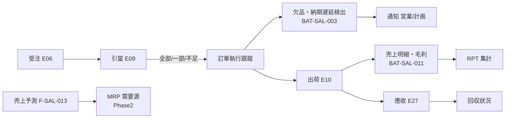
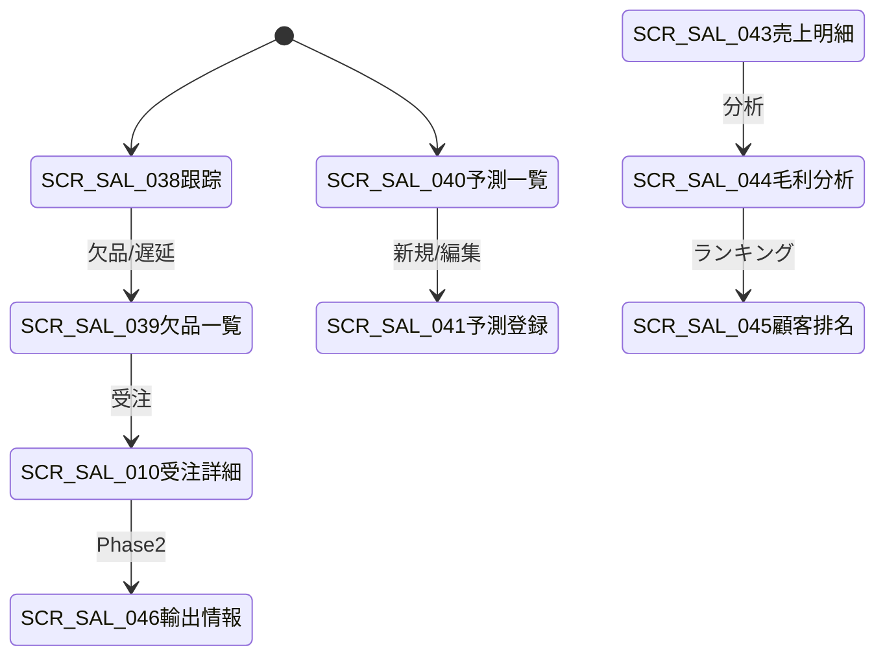

# 订单执行跟踪・销售预测・报表 详细设计书（受注進捗・売上予測・レポート 詳細設計書）

| 項目 | 内容 |
|---|---|
| 文書名 | 订单执行跟踪・销售预测・报表 详细设计书（受注進捗・売上予測・レポート 詳細設計書） |
| 文書番号 | DSN-SAL-007 |
| 版数 | v1.1 |
| 作成日 | 2026-10-20 |
| 作成者 | sales-designer（销售域担当） |
| 承認者 | 未承認（レビュー待ち） |
| 状態 | ドラフト（レビュー中） |
| 関連文書 | [業務域概要](00-overview.md) / [销售订单](02-sales-order.md) / [出荷](03-delivery-picking.md) / [開票・應收](05-invoice-receivable.md) / [信用管控](06-credit-pricing.md) / [共通業務規則](../00-common/08-common-business-rules.md) / [跨域流程](../00-common/09-cross-domain-flow.md) / 10-analytics（予定） / [生產域 MRP](../06-production/05-mrp-planning.md) |

---

## 1. 機能概要

| 項目 | 内容 |
|---|---|
| 機能 ID | F-SAL-012（訂單執行跟蹤）/ F-SAL-013（銷售預測）/ F-SAL-015（銷售報表）/ F-SAL-016（出口銷售預留） |
| 機能名 | 受注進捗・欠品・納期遅延の可視化、月次売上予測、域内レポート（売上明細・粗利・顧客排名）、輸出販売項目予約 |
| 目的 | 受注から出荷までの実行狀況を可視化し、引當不足・納期遅延に先手を打つ。売上・粗利・顧客別の實績を営業活動にフィードバックする。予測データを生産計画（MRP）へ提供する。輸出販売（Phase 2）の項目を予約する |
| 利用者・ロール | 銷售員（擔當顧客の進捗・回収状況）、銷售經理/銷售總監（全社・部門の進捗・業績）、計劃員（引當不足・納期回答の參考）、経営層（KPI） |
| 利用シーン | ① 日次の受注残・欠品・遅延確認 ② 顧客への納期回答 ③ 月末の売上・粗利分析 ④ 顧客別の取引規模・成長率分析 ⑤ 月次売上予測の入力・確定 ⑥ 輸出向け受注の項目入力（Phase 2） |
| 優先度 | F-SAL-012：P1、F-SAL-015：P1、F-SAL-013：P2（概要）、F-SAL-016：P2（項目予約） |
| 画面 ID | SCR-SAL-038（訂單執行跟蹤）、SCR-SAL-039（欠貨・交期遲延一覧）、SCR-SAL-040（銷售預測一覧）、SCR-SAL-041（銷售預測登録編集）、SCR-SAL-043（銷售明細報表）、SCR-SAL-044（毛利分析）、SCR-SAL-045（客戶排名）、SCR-SAL-046（出口銷售信息） |
| 関連 IF | E09（引當・不足）、E10（出荷）、E18（原價）、E27/E29（應收・入金）、FIN 帳齡 API、PRD MRP（Phase2）、RPT 抽出（BAT-SAL-011） |

## 2. 業務要件・業務ルール

### 2.1 前提条件

| # | 前提条件 | 成立しない場合の挙動 |
|---|---|---|
| 1 | 受注・引當（E09）・出荷（E10）データが存在する | 該當データなしは空表示（`MSG-SAL-190`） |
| 2 | 原價データ（E18 または INV 平均單價）が取得できる（粗利分析） | 原價不明明細は粗利を「—」とし、集計対象外（`MSG-SAL-191`） |
| 3 | 應收・入金（E27/E29）が FIN から取得できる（回収狀況） | FIN API 障害時は回収項目のみ非表示（`MSG-SAL-081`） |
| 4 | 予測は対象月の 3 ヶ月前〜當月まで入力可（Phase 2） | 期間外は入力不可 |
| 5 | 輸出販売の項目は Phase 2 で業務適用（Phase 1 は入力可能だがチェックなし） | — |

### 2.2 業務ルール

| # | ルール | 根拠 | 関連項目 |
|---|---|---|---|
| BR-TR-01 | 訂單執行區分：`10 未引當`（狀態 25）、`20 引當済未出荷`（30）、`30 一部出荷`（35）、`40 完了`（40）、`90 取消`、`95 却下`。引當不足がある場合は `20` に「欠品」フラグを付ける | 02-sales-order | `execution_status` |
| BR-TR-02 | 受注殘 = 受注數量 − 出荷済數量 − 取消數量（明細単位）。受注殘 > 0 かつ 狀態 30/35 の明細を「未出荷殘」と呼ぶ | 02-sales-order | `open_qty` |
| BR-TR-03 | 欠品（バックオーダー）= E09 で `shortage_qty > 0` の明細、または出荷確定時に出荷數量 < 受注殘となった明細。欠品數量 = 不足數量 | 03-delivery-picking | `shortage_qty` |
| BR-TR-04 | 納期遅延 = `delivery_date < 當日` かつ受注殘 > 0 の明細。遅延日數 = 當日 − 納期。BAT-SAL-003 で日次検出し、営業・計画へ通知する | 本設計 | `delay_days` |
| BR-TR-05 | 齊套（引當充足）判定：受注殘 ≤ 引當殘 + 在庫可用量（未引當分）の明細を「齊套可能」、それ以外を「欠品見込み」とする。齊套率 = 齊套可能な受注殘金額 ÷ 受注殘金額合計 | 本設計 | `is_ready`、`readiness_rate` |
| BR-TR-06 | 引當不足の解消見込み日は、`expected_available_date`（受注明細）または入荷/完成予定（PUR/PRD 照會）を用いる。不明な場合は「未定」と表示する | 02-sales-order | `expected_available_date` |
| BR-TR-07 | 売上明細レポートは「出荷確定日（E10）基準」で集計する（出荷基準、09 §7.3）。請求基準・入金基準とは一致しない | 09 §7.3 | `delivery_date` |
| BR-TR-08 | 粗利 = 売上金額（稅抜）− 売上原價。売上原價は E18 の出庫原價（`cost_amount`）を正とし、未確定の場合は INV 平均單價による概算を用いる（概算フラグを立てる） | 09 §7.2 | `gross_profit` |
| BR-TR-09 | 顧客排名は当期売上金額（稅込/稅抜を指定）・粗利・前年同期比・前月比で順位付けする。母集団はデータ範圍內（営業は擔當顧客のみ） | 本設計 | `rank`、`growth_rate` |
| BR-TR-10 | レポートの抽出元は SAL の傳票・明細とし、RPT 域の集計テーブルへ日次で抽出する（BAT-SAL-011）。RPT 側の算出式と齟齬が生じないよう、指標定義を本節に一元化する | 10-analytics | — |
| BR-TR-11 | 売上予測（Phase 2）は月次・顧客・物料単位で入力し、版數（`forecast_version`）で確定する。確定データは MRP の需要源として PRD へ提供する（Phase 2 でイベント/連携方式を確定） | 06-production | `forecast_version` |
| BR-TR-12 | 輸出販売（Phase 2）の項目：Incoterms 2020（`incoterms_code`）、引渡場所、外貨・為替レート、仕向國、港、通關單號、輸出許可番號、積荷明細（梱包明細）。Phase 1 は入力のみで業務チェックなし | 06-code-list §9 | — |
| BR-TR-13 | KPI の目標値は [00-overview §1.3](00-overview.md) を正とし、ダッシュボードに実績と目標を併記する。目標値は `sys_param` または RPT 域の KPI 定義で管理する | 本設計 | — |
| BR-TR-14 | データ範囲（営業は擔當顧客のみ、主管は部門、経営層は全社）を全レポートに適用する。集計値も範囲外を含めない | 共通項目定義 4 | — |
| BR-TR-15 | 帳票・レポートのエクスポートは 10,000 件まで同期、超過は非同期ジョブ（BAT または `/jobs`）。個人情報はマスキングする | 畫面共通規格 4.4 | — |

### 2.3 計算式・判定式

| # | 対象 | 算式 | 丸め | 例 |
|---|---|---|---|---|
| CALC-TR-01 | 受注殘數量 | 受注數量 − 出荷済 − 取消済 | 4 桁 | 120 − 40 − 0 = 80 PCE |
| CALC-TR-02 | 未出荷殘金額 | 受注殘數量 × 稅抜單價 | 2 桁 | 80 × 856.50 = 68,520.00 |
| CALC-TR-03 | 欠品數量 | MAX(0, 受注殘 − 引當殘) | 4 桁 | 80 − 60 = 20 PCE |
| CALC-TR-04 | 歸套率 | 齊套可能な受注殘金額 ÷ 受注殘金額合計 × 100 | 2 桁（%） | 4,000,000 ÷ 4,500,000 = 88.89% |
| CALC-TR-05 | 延遲日數 | 當日 − 納期（納期 < 當日） | 日 | 2026-10-20 − 2026-10-15 = 5 日 |
| CALC-TR-06 | 營收（稅抜） | Σ 出荷明細金額（E10） | 2 桁 | 102,780.00 |
| CALC-TR-07 | 銷貨成本 | Σ E18 `cost_amount`（または INV 平均單價 × 數量） | 2 桁 | 120 × 778.20 = 93,384.00 |
| CALC-TR-08 | 毛利 | 營收（稅抜）− 銷貨成本 | 2 桁 | 102,780.00 − 93,384.00 = 9,396.00 |
| CALC-TR-09 | 毛利率 | 毛利 ÷ 營收（稅抜）× 100 | 2 桁（%） | 9,396.00 ÷ 102,780.00 = 9.14% |
| CALC-TR-10 | 前期比 | (當期金額 − 前期金額) ÷ 前期金額 × 100 | 2 桁（%） | (102,780 − 98,000) ÷ 98,000 = 4.88% |
| CALC-TR-11 | 顧客佔比 | 顧客金額 ÷ 全社金額 × 100 | 2 桁（%） | — |
| CALC-TR-12 | DSO（應收周轉天數） | **平均應收餘額 ÷ 營業收入 × 期間日數**（FIN 定義。SAL は FIN 提供値を表示するのみ） | 2 桁 | FIN 提供値（平均残高口径）を使用 |
| CALC-TR-13 | 預測差異率 | (實績 − 預測) ÷ 預測 × 100 | 2 桁（%） | (1,050 − 1,000) ÷ 1,000 = 5.00% |

**訂單執行跟蹤例（【示例値】、2026-10-20 時点）**

| 受注番號 | 顧客 | 受注殘 | 引當殘 | 欠品 | 納期 | 延遲 | 齊套 | 狀態 |
|---|---|---|---|---|---|---|---|---|
| SO2610200001 | C000001 江蘇恒立液壓 | 80 PCE | 80 PCE | 0 | 2026-10-30 | 0 日 | ○ | 20 引當済未出荷 |
| SO2610190002 | C000002 國茂減速機 | 60 PCE | 20 PCE | 40 PCE | 2026-10-15 | 5 日 | × | 35 一部出荷（欠品） |
| SO2610180003 | C000005 上海凱泉泵業 | 120 PCE | 120 PCE | 0 | 2026-10-25 | 0 日 | ○ | 30 引當済 |

> 上記は【示例値】。顧客は公開企業情報に基づく示例（商業関係なし）。

### 2.4 処理フロー



## 3. 関連機能

| 関係 | 機能 ID | 機能名 | 関係內容 |
|---|---|---|---|
| 上流 | F-SAL-003/004/005 | 受注・変更・出荷 | 受注殘・引當・出荷實績 |
| 上流 | INV | 引當（E09）・在庫可用量 | 欠品判定 |
| 上流 | FIN | 應收（E27）・入金（E29）・帳齡 | 回収狀況 |
| 下流 | PRD | MRP | 売上予測（Phase2） |
| 下流 | RPT | 分析レポート | 日次抽出データ（BAT-SAL-011） |
| 下流 | F-SAL-010 | 與信 | 與信使用狀況表 |

## 4. 画面設計

### 4.1 画面一覧

| 画面 ID | 画面名 | 類型 | 概要 |
|---|---|---|---|
| SCR-SAL-038 | 訂單執行跟蹤 | DASH | 受注殘・引當・欠品・延遲・齊套率の可視化 |
| SCR-SAL-039 | 欠貨・交期遲延一覧 | LIST | 欠品・遅延明細の一覧と担当割当・メモ |
| SCR-SAL-040 | 銷售預測一覧 | LIST | 月次予測の検索・版數管理（Phase2） |
| SCR-SAL-041 | 銷售預測登録編集 | EDIT | 顧客・物料別の月次予測入力（Phase2） |
| SCR-SAL-043 | 銷售明細報表 | VIEW | 期間・顧客・物料別の売上明細 |
| SCR-SAL-044 | 毛利分析 | DASH | 顧客・物料・月別の粗利分析 |
| SCR-SAL-045 | 客戶排名 | VIEW | 売上・粗利・成長率による顧客ランキング |
| SCR-SAL-046 | 出口銷售信息 | EDIT | 輸出向け受注の Incoterms・外貨・通關情報（Phase2） |

### 4.2 画面遷移



### 4.3 画面レイアウト

**SCR-SAL-038 訂單執行跟蹤**

```
┌──────────────────────────────────────────────────────────────────────────────┐
│ パンくず：ホーム > 販売管理 > 受注進捗 > 訂單執行跟蹤                         │
├──────────────────────────────────────────────────────────────────────────────┤
│〔KPI〕受注殘 4,500,000.00｜引當済 3,200,000.00｜欠品 52 件｜延遲 18 件        │
│       齊套率 88.89%｜當月出荷 12,400,000.00｜未回収 2,632,358.47              │
├──────────────────────────────────────────────────────────────────────────────┤
│〔検索〕顧客[C000001▼] 擔當[E000123▼] 狀態[未完了▼] 納期[__]〜[__] 欠品のみ[ ]  │
├──────────────────────────────────────────────────────────────────────────────┤
│〔一覧〕受注番號|顧客|明細|受注殘|引當殘|欠品|納期|延遲|齊套|狀態|擔當|メモ     │
│ SO2610190002|國茂減速|YE3-132…|60|20|40|10-15|5日|×|35|E000124|入荷待ち      │
│ SO2610200001|恒立液壓|YE3-100…|80|80|0|10-30|0日|○|30|E000123|—             │
├──────────────────────────────────────────────────────────────────────────────┤
│〔フッタ〕[Excel 出力][CSV 出力][更新]                                        │
└──────────────────────────────────────────────────────────────────────────────┘
```

**SCR-SAL-041 銷售預測登録編集（Phase2）**

```
┌──────────────────────────────────────────────────────────────────────────────┐
│ 予測：FCST2610200001 版1 狀態[10 入力中] 対象月[2026-11] 部門[D010]          │
│ 顧客[C000001▼] 通貨[CNY] 入力締切[2026-10-25]                                │
├──────────────────────────────────────────────────────────────────────────────┤
│〔明細〕物料|品名|前月實績|本月予測|前年同月|成長率|確度|備考                  │
│ 3001000001|YE3-100L1-4|120|140|100|+40%|A|新規顧客分                        │
│ 3001000002|YE3-112M-4|60|60|60|0%|B|—                                       │
├──────────────────────────────────────────────────────────────────────────────┤
│〔合計〕數量 200｜金額 CNY 102,780.00                                          │
│〔フッタ〕[保存][確定][確定解除（主管）][戻る]                                │
└──────────────────────────────────────────────────────────────────────────────┘
```

### 4.4 画面項目定義

#### 4.4.1 SCR-SAL-038/039 訂單執行跟蹤（検索・一覧）

| No | 項目 ID | 項目名 | 種別 | 型/桁 | 必須 | 初期值 | 入力チェック | データソース | DB 項目 | 備考 |
|---|---|---|---|---|---|---|---|---|---|---|
| 1 | `customerId` | 顧客 | 選択 | BIGINT | △ | — | 有効顧客 | MDM | `customer_id` | 検索 |
| 2 | `ownerUserId` | 営業擔當 | 選択 | BIGINT | △ | — | 有効ユーザ | SYS | `owner_user_id` | 検索 |
| 3 | `orderStatus` | 狀態 | 選択 | SMALLINT | △ | 未完了 | 25/30/35/40 | — | `order_status` | 検索 |
| 4 | `deliveryDateFrom/To` | 納期範圍 | 日付 | DATE | △ | — | from ≤ to | — | `delivery_date` | 検索 |
| 5 | `shortageOnly` | 欠品のみ | チェック | BOOLEAN | — | false | — | — | — | 検索 |
| 6 | `delayOnly` | 延遲のみ | チェック | BOOLEAN | — | false | — | — | — | 検索 |
| 7 | `orderNo` | 受注番號 | 表示 | VARCHAR(32) | — | — | — | SAL | `sales_order_no` | リンク |
| 8 | `materialCode/Name` | 物料 | 表示 | VARCHAR(20/200) | — | — | — | SAL | `material_code/name` | — |
| 9 | `orderedQty` | 受注數量 | 表示 | NUMERIC(18,4) | — | — | — | SAL | `ordered_qty` | — |
| 10 | `openQty` | 受注殘 | 表示 | NUMERIC(18,4) | — | — | — | 計算 | — | CALC-TR-01 |
| 11 | `reservedQty` | 引當殘 | 表示 | NUMERIC(18,4) | — | — | — | SAL | `reserved_qty` | — |
| 12 | `shortageQty` | 欠品數量 | 表示 | NUMERIC(18,4) | — | — | — | SAL | `shortage_qty` | 赤表示 |
| 13 | `deliveryDate` | 納期 | 表示 | DATE | — | — | — | SAL | `delivery_date` | — |
| 14 | `delayDays` | 延遲日數 | 表示 | INT | — | — | — | 計算 | — | CALC-TR-05 |
| 15 | `isReady` | 齊套 | 表示 | BOOLEAN | — | — | — | 計算 | — | CALC-TR-04 |
| 16 | `expectedAvailableDate` | 入荷/完成予定 | 表示 | DATE | — | — | — | SAL/PUR/PRD | `expected_available_date` | — |
| 17 | `executionStatus` | 執行區分 | 表示 | SMALLINT | — | — | — | 計算 | — | 10/20/30/40/90/95 |
| 18 | `memo` | メモ | テキスト | VARCHAR(500) | △ | — | 500 桁 | 手入力 | `tracking_memo` | 追記のみ |
| 19 | `readinessRate` | 齊套率 | 數値 | NUMERIC(7,2) | — | — | — | 計算 | — | KPI カード |

#### 4.4.2 SCR-SAL-040/041 銷售預測（Phase2）

| No | 項目 ID | 項目名 | 種別 | 型/桁 | 必須 | 初期值 | 入力チェック | データソース | DB 項目 | 備考 |
|---|---|---|---|---|---|---|---|---|---|---|
| 1 | `forecastNo` | 予測番號 | テキスト | VARCHAR(32) | ○ | 自動採番 | `FCST+YYMMDD+4桁` | SYS | `forecast_no` | 參照のみ |
| 2 | `forecastVersion` | 版數 | 表示 | INT | — | 1 | — | — | `forecast_version` | 確定で +1 |
| 3 | `periodCode` | 対象月 | 選択 | VARCHAR(7) | ○ | 翌月 | 3 ヶ月前〜當月 | 手入力 | `period_code` | — |
| 4 | `departmentId` | 部門 | 選択 | BIGINT | ○ | ユーザ部門 | 有効組織 | SYS | `department_id` | — |
| 5 | `customerId` | 顧客 | 選択 | BIGINT | ○ | — | 有効顧客 | MDM | `customer_id` | — |
| 6 | `currencyCode` | 通貨 | 選択 | VARCHAR(3) | ○ | CNY | Phase1 CNY のみ | MDM | `currency_code` | — |
| 7 | `inputDeadline` | 入力締切 | 日付 | DATE | △ | 當月末 | 未来日 | 手入力 | `input_deadline` | — |
| 8 | `forecastStatus` | 狀態 | 表示 | SMALLINT | — | 10 | — | — | `forecast_status` | 10/25/40/90 |
| 9 | `materialId/Code/Name` | 物料 | 選択 | BIGINT/VARCHAR | ○ | — | 有効・販売可 | MDM/SAL | `material_id/code/name` | 明細 |
| 10 | `lastMonthActualQty` | 前月實績 | 表示 | NUMERIC(18,4) | — | 自動 | — | SAL | — | 集計 |
| 11 | `lastYearSameMonthQty` | 前年同月 | 表示 | NUMERIC(18,4) | — | 自動 | — | SAL | — | 集計 |
| 12 | `forecastQty` | 本月予測數量 | 數値 | NUMERIC(18,4) | ○ | 前月實績 | ≥ 0、4 桁 | 手入力 | `forecast_qty` | — |
| 13 | `forecastAmount` | 予測金額 | 數値 | NUMERIC(18,2) | — | 自動 | — | 計算 | `forecast_amount` | 標準價ベース |
| 14 | `confidence` | 確度 | 選択 | VARCHAR(1) | △ | B | A/B/C | 手入力 | `confidence` | — |
| 15 | `growthRate` | 成長率 | 表示 | NUMERIC(7,2) | — | 自動 | — | 計算 | — | CALC-TR-13 |
| 16 | `lineRemark` | 明細備考 | テキスト | VARCHAR(500) | △ | — | 500 桁 | 手入力 | `line_remark` | — |

#### 4.4.3 SCR-SAL-043/044/045 レポート（検索條件）

| No | 項目 ID | 項目名 | 種別 | 型/桁 | 必須 | 初期值 | 入力チェック | データソース | 備考 |
|---|---|---|---|---|---|---|---|---|---|
| 1 | `dateFrom/To` | 期間 | 日付 | DATE | ○ | 當月 | from ≤ to | 手入力 | 出荷確定日基準 |
| 2 | `customerId` | 顧客 | 選択 | BIGINT | △ | — | 有効顧客 | MDM | 複数選択可 |
| 3 | `materialId` | 物料 | 選択 | BIGINT | △ | — | 有効物料 | MDM | 複数選択可 |
| 4 | `salesDepartmentId` | 部門 | 選択 | BIGINT | △ | ユーザ部門 | 有効組織 | SYS | データ範圍 |
| 5 | `ownerUserId` | 営業擔當 | 選択 | BIGINT | △ | — | 有効ユーザ | SYS | — |
| 6 | `currencyCode` | 通貨 | 選択 | VARCHAR(3) | — | CNY | Phase1 CNY | MDM | — |
| 7 | `amountBasis` | 金額基準 | 選択 | SMALLINT | ○ | 10 稅抜 | 10 稅抜/20 稅込 | 固定値 | — |
| 8 | `groupBy` | 集計單位 | 選択 | SMALLINT | ○ | 10 顧客 | 10 顧客/20 物料/30 月/40 営業擔當 | 固定値 | — |
| 9 | `topN` | ランキング件數 | 選択 | INT | — | 20 | 10/20/50/100 | 固定値 | 客戶排名 |
| 10 | `includeCost` | 原價表示 | チェック | BOOLEAN | — | false | 原價権限者のみ | 權限 | 粗利表示 |
| 11 | `exportFormat` | 出力形式 | 選択 | SMALLINT | — | 10 Excel | 10 Excel/20 CSV/30 PDF | 固定値 | — |

### 4.5 イベント処理

| No | イベント | トリガ | 処理內容 | 呼出 API / 処理 ID | 畫面遷移 | 備考 |
|---|---|---|---|---|---|---|
| 1 | 追蹤検索 | 検索ボタン | 受注殘・引當・欠品・延遲を集計 | GET /api/sales/order-tracking | — | 2 秒目標 |
| 2 | 欠品一覧 | リンク | 欠品明細の抽出（E09 + 受注殘） | GET /api/sales/order-tracking/shortages | SCR-SAL-039 | — |
| 3 | 遅延一覧 | リンク | 納期遅延明細の抽出 | GET /api/sales/order-tracking/delays | SCR-SAL-039 | — |
| 4 | メモ保存 | 保存 | 追跡メモの追記 | PUT /api/sales/order-tracking/{orderId}/memo | — | 追記のみ |
| 5 | 予測入力 | 保存 | Phase2：予測明細の保存・版數管理 | POST /api/sales/forecasts | — | — |
| 6 | 予測確定 | ボタン | 狀態 25、版數 +1、MRP 連携（Phase2） | POST /api/sales/forecasts/{id}/confirm | — | — |
| 7 | 売上明細 | 検索 | 出荷確定日基準の売上明細 | GET /api/sales/reports/sales-detail | — | — |
| 8 | 毛利分析 | 検索 | 粗利・毛利率（原價権限者のみ） | GET /api/sales/reports/gross-profit | — | — |
| 9 | 顧客排名 | 検索 | 売上・粗利・成長率のランキング | GET /api/sales/reports/customer-ranking | — | — |
| 10 | エクスポート | ボタン | Excel/CSV（10,000 件超は非同期） | POST /api/sales/exports | — | — |
| 11 | 輸出情報 | 保存 | Phase2：SO の輸出項目保存 | PUT /api/sales/sales-orders/{id}/export-info | — | — |

### 4.6 表示制御

| 條件 | 対象 | 制御 |
|---|---|---|
| 原價権限なし | 原價・粗利 | 非表示（API 非返却） |
| データ範圍外 | 顧客・金額 | 非表示 |
| 欠品 0 | 欠品列 | 「—」表示 |
| 遅延 0 日 | 延遲列 | 非表示 |
| 予測狀態 25（確定済） | 編集 | 非表示（主管のみ解除可） |
| Phase1 | 輸出情報 | 入力可・チェックなし（Phase2 バッジ表示） |

## 5. 入力チェック仕様

| No | チェック ID | 対象項目 | 種別 | 條件 | タイミング | メッセージ ID |
|---|---|---|---|---|---|---|
| 1 | CHK-SAL-007-01 | 期間 | 必須/相関 | from ≤ to、1 年以內 | 検索時 | MSG-COM-046 |
| 2 | CHK-SAL-007-02 | 顧客・物料 | コード存在 | 有効 | 検索時 | MSG-COM-049 |
| 3 | CHK-SAL-007-03 | 集計單位 | 必須 | 固定値 | 検索時 | MSG-COM-040 |
| 4 | CHK-SAL-007-04 | 件數超過 | 範圍 | 10,000 件超は非同期 | 検索時 | MSG-COM-052 |
| 5 | CHK-SAL-007-05 | 予測対象月 | 必須/範囲 | 3 ヶ月前〜當月 | 保存時 | MSG-SAL-192 |
| 6 | CHK-SAL-007-06 | 予測數量 | 必須/範圍 | ≥ 0、4 桁 | 保存時 | MSG-COM-044 |
| 7 | CHK-SAL-007-07 | 予測狀態 | 業務 | 10/25 のみ編集可、25 は主管のみ解除 | 保存時 | MSG-COM-034 |
| 8 | CHK-SAL-007-08 | 予測版數 | 一意 | 同一対象月・顧客・部門で版數重複なし | 確定時 | MSG-COM-050 |
| 9 | CHK-SAL-007-09 | 輸出項目 | 形式 | Incoterms 2020 のコード、通貨 3 桁 | Phase2 保存時 | MSG-SAL-193 |
| 10 | CHK-SAL-007-10 | エクスポート | 権限 | `sales:report:export` | 出力時 | MSG-COM-030 |
| 11 | CHK-SAL-007-11 | 原價表示 | 権限 | 原價権限者のみ | 検索時 | MSG-COM-030 |
| 12 | CHK-SAL-007-12 | 期間締切 | 業務 | 締切後のデータも参照可（修正不可） | 検索時 | — |

## 6. 処理詳細

### 6.1 処理一覧

| 処理 ID | 処理名 | 契機 | トランザクション | 排他 |
|---|---|---|---|---|
| PRC-SAL-007-01 | 執行跟蹤集計 | 畫面検索 | 不要（読取） | — |
| PRC-SAL-007-02 | 欠品・遅延抽出 | 検索/バッチ | 不要（読取） | — |
| PRC-SAL-007-03 | 納期遅延検出・通知 | BAT-SAL-003 | 要（通知ログ） | 二重起動防止 |
| PRC-SAL-007-04 | 売上明細集計 | 検索/バッチ | 不要（読取） | — |
| PRC-SAL-007-05 | 粗利集計 | 検索/バッチ | 不要（読取） | — |
| PRC-SAL-007-06 | 顧客排名集計 | 検索/バッチ | 不要（読取） | — |
| PRC-SAL-007-07 | RPT 抽出 | BAT-SAL-011 | 要（抽出テーブル） | 日付単位全削除→再作成 |
| PRC-SAL-007-08 | 予測保存・確定 | 画面/確定 | 要（Phase2） | 楽観排他 |
| PRC-SAL-007-09 | 輸出情報保存 | 画面 | 要（So ヘッダ予約項目） | 楽観排他 |

### 6.2 処理手順（正常系）

**PRC-SAL-007-01 執行跟蹤集計**

1. 検索條件（顧客・擔當・狀態・納期・欠品/遅延フラグ）とデータ範圍を SQL に適用する。
2. `sal_sales_order`・`sal_sales_order_line` から狀態 25/30/35・受注殘 > 0 の明細を取得する。
3. 明細ごとに CALC-TR-01〜05 を計算し、引當殘・欠品・齊套・延遲日數を算出する。
4. KPI（受注殘金額・引當済金額・欠品件數・延遲件數・齊套率）を集計する。
5. ページングして返す。応答 2 秒以內を目標とする（`idx_sal_sales_order_line_status`）。

**PRC-SAL-007-04 売上明細集計**

1. 期間（出荷確定日）・顧客・物料・部門・擔當で E10 確定済の `sal_delivery_note_line` を抽出する。
2. 明細ごとに數量・稅抜金額・稅額・稅込金額を集計し、原價権限がある場合は E18 の `cost_amount`（未確定時は INV 平均單價による概算）を付加する。
3. グルーピング（顧客/物料/月/擔當）ごとに合計・粗利・毛利率を計算する（CALC-TR-06〜09）。
4. 金額基準（稅抜/稅込）を適用し、2 桁 HALF_UP で返す。
5. 10,000 件超の場合は非同期ジョブを起動し、`MSG-COM-004` を返す。

**PRC-SAL-007-03 納期遅延検出・通知（BAT-SAL-003）**

1. 前回実行日時を確認し、二重起動を防止する。
2. `delivery_date < 當日` かつ受注殘 > 0 の明細を抽出する（CALC-TR-05）。
3. 新規に遅延となった明細（前回通知なし）を抽出し、担当営業・計劃へ站内通知する。通知ログを `sys_notification` に記錄する。
4. 欠品（`shortage_qty > 0`）の明細についても日次で担当へ通知する。
5. 実行件数・通知件数を `sys_job_log` に記錄する。再実行しても通知が重複しないよう、当日分の通知済みキーを確認する。

**PRC-SAL-007-08 予測保存・確定（Phase 2 概要）**

1. 対象月・部門・顧客の予測を保存する（`forecast_status=10`）。版數は保存時に採番する。
2. 前月實績・前年同月を SAL の出荷實績から集計して表示用に保持する。
3. 「確定」で `forecast_status=25`、`forecast_version+1`、`confirmed_at/by` を更新する。確定データは MRP の需要源として PRD に提供する（Phase 2 でイベント/API を確定）。
4. 確定解除は主管のみ可能（理由必須）。

### 6.3 例外処理

| No | 異常條件 | 検知箇所 | 処理 | ロールバック | メッセージ ID |
|---|---|---|---|---|---|
| 1 | データなし | 検索 | 空表示（ヘッダ維持） | — | MSG-SAL-190 |
| 2 | 原價取得不能 | 粗利集計 | 粗利「—」・集計対象外・概算フラグ | — | MSG-SAL-191 |
| 3 | FIN API 障害 | 回収狀況 | 回収項目のみ非表示 | — | MSG-SAL-081 |
| 4 | 件數超過 | 検索/出力 | 非同期ジョブへ切替 | — | MSG-COM-052 |
| 5 | 予測期間外 | 予測保存 | エラー | 全體 | MSG-SAL-192 |
| 6 | 予測版數重複 | 確定 | エラー | 全體 | MSG-COM-050 |
| 7 | バッチ二重起動 | BAT-SAL-003/011 | 起動スキップ・ログ | — | MSG-COM-084 |
| 8 | RPT 抽出失敗 | BAT-SAL-011 | ロールバック・アラート・再実行 | 日付単位 | MSG-COM-080 |

### 6.4 冪等性・再実行

- 集計 API は読取のみで冪等。
- BAT-SAL-003（遅延通知）は当日の通知済みキー（`orderLineId + notifyDate`）で重複通知を防止する。
- BAT-SAL-011（RPT 抽出）は日付単位で全削除→再作成するため再実行可能。抽出途中で失敗した場合はロールバックし、部分データを殘さない。
- 予測の確定は版數の一意制約で二重確定を防止する。

## 7. API 設計

### 7.1 API 一覧

| No | メソッド | パス | 権限 | 概要 | 主なエラー |
|---|---|---|---|---|---|
| 1 | GET | `/api/sales/order-tracking` | `sales:tracking:view` | 執行跟蹤一覧 | 3001 |
| 2 | GET | `/api/sales/order-tracking/summary` | `sales:tracking:view` | KPI サマリ | 3001 |
| 3 | GET | `/api/sales/order-tracking/shortages` | `sales:tracking:view` | 欠品一覧 | 3001 |
| 4 | GET | `/api/sales/order-tracking/delays` | `sales:tracking:view` | 納期遅延一覧 | 3001 |
| 5 | PUT | `/api/sales/order-tracking/{orderId}/memo` | `sales:tracking:view` | 追跡メモ追記 | 4001 |
| 6 | GET | `/api/sales/forecasts` | `sales:forecast:view` | 予測一覧（Phase2） | 3001 |
| 7 | POST | `/api/sales/forecasts` | `sales:forecast:create` | 予測保存（Phase2） | 1001 |
| 8 | POST | `/api/sales/forecasts/{id}/confirm` | `sales:forecast:create` | 予測確定（Phase2） | 4002 |
| 9 | GET | `/api/sales/reports/sales-detail` | `sales:report:view` | 売上明細 | 3001 |
| 10 | GET | `/api/sales/reports/gross-profit` | `sales:report:view` | 粗利分析 | 3001 |
| 11 | GET | `/api/sales/reports/customer-ranking` | `sales:report:view` | 顧客排名 | 3001 |
| 12 | GET | `/api/sales/reports/sales-summary` | `sales:report:view` | 売上サマリ（部門/擔當/月） | 3001 |
| 13 | PUT | `/api/sales/sales-orders/{id}/export-info` | `sales:export:update` | 輸出販売情報（Phase2） | 4001 |
| 14 | POST | `/api/sales/exports` | `sales:report:export` | 非同期エクスポート | 4005 |

### 7.2 リクエスト／レスポンス詳細

**GET /api/sales/order-tracking?status=25,30,35&shortageOnly=true&pageNum=1&pageSize=20 → 200**

```json
{
  "code": 0,
  "message": "ok",
  "data": {
    "list": [
      {
        "salesOrderId": "1845679000000000002",
        "salesOrderNo": "SO2610190002",
        "customerCode": "C000002",
        "customerName": "江苏国茂减速机股份有限公司",
        "orderStatus": 35,
        "materialCode": "3001000003",
        "materialName": "YE3-132S-4 三相异步电动机 5.5kW 4极",
        "orderedQty": "100.0000",
        "shippedQty": "40.0000",
        "openQty": "60.0000",
        "reservedQty": "20.0000",
        "shortageQty": "40.0000",
        "deliveryDate": "2026-10-15",
        "delayDays": 5,
        "isReady": false,
        "executionStatus": 35,
        "expectedAvailableDate": "2026-10-28",
        "ownerUserName": "E000124 王**",
        "trackingMemo": "入荷待ち、10/28 完成予定"
      }
    ],
    "total": 52,
    "pageNum": 1,
    "pageSize": 20,
    "pages": 3,
    "summary": {
      "openAmount": "4500000.00",
      "reservedAmount": "3200000.00",
      "shortageCount": 52,
      "delayCount": 18,
      "readinessRate": "88.89",
      "asOf": "2026-10-20T09:00:00+08:00"
    }
  }
}
```

**GET /api/sales/reports/sales-detail?dateFrom=2026-10-01&dateTo=2026-10-31&groupBy=10&amountBasis=10 → 200**

```json
{
  "code": 0,
  "message": "ok",
  "data": {
    "list": [
      {
        "customerCode": "C000001",
        "customerName": "江苏恒立液压股份有限公司",
        "deliveryCount": 2,
        "qty": "120.0000",
        "salesAmount": "102780.00",
        "taxAmount": "13361.40",
        "totalAmount": "116141.40",
        "costAmount": "93384.00",
        "grossProfit": "9396.00",
        "grossMarginRate": "9.14"
      }
    ],
    "totalAmount": "102780.00",
    "totalCost": "93384.00",
    "totalGrossProfit": "9396.00",
    "averageMarginRate": "9.14",
    "costEstimated": false,
    "period": { "from": "2026-10-01", "to": "2026-10-31" }
  }
}
```

**GET /api/sales/reports/customer-ranking?dateFrom=2026-01-01&dateTo=2026-10-31&topN=2 → 200**

```json
{
  "code": 0,
  "message": "ok",
  "data": {
    "list": [
      {
        "rank": 1,
        "customerCode": "C000001",
        "customerName": "江苏恒立液压股份有限公司",
        "salesAmount": "4280000.00",
        "grossProfit": "1020000.00",
        "grossMarginRate": "23.83",
        "shareRate": "9.52",
        "lastPeriodAmount": "3980000.00",
        "growthRate": "7.54"
      },
      {
        "rank": 2,
        "customerCode": "C000002",
        "customerName": "江苏国茂减速机股份有限公司",
        "salesAmount": "3120000.00",
        "grossProfit": "740000.00",
        "grossMarginRate": "23.72",
        "shareRate": "6.94",
        "lastPeriodAmount": "3050000.00",
        "growthRate": "2.30"
      }
    ],
    "totalSalesAmount": "44960000.00",
    "currencyCode": "CNY",
    "asOf": "2026-10-20"
  }
}
```

**PUT /api/sales/sales-orders/{id}/export-info（Phase2 項目予約）**

```json
{
  "version": 3,
  "incotermsCode": "FOB",
  "incotermsPlace": "Shanghai Port",
  "destinationCountryCode": "US",
  "portOfLoading": "CNSHA",
  "portOfDestination": "USLAX",
  "foreignCurrencyCode": "USD",
  "exportDeclarationNo": null,
  "exportLicenseNo": null,
  "packingListNo": null,
  "remark": "Phase2 輸出向け項目（現状は入力のみ）"
}
```

## 8. データ更新仕様

| テーブル | 操作 | 更新項目 | 更新條件 | トリガ |
|---|---|---|---|---|
| `sal_sales_order_line` | UPDATE | `tracking_memo`（追記） | メモ保存 | PRC-SAL-007-01 |
| `sal_sales_order` | UPDATE | 輸出予約項目（`incoterms_code` 等） | Phase2 保存 | PRC-SAL-007-09 |
| `sal_sales_forecast` | INSERT/UPDATE | 予測ヘッダ・`forecast_status`・`forecast_version` | Phase2 保存/確定 | PRC-SAL-007-08 |
| `sal_sales_forecast_line` | INSERT/UPDATE | 明細・`forecast_qty`・`forecast_amount` | Phase2 保存 | PRC-SAL-007-08 |
| `rpt_sales_detail`（RPT 域抽出テーブル） | INSERT/DELETE | 日次抽出データ | BAT-SAL-011 | 日付単位再作成 |
| `sys_notification` | INSERT | 遅延・欠品通知 | BAT-SAL-003 | — |
| `sys_job_log` | INSERT | 実行結果・件數 | 各バッチ | — |

> 集計 API はテーブルを更新しない（読取専用）。RPT 域への抽出は RPT 側のテーブル定義に従う（10-analytics（予定） 予定）。

## 9. エラー処理・メッセージ

| メッセージ ID | 種別 | 本文 | 発生條件 | 利用者への対処 | ログ |
|---|---|---|---|---|---|
| MSG-SAL-190 | I | 没有符合条件的数据。 | 該當なし | 條件変更 | INFO |
| MSG-SAL-191 | W | 部分明细缺少成本数据，毛利按「—」显示且不计入合计。 | 原價未確定 | 原價確定後に再実行 | WARN |
| MSG-SAL-192 | E | 预测対象月必须在 3 个月前至当月的范围内。 | 期間外 | 対象月修正 | WARN |
| MSG-SAL-193 | E | 出口销售信息格式不正确（Incoterms/货币/国家代码）。 | Phase2 形式不正 | 形式修正 | WARN |
| MSG-SAL-194 | I | 已导出 {0} 件数据。 | 同期出力 | — | INFO |
| MSG-SAL-195 | W | 数据量超过 10,000 件，已转为异步导出（任务号 {0}）。 | 非同期切替 | ジョブ完了を待つ | INFO |
| MSG-SAL-196 | I | 预测已保存（版 {0}）。 | Phase2 保存 | — | INFO |
| MSG-SAL-197 | I | 预测已确定，可用于生产计划。 | Phase2 確定 | — | INFO |
| MSG-SAL-198 | W | 齐套率低于目标值（{0}%），请确认欠品与延迟案件。 | KPI 割れ | 欠品・遅延確認 | WARN |

## 10. 権限・セキュリティ

| 種別 | 內容 |
|---|---|
| 画面権限 | `sales:tracking:view`、`sales:forecast:view/create`、`sales:report:view/export`、`sales:export:update` |
| 操作権限 | 追蹤メモ=営業、予測確定=主管、レポート出力=権限者、輸出情報=Phase2 |
| 項目権限 | 原價・粗利は原價権限者のみ、他擔當顧客の金額は非表示 |
| データ範囲 | 営業=擔當顧客、主管=部門、経営層=全社 |
| 監査ログ | レポート出力・エクスポート・予測確定を記錄（出力條件・件數） |

## 11. 性能・非機能

| 項目 | 目標値 | 前提 |
|---|---|---|
| 追蹤一覧 | 2 秒以内（100 件） | `idx_sal_sales_order_line_status_delivery` |
| KPI サマリ | 3 秒以内 | 集計キャッシュ（5 分） |
| 売上明細（月次） | 5 秒以内（10 万明細） | 出荷明細インデックス |
| 粗利集計 | 8 秒以内（10 万明細） | E18 原價結合 |
| RPT 抽出バッチ | 30 分以内（日次） | 月次パーティション検討（Phase2） |
| 同時実行 | 50 ユーザ | — |

## 12. テスト観点

| No | 観点 ID | 分類 | 観点 | 期待結果 |
|---|---|---|---|---|
| 1 | TST-F-SAL-012-01 | 正常系 | 追蹤一覧 | 受注殘・引當殘・欠品・延遲が正しく計算される |
| 2 | TST-F-SAL-012-02 | 正常系 | 欠品のみフィルタ | `shortage_qty > 0` のみ表示 |
| 3 | TST-F-SAL-012-03 | 正常系 | 齊套率計算 | CALC-TR-04 と一致 |
| 4 | TST-F-SAL-012-04 | 正常系 | 納期遅延検出バッチ | 遅延明細が抽出され通知される |
| 5 | TST-F-SAL-012-05 | 異常系 | データなし | 空表示（MSG-SAL-190） |
| 6 | TST-F-SAL-012-06 | 権限 | 擔當外顧客の追蹤 | データ範圍外は非表示 |
| 7 | TST-F-SAL-012-07 | 冪等 | 遅延通知バッチ再実行 | 当日の重複通知なし |
| 8 | TST-F-SAL-013-01 | 正常系 | 予測保存・確定（Phase2） | 版數 +1、狀態 25 |
| 9 | TST-F-SAL-013-02 | 異常系 | 予測対象月の範囲外 | エラー（MSG-SAL-192） |
| 10 | TST-F-SAL-015-01 | 正常系 | 売上明細（出荷基準） | E10 基準の金額・數量一致 |
| 11 | TST-F-SAL-015-02 | 正常系 | 粗利計算 | E18 原價と一致、毛利率一致 |
| 12 | TST-F-SAL-015-03 | 異常系 | 原價未確定 | 粗利「—」・概算フラグ |
| 13 | TST-F-SAL-015-04 | 正常系 | 顧客排名 | 金額・成長率・シェア一致 |
| 14 | TST-F-SAL-015-05 | 境界値 | 10,000 件超エクスポート | 非同期ジョブ切替 |
| 15 | TST-F-SAL-015-06 | 権限 | 原價権限なし | 粗利非表示・API 非返却 |
| 16 | TST-F-SAL-015-07 | 連携 | RPT 抽出バッチ | 抽出件數・金額が SAL と一致 |
| 17 | TST-F-SAL-016-01 | 正常系 | 輸出情報保存（Phase2） | 項目保存・再表示一致 |
| 18 | TST-F-SAL-016-02 | 異常系 | Incoterms 不正 | エラー（MSG-SAL-193） |

## 13. 未決事項

| # | 事項 | 理由 | 暫定仕様 | 担当 | 期限 |
|---|---|---|---|---|---|
| 1 | 売上予測から MRP への連携方式（イベント/API/DB 参照）（**已裁决**） | PRD 域の MRP 設計待ちだったが、Lead が **E43 `sales.forecast.updated`（SAL→PRD、Phase 2）** を 09 §3 に追補（2026-10-20） | **已裁决：E43 已定义（Phase 2 实现）**。payload：forecastId, periodCode, lines[{materialId, forecastDate, qty}], version。Phase 1 は同期参照（予測テーブル共有 or API）で代替し、Phase 2 で E43 による MRP 需要取込を実装 | Lead / sales-designer / production-designer | Phase 2 |
| 2 | 粗利計算に用いる原價（E18 実績 vs INV 平均單價 vs 標準原價） | 原價確定時期と目的が異なる | 確定済は E18 実績、未確定は INV 平均單價の概算（概算フラグ） | finance-designer / inventory-designer | 2026-11-01 |
| 3 | 顧客排名の金額基準（稅抜/稅込）と期間（月次/累計） | 経営層の利用目的による | 既定は稅抜・當月累計。検索條件で切替可 | Lead / 業務 | 2026-10-30 |
| 4 | 齊套判定に未引當の在庫可用量を含めるか | 引當前の在庫は他受注に取られる可能性 | 現状は「引當殘＋可用量」で參考判定し「參考」表示 | Lead | 2026-10-30 |
| 5 | 輸出販売の詳細（Incoterms 別の費用負担・通關・外貨換算） | Phase 2 | 項目予約のみ | sales-designer | Phase 2 |
| 6 | RPT 域との集計テーブル重複回避 | 10-analytics と並行設計 | SAL は明細提供、集計は RPT が保有。本域の域内レポートは SAL 側で生成 | Lead / analytics-designer | 2026-10-30 |

## 14. 改訂履歴

| 版数 | 日付 | 変更內容 | 変更者 |
|---|---|---|---|
| v1.0 | 2026-10-20 | 初版作成：訂單執行跟蹤（受注殘・引當・欠品・納期延遲・齊套率）、月次予測（Phase2 概要）、売上明細・粗利・顧客排名レポート、輸出販売項目予約、KPI/算式定義、畫面 8 件、API 14 件、テスト観点 18 件 | sales-designer |
| v1.1 | 2026-10-20 | Lead 追補 E43 `sales.forecast.updated` を反映：予測連携の未決 #1 を「E43 已定义（Phase2 实现）」に更新。紅隊修復第 2 輪：売上原価を J06 正本 93,384.00（120×778.20）に、DSO を平均残高口径（FIN 定義）に統一 | system-workflow（validator） |


