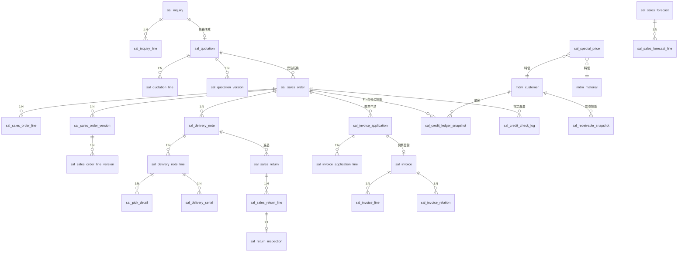

# 销售管理 数据库详细设计书（販売管理 DB 詳細設計書）

| 項目 | 内容 |
|---|---|
| 文書名 | 销售管理 数据库详细设计书（販売管理 DB 詳細設計書） |
| 文書番号 | DSN-SAL-090 |
| 版数 | v1.1 |
| 作成日 | 2026-10-20 |
| 作成者 | sales-designer（销售域担当） |
| 承認者 | 未承認（レビュー待ち） |
| 状態 | ドラフト（レビュー中） |
| 関連文書 | [業務域概要](00-overview.md) / [DB 共通規格](../00-common/04-common-db-spec.md) / [共通項目定義](../00-common/01-common-item-definitions.md) / [テーブル定義テンプレート](../_template/03-table-definition-template.md) / [主データ域 DB](../02-mdm/90-db-design.md) / [跨域流程](../00-common/09-cross-domain-flow.md) |

---

## 1. 設計方針

### 1.1 データモデル概要

銷售域は「引合 → 見積 → 受注 → 出荷指示 → 出荷確定 → 請求 → 應收」の傳票チェーンを保持し、在庫引當・與信・AR は他域が所有者となる。本域テーブルは以下の 5 分類に分かれる。

| 分類 | テーブル | 役割 |
|---|---|---|
| 引合・見積 | `sal_inquiry` / `sal_inquiry_line` / `sal_quotation` / `sal_quotation_line` / `sal_quotation_version` | 引合受付・見積提示・版數管理 |
| 受注 | `sal_sales_order` / `sal_sales_order_line` / `sal_sales_order_version` / `sal_sales_order_line_version` | 受注登録・引當/出荷實績・変更版管理 |
| 出荷 | `sal_delivery_note` / `sal_delivery_note_line` / `sal_pick_detail` / `sal_delivery_serial` | 出荷指示・ピッキング（批次/序列號）・出荷實績 |
| 返品・請求・對账 | `sal_sales_return` / `sal_sales_return_line` / `sal_return_inspection` / `sal_invoice_application` / `sal_invoice_application_line` / `sal_invoice` / `sal_invoice_line` / `sal_invoice_relation` / `sal_statement` / `sal_statement_line` | 返品・赤伝・開票・對账 |
| 與信・應收投影・特價・予測 | `sal_credit_ledger_snapshot` / `sal_credit_check_log` / `sal_receivable_snapshot` / `sal_special_price` / `sal_sales_forecast` / `sal_sales_forecast_line` | 與信占用・判定履歴・FIN 投影・特價・予測 |



### 1.2 設計原則

| # | 原則 | 內容 |
|---|---|---|
| 1 | 更新責任の一元化 | 本域が更新するのは `sal_*` のみ。`mdm_*`/`inv_*`/`fin_*` は参照専用（同期 API/イベント投影） |
| 2 | 傳票は物理削除しない | 取消は `*_status=90` で表現。`deleted` カラムは傳票テーブルに付けない（[01 §2.3](../00-common/01-common-item-definitions.md)） |
| 3 | スナップショット | 顧客名・稅號・住所・物料名・仕様・單位・單價・稅率・為替レートは傳票登録時にコピーし、マスタ変更の影響を排除する |
| 4 | 金額・數量の精度 | 金額 `NUMERIC(18,2)`、單價 `NUMERIC(18,6)`、數量 `NUMERIC(18,4)`、率 `NUMERIC(7,4)`、為替 `NUMERIC(18,8)`（[01 §6](../00-common/01-common-item-definitions.md)） |
| 5 | 状態 | `SMALLINT`。意味は [00-overview §3.4](00-overview.md) と 08 §3 を正とする |
| 6 | 採番 | 業務番號は別カラム + 一意索引。`sys_sequence` で原子的に採番（[04 §5](../00-common/04-common-db-spec.md)） |
| 7 | 楽観排他 | 畫面で編集する全ヘッダに `version INT`（共通カラム）。業務版數は `version_no` / `revision_no` / `forecast_version` で別管理 |
| 8 | FK | マスタ・親子關係に FK を張る（`ON DELETE RESTRICT`）。循環参照（引合↔見積）は片側を論理参照とし FK を張らない |
| 9 | 索引 | 一覧検索・状態×日付・顧客・傳票番號を基本。1 テーブル 5 本以内を目安 |
| 10 | 非正規化 | `sal_receivable_snapshot` は FIN の読取投影（權威データではない）。表示・與信計算用にのみ使用 |
| 11 | 保存期間 | 傳票 10 年、監査ログ 3 年、會計関連は 30 年（[08 §12](../00-common/08-common-business-rules.md)） |
| 12 | 容量 | 受注 3.6 万/年、明細 18 万/年、出荷 3.6 万/年を前提（[04 §13](../00-common/04-common-db-spec.md)） |

### 1.3 共通カラム

全テーブル（明細は `company_id` を除く）に以下の共通カラムを付与する。定義は [01 共通項目定義 §2](../00-common/01-common-item-definitions.md) を正とする。

```sql
-- 全テーブル共通（各テーブル DDL に展開する。以下は雛形）
id          BIGINT       NOT NULL,                          -- 主キー（雪花 ID）
tenant_id   BIGINT       NOT NULL DEFAULT current_setting('app.tenant_id')::bigint,                -- 租户 ID（RLS。DEFAULT 0 禁止）
company_id  BIGINT       NOT NULL,                          -- 公司 ID（既定値なし。明細は親で保持）
created_at  TIMESTAMPTZ  NOT NULL DEFAULT now(),            -- 作成日時
created_by  BIGINT       NOT NULL DEFAULT 0,                -- 作成者
updated_at  TIMESTAMPTZ  NOT NULL DEFAULT now(),            -- 更新日時
updated_by  BIGINT       NOT NULL DEFAULT 0,                -- 更新者
version     INT          NOT NULL DEFAULT 0,                -- 楽観排他版數
remark      VARCHAR(500),                                   -- 備考
ext_data    JSONB,                                          -- 拡張項目
CONSTRAINT pk_{table} PRIMARY KEY (id)
```

- `updated_at`/`updated_by` はアプリ層で自動充填する（DB トリガ禁止）。
- 明細テーブルは `company_id` を省略し、親ヘッダで保持する。
- `sal_credit_check_log`・`sal_receivable_snapshot`・`sal_delivery_serial` など追記・投影系は `version`/`remark`/`ext_data` を省略可。

## 2. テーブル一覧

| # | 物理名 | 論理名 | 種別 | 更新元機能 | 容量見積（初期/年/5 年） | 保存 |
|---|---|---|---|---|---|---|
| 1 | `sal_inquiry` | 询价单 | 傳票ヘッダ | F-SAL-001 | 2 万/1.2 万/8 万 | 10 年 |
| 2 | `sal_inquiry_line` | 询价明细 | 傳票明細 | F-SAL-001 | 5 万/3 万/20 万 | 10 年 |
| 3 | `sal_quotation` | 报价单 | 傳票ヘッダ | F-SAL-002 | 3 万/2.4 万/14 万 | 10 年 |
| 4 | `sal_quotation_line` | 报价明细 | 傳票明細 | F-SAL-002 | 8 万/7 万/40 万 | 10 年 |
| 5 | `sal_quotation_version` | 报价单版本 | 履歴 | F-SAL-002 | 3.5 万/3 万/16 万 | 10 年 |
| 6 | `sal_sales_order` | 销售订单 | 傳票ヘッダ | F-SAL-003/004/017 | 6 万/3.6 万/24 万 | 10 年 |
| 7 | `sal_sales_order_line` | 销售订单明细 | 傳票明細 | F-SAL-003/004/005 | 30 万/18 万/120 万 | 10 年 |
| 8 | `sal_sales_order_version` | 销售订单版本 | 履歴 | F-SAL-004 | 1 万/1.2 万/6.6 万 | 10 年 |
| 9 | `sal_sales_order_line_version` | 销售订单明细版本 | 履歴 | F-SAL-004 | 3 万/6 万/33 万 | 10 年 |
| 10 | `sal_delivery_note` | 发货通知 | 傳票ヘッダ | F-SAL-005 | 6 万/3.6 万/20 万 | 10 年 |
| 11 | `sal_delivery_note_line` | 发货通知明细 | 傳票明細 | F-SAL-005 | 30 万/18 万/100 万 | 10 年 |
| 12 | `sal_pick_detail` | 拣货明细 | 明細 | F-SAL-005 | 60 万/36 万/190 万 | 10 年 |
| 13 | `sal_delivery_serial` | 发货序列号 | 明細 | F-SAL-005/006 | 60 万/36 万/190 万 | 10 年 |
| 14 | `sal_sales_return` | 销售退货单 | 傳票ヘッダ | F-SAL-006/014 | 6,000/3,600/2 万 | 10 年 |
| 15 | `sal_sales_return_line` | 销售退货明细 | 傳票明細 | F-SAL-006 | 2 万/1.2 万/7 万 | 10 年 |
| 16 | `sal_return_inspection` | 退货检验 | 明細 | F-SAL-006 | 2 万/1.2 万/7 万 | 10 年 |
| 17 | `sal_invoice_application` | 开票申请 | 傳票ヘッダ | F-SAL-007 | 4 万/2.4 万/13 万 | 10 年 |
| 18 | `sal_invoice_application_line` | 开票申请明细 | 傳票明細 | F-SAL-007 | 20 万/12 万/66 万 | 10 年 |
| 19 | `sal_invoice` | 销售发票 | 傳票ヘッダ | F-SAL-007 | 4.2 万/2.6 万/14 万 | 10 年（法定） |
| 20 | `sal_invoice_line` | 发票明细 | 傳票明細 | F-SAL-007 | 21 万/13 万/70 万 | 10 年（法定） |
| 21 | `sal_invoice_relation` | 发票关联 | 関連 | F-SAL-007 | 16 万/10 万/52 万 | 10 年 |
| 22 | `sal_statement` | 客户对账单 | 傳票ヘッダ | F-SAL-008 | 2.3 万/1.4 万/7 万 | 10 年 |
| 23 | `sal_statement_line` | 对账单明细 | 傳票明細 | F-SAL-008 | 70 万/42 万/220 万 | 10 年 |
| 24 | `sal_credit_ledger_snapshot` | 与信台帳投影（FIN 台帳の読取） | 残高・投影 | F-SAL-003/004/010 | 8 万/6 万/38 万 | 10 年 |
| 25 | `sal_credit_check_log` | 与信检查日志 | ログ | F-SAL-003/010 | 16 万/10 万/52 万 | 10 年 |
| 26 | `sal_receivable_snapshot` | 应收投影 | 投影 | F-SAL-009 | 8,000/1.2 万/7 万 | 10 年 |
| 27 | `sal_special_price` | 特价申请 | 傳票ヘッダ | F-SAL-011 | 3,000/2,000/1.2 万 | 10 年 |
| 28 | `sal_sales_forecast` | 销售预测 | 傳票ヘッダ | F-SAL-013 | 200/120/700 | 5 年 |
| 29 | `sal_sales_forecast_line` | 销售预测明细 | 傳票明細 | F-SAL-013 | 1 万/6,000/3.3 万 | 5 年 |

## 3. テーブル定義

> 各テーブルの DDL は**業務カラムのみ**を記載する。共通カラム（§1.3）は全テーブルに付与すること。`COMMENT ON` は列コメント（`--`）を正とし、実装時に SQL コメントへ展開する。

### 3.1 `sal_inquiry`（询价单）

| 項目 | 内容 |
|---|---|
| 種別 | 傳票ヘッダ |
| 更新元 | F-SAL-001（登録・回答・取消） |
| 容量 | 初期 2 万 / 年 1.2 万 / 5 年 8 万 |
| 保存期間 | 10 年 |
| 備考 | 引合は金額を持たない。見積作成で `quotation_id` を設定（論理参照） |

```sql
CREATE TABLE sal_inquiry (
    inquiry_no          VARCHAR(32)  NOT NULL,                 -- 引合番号（INQ+YYMMDD+4桁）
    customer_id         BIGINT       NOT NULL,                 -- 顧客ID（mdm_customer.id）
    customer_code       VARCHAR(20)  NOT NULL,                 -- 顧客コード（スナップショット）
    customer_name       VARCHAR(200) NOT NULL,                 -- 顧客名（スナップショット）
    contact_name        VARCHAR(50),                           -- 連絡先氏名（マスキング対象）
    contact_phone       VARCHAR(30),                           -- 連絡先電話（マスキング対象）
    inquiry_date        DATE         NOT NULL,                 -- 引合日
    inquiry_source      SMALLINT     NOT NULL DEFAULT 10,      -- 引合区分（10電話/20メール/30訪問/40既存取引/50その他）
    required_date       DATE,                                  -- 希望納期
    owner_user_id       BIGINT       NOT NULL,                 -- 営業担当（sys_user.id）
    sales_department_id BIGINT       NOT NULL,                 -- 販売部門（sys_department.id）
    inquiry_status      SMALLINT     NOT NULL DEFAULT 10,      -- 状態（10起票中/30回答済/40見積作成済/90取消）
    answered_at         DATE,                                  -- 回答日
    answer_note         VARCHAR(1000),                         -- 回答内容
    quotation_id        BIGINT,                                -- 見積ID（論理参照）
    CONSTRAINT pk_sal_inquiry PRIMARY KEY (id),
    CONSTRAINT fk_sal_inquiry_customer FOREIGN KEY (customer_id) REFERENCES mdm_customer (id)
);
```

| 索引 | 種別 | 対象列 | 目的 |
|---|---|---|---|
| `uk_sal_inquiry_no` | UNIQUE | (`tenant_id`, `company_id`, `inquiry_no`) | 引合番號一意 |
| `idx_sal_inquiry_customer` | B-Tree | (`customer_id`, `inquiry_date` DESC) | 顧客別照会 |
| `idx_sal_inquiry_owner_status` | B-Tree | (`owner_user_id`, `inquiry_status`) | 擔當者別一覧 |
| `idx_sal_inquiry_date` | B-Tree | (`inquiry_date` DESC) | 日付検索 |

制約：`inquiry_status IN (10,30,40,90)`、`inquiry_date <= CURRENT_DATE`。

### 3.2 `sal_inquiry_line`（询价明细）

| 項目 | 内容 |
|---|---|
| 種別 | 傳票明細 |
| 更新元 | F-SAL-001 |
| 容量 | 初期 5 万 / 年 3 万 / 5 年 20 万 |
| 保存期間 | 10 年 |

```sql
CREATE TABLE sal_inquiry_line (
    inquiry_id          BIGINT       NOT NULL,                 -- 親（sal_inquiry.id）
    line_no             INT          NOT NULL,                 -- 行番号（10刻み）
    material_id         BIGINT       NOT NULL,                 -- 物料ID（mdm_material.id）
    material_code       VARCHAR(20)  NOT NULL,                 -- 物料コード（スナップショット）
    material_name       VARCHAR(200) NOT NULL,                 -- 品名（スナップショット）
    spec                VARCHAR(500),                          -- 仕様・要求
    qty            NUMERIC(18,4) NOT NULL,                -- 希望数量
    uom_code            VARCHAR(10)  NOT NULL,                 -- 単位（mdm_uom.uom_code）
    required_date       DATE,                                  -- 希望納期
    customer_material_no VARCHAR(100),                         -- 顧客品番
    line_remark         VARCHAR(500),                          -- 明細備考
    CONSTRAINT pk_sal_inquiry_line PRIMARY KEY (id),
    CONSTRAINT fk_sal_inquiry_line_inquiry FOREIGN KEY (inquiry_id) REFERENCES sal_inquiry (id),
    CONSTRAINT fk_sal_inquiry_line_material FOREIGN KEY (material_id) REFERENCES mdm_material (id),
    CONSTRAINT ck_sal_inquiry_line_qty CHECK (qty > 0)
);
```

| 索引 | 種別 | 対象列 | 目的 |
|---|---|---|---|
| `uk_sal_inquiry_line_no` | UNIQUE | (`tenant_id`, `company_id`, `inquiry_id`, `line_no`) | 行番號一意 |
| `idx_sal_inquiry_line_material` | B-Tree | (`material_id`) | 物料別照会 |

### 3.3 `sal_quotation`（报价单）

| 項目 | 内容 |
|---|---|
| 種別 | 傳票ヘッダ |
| 更新元 | F-SAL-002（登録・提出・承認・發行・改訂・轉換・失効） |
| 容量 | 初期 3 万 / 年 2.4 万 / 5 年 14 万 |
| 保存期間 | 10 年 |
| 備考 | `revision_no` は業務版數。`version`（共通カラム）は楽観排他用で別物 |

```sql
CREATE TABLE sal_quotation (
    quotation_no        VARCHAR(32)  NOT NULL,                 -- 見積番号（QT+YYMMDD+4桁）
    revision_no         INT          NOT NULL DEFAULT 1,       -- 版数（改訂で+1）
    inquiry_id          BIGINT,                                -- 引合ID（sal_inquiry.id）
    customer_id         BIGINT       NOT NULL,                 -- 顧客ID
    customer_code       VARCHAR(20)  NOT NULL,                 -- 顧客コード
    customer_name       VARCHAR(200) NOT NULL,                 -- 顧客名
    customer_tax_no     VARCHAR(30),                           -- 顧客税号（スナップショット）
    delivery_address    VARCHAR(500) NOT NULL,                 -- 納品先住所
    owner_user_id       BIGINT       NOT NULL,                 -- 営業担当
    sales_department_id BIGINT       NOT NULL,                 -- 販売部門
    issue_date          DATE         NOT NULL,                 -- 発行日
    valid_from          DATE         NOT NULL,                 -- 有効期限開始日
    valid_to            DATE         NOT NULL,                 -- 有効期限終了日
    currency_code       VARCHAR(3)   NOT NULL DEFAULT 'CNY',   -- 通貨（ISO 4217）
    exchange_rate       NUMERIC(18,8) NOT NULL DEFAULT 1,      -- 為替レート
    price_list_id       BIGINT,                                -- 価格表（mdm_price_list.id）
    payment_term_code   VARCHAR(20)  NOT NULL,                 -- 付款条件（mdm_payment_term.payment_term_code）
    settlement_method_code VARCHAR(20),                        -- 決済方法
    quotation_status    SMALLINT     NOT NULL DEFAULT 10,      -- 状態（10作成中/25承認待ち/30有効/35已转订单/90失效/95却下）
    approval_status     SMALLINT     NOT NULL DEFAULT 10,      -- 承認状態（10不要/20承認待ち/25承認済）
    approval_required   BOOLEAN      NOT NULL DEFAULT FALSE,   -- 承認要否
    approved_at         TIMESTAMPTZ,                            -- 承認日時
    approved_by         BIGINT,                                 -- 承認者
    sent_at             TIMESTAMPTZ,                            -- 顧客送付日時
    converted_at        TIMESTAMPTZ,                            -- 受注転換日時
    invalidated_at      TIMESTAMPTZ,                            -- 失効日時
    total_qty           NUMERIC(18,4) NOT NULL DEFAULT 0,      -- 数量合計
    total_amount        NUMERIC(18,2) NOT NULL DEFAULT 0,      -- 税抜合計
    tax_amount          NUMERIC(18,2) NOT NULL DEFAULT 0,      -- 税額合計
    grand_total         NUMERIC(18,2) NOT NULL DEFAULT 0,      -- 税込合計
    CONSTRAINT pk_sal_quotation PRIMARY KEY (id),
    CONSTRAINT fk_sal_quotation_customer FOREIGN KEY (customer_id) REFERENCES mdm_customer (id),
    CONSTRAINT fk_sal_quotation_inquiry FOREIGN KEY (inquiry_id) REFERENCES sal_inquiry (id)
);
```

| 索引 | 種別 | 対象列 | 目的 |
|---|---|---|---|
| `uk_sal_quotation_no` | UNIQUE | (`tenant_id`, `company_id`, `quotation_no`) | 見積番號一意 |
| `idx_sal_quotation_status_valid` | B-Tree | (`quotation_status`, `valid_to`) | 失効バッチ・有効検索 |
| `idx_sal_quotation_customer` | B-Tree | (`customer_id`, `issue_date` DESC) | 顧客別照会 |
| `idx_sal_quotation_owner` | B-Tree | (`owner_user_id`, `quotation_status`) | 擔當者別 |
| `idx_sal_quotation_inquiry` | B-Tree | (`inquiry_id`) | 引合連携 |

制約：`quotation_status IN (10,25,30,35,90,95)`、`valid_from <= valid_to`、`revision_no >= 1`。

### 3.4 `sal_quotation_line`（报价明细）

| 項目 | 内容 |
|---|---|
| 種別 | 傳票明細 |
| 更新元 | F-SAL-002 |
| 容量 | 初期 8 万 / 年 7 万 / 5 年 40 万 |

```sql
CREATE TABLE sal_quotation_line (
    quotation_id        BIGINT       NOT NULL,                 -- 親
    line_no             INT          NOT NULL,                 -- 行番号
    material_id         BIGINT       NOT NULL,                 -- 物料ID
    material_code       VARCHAR(20)  NOT NULL,                 -- 物料コード
    material_name       VARCHAR(200) NOT NULL,                 -- 品名
    spec                VARCHAR(200),                          -- 仕様
    qty            NUMERIC(18,4) NOT NULL,                -- 見積数量
    uom_code            VARCHAR(10)  NOT NULL,                 -- 単位
    base_uom_code       VARCHAR(10)  NOT NULL,                 -- 基本単位
    conversion_rate     NUMERIC(18,8) NOT NULL DEFAULT 1,      -- 単位換算率
    list_price          NUMERIC(18,6),                         -- 標準価格（税抜）
    unit_price          NUMERIC(18,6) NOT NULL,                -- 見積単価（税抜）
    price_source        SMALLINT     NOT NULL DEFAULT 50,      -- 取価区分（10特価/20顧客物料/30顧客分類/40物料/50標準/90手動）
    price_list_line_id  BIGINT,                                -- 価格表行ID
    special_price_id    BIGINT,                                -- 特価ID
    discount_rate       NUMERIC(7,4) NOT NULL DEFAULT 0,       -- 折扣率（%）
    tax_code            VARCHAR(20)  NOT NULL,                 -- 税コード（VAT13-OUT 等）
    tax_rate            NUMERIC(7,4) NOT NULL DEFAULT 13,      -- 税率（%）
    line_amount         NUMERIC(18,2) NOT NULL DEFAULT 0,      -- 税抜金額
    tax_amount          NUMERIC(18,2) NOT NULL DEFAULT 0,      -- 税額
    total_amount        NUMERIC(18,2) NOT NULL DEFAULT 0,      -- 税込金額
    delivery_date       DATE,                                  -- 回答納期
    converted_qty       NUMERIC(18,4) NOT NULL DEFAULT 0,      -- 受注転換済数量
    line_remark         VARCHAR(500),                          -- 明細備考
    CONSTRAINT pk_sal_quotation_line PRIMARY KEY (id),
    CONSTRAINT fk_sal_quotation_line_q FOREIGN KEY (quotation_id) REFERENCES sal_quotation (id),
    CONSTRAINT ck_sal_quotation_line_qty CHECK (qty > 0 AND converted_qty >= 0),
    CONSTRAINT ck_sal_quotation_line_price CHECK (unit_price >= 0)
);
```

| 索引 | 種別 | 対象列 | 目的 |
|---|---|---|---|
| `uk_sal_quotation_line_no` | UNIQUE | (`tenant_id`, `company_id`, `quotation_id`, `line_no`) | 行番號一意 |
| `idx_sal_quotation_line_material` | B-Tree | (`material_id`) | 物料別 |

### 3.5 `sal_quotation_version`（报价单版本）

| 項目 | 内容 |
|---|---|
| 種別 | 履歴 |
| 更新元 | F-SAL-002（作成・改訂・發行） |
| 容量 | 初期 3.5 万 / 年 3 万 / 5 年 16 万 |
| 保存期間 | 10 年 |
| 備考 | 版ごとのヘッダ・明細スナップショットを `snapshot JSONB` に保持（項目追加に強い） |

```sql
CREATE TABLE sal_quotation_version (
    quotation_id        BIGINT       NOT NULL,                 -- 親
    revision_no         INT          NOT NULL,                 -- 版数
    version_status      SMALLINT     NOT NULL DEFAULT 10,      -- 版状態（10作成中/30発行済/90無効）
    valid_from          DATE,                                  -- 版の有効開始日
    valid_to            DATE,                                  -- 版の有効終了日
    total_amount        NUMERIC(18,2) NOT NULL DEFAULT 0,      -- 税抜合計
    tax_amount          NUMERIC(18,2) NOT NULL DEFAULT 0,      -- 税額合計
    grand_total         NUMERIC(18,2) NOT NULL DEFAULT 0,      -- 税込合計
    snapshot            JSONB        NOT NULL,                 -- ヘッダ+明細スナップショット
    change_reason       VARCHAR(500),                          -- 改訂理由
    created_by_name     VARCHAR(64),                           -- 作成者名（スナップショット）
    approved_at         TIMESTAMPTZ,                            -- 承認日時
    CONSTRAINT pk_sal_quotation_version PRIMARY KEY (id),
    CONSTRAINT fk_sal_quotation_version_q FOREIGN KEY (quotation_id) REFERENCES sal_quotation (id)
);
CREATE UNIQUE INDEX uk_sal_quotation_version_rev ON sal_quotation_version (tenant_id, company_id, quotation_id, revision_no);
```

### 3.6 `sal_sales_order`（销售订单）

| 項目 | 内容 |
|---|---|
| 種別 | 傳票ヘッダ |
| 更新元 | F-SAL-003（登録・提出・承認）、F-SAL-004（変更）、F-SAL-005（出荷連動）、F-SAL-017（取消・クローズ） |
| 容量 | 初期 6 万 / 年 3.6 万 / 5 年 24 万 |
| 保存期間 | 10 年 |
| 備考 | `version_no` は業務版數、`version` は楽観排他。與信・引當の状態は本テーブルに集約（明細は `sal_sales_order_line`） |

```sql
CREATE TABLE sal_sales_order (
    sales_order_no      VARCHAR(32)  NOT NULL,                 -- 受注番号（SO+YYMMDD+4桁）
    order_type          SMALLINT     NOT NULL DEFAULT 10,      -- 受注区分（10標準/20備貨/30出口/40換貨/50サンプル）
    order_date          DATE         NOT NULL,                 -- 受注日
    customer_id         BIGINT       NOT NULL,                 -- 顧客ID
    customer_code       VARCHAR(20)  NOT NULL,                 -- 顧客コード
    customer_name       VARCHAR(200) NOT NULL,                 -- 顧客名
    customer_tax_no     VARCHAR(30),                           -- 顧客税号
    contact_name        VARCHAR(50),                           -- 連絡先
    contact_phone       VARCHAR(30),                           -- 連絡先電話
    delivery_address    VARCHAR(500) NOT NULL,                 -- 納品先住所
    sales_department_id BIGINT       NOT NULL,                 -- 販売部門
    owner_user_id       BIGINT       NOT NULL,                 -- 営業担当
    currency_code       VARCHAR(3)   NOT NULL DEFAULT 'CNY',   -- 通貨
    exchange_rate       NUMERIC(18,8) NOT NULL DEFAULT 1,      -- 為替レート
    price_list_id       BIGINT,                                -- 価格表
    payment_term_code   VARCHAR(20)  NOT NULL,                 -- 付款条件
    settlement_method_code VARCHAR(20),                        -- 決済方法
    delivery_date       DATE         NOT NULL,                 -- 最終納期
    warehouse_id        BIGINT       NOT NULL,                 -- 出荷倉庫（既定）
    invoice_type        SMALLINT,                              -- 発票種別（10専票/20普票/30数電専票/40数電普票）
    invoice_title       VARCHAR(200),                          -- 発票抬頭
    order_status        SMALLINT     NOT NULL DEFAULT 10,      -- 状態（10草稿/20承認待ち/25承認済/30引当済/35一部出荷/40完了/90取消/95却下）
    version_no          INT          NOT NULL DEFAULT 1,       -- 業務版数（変更で+1）
    credit_check_result SMALLINT,                              -- 与信判定（10正常/20注意/30超限審査中/40超限承認済/90凍結・閉鎖）
    credit_used_amount  NUMERIC(18,2),                         -- 与信使用額（判定時スナップショット）
    credit_over_amount  NUMERIC(18,2),                         -- 超限金額
    credit_check_at     TIMESTAMPTZ,                           -- 与信判定日時
    list_amount         NUMERIC(18,2) NOT NULL DEFAULT 0,      -- 標準価格合計
    discount_amount     NUMERIC(18,2) NOT NULL DEFAULT 0,      -- 値引合計
    total_amount        NUMERIC(18,2) NOT NULL DEFAULT 0,      -- 税抜合計
    tax_amount          NUMERIC(18,2) NOT NULL DEFAULT 0,      -- 税額合計
    grand_total         NUMERIC(18,2) NOT NULL DEFAULT 0,      -- 税込合計
    total_qty           NUMERIC(18,4) NOT NULL DEFAULT 0,      -- 数量合計
    external_no         VARCHAR(100),                          -- 顧客注文番号
    quotation_id        BIGINT,                                -- 見積ID（受注転換元）
    source_type         VARCHAR(30),                           -- 來源区分（QUOTATION/EXCHANGE/MANUAL）
    source_id           BIGINT,                                -- 來源ID
    source_no           VARCHAR(32),                           -- 來源番号
    submitted_at        TIMESTAMPTZ,                           -- 提出日時
    submitted_by        BIGINT,                                -- 提出者
    approved_at         TIMESTAMPTZ,                           -- 承認日時
    approved_by         BIGINT,                                -- 承認者
    cancelled_at        TIMESTAMPTZ,                           -- 取消日時
    cancelled_by        BIGINT,                                -- 取消者
    cancel_reason       VARCHAR(500),                          -- 取消理由
    rejection_reason    VARCHAR(500),                          -- 却下・差戻し理由
    closed_at           TIMESTAMPTZ,                           -- クローズ日時
    closed_by           BIGINT,                                -- クローズ者
    incoterms_code      VARCHAR(10),                           -- Incoterms 2020
    incoterms_place     VARCHAR(100),                          -- 引渡場所
    export_flag         BOOLEAN      NOT NULL DEFAULT FALSE,   -- 輸出フラグ
    destination_country_code VARCHAR(3),                       -- 仕向国
    port_of_loading     VARCHAR(10),                           -- 積出港
    port_of_destination VARCHAR(10),                           -- 仕向港
    export_declaration_no VARCHAR(50),                         -- 通関申告番号
    export_license_no   VARCHAR(50),                           -- 輸出許可番号
    packing_list_no     VARCHAR(50),                           -- 梱包明細番号
    foreign_currency_code VARCHAR(3),                          -- 外貨通貨
    CONSTRAINT pk_sal_sales_order PRIMARY KEY (id),
    CONSTRAINT fk_sal_sales_order_customer FOREIGN KEY (customer_id) REFERENCES mdm_customer (id),
    CONSTRAINT fk_sal_sales_order_quotation FOREIGN KEY (quotation_id) REFERENCES sal_quotation (id),
    CONSTRAINT ck_sal_sales_order_status CHECK (order_status IN (10,20,25,30,35,40,90,95)),
    CONSTRAINT ck_sal_sales_order_amt CHECK (grand_total >= 0)
);
```

| 索引 | 種別 | 対象列 | 目的 |
|---|---|---|---|
| `uk_sal_sales_order_no` | UNIQUE | (`tenant_id`, `company_id`, `sales_order_no`) | 引合番號一意 |
| `idx_sal_sales_order_status_date` | B-Tree | (`order_status`, `order_date` DESC) | 一覧・追蹤 |
| `idx_sal_sales_order_customer` | B-Tree | (`customer_id`, `order_date` DESC) | 顧客別 |
| `idx_sal_sales_order_owner` | B-Tree | (`owner_user_id`, `order_status`) | 擔當者別 |
| `idx_sal_sales_order_delivery` | B-Tree | (`delivery_date`, `order_status`) | 納期遅延検出 |
| `uk_sal_sales_order_source` | UNIQUE | (`tenant_id`, `company_id`, `source_type`, `source_id`) WHERE `source_id` IS NOT NULL | 受注転換の二重作成防止 |

### 3.7 `sal_sales_order_line`（销售订单明细）

| 項目 | 内容 |
|---|---|
| 種別 | 傳票明細 |
| 更新元 | F-SAL-003/004（登録・変更）、F-SAL-005（出荷實績）、E09（引當結果） |
| 容量 | 初期 30 万 / 年 18 万 / 5 年 120 万 |
| 保存期間 | 10 年 |
| 備考 | 引當・出荷・返品・開票の數量を集約。`line_status` は明細単位の進捗 |

```sql
CREATE TABLE sal_sales_order_line (
    sales_order_id      BIGINT       NOT NULL,                 -- 親（sal_sales_order.id）
    line_no             INT          NOT NULL,                 -- 行番号（10刻み・安定キー）
    material_id         BIGINT       NOT NULL,                 -- 物料ID
    material_code       VARCHAR(20)  NOT NULL,                 -- 物料コード
    material_name       VARCHAR(200) NOT NULL,                 -- 品名
    spec                VARCHAR(200),                          -- 仕様
    customer_material_no VARCHAR(100),                         -- 顧客品番
    ordered_qty         NUMERIC(18,4) NOT NULL,                -- 受注数量
    uom_code            VARCHAR(10)  NOT NULL,                 -- 販売単位
    base_uom_code       VARCHAR(10)  NOT NULL,                 -- 基本単位
    conversion_rate     NUMERIC(18,8) NOT NULL DEFAULT 1,      -- 換算率スナップショット（1 販売単位 = n 基本単位。受注確定時に固定、以降変更しない）
    base_qty            NUMERIC(18,4) NOT NULL,                -- 基本単位数量（= ordered_qty × conversion_rate）
    list_price          NUMERIC(18,6),                         -- 標準価格（税抜）
    unit_price          NUMERIC(18,6) NOT NULL,                -- 受注単価（税抜）
    is_tax_included_input BOOLEAN     NOT NULL DEFAULT FALSE,  -- 税込入力フラグ
    price_source        SMALLINT     NOT NULL DEFAULT 50,      -- 取価区分
    price_list_line_id  BIGINT,                                -- 価格表行ID
    special_price_id    BIGINT,                                -- 特価ID
    discount_rate       NUMERIC(7,4) NOT NULL DEFAULT 0,       -- 折扣率（%）
    discount_amount     NUMERIC(18,2) NOT NULL DEFAULT 0,      -- 折扣額
    tax_code            VARCHAR(20)  NOT NULL,                 -- 税コード（VAT13-OUT）
    tax_rate            NUMERIC(7,4) NOT NULL,                 -- 税率（%）
    line_amount         NUMERIC(18,2) NOT NULL DEFAULT 0,      -- 税抜金額
    tax_amount          NUMERIC(18,2) NOT NULL DEFAULT 0,      -- 税額
    total_amount        NUMERIC(18,2) NOT NULL DEFAULT 0,      -- 税込金額
    delivery_date       DATE         NOT NULL,                 -- 納期
    warehouse_id        BIGINT       NOT NULL,                 -- 出荷倉庫
    reserved_qty        NUMERIC(18,4) NOT NULL DEFAULT 0,      -- 引当済数量（E09）
    shipped_qty         NUMERIC(18,4) NOT NULL DEFAULT 0,      -- 出荷済数量（販売単位。E10）
    shipped_base_qty    NUMERIC(18,4) NOT NULL DEFAULT 0,      -- 出荷済数量（基本単位。= shipped_qty × conversion_rate の累計）
    cancelled_qty       NUMERIC(18,4) NOT NULL DEFAULT 0,      -- 取消数量
    completed_qty       NUMERIC(18,4) NOT NULL DEFAULT 0,      -- 完工累計（基本単位。G2-18、生産過帳が更新）
    allowed_qty         NUMERIC(18,4) NOT NULL DEFAULT 0,      -- 許容完工上限（基本単位。確定時にスナップショット）
    completion_over_rate NUMERIC(5,4),                         -- 完工超収容差スナップショット（比率。NULL=チェーン継承結果を確定時に展開）
    shortage_qty        NUMERIC(18,4) NOT NULL DEFAULT 0,      -- 引当不足数量
    return_qty          NUMERIC(18,4) NOT NULL DEFAULT 0,      -- 返品済数量（E11）
    invoiced_qty        NUMERIC(18,4) NOT NULL DEFAULT 0,      -- 開票済数量（E12）
    expected_available_date DATE,                              -- 入荷/完成予定日
    reservation_id      BIGINT,                                -- 引当ID（inv_reservation.id）
    reservation_line_id BIGINT,                                -- 引当明細ID（inv_reservation_line.id）
    line_status         SMALLINT     NOT NULL DEFAULT 10,      -- 明細状態（10未引当/30引当済/35一部出荷/40完了/90取消）
    line_version        INT          NOT NULL DEFAULT 1,       -- 明細版数
    tracking_memo       VARCHAR(500),                          -- 追跡メモ（追記）
    line_remark         VARCHAR(500),                          -- 明細備考
    CONSTRAINT pk_sal_sales_order_line PRIMARY KEY (id),
    CONSTRAINT fk_sal_sales_order_line_o FOREIGN KEY (sales_order_id) REFERENCES sal_sales_order (id),
    CONSTRAINT fk_sal_sales_order_line_m FOREIGN KEY (material_id) REFERENCES mdm_material (id),
    CONSTRAINT ck_sal_sales_order_line_qty CHECK (ordered_qty > 0 AND reserved_qty >= 0 AND shipped_qty >= 0 AND shipped_base_qty >= 0 AND cancelled_qty >= 0 AND completed_qty >= 0 AND allowed_qty >= 0),
    CONSTRAINT ck_sal_sales_order_line_price CHECK (unit_price >= 0)
);
```

| 索引 | 種別 | 対象列 | 目的 |
|---|---|---|---|
| `uk_sal_sales_order_line_no` | UNIQUE | (`tenant_id`, `company_id`, `sales_order_id`, `line_no`) | 行番號一意（安定キー） |
| `idx_sal_sales_order_line_status` | B-Tree | (`line_status`, `delivery_date`) | 追蹤・遅延検出 |
| `idx_sal_sales_order_line_material` | B-Tree | (`material_id`, `delivery_date`) | 物料別引當整理 |
| `idx_sal_sales_order_line_open` | B-Tree | (`sales_order_id`) WHERE `line_status IN (10,30,35)` | 未完了明細 |

**数量・単位（2026-10-20 決定）**：

- `shipped_qty` は**販売単位**、`shipped_base_qty` は**基本単位**。画面は両方を表示し、API も両方を返す。
- `conversion_rate` は受注確定時のスナップショット。単位換算後の基本単位数量は `base_qty` / `shipped_base_qty`。
- `allowed_qty` / `completed_qty` は基本単位。`allowed_qty = floor(ordered_qty × conversion_rate × (1 + rate))`（`mdm_uom.decimal_places` で切捨て）。容差チェーンは受注行 > 物料 > 物料分類 > 会社（`sys_param.prd.completion_over_rate`）。確定時にスナップショットし、承認済の受注変更または超産承認時のみ再計算。
- 跨表ロック順序：受注行 → 工单（同一表は id 昇順）。過帳は行ロックのみ（[04 §11.1](../00-common/04-common-db-spec.md)）。
- 工单の物料は受注行の物料と一致しなければならない（生産ドメインで検証）。


### 3.8 `sal_sales_order_version`（销售订单版本）

| 項目 | 内容 |
|---|---|
| 種別 | 履歴 |
| 更新元 | F-SAL-004 |
| 容量 | 初期 1 万 / 年 1.2 万 / 5 年 6.6 万 |
| 保存期間 | 10 年 |
| 備考 | 変更版の状態（10変更中/20変更承認待ち/25変更確定/40適用済/90取消/95却下） |

```sql
CREATE TABLE sal_sales_order_version (
    sales_order_id      BIGINT       NOT NULL,                 -- 親受注
    version_no          INT          NOT NULL,                 -- 業務版数（2 以降）
    change_status       SMALLINT     NOT NULL DEFAULT 10,      -- 変更状態
    change_type         SMALLINT     NOT NULL DEFAULT 10,      -- 変更種別（10数量/20納期/30価格/40明細追加削除/50混在）
    change_reason       VARCHAR(500),                          -- 変更理由
    before_total_amount NUMERIC(18,2) NOT NULL DEFAULT 0,      -- 変更前税抜合計
    after_total_amount  NUMERIC(18,2) NOT NULL DEFAULT 0,      -- 変更後税抜合計
    before_grand_total  NUMERIC(18,2) NOT NULL DEFAULT 0,      -- 変更前税込合計
    after_grand_total   NUMERIC(18,2) NOT NULL DEFAULT 0,      -- 変更後税込合計
    credit_check_result SMALLINT,                              -- 変更時の与信判定（10/20/30/40/90）
    requested_at        TIMESTAMPTZ,                           -- 変更開始日時
    requested_by        BIGINT,                                -- 変更申請者
    approved_at         TIMESTAMPTZ,                           -- 変更承認日時
    approved_by         BIGINT,                                -- 変更承認者
    applied_at          TIMESTAMPTZ,                           -- 引当増減適用日時（E09）
    snapshot            JSONB,                                 -- 変更前後スナップショット
    CONSTRAINT pk_sal_sales_order_version PRIMARY KEY (id),
    CONSTRAINT fk_sal_sales_order_version_o FOREIGN KEY (sales_order_id) REFERENCES sal_sales_order (id)
);
CREATE UNIQUE INDEX uk_sal_sales_order_version_no ON sal_sales_order_version (tenant_id, company_id, sales_order_id, version_no);
CREATE INDEX idx_sal_sales_order_version_status ON sal_sales_order_version (change_status, requested_at DESC);
```

### 3.9 `sal_sales_order_line_version`（销售订单明细版本）

| 項目 | 内容 |
|---|---|
| 種別 | 履歴 |
| 更新元 | F-SAL-004 |
| 容量 | 初期 3 万 / 年 6 万 / 5 年 33 万 |
| 保存期間 | 10 年 |

```sql
CREATE TABLE sal_sales_order_line_version (
    sales_order_id      BIGINT       NOT NULL,                 -- 親受注
    version_no          INT          NOT NULL,                 -- 業務版数
    line_no             INT          NOT NULL,                 -- 行番号
    change_type         SMALLINT     NOT NULL,                 -- 変更種別（10追加/20変更/30削除）
    material_id         BIGINT,                                -- 物料ID
    material_code       VARCHAR(20),                           -- 物料コード
    material_name       VARCHAR(200),                          -- 品名
    before_qty          NUMERIC(18,4),                         -- 変更前数量
    after_qty           NUMERIC(18,4),                         -- 変更後数量
    before_unit_price   NUMERIC(18,6),                         -- 変更前単価
    after_unit_price    NUMERIC(18,6),                         -- 変更後単価
    before_delivery_date DATE,                                 -- 変更前納期
    after_delivery_date DATE,                                  -- 変更後納期
    before_amount       NUMERIC(18,2),                         -- 変更前税抜金額
    after_amount        NUMERIC(18,2),                         -- 変更後税抜金額
    change_reason       VARCHAR(500),                          -- 変更理由（明細）
    CONSTRAINT pk_sal_sales_order_line_version PRIMARY KEY (id),
    CONSTRAINT fk_sal_sales_order_line_version_v FOREIGN KEY (sales_order_id) REFERENCES sal_sales_order (id)
);
CREATE INDEX idx_sal_so_line_version ON sal_sales_order_line_version (sales_order_id, version_no, line_no);
```

### 3.10 `sal_delivery_note`（发货通知）

| 項目 | 内容 |
|---|---|
| 種別 | 傳票ヘッダ |
| 更新元 | F-SAL-005（作成・ピッキング・出荷確定・取消） |
| 容量 | 初期 6 万 / 年 3.6 万 / 5 年 20 万 |
| 保存期間 | 10 年 |
| 備考 | 状態 25/30/35/40/90（08 §3.2）。出荷確定で E10 を発行 |

```sql
CREATE TABLE sal_delivery_note (
    delivery_no         VARCHAR(32)  NOT NULL,                 -- 出荷指示番号（DN+YYMMDD+4桁）
    sales_order_id      BIGINT       NOT NULL,                 -- 受注ID
    sales_order_no      VARCHAR(32)  NOT NULL,                 -- 受注番号（スナップショット）
    customer_id         BIGINT       NOT NULL,                 -- 顧客ID
    customer_code       VARCHAR(20)  NOT NULL,                 -- 顧客コード
    customer_name       VARCHAR(200) NOT NULL,                 -- 顧客名
    delivery_date       DATE         NOT NULL,                 -- 出荷日
    warehouse_id        BIGINT       NOT NULL,                 -- 出荷倉庫
    delivery_status     SMALLINT     NOT NULL DEFAULT 25,      -- 状態（25承認済/30ピッキング中/35一部出庫/40全数出庫/90取消）
    picking_rule        VARCHAR(10)  NOT NULL DEFAULT 'FEFO',  -- ピッキングルール（FEFO/FIFO/MANUAL）
    credit_check_result SMALLINT,                              -- 出荷時与信判定（10/20/30/40/90）
    is_exception        BOOLEAN      NOT NULL DEFAULT FALSE,   -- 例外出荷フラグ
    exception_approval_id VARCHAR(32),                         -- 例外承認ID（WF）
    carrier_code        VARCHAR(20),                           -- 運送会社
    carrier_no          VARCHAR(50),                           -- 送り状番号
    total_qty           NUMERIC(18,4) NOT NULL DEFAULT 0,      -- 出荷数量合計
    total_amount        NUMERIC(18,2) NOT NULL DEFAULT 0,      -- 税抜合計
    tax_amount          NUMERIC(18,2) NOT NULL DEFAULT 0,      -- 税額合計
    grand_total         NUMERIC(18,2) NOT NULL DEFAULT 0,      -- 税込合計
    picked_at           TIMESTAMPTZ,                           -- ピッキング開始日時
    confirmed_at        TIMESTAMPTZ,                           -- 出荷確定日時
    confirmed_by        BIGINT,                                -- 出荷確定者
    cancelled_at        TIMESTAMPTZ,                           -- 取消日時
    cancel_reason       VARCHAR(500),                          -- 取消理由
    CONSTRAINT pk_sal_delivery_note PRIMARY KEY (id),
    CONSTRAINT fk_sal_delivery_note_order FOREIGN KEY (sales_order_id) REFERENCES sal_sales_order (id),
    CONSTRAINT fk_sal_delivery_note_wh FOREIGN KEY (warehouse_id) REFERENCES mdm_warehouse (id),
    CONSTRAINT ck_sal_delivery_note_status CHECK (delivery_status IN (25,30,35,40,90))
);
```

| 索引 | 種別 | 対象列 | 目的 |
|---|---|---|---|
| `uk_sal_delivery_note_no` | UNIQUE | (`tenant_id`, `company_id`, `delivery_no`) | DN 番號一意 |
| `idx_sal_delivery_note_status_date` | B-Tree | (`delivery_status`, `delivery_date` DESC) | 一覧・未出荷 |
| `idx_sal_delivery_note_order` | B-Tree | (`sales_order_id`) | 受注別 |
| `idx_sal_delivery_note_customer` | B-Tree | (`customer_id`, `delivery_date` DESC) | 顧客別 |

### 3.11 `sal_delivery_note_line`（发货通知明细）

| 項目 | 内容 |
|---|---|
| 種別 | 傳票明細 |
| 更新元 | F-SAL-005、E18（原價） |
| 容量 | 初期 30 万 / 年 18 万 / 5 年 100 万 |
| 保存期間 | 10 年 |
| 備考 | 画面の「出荷済」は `prior_shipped_qty`、今回出荷確定数量は `shipped_qty` |

```sql
CREATE TABLE sal_delivery_note_line (
    delivery_note_id    BIGINT       NOT NULL,                 -- 親
    line_no             INT          NOT NULL,                 -- 行番号
    sales_order_line_id BIGINT       NOT NULL,                 -- 受注明細ID
    material_id         BIGINT       NOT NULL,                 -- 物料ID
    material_code       VARCHAR(20)  NOT NULL,                 -- 物料コード
    material_name       VARCHAR(200) NOT NULL,                 -- 品名
    spec                VARCHAR(200),                          -- 仕様
    uom_code            VARCHAR(10)  NOT NULL,                 -- 単位
    ordered_qty         NUMERIC(18,4) NOT NULL,                -- 受注数量（スナップショット）
    reserved_qty        NUMERIC(18,4) NOT NULL,                -- DN 作成時の引当残
    prior_shipped_qty   NUMERIC(18,4) NOT NULL DEFAULT 0,      -- 作成時の既出荷数量
    planned_qty         NUMERIC(18,4) NOT NULL,                -- 今回出荷指示数量
    picked_qty          NUMERIC(18,4) NOT NULL DEFAULT 0,      -- ピッキング数量
    shipped_qty         NUMERIC(18,4) NOT NULL DEFAULT 0,      -- 今回出荷確定数量
    unit_price          NUMERIC(18,6) NOT NULL,                -- 税抜単価（受注スナップショット）
    tax_code            VARCHAR(20)  NOT NULL,                 -- 税コード
    tax_rate            NUMERIC(7,4) NOT NULL,                 -- 税率（%）
    line_amount         NUMERIC(18,2) NOT NULL DEFAULT 0,      -- 税抜金額
    tax_amount          NUMERIC(18,2) NOT NULL DEFAULT 0,      -- 税額
    total_amount        NUMERIC(18,2) NOT NULL DEFAULT 0,      -- 税込金額
    cost_amount         NUMERIC(18,2),                         -- 出庫原価（E18 より）
    inv_txn_no          VARCHAR(32),                           -- 在庫取引番号（SDO…）
    batch_no            VARCHAR(50),                           -- 批次番号
    serial_nos          JSONB,                                 -- 序列号リスト
    stock_status        SMALLINT,                              -- 在庫状態（10可用/20待検/30凍結/40不合格/50報廃待）
    line_status         SMALLINT     NOT NULL DEFAULT 25,      -- 明細状態（25/30/35/40）
    pick_remark         VARCHAR(200),                          -- ピッキング備考
    CONSTRAINT pk_sal_delivery_note_line PRIMARY KEY (id),
    CONSTRAINT fk_sal_dn_line_note FOREIGN KEY (delivery_note_id) REFERENCES sal_delivery_note (id),
    CONSTRAINT fk_sal_dn_line_so_line FOREIGN KEY (sales_order_line_id) REFERENCES sal_sales_order_line (id),
    CONSTRAINT ck_sal_dn_line_qty CHECK (planned_qty > 0 AND picked_qty >= 0 AND shipped_qty >= 0 AND shipped_qty <= planned_qty)
);
```

| 索引 | 種別 | 対象列 | 目的 |
|---|---|---|---|
| `uk_sal_dn_line_no` | UNIQUE | (`tenant_id`, `company_id`, `delivery_note_id`, `line_no`) | 行番號一意 |
| `idx_sal_dn_line_order_line` | B-Tree | (`sales_order_line_id`) | 受注明細別の出荷集計 |
| `idx_sal_dn_line_material` | B-Tree | (`material_id`) | 物料別 |

### 3.12 `sal_pick_detail`（拣货明细）

| 項目 | 内容 |
|---|---|
| 種別 | 明細 |
| 更新元 | F-SAL-005（ピッキング） |
| 容量 | 初期 60 万 / 年 36 万 / 5 年 190 万 |
| 保存期間 | 10 年 |
| 備考 | 1 DN 明細に複数行（批次・庫位・序列号単位）。取消は `pick_status=90` |

```sql
CREATE TABLE sal_pick_detail (
    delivery_note_id    BIGINT       NOT NULL,                 -- 親 DN
    delivery_note_line_id BIGINT     NOT NULL,                 -- 親 DN 明細
    pick_seq            INT          NOT NULL,                 -- ピッキング連番
    material_id         BIGINT       NOT NULL,                 -- 物料ID
    warehouse_id        BIGINT       NOT NULL,                 -- 倉庫
    location_code       VARCHAR(50),                           -- 庫位コード
    batch_no            VARCHAR(50),                           -- 批次番号
    serial_nos          JSONB,                                 -- 序列号リスト
    pick_qty            NUMERIC(18,4) NOT NULL,                -- ピッキング数量
    stock_status        SMALLINT     NOT NULL DEFAULT 10,      -- 在庫状態
    pick_status         SMALLINT     NOT NULL DEFAULT 10,      -- ピッキング状態（10指示/30完了/90取消）
    source_reservation_line_id BIGINT,                         -- 引当明細ID（inv_reservation_line.id）
    picked_by           BIGINT,                                -- ピッキング担当
    picked_at           TIMESTAMPTZ,                           -- ピッキング日時
    CONSTRAINT pk_sal_pick_detail PRIMARY KEY (id),
    CONSTRAINT fk_sal_pick_detail_dn FOREIGN KEY (delivery_note_id) REFERENCES sal_delivery_note (id),
    CONSTRAINT fk_sal_pick_detail_dn_line FOREIGN KEY (delivery_note_line_id) REFERENCES sal_delivery_note_line (id),
    CONSTRAINT ck_sal_pick_detail_qty CHECK (pick_qty > 0)
);
CREATE INDEX idx_sal_pick_detail_line ON sal_pick_detail (delivery_note_line_id, pick_seq);
CREATE INDEX idx_sal_pick_detail_batch ON sal_pick_detail (material_id, batch_no);
```

### 3.13 `sal_delivery_serial`（发货序列号）

| 項目 | 内容 |
|---|---|
| 種別 | 明細 |
| 更新元 | F-SAL-005（出荷確定）、F-SAL-006（返品） |
| 容量 | 初期 60 万 / 年 36 万 / 5 年 190 万 |
| 保存期間 | 10 年 |
| 備考 | YE3 成品など序列号管理物料のトレーサビリティ。`serial_no` で逆引き可能 |

```sql
CREATE TABLE sal_delivery_serial (
    delivery_note_id    BIGINT       NOT NULL,                 -- 親 DN
    delivery_note_line_id BIGINT     NOT NULL,                 -- 親 DN 明細
    material_id         BIGINT       NOT NULL,                 -- 物料ID
    material_code       VARCHAR(20)  NOT NULL,                 -- 物料コード
    serial_no           VARCHAR(50)  NOT NULL,                 -- 序列号
    serial_status       SMALLINT     NOT NULL DEFAULT 10,      -- 状態（10出荷済/90返品済）
    shipped_at          DATE         NOT NULL,                 -- 出荷日
    returned_at         DATE,                                  -- 返品日
    return_id           BIGINT,                                -- 返品ID
    CONSTRAINT pk_sal_delivery_serial PRIMARY KEY (id),
    CONSTRAINT fk_sal_delivery_serial_dn FOREIGN KEY (delivery_note_id) REFERENCES sal_delivery_note (id),
    CONSTRAINT fk_sal_delivery_serial_line FOREIGN KEY (delivery_note_line_id) REFERENCES sal_delivery_note_line (id)
);
CREATE UNIQUE INDEX uk_sal_delivery_serial_line ON sal_delivery_serial (tenant_id, company_id, delivery_note_line_id, serial_no);
CREATE INDEX idx_sal_delivery_serial_no ON sal_delivery_serial (material_id, serial_no);
```

### 3.14 `sal_sales_return`（销售退货单）

| 項目 | 内容 |
|---|---|
| 種別 | 傳票ヘッダ |
| 更新元 | F-SAL-006（受付・承認・検品・完了・取消）、F-SAL-014 |
| 容量 | 初期 6,000 / 年 3,600 / 5 年 2 万 |
| 保存期間 | 10 年 |
| 備考 | 狀態 10/20/25/30/40/90/95。E11 は検品完了（30）で発行 |

```sql
CREATE TABLE sal_sales_return (
    return_no           VARCHAR(32)  NOT NULL,                 -- 返品番号（SRT+YYMMDD+4桁）
    return_type         SMALLINT     NOT NULL DEFAULT 10,      -- 返品区分（10通常/20交換）
    original_delivery_id BIGINT      NOT NULL,                 -- 元出荷ID
    original_delivery_no VARCHAR(32) NOT NULL,                 -- 元出荷番号
    sales_order_id      BIGINT       NOT NULL,                 -- 元受注ID
    sales_order_no      VARCHAR(32)  NOT NULL,                 -- 元受注番号
    customer_id         BIGINT       NOT NULL,                 -- 顧客ID
    customer_code       VARCHAR(20)  NOT NULL,                 -- 顧客コード
    customer_name       VARCHAR(200) NOT NULL,                 -- 顧客名
    return_date         DATE         NOT NULL,                 -- 返品日
    return_deadline_date DATE        NOT NULL,                 -- 返品期限日
    is_overdue          BOOLEAN      NOT NULL DEFAULT FALSE,   -- 期限超過フラグ
    return_reason_code  VARCHAR(20)  NOT NULL,                 -- 返品理由（QUALITY/QTY_DIFF/LATE/WRONG_ORDER/SPEC_DIFF/OTHER）
    return_reason       VARCHAR(500),                          -- 理由詳細
    freight_bearer      SMALLINT     NOT NULL DEFAULT 10,      -- 運賃負担（10自社/20顧客/30折半）
    red_invoice_required BOOLEAN     NOT NULL DEFAULT FALSE,   -- 赤伝要否
    red_invoice_id      BIGINT,                                -- 赤伝発票ID
    exchange_order_id   BIGINT,                                -- 交換先受注ID（F-SAL-014）
    return_status       SMALLINT     NOT NULL DEFAULT 10,      -- 状態（10受付/20承認待ち/25承認済/30検品完了/40完了/90取消/95却下）
    total_qty           NUMERIC(18,4) NOT NULL DEFAULT 0,      -- 返品数量合計
    total_amount        NUMERIC(18,2) NOT NULL DEFAULT 0,      -- 税抜合計
    tax_amount          NUMERIC(18,2) NOT NULL DEFAULT 0,      -- 税額合計
    grand_total         NUMERIC(18,2) NOT NULL DEFAULT 0,      -- 税込合計
    submitted_at        TIMESTAMPTZ,                           -- 提出日時
    submitted_by        BIGINT,                                -- 提出者
    approved_at         TIMESTAMPTZ,                           -- 承認日時
    approved_by         BIGINT,                                -- 承認者
    confirmed_at        TIMESTAMPTZ,                           -- 検品確定日時
    completed_at        TIMESTAMPTZ,                           -- 完了日時
    cancelled_at        TIMESTAMPTZ,                           -- 取消日時
    cancel_reason       VARCHAR(500),                          -- 取消理由
    CONSTRAINT pk_sal_sales_return PRIMARY KEY (id),
    CONSTRAINT fk_sal_sales_return_dn FOREIGN KEY (original_delivery_id) REFERENCES sal_delivery_note (id),
    CONSTRAINT fk_sal_sales_return_so FOREIGN KEY (sales_order_id) REFERENCES sal_sales_order (id),
    CONSTRAINT ck_sal_sales_return_status CHECK (return_status IN (10,20,25,30,40,90,95))
);
CREATE UNIQUE INDEX uk_sal_sales_return_no ON sal_sales_return (tenant_id, company_id, return_no);
CREATE INDEX idx_sal_sales_return_deadline ON sal_sales_return (return_status, return_deadline_date);
CREATE INDEX idx_sal_sales_return_customer ON sal_sales_return (customer_id, return_date DESC);
CREATE INDEX idx_sal_sales_return_delivery ON sal_sales_return (original_delivery_id);
```

### 3.15 `sal_sales_return_line`（销售退货明细）

| 項目 | 内容 |
|---|---|
| 種別 | 傳票明細 |
| 更新元 | F-SAL-006、E18（原價戻し） |
| 容量 | 初期 2 万 / 年 1.2 万 / 5 年 7 万 |
| 保存期間 | 10 年 |

```sql
CREATE TABLE sal_sales_return_line (
    return_id           BIGINT       NOT NULL,                 -- 親返品
    line_no             INT          NOT NULL,                 -- 行番号
    original_delivery_line_id BIGINT NOT NULL,                 -- 元出荷明細ID
    material_id         BIGINT       NOT NULL,                 -- 物料ID
    material_code       VARCHAR(20)  NOT NULL,                 -- 物料コード
    material_name       VARCHAR(200) NOT NULL,                 -- 品名
    uom_code            VARCHAR(10)  NOT NULL,                 -- 単位
    original_qty        NUMERIC(18,4) NOT NULL,                -- 元出荷数量
    returned_qty        NUMERIC(18,4) NOT NULL DEFAULT 0,      -- 既返品数量
    returnable_qty      NUMERIC(18,4) NOT NULL,                -- 返品可能数量（作成時点）
    return_qty          NUMERIC(18,4) NOT NULL,                -- 今回返品数量
    inspected_qty       NUMERIC(18,4) NOT NULL DEFAULT 0,      -- 受入数量
    unit_price          NUMERIC(18,6) NOT NULL,                -- 元出荷税抜単価
    tax_code            VARCHAR(20)  NOT NULL,                 -- 税コード
    tax_rate            NUMERIC(7,4) NOT NULL,                 -- 税率（%）
    line_amount         NUMERIC(18,2) NOT NULL DEFAULT 0,      -- 税抜金額
    tax_amount          NUMERIC(18,2) NOT NULL DEFAULT 0,      -- 税額
    total_amount        NUMERIC(18,2) NOT NULL DEFAULT 0,      -- 税込金額
    cost_amount         NUMERIC(18,2),                         -- 元出荷原価（按分前）
    cost_return_amount  NUMERIC(18,2),                         -- 原価戻し額（E18）
    batch_no            VARCHAR(50),                           -- 元批次
    serial_nos          JSONB,                                 -- 元序列号
    inspection_result   VARCHAR(20),                           -- 検品結果（PASS/REWORK/REJECT/CONCESSION）
    inventory_status    SMALLINT,                              -- 戻入先在庫状態（10可用/20待検/40不合格）
    defect_reason       VARCHAR(500),                          -- 不良内容
    line_status         SMALLINT     NOT NULL DEFAULT 10,      -- 明細状態
    inv_txn_no          VARCHAR(32),                           -- 在庫取引番号（RT_IN）
    line_remark         VARCHAR(500),                          -- 明細備考
    CONSTRAINT pk_sal_sales_return_line PRIMARY KEY (id),
    CONSTRAINT fk_sal_return_line_return FOREIGN KEY (return_id) REFERENCES sal_sales_return (id),
    CONSTRAINT fk_sal_return_line_dn_line FOREIGN KEY (original_delivery_line_id) REFERENCES sal_delivery_note_line (id),
    CONSTRAINT ck_sal_return_line_qty CHECK (return_qty > 0 AND return_qty <= returnable_qty)
);
CREATE UNIQUE INDEX uk_sal_return_line_no ON sal_sales_return_line (tenant_id, company_id, return_id, line_no);
CREATE INDEX idx_sal_return_line_dn_line ON sal_sales_return_line (original_delivery_line_id);
```

### 3.16 `sal_return_inspection`（退货检验）

| 項目 | 内容 |
|---|---|
| 種別 | 明細 |
| 更新元 | F-SAL-006（検品） |
| 容量 | 初期 2 万 / 年 1.2 万 / 5 年 7 万 |
| 保存期間 | 10 年 |
| 備考 | 検品履歴を保持（再検品時に複数行）。最新行で判定を確定 |

```sql
CREATE TABLE sal_return_inspection (
    return_id           BIGINT       NOT NULL,                 -- 親返品
    return_line_id      BIGINT       NOT NULL,                 -- 返品明細
    inspection_seq      INT          NOT NULL,                 -- 検品連番
    inspection_status   SMALLINT     NOT NULL DEFAULT 10,      -- 検品状態（10未検品/20検品中/40完了）
    inspection_result   VARCHAR(20),                           -- 検品結果
    inventory_status    SMALLINT,                              -- 在庫状態
    inspected_qty       NUMERIC(18,4),                         -- 受入数量
    defect_reason       VARCHAR(500),                          -- 不良内容
    inspection_remark   VARCHAR(500),                          -- 検品備考
    inspected_by        BIGINT,                                -- 検品者
    inspected_at        TIMESTAMPTZ,                           -- 検品日時
    CONSTRAINT pk_sal_return_inspection PRIMARY KEY (id),
    CONSTRAINT fk_sal_return_inspection_r FOREIGN KEY (return_id) REFERENCES sal_sales_return (id),
    CONSTRAINT fk_sal_return_inspection_l FOREIGN KEY (return_line_id) REFERENCES sal_sales_return_line (id)
);
CREATE INDEX idx_sal_return_inspection_line ON sal_return_inspection (return_line_id, inspection_seq DESC);
```

### 3.17 `sal_invoice_application`（开票申请）

| 項目 | 内容 |
|---|---|
| 種別 | 傳票ヘッダ |
| 更新元 | F-SAL-007（作成・提出・承認・取消） |
| 容量 | 初期 4 万 / 年 2.4 万 / 5 年 13 万 |
| 保存期間 | 10 年 |
| 備考 | 状態 10/20/25/30/40/90/95（本域拡張、[00-overview §12](00-overview.md) 記載） |

```sql
CREATE TABLE sal_invoice_application (
    application_no      VARCHAR(32)  NOT NULL,                 -- 申請番号（IVA+YYMMDD+4桁）
    customer_id         BIGINT       NOT NULL,                 -- 顧客ID
    customer_code       VARCHAR(20)  NOT NULL,                 -- 顧客コード
    customer_name       VARCHAR(200) NOT NULL,                 -- 顧客名
    period_from         DATE         NOT NULL,                 -- 請求期間From
    period_to           DATE         NOT NULL,                 -- 請求期間To
    invoice_type        SMALLINT     NOT NULL,                 -- 発票種別（10専票/20普票/30数電専票/40数電普票）
    invoice_kind        VARCHAR(20),                           -- 発票区分（SPECIAL/NORMAL/E_INVOICE）
    invoice_title       VARCHAR(200),                          -- 発票抬頭
    invoice_tax_no      VARCHAR(30),                           -- 購入方納税者番号
    invoice_address_phone VARCHAR(300),                        -- 購入方住所・電話
    invoice_bank_name   VARCHAR(200),                          -- 購入方銀行名
    invoice_bank_account VARCHAR(50),                          -- 購入方口座（暗号化対象）
    delivery_method     SMALLINT     NOT NULL DEFAULT 10,      -- 交付方法（10PDFメール/20郵送/30ポータル/40数電交付）
    total_amount        NUMERIC(18,2) NOT NULL DEFAULT 0,      -- 税抜合計
    tax_amount          NUMERIC(18,2) NOT NULL DEFAULT 0,      -- 税額合計
    grand_total         NUMERIC(18,2) NOT NULL DEFAULT 0,      -- 税込合計
    amount_diff         NUMERIC(18,2) NOT NULL DEFAULT 0,      -- 応収との差額
    diff_reason         VARCHAR(500),                          -- 差額理由
    application_status  SMALLINT     NOT NULL DEFAULT 10,      -- 状態（10草稿/20承認待ち/25承認済/30発票発行済/40完了/90取消/95却下）
    invoice_id          BIGINT,                                -- 発票ID
    submitted_at        TIMESTAMPTZ,                           -- 提出日時
    submitted_by        BIGINT,                                -- 提出者
    approved_at         TIMESTAMPTZ,                           -- 承認日時
    approved_by         BIGINT,                                -- 承認者
    completed_at        TIMESTAMPTZ,                           -- 完了日時
    cancelled_at        TIMESTAMPTZ,                           -- 取消日時
    cancel_reason       VARCHAR(500),                          -- 取消理由
    CONSTRAINT pk_sal_invoice_application PRIMARY KEY (id),
    CONSTRAINT fk_sal_iva_customer FOREIGN KEY (customer_id) REFERENCES mdm_customer (id),
    CONSTRAINT ck_sal_iva_period CHECK (period_from <= period_to)
);
CREATE UNIQUE INDEX uk_sal_iva_no ON sal_invoice_application (tenant_id, company_id, application_no);
CREATE INDEX idx_sal_iva_customer_period ON sal_invoice_application (customer_id, period_from DESC);
CREATE INDEX idx_sal_iva_status ON sal_invoice_application (application_status, period_from DESC);
```

### 3.18 `sal_invoice_application_line`（开票申请明细）

| 項目 | 内容 |
|---|---|
| 種別 | 傳票明細 |
| 更新元 | F-SAL-007 |
| 容量 | 初期 20 万 / 年 12 万 / 5 年 66 万 |
| 保存期間 | 10 年 |

```sql
CREATE TABLE sal_invoice_application_line (
    application_id      BIGINT       NOT NULL,                 -- 親申請
    line_no             INT          NOT NULL,                 -- 行番号
    delivery_id         BIGINT       NOT NULL,                 -- 出荷ID（sal_delivery_note.id）
    delivery_no         VARCHAR(32)  NOT NULL,                 -- 出荷番号
    receivable_id       BIGINT,                                -- 応収ID（fin_receivable.id）
    receivable_no       VARCHAR(32),                           -- 応収番号
    material_id         BIGINT       NOT NULL,                 -- 物料ID
    material_code       VARCHAR(20)  NOT NULL,                 -- 物料コード
    material_name       VARCHAR(200) NOT NULL,                 -- 品名
    qty                 NUMERIC(18,4) NOT NULL,                -- 数量
    uom_code            VARCHAR(10)  NOT NULL,                 -- 単位
    unit_price          NUMERIC(18,6) NOT NULL,                -- 税抜単価
    tax_code            VARCHAR(20)  NOT NULL,                 -- 税コード
    tax_rate            NUMERIC(7,4) NOT NULL,                 -- 税率（%）
    line_amount         NUMERIC(18,2) NOT NULL DEFAULT 0,      -- 税抜金額
    tax_amount          NUMERIC(18,2) NOT NULL DEFAULT 0,      -- 税額
    total_amount        NUMERIC(18,2) NOT NULL DEFAULT 0,      -- 税込金額
    invoice_status      SMALLINT     NOT NULL DEFAULT 10,      -- 開票状態（10未開票/30開票済/40紐付け済）
    line_remark         VARCHAR(200),                          -- 明細備考
    CONSTRAINT pk_sal_iva_line PRIMARY KEY (id),
    CONSTRAINT fk_sal_iva_line_app FOREIGN KEY (application_id) REFERENCES sal_invoice_application (id),
    CONSTRAINT fk_sal_iva_line_dn FOREIGN KEY (delivery_id) REFERENCES sal_delivery_note (id)
);
CREATE UNIQUE INDEX uk_sal_iva_line_no ON sal_invoice_application_line (tenant_id, company_id, application_id, line_no);
CREATE INDEX idx_sal_iva_line_dn ON sal_invoice_application_line (delivery_id);
```

### 3.19 `sal_invoice`（销售发票）

| 項目 | 内容 |
|---|---|
| 種別 | 傳票ヘッダ |
| 更新元 | F-SAL-007（登録・交付・赤伝・再発行） |
| 容量 | 初期 4.2 万 / 年 2.6 万 / 5 年 14 万 |
| 保存期間 | 10 年（法定保存期間は稅務要件に従う） |
| 備考 | `invoice_kind`：SPECIAL/NORMAL/E_INVOICE/RED。数電票は 20 桁番號・コードなし |

```sql
CREATE TABLE sal_invoice (
    invoice_no          VARCHAR(50)  NOT NULL,                 -- 発票番号（数電票20桁/紙票8桁）
    invoice_code        VARCHAR(20),                           -- 発票コード（紙票のみ）
    invoice_kind        VARCHAR(20)  NOT NULL,                 -- 発票区分（SPECIAL/NORMAL/E_INVOICE/RED）
    invoice_type        SMALLINT     NOT NULL,                 -- 発票種別（10/20/30/40）
    application_id      BIGINT,                                -- 開票申請ID
    customer_id         BIGINT       NOT NULL,                 -- 顧客ID
    customer_code       VARCHAR(20)  NOT NULL,                 -- 顧客コード
    customer_name       VARCHAR(200) NOT NULL,                 -- 顧客名
    buyer_name          VARCHAR(200) NOT NULL,                 -- 購入方名称
    buyer_tax_no        VARCHAR(30),                           -- 購入方納税者番号
    buyer_address_phone VARCHAR(300),                          -- 購入方住所・電話
    buyer_bank_name     VARCHAR(200),                          -- 購入方銀行名
    buyer_bank_account  VARCHAR(50),                           -- 購入方口座（暗号化）
    issued_at           DATE         NOT NULL,                 -- 開票日
    delivered_at        DATE,                                  -- 交付日
    delivery_status     SMALLINT     NOT NULL DEFAULT 10,      -- 交付状態（10未交付/30交付済）
    delivery_method     SMALLINT,                              -- 交付方法
    amount              NUMERIC(18,2) NOT NULL DEFAULT 0,      -- 税抜金額
    tax_amount          NUMERIC(18,2) NOT NULL DEFAULT 0,      -- 税額
    total_amount        NUMERIC(18,2) NOT NULL DEFAULT 0,      -- 税込金額
    currency_code       VARCHAR(3)   NOT NULL DEFAULT 'CNY',   -- 通貨
    invoice_status      SMALLINT     NOT NULL DEFAULT 10,      -- 状態（10登録済/30交付済/40完了/90赤伝済）
    ar_link_status      SMALLINT     NOT NULL DEFAULT 10,      -- AR紐付け（10未/40済）
    original_invoice_id BIGINT,                                -- 元発票ID（赤伝時）
    red_reason          VARCHAR(500),                          -- 赤伝理由
    reissue_count       INT          NOT NULL DEFAULT 0,       -- 再発行回数
    attachment_id       BIGINT,                                -- 発票 PDF/OFD（sys_attachment.id）
    CONSTRAINT pk_sal_invoice PRIMARY KEY (id),
    CONSTRAINT fk_sal_invoice_customer FOREIGN KEY (customer_id) REFERENCES mdm_customer (id),
    CONSTRAINT fk_sal_invoice_application FOREIGN KEY (application_id) REFERENCES sal_invoice_application (id)
);
CREATE UNIQUE INDEX uk_sal_invoice_no ON sal_invoice (tenant_id, company_id, COALESCE(invoice_code, ''), invoice_no);
CREATE INDEX idx_sal_invoice_issued ON sal_invoice (issued_at DESC, invoice_status);
CREATE INDEX idx_sal_invoice_customer ON sal_invoice (customer_id, issued_at DESC);
CREATE INDEX idx_sal_invoice_original ON sal_invoice (original_invoice_id);
```

### 3.20 `sal_invoice_line`（发票明细）

| 項目 | 内容 |
|---|---|
| 種別 | 傳票明細 |
| 更新元 | F-SAL-007 |
| 容量 | 初期 21 万 / 年 13 万 / 5 年 70 万 |
| 保存期間 | 10 年（法定） |

```sql
CREATE TABLE sal_invoice_line (
    invoice_id          BIGINT       NOT NULL,                 -- 親発票
    line_no             INT          NOT NULL,                 -- 行番号
    delivery_id         BIGINT,                                -- 出荷ID
    delivery_no         VARCHAR(32),                           -- 出荷番号
    material_id         BIGINT       NOT NULL,                 -- 物料ID
    material_code       VARCHAR(20)  NOT NULL,                 -- 物料コード
    material_name       VARCHAR(200) NOT NULL,                 -- 品名（貨物或应税劳务、服务名称）
    spec                VARCHAR(200),                          -- 規格型番
    qty                 NUMERIC(18,4) NOT NULL,                -- 数量
    uom_code            VARCHAR(10)  NOT NULL,                 -- 単位
    unit_price          NUMERIC(18,6) NOT NULL,                -- 単価（税抜）
    amount              NUMERIC(18,2) NOT NULL DEFAULT 0,      -- 金額（税抜）
    tax_code            VARCHAR(20)  NOT NULL,                 -- 税コード
    tax_rate            NUMERIC(7,4) NOT NULL,                 -- 税率・徴収率（%）
    tax_amount          NUMERIC(18,2) NOT NULL DEFAULT 0,      -- 税額
    total_amount        NUMERIC(18,2) NOT NULL DEFAULT 0,      -- 税込金額
    tax_classification_code VARCHAR(20),                       -- 税収分類編碼
    CONSTRAINT pk_sal_invoice_line PRIMARY KEY (id),
    CONSTRAINT fk_sal_invoice_line_inv FOREIGN KEY (invoice_id) REFERENCES sal_invoice (id),
    CONSTRAINT ck_sal_invoice_line_qty CHECK (qty > 0)
);
CREATE UNIQUE INDEX uk_sal_invoice_line_no ON sal_invoice_line (tenant_id, company_id, invoice_id, line_no);
CREATE INDEX idx_sal_invoice_line_material ON sal_invoice_line (material_id);
```

### 3.21 `sal_invoice_relation`（发票关联）

| 項目 | 内容 |
|---|---|
| 種別 | 関連 |
| 更新元 | F-SAL-007 |
| 容量 | 初期 16 万 / 年 10 万 / 5 年 52 万 |
| 保存期間 | 10 年 |
| 備考 | 発票↔元発票/出荷/受注/応収の紐付け。赤伝の按分根拠 |

```sql
CREATE TABLE sal_invoice_relation (
    invoice_id          BIGINT       NOT NULL,                 -- 発票ID
    relate_type         VARCHAR(30)  NOT NULL,                 -- 関連種別（ORIGINAL_INVOICE/DELIVERY/ORDER/RECEIVABLE/RETURN）
    relate_id           BIGINT       NOT NULL,                 -- 関連ID
    relate_no           VARCHAR(50),                           -- 関連番号
    relate_amount       NUMERIC(18,2),                         -- 関連金額（按分額）
    CONSTRAINT pk_sal_invoice_relation PRIMARY KEY (id),
    CONSTRAINT fk_sal_invoice_relation_inv FOREIGN KEY (invoice_id) REFERENCES sal_invoice (id)
);
CREATE INDEX idx_sal_invoice_relation_inv ON sal_invoice_relation (invoice_id, relate_type);
CREATE INDEX idx_sal_invoice_relation_target ON sal_invoice_relation (relate_type, relate_id);
```

### 3.22 `sal_statement`（客户对账单）

| 項目 | 内容 |
|---|---|
| 種別 | 傳票ヘッダ |
| 更新元 | F-SAL-008（生成・送付・確認） |
| 容量 | 初期 2.3 万 / 年 1.4 万 / 5 年 7 万 |
| 保存期間 | 10 年 |
| 備考 | 版數管理（再生成時 +1）。金額は FIN 應收の集計値（SAL 内で再計算しない） |

```sql
CREATE TABLE sal_statement (
    statement_no        VARCHAR(32)  NOT NULL,                 -- 対账单番号（STM+YYMMDD+4桁）
    statement_version   INT          NOT NULL DEFAULT 1,       -- 版数
    customer_id         BIGINT       NOT NULL,                 -- 顧客ID
    customer_code       VARCHAR(20)  NOT NULL,                 -- 顧客コード
    customer_name       VARCHAR(200) NOT NULL,                 -- 顧客名
    period_code         VARCHAR(7)   NOT NULL,                 -- 対象期間（YYYY-MM）
    opening_balance     NUMERIC(18,2) NOT NULL DEFAULT 0,      -- 前月末残高
    period_sales_amount NUMERIC(18,2) NOT NULL DEFAULT 0,      -- 当期売上（税込）
    period_return_amount NUMERIC(18,2) NOT NULL DEFAULT 0,     -- 当期赤伝
    period_receipt_amount NUMERIC(18,2) NOT NULL DEFAULT 0,    -- 当期入金
    period_adjust_amount NUMERIC(18,2) NOT NULL DEFAULT 0,     -- 当期調整
    closing_balance     NUMERIC(18,2) NOT NULL DEFAULT 0,      -- 月末残高
    overdue_amount      NUMERIC(18,2) NOT NULL DEFAULT 0,      -- うち逾期
    fin_balance         NUMERIC(18,2),                         -- FIN 応収残高
    balance_diff        NUMERIC(18,2),                         -- 差異
    balance_diff_reason VARCHAR(500),                          -- 差異理由
    statement_status    SMALLINT     NOT NULL DEFAULT 10,      -- 状態（10作成中/30発行済/40顧客確認済）
    sent_at             TIMESTAMPTZ,                           -- 送付日時
    send_method         SMALLINT,                              -- 送付方法（10PDFメール/20郵送/30ポータル）
    sent_by             BIGINT,                                -- 送付者
    confirmed_at        TIMESTAMPTZ,                           -- 顧客確認日時
    confirmed_by        BIGINT,                                -- 確認記録者
    CONSTRAINT pk_sal_statement PRIMARY KEY (id),
    CONSTRAINT fk_sal_statement_customer FOREIGN KEY (customer_id) REFERENCES mdm_customer (id)
);
CREATE UNIQUE INDEX uk_sal_statement_version ON sal_statement (tenant_id, company_id, customer_id, period_code, statement_version);
CREATE INDEX idx_sal_statement_status ON sal_statement (statement_status, period_code DESC);
```

### 3.23 `sal_statement_line`（对账单明细）

| 項目 | 内容 |
|---|---|
| 種別 | 傳票明細 |
| 更新元 | F-SAL-008 |
| 容量 | 初期 70 万 / 年 42 万 / 5 年 220 万 |
| 保存期間 | 10 年 |

```sql
CREATE TABLE sal_statement_line (
    statement_id        BIGINT       NOT NULL,                 -- 親対账单
    line_no             INT          NOT NULL,                 -- 行番号
    transaction_type    SMALLINT     NOT NULL,                 -- 区分（10前期繰越/20売上/30赤伝/40入金/50前受金/90その他）
    transaction_date    DATE         NOT NULL,                 -- 取引日
    document_no         VARCHAR(32),                           -- 伝票番号（応収/出荷/入金）
    receivable_id       BIGINT,                                -- 応収ID
    delivery_id         BIGINT,                                -- 出荷ID
    invoice_id          BIGINT,                                -- 発票ID
    description         VARCHAR(200),                          -- 摘要
    debit_amount        NUMERIC(18,2) NOT NULL DEFAULT 0,      -- 借方金額（売上）
    credit_amount       NUMERIC(18,2) NOT NULL DEFAULT 0,      -- 貸方金額（入金）
    balance_amount      NUMERIC(18,2) NOT NULL DEFAULT 0,      -- 残高
    due_date            DATE,                                  -- 支払期日
    CONSTRAINT pk_sal_statement_line PRIMARY KEY (id),
    CONSTRAINT fk_sal_statement_line_s FOREIGN KEY (statement_id) REFERENCES sal_statement (id)
);
CREATE UNIQUE INDEX uk_sal_statement_line_no ON sal_statement_line (tenant_id, company_id, statement_id, line_no);
CREATE INDEX idx_sal_statement_line_date ON sal_statement_line (statement_id, transaction_date);
```

### 3.24 `sal_credit_ledger_snapshot`（与信台帳投影）

| 項目 | 内容 |
|---|---|
| 種別 | **投影（読取専用）**。権威は FIN 與信台帳（`fin_credit_ledger`、FIN 域設計） |
| 更新元 | E06/E07/E08/E10/E29 購読（F-SAL-003/005/010。SAL の業務処理は直接 INSERT/UPDATE しない） |
| 容量 | 初期 8 万 / 年 6 万 / 5 年 38 万 |
| 保存期間 | 10 年 |
| 備考 | FIN 台帳の読取投影。`(source_type, source_id, release_seq)` 一意＋`eventId` 冪等で二重更新防止 |

```sql
CREATE TABLE sal_credit_ledger_snapshot (
    customer_id         BIGINT       NOT NULL,                 -- 顧客ID
    source_type         VARCHAR(30)  NOT NULL,                 -- 来源（SALES_ORDER）
    source_id           BIGINT       NOT NULL,                 -- 来源ID（受注ID）
    source_no           VARCHAR(32)  NOT NULL,                 -- 来源番号
    currency_code       VARCHAR(3)   NOT NULL DEFAULT 'CNY',   -- 通貨
    amount              NUMERIC(18,2) NOT NULL,                -- FIN 台帳コミット額（税込）の投影
    released_amount     NUMERIC(18,2) NOT NULL DEFAULT 0,      -- 解放済額
    status              SMALLINT     NOT NULL DEFAULT 10,      -- 状態（10有効/35一部解放/40全解放/90取消）
    release_seq         INT          NOT NULL DEFAULT 0,       -- 解放連番（冪等キー）
    committed_at        TIMESTAMPTZ  NOT NULL,                 -- FIN 台帳コミット日時の投影
    released_at         TIMESTAMPTZ,                           -- 最終解放日時
    release_reason      VARCHAR(30),                           -- 解放理由（SHIP/RECEIPT/CANCEL/WRITE_OFF）
    release_event_id    VARCHAR(64),                           -- 解放イベントID（冪等）
    CONSTRAINT pk_sal_credit_ledger_snapshot PRIMARY KEY (id),
    CONSTRAINT fk_sal_credit_occ_customer FOREIGN KEY (customer_id) REFERENCES mdm_customer (id),
    CONSTRAINT ck_sal_credit_occ_amt CHECK (amount >= 0 AND released_amount >= 0 AND released_amount <= amount)
);
CREATE UNIQUE INDEX uk_sal_credit_occ_source ON sal_credit_ledger_snapshot (tenant_id, company_id, source_type, source_id, release_seq);
CREATE INDEX idx_sal_credit_occ_customer ON sal_credit_ledger_snapshot (customer_id, status);
CREATE INDEX idx_sal_credit_occ_source_lookup ON sal_credit_ledger_snapshot (source_type, source_id);
```

### 3.25 `sal_credit_check_log`（与信检查日志）

| 項目 | 内容 |
|---|---|
| 種別 | ログ（追記専用） |
| 更新元 | F-SAL-003/010 |
| 容量 | 初期 16 万 / 年 10 万 / 5 年 52 万 |
| 保存期間 | 10 年 |
| 備考 | 判定根拠の証跡。金額は判定時点のスナップショット |

```sql
CREATE TABLE sal_credit_check_log (
    customer_id         BIGINT       NOT NULL,                 -- 顧客ID
    check_type          SMALLINT     NOT NULL,                 -- 判定種別（10登録/20提出/30承認/40出荷/50日次照合）
    sales_order_id      BIGINT,                                -- 受注ID
    receivable_balance  NUMERIC(18,2) NOT NULL DEFAULT 0,      -- FIN 応収残高
    order_commitment    NUMERIC(18,2) NOT NULL DEFAULT 0,      -- 受注コミット残
    advance_receipt     NUMERIC(18,2) NOT NULL DEFAULT 0,      -- 前受金未核销
    credit_limit_amount NUMERIC(18,2),                         -- 与信限度額
    single_order_limit_amount NUMERIC(18,2),                   -- 単筆上限
    order_amount        NUMERIC(18,2) NOT NULL DEFAULT 0,      -- 今回受注額
    used_amount         NUMERIC(18,2) NOT NULL DEFAULT 0,      -- 与信使用額
    available_amount    NUMERIC(18,2) NOT NULL DEFAULT 0,      -- 与信余力
    over_amount         NUMERIC(18,2) NOT NULL DEFAULT 0,      -- 超限金額
    over_ratio          NUMERIC(7,4) NOT NULL DEFAULT 0,       -- 超限比率（%）
    check_result        SMALLINT     NOT NULL,                 -- 判定結果（10正常/20注意/30超限審査中/40超限承認済/90凍結・閉鎖）
    check_action        VARCHAR(30),                           -- 処置（CONTINUE/APPROVAL_REQUIRED/BLOCKED）
    rule_id             BIGINT,                                -- 与信チェックルールID
    snapshot            JSONB,                                 -- 判定根拠スナップショット
    checked_by          BIGINT,                                -- 判定者
    checked_at          TIMESTAMPTZ  NOT NULL DEFAULT now(),   -- 判定日時
    CONSTRAINT pk_sal_credit_check_log PRIMARY KEY (id),
    CONSTRAINT fk_sal_credit_log_customer FOREIGN KEY (customer_id) REFERENCES mdm_customer (id)
);
CREATE INDEX idx_sal_credit_log_customer ON sal_credit_check_log (customer_id, checked_at DESC);
CREATE INDEX idx_sal_credit_log_order ON sal_credit_check_log (sales_order_id, check_type);
```

### 3.26 `sal_receivable_snapshot`（应收投影）

| 項目 | 内容 |
|---|---|
| 種別 | 投影（読取専用） |
| 更新元 | E27/E29 購読（F-SAL-009） |
| 容量 | 初期 8,000 / 年 1.2 万 / 5 年 7 万 |
| 保存期間 | 10 年 |
| 備考 | **權威データは FIN**。SAL は表示・與信計算用に保持するのみ。金額の再計算は行わない |

```sql
CREATE TABLE sal_receivable_snapshot (
    receivable_id       BIGINT       NOT NULL,                 -- FIN 応収ID（fin_receivable.id）
    receivable_no       VARCHAR(32)  NOT NULL,                 -- 応収番号
    customer_id         BIGINT       NOT NULL,                 -- 顧客ID
    customer_code       VARCHAR(20)  NOT NULL,                 -- 顧客コード
    customer_name       VARCHAR(200) NOT NULL,                 -- 顧客名
    source_type         VARCHAR(30),                           -- 来源区分（SALES_DELIVERY/SALES_RETURN/OPENING）
    source_id           BIGINT,                                -- 来源ID
    source_no           VARCHAR(32),                           -- 来源番号
    delivery_id         BIGINT,                                -- 出荷ID
    sales_order_id      BIGINT,                                -- 受注ID
    receivable_date     DATE         NOT NULL,                 -- 計上日
    due_date            DATE         NOT NULL,                 -- 支払期日
    currency_code       VARCHAR(3)   NOT NULL DEFAULT 'CNY',   -- 通貨
    amount              NUMERIC(18,2) NOT NULL DEFAULT 0,      -- 税抜金額
    tax_amount          NUMERIC(18,2) NOT NULL DEFAULT 0,      -- 税額
    total_amount        NUMERIC(18,2) NOT NULL DEFAULT 0,      -- 税込金額
    received_amount     NUMERIC(18,2) NOT NULL DEFAULT 0,      -- 入金済額
    balance_amount      NUMERIC(18,2) NOT NULL DEFAULT 0,      -- 残高
    invoice_status      SMALLINT     NOT NULL DEFAULT 0,       -- 開票状態（FIN 契約: 0未開票/1部分開票/2已開票）
    receivable_status   SMALLINT     NOT NULL DEFAULT 10,      -- 状態（10未回収/35一部回収/40回収済/90取消）
    overdue_days        INT          NOT NULL DEFAULT 0,       -- 逾期日数（FIN 提供値）
    last_event_id       VARCHAR(64),                           -- 最終反映イベントID（冪等）
    synced_at           TIMESTAMPTZ  NOT NULL DEFAULT now(),   -- 同期日時
    CONSTRAINT pk_sal_receivable_snapshot PRIMARY KEY (id)
);
CREATE UNIQUE INDEX uk_sal_receivable_snapshot_fin ON sal_receivable_snapshot (tenant_id, company_id, receivable_id);
CREATE INDEX idx_sal_receivable_snapshot_cust ON sal_receivable_snapshot (customer_id, due_date);
CREATE INDEX idx_sal_receivable_snapshot_open ON sal_receivable_snapshot (customer_id, receivable_status);
```

### 3.27 `sal_special_price`（特价申请）

| 項目 | 内容 |
|---|---|
| 種別 | 傳票ヘッダ |
| 更新元 | F-SAL-011（登録・提出・承認・失効・取消） |
| 容量 | 初期 3,000 / 年 2,000 / 5 年 1.2 万 |
| 保存期間 | 10 年 |
| 備考 | 有効特價は取價時に最優先。同一顧客・物料の重複はアプリ + 部分一意索引で防止 |

```sql
CREATE TABLE sal_special_price (
    special_price_no    VARCHAR(32)  NOT NULL,                 -- 特価番号（SP+YYMMDD+4桁）
    customer_id         BIGINT       NOT NULL,                 -- 顧客ID
    customer_code       VARCHAR(20)  NOT NULL,                 -- 顧客コード
    customer_name       VARCHAR(200) NOT NULL,                 -- 顧客名
    material_id         BIGINT       NOT NULL,                 -- 物料ID
    material_code       VARCHAR(20)  NOT NULL,                 -- 物料コード
    material_name       VARCHAR(200) NOT NULL,                 -- 品名
    standard_price      NUMERIC(18,6),                         -- 標準価格（税抜）
    special_unit_price  NUMERIC(18,6) NOT NULL,                -- 特価（税抜）
    min_qty             NUMERIC(18,4) NOT NULL DEFAULT 0,      -- 最低数量
    currency_code       VARCHAR(3)   NOT NULL DEFAULT 'CNY',   -- 通貨
    tax_code            VARCHAR(20)  NOT NULL,                 -- 税コード（VAT13-OUT）
    valid_from          DATE         NOT NULL,                 -- 有効開始日
    valid_to            DATE         NOT NULL,                 -- 有効終了日
    reason_type         VARCHAR(20)  NOT NULL,                 -- 理由区分（COMPETITION/VOLUME/NEW_CUSTOMER/STOCK_CLEAR/OTHER）
    reason              VARCHAR(500) NOT NULL,                 -- 理由
    standard_cost       NUMERIC(18,6),                         -- 標準原価（参考）
    gross_margin_rate   NUMERIC(7,4),                          -- 粗利率（%）
    status              SMALLINT     NOT NULL DEFAULT 10,      -- 状態（10草稿/20承認待ち/25承認済有効/40適用終了/90取消/95却下）
    approval_route      VARCHAR(200),                          -- 承認経路
    source_type         VARCHAR(30),                           -- 来源（QUOTATION/ORDER/MANUAL）
    source_id           BIGINT,                                -- 来源ID
    approved_at         TIMESTAMPTZ,                           -- 承認日時
    approved_by         BIGINT,                                -- 承認者
    closed_at           TIMESTAMPTZ,                           -- 終了日時
    cancel_reason       VARCHAR(500),                          -- 取消理由
    CONSTRAINT pk_sal_special_price PRIMARY KEY (id),
    CONSTRAINT fk_sal_special_price_cust FOREIGN KEY (customer_id) REFERENCES mdm_customer (id),
    CONSTRAINT fk_sal_special_price_mat FOREIGN KEY (material_id) REFERENCES mdm_material (id),
    CONSTRAINT ck_sal_special_price_price CHECK (special_unit_price > 0),
    CONSTRAINT ck_sal_special_price_valid CHECK (valid_from <= valid_to)
);
CREATE UNIQUE INDEX uk_sal_special_price_no ON sal_special_price (tenant_id, company_id, special_price_no);
CREATE UNIQUE INDEX uk_sal_special_price_active ON sal_special_price (tenant_id, company_id, customer_id, material_id, valid_from) WHERE status = 25;
CREATE INDEX idx_sal_special_price_lookup ON sal_special_price (customer_id, material_id, status, valid_to);
```

### 3.28 `sal_sales_forecast`（销售预测）

| 項目 | 内容 |
|---|---|
| 種別 | 傳票ヘッダ |
| 更新元 | F-SAL-013 |
| 容量 | 初期 200 / 年 120 / 5 年 700 |
| 保存期間 | 5 年 |
| 備考 | 予測は版數管理。確定版を MRP 需要源とする |

```sql
CREATE TABLE sal_sales_forecast (
    forecast_no         VARCHAR(32)  NOT NULL,                 -- 予測番号（FCST+YYMMDD+4桁）
    forecast_version    INT          NOT NULL DEFAULT 1,       -- 版数
    period_code         VARCHAR(7)   NOT NULL,                 -- 対象月（YYYY-MM）
    department_id       BIGINT       NOT NULL,                 -- 部門ID
    customer_id         BIGINT,                                -- 顧客ID（任意）
    currency_code       VARCHAR(3)   NOT NULL DEFAULT 'CNY',   -- 通貨
    input_deadline      DATE,                                  -- 入力締切
    forecast_status     SMALLINT     NOT NULL DEFAULT 10,      -- 状態（10入力中/25確定/40実績照合済/90取消）
    total_qty           NUMERIC(18,4) NOT NULL DEFAULT 0,      -- 数量合計
    total_amount        NUMERIC(18,2) NOT NULL DEFAULT 0,      -- 金額合計
    confirmed_at        TIMESTAMPTZ,                           -- 確定日時
    confirmed_by        BIGINT,                                -- 確定者
    CONSTRAINT pk_sal_sales_forecast PRIMARY KEY (id),
    CONSTRAINT fk_sal_forecast_dept FOREIGN KEY (department_id) REFERENCES sys_department (id),
    CONSTRAINT ck_sal_forecast_period CHECK (period_code ~ '^[0-9]{4}-[0-9]{2}$')
);
CREATE UNIQUE INDEX uk_sal_forecast_ver ON sal_sales_forecast (tenant_id, company_id, forecast_no, forecast_version);
CREATE INDEX idx_sal_forecast_period ON sal_sales_forecast (period_code, department_id, forecast_status);
```

### 3.29 `sal_sales_forecast_line`（销售预测明细）

| 項目 | 内容 |
|---|---|
| 種別 | 傳票明細 |
| 更新元 | F-SAL-013 |
| 容量 | 初期 1 万 / 年 6,000 / 5 年 3.3 万 |
| 保存期間 | 5 年 |

```sql
CREATE TABLE sal_sales_forecast_line (
    forecast_id         BIGINT       NOT NULL,                 -- 親予測
    line_no             INT          NOT NULL,                 -- 行番号
    material_id         BIGINT       NOT NULL,                 -- 物料ID
    material_code       VARCHAR(20)  NOT NULL,                 -- 物料コード
    material_name       VARCHAR(200) NOT NULL,                 -- 品名
    uom_code            VARCHAR(10)  NOT NULL,                 -- 単位
    last_month_actual_qty NUMERIC(18,4) NOT NULL DEFAULT 0,    -- 前月実績
    last_year_same_month_qty NUMERIC(18,4) NOT NULL DEFAULT 0, -- 前年同月実績
    forecast_qty        NUMERIC(18,4) NOT NULL DEFAULT 0,      -- 予測数量
    forecast_amount     NUMERIC(18,2) NOT NULL DEFAULT 0,      -- 予測金額
    confidence          VARCHAR(1),                            -- 確度（A/B/C）
    line_remark         VARCHAR(500),                          -- 明細備考
    CONSTRAINT pk_sal_sales_forecast_line PRIMARY KEY (id),
    CONSTRAINT fk_sal_forecast_line_f FOREIGN KEY (forecast_id) REFERENCES sal_sales_forecast (id),
    CONSTRAINT ck_sal_forecast_line_qty CHECK (forecast_qty >= 0)
);
CREATE UNIQUE INDEX uk_sal_forecast_line_no ON sal_sales_forecast_line (tenant_id, company_id, forecast_id, line_no);
CREATE INDEX idx_sal_forecast_line_material ON sal_sales_forecast_line (material_id);
```

## 4. インデックス一覧（橫斷）

| テーブル | 索引 | 対象 | 目的 |
|---|---|---|---|
| `sal_sales_order` | `idx_sal_sales_order_status_date` | (`order_status`, `order_date` DESC) | 受注一覧・追蹤 |
| `sal_sales_order_line` | `idx_sal_sales_order_line_status` | (`line_status`, `delivery_date`) | 欠品・遅延検出 |
| `sal_delivery_note` | `idx_sal_delivery_note_status_date` | (`delivery_status`, `delivery_date` DESC) | 出荷一覧 |
| `sal_delivery_serial` | `idx_sal_delivery_serial_no` | (`material_id`, `serial_no`) | 序列號トレース |
| `sal_sales_return` | `idx_sal_sales_return_deadline` | (`return_status`, `return_deadline_date`) | 返品期限管理 |
| `sal_invoice` | `idx_sal_invoice_issued` | (`issued_at` DESC, `invoice_status`) | 発票一覧 |
| `sal_statement` | `idx_sal_statement_status` | (`statement_status`, `period_code` DESC) | 対账一覧 |
| `sal_credit_ledger_snapshot` | `idx_sal_credit_occ_customer` | (`customer_id`, `status`) | 與信使用額集計 |
| `sal_receivable_snapshot` | `idx_sal_receivable_snapshot_cust` | (`customer_id`, `due_date`) | 應收・帳齡照会 |

## 5. 制約・整合性（橫斷）

| # | 制約 | 実現方法 | エラーメッセージ |
|---|---|---|---|
| 1 | 傳票番號の一意 | UNIQUE (`company_id`, `*_no`) | MSG-COM-050 |
| 2 | 明細行番號の一意 | UNIQUE (`*_id`, `line_no`) | MSG-COM-050 |
| 3 | 與信コミットの二重防止 | UNIQUE (`source_type`, `source_id`, `release_seq`) | MSG-COM-050 |
| 4 | 受注転換の二重作成防止 | UNIQUE (`source_type`, `source_id`) WHERE `source_id` IS NOT NULL | MSG-COM-050 |
| 5 | 特價の重複 | UNIQUE (`company_id`, `customer_id`, `material_id`, `valid_from`) WHERE `status=25` | MSG-SAL-093 |
| 6 | 發票番號の一意（コード考慮） | UNIQUE (`company_id`, COALESCE(`invoice_code`,''), `invoice_no`) | MSG-SAL-156 |
| 7 | 對账单の版數一意 | UNIQUE (`company_id`, `customer_id`, `period_code`, `statement_version`) | MSG-COM-050 |
| 8 | 數量・金額の符號 | CHECK（數量 > 0、金額 ≥ 0 等） | MSG-COM-047/048 |
| 9 | 状態値の妥当性 | CHECK（各テーブルの状態コード列挙） | MSG-COM-034 |
| 10 | 期間整合 | CHECK（`valid_from <= valid_to`、`period_from <= period_to`） | MSG-COM-046 |

## 6. データ更新責任・イベント連動

| テーブル | 更新トリガ | イベント |
|---|---|---|
| `sal_sales_order` / `_line` | 登録・承認・E09・E10・変更・取消 | E05/E06/E07/E08（発行）、E09（購読） |
| `sal_delivery_note` / `_line` / `sal_pick_detail` / `sal_delivery_serial` | DN 作成・ピッキング・出荷確定 | E10（発行）、E18（購読） |
| `sal_sales_return` / `_line` / `sal_return_inspection` | 返品受付・検品確定 | E11（発行）、E18（購読） |
| `sal_invoice_application` / `sal_invoice` | 開票申請・発票登録・赤伝 | E12（発行） |
| `sal_statement` / `_line` | 対账单生成 | — |
| `sal_credit_ledger_snapshot` / `sal_credit_check_log` | 與信判定・コミット・解放 | E06/E10/E29 連動 |
| `sal_receivable_snapshot` | E27/E29 購読 | E27/E29（購読） |
| `sal_special_price` | 特價申請・承認・失効 | E05/E31/E32（承認） |
| `sal_sales_forecast` / `_line` | 予測保存・確定 |  で MRP 連携 |

## 7. データ量・パフォーマンス

| テーブル | 5 年後行數 | 想定 SQL | 性能目標 |
|---|---|---|---|
| `sal_sales_order` | 24 万 | 狀態×受注日、顧客×日付 | 一覧 2 秒以内 |
| `sal_sales_order_line` | 120 万 | 未完了明細、欠品検出 | 集計 5 秒以内 |
| `sal_delivery_note` | 20 万 | 出荷日×狀態 | 一覧 2 秒以内 |
| `sal_delivery_serial` | 190 万 | 序列號完全一致 | 1 秒以内 |
| `sal_invoice` / `_line` | 14 万 / 70 万 | 開票日×狀態、顧客×期間 | 一覧 2 秒以内 |
| `sal_statement_line` | 220 万 | 對账单ID×取引日 | 2 秒以内（明細 200 行） |
| `sal_credit_ledger_snapshot` | 38 万 | 顧客×狀態の殘高集計 | 1 秒以内 |
| `sal_credit_check_log` | 52 万 | 顧客×判定日時 | 監査照会 3 秒以内 |
| `sal_receivable_snapshot` | 7 万 | 顧客×到期日、殘高 > 0 | 2 秒以内 |
| `sal_pick_detail` | 190 万 | DN 明細×連番、物料×批次 | 1 秒以内 |

- `sal_pick_detail`・`sal_delivery_serial`・`sal_credit_check_log` は 第一版 で月次パーティション化を検討（[04 §8](../00-common/04-common-db-spec.md)）。
- 粗利集計・帳齡は E18/FIN と結合するため、集計用の複合インデックスを追加する場合は性能試験で判斷する。

## 8. Flyway マイグレーション

| ファイル | 內容 |
|---|---|
| `sal/V{yyyyMMdd}0301__sal_create_sal_inquiry.sql` | `sal_inquiry` / `sal_inquiry_line` |
| `sal/V{yyyyMMdd}0302__sal_create_sal_quotation.sql` | `sal_quotation` / `sal_quotation_line` / `sal_quotation_version` |
| `sal/V{yyyyMMdd}0303__sal_create_sal_sales_order.sql` | `sal_sales_order` / `_line` / `_version` / `_line_version` |
| `sal/V{yyyyMMdd}0304__sal_create_sal_delivery.sql` | `sal_delivery_note` / `_line` / `sal_pick_detail` / `sal_delivery_serial` |
| `sal/V{yyyyMMdd}0305__sal_create_sal_return.sql` | `sal_sales_return` / `_line` / `sal_return_inspection` |
| `sal/V{yyyyMMdd}0306__sal_create_sal_invoice.sql` | `sal_invoice_application` / `_line` / `sal_invoice` / `_line` / `sal_invoice_relation` |
| `sal/V{yyyyMMdd}0307__sal_create_sal_statement.sql` | `sal_statement` / `_line` |
| `sal/V{yyyyMMdd}0308__sal_create_sal_credit.sql` | `sal_credit_ledger_snapshot` / `sal_credit_check_log` / `sal_receivable_snapshot` |
| `sal/V{yyyyMMdd}0309__sal_create_sal_price_forecast.sql` | `sal_special_price` / `sal_sales_forecast` / `_line` |

- FK は親テーブル作成後に ALTER TABLE で追加してもよい（循環を避ける）。
- 初期データ（コード・採番キー）は `R__seed_sales_sequence.sql` で冪等投入する。

## 9. レビュー観点（本域）

- [x] 共通カラム（§1.3）を全テーブルに付与（明細は `company_id` 省略）
- [x] 金額 `NUMERIC(18,2)`・單價 `NUMERIC(18,6)`・數量 `NUMERIC(18,4)`・率 `NUMERIC(7,4)` に統一
- [x] 傳票番號・業務キーの一意制約を定義
- [x] 状態列に `CHECK` 制約を設定
- [x] スナップショット項目（顧客名・物料名・稅率・單價）を傳票に保持
- [x] 與信コミット・受注転換の二重防止（一意索引）
- [x] 容量・保存期間・性能目標を記載
- [x] 更新責任（本域のみ `sal_*` 更新、他域は参照/イベント投影）

### 一意索引の先頭列ルールと例外（2026-10-20 決定）

- 業務一意索引は `(tenant_id, company_id, 業務キー)` で始める（#43/#49 と同一）。
- `ON CONFLICT` は同じ列を含め、採番は `sys_sequence.step` で増分する（`EXCLUDED.step` 禁止）。
- `company_id` は既定値なし・必須。`tenant_id` は `DEFAULT current_setting('app.tenant_id')::bigint`（`DEFAULT 0` 禁止）。
- **例外**：例外は [00-common/04](../00-common/04-common-db-spec.md) §6.1 第 4 条（`company_id` を持たないテナント共有表、`(tenant_id, …)` 先頭）のみ：`uk_sys_company_code`、`uk_sys_company_credit`、`uk_sys_menu_code`、`uk_sys_menu_permission`、`uk_sys_dict_type_code`、`uk_sys_outbox_event_id`、`uk_sys_idempotency_key`、`uk_sys_user_username`（ログイン ID はテナント単位（蓝色大肥鱼 2026-10-21 決定））、`uk_mdm_exchange_rate`。親 ID・イベント ID 先頭の例外は廃止（蓝色大肥鱼 2026-10-21 決定、sys/V202610210708 と整合）。明細・版表（`uk_sal_*_line_no`、`uk_sal_quotation_version_rev`、`uk_sal_sales_order_version_no`、`uk_sal_delivery_serial_line`）も `(tenant_id, company_id, 親 ID, …)` 先頭。

## 10. 未決事項

| # | 事項 | 理由 | 暫定仕様 | 担当 | 期限 |
|---|---|---|---|---|---|
| 1 | `sal_pick_detail`・`sal_delivery_serial` のパーティション化時期 | 行數増加（5 年 190 万）と運用負荷の判斷 | 第一版 で月次パーティションを検討。当面は単一テーブル | inventory-designer / Lead | 第一版 |
| 2 | `sal_receivable_snapshot` の保持期間・再構築手順 | FIN が權威のため、投影の再構築が必要 | E27/E29 の再送または FIN からの全件再同期で再構築可能とする | finance-designer | 2026-11-01 |
| 3 | 発票 PDF/OFD の保存先（DB/添付基盤） | SYS 添付基盤の設計待ち | `sys_attachment` に保存し、`sal_invoice.attachment_id` で参照 | system-workflow | 2026-11-01 |
| 4 | 輸出販売項目の正規化 | Incoterms・通関項目は文字列/予約列で保持中 | 第一版 で必要に応じて専用テーブルへ移行 | sales-designer | 第一版 |
| 5 | 論理削除の適用範囲 | 傳票は論理削除しない方針を採用 | マスタのみ `deleted`。本域はすべて狀態管理 | Lead | 2026-10-28 |

## 11. 改訂履歴

| 版数 | 日付 | 変更內容 | 変更者 |
|---|---|---|---|
| v1.0 | 2026-10-20 | 初版作成：29 テーブルの物理設計（DDL・索引・制約・容量・更新責任）、共通カラム方針、イベント連動、Flyway 計画 | sales-designer |
| v1.1 | 2026-10-20 | 紅隊修復第 2 輪：`sal_credit_ledger_snapshot` を FIN 與信台帳の読取投影へ再定義（SAL 直接更新禁止）、與信判定コードを 10/20/30/40/90 に統一、与信使用額の権威を FIN へ一本化 | sales-designer |
| v1.2 | 2026-10-21 | sal 明細・版表 15 件を 一意索引を `(tenant_id, company_id, …)` 先頭に統一（sys/V202610210707・0708 と整合）、「親 ID 先頭」例外一覧を削除。例外は 00-common/04 §6.1 第 4 条のテナント共有表のみ（蓝色大肥鱼 2026-10-21 決定） | 业务分析 |
| v1.3 | 2026-10-21 | 例外一覧に `uk_sys_user_username`（`(tenant_id, username)`、テナント単位）を追加（蓝色大肥鱼 2026-10-21 決定） | 业务分析 |
