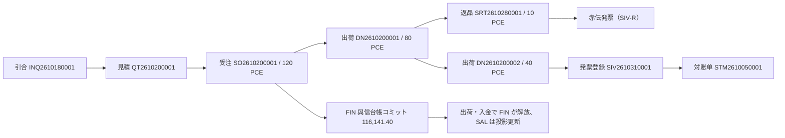

# 销售管理 样例数据说明（販売管理 サンプルデータ説明書）

| 項目 | 内容 |
|---|---|
| 文書名 | 销售管理 样例数据说明（販売管理 サンプルデータ説明書） |
| 文書番号 | DSN-SAL-094 |
| 版数 | v1.1 |
| 作成日 | 2026-10-20 |
| 作成者 | sales-designer（销售域担当） |
| 承認者 | 未承認（レビュー待ち） |
| 状態 | ドラフト（レビュー中） |
| 関連文書 | [業務域概要](00-overview.md) / [90-data データマップ](../90-data/README.md) / [90-data 出典一覧](../90-data/sources.md) / [コード一覧](../00-common/06-code-list.md) / [主データ域 サンプル](../02-mdm/94-sample-data.md) |

---

## 1. 本域で使用するデータと分類

本域の設計検証に用いるデータは以下の 3 分類に従う（[設計方針 §8](../00-common/00-design-principles.md)）。

| 分類 | マーカー | 本域での用途 |
|---|---|---|
| 真实资料 | `【実データ】` | 国家標準（GB 18613-2020、GB/T 28575-2020）、増値税率（13%）、税収政策、會計档案保存年限、HS コード、ISO 4217 通貨、GB/T 2260 地域コード、Incoterms 2020 |
| 公開情報ベース | `【公開情報】` | 顧客企業の公開情報（上場コード・所在地・業種）。**商業関係を示すものではない** |
| 示例值 | `【示例値】` | 単價・數量・與信限度額・納期・返品期限・ロット/序列號・承認金額閾値など企業內部の架空データ |

> **免責**：以下に登場する企業名はすべて公開情報に基づく**設計検証用の例示**であり、実際の取引・契約・商業関係を示すものではない。連絡先・稅號・銀行口座などの個人情報・企業機密は記載しない（[設計方針 §8.3](../00-common/00-design-principles.md)）。

## 2. 使用する実データ（出典付き）

| # | データ | 値・内容 | 出典 | 本域での使用箇所 |
|---|---|---|---|---|
| D-01 | YE3 シリーズ技術条件 | GB/T 28575-2020《YE3 系列（IP55）三相异步电动机技术条件（机座号 63〜355）》 | S-002（[sources.md](../90-data/sources.md)） | 物料仕様・見積・受注・発票の品名/規格 |
| D-02 | 電動機能効限定値 | GB 18613-2020《电动机能效限定值及能效等级》（IE3 能效 3 級） | S-001 | 物料仕様・顧客説明 |
| D-03 | 増値税率 | 13%（貨物販売）。基礎税碼 `VAT13`、業務税碼 `VAT13-OUT`（銷項） | S-051（財政部 税務総局 海関総署公告 2019 年第 39 号） | 単價・金額・稅額・発票・赤伝の計算 |
| D-04 | 附加税費 | 城建税 7%（市区）・教育費附加 3%・地方教育附加 2% | S-052（城市維護建設税法）・06-code-list §7.2 | 財務連携の參考（本域は計算しない） |
| D-05 | 企業所得税 | 25%（一般）、15%（高新技術）、小型微利 実効 5% | S-056・S-053 | 參考情報（本域の計算対象外） |
| D-06 | 数電票 | 全面数字化的電子発票（国家税务总局公告 2024 年第 11 号、2024-12-01 施行） | S-050 | 発票種別・票面項目・交付・赤伝（F-SAL-007） |
| D-07 | 会計档案保存 | 会計憑証・帳簿 30 年、年度財務会計報告 永久、月次報告 10 年 | S-058/S-059（会計档案管理辦法 79 号令） | 伝票・発票の保存期間 |
| D-08 | HS コード | 8501.52（モーター）等 | S-068 | 出口販売（Phase2）の通関項目 |
| D-09 | 通貨 | CNY（ISO 4217、小数 2 桁）ほか | 06-code-list §3 | 金額・発票・與信限度 |
| D-10 | 計量単位 | PCE（個/台）・SET（セット）・KGM 等 | 06-code-list §6（UN/ECE Rec20、GB 3100-1993） | 數量・単位 |
| D-11 | 地域コード | 320400 常州市、320412 常州市武進区、320200 無錫市、310000 上海市 等 | 06-code-list §5（GB/T 2260-2007） | 顧客住所・納品先・稅務情報 |
| D-12 | Incoterms 2020 | EXW/FCA/FAS/FOB/CFR/CIF/CPT/CIP/DAP/DPU/DDP | 06-code-list §9（ICC Incoterms® 2020） | 出口販売（Phase2） |
| D-13 | 顧客企業公開情報 | C000001 江蘇恒立液圧（601100、常州武進）ほか §3.1 | S-123〜S-134（[sources.md](../90-data/sources.md)） | 顧客マスタ・受注・對账单の示例 |
| D-14 | 付款条件コード | NET30/NET60/NET90 等 | 06-code-list §8.2 | 受注・應收の支払期日 |

## 3. マスタ・コードのサンプル

### 3.1 顧客（`mdm_customer`）— 公開情報ベースの示例

出典：各社公開情報（上場企業の年次報告・巨潮資訊網等、參照日 2026-10-20）、[90-data/customer-master.csv](../90-data/customer-master.csv)。**示例データであり、商業関係を示さない。**

| 顧客コード | 顧客名 | 略称 | 地域 | 業種 | 與信限度額（CNY） | 付款條件 | 発票種別 | 区分 |
|---|---|---|---|---|---|---|---|---|
| C000001 | 江苏恒立液压股份有限公司 | 恒立液压 | 320412 常州武進 | C34 通用設備 | 5,000,000.00【示例値】 | NET60 | 30 数電専票 | 【公開情報】601100 |
| C000002 | 江苏国茂减速机股份有限公司 | 国茂股份 | 320412 常州武進 | C34 通用設備 | 3,000,000.00【示例値】 | NET60 | 30 数電専票 | 【公開情報】603915 |
| C000003 | 今创集团股份有限公司 | 今创集团 | 320412 常州武進 | C37 軌道交通 | 2,000,000.00【示例値】 | NET90 | 30 数電専票 | 【公開情報】603680 |
| C000004 | 常柴股份有限公司 | 常柴股份 | 320404 常州鐘楼 | C34 通用設備 | 3,000,000.00【示例値】 | NET60 | 20 普票 | 【公開情報】000570 |
| C000005 | 上海凯泉泵业（集团）有限公司 | 凯泉泵业 | 310000 上海 | C34 通用設備 | 4,000,000.00【示例値】 | NET60 | 30 数電専票 | 【公開情報】非上場 |
| C000006 | 中联重科股份有限公司 | 中联重科 | — 長沙 | C35 専用設備 | 2,000,000.00【示例値】 | NET90 | 30 数電専票 | 【公開情報】000157 |
| C000007 | 陕西鼓风机（集团）有限公司 | 陕鼓动力 | — 西安 | C34 通用設備 | 2,000,000.00【示例値】 | NET60 | 30 数電専票 | 【公開情報】601369 |
| C000008 | 开山股份有限公司 | 开山股份 | — 衢州 | C34 通用設備 | 1,500,000.00【示例値】 | NET60 | 20 普票 | 【公開情報】300257 |

> 與信限度額は【示例値】。統一社会信用コード（稅號）は企業登記情報のため本設計では引用しない（マスタ項目の存在のみ定義）。

### 3.2 物料（`mdm_material`）— 実データ規格＋示例値

出典：仕様・執行標準は GB/T 28575-2020、GB 18613-2020（S-001/S-002）。価格は【示例値】。[90-data/material-master.csv](../90-data/material-master.csv)。

| 物料コード | 品名 | 仕様 | 分類 | 基本/販売單位 | 批次 | 序列號 | 標準價（稅抜） | 区分 |
|---|---|---|---|---|---|---|---|---|
| 3001000001 | YE3-100L1-4 三相异步电动机 | 2.2kW/4極/380V/50Hz/IP55/B3/F級、能効 3 級 | 3001 YE3 系列 | PCE | 要 | 要 | CNY 856.50【示例値】 | 【実データ】GB/T 28575-2020＋GB 18613-2020 |
| 3001000002 | YE3-112M-4 三相异步电动机 | 4.0kW/4極/380V/50Hz/IP55/B3/F級、能効 3 級 | 3001 YE3 系列 | PCE | 要 | 要 | CNY 1,286.00【示例値】 | 【実データ】同上 |
| 3003000001 | YE3-100L1-4/B5 定制电机 | 2.2kW/4極/B5 フランジ/380V/50Hz/IP55/F級 | 3003 非標定製 | PCE | 要 | 要 | CNY 1,020.00【示例値】 | 受注生産（MTO）【示例値】 |
| 2001000004 | 定子总成（YE3-100L1-4） | 含浸漆、半成品 | 2001 定子組件 | PCE | 要 | 不要 | — | 生産域連携【示例値】 |
| 1001000001 | 冷轧无取向电工钢带 | 50W470 0.50mm×1000mm 巻料 | 1001 硅鋼片 | KGM | 要 | 不要 | CNY 5.20【示例値】 | 【実データ】GB/T 2521.1-2016（90-data） |

> 本域は受注・出荷対象として成品（3001/3003）を使用する。半成品・原材料は生産/在庫域の引用にとどまる。

### 3.3 コード値（06-code-list 準拠）

| 区分 | 使用コード | 説明 |
|---|---|---|
| 通貨 | `CNY` | 人民元（ISO 4217、2 桁）。Phase 1 は CNY のみ |
| 稅碼（基礎） | `VAT13` | 増値税 13%（貨物販売）【実データ】S-051 |
| 稅碼（業務・銷項） | `VAT13-OUT` | 銷項方向の業務税碼（MDM `mdm_tax_code`）。稅率 13.0000 |
| 稅碼（業務・進項） | `VAT13-IN` | 進項方向（採購域） |
| 計量單位 | `PCE` | 個/台。YE3 成品の販売・在庫單位 |
| 付款條件 | `NET60` | 月結 60 天（月末締め翌々月末払い）。C000001 の既定 |
| 決済方法 | `BANK_TRANSFER` | 電匯（銀行振込） |
| 地域 | `320412` | 常州市武進区（GB/T 2260-2007）【実データ】 |
| 発票種別 | `30` | 数電専用発票（MDM `invoice_type`） |

## 4. 取引サンプル（O2C 一連・正本）

> **正本**：YE3-100L1-4（`3001000001`）× 120 PCE × 稅抜 856.500000。受注・出荷・請求・返品・與信の全サンプルはこの正本に統一する（SO2610200001）。折扣例は別伝票 SO2610200002 として §4.9 に分離する。

### 4.1 全体像

### 4.2 引合・見積

| 項目 | 値 | 区分 |
|---|---|---|
| 引合番號 | `INQ2610180001` | 【示例値】 |
| 引合日 | 2026-10-18 | 【示例値】 |
| 顧客 | C000001 江蘇恒立液圧股份有限公司 | 【公開情報】S-123 |
| 明細 | 3001000001 × 120 PCE | 【示例値】 |
| 希望納期 | 2026-10-30 | 【示例値】 |
| 見積番號 / 版數 | `QT2610200001` / 1 | 【示例値】 |
| 有効期限 | 2026-10-20 〜 2026-11-19 | 【示例値】 |
| 稅抜合計 / 稅額 / 稅込 | CNY 102,780.00 / 13,361.40 / 116,141.40 | 【示例値】 |
| 承認要否 | 不要（標準價比 −4.83%、折扣なし） | 【示例値】判定 |

### 4.3 受注（`sal_sales_order` / `sal_sales_order_line`）

**ヘッダ**

| 項目 | 値 | 区分 |
|---|---|---|
| 受注番號 | `SO2610200001` | 【示例値】 |
| 受注日 / 最終納期 | 2026-10-20 / 2026-10-30 | 【示例値】 |
| 顧客 | C000001 江蘇恒立液圧（NET60、WH03 成品倉） | 【公開情報】/【示例値】 |
| 顧客注文番號 | `PO-CUS-20261018-001` | 【示例値】 |
| 通貨 / 為替 | CNY / 1.00000000 | 【実データ】ISO 4217 |
| 稅抜合計 / 稅額 / 稅込 | CNY 102,780.00 / 13,361.40 / 116,141.40 | 【示例値】 |
| 與信判定 | **10 正常**（FIN 與信台帳 使用額 3,900,000.00、餘力 1,100,000.00） | 【示例値】 |
| 狀態 | 10 草稿 → 25 承認済 → 30 引當済 → 35 一部出荷 → 40 完了 | 業務フロー |

**明細**

| 行 | 物料 | 數量 | 稅抜單價 | 標準價 | 折扣 | 稅抜金額 | 稅額（13%） | 稅込金額 | 引當/出荷 |
|---|---|---|---|---|---|---|---|---|---|
| 10 | 3001000001 YE3-100L1-4 | 120 PCE | 856.500000 | 900.000000 | 0.00% | 102,780.00 | 13,361.40 | 116,141.40 | 120/120 出荷済 |
| 合計 | — | 120 PCE | — | — | — | 102,780.00 | 13,361.40 | 116,141.40 | — |

> 明細金額は `120 × 856.50 = 102,780.00`、稅額は `102,780.00 × 13% = 13,361.40`（HALF_UP 2 桁）。全數値は【示例値】。

### 4.4 出荷（`sal_delivery_note` / `sal_delivery_note_line` / `sal_delivery_serial`）

| 項目 | 第 1 回 | 第 2 回 | 区分 |
|---|---|---|---|
| 出荷番號 | `DN2610200001` | `DN2610200002` | 【示例値】 |
| 出荷日 | 2026-10-24 | 2026-10-30 | 【示例値】 |
| 出荷數量 | 80 PCE（3001000001） | 40 PCE（3001000001） | 【示例値】 |
| 稅抜 / 稅額 / 稅込 | 68,520.00 / 8,907.60 / 77,427.60 | 34,260.00 / 4,453.80 / 38,713.80 | 【示例値】 |
| 合計（120 PCE） | — | 102,780.00 / 13,361.40 / 116,141.40 | 正本一致 |
| 狀態 | 40 完了 | 40 完了 | — |
| 序列號例 | `SN-YE3-2610-0001`〜`0002`（示例 2 件／実際は 80 件） | `SN-YE3-2610-0003`〜`0004`（例） | 【示例値】 |
| 批次番號 | —（成品はシリアル管理） | — | 90-data 設定 |
| E10 payload | `sales.delivery.confirmed`（09 v1.1 契約、`serialNos` 含む） | 同左 | 09 §3 |

> 成品 3001000001 は `serial_managed=Y`（90-data）。本域は `sal_delivery_serial` に序列號を保存し、トレースを可能とする。半成品・原材料は批次管理（`batch_managed=Y`）。

### 4.5 返品（`sal_sales_return` / `sal_sales_return_line`）

| 項目 | 値 | 区分 |
|---|---|---|
| 返品番號 | `SRT2610280001` | 【示例値】 |
| 元出荷 | `DN2610200001`（80 PCE のうち 10 PCE） | 【示例値】 |
| 返品日 / 期限 | 2026-10-28 / 2026-11-23（出荷日 + 30 日） | 【示例値】 |
| 返品理由 | QUALITY（軸承異音） | 【示例値】 |
| 返品金額（稅抜/稅額/稅込） | 8,565.00 / 1,113.45 / 9,678.45 | 【示例値】 |
| 検品結果 / 在庫狀態 | REWORK / 20 待検 | 【示例値】 |
| 原價戻し | 7,782.00（元出荷原價 778.20/PCE × 10） | 【示例値】 |
| 赤伝 | 元発票 `SIV2610240001` に対する赤伝（部分） | 【示例値】 |
| E11 payload | `sales.return.confirmed`（09 v1.1 契約、`unitPrice/taxRate/amount/taxAmount/costAmount`） | 09 §3 |

### 4.6 開票・對账・應收

| 項目 | 値 | 区分 |
|---|---|---|
| 開票申請 | `IVA2610240001`（2026-10、C000001、数電専票） | 【示例値】 |
| 發票登録 | `SIV2610240001`（数電票 20 桁 `26322000000012345678`） | 【示例値】 |
| 發票金額（稅抜/稅額/稅込） | 102,780.00 / 13,361.40 / 116,141.40 | 【示例値】 |
| 應收 | `AR2610240001`（FIN 採番、出荷基準で計上、期日 2026-12-24 NET60） | 【示例値】 |
| 對账单 | `STM2610050001`（前月末 2,600,000.00 → 當月売上 116,141.40 − 入金 146,462.95 − 赤伝 9,678.45 → 月末 2,560,000.00） | 【示例値】 |
| 帳齡 | FIN 口徑（未到期/1-30/31-60/61-90/91-180/181-360/360 超） | FIN 契約 |
| DSO | FIN 定義（平均應收餘額 ÷ 營業收入 × 期間日數）を表示 | FIN 契約 |
| 與信使用額（FIN 台帳） | 3,900,000.00（應收 2,800,000 + 受注コミット 1,200,000 − 前受金 100,000） | 【示例値】 |

### 4.7 與信台帳投影・特價

| 項目 | 値 | 区分 |
|---|---|---|
| FIN 與信台帳コミット | `SALES_ORDER` / SO2610200001 / 116,141.40（FIN が台帳計上） | 【示例値】 |
| SAL 投影更新 | E06 で INSERT、E10 で 77,427.60 解放、2 回目出荷で殘額解放 → status 40 | 【示例値】 |
| 出荷時解放 | DN2610200001 分 77,427.60（RELEASE_SHIP、FIN 台帳） | 【示例値】 |
| 特價 | `SP2610200001`（C000001 × 3001000001、856.50、≥100 PCE、2026-10-20〜2027-10-19） | 【示例値】 |
| 特價承認経路 | 銷售總監（標準價比 −4.83%、粗利率 8.93% > 0） | 承認マトリクス |

### 4.8 イベント連鎖（サンプル）

| 時點 | イベント | 集約 | 主要値 |
|---|---|---|---|
| 2026-10-20 14:30 | E05 `sales.order.submitted` | SO2610200001 | amount 102,780.00 / tax 13,361.40 / total 116,141.40 |
| 2026-10-20 15:10 | E06 `sales.order.approved` | SO2610200001 | 明細 120 PCE（`qty`）、與信 10 正常 |
| 2026-10-20 15:12 | E09 `inventory.reservation.updated` | SO2610200001 | RESERVED 120 PCE |
| 2026-10-24 10:30 | E10 `sales.delivery.confirmed` | DN2610200001 | 80 PCE、amount 68,520.00、tax 8,907.60 |
| 2026-10-24 10:31 | E18 `inventory.txn.posted` | SDO2610200001 | SI、原價 62,256.00（80 × 778.20） |
| 2026-10-24 10:32 | E27 `finance.receivable.created` | AR2610240001 | 77,427.60 |
| 2026-10-28 16:00 | E11 `sales.return.confirmed` | SRT2610280001 | 10 PCE、inventoryStatus 20、costAmount 7,782.00 |
| 2026-10-30 16:00 | E10 `sales.delivery.confirmed` | DN2610200002 | 40 PCE、amount 34,260.00、tax 4,453.80 |
| 2026-10-31 15:00 | E12 `sales.invoice.issued` | SIV2610240001 | E_INVOICE、deliveryIds[2] |
| 2026-11-05 09:00 | E29 `finance.receipt.completed` | RCP2610300001 | matched 77,427.60 |

> イベント項目の詳細は [02-sales-order.md §7.3](02-sales-order.md)、[03-delivery-picking.md §7.2](03-delivery-picking.md)、[04-sales-return.md §7.2](04-sales-return.md)、[05-invoice-receivable.md §7.2](05-invoice-receivable.md) を正とする。

### 4.9 折扣例（別伝票 SO2610200002）

| 項目 | 値 | 区分 |
|---|---|---|
| 受注番號 | `SO2610200002`（正本 SO2610200001 とは別伝票） | 【示例値】 |
| 明細 | 3001000001 × 120 PCE、行折扣 2.00% | 【示例値】 |
| 稅抜金額 / 稅額 / 稅込 | 100,724.40 / 13,094.17 / 113,818.57 | 【示例値】 |
| 備考 | 正本サンプルには折扣を混在させない。折扣時は CALC-01/02/04 の順で計算 | 設計 |

## 5. テーブルデータ例

### 5.1 `sal_sales_order`（抜粋）

| 列 | 値 | 区分 |
|---|---|---|
| `sales_order_no` | SO2610200001 | 【示例値】 |
| `order_date` | 2026-10-20 | 【示例値】 |
| `customer_code` / `customer_name` | C000001 / 江苏恒立液压股份有限公司 | 【公開情報】 |
| `currency_code` / `exchange_rate` | CNY / 1.00000000 | 【実データ】/【示例値】 |
| `payment_term_code` | NET60 | 06-code-list |
| `order_status` / `version_no` | 40 / 2 | 【示例値】 |
| `list_amount` / `total_amount` / `tax_amount` / `grand_total` | 108,000.00 / 102,780.00 / 13,361.40 / 116,141.40 | 【示例値】 |
| `credit_check_result` | 10（正常） | 【示例値】 |
| `warehouse_id` | WH03 成品倉（コードで示す） | 06-code-list |

### 5.2 `sal_sales_order_line`（抜粋）

| 列 | 明細 10 | 区分 |
|---|---|---|
| `line_no` | 10 | — |
| `material_code` | 3001000001 | 90-data |
| `ordered_qty` / `uom_code` | 120.0000 / PCE | 【示例値】 |
| `base_qty` | 120.0000 | 【示例値】 |
| `list_price` / `unit_price` | 900.000000 / 856.500000 | 【示例値】 |
| `discount_rate` | 0.0000 | 【示例値】 |
| `line_amount` / `tax_amount` / `total_amount` | 102,780.00 / 13,361.40 / 116,141.40 | 【示例値】 |
| `reserved_qty` / `shipped_qty` / `shortage_qty` | 120.0000 / 120.0000 / 0 | 【示例値】 |
| `line_status` | 40 | — |

### 5.3 `sal_credit_ledger_snapshot`（抜粋・FIN 台帳の投影）

| 列 | 値 | 区分 |
|---|---|---|
| `customer_id` / `customer_code` | 顧客 ID / C000001 | 【公開情報】 |
| `source_type` / `source_id` / `source_no` | SALES_ORDER / 受注 ID / SO2610200001 | 【示例値】 |
| `amount` / `released_amount` / `status` | 116,141.40 / 116,141.40 / 40 | 【示例値】 |
| `release_reason` | SHIP → RECEIPT | 契約 |
| 備考 | FIN 與信台帳が権威。SAL は E06/E10/E29 購読で投影を更新するのみ | Lead 裁定 |

### 5.4 `sal_invoice`（抜粋）

| 列 | 値 | 区分 |
|---|---|---|
| `invoice_no` / `invoice_code` | 26322000000012345678 / NULL | 【示例値】 |
| `invoice_kind` / `invoice_type` | E_INVOICE / 30 | 契約 |
| `buyer_name` / `buyer_tax_no` | 江苏恒立液压股份有限公司 / （未引用） | 【公開情報】 |
| `amount` / `tax_amount` / `total_amount` | 102,780.00 / 13,361.40 / 116,141.40 | 【示例値】 |
| `invoice_status` / `ar_link_status` | 40 / 40 | 【示例値】 |
| `delivery_ids`（E12 payload） | DN2610200001, DN2610200002 | 【示例値】 |

### 5.5 J06 仕訳サンプル（FIN 連携）

| 項目 | 値 | 区分 |
|---|---|---|
| 売上原価（J06） | 93,384.00（120 PCE × 778.20、E18 合計） | 【示例値】 |
| 第 1 回出荷分 | 62,256.00（80 × 778.20） | 【示例値】 |
| 第 2 回出荷分 | 31,128.00（40 × 778.20） | 【示例値】 |
| 返品戻し（J23 の原價部分） | 7,782.00（10 × 778.20） | 【示例値】 |
| 備考 | FIN の J06 は E18 `costAmount` を正とする。INV/FIN の 94-sample と一致させる | 09 §7.2 |

## 6. 仮定値（【示例値】）一覧

| # | 項目 | 値 | 根拠・備考 |
|---|---|---|---|
| A-01 | YE3-100L1-4 標準價（稅抜） | CNY 856.50/PCE | 設計検証用。90-data material-master の `price_ref_cny` |
| A-02 | YE3-100L1-4 標準價（マスタ） | CNY 900.00/PCE | 標準價比 −4.83% の基準 |
| A-03 | 與信限度額（C000001〜008） | 1,500,000〜5,000,000 | 90-data customer-master の `credit_limit_cny` |
| A-04 | 與信使用額（C000001） | 3,900,000.00 | FIN 台帳：應收 2,800,000＋受注コミット 1,200,000−前受金 100,000 |
| A-05 | 前受金未核銷 | CNY 100,000.00 | 90-data 設計検証用 |
| A-06 | 返品期限 | 出荷日 + 30 日 | 社内規程が未提示のため暫定（[00-overview §12](00-overview.md)） |
| A-07 | 出荷リードタイム | 受注日 + 7 日（YE3 成品） | 90-data `lead_time_days=7` |
| A-08 | 標準原價（YE3-100L1-4） | CNY 780.00/PCE | 粗利計算の検証用。原價は在庫/財務域の計算値を使用 |
| A-09 | 元出荷原價 | CNY 778.20/PCE | 移動平均の示例。J06 93,384.00 ÷ 120 と一致 |
| A-10 | 出荷數量（第1回/第2回） | 80 PCE / 40 PCE | 部分出荷の検証用 |
| A-11 | 返品數量 | 10 PCE | 返品・赤伝の検証用（J22/J23 と一致） |
| A-12 | 序列號 | `SN-YE3-2610-0001`〜 | 形式は設計値。実際は製造/在庫域が採番 |
| A-13 | 承認金額閾値 | 08 §8.1 の値 | 社内規程（仮定値）。`wf_approval_matrix` で管理 |
| A-14 | 帳齡基準日 | 到期日ベース | FIN 契約（BR-ST-06） |
| A-15 | 与信チェック比率 | `over_limit_ratio` 例 10% | 90-data / MDM 設定値 |
| A-16 | J06 売上原価（正本） | CNY 93,384.00（120×778.20） | INV/FIN と一致（Lead 指示） |

## 7. 出典一覧（本域関連）

| 出典 ID | 資料 | 本域での用途 |
|---|---|---|
| S-001 | GB 18613-2020 電動機能効限定値及能効等級 | 物料仕様・顧客説明 |
| S-002 | GB/T 28575-2020 YE3 技術条件 | 物料仕様・発票品名 |
| S-050 | 国家税務総局公告 2024 年第 11 号（数電票） | 発票種別・票面・交付 |
| S-051 | 財政部 税務総局 海関総署公告 2019 年第 39 号（増値税 13%） | 稅率・稅額計算 |
| S-052 | 城市維護建設税法 | 附加税の參考 |
| S-053 | 財政部 税務総局公告 2023 年第 12 号（小型微利） | 參考情報 |
| S-056 | 企業所得税法 | 參考情報 |
| S-058/S-059 | 会計档案管理辦法（79 号令）及保管期限表 | 保存期間 |
| S-068 | 中国海関 HS コード（8501.52 等） | 出口販売（Phase2） |
| S-123〜S-134 | 顧客企業の公開情報（上場コード・所在地等） | 顧客マスタの示例 |

> 出典の完全な URL・参照日（2026-10-20）は [90-data/sources.md](../90-data/sources.md) を参照。本域は S-001/S-002/S-050/S-051/S-068/S-123〜S-134 を主に使用する。

## 8. 利用上の注意

1. 本ファイルの企業名は**公開情報に基づく示例**であり、実際の取引・契約・與信・発票を示さない。顧客マスタの備考にも「示例データ、僅用於設計驗證，不代表任何商業関係」と記錄する。
2. 單價・數量・與信限度・原價・序列號は【示例値】。実装・テスト時に實データへ置換する際は、90-data の CSV を正とする。
3. 稅率・標準・法規は 2026-10-20 時点の情報。法改正時は 06-code-list と 90-data/sources.md を更新し、既存傳票は登録時點のスナップショットを保持する。
4. 個人情報（連絡先・口座）は記載しない。必要な場合はマスキング示例を用いる。
5. 本域のサンプルは單獨で完結せず、MDM（顧客/物料/價格/與信）、INV（在庫/引當/批次）、FIN（應收/入金/与信台帳）のサンプルと整合させる（各域 94-sample-data を参照）。
6. 與信台帳は FIN が唯一所有し、SAL は読取投影（`sal_credit_ledger_snapshot`）と判定のみを行う（Lead 裁定 2026-10-20）。

## 9. 改訂履歴

| 版数 | 日付 | 変更內容 | 変更者 |
|---|---|---|---|
| v1.0 | 2026-10-20 | 初版作成：実データ出典（GB 標準・税率・数電票・会計档案・HS）、顧客 8 社・物料 5 件のサンプル、O2C 一連の取引サンプル、テーブルデータ例、仮定値 15 件 | sales-designer |
| v1.1 | 2026-10-20 | 紅隊修復第 2 輪：正本サンプルを SO2610200001＝YE3 120 PCE×856.50（102,780/13,361.40/116,141.40）に統一。出荷 80+40、返品 10 PCE（J22/J23 と一致）、J06 93,384.00、與信台帳（FIN 権威・SAL 投影）、DSO FIN 定義、折扣例を別伝票 §4.9 へ分離 | sales-designer |

