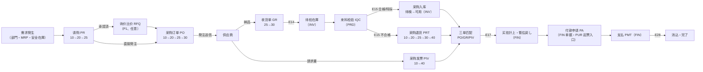
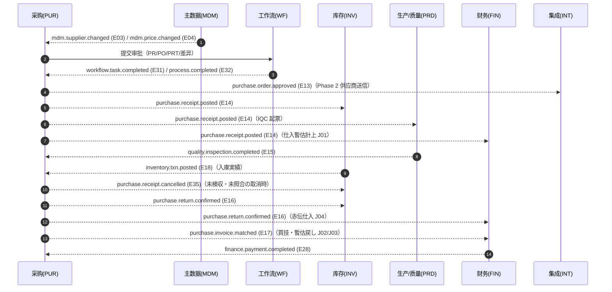

# 采购管理 业务域概要书（採購管理 業務概要書）

| 項目 | 内容 |
|---|---|
| 文書名 | 采购管理 业务域概要书（採購管理 業務概要書） |
| 文書番号 | DSN-PUR-000 |
| 版数 | v1.0 |
| 作成日 | 2026-10-20 |
| 作成者 | purchase-designer |
| 承認者 | 未承認（レビュー待ち） |
| 状態 | ドラフト（レビュー中） |
| 関連文書 | [体系总览](../README.md) / [共通项目定义](../00-common/01-common-item-definitions.md) / [共通业务规则](../00-common/08-common-business-rules.md) / [跨域流程](../00-common/09-cross-domain-flow.md) / [主数据](../02-mdm/00-overview.md) / [库存](../05-inventory/00-overview.md) / [生产](../06-production/00-overview.md) / [财务](../07-finance/00-overview.md) / [工作流](../08-workflow/00-overview.md) |

---

## 1. 業務概要

### 1.1 目的

本业务域覆盖「调达→支払（P2P：Procure to Pay）」全链路，从部门需求发生、请购审批、询价比价、采购订单、到货接收、来料检验（IQC）、采购入库、三单匹配（PO/GR/PIV）、暂估与应付确认、供应商对账、付款申请直到付款消込，为华东精密电机股份有限公司提供**采购业务的唯一事实来源**。

采购域同时承担三项横断职责：① 采购价格的适用与比价决策（引用 MDM 采购价格）；② 供应商交付与质量的绩效数据供给（供 MDM 供应商评估引用）；③ 采购执行数据对财务暂估、应付、差异会计的确定性输入（通过 E14/E16/E17 事件契约）。

### 1.2 適用範囲

| 項目 | 内容 |
|---|---|
| 対象会社・拠点 | 华东精密电机股份有限公司 / 常州总装厂・无锡零部件厂（示例企业，见 [demo-company.md](../90-data/demo-company.md)） |
| 対象機能範囲 | 请购→审批→询价比价→采购订单→收货→来料检验→入库→三单匹配→暂估/应付→对账→付款申请 的全过程，以及交期跟踪、采购价格适用、计划采购、供应商绩效、采购报表 |
| 対象外（他域管掌） | 来料检验单本体（PRD 域 `prd_inspection`，F-PRD-012）、库存入出库执行与库存余额（INV 域）、买挂余额/凭证/付款执行/核销（FIN 域 F-FIN-003）、供应商主数据与采购价格主数据（MDM 域）、审批引擎与待办（WF 域）、发票开具与税务申报（FIN/INT 域） |
| 前提 | MDM 的物料・供应商・采购价格・税码・付款条件・单位换算已整备；WF 审批矩阵已配置（`wf_approval_matrix`）；INV 已实现待检在庫与状态转换；FIN 已实现暂估/应付自动凭证模板；PRD 已实现 IQC 检验标准与判定 |
| 優先度 | P0：请购・订单・收货・IQC 跟踪・入库跟踪・退货・发票登记・三单匹配・暂估应付・付款申请（Phase 1）；P1：询价比价・对账单・交期跟踪・价格管理・计划采购・绩效（Phase 1.5）；P2：供应商门户/EDI（集成域协同） |

### 1.3 業務上の狙い（KPI）

| KPI | 定義・算式 | 目標値（示例企業） | 実現する機能 ID |
|---|---|---|---|
| 请购到发注周期 | 平均（PO 首次发注日 − PR 承认日），营业日 | ≤ 3 营业日 | F-PUR-003、F-PUR-007 |
| 三单匹配自动通过率 | 自动匹配成功（一致+容差内）行数 ÷ 匹配总行数 | ≥ 85% | F-PUR-018 |
| 采购订单按期交付率 | 按期入荷行数 ÷ 已入荷行数 | ≥ 95% | F-PUR-023 |
| 来料检验合格率 | IQC 合格数量 ÷ 受入数量 | ≥ 98%（关键件 100%） | F-PUR-013 |
| 超收发生率 | 超收行数 ÷ 收货行数 | ≤ 2% | F-PUR-011 |
| 入荷済未請求滞留 | 月结时入荷済未請求数量・金额（暂估残高） | 金额滞留 ≤ 1 个月 | F-PUR-020 |
| 采购价格适用率 | 使用价格表/询价中选价发注的行数 ÷ 全部发注行数 | ≥ 95% | F-PUR-024 |
| 供应商绩效覆盖率 | 有月度绩效评分的供应商数 ÷ 期间有交易的供应商数 | 100% | F-PUR-026 |

> 目标值为示例企业内部管理目标【示例值】。

---

## 2. 組織とロール

| ロール | 所属 | 主な操作 | 関連機能 ID | 権限（代表） |
|---|---|---|---|---|
| 部门担当 | 生产部/技术部/设备部/各部门 | 请购登记、提交、撤回、进度查询 | F-PUR-001 | `purchase:requisition:create` / `submit` |
| 部门经理 | 各需求部门 | 请购审批、预算确认 | F-PUR-002 | `purchase:requisition:approve` |
| 采购员 | 采购部 | 询价、报价登录、比价、下单、交期催货 | F-PUR-004～010、023 | `purchase:rfq:*`、`purchase:order:create` |
| 采购经理 | 采购部 | PO 审批、退货审批、中选确认、超收例外审批、绩效确认 | F-PUR-006、008、015、026 | `purchase:order:approve`、`purchase:return:approve` |
| 分管副总 | 生产副总 | 50,000～500,000 元（税込）审批 | F-PUR-002、008 | `purchase:requisition:approve` |
| 总经理 | 总经理室 | 500,000 元以上（税込）审批 | F-PUR-002、008 | `purchase:requisition:approve` |
| 仓管员 | 仓库（常州/无锡） | 收货单登记、入荷确认、退货出库确认 | F-PUR-011、012、016 | `purchase:receipt:create` |
| 质检员 / 品质经理 | 质量部 | IQC 判定、特采承认（PRD 域操作，PUR 域跟踪） | F-PUR-013 | `production:inspection:judge`（PRD） |
| 财务会计 | 财务部 | 发票登记、三单匹配、对账、应付确认 | F-PUR-017～020 | `purchase:invoice:*`、`purchase:match:*` |
| 财务经理 | 财务部 | 匹配差异承认、付款申请审批（阈值内）、预付款审批 | F-PUR-018、021、022 | `purchase:match:approve`、`purchase:payment:approve` |
| 出纳 | 财务部 | 付款执行、银行回单（FIN 域） | F-PUR-021（FIN 执行） | `finance:payment:execute`（FIN） |
| 系统管理员 | 信息部 | 参数、容差规则、接口监控 | F-PUR（配置） | `system:param:*` |

### 2.1 承認経路

采购域各单据の承認は **90-data/approval-matrix.md の A01〜A20 を正本**とし（Lead 裁定 2026-10-20）、08 §8.1 は概略とする。金額閾値・経路は再定義せず、`wf_approval_matrix` の初期設定を引用する。主数据（価格・与信・銀行口座）の変更承認は MDM/WF が主管し、**A16（銀行口座変更は財務総監承認を追加）**に従う。PUR は参照のみである。

| 対象 | 条件（税込金额） | 承認経路 | 方式 | 根拠 |
|---|---|---|---|---|
| 采购申请 PR | < 5,000 元 | 部门经理 | 或签 | 08 §8.1 |
| 采购申请 PR | 5,000～50,000 元 | 部门经理 → 采购经理 | 顺送 | 同上 |
| 采购申请 PR | 50,000～500,000 元 | 部门经理 → 采购经理 → 分管副总 | 顺送 | 同上 |
| 采购申请 PR | ≥ 500,000 元 | 上記 + 总经理 | 顺送 | 同上 |
| 采购订单 PO | 依頼金額に準拠 | PR と同じ経路（PR 承認済の場合は短縮可：采购经理の 1 段のみ） | 顺送 | 同上 |
| 采购退货 PRT | 全額 | 采购经理 → 财务经理 | 顺送 | 同上 |
| 付款申请 PA | < 50,000 元 / 50,000～500,000 元 / ≥ 500,000 元 | 财务经理 / 财务经理→财务总监 / 财务总监→总经理 | 或签/顺送 | 同上 |
| 三单匹配差异 | 超容差差异 | 财务经理（金额 ≥ 50,000 元时追加财务总监） | 顺送 | 本域追加（示例企业规定） |
| 超收例外 | 超容差受入 | 采购经理 | 或签 | 本域追加（示例企业规定） |
| 特采（让步接收） | 全部 | 品质经理 → 采购经理（重要件追加技术部经理） | 顺送 | PRD 域 F-PRD-012 与本域约定 |

> 申请人与承认者不得为同一人（自己承認禁止）。金额阈值与路径在 `wf_approval_matrix` 维护，不硬编码。

---

## 3. 業務フロー

### 3.1 全体フロー

### 3.2 処理手順（P2P 責任分界）

| # | 手順 | 実施域/ロール | 入力 | システム処理 | 出力/イベント | 状態コード |
|---|---|---|---|---|---|---|
| 1 | 请购登记 | PUR / 部門担当 | 品目・数量・希望納期・用途・予算科目 | 予算残高確認、重複チェック、採番 `PR` | PR（10 草稿） | 10 |
| 2 | 请购审批 | WF / 承認者 | — | 金額別経路で承認（E31/E32） | PR（25 承認済） | 20→25 |
| 3 | 询价比价 | PUR / 采购员 | PR 承认済、供应商名单 | 报价邀请、报价登录、比价计算、中选 | RFQ（40）、中选价 | 30→35→40 |
| 4 | 发注 | PUR / 采购员 | PR/RFQ、供应商、单价、納期 | 取价・MOQ・准入检查、採番 `PO`、PO 作成 | PO（10） | — |
| 5 | PO 审批 | WF / 承認者 | — | 承認 | E13、PO（25） | 20→25 |
| 6 | 発注送信 | PUR / 采购员 | PO 承認済 | 帳票出力・送信記録 | PO（30）、送信日時 | 25→30 |
| 7 | 入荷 | PUR / 倉管员 | 送り状、実数量、批次 | 過入荷チェック（5% または 1 個）、採番 `GR`、GR 作成・確認 | GR（30）、**E14** | 25→30 |
| 7a | 入荷取消 | PUR / 倉管员・采购经理 | 取消理由 | 未検収（IQC 未完了）かつ未照合の場合のみ取消可、**E35** 発行 | GR（90） | 30→90 |
| 8 | 受入検査 | PRD / 品質 | IQC 依頼（E14） | 検査登録・判定（PASS/CONCESSION/REJECT） | **E15** | 10→30→40 |
| 9 | 入庫 | INV / 倉管员 | 合格数量 | 在庫ステータス待検→可用、在庫取引 `PI` | GRI、**E18** | 35→40 |
| 10 | 請求書照合 | PUR+FIN / 会計 | 発票、GR、PO | 三単マッチ、差異判定、差異承認 | PIV（40）、**E17** | 10→20→40 |
| 11 | 買挂・暫估 | FIN / 会計 | E14、E17 | 暫估計上（J01）→暫估戻し（J02）・買挂計上（J03）・差異処理 | AP、仕訳 | — |
| 12 | 支払申請 | PUR 发起 / FIN 保有 | AP、支払期日 | 支払予定作成、承認依頼 | PA（FIN、10→20→25） | — |
| 13 | 支払実行 | FIN / 出納 | PA 承認済 | 銀行送金・消込 | PMT（40）、**E28** | 40 |
| 14 | 消込・完了 | FIN / 会計 | 入出金明細 | AP 消込、買挂残更新 | AP 完了、帳票 | 40 |

> 上表与 [09-cross-domain-flow.md](../00-common/09-cross-domain-flow.md) 第 4.2 节完全一致；本域仅对第 7～11 步进行单据级细化。**更新责任分界**：库存余额与出入库执行由 INV 独占；买挂余额、凭证、付款执行由 FIN 独占；检验单本体由 PRD 独占；采购域独占 PR、RFQ、PO、GR、PRT、PIV、三单匹配结果与对账单。

### 3.3 関連業務域との連携

| 相手域 | 連携内容 | 方式（同期/イベント） | 契約 |
|---|---|---|---|
| MDM | 物料・供应商・采购价格・税码・付款条件・单位换算的参照；E03 供应商变更、E04 采购价格变更、**E40 税码变更**的订阅 | 同期参照 + イベント購読 | [09 §3](../00-common/09-cross-domain-flow.md) E03/E04/E40、§11 マスタ参照規約 |
| WF | PR/PO/PRT/三单匹配差异/付款申请/预付款申请的承认流程 | イベント（E31/E32） | 09 §9 ワークフロー連携 |
| INV | 入荷確定（待检入库）、收货取消逆処理（E35）、退货出库、入库完成通知（E18） | イベント（E14/E16/E35 発行、E18 購読） | 09 §3、§4.3、§7 在庫取引と仕訳 |
| PRD | IQC 起票依頼（E14 購読）、IQC 判定受信（E15）、MRP 计划订单受信 | イベント + 同期参照（計画） | 09 §3、§4.1、§8 品質連携 |
| FIN | 暂估计上（E14 購読）、票据匹配确定（E17）、退货赤传（E16）、付款完了（E28）、会计期间状态参照 | イベント + 同期参照 | 09 §3、§7.2 J01～J04 |
| INT | PO 送信（供应商门户/邮件/EDI，Phase 2）、电子发票采集（Phase 2） | イベント/API | 09 §12 連携マトリクス（IF-PUR-001/002） |
| SYS | 用户・组织・权限・数据范围、采番、附件、消息通知 | 同期参照 | 00-common/01、03 |
| RPT | 采购分析报表的读取（本域提供域内操作报表，跨域汇总在 RPT 域） | 参照 | 10-analytics 设计书 |

### 3.4 单据追溯链（source_type / source_id）

采购域所有下游单据必须记录来源单据，形成可反向追溯的链路。`source_type` 取值与含义如下（全域统一）：

| source_type | 含义 | 上游单据 | 典型下游 |
|---|---|---|---|
| `MANUAL` | 手工创建 | — | PR、PO、PIV |
| `MRP` | MRP 计划订单 | PRD `prd_planned_order` | PR |
| `SAFETY_STOCK` | 安全库存补货建议 | PRD MRP | PR |
| `REQUISITION` | 请购单 | `pur_purchase_requisition` | PO |
| `RFQ` | 询价比价单 | `pur_rfq` | PO |
| `CONTRACT` | 框架合同/一揽子订单 | MDM `mdm_contract`（P2） | PO |
| `PURCHASE_ORDER` | 采购订单 | `pur_purchase_order` | GR、PRT、PIV 明细 |
| `RECEIPT` | 收货单 | `pur_receipt` | PRT、PIV 明细 |
| `INSPECTION` | 来料检验单 | PRD `prd_inspection` | PRT（不合格退货） |
| `RETURN` | 采购退货单 | `pur_return` | 补货 GR（换货）、PIV（红字） |
| `INVOICE` | 采购发票 | `pur_invoice` | PIV（红字）、AP |
| `RECEIPT_CANCEL` | 收货取消 | `pur_receipt`（status=90） | 无（逆処理のみ） |

追溯关系一览：

| 下游单据 | 上游字段 | 约束 |
|---|---|---|
| PO ヘッダ | `source_type`、`source_id` | `REQUISITION`/`RFQ`/`MRP`/`MANUAL`/`CONTRACT` |
| PO 明細 | `pr_line_id`、`rfq_quotation_line_id` | 可空；有值时须与ヘッダ source_type 一致 |
| GR ヘッダ | `source_type= PURCHASE_ORDER`、`source_id=po_id` | 必填 |
| GR 明細 | `po_line_id` | 必填；入荷数量累加至 PO 明细 |
| PRT ヘッダ | `source_type`、`source_id`（`RECEIPT`/`INSPECTION`/`PURCHASE_ORDER`） | 必填 |
| PRT 明細 | `receipt_line_id` | 质量退货必填（必须指明不合格批次） |
| PIV ヘッダ | `source_type`（`MANUAL`/`INVOICE` 红字）、`original_invoice_id` | 红字发票必填原发票 |
| PIV 明細 | `po_id`、`po_line_id`、`receipt_id`、`receipt_line_id` | 三单匹配依据；可多 PO 合并开票 |
| 匹配结果 | `invoice_line_id`、`po_line_id`、`receipt_line_id` | 一对一；部分匹配时按累计数量拆分多行 |
| 对账单明细 | `source_type`（`RECEIPT`/`PURCHASE_ORDER`/`RETURN`/`INVOICE`）、`source_id` | 必填 |

> 追溯链完整性是月结检查（09 §10.3 第 3 项「入荷済・未請求」）与审计的前提。禁止创建无来源的 GR/PRT/PIV（手工来源仅限 PIV 且需指定 PO）。

### 3.5 共通ステータスとの対応表

本域使用 [01-common-item-definitions.md](../00-common/01-common-item-definitions.md) 7.1 与 [08-common-business-rules.md](../00-common/08-common-business-rules.md) 3.1 的共通代码，并按下表扩展语义。**同一代码在不同单据中语义不同时，在本表明确**：

| コード | 共通名称 | PR | RFQ | PO | GR | PRT | PIV | 对账单 |
|---|---|---|---|---|---|---|---|---|
| 10 | 草稿 | 登録済・未提出 | 登録済・未发出 | 登録済・未提出 | — | 登録済・未提出 | 登録済・未照合（`matched_status=0`） | 作成中 |
| 20 | 承認待ち | 承認中 | —（RFQ は承認なし） | 承認中・変更承認中 | — | 承認中 | 差異承認待ち（`matched_status=4`） | — |
| 25 | 承認済 | 承認完了 | —（RFQ は 25 未使用） | 承認済・未発注送信 | 登録済（承認不要） | 承認済・未出庫 | — | — |
| 30 | 発行済/未実行 | 全量転単済（発注済） | 询价中（报价邀请发出） | 発注送信済・未入荷 | 入荷済・待検 | 退货出庫済 | 保留（`matched_status=6`） | 发送済・未确认 |
| 35 | 一部実行 | 一部転単済 | 报价收集中（一部回收） | 一部入荷 | 一部入庫 | — | — | — |
| 40 | 完了/クローズ | 全量転単または手動完了 | 中选确定・完了 | 全量入荷または手動关闭 | 全量入库完了 | 退货完了（红字发票关联） | 照合確定（`matched_status=2/3/5`） | 双方确认完了 |
| 90 | 取消 | 取消 | 取消 | 取消（未入荷のみ） | 取消（未検収・未照合のみ、E35 発行） | 取消 | 取消（`matched_status=9`） | 取消 |
| 95 | 却下 | 承認却下 | — | 承認却下 | — | 承認却下 | 差異却下（`matched_status=1` へ戻す） | — |

> GR 的「25 承認済」表示「收货单已登记、无需审批」，是 08 §3.2 的既定语义；「30 入荷済」对应 E14 已发出。IQC 状态由 PRD 域单据管理，PUR 域仅在 GR 明细上以 `inspection_status`（0～5）表示跟踪结果，见 [04-receipt-iqc.md](04-receipt-iqc.md)。
>
> **PIV の状態管理**：PIV は 08 §3.1 の伝票状態ではなく、`pur_invoice.matched_status`（0 未匹配 / 1 匹配中 / 2 完全一致 / 3 容差内 / 4 超容差承認待ち / 5 差異承認済 / 6 保留 / 9 取消）と `ap_status`（0 未計上 / 1 已計上 / 2 部分付款 / 3 支払済 / 9 取消）で管理する。本表は対応関係の目安であり、API・DB は `matched_status`/`ap_status` を正とする（[06](06-purchase-invoice-ap.md) §2.4、[90](90-db-design.md) §5.15）。

---

## 4. 機能一覧

| 機能 ID | 機能名 | 概要 | 画面 ID | 種別 | 優先度 | 状態 | 詳細設計書 |
|---|---|---|---|---|---|---|---|
| F-PUR-001 | 请购单登记 | 部门需求登记、预算检查、重複チェック、提出・撤回 | SCR-PUR-001、002 | 登録 | P0 | 設計済 | [01-requisition.md](01-requisition.md) |
| F-PUR-002 | 请购审批 | 金额阶梯审批、差戻・撤回、承認結果反映 | SCR-PUR-002、003 | 承認 | P0 | 設計済 | [01-requisition.md](01-requisition.md) |
| F-PUR-003 | 请购转订单 | 全量/部分转单、合并转单、转单取消与数量戻し | SCR-PUR-002 | 登録 | P0 | 設計済 | [01-requisition.md](01-requisition.md) |
| F-PUR-004 | 询价比价单管理 | 询价单作成、供应商邀请、报价截止管理 | SCR-PUR-004、005 | 登録 | P1 | 設計済 | [02-rfq-comparison.md](02-rfq-comparison.md) |
| F-PUR-005 | 供应商报价登录 | 多供应商报价录入（单价/交期/MOQ/运费/条件） | SCR-PUR-006 | 登録 | P1 | 設計済 | [02-rfq-comparison.md](02-rfq-comparison.md) |
| F-PUR-006 | 比价与中选 | 比价表、综合评分、按行中选、生成 PO | SCR-PUR-007 | 照会/登録 | P1 | 設計済 | [02-rfq-comparison.md](02-rfq-comparison.md) |
| F-PUR-007 | 采购订单登记 | 来源请购/询价/手工，取价、MOQ、准入检查 | SCR-PUR-008、009 | 登録 | P0 | 設計済 | [03-purchase-order.md](03-purchase-order.md) |
| F-PUR-008 | 采购订单审批 | 金额阶梯审批、承认后発注可 | SCR-PUR-009、010 | 承認 | P0 | 設計済 | [03-purchase-order.md](03-purchase-order.md) |
| F-PUR-009 | 采购订单变更 | 数量/单价/交期变更、版数管理、再承認、再送信 | SCR-PUR-011 | 登録 | P1 | 設計済 | [03-purchase-order.md](03-purchase-order.md) |
| F-PUR-010 | 采购订单取消与关闭 | 未入荷取消、残数量取消、手動关闭 | SCR-PUR-009 | 登録 | P0 | 設計済 | [03-purchase-order.md](03-purchase-order.md) |
| F-PUR-011 | 收货单登记 | 按 PO 收货、超收容差、分纳、批次采集 | SCR-PUR-012、013 | 登録 | P0 | 設計済 | [04-receipt-iqc.md](04-receipt-iqc.md) |
| F-PUR-012 | 收货确认与待检跟踪 | 入荷确定（E14）、待检在庫跟踪、取消 | SCR-PUR-014 | 登録 | P0 | 設計済 | [04-receipt-iqc.md](04-receipt-iqc.md) |
| F-PUR-013 | 来料检验判定与处置 | IQC 判定结果受信（E15）、合格/特采/不合格处置 | SCR-PUR-015 | 承認 | P0 | 設計済 | [04-receipt-iqc.md](04-receipt-iqc.md) |
| F-PUR-014 | 采购入库跟踪 | 入库进度确认（E18）、异常补正 | SCR-PUR-016 | 照会 | P0 | 設計済 | [04-receipt-iqc.md](04-receipt-iqc.md) |
| F-PUR-015 | 采购退货申请 | 质量/数量/错发退货申请、审批 | SCR-PUR-017 | 登録 | P0 | 設計済 | [05-return.md](05-return.md) |
| F-PUR-016 | 采购退货出库确认 | 退货出库（E16）、红字发票关联、换货补货 | SCR-PUR-018 | 登録 | P0 | 設計済 | [05-return.md](05-return.md) |
| F-PUR-017 | 采购发票登记 | 专票/普票/数电票/红字发票登记、发票查验 | SCR-PUR-019 | 登録 | P0 | 設計済 | [06-purchase-invoice-ap.md](06-purchase-invoice-ap.md) |
| F-PUR-018 | 三单匹配与差异处理 | PO/GR/PIV 字段级匹配、容差判定、差异承认 | SCR-PUR-020 | 照会/承認 | P0 | 設計済 | [06-purchase-invoice-ap.md](06-purchase-invoice-ap.md) |
| F-PUR-019 | 采购对账单 | 月次供应商对账、差异确认、开票依据 | SCR-PUR-021 | 照会 | P1 | 設計済 | [06-purchase-invoice-ap.md](06-purchase-invoice-ap.md) |
| F-PUR-020 | 应付/暂估确认与冲回 | E17 发信、暂估台账、入荷済未請求管理 | SCR-PUR-022 | 照会 | P0 | 設計済 | [06-purchase-invoice-ap.md](06-purchase-invoice-ap.md) |
| F-PUR-021 | 付款申请（采购发起） | 依据 AP/PO 发起付款申请（FIN 单据） | SCR-PUR-023 | 登録 | P1 | 設計済 | [06-purchase-invoice-ap.md](06-purchase-invoice-ap.md) |
| F-PUR-022 | 预付款申请 | 预付款比例、预付款申请、冲抵跟踪 | SCR-PUR-024 | 登録 | P1 | 設計済 | [06-purchase-invoice-ap.md](06-purchase-invoice-ap.md) |
| F-PUR-023 | 交期跟踪与催货 | 未入荷一览、延迟判定、催货记录、提醒 | SCR-PUR-025 | 照会/登録 | P1 | 設計済 | [07-tracking-performance.md](07-tracking-performance.md) |
| F-PUR-024 | 采购价格管理 | 价格表引用、取价规则、成交价历史、价格异常 | SCR-PUR-026 | 照会 | P1 | 設計済 | [07-tracking-performance.md](07-tracking-performance.md) |
| F-PUR-025 | 计划采购 | MRP 计划订单受信、转请购、安全库存补货 | SCR-PUR-027 | 登録 | P1 | 設計済 | [07-tracking-performance.md](07-tracking-performance.md) |
| F-PUR-026 | 供应商绩效评价 | 交付/质量/价格/响应指标、评分分级 | SCR-PUR-028 | 照会 | P1 | 設計済 | [07-tracking-performance.md](07-tracking-performance.md) |
| F-PUR-027 | 采購报表 | 采购额、价格趋势、交付达成、暂估台账 | SCR-PUR-029 | 照会 | P1 | 設計済 | [07-tracking-performance.md](07-tracking-performance.md)、[92](92-report-batch-design.md) |

> 状態：未設計/設計中/設計済/レビュー済/承認済。本域 27 機能すべて設計済（v1.0 ドラフト）。

---

## 5. 画面一覧

| 画面 ID | 画面名 | 類型 | 機能 ID | 権限コード | 遷移元 | 遷移先 |
|---|---|---|---|---|---|---|
| SCR-PUR-001 | 请购单一覧 | LIST | F-PUR-001 | `purchase:requisition:view` | 采购管理メニュー | 002 |
| SCR-PUR-002 | 请购单登録編集 | EDIT | F-PUR-001/002/003 | `purchase:requisition:create` | 001、WF 待办 | 001 |
| SCR-PUR-003 | 请购审批 | WF | F-PUR-002 | `purchase:requisition:approve` | WF 待办一覧 | WF 待办 |
| SCR-PUR-004 | 询价比价单一覧 | LIST | F-PUR-004 | `purchase:rfq:view` | 采购管理メニュー | 005、007 |
| SCR-PUR-005 | 询价比价单登録編集 | EDIT | F-PUR-004 | `purchase:rfq:create` | 004、002 | 004、006 |
| SCR-PUR-006 | 供应商报价登録 | EDIT | F-PUR-005 | `purchase:rfq:quote` | 005、007 | 007 |
| SCR-PUR-007 | 比价表 | VIEW | F-PUR-006 | `purchase:rfq:view` | 004、005、006 | 005、009 |
| SCR-PUR-008 | 采购订单一覧 | LIST | F-PUR-007 | `purchase:order:view` | 采购管理メニュー | 009、011 |
| SCR-PUR-009 | 采购订单登録編集 | EDIT | F-PUR-007/008/010 | `purchase:order:create` | 008、002、007 | 008、010 |
| SCR-PUR-010 | 采购订单审批 | WF | F-PUR-008 | `purchase:order:approve` | WF 待办一覧 | WF 待办 |
| SCR-PUR-011 | 采购订单变更 | EDIT | F-PUR-009 | `purchase:order:change` | 008、009 | 008、010 |
| SCR-PUR-012 | 收货单一覧 | LIST | F-PUR-011 | `purchase:receipt:view` | 采购管理メニュー | 013、014 |
| SCR-PUR-013 | 收货单登録編集 | EDIT | F-PUR-011 | `purchase:receipt:create` | 012、009 | 012、014 |
| SCR-PUR-014 | 收货确认与待检跟踪 | VIEW | F-PUR-012 | `purchase:receipt:view` | 012、013 | 015、016 |
| SCR-PUR-015 | 来料检验判定（IQC） | WF | F-PUR-013 | `production:inspection:judge`（PRD） | 014、PRD 待检一覧 | 016、017 |
| SCR-PUR-016 | 采购入库跟踪 | VIEW | F-PUR-014 | `purchase:receipt:view` | 014、015 | 019 |
| SCR-PUR-017 | 采购退货单登録編集 | EDIT | F-PUR-015 | `purchase:return:create` | 014、015、016 | 018 |
| SCR-PUR-018 | 采购退货出库确认 | EDIT | F-PUR-016 | `purchase:return:ship` | 017、018 一覧 | 019 |
| SCR-PUR-019 | 采购发票登记 | EDIT | F-PUR-017 | `purchase:invoice:create` | 采购管理メニュー、016 | 020 |
| SCR-PUR-020 | 三单匹配与差异处理 | VIEW | F-PUR-018 | `purchase:invoice:view` | 019、022 | 019、022 |
| SCR-PUR-021 | 采购对账单 | VIEW | F-PUR-019 | `purchase:statement:view` | 采购管理メニュー | 019、020 |
| SCR-PUR-022 | 应付/暂估台账 | VIEW | F-PUR-020 | `purchase:ap:view` | 采购管理メニュー、020 | 023 |
| SCR-PUR-023 | 付款申请（采购发起） | EDIT | F-PUR-021 | `purchase:payment:create` | 022 | 022 |
| SCR-PUR-024 | 预付款申请 | EDIT | F-PUR-022 | `purchase:payment:create` | 009、023 | 022 |
| SCR-PUR-025 | 交期跟踪看板 | DASH | F-PUR-023 | `purchase:tracking:view` | 采购管理メニュー | 009、011 |
| SCR-PUR-026 | 采购价格查询 | LIST | F-PUR-024 | `purchase:price:view` | 采购管理メニュー、009 | 009 |
| SCR-PUR-027 | 计划采购建议 | LIST | F-PUR-025 | `purchase:plan:view` | 采购管理メニュー | 002、009 |
| SCR-PUR-028 | 供应商绩效评价 | VIEW | F-PUR-026 | `purchase:performance:view` | 采购管理メニュー、009 | — |
| SCR-PUR-029 | 采购报表 | LIST | F-PUR-027 | `purchase:report:view` | 采购管理メニュー | 025、028 |

画面数：29。画面項目定義の詳細は各機能文書の第 4 章に展開する（请购/订单/收货/三单匹配/比价表は全項目定義を記載）。

---

## 6. 帳票一覧

| 帳票 ID | 帳票名 | 出力タイミング | 帳票種別 | 機能 ID | 詳細 |
|---|---|---|---|---|---|
| PRT-PUR-001 | 采购申请单（请购单） | 手動・承認提出時 | 伝票 | F-PUR-001 | [92](92-report-batch-design.md) |
| PRT-PUR-002 | 询价比价单（含比价表） | 手動（中选确定後） | 伝票 | F-PUR-006 | [92](92-report-batch-design.md) |
| PRT-PUR-003 | 采购订单（発注書） | 手動（発注送信時） | 伝票 | F-PUR-007 | [92](92-report-batch-design.md) |
| PRT-PUR-004 | 收货单（入荷検収書） | 手動（入荷確定時） | 伝票 | F-PUR-012 | [92](92-report-batch-design.md) |
| PRT-PUR-005 | 采购退货单 | 手動（出库確認時） | 伝票 | F-PUR-016 | [92](92-report-batch-design.md) |
| PRT-PUR-006 | 采购对账单（供应商对账单） | 月次・手動 | 一覧表 | F-PUR-019 | [92](92-report-batch-design.md) |
| PRT-PUR-007 | 交期跟踪表（未入荷一覧） | 日次・手動 | 一覧表 | F-PUR-023 | [92](92-report-batch-design.md) |
| PRT-PUR-008 | 采购明细表（采购额分析） | 月次・手動 | 集計表 | F-PUR-027 | [92](92-report-batch-design.md) |
| PRT-PUR-009 | 采购价格趋势表 | 月次・手動 | 集計表 | F-PUR-027 | [92](92-report-batch-design.md) |
| PRT-PUR-010 | 供应商交付达成率表 | 月次 | 集計表 | F-PUR-026 | [92](92-report-batch-design.md) |
| PRT-PUR-011 | 入荷済未請求一覧（暂估台账） | 日次・月结前 | 一覧表 | F-PUR-020 | [92](92-report-batch-design.md) |
| PRT-PUR-012 | 三单匹配差异一覧 | 日次・手動 | 一覧表 | F-PUR-018 | [92](92-report-batch-design.md) |
| PRT-PUR-013 | 供应商绩效评价表 | 月次 | 集計表 | F-PUR-026 | [92](92-report-batch-design.md) |
| PRT-PUR-014 | 采购发票登记簿 | 月次・税務申告補助 | 帳簿 | F-PUR-017 | [92](92-report-batch-design.md) |

帳票数：14。

---

## 7. バッチ一覧

| バッチ ID | バッチ名 | 起動方式 | 実行時間帯 | 処理概要 | 冪等性 |
|---|---|---|---|---|---|
| BAT-PUR-001 | 交期跟踪・催货提醒 | 日次 | 07:00 | 未入荷 PO 明细の延迟抽出、担当・供应商通知 | 再実行可 |
| BAT-PUR-002 | 超期未入荷 PO 抽出・关闭候補 | 日次 | 08:00 | 超过容忍期未入荷的 PO 抽出，候補リスト作成 | 再実行可 |
| BAT-PUR-003 | 入荷済未請求（暂估）照合 | 日次 + 月结前 | 06:00 | GR 已入荷未匹配 PIV 的数量・金额台账化 | 再実行可 |
| BAT-PUR-004 | 三单匹配差异滞留監視 | 日次 | 08:30 | 差异承認待ち・保留状態の滞留日数チェック・アラート | 再実行可 |
| BAT-PUR-005 | 请购未转单提醒 | 日次 | 08:00 | 承认済且未转单超过 3 营业日的 PR 提醒 | 再実行可 |
| BAT-PUR-006 | 供应商绩效月次计算 | 月次（毎月 1 日） | 02:00 | 前月の交付/质量/价格/响应指标计算与评分 | 条件付き（同月再計算は置換） |
| BAT-PUR-007 | 采购价格异常检查 | 日次 | 03:00 | PO 单价 vs 价格表/前次成交价的异常検知（±10%） | 再実行可 |
| BAT-PUR-008 | 询价报价締切処理 | 毎時 | 毎時 00 分 | 期限到来 RFQ の締切・未回答供应商への督促 | 再実行可 |
| BAT-PUR-009 | 采购报表日次集計 | 日次 | 02:30 | 采购额・交期・暂估台账の集計テーブル更新 | 再実行可（全件再計算） |
| BAT-PUR-010 | 长期未照合发票提醒 | 日次 | 09:00 | 登録後 N 日以上未匹配・未计上的 PIV 提醒 | 再実行可 |
| BAT-PUR-011 | 発注未送信・承認滞留チェック | 日次 | 08:10 | 承認済未送信 PO、承認待ち超過 PO のアラート | 再実行可 |

バッチ数：11。詳細は [92-report-batch-design.md](92-report-batch-design.md)。

---

## 8. テーブル一覧

| 物理名 | 論理名 | 種別 | 主な用途 | 更新元機能 ID | データ量見積 |
|---|---|---|---|---|---|
| `pur_purchase_requisition` | 请购单 | 伝票ヘッダ | 请购ヘッダ | F-PUR-001/002/003 | 初期 2,000 / 年 3,000 / 5 年 17,000 |
| `pur_purchase_requisition_line` | 请购单明细 | 伝票明細 | 请购明细 | F-PUR-001/003 | 初期 8,000 / 年 12,000 / 5 年 68,000 |
| `pur_rfq` | 询价单 | 伝票ヘッダ | 询价ヘッダ | F-PUR-004/006 | 初期 300 / 年 600 / 5 年 3,300 |
| `pur_rfq_line` | 询价单明细 | 伝票明細 | 询价明细 | F-PUR-004 | 初期 1,200 / 年 2,400 / 5 年 13,200 |
| `pur_rfq_supplier` | 询价供应商 | 関連 | 报价邀请供应商 | F-PUR-004/005 | 初期 1,500 / 年 3,000 / 5 年 16,500 |
| `pur_supplier_quotation` | 供应商报价 | 伝票ヘッダ | 供应商报价ヘッダ | F-PUR-005 | 初期 2,500 / 年 5,000 / 5 年 27,500 |
| `pur_supplier_quotation_line` | 供应商报价明细 | 伝票明細 | 按物料报价 | F-PUR-005/006 | 初期 10,000 / 年 20,000 / 5 年 110,000 |
| `pur_purchase_order` | 采购订单 | 伝票ヘッダ | 订单ヘッダ | F-PUR-007～010 | 初期 20,000 / 年 12,000 / 5 年 80,000 |
| `pur_purchase_order_line` | 采购订单明细 | 伝票明細 | 订单明细 | F-PUR-007～011 | 初期 100,000 / 年 60,000 / 5 年 400,000 |
| `pur_purchase_order_his` | 采购订单变更履历 | 履歴 | 变更前後スナップショット | F-PUR-009 | 年 8,000 / 5 年 40,000 |
| `pur_receipt` | 收货单 | 伝票ヘッダ | 入荷ヘッダ | F-PUR-011/012 | 初期 30,000 / 年 18,000 / 5 年 120,000 |
| `pur_receipt_line` | 收货单明细 | 伝票明細 | 入荷・検査・入庫数量 | F-PUR-011～014 | 初期 150,000 / 年 90,000 / 5 年 600,000 |
| `pur_return` | 采购退货单 | 伝票ヘッダ | 退货ヘッダ | F-PUR-015/016 | 初期 1,500 / 年 900 / 5 年 6,000 |
| `pur_return_line` | 采购退货单明细 | 伝票明細 | 退货明细 | F-PUR-015/016 | 初期 3,000 / 年 2,000 / 5 年 13,000 |
| `pur_invoice` | 采购发票登记 | 伝票ヘッダ | 发票ヘッダ | F-PUR-017/018 | 初期 15,000 / 年 9,000 / 5 年 60,000 |
| `pur_invoice_line` | 采购发票登记明细 | 伝票明細 | 发票明细・PO/GR 紐付 | F-PUR-017/018 | 初期 90,000 / 年 54,000 / 5 年 360,000 |
| `pur_invoice_match` | 三单匹配结果 | 履歴 | 匹配判定・差异 | F-PUR-018 | 初期 90,000 / 年 54,000 / 5 年 360,000 |
| `pur_statement` | 采购对账单 | 伝票ヘッダ | 月次对账ヘッダ | F-PUR-019 | 初期 2,000 / 年 2,400 / 5 年 14,000 |
| `pur_statement_line` | 采购对账单明细 | 伝票明細 | 对账明细（GR/PIV/PRT） | F-PUR-019 | 初期 30,000 / 年 36,000 / 5 年 210,000 |
| `pur_tolerance_rule` | 容差规则 | 設定 | 超收/单价/数量/税额容差 | F-PUR-011/018 | 初期 50 / マスタ相当 |
| `pur_delivery_followup` | 催货记录 | ログ | 交期跟进记录 | F-PUR-023 | 年 6,000 / 5 年 30,000 |
| `pur_supplier_performance` | 供应商绩效快照 | 集計 | 月度绩效指標 | F-PUR-026 | 年 9,600 / 5 年 48,000 |

テーブル数：22。詳細は [90-db-design.md](90-db-design.md)。

---

## 9. 外部 IF 一覧

| IF ID | 名称 | 相手先 | 方向 | 方式 | 頻度 | 契機 |
|---|---|---|---|---|---|---|
| IF-PUR-001 | 采购订单送信 | INT（供应商门户/邮件/EDI） | 送信 | REST/ファイル | イベント | E13 `purchase.order.approved`（Phase 2） |
| IF-PUR-002 | 电子发票采集 | INT（金税/数电票平台） | 受信 | REST/ファイル | 日次/イベント | 发票登録時に採番・取得（Phase 2） |
| IF-PUR-003 | MRP 计划订单受信 | PRD | 受信 | REST（同期参照） | 日次/イベント | MRP 実行後、计划订单确定 |
| IF-PUR-004 | IQC 检验起票 | PRD | 送信 | イベント | イベント | E14 `purchase.receipt.posted` |
| IF-PUR-005 | IQC 判定受信 | PRD | 受信 | イベント | イベント | E15 `quality.inspection.completed` |
| IF-PUR-006 | 在庫入出庫 | INV | 送信/受信 | イベント | イベント | E14/E16 発行、E18 購読 |
| IF-PUR-007 | 应付・暂估・付款 | FIN | 送信/受信 | イベント | イベント | E17 発行、E28 購読 |
| IF-PUR-008 | 供应商・采购价格受信 | MDM | 受信 | イベント/同期参照 | イベント | E03/E04 |
| IF-PUR-009 | PDA・条码收货 | INT | 受信 | REST | リアルタイム | 收货登録（Phase 1.5） |
| IF-PUR-010 | 供应商门户报价 | INT | 受信 | REST/ファイル | 日次 | RFQ 报价回收（Phase 2） |
| IF-PUR-011 | 收货取消逆処理 | INV/PRD/FIN | 送信 | イベント | イベント | E35 `purchase.receipt.cancelled` |

IF 数：11（うち Phase 1 実装は内部イベント IF-PUR-004～008、011）。

---

## 10. 権限一覧

| 権限コード | 対象機能 | 対象データ範囲 | 付与ロール |
|---|---|---|---|
| `purchase:requisition:view` | 请购照会 | 部門/全社 | 部门担当、采购员、采购经理、部门经理 |
| `purchase:requisition:create` | 请购登録 | 自部門 | 部门担当、采购员 |
| `purchase:requisition:update` | 请购修正（草稿/差戻し） | 自部門・本人 | 部门担当 |
| `purchase:requisition:submit` | 请购提出・撤回 | 本人 | 部门担当 |
| `purchase:requisition:approve` | 请购承认 | 承認経路 | 部门经理、采购经理、分管副总、总经理 |
| `purchase:requisition:cancel` | 请购取消 | 自部門 | 部门担当、采购员 |
| `purchase:requisition:convert` | 请购转订单 | 全社 | 采购员、采购经理 |
| `purchase:rfq:view` | 询价照会 | 全社 | 采购员、采购经理、财务 |
| `purchase:rfq:create` | 询价单作成・发出 | 全社 | 采购员 |
| `purchase:rfq:quote` | 供应商报价登録 | 全社 | 采购员 |
| `purchase:rfq:select` | 比价中选确定 | 全社 | 采购经理 |
| `purchase:order:view` | 订单照会 | 全社/部門 | 采购员、采购经理、仓管员、财务、部门担当（自部門分） |
| `purchase:order:create` | 订单登録 | 全社 | 采购员 |
| `purchase:order:update` | 订单修正（草稿） | 本人 | 采购员 |
| `purchase:order:submit` | 订单提出・撤回 | 本人 | 采购员 |
| `purchase:order:approve` | 订单承认 | 承認経路 | 采购经理、分管副总、总经理 |
| `purchase:order:change` | 订单变更申请 | 全社 | 采购员 |
| `purchase:order:send` | 発注送信 | 全社 | 采购员 |
| `purchase:order:cancel` | 订单取消・关闭 | 全社 | 采购员、采购经理 |
| `purchase:receipt:view` | 收货照会 | 全社 | 仓管员、采购员、质检员、财务 |
| `purchase:receipt:create` | 收货登録・確認 | 倉庫 | 仓管员 |
| `purchase:receipt:cancel` | 收货取消（未確認） | 倉庫 | 仓管员、采购经理 |
| `purchase:receipt:override` | 超收例外承认 | 全社 | 采购经理 |
| `purchase:return:view` | 退货照会 | 全社 | 采购员、财务、仓管员、质检员 |
| `purchase:return:create` | 退货申请 | 全社 | 采购员 |
| `purchase:return:approve` | 退货承认 | 承認経路 | 采购经理、财务经理 |
| `purchase:return:ship` | 退货出库確認 | 倉庫 | 仓管员 |
| `purchase:invoice:view` | 发票照会 | 全社 | 财务会计、财务经理、采购员 |
| `purchase:invoice:create` | 发票登録 | 全社 | 财务会计 |
| `purchase:invoice:cancel` | 发票取消 | 全社 | 会计、财务经理 |
| `purchase:match:view` | 三单匹配照会 | 全社 | 财务会计、财务经理、采购员 |
| `purchase:match:run` | 三单匹配执行 | 全社 | 财务会计 |
| `purchase:match:approve` | 差异承认 | 全社 | 财务经理、财务总监 |
| `purchase:ap:view` | 暂估・应付台账照会 | 全社 | 财务会计、财务经理、采购经理 |
| `purchase:statement:view` | 对账单照会 | 全社 | 会计、采购员、采购经理 |
| `purchase:statement:confirm` | 对账单确认 | 全社 | 财务会计 |
| `purchase:payment:create` | 付款申请・预付款申请（发起） | 全社 | 采购员、财务会计 |
| `purchase:payment:approve` | 付款申请承认（FIN 側） | 承認経路 | 财务经理、财务总监、总经理 |
| `purchase:tracking:view` | 交期跟踪照会 | 全社 | 采购员、采购经理、计划员 |
| `purchase:tracking:followup` | 催货记录登録 | 全社 | 采购员 |
| `purchase:price:view` | 采购价格照会 | 全社 | 采购员、采购经理、财务 |
| `purchase:plan:view` | 计划采购建议照会 | 全社 | 采购员、计划员 |
| `purchase:plan:convert` | 计划建议转请购 | 全社 | 采购员、计划员 |
| `purchase:performance:view` | 供应商绩效照会 | 全社 | 采购经理、采购员、总经理 |
| `purchase:performance:calculate` | 绩效再計算 | 全社 | 采购经理 |
| `purchase:report:view` | 采購报表照会 | 全社/部門 | 采购经理、财务、总经理 |
| `purchase:report:export` | 采購报表导出 | 全社/部門 | 采购经理、财务 |
| `purchase:param:manage` | 容差规则・参数维护 | 全社 | 采购经理、系统管理员 |
| `purchase:statement:export` | 对账单导出 | 全社 | 会计 |
| `purchase:requisition:print` | 请购单打印（PRT-PUR-001） | 自部門 | 部门担当、采购员 |
| `purchase:rfq:print` | 比价表打印（PRT-PUR-002） | 全社 | 采购员、采购经理 |
| `purchase:order:print` | 发注书打印（PRT-PUR-003） | 全社 | 采购员 |
| `purchase:receipt:print` | 入荷検収書打印（PRT-PUR-004） | 倉庫 | 仓管员、采购员 |
| `purchase:return:print` | 退货单打印（PRT-PUR-005） | 全社 | 采购员 |

権限コード数：54。

---

## 11. 他域との依存関係

| 依存先 | 依存内容 | 種別 | 未成立時の挙動 |
|---|---|---|---|
| MDM | 物料（采购视图：采购单位/换算/采购员/质检区分/批次管理）、供应商（准入状态/付款条件/银行账户/供货范围）、采购价格（`mdm_purchase_price`）、業務税码（基礎税率码 **21 件**：06 §7.1〜7.4・90-data/code-lists/tax.csv）、付款条件、单位换算 | 同期参照 | 物料/供应商无效时禁止登録（MSG-PUR-002/003） |
| WF | 审批流程定义・金额矩阵・字段级权限、E31/E32 回调 | イベント | 审批流程未配置时禁止提出（MSG-COM-073） |
| INV | 待检在庫（E14）、退货出库（E16）、入库完了（E18）、库存状态转换 | イベント | 事件未处理时快照状显示「処理待ち」并告警（BAT-PUR-004 监控） |
| PRD | IQC 检验（E14→IQC 起票、E15 判定）、MRP 计划订单（IF-PUR-003） | イベント/同期参照 | IQC 判定未返回时 GR 停留在待检，禁止入库 |
| FIN | 暂估・应付・付款（E14/E16/E17 発行、E28 購読）、会计期间状态参照、付款申请（PA） | イベント/同期参照 | 期間締切時は登録拒否（MSG-COM-071） |
| SYS | 用户・部门・数据权限、采番、附件、消息通知、参数 | 同期参照 | — |
| INT | PO 送信（Phase 2）、电子发票采集（Phase 2）、PDA | イベント/API | Phase 1 は手動出力で代替（機能制限を画面に明示） |
| RPT | 采购分析（跨域汇总）读取本域数据 | 参照 | — |

---

## 12. 用語（本域固有）

| 用語 | 説明 | 対応英語/日文 |
|---|---|---|
| 请购单 | 部门提出采购需求的单据，采购域 P2P 的起点 | Purchase Requisition（購買依頼） |
| 询价比价单 | 向多家供应商询价并比较报价的单据 | RFQ / Quotation Comparison（見積比較） |
| 采购订单 | 向供应商发出的订货单据 | Purchase Order（発注書） |
| 收货单 | 到货接收记录，入荷确定后触发待检入库 | Goods Receipt（入荷検収書） |
| 来料检验 | 收货后入库前的品质检查 | Incoming Inspection / IQC（受入検査） |
| 三单匹配 | 采购订单、收货单、采购发票三者的一致性与差异判定 | 3-way Match（三者照合） |
| 暂估 | 入荷済未請求时的暂定计上 | Accrual（暫定計上） |
| 入荷済未請求 | 已收货但发票未到/未匹配的状态 | Received not Invoiced（入荷済未請求） |
| 采购发票登记 | 供应商发票的登记与匹配单据 | Purchase Invoice Registration（仕入請求書登録） |
| 采购入库 | 检验合格后在库存中转为可用状态的业务 | Purchase Receipt（仕入入庫） |
| 超收 | 收货数量超过订单数量的情况 | Over-receipt（過入荷） |
| 特采 | 不合格品经承认后让步接收 | Concession（特採） |
| 交期跟踪 | 未入荷订单的纳期管理 | Delivery Follow-up（納期フォロー） |
| 供应商绩效 | 交付・质量・价格・响应的月度评价 | Supplier Performance（仕入先評価） |
| 容差规则 | 超收・单价差异・数量差异的许容范围设定 | Tolerance Rule（許容差ルール） |

> 共通术语（物料・供应商・批次・移动加权平均等）以 [07-glossary.md](../00-common/07-glossary.md) 为准，本表仅列本域特有术语。

---

## 13. 未決事項

| # | 事項 | 理由 | 暫定仕様 | 担当 | 期限 |
|---|---|---|---|---|---|
| 1 | 90-data CSV の最終版反映 | data-researcher の 90-data は v1.0 納品済（23 ファイル、2026-10-20）。将来の改訂（標準年号・参考価格の更新）時に 94-sample-data と出典を再突合する | 2026-10-20 版の 90-data に整合済。改訂時は 94 を更新 | data-researcher / purchase-designer | 90-data 改訂時 |
| 2 | 预算检查的数据源 | 预算模块为 P2；Phase 1 无预算余额数据 | Phase 1 仅做「年度采购额 vs 部门预算参数」警告级检查（参数 `pur.budget.check.enabled`）；Phase 2 接 FIN 预算 | finance-designer / Lead | Phase 1.5 |
| 3 | 多币种采购（外币 PO/发票） | Phase 2 范围；汇率与换汇损益归 FIN | Phase 1 仅 CNY；字段预留 `currency_code`/`exchange_rate` | Lead | Phase 2 |
| 4 | 供应商门户/EDI 报价与订单送信 | 集成域 Phase 2 | Phase 1 手动打印/邮件；E13 发出后 INT 不订阅仅记录 | integration 担当 | Phase 2 |
| 5 | 电子发票查验（真伪・重复） | 数电票查验需税局接口（INT Phase 2） | Phase 1 仅发票号码唯一性校验 + 手工确认；重复发票检测（同号码）强制 | integration 担当 | Phase 2 |
| 6 | 采购价格表更新联动（RFQ 中选价→MDM 价格） | MDM 价格变更需 MDM 审批流程；跨域接口未定 | 中选价保存在报价明细，PO 取价 `price_source_type=RFQ`；MDM 价格表更新为 P1 手工待办 | mdm-designer | Phase 1.5 |

> 已解決事項（Lead 2026-10-20 裁定）：
> - **E35 `purchase.receipt.cancelled`** を 09 §3 に追加。取消条件は「未検収（IQC 未完了）かつ未照合」。本域は E35 に基づき設計済（[04](04-receipt-iqc.md) §2.4）。
> - **入库責任**：INV が E15 を購読して待検→可用の状態変換と E18 返却を実行し、PUR は在庫を更新せず進捗表示のみ（[04](04-receipt-iqc.md) §BR-11）。
> - **付款申請/預付款**：PA 単据本体は FIN が所有し、PUR は画面入口と PO/AP 根拠を提供して FIN 公開 API を呼ぶ（[06](06-purchase-invoice-ap.md) §BR-26/27）。
> - **供应商对账单前缀 `PST`**：08 §2.1 に「供应商对账单（采购对账）｜`PST`｜13 桁｜日次」として追加承認済み（2026-10-20）。本域は `PST{YYMMDD}{4桁}` で設計済み（[06](06-purchase-invoice-ap.md) §4.4.4、[90](90-db-design.md) §5.18）。
> - **E17 payload 拡張**：09 §3 に `diffTreatment`・`lines[{poLineId, receiptLineId, qty, price, taxAmount, diffType, diffAmount}]` を追加承認済み（後方互換）。本域の送出項目は [91](91-api-design.md) §7.5 の対応表に従う。

---

## 14. 改訂履歴

| 版数 | 日付 | 変更内容 | 変更者 |
|---|---|---|---|
| v1.0 | 2026-10-20 | 初版：業務概要、ロール・承認経路、P2P フロー・責任分界、追溯链、状態対応表、機能 27・画面 29・帳票 14・バッチ 11・表 22・IF 11・権限 54、未決 6 件（ほか裁定済 4 件）。90-data v1.0（物料・供應商・承認マトリクス・コード）と 06-code-list に整合 | purchase-designer |
| v1.1 | 2026-10-20 | 红队第 2 轮修复：承認正本を A01〜A20 に明確化（A16 銀行口座 SoD 追記）、税码 21 件参照、E13 購読者 WF 除去、容差は MDM 既定＋PUR 上書きに整理 | purchase-designer |
