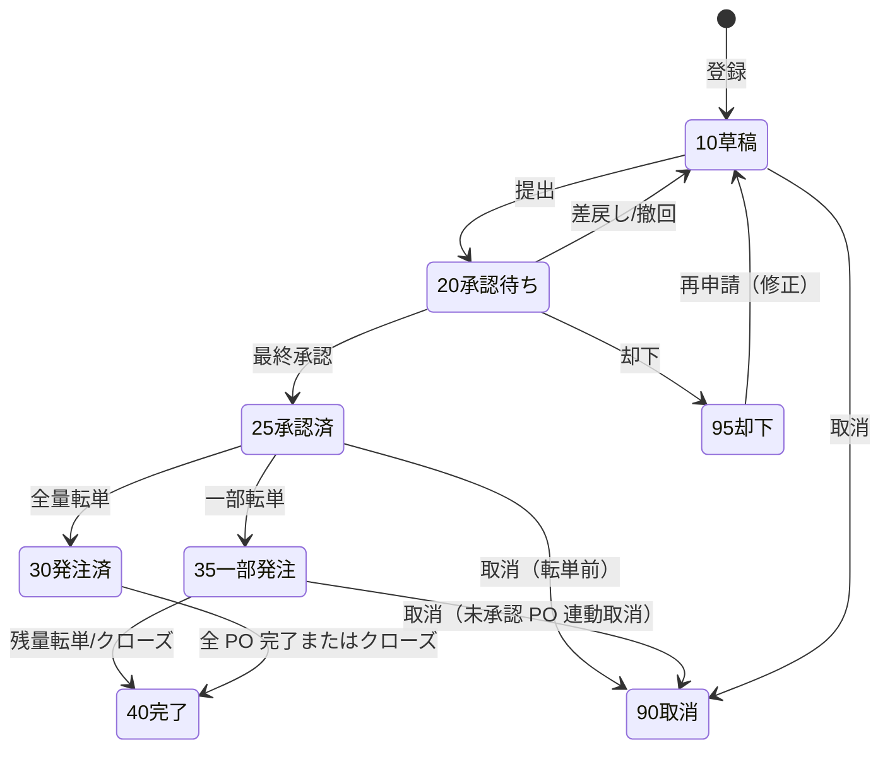
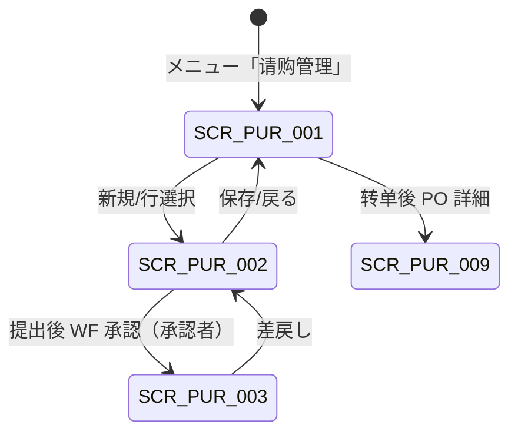

# 请购管理 详细设计书（購買依頼管理 詳細設計書）

| 項目 | 内容 |
|---|---|
| 文書名 | 请购管理 详细设计书（購買依頼管理 詳細設計書） |
| 文書番号 | DSN-PUR-001 |
| 版数 | v1.0 |
| 作成日 | 2026-10-20 |
| 作成者 | purchase-designer |
| 承認者 | 未承認（レビュー待ち） |
| 状態 | ドラフト（レビュー中） |
| 関連文書 | [業務域概要](00-overview.md) / [共通項目定義](../00-common/01-common-item-definitions.md) / [画面共通規格](../00-common/02-common-screen-spec.md) / [API 共通規格](../00-common/03-common-api-spec.md) / [共通業務規則](../00-common/08-common-business-rules.md) / [跨域流程](../00-common/09-cross-domain-flow.md) / [代码一覧](../00-common/06-code-list.md) / [采购订单](03-purchase-order.md) |

---

## 1. 機能概要

| 項目 | 内容 |
|---|---|
| 機能 ID | F-PUR-001 请购单登记 / F-PUR-002 请购审批 / F-PUR-003 请购转订单 |
| 機能名 | 请购管理（購買依頼） |
| 目的 | 部门需求发生后的采购要求登记、预算与重复性检查、金额分级审批，并将承认済请购转为采购订单，保证「谁需要、为何需要、是否批准、转成了哪些订单」全程可追溯 |
| 利用者・ロール | 部门担当（登记・提出）、部门经理/采购经理/分管副总/总经理（承认）、采购员（转单） |
| 利用シーン | ① 生产部按月度生产计划提出原材料请购；② 技术部提出样品/工装请购；③ 设备部提出备件请购；④ MRP 计划订单自动生成计划请购后由采购员确认（F-PUR-025） |
| 優先度 | P0 |
| 画面 ID | SCR-PUR-001（一览）、SCR-PUR-002（登録編集）、SCR-PUR-003（审批） |
| 関連 IF | なし（外部 IF なし。WF 承認は E31/E32、計画采购は IF-PUR-003） |

### 1.1 機能分解

| 機能 ID | 機能名 | 概要 | 優先度 |
|---|---|---|---|
| F-PUR-001 | 请购单登记 | 单据作成・修正・提出・撤回・取消・打印；预算检查与重复检查 | P0 |
| F-PUR-002 | 请购审批 | 提出后的 WF 审批、差戻し・撤回・却下、承认结果反映（E31/E32） | P0 |
| F-PUR-003 | 请购转订单 | 全量/部分/合并转单；转单取消与数量戻し；转单进度跟踪 | P0 |

---

## 2. 業務要件・業務ルール

### 2.1 前提条件

| # | 前提条件 | 成立しない場合の挙動 |
|---|---|---|
| 1 | 申請者の所属部門・工厂が SYS 組織マスタに存在する | 部門選択不可。保存時エラー `MSG-COM-049` |
| 2 | 物料在 MDM 有效且采购视图为「可采购」 | 物料选择不可；保存时 `MSG-PUR-002` |
| 3 | 收货仓库为 MDM 有效仓库（原料仓 WH01 等） | 仓库选择不可 |
| 4 | WF 已配置采购申请审批流程（`wf_approval_matrix` 中存在对应金额区间的路径） | 提出失败 `MSG-COM-073` |
| 5 | 会计期间未结账（登録日所属期间状态 = OPEN） | 登録・提出拒否 `MSG-COM-071` |
| 6 | 用户具有申请部门的数据范围 | 画面 403 / API `code=3002` |

### 2.2 業務ルール

| # | ルール | 根拠 | 関連項目 |
|---|---|---|---|
| BR-01 | 请购单必须指定需求部门、申请人、收货仓库、希望交期；希望交期不得早于系统日（亚洲/上海服务器时刻） | 社内采购规程（示例企业） | `department_id`、`required_date` |
| BR-02 | 请购明细必须指定物料、数量（> 0）、用途、希望交期；单价为参考值可空（空时取 MDM 采购价格/最近成交价） | 社内采购规程 | `quantity`、`purpose` |
| BR-03 | 重复检查：同一需求部门 + 同一物料 + 状态 ∈ {10,20,25,30,35} 的请购在最近 7 日内存在时，警告并显示既存单号（可继续，须填写理由） | 防止重复请购（示例企业） | `warning`、`remark` |
| BR-04 | 预算检查（P0 実装時点 简易）：`部门年度预算余额 − 本年已发注金额 < 本单税込金额` 时警告；参数 `pur.budget.check.enabled` 关闭时跳过。P2 実装で接 FIN 预算余额 | 预算管理（P2）过渡设计 | `budget_check_status` |
| BR-05 | 审批路径：按 [08 §8.1](../00-common/08-common-business-rules.md) 金额阶梯（税込：<5,000 / 5,000～50,000 / 50,000～500,000 / ≥500,000 元），`wf_approval_matrix` 管理，不硬编码 | 08 §8.1 | `total_amount_with_tax` |
| BR-06 | 申请人不得承认自己的单据（自我承認禁止）；承认者不在时应设置代理承认 | 08 §8.2 | `applicant_id`、`approver_id` |
| BR-07 | 承认済（25）后请购内容不可修改；数量变更通过「取消→再作成」或转单时的部分转单处理 | 08 §3.3-3 | `pr_status` |
| BR-08 | 请购数量可分次转单；转单数量累计不得超过请购数量（`converted_qty ≤ quantity`） | 本域设计 | `converted_qty` |
| BR-09 | 转单可按供应商/收货仓库/希望交期分组生成多张 PO；同组内的多张请购明细可合并到一张 PO（需同供应商、同仓库，交期取最早） | 本域设计 | `supplier_id`、`warehouse_id` |
| BR-10 | 转单生成的 PO 为 10 草稿状态，由采购员确认后提交审批；PO 承认后才计入 `ordered_qty` 统计，但 `converted_qty` 在转单时即冻结占用，防止重复转单 | 本域设计 | `pur_purchase_order.po_status` |
| BR-11 | PO 在承认前取消/被却下时，触发转单数量戻し处理：`converted_qty` 减算、请购状态重新计算；PO 承认后取消，同样戻さない（PO 保留为 90 状态，请购保持已转单） | 08 §3.3-4、本域设计 | `converted_qty`、`pr_status` |
| BR-12 | 请购取消（90）条件：状态 10/20 可直接取消；25/35 且存在未承认的 PO 时可取消（同步取消相关 PO 草稿），已承认 PO 需先取消 PO；40 不可取消 | 08 §3.3-4 | `pr_status`、PO 关联 |
| BR-13 | 紧急请购（`pr_type=3`）可跳过询价直接指定供应商转单，但 PO 审批路径不得缩短（金额阶梯不变） | 本域设计 | `pr_type` |
| BR-14 | 请购单不物理删除；草稿的「删除」等同「取消」（状态 90），取消后可在列表参照，不可再提交 | 01 §11.2 | `pr_status` |
| BR-15 | 计划采购（`source_type=MRP`）由 PRD 计划订单生成，允许批量确认/调整数量与交期后提交；来源计划订单号不可修改 | 09 §6.1 | `source_type`、`source_id` |
| BR-16 | 打印/输出记录至 `sys_audit_log`（PRINT）；附件支持 pdf/jpg/png/xlsx（技术规格书、报价单），单个 ≤20MB、最多 20 个 | 01 §9 | 附件 |

### 2.3 計算式・判定式

| # | 対象 | 算式 | 丸め | 例（示例值） |
|---|---|---|---|---|
| CALC-01 | 明細金額（税抜） | 请购数量 × 预计单价 | 四捨五入 2 桁 | 12,000.0000 KGM × 5.650000 = 67,800.00 |
| CALC-02 | 明細税額 | 明細金額（税抜）× 税率 | 四捨五入 2 桁 | 67,800.00 × 13% = 8,814.00 |
| CALC-03 | 伝票税抜合計 | Σ 明細金額 | — | 67,800.00 + … |
| CALC-04 | 伝票税込合計 | 税抜合計 + 税額合計 | — | 税抜 + 税額 |
| CALC-05 | 剩余可转数量 | 请购数量 − 已转单数量 | 数量 4 桁 | 12,000 − 8,000 = 4,000.0000 |
| CALC-06 | 转单进度 | Σ 已转单数量 ÷ Σ 请购数量 | 比率 4 桁（%） | 33.33% |
| CALC-07 | 预算余额（P0 簡易） | 部门年度预算 − 本年累计发注税込额 | 2 桁 | 1,200,000.00 − 860,000.00 = 340,000.00 |
| CALC-08 | 参考单价取价 | ① MDM 有效采购价格（供应商+物料+日期）→ ② 最近 90 天成交价 → ③ 空 | — | 5.650000 CNY/KGM |

> 金额精度・端数规则引用 [01 §6](../00-common/01-common-item-definitions.md) 与 [08 §4](../00-common/08-common-business-rules.md)。

### 2.4 状態遷移



| 遷移 | トリガ | 権限 | 更新項目 | メッセージ |
|---|---|---|---|---|
| 10→20 | 提交按钮 | `purchase:requisition:submit` | `pr_status=20`、`submitted_at`、`process_instance_id` | `MSG-PUR-016` |
| 20→25 | E31/E32 最终承认回调 | 系统（WF） | `pr_status=25`、`approved_at`、`approver_id` | — |
| 20→10 | 差戻し/撤回 | 承認者/申請者 | `pr_status=10`、`reject_reason`（差戻し時） | `MSG-PUR-017` |
| 20→95 | 却下 | 承認者 | `pr_status=95`、`reject_reason` | `MSG-PUR-018` |
| 25→30 | 全量转单 | `purchase:requisition:convert` | `pr_status=30`、全支行 `line_status=30` | `MSG-PUR-023` |
| 25→35 | 一部转单 | 同上 | `pr_status=35`、`converted_qty` 累加 | `MSG-PUR-023` |
| 35→40 | 残量转单或手動关闭 | 同上 | `pr_status=40`、`closed_at`、`close_reason` | `MSG-PUR-024` |
| 25/35→90 | 取消 | `purchase:requisition:cancel` | `pr_status=90`、`cancel_reason`、关联 PO 草稿取消 | `MSG-PUR-019` |
| 10→90 | 取消 | 申請者 | `pr_status=90` | `MSG-PUR-019` |
| 95→10 | 再申請 | 申請者 | `pr_status=10` | `MSG-PUR-020` |

> 状态代码语义见 [00-overview.md](00-overview.md) §3.5。承认后内容变更禁止（08 §3.3）。

---

## 3. 関連機能

| 関係 | 機能 ID | 機能名 | 関係内容 |
|---|---|---|---|
| 上流 | F-PUR-025 | 计划采购 | MRP 计划订单生成计划请购（`source_type=MRP`） |
| 上流 | F-MDM-001/002 | 物料主数据 | 物料・采购单位・采购员・质检区分参照 |
| 上流 | F-MDM-005 | 供应商主数据 | 推荐供应商・准入状态参照 |
| 下流 | F-PUR-003 | 请购转订单 | 生成采购订单 |
| 下流 | F-PUR-004 | 询价比价 | 承认済请购作为询价对象 |
| 并行 | F-WF-003/004 | 审批发起・待办 | 审批流程引擎与承认回调 |
| 参照 | F-PUR-024 | 采购价格管理 | 参考单价取价 |
| 参照 | F-FIN-013（P2） | 预算管理 | 第一版（実装順 P2） 预算余额检查 |

---

## 4. 画面設計

### 4.1 画面一覧

| 画面 ID | 画面名 | 類型 | 概要 |
|---|---|---|---|
| SCR-PUR-001 | 请购单一覧 | 一覧検索 | 条件検索・状態別一覧・一括提出/取消/导出 |
| SCR-PUR-002 | 请购单登録編集 | 登録編集 | ヘッダ + 明細 + 转单对话框 + 审批履历タブ |
| SCR-PUR-003 | 请购审批 | ワークフロー | 承認画面（WF 共通画面を呼び出す。本節では请购固有の表示項目のみ定義） |

### 4.2 画面遷移



### 4.3 画面レイアウト（SCR-PUR-002）

```
┌──────────────────────────────────────────────────────────────────────┐
│ パンくず：ホーム > 采购管理 > 请购单登録                     [状態バッジ] │
├──────────────────────────────────────────────────────────────────────┤
│〔ヘッダ〕 请购单号 PR2610200001  请购类型[通常请购▼]  需求部门[D030生产部▼]│
│  申请人[E000123 张伟]  收货仓库[WH01 原料仓▼]  希望交期[2026-11-05]     │
│  预算检查结果[○通过]  外部参考号[________]                              │
├──────────────────────────────────────────────────────────────────────┤
│〔ツールバー〕[保存][保存并继续][提交][撤回][转订单][取消][关闭][打印][复制]│
├──────────────────────────────────────────────────────────────────────┤
│〔明細〕 行|物料编码|品名・规格|数量|单位|预计单价|金额(税抜)|税率|税額|   │
│        希望交期|推荐供应商|用途|已转单|剩余|行状态|操作                 │
│  10 |1001000001|50W470 冷轧无取向电工钢带 0.50×1250×C|12,000|KGM|     │
│     |5.650000|67,800.00|13.00%|8,814.00|2026-11-05|S000001|定子冲片|  │
│     |0.0000|12,000.0000|草稿| 删除                                    │
│  [+ 添加行]  [从采购价格取价]                                          │
├──────────────────────────────────────────────────────────────────────┤
│〔フッタ〕 税抜合計 CNY 67,800.00  税額 CNY 8,814.00  税込合計 CNY 76,614.00│
├──────────────────────────────────────────────────────────────────────┤
│〔タブ〕 明細 | 审批履历 | 关联订单 | 附件 | 变更履历                     │
└──────────────────────────────────────────────────────────────────────┘
```

### 4.4 画面項目定義

#### 4.4.1 SCR-PUR-001 请购单一覧（検索条件・一覧項目）

| No | 項目 ID | 項目名 | 区分 | 種別 | 型/桁 | 必須 | 初期値 | 入力チェック | データソース | DB 項目 | 備考 |
|---|---|---|---|---|---|---|---|---|---|---|---|
| 1 | `keyword` | 关键字 | 検索 | テキスト | VARCHAR(64) | — | 空 | 桁数 | — | `pr_no`/`material_name` | 部分一致（pg_trgm） |
| 2 | `departmentId` | 需求部门 | 検索 | 選択 | BIGINT | — | 自部門 | — | `sys_department` | `department_id` | データ範囲で絞込 |
| 3 | `prStatus` | 状态 | 検索 | 複数選択 | SMALLINT | — | 10,20,25,35 | コード存在 | 固定値 | `pr_status` | 複数可 |
| 4 | `prType` | 请购类型 | 検索 | 選択 | SMALLINT | — | 全部 | 値域 1～4 | 固定値 | `pr_type` | — |
| 5 | `applicantId` | 申请人 | 検索 | 選択 | BIGINT | — | 空 | — | `sys_user` | `applicant_id` | — |
| 6 | `requiredDateFrom` | 希望交期(自) | 検索 | 日付 | DATE | — | 空 | 両端含む | — | `required_date` | — |
| 7 | `requiredDateTo` | 希望交期(至) | 検索 | 日付 | DATE | — | 空 | from ≤ to（`MSG-COM-046`） | — | `required_date` | — |
| 8 | `prNo` | 请购单号 | 一覧 | リンク | VARCHAR(32) | — | — | — | — | `pr_no` | 詳細へ遷移 |
| 9 | `departmentName` | 需求部门 | 一覧 | テキスト | VARCHAR(100) | — | — | — | マスタ | `department_id` | — |
| 10 | `prTypeName` | 请购类型 | 一覧 | テキスト | VARCHAR(20) | — | — | — | 固定値 | `pr_type` | — |
| 11 | `applicantName` | 申请人 | 一覧 | テキスト | VARCHAR(50) | — | — | — | `sys_user` | `applicant_id` | — |
| 12 | `requiredDate` | 希望交期 | 一覧 | 日付 | DATE | — | — | — | — | `required_date` | 早期警告色 |
| 13 | `totalAmountWithTax` | 税込金額 | 一覧 | 数値 | NUMERIC(18,2) | — | — | — | — | `total_amount_with_tax` | 右寄せ |
| 14 | `prStatus` | 状态 | 一覧 | バッジ | SMALLINT | — | — | — | 固定値 | `pr_status` | 色規則 01 §14.3 |
| 15 | `convertedRate` | 转单进度 | 一覧 | 数値 | NUMERIC(7,4) | — | — | — | 計算 | `converted_qty`/`quantity` | プログレスバー |
| 16 | `createdAt` | 登録日時 | 一覧 | 日時 | TIMESTAMPTZ | — | — | — | — | `created_at` | 既定ソート降順 |

一括操作：提交（10→20）、取消（10/25/35）、导出（Excel ≤10,000 件，超過は非同期 `POST /api/purchase/exports`）。

#### 4.4.2 SCR-PUR-002 请购单登録編集（ヘッダ項目）

| No | 項目 ID | 項目名 | 種別 | 型/桁 | 必須 | 初期値 | 入力チェック | データソース | DB 項目 | 権限 | 備考 |
|---|---|---|---|---|---|---|---|---|---|---|---|
| 1 | `prNo` | 请购单号 | テキスト | VARCHAR(32) | ○ | 自動採番 | 形式 `PR{YYMMDD}{4桁}` | 採番（SYS） | `pr_no` | 参照のみ | 保存後に確定 |
| 2 | `prType` | 请购类型 | ラジオ | SMALLINT | ○ | 1 通常请购 | 値域 1～4 | 固定値（1 通常/2 计划/3 紧急/4 费用性） | `pr_type` | 編集可 | 紧急请购可指定供应商 |
| 3 | `sourceType` | 来源类型 | テキスト | VARCHAR(32) | 自動 | MANUAL | 値域（09 §P2M） | — | `source_type` | 非表示 | MRP 时显示计划订单号 |
| 4 | `sourceId` | 来源单据 ID | テキスト | BIGINT | — | 空 | — | — | `source_id` | 非表示 | 参照用 |
| 5 | `departmentId` | 需求部门 | 選択 | BIGINT | ○ | ログインユーザ部門 | コード存在・データ範囲 | `sys_department` | `department_id` | 編集可 | 部門変更時は承認経路再計算 |
| 6 | `applicantId` | 申请人 | テキスト | BIGINT | ○ | ログインユーザ | — | `sys_user` | `applicant_id` | 参照のみ | — |
| 7 | `factoryId` | 工厂 | 選択 | BIGINT | ○ | ユーザ既定（CZ01） | コード存在 | `mdm_factory` | `factory_id` | 編集可 | — |
| 8 | `warehouseId` | 收货仓库 | 選択 | BIGINT | ○ | WH01 原料仓 | コード存在・有効 | `mdm_warehouse` | `warehouse_id` | 編集可 | 明細で上書き可（行優先） |
| 9 | `requiredDate` | 希望交期 | 日付 | DATE | ○ | 当日 + 7 日 | ≥ 当日（`MSG-PUR-001`） | — | `required_date` | 編集可 | 明細未入力時の既定 |
| 10 | `budgetCheckStatus` | 预算检查结果 | テキスト | SMALLINT | 自動 | 0 未检查 | — | 計算 | `budget_check_status` | 参照のみ | 0 未/1 通过/2 警告/3 超预算 |
| 11 | `budgetSubjectCode` | 预算科目 | 選択 | VARCHAR(32) | △ | 空 | 代码存在 | FIN 预算科目（P2） | `budget_subject_code` | 編集可 | FIN 予算連携（実装順 P2）で使用 |
| 12 | `currencyCode` | 币种 | 選択 | VARCHAR(8) | ○ | CNY | ISO 4217（06 §3） | `mdm_currency` | `currency_code` | 参照のみ | 既定 CNY（外貨は実装順 P2） |
| 13 | `totalAmount` | 税抜合計 | 数値 | NUMERIC(18,2) | 自動 | 0.00 | — | Σ 明細 | `total_amount` | 参照のみ | — |
| 14 | `taxAmount` | 税额合计 | 数値 | NUMERIC(18,2) | 自動 | 0.00 | — | Σ 明細 | `tax_amount` | 参照のみ | — |
| 15 | `totalAmountWithTax` | 税込合計 | 数値 | NUMERIC(18,2) | 自動 | 0.00 | — | 計算 | `total_amount_with_tax` | 参照のみ | 承認金額判定に使用 |
| 16 | `reason` | 申请理由 | テキストエリア | VARCHAR(500) | ○ | 空 | 桁数 ≤500 | — | `reason` | 編集可 | 重复请购时必填补充理由 |
| 17 | `externalNo` | 外部参考号 | テキスト | VARCHAR(64) | △ | 空 | 桁数 | — | `external_no` | 編集可 | 技术通知单号等 |
| 18 | `prStatus` | 状态 | バッジ | SMALLINT | 自動 | 10 | — | — | `pr_status` | 参照のみ | — |
| 19 | `remark` | 备注 | テキストエリア | VARCHAR(500) | △ | 空 | 桁数 | — | `remark` | 編集可 | — |
| 20 | `attachments` | 附件 | 添付 | — | △ | 空 | 形式・サイズ（01 §9） | `sys_attachment` | — | 編集可 | — |
| 21 | `version` | 版数 | 数値 | INT | 自動 | 0 | — | — | `version` | 非表示 | 楽観排他 |

#### 4.4.3 SCR-PUR-002 明細項目

| No | 項目 ID | 項目名 | 種別 | 型/桁 | 必須 | 初期値 | 入力チェック | データソース | DB 項目 | 備考 |
|---|---|---|---|---|---|---|---|---|---|---|
| 1 | `lineNo` | 行番号 | 数値 | INT | 自動 | 10 刻み | — | — | `line_no` | 保存時に振り直し |
| 2 | `materialCode` | 物料编码 | 選択ダイアログ | VARCHAR(20) | ○ | 空 | 存在・有効・采购视图可采购（`MSG-PUR-002`） | `mdm_material` | `material_id`/`material_code` | コード直接入力可 |
| 3 | `materialName` | 品名 | テキスト | VARCHAR(200) | 自動 | 空 | — | `mdm_material` | `material_name` | スナップショット |
| 4 | `spec` | 规格 | テキスト | VARCHAR(200) | 自動 | 空 | — | `mdm_material` | `spec` | スナップショット |
| 5 | `uomCode` | 采购单位 | 選択 | VARCHAR(8) | ○ | 物料采购单位 | 同一单位组 | `mdm_uom`（06 §6） | `uom_code` | 換算率を保持 |
| 6 | `quantity` | 请购数量 | 数値 | NUMERIC(18,4) | ○ | 0 | > 0（`MSG-COM-047`） | — | `quantity` | 単位精度 4 桁 |
| 7 | `estimatedUnitPrice` | 预计单价 | 数値 | NUMERIC(18,6) | △ | 取价 CALC-08 | ≥ 0（`MSG-COM-048`） | `mdm_purchase_price` | `estimated_unit_price` | 税抜単価 |
| 8 | `estimatedAmount` | 预计金额 | 数値 | NUMERIC(18,2) | 自動 | 0.00 | — | 計算 | `estimated_amount` | 数量×単価 |
| 9 | `taxCode` | 税码（进项） | 選択 | VARCHAR(32) | ○ | `VAT13-IN` | 有效业务税码・`tax_type=11`（进项） | `mdm_tax_code`（06 §7 基础码 + 业务税码） | `tax_code` | 税込/税抜は税码属性で判定 |
| 9a | `taxRate` | 税率（快照） | 数値 | NUMERIC(7,4) | 自動 | 13.0000 | 税码取得時点の税率を保持 | `mdm_tax_code` | `tax_rate` | 伝票登録時点をスナップショット |
| 10 | `taxAmount` | 税額 | 数値 | NUMERIC(18,2) | 自動 | 0.00 | — | 計算 | `tax_amount` | — |
| 11 | `requiredDate` | 希望交期 | 日付 | DATE | ○ | ヘッダ值 | ≥ 当日 | — | `required_date` | 行単位で上書き可 |
| 12 | `supplierSuggestId` | 推荐供应商 | 選択 | BIGINT | △ | 空 | 准入済（`MSG-PUR-003`） | `mdm_supplier` | `supplier_suggest_id` | 紧急请购时必填 |
| 13 | `purpose` | 用途 | テキスト | VARCHAR(200) | ○ | 空 | 桁数 ≤200 | — | `purpose` | 例「YE3-100L1-4 定子冲片」 |
| 14 | `convertedQty` | 已转单数量 | 数値 | NUMERIC(18,4) | 自動 | 0 | — | 計算 | `converted_qty` | 参照のみ |
| 15 | `remainQty` | 剩余可转数量 | 数値 | NUMERIC(18,4) | 自動 | = 数量 | — | 計算 | 导出（非保存） | 参照のみ |
| 16 | `lineStatus` | 行状态 | バッジ | SMALLINT | 自動 | 10 | — | — | `line_status` | 10/30/35/40/90 |
| 17 | `lineRemark` | 行备注 | テキスト | VARCHAR(500) | △ | 空 | 桁数 | — | `line_remark` | — |

### 4.5 イベント処理

| No | イベント | トリガ | 処理内容 | 呼出 API | 画面遷移 | 備考 |
|---|---|---|---|---|---|---|
| 1 | 検索 | 検索ボタン / Enter | 条件検証・一覧取得 | `GET /api/purchase/purchase-requisitions` | 同一画面 | ローディング表示 |
| 2 | 新規 | 新規ボタン | 空の編集画面（採番は保存時） | — | SCR-PUR-002 | — |
| 3 | 行選択 | 一覧行ダブルクリック | 詳細取得・編集/参照モード判定 | `GET /api/purchase/purchase-requisitions/{id}` | SCR-PUR-002 | 状態で編集可否 |
| 4 | 保存 | 保存ボタン | 入力チェック→登録/更新→採番→再計算 | `POST`/`PUT /api/purchase/purchase-requisitions` | 同画面（保存して継続は新規） | 二重送信防止（Idempotency-Key） |
| 5 | 明細追加 | 追加ボタン | 空行追加・行番号採番・既定値セット | — | — | 最大 1,000 行 |
| 6 | 明細削除 | 削除ボタン | 確認後行削除（最低 1 行） | — | — | `MSG-COM-010` |
| 7 | 物料選択 | 物料参照ボタン | 物料選択ダイアログ→名称・规格・单位・税率・参考单価を返却 | `GET /api/mdm/materials`（選択ダイアログ） | — | 無効物料は選択不可 |
| 8 | 取价 | 「从采购价格取价」 | 明細全行の参考单価を再取得 | `GET /api/purchase/prices` | — | 失敗行は警告のみ |
| 9 | 数量/単価変更 | 項目フォーカスアウト | 金額・税額・合計を再計算 | — | — | 前端計算 + 保存時サーバ再計算 |
| 10 | 提出 | 提交ボタン | 保存→承認経路取得→WF 提出→状態 20 | `POST /api/purchase/purchase-requisitions/{id}/submit` | 同一画面（状態更新） | 承認経路未設定時 `MSG-COM-073` |
| 11 | 撤回 | 撤回ボタン | 未処理タスクのみ撤回→状態 10 | `POST .../{id}/withdraw` | 同一画面 | 承認者既処理時は不可 |
| 12 | 转订单 | 转订单ボタン | 转单对话框（行・数量・供应商・仓库・交期）→PO 生成 | `POST .../{id}/convert-to-orders` | 完了後、生成 PO 一覧をダイアログ表示 | 部分转单可 |
| 13 | 取消 | 取消ボタン | 確認後取消（状態 90） | `POST .../{id}/cancel` | 一覧へ戻る | 关联 PO 草稿の取消を含む |
| 14 | 关闭 | 关闭ボタン | 残量不再转单→状態 40 | `POST .../{id}/close` | 一覧へ戻る | 理由必須 |
| 15 | 打印 | 打印ボタン | PRT-PUR-001 を PDF 出力 | `POST .../{id}/print` | — | 出力履歴記録 |
| 16 | 复制 | 复制ボタン | ヘッダ一部+明細をコピーした新規草稿 | — | SCR-PUR-002（新規モード） | 新規採番 |
| 17 | タブ切替 | タブクリック | 审批履历・关联订单・附件・变更履历取得 | `GET .../{id}/history` 等 | — | 遅延ロード |

### 4.6 一覧画面仕様（SCR-PUR-001）

| 項目 | 内容 |
|---|---|
| 検索条件 | 关键字（部分一致，`pg_trgm`）、需求部门、状态（複数）、请购类型、申请人、希望交期范围 |
| 既定検索条件 | 自部門（データ範囲）+ 未完了状态（10,20,25,35）+ 当月 |
| ソート | 既定：登録日時降順。他：请购单号、希望交期、金额 |
| ページング | 20 / 50 / 100 / 200（既定 20、最大 200） |
| 一括操作 | 提交、撤回、取消、导出 |
| エクスポート | Excel、≤10,000 件；超過は非同期ジョブ（`POST /api/purchase/exports`、`MSG-COM-004`） |
| 権限 | 一覧は `purchase:requisition:view`。部門外データはデータ権限で自動絞込（画面に条件表示しない） |

### 4.7 表示制御

| 条件 | 対象項目/ボタン | 制御 |
|---|---|---|
| `pr_status ≠ 10` | 編集可項目、保存、删除行 | 参照のみ（グレー） |
| `pr_status = 20` | 提交、撤回（申請者のみ） | 承認者・申請者で表示分岐 |
| `pr_status ∈ {25,30,35,40,90,95}` または 転単実績 > 0 | 数量・単位・物料 | 非表示（変更不可） |
| `pr_status ∈ {10,20,25,35}` かつ 権限あり | 取消ボタン | 表示 |
| `pr_status = 25` かつ 未転単残 > 0 | 转订单ボタン | 表示 |
| 権限なし | 金额項目・转订单ボタン | 非表示（API も返さない） |
| `source_type = MRP` | 来源计划订单号 | 参照表示（リンクは PRD 権限保持時のみ） |

---

## 5. 入力チェック仕様

| No | チェック ID | 対象項目 | 種別 | 条件 | タイミング | メッセージ ID |
|---|---|---|---|---|---|---|
| 1 | CHK-PUR-001-01 | 需求部门 | 必須 | NULL/未選択でない | 保存時 | `MSG-COM-040` |
| 2 | CHK-PUR-001-02 | 收货仓库 | 必須・コード存在 | 有効な `mdm_warehouse` に存在 | フォーカスアウト + 保存時 | `MSG-COM-049` |
| 3 | CHK-PUR-001-03 | 希望交期（ヘッダ・明細） | 範囲 | ≥ サーバ当日 | 保存時 | `MSG-PUR-001` |
| 4 | CHK-PUR-001-04 | 申请理由 | 必須・桁数 | 入力あり、≤500 文字 | 保存時 | `MSG-COM-040` / `MSG-COM-041` |
| 5 | CHK-PUR-001-05 | 物料编码 | 必須・コード存在 | 物料有效且 `purchasable=true` | フォーカスアウト | `MSG-PUR-002` |
| 6 | CHK-PUR-001-06 | 请购数量 | 必須・範囲 | > 0 かつ数量精度 4 桁以内 | 保存時 | `MSG-COM-047` |
| 7 | CHK-PUR-001-07 | 预计单价 | 範囲 | ≥ 0、小数 6 桁以内 | 保存時 | `MSG-COM-048` |
| 8 | CHK-PUR-001-08 | 税码 | 必須・コード存在 | 有効な業務税码（`tax_type=11` 進項） | 保存時 | `MSG-COM-049` |
| 9 | CHK-PUR-001-09 | 推荐供应商 | コード存在 | 准入済・有効（紧急请购で必須） | フォーカスアウト | `MSG-PUR-003` |
| 10 | CHK-PUR-001-10 | 明細行数 | 相関 | 1 行以上 1,000 行以下 | 保存時 | `MSG-COM-047` |
| 11 | CHK-PUR-001-11 | 明細合計 | 相関 | ヘッダ合計と明細合計が一致（サーバ再計算値で上書き） | 保存時 | `MSG-COM-051`（W） |
| 12 | CHK-PUR-001-12 | 重複请购 | 業務 | 同一部門+物料+7 日以内の未転単请购 | 保存時 | `MSG-PUR-004`（W） |
| 13 | CHK-PUR-001-13 | 予算残高 | 業務 | 予算余额 < 本单税込額 | 保存時 | `MSG-PUR-005`（W） |
| 14 | CHK-PUR-001-14 | 期間状態 | 業務 | 登録日所属会計期間 ≠ CLOSED | 保存時 | `MSG-COM-071` |
| 15 | CHK-PUR-001-15 | 転単数量 | 相関 | 転単数量 ≤ 残量、> 0 | 転単実行時 | `MSG-PUR-021` |
| 16 | CHK-PUR-001-16 | 状態整合 | 業務 | 操作が現在状態で許可されている | 各操作時 | `MSG-COM-034` |
| 17 | CHK-PUR-001-17 | 楽観排他 | 排他 | `version` 一致 | 保存・状態操作時 | `MSG-COM-033`（HTTP 409） |
| 18 | CHK-PUR-001-18 | 数据权限 | 権限 | 自部門或授权范围 | 画面表示 + API | `MSG-COM-031` |

---

## 6. 処理詳細

### 6.1 処理一覧

| 処理 ID | 処理名 | 契機 | トランザクション | 排他 |
|---|---|---|---|---|
| PRC-PUR-001-01 | 请购登録 | 保存（新規） | 要 | 採番行ロック |
| PRC-PUR-001-02 | 请购更新 | 保存（編集） | 要 | 楽観排他（version） |
| PRC-PUR-001-03 | 请购提出 | 提交 | 要 | 楽観排他 |
| PRC-PUR-001-04 | 请购撤回 | 撤回 | 要 | 楽観排他 |
| PRC-PUR-001-05 | 请购取消 | 取消 | 要 | 楽観排他 + PO 草稿ロック |
| PRC-PUR-001-06 | 请购关闭 | 关闭 | 要 | 楽観排他 |
| PRC-PUR-002-01 | 承認結果反映 | E31/E32 受信 | 要 | 楽観排他 + 冪等（eventId） |
| PRC-PUR-003-01 | 请购转订单 | 转订单 | 要 | PR 行ロック + 採番 |
| PRC-PUR-003-02 | 転単数量戻し | PO 取消/却下時 | 要 | PO 行ロック |

### 6.2 処理手順（正常系）

**PRC-PUR-001-01 请购登録**

1. リクエストの Bean Validation（必須・桁・型）を実行する。
2. 権限 `purchase:requisition:create` とデータ範囲（自部門）を検証する。
3. 会計期間状態を FIN から同期参照し、`CLOSED` なら `MSG-COM-071` で終了する。
4. 物料・倉庫・税码・通貨のコード存在と有効性を検証する。
5. 明細の数量・単価・税額を再計算する（前端値を信用しない。CALC-01～04）。
6. 重複チェック（CHK-12）と予算チェック（CHK-13）を実行し、警告は `data.warnings[]` として返す（保存は継続）。
7. `sys_sequence` から `PR{YYMMDD}{4桁}` を採番する（`sequence_key=PUR_PURCHASE_REQUISITION`、日次）。
8. `pur_purchase_requisition` / `pur_purchase_requisition_line` を INSERT する（`pr_status=10`、`budget_check_status` 更新）。
9. 監査ログ `sys_audit_log`（CREATE）を記録する。
10. 作成結果（ID・番号・計算後金額）を返却する。

**PRC-PUR-001-03 请购提出**

1. 状態が 10（または差戻し後 10）であることを確認する（`MSG-COM-034`）。
2. 明細 1 行以上・金額再計算・希望交期を再検証する。
3. WF へ提出データ（`businessType=PURCHASE_REQUISITION`、`businessId`、`businessNo`、`variables{amount, departmentId, prType}`、`formSnapshot`）を送信する。
4. WF 受付失敗（承認経路なし）時はロールバックし `MSG-COM-073` を返す。
5. `pr_status=20`、`submitted_at=now()`、`process_instance_id` を更新する（楽観排他）。
6. 監査ログ（SUBMIT）を記録し、申請者・承認者へ通知（SYS 通知、08 §13.3）。

**PRC-PUR-002-01 承認結果反映（E31/E32）**

1. `sys_event_consume_log` で `eventId` の重複を排除する（冪等）。
2. `businessType=PURCHASE_REQUISITION` かつ `businessId` が対象 PR を指すことを検証する。
3. `aggregateVersion` が現在 `version` より古い場合は無視する。
4. `result=APPROVED` かつ最終承認：`pr_status=25`、`approved_at`、`approver_id`、`approval_comment` を更新。
5. `result=REJECTED`：`pr_status=95`、`reject_reason` を保存。`result=RETURNED`：`pr_status=10`、`reject_reason` 保存。
6. 通知（申請者）と監査ログ（APPROVE/REJECT）を記録する。

**PRC-PUR-003-01 请购转订单**

1. PR を `SELECT ... FOR UPDATE` でロックし、`pr_status ∈ {25,35}` を確認する（`MSG-PUR-022`）。
2. 転単対象行を抽出し、`転単数量 > 0` かつ `≤ 残量` を検証する（`MSG-PUR-021`）。
3. 転単グループ（`supplier_id` + `warehouse_id` + `required_date`）を決定する。供应商未指定行は転単不可（`MSG-PUR-003`）。
4. 供应商准入状態（`mdm_supplier.status=APPROVED`、`supply_scope` に物料が含まれる）を検証する。未承認は警告、範囲外は `MSG-PUR-003`。
5. MOQ チェック：転単数量 < `mdm_supplier_material.moq`（未登録時は `mdm_material.min_order_qty`/`mdm_purchase_price.moq` へフォールバック）の場合、`MSG-PUR-026`（W）を返し、数量を MOQ に切り上げるか行除外を利用者に選択させる。切り上げ時は `converted_qty` も切上げ後の数量で更新する。
6. グループごとに PO を採番（`PO{YYMMDD}{4桁}`）し、`pur_purchase_order`（`po_status=10`、`source_type=REQUISITION`、`source_id=PR id`）と `pur_purchase_order_line`（`purchase_requisition_line_id`、`rfq_quotation_line_id=NULL`）を INSERT する。PO 単価は CALC-08 の取价、`price_source_type` に取得元を記録する。
7. PR 明細の `converted_qty` を加算し、行状态を再計算する（残 0 → 40、一部 → 35、未転単 → 10）。
8. PR ヘッダ状态を再計算する（全行 40 → 40、一部 30/35 混在 → 35、全行未転単 → 25）。
9. 監査ログ（CREATE/UPDATE）と PR 变更履历を記録し、生成 PO 一覧を返却する。
10. 冪等性：`Idempotency-Key` により同一リクエストの再送を排除する。転単処理中の二重起動は PR 行ロックで排除する。

**PRC-PUR-003-02 転単数量戻し**

1. 転单取消/却下された PO の明細から `purchase_requisition_line_id` と数量を取得する。
2. 対応する PR 明細を `FOR UPDATE` でロックし、`converted_qty` から当該 PO 明細数量を減算する（負にならないことを検証、異常時は `MSG-PUR-025` でアラート）。
3. PR 明細・ヘッダ状态を再計算する（PR が 40 → 35/30/25 に戻る）。
4. PO が承認済（25 以降）の場合は戻さない（BR-11）。承認前（10/20）または却下（95）の場合のみ戻す。
5. 監査ログ（UPDATE）を記録する。

### 6.3 例外処理

| No | 異常条件 | 検知箇所 | 処理 | ロールバック | メッセージ ID |
|---|---|---|---|---|---|
| 1 | 承認経路未設定 | 提出 | 提出中止 | 全体 | `MSG-COM-073` |
| 2 | 楽観排他競合 | 保存・状態操作 | 最新版再取得を促す | 全体 | `MSG-COM-033` |
| 3 | 期間締切済 | 登録・提出 | 登録拒否 | 全体 | `MSG-COM-071` |
| 4 | 転単数量超過 | 転単 | 処理中止 | 全体 | `MSG-PUR-021` |
| 5 | 物料無効化（承認後） | 転単 | 該当行をエラー一覧に返し他行は処理しない（全件ロールバック） | 全体 | `MSG-PUR-002` |
| 6 | 採番失敗 | 登録・転単 | ロールバック（欠番許容、重複禁止） | 全体 | `MSG-COM-080` |
| 7 | WF サービス停止 | 提出 | 失敗を返し「承認開始待ち」表示（設定時は Outbox 再送） | 全体 | `MSG-COM-081` |
| 8 | 転単中の PO 却下（並行） | 戻し処理 | 戻し対象なしとしてスキップしログ記録 | 部分 | — |

### 6.4 冪等性・再実行

- `POST /{id}/submit`・`POST /{id}/convert-to-orders`・`POST /{id}/cancel` は `Idempotency-Key` 必須（24 時間保持、[03 §9](../00-common/03-common-api-spec.md)）。
- 承認結果反映は `eventId` で重複排除し、同一イベントの再配信で二重遷移しない。
- 転単は PR 行ロックと残量チェックにより、同一 PR に対する並行転単でも二重転単しない。
- BAT からの再処理はない（本機能は同期処理のみ）。ただし Outbox 再送（E31/E32 購読失敗）は SYS の再送機構に委ねる。

---

## 7. API 設計

| No | メソッド | パス | 権限 | 概要 | リクエスト | レスポンス | 主なエラー |
|---|---|---|---|---|---|---|---|
| 1 | GET | `/api/purchase/purchase-requisitions` | `purchase:requisition:view` | 一覧検索 | 検索条件 + `pageNum/pageSize/sort` | `PageResult<PurchaseRequisitionListDto>` | 3001/3002 |
| 2 | GET | `/api/purchase/purchase-requisitions/{id}` | `purchase:requisition:view` | 詳細取得 | — | `PurchaseRequisitionDetailDto` | 4001/3002 |
| 3 | POST | `/api/purchase/purchase-requisitions` | `purchase:requisition:create` | 登録 | `PurchaseRequisitionCreateDto` | `PurchaseRequisitionDetailDto`（201） | 1001/40001 |
| 4 | PUT | `/api/purchase/purchase-requisitions/{id}` | `purchase:requisition:update` | 更新（草稿のみ） | `PurchaseRequisitionUpdateDto` + `version` | 詳細 DTO | 4002/4003 |
| 5 | POST | `/api/purchase/purchase-requisitions/{id}/submit` | `purchase:requisition:submit` | 提出 | `{version, comment?}` | 詳細 DTO | 4002/80001 |
| 6 | POST | `/api/purchase/purchase-requisitions/{id}/withdraw` | `purchase:requisition:submit` | 撤回 | `{version}` | 詳細 DTO | 4002 |
| 7 | POST | `/api/purchase/purchase-requisitions/{id}/cancel` | `purchase:requisition:cancel` | 取消 | `{version, reason}` | 詳細 DTO | 4002/40072 |
| 8 | POST | `/api/purchase/purchase-requisitions/{id}/close` | `purchase:requisition:convert` | 关闭（残量不再转单） | `{version, reason}` | 詳細 DTO | 4002 |
| 9 | POST | `/api/purchase/purchase-requisitions/{id}/convert-to-orders` | `purchase:requisition:convert` | 转订单 | `ConvertToOrdersRequest` | `ConvertToOrdersResponse` | 40010/40011/40012 |
| 10 | POST | `/api/purchase/purchase-requisitions/batch-submit` | `purchase:requisition:submit` | 一括提出 | `{ids[], comment?}` | `BatchResultDto` | — |
| 11 | POST | `/api/purchase/purchase-requisitions/{id}/print` | `purchase:requisition:print` | 帳票出力 | — | PDF（200） | 4001 |
| 12 | GET | `/api/purchase/purchase-requisitions/{id}/history` | `purchase:requisition:view` | 审批・变更履历 | — | `HistoryDto[]` | 4001 |

### 7.1 登録リクエスト例

```json
{
  "prType": 1,
  "departmentId": "1845000000000000030",
  "factoryId": "1845000000000000001",
  "warehouseId": "1845000000000000101",
  "requiredDate": "2026-11-05",
  "reason": "YE3-100L1-4 2026-10 計画（120 PCE、WO2610200001）用定子硅钢片",
  "externalNo": "SC-PLAN-202610-01",
  "lines": [
    {
      "materialId": "1845000000000001001",
      "uomCode": "KGM",
      "quantity": "12000.0000",
      "estimatedUnitPrice": "5.650000",
      "taxCode": "VAT13-IN",
      "taxRate": "13.0000",
      "requiredDate": "2026-11-05",
      "supplierSuggestId": "1845000000000002001",
      "purpose": "YE3-100L1-4 定子冲片"
    },
    {
      "materialId": "1845000000000001002",
      "uomCode": "KGM",
      "quantity": "2000.0000",
      "estimatedUnitPrice": "78.500000",
      "taxCode": "VAT13-IN",
      "taxRate": "13.0000",
      "requiredDate": "2026-11-08",
      "supplierSuggestId": "1845000000000002002",
      "purpose": "定子绕组用 QZY-2/180 φ1.00mm漆包线"
    }
  ]
}
```

### 7.2 登録レスポンス例（抜粋）

```json
{
  "code": 0,
  "message": "ok",
  "data": {
    "id": "1845678901234567890",
    "prNo": "PR2610200001",
    "prStatus": 10,
    "statusName": "草稿",
    "departmentId": "1845000000000000030",
    "departmentName": "生产部",
    "requiredDate": "2026-11-05",
    "totalAmount": "224780.00",
    "taxAmount": "29221.40",
    "totalAmountWithTax": "254001.40",
    "budgetCheckStatus": 1,
    "version": 0,
    "lines": [
      {
        "lineNo": 10,
        "materialCode": "1001000001",
        "materialName": "冷轧无取向电工钢带",
        "spec": "50W470 0.50mm×1000mm 卷料",
        "quantity": "12000.0000",
        "uomCode": "KGM",
        "estimatedUnitPrice": "5.650000",
        "estimatedAmount": "67800.00",
        "taxRate": "13.0000",
        "taxAmount": "8814.00",
        "convertedQty": "0.0000",
        "lineStatus": 10
      }
    ],
    "warnings": [
      { "code": 40004, "message": "该部门/物料在近 7 天内已有未转单的请购（PR2610150002），请确认是否重复。" }
    ]
  }
}
```

### 7.3 转订单リクエスト/レスポンス例

```json
{
  "lines": [
    {
      "purchaseRequisitionLineId": "1845678901234567891",
      "quantity": "8000.0000",
      "supplierId": "1845000000000002001",
      "warehouseId": "1845000000000000101",
      "deliveryDate": "2026-11-03"
    }
  ],
  "autoSubmit": false,
  "comment": "分两批到货"
}
```

```json
{
  "code": 0,
  "message": "ok",
  "data": {
    "orders": [
      { "poId": "1845678901234567900", "poNo": "PO2610200001", "lineCount": 1, "totalAmountWithTax": "72606.00" }
    ],
    "prStatus": 35,
    "convertedRate": "0.6667"
  }
}
```

### 7.4 エラー例

```json
{
  "code": 40010,
  "message": "转单数量超过请购剩余可转单数量（剩余 4,000.0000 KGM）。",
  "data": {
    "fieldErrors": [
      { "field": "lines[0].quantity", "message": "超过剩余可转单数量" }
    ]
  }
}
```

> エラーコード体系は [03 §6](../00-common/03-common-api-spec.md) に従い、PUR 域は 40000〜49999 を使用する。`code` と `MSG-PUR-xxx` の対応は [93-messages.md](93-messages.md) を正とする。

---

## 8. データ更新仕様

| テーブル | 操作 | 更新項目 | 更新条件 | トリガ |
|---|---|---|---|---|
| `pur_purchase_requisition` | INSERT | 全項目（`pr_status=10`） | 新規保存 | PRC-PUR-001-01 |
| `pur_purchase_requisition` | UPDATE | ヘッダ項目、`total_amount`/`tax_amount`/`total_amount_with_tax`、`version+1` | 草稿編集 | PRC-PUR-001-02 |
| `pur_purchase_requisition` | UPDATE | `pr_status=20`、`submitted_at`、`process_instance_id` | 提出 | PRC-PUR-001-03 |
| `pur_purchase_requisition` | UPDATE | `pr_status=25/95/10`、`approved_at`、`approver_id`、`reject_reason` | E31/E32 | PRC-PUR-002-01 |
| `pur_purchase_requisition` | UPDATE | `pr_status=30/35/40/90`、`closed_at`、`close_reason`、`cancel_reason` | 転単・取消・关闭 | PRC-PUR-001-05/06、003-01 |
| `pur_purchase_requisition_line` | INSERT/UPDATE | 明細項目、`converted_qty`、`line_status` | 保存・転単・戻し | PRC-PUR-001/003 |
| `pur_purchase_order` | INSERT | 全項目（`po_status=10`） | 転単 | PRC-PUR-003-01 |
| `pur_purchase_order_line` | INSERT | 全項目（`purchase_requisition_line_id` 設定） | 転単 | PRC-PUR-003-01 |
| `pur_purchase_order` | UPDATE | `po_status=90`、`cancel_reason` | 転単取消 | PRC-PUR-003-02 |
| `sys_audit_log` | INSERT | 操作ログ | 全操作 | 各 PRC |
| `sys_outbox_event` | INSERT | `workflow` 提出要求（必要時） | 提出 | PRC-PUR-001-03 |

スナップショット項目（マスタ変更の影響を受けない）：`material_code`、`material_name`、`spec`、`uom_code`、`tax_rate`、`department_name` 相当は参照時に名称解決するが、伝票表示用に `material_name`/`spec`/`uom_code`/`tax_rate` を明細に保持する。

---

## 9. エラー処理・メッセージ

| メッセージ ID | 種別 | 本文 | 発生条件 | 利用者への対処 | ログ |
|---|---|---|---|---|---|
| MSG-PUR-001 | E | 希望交期不能早于今天。 | 希望交期 < サーバ当日 | 正しい日付を入力 | WARN |
| MSG-PUR-002 | E | 所选物料不存在、已停用或不可采购，请重新选择。 | 物料無効/非采购品 | 物料を選び直す | WARN |
| MSG-PUR-003 | E | 所选供应商未通过准入或不在供货范围内，不能转单。 | 供应商未承認/範囲外 | 承認済供应商を選択、または MDM で准入 | WARN |
| MSG-PUR-004 | W | 该部门/物料在近 {0} 天内已有未转单的请购（{1}），是否继续？ | 重複请购 | 「继续」で理由入力、または既存单へ統合 | INFO |
| MSG-PUR-005 | W | 部门采购预算不足：本单税込金额 {0} 超过剩余预算 {1}，需上级承认。 | 预算残高不足 | 承認へ進む（警告のみ、保存可） | INFO |
| MSG-PUR-016 | I | 请购单已提交审批，当前审批人：{0}。 | 提出成功 | — | INFO |
| MSG-PUR-017 | E | 当前状态不允许撤回（已有审批人处理）。 | 撤回不可 | 承認者に差戻しを依頼 | WARN |
| MSG-PUR-018 | E | 请购单已被却下，请修正后重新提交。 | 却下後の操作 | 修正→再提出 | WARN |
| MSG-PUR-019 | I | 请购单已取消。 | 取消成功 | — | INFO |
| MSG-PUR-020 | I | 请购单已恢复为草稿，可修改后重新提交。 | 却下/差戻し後 | — | INFO |
| MSG-PUR-021 | E | 转单数量超过请购剩余可转单数量（剩余 {0}）。 | 転単数量超過 | 数量修正 | WARN |
| MSG-PUR-022 | E | 该请购单未批准或已全部转单，不能转单。 | 状態不整合 | 状態確認 | WARN |
| MSG-PUR-023 | I | 已生成采购订单 {0}（{1} 张），请购单状态已更新。 | 転単成功 | PO へ遷移して確認 | INFO |
| MSG-PUR-024 | I | 请购单已关闭，剩余未转单数量不再处理。 | 手動关闭 | — | INFO |
| MSG-PUR-025 | E | 转单数量戻し处理异常：请购剩余数量不足（数据不一致），请联系管理员。 | 戻し異常 | データ調査 | ERROR |
| MSG-PUR-026 | W | 转单数量低于供应商最小起订量 {0}，已按 MOQ 调整。 | MOQ 未満 | 数量確認 | INFO |
| MSG-COM-033 | E | 数据已被其他用户更新，请重新获取最新信息后再操作。 | 楽観排他 | 再取得 | WARN |
| MSG-COM-034 | E | 该记录当前状态不允许此操作。 | 状態不整合 | 状態確認 | WARN |
| MSG-COM-073 | E | 未找到匹配的审批流程，请联系管理员配置。 | WF 未設定 | 管理者へ連絡 | ERROR |

> 共通メッセージ（`MSG-COM-xxx`）は [05-common-message-list.md](../00-common/05-common-message-list.md) を正とする。以下同様。

---

## 10. 権限・セキュリティ

| 種別 | 内容 |
|---|---|
| 画面権限 | SCR-PUR-001/002：`purchase:requisition:view`；003：`purchase:requisition:approve` |
| 操作権限 | create / update / submit / withdraw / cancel / close / convert / print / export（[00-overview](00-overview.md) §10） |
| 項目権限 | 金額・予算項目は部門担当に表示可（自部門のみ）。他部門の金額は非表示（API も返さない） |
| データ範囲 | 部门担当は自部門、采购员は全社、审批者は承認路径上の部門 |
| 監査ログ | CREATE / UPDATE / SUBMIT / APPROVE / REJECT / CANCEL / CLOSE / PRINT / EXPORT を記録（before/after は金額・状態必須） |
| 機密 | 特になし（個人情報を含まない）。添付は権限 + 業務参照チェック |

---

## 11. 性能・非機能

| 項目 | 目標値 | 前提 |
|---|---|---|
| 一覧検索応答 | 2 秒以内（100 件表示） | `(department_id, pr_status, required_date)` 索引 |
| 詳細取得 | 1 秒以内 | 明細 1,000 行以下 |
| 登録・更新 | 3 秒以内 | 採番行ロック待ち含む |
| 転単（1 PR・20 行） | 3 秒以内 | 採番 20 件・PO 20 件 |
| 同時実行 | 20 ユーザ | 楽観排他 + 行ロック |
| 最大件数 | 月 3,000 件 / 明細 12,000 行 | 5 年 68,000 行 |

---

## 12. テスト観点

| No | 観点 ID | 分類 | 観点 | 期待結果 |
|---|---|---|---|---|
| 1 | TST-F-PUR-001-01 | 正常系 | 明細 2 行の请购を保存 | 採番 `PR{YYMMDD}{4桁}`、金額・税額合計が正しい |
| 2 | TST-F-PUR-001-02 | 正常系 | 保存→提出→承認 | 状態 10→20→25、承認者・日時が記録される |
| 3 | TST-F-PUR-001-03 | 異常系 | 希望交期に昨日を入力 | `MSG-PUR-001`、保存されない |
| 4 | TST-F-PUR-001-04 | 異常系 | 数量 0 / 負数 | `MSG-COM-047`、保存されない |
| 5 | TST-F-PUR-001-05 | 境界値 | 金額 5,000 元ちょうど（税込） | 承認経路が境界規則どおり（5,000 元未満は部門经理のみ） |
| 6 | TST-F-PUR-001-06 | 業務 | 同一部門・同一物料を 7 日以内に再登録 | 警告 `MSG-PUR-004` 表示、続行可 |
| 7 | TST-F-PUR-001-07 | 排他 | 2 ユーザが同時に更新 | 後勝ちせず `MSG-COM-033`（409） |
| 8 | TST-F-PUR-001-08 | 権限 | 他部門ユーザが画面を開く | 403 / データ非表示 |
| 9 | TST-F-PUR-001-09 | 状態 | 承認済 PR を編集 | 編集不可（項目参照のみ） |
| 10 | TST-F-PUR-003-01 | 正常系 | 承認済 PR を 2 グループに分けて転単 | PO 2 張生成、`converted_qty` 加算、PR 状態 35 |
| 11 | TST-F-PUR-003-02 | 境界値 | 全量転単 | PR 状態 30、全行 `line_status=40` |
| 12 | TST-F-PUR-003-03 | 異常系 | 残量を超える転単 | `MSG-PUR-021`、PO 生成されない |
| 13 | TST-F-PUR-003-04 | 業務 | 転単後 PO を却下 | 転単数量戻し、PR 状態が 25 に戻る |
| 14 | TST-F-PUR-003-05 | 冪等 | 同一 Idempotency-Key で転単を 2 回送信 | 2 回目は初回結果を返し、PO は増えない |
| 15 | TST-F-PUR-003-06 | 異常系 | 承認経路未設定で提出 | `MSG-COM-073`、状態は 10 のまま |

---

## 13. 未決事項

| # | 事項 | 理由 | 暫定仕様 | 担当 | 期限 |
|---|---|---|---|---|---|
| 1 | 予算检查の正式データソース | FIN 予算モジュールは P2 | P0 実装時点は部門年度予算パラメータによる警告のみ | finance-designer | 第一版（実装順 P1） |
| 2 | 请购变更（数量・交期）専用機能の要否 | 08 は承認後の変更を「変更伝票または取消→再作成」と規定。请购变更传票は未設計 | P0 実装時点は取消→再作成。P1 で「请购变更申请」を追加検討 | lead | 第一版（実装順 P1） |
| 3 | 転単時の MOQ 切上げ数量の扱い | MOQ 切上げ分は请购数量を超える可能性がある | 切上げ時は `converted_qty` も切上げ後数量で更新し、超過分は備考に記録。会計・在庫への影響なし | purchase-designer | 2026-10-27 |
| 4 | 外部参考号の重複チェック要否 | 技術通知单号等の重複可否が業務未確定 | 重複チェックしない（参照情報として保持） | 采购部 | 2026-10-27 |

---

## 14. 改訂履歴

| 版数 | 日付 | 変更内容 | 変更者 |
|---|---|---|---|
| v1.0 | 2026-10-20 | 初版：F-PUR-001～003（请购登録・承認・転単）、状態遷移、画面項目定義、処理詳細、API、テスト観点 | purchase-designer |
| v1.1 | 2026-10-20 | 红队第 2 轮修复：MOQ 参照を mdm_supplier_material 第一・material/purchase_price フォールバックに変更、PR 理由を唯一シナリオ（120 PCE）へ整合 | purchase-designer |
| v1.2 | 2026-10-21 | `pr_line_id`→`purchase_requisition_line_id`（90 DDL に統一） | 业务分析 |
