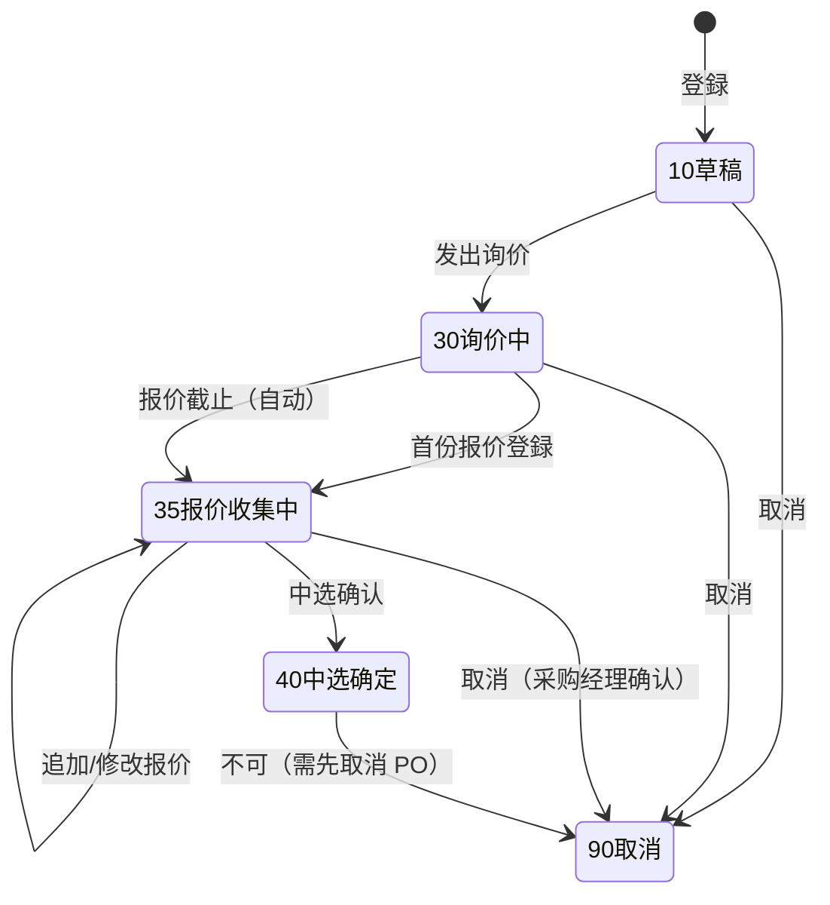
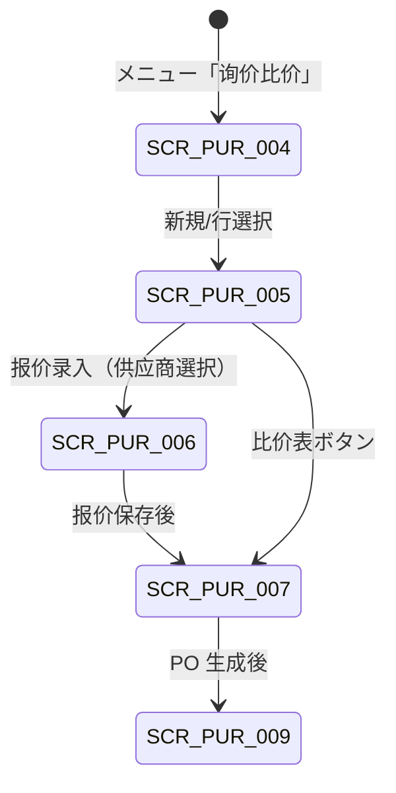

# 询价比价管理 详细设计书（見積依頼・比較管理 詳細設計書）

| 項目 | 内容 |
|---|---|
| 文書名 | 询价比价管理 详细设计书（見積依頼・比較管理 詳細設計書） |
| 文書番号 | DSN-PUR-002 |
| 版数 | v1.0 |
| 作成日 | 2026-10-20 |
| 作成者 | purchase-designer |
| 承認者 | 未承認（レビュー待ち） |
| 状態 | ドラフト（レビュー中） |
| 関連文書 | [業務域概要](00-overview.md) / [共通項目定義](../00-common/01-common-item-definitions.md) / [画面共通規格](../00-common/02-common-screen-spec.md) / [API 共通規格](../00-common/03-common-api-spec.md) / [共通業務規則](../00-common/08-common-business-rules.md) / [代码一覧](../00-common/06-code-list.md) / [请购管理](01-requisition.md) / [采购订单](03-purchase-order.md) |

---

## 1. 機能概要

| 項目 | 内容 |
|---|---|
| 機能 ID | F-PUR-004 询价比价单管理 / F-PUR-005 供应商报价登录 / F-PUR-006 比价与中选 |
| 機能名 | 询价比价（RFQ / Quotation Comparison） |
| 目的 | 对承认済请购或手工需求向多家供应商发出询价，收集报价并按统一口径（税抜单价 + 运费 + 交期 + 质量）形成比价表，通过可解释的评分与中选规则确定供应商及价格，最终生成采购订单（PO），实现采购价格的竞争性与可追溯性 |
| 利用者・ロール | 采购员（询价发出・报价录入）、采购经理（中选确认・例外承认）、财务/审计（比价结果参照） |
| 利用シーン | ① 年度价格谈判前的多供应商询价；② 新物料首次采购比价；③ 单一供应商涨价时的替代供应商比价；④ 紧急需求的小范围询价（2 家） |
| 優先度 | P1（第一版（実装順 P1）。P0 実装時点 可在 PO 直接指定价格，本功能不阻塞 P2P 主链路） |
| 画面 ID | SCR-PUR-004（一览）、SCR-PUR-005（登録編集）、SCR-PUR-006（报价登録）、SCR-PUR-007（比价表） |
| 関連 IF | なし（第一版（実装順 P2）：IF-PUR-010 供应商门户报价） |

### 1.1 機能分解

| 機能 ID | 機能名 | 概要 | 優先度 |
|---|---|---|---|
| F-PUR-004 | 询价比价单管理 | 询价单作成、供应商邀请、发出、报价截止、取消 | P1 |
| F-PUR-005 | 供应商报价登录 | 供应商报价录入（单价・税码・运费・MOQ・交期・付款条件・有效期） | P1 |
| F-PUR-006 | 比价与中选 | 比价表计算、综合评分、排名、按行中选、生成 PO | P1 |

---

## 2. 業務要件・業務ルール

### 2.1 前提条件

| # | 前提条件 | 成立しない場合の挙動 |
|---|---|---|
| 1 | 请购单状态 = 25/35 且存在未转单残量（或手工询价） | 询价对象不可选；保存时 `MSG-PUR-038` |
| 2 | 邀请供应商为 MDM 准入済且物料在供货范围内 | 供应商不可邀请；保存时 `MSG-PUR-003` |
| 3 | 币种・汇率在 MDM 有效（既定 CNY、外貨は実装順 P2） | 外币报价不可录（`MSG-PUR-041`） |
| 4 | 税码为有效业务税码（进项，`tax_type=11`） | 税码选择不可 |
| 5 | 采购员具有全社采购数据范围 | 403（`code=3001`） |

### 2.2 業務ルール

| # | ルール | 根拠 | 関連項目 |
|---|---|---|---|
| BR-01 | 询价单须邀请 2 家以上供应商；不足 2 家时保存/发出需填写「单一来源理由」并由采购经理承认（例外承认记录 `exception_reason`・`exception_approver`） | 社内采购规程（示例企业）：竞争性原则 | `rfq_supplier` |
| BR-02 | 报价截止日期时间必须晚于询价发出日期时间；截止后不得登记/修改报价（采购经理可延期，须记录） | 本域设计 | `quote_deadline` |
| BR-03 | 报价须包含：单价（税抜为基础）、税码、报价数量、MOQ、交货天数、报价有效期、付款条件、运费承担方式；缺项不可提交报价 | 比价公平性要求 | `pur_supplier_quotation_line` |
| BR-04 | 报价比较口径统一为「CNY 税抜单价 + 买方承担时按数量分摊的运费」＝**可比单价**；外币按报价日 MDM 汇率换算为 CNY（第一版・実装順 P2） | 08 §4、本域设计 | `comparable_unit_price` |
| BR-05 | 综合评分满分 100：价格分 60 + 交期分 20 + 质量分 20。计算规则见 2.3，权重通过 `sys_param`（`pur.rfq.weight.price/delivery/quality`）可配置 | 本域设计（示例企业评分办法） | `price_score` 等 |
| BR-06 | 中选规则：默认按「综合得分最高」；若最低价与中选价差 > 5% 且交期差 ≤ 3 日，则改为「最低价优先」（规则参数 `pur.rfq.award_rule = SCORE / LOWEST_PRICE`） | 本域设计 | `is_selected` |
| BR-07 | 允许按物料行分拆中选（不同供应商）；P0 実装時点は同一物料行只能中选 1 家（数量分拆は実装順 P2、いずれも第一版） | 本域设计 | `selected_qty` |
| BR-08 | 报价有效期早于需求交期的报价视为无效报价（比价时置灰，不可中选）；无效报价不参与最低价计算，但须在比价表显示 | 本域设计 | `valid_to` |
| BR-09 | 中选确认权限：采购经理。中选金额（税込）≥ 500,000 元时，中选确认后生成的 PO 需按金额阶梯追加分管副总/总经理承认（由 PO 审批覆盖） | 08 §8.1 | `total_award_amount` |
| BR-10 | 中选后生成 PO：按中选供应商分组，每组生成 1 张 PO（10 草稿，`source_type=RFQ`、`source_id=rfq_id`）；PO 明细 `rfq_quotation_line_id` 必填且唯一 | 本域设计、01 §BR-09 | `pur_purchase_order` |
| BR-11 | 询价单状态 40（中选确定）后不可再改报价与中选；需重新询价时复制为新单 | 08 §3.3-3 | `rfq_status` |
| BR-12 | 中选价与「目安単価（target_price）」差异 > 10% 时，须填写价格差异理由；中选价与最近成交价差异 > 10% 时，比价表以红色警示 | 价格异动管理（08 §13.3 通知） | `target_price`、`price_diff_reason` |
| BR-13 | 询价单取消（90）：状态 10/30 可直接取消；35 需采购经理确认；40 不可取消（已生成 PO 时须先取消 PO） | 08 §3.3-4 | `rfq_status` |
| BR-14 | 报价数据作为供应商绩效「报价响应速度/比价胜率」的数据源（F-PUR-026） | 本域设计 | `pur_supplier_quotation` |
| BR-15 | 报价单附件（供应商报价 PDF/Excel）上传至 `sys_attachment`，类型 `SUPPLIER_QUOTATION` | 01 §9 | 附件 |

### 2.3 計算式・判定式

| # | 対象 | 算式 | 丸め | 例（示例值） |
|---|---|---|---|---|
| CALC-01 | 可比单价（税抜+运费分摊） | 税抜単価 + 运费 × 行配分率 ÷ 报价数量 | 四捨五入 6 桁 | 5.650000 + 0 = 5.650000 |
| CALC-02 | 价格分 | 最低可比单价 ÷ 当該可比单价 × 权重 60 | 四捨五入 2 桁 | 5.58 ÷ 5.65 × 60 = 59.26 |
| CALC-03 | 交期分 | `20 − max(0, 交货天数 − 需求余裕日数) × 2`（下限 0） | 四捨五入 2 桁 | 交货 20 日、余裕 16 日 → 20 − 4×2 = 12.00 |
| CALC-04 | 质量分 | 供应商近 6 个月 IQC 合格率 × 20（无数据时 16.00） | 四捨五入 2 桁 | 99.2% × 20 = 19.84 |
| CALC-05 | 综合得分 | 价格分 + 交期分 + 质量分 | 四捨五入 2 桁 | 59.26 + 20 + 19.84 = 99.10 |
| CALC-06 | 需求余裕日数 | 希望交期 − 询价发出日（自然日） | — | 2026-11-05 − 2026-10-20 = 16 日 |
| CALC-07 | 价格差异率（目安比） | (中选可比单价 − 目安単価) ÷ 目安単価 | 比率 4 桁 | (5.65 − 5.40) ÷ 5.40 = 4.63% |
| CALC-08 | 中选金额（税込） | Σ(中选数量 × 中选单价) × (1 + 税率) + 买方承担运费 | 2 桁 | 12,000 × 5.65 = 67,800.00（税抜）+ 8,814.00 = 76,614.00 |

### 2.4 状態遷移



| 遷移 | トリガ | 権限 | 更新項目 | メッセージ |
|---|---|---|---|---|
| 10→30 | 发出询价 | `purchase:rfq:create` | `rfq_status=30`、`issued_at`、供应商 `sent_at` | `MSG-PUR-039` |
| 30→35 | 首份报价登録 / 截止自动 | `purchase:rfq:quote` / BAT-PUR-008 | `rfq_status=35`、`response_status=2` | — |
| 35→40 | 中选确认 | `purchase:rfq:select` | `rfq_status=40`、`awarded_at`、`awarded_by` | `MSG-PUR-046` |
| 10/30/35→90 | 取消 | `purchase:rfq:create` | `rfq_status=90`、`cancel_reason` | `MSG-PUR-043` |

> RFQ 不设 20/25 承認待ち・承認済：中选结果由 PO 审批覆盖（BR-09）。这是对 08 §3.1 共通状态的域内简化，已在 [00-overview](00-overview.md) §3.5 明确。

---

## 3. 関連機能

| 関係 | 機能 ID | 機能名 | 関係内容 |
|---|---|---|---|
| 上流 | F-PUR-001～003 | 请购管理 | 承认済请购行作为询价对象 |
| 上流 | F-MDM-005 | 供应商主数据 | 准入状态・供货范围・联系人 |
| 上流 | F-MDM-011 | 采购价格 | 目安単価/基准价的参考 |
| 下流 | F-PUR-007 | 采购订单登记 | 中选结果生成 PO |
| 参照 | F-PUR-026 | 供应商绩效 | 质量合格率、报价响应数据 |
| 参照 | F-PUR-024 | 采购价格管理 | 成交价历史（基准价） |

---

## 4. 画面設計

### 4.1 画面一覧

| 画面 ID | 画面名 | 類型 | 概要 |
|---|---|---|---|
| SCR-PUR-004 | 询价比价单一覧 | 一覧検索 | 询价单検索・状态別一覧・比价表へ遷移 |
| SCR-PUR-005 | 询价比价单登録編集 | 登録編集 | ヘッダ + 询价明细 + 邀请供应商 + 报价状况 |
| SCR-PUR-006 | 供应商报价登録 | 登録編集 | 供应商単位の报价录入（明細形式） |
| SCR-PUR-007 | 比价表 | 参照詳細 | 物料×供应商マトリクス、评分、中选操作 |

### 4.2 画面遷移



### 4.3 画面レイアウト（SCR-PUR-007 比价表）

```
┌────────────────────────────────────────────────────────────────────────────────┐
│ 比价表  RFQ2610200001  状态[报价收集中]  截止 2026-10-27 17:00  币种 CNY        │
├────────────────────────────────────────────────────────────────────────────────┤
│ 物料：1001000001 50W470 冷轧无取向电工钢带 0.50×1250×C  数量 12,000.0000 KGM   │
│ 希望交期 2026-11-05  目安単価 5.400000  最近成交价 5.610000（2026-08-12）       │
├──────────┬──────────────┬──────────────┬──────────────┬─────────────┬────────┤
│ 供应商   │ 可比单价     │ 交期(日)     │ 评分(价/交期 │ 排名        │ 中选   │
│          │ CNY/KGM     │              │ /质量=合计)  │             │        │
├──────────┼──────────────┼──────────────┼──────────────┼─────────────┼────────┤
│S000001   │ 5.650000     │ 15           │59.26/20.00/  │ 1           │ ◉      │
│宝山钢铁  │              │              │19.84 = 99.10 │             │        │
│S000002   │ 5.580000     │ 20           │60.00/12.00/  │ 2           │ ○      │
│首钢股份  │              │              │19.72 = 91.72 │             │        │
│S000003   │ 5.720000     │ 10           │58.53/20.00/  │ 3           │ ○      │
│马钢股份│              │              │19.50 = 98.03 │             │        │
├──────────┴──────────────┴──────────────┴──────────────┴─────────────┴────────┤
│ 中选数量 [12000.0000]  中选理由[综合评分最高，交期满足]                        │
│ [重新计算]  [保存中选]  [生成采购订单]  [导出比价表 PRT-PUR-002]               │
└────────────────────────────────────────────────────────────────────────────────┘
```

### 4.4 画面項目定義

#### 4.4.1 SCR-PUR-005 询价单ヘッダ

| No | 項目 ID | 項目名 | 種別 | 型/桁 | 必須 | 初期値 | 入力チェック | データソース | DB 項目 | 備考 |
|---|---|---|---|---|---|---|---|---|---|---|
| 1 | `rfqNo` | 询价单号 | テキスト | VARCHAR(32) | ○ | 自動採番 | `RFQ{YYMMDD}{4桁}` | 採番 | `rfq_no` | 参照のみ |
| 2 | `rfqType` | 询价类型 | ラジオ | SMALLINT | ○ | 1 一般询价 | 1 一般/2 紧急/3 年度框架 | 固定値 | `rfq_type` | — |
| 3 | `departmentId` | 需求部门 | 選択 | BIGINT | ○ | 请购部门 | コード存在 | `sys_department` | `department_id` | 请购由来は引継ぎ |
| 4 | `buyerId` | 采购负责人 | 選択 | BIGINT | ○ | ログインユーザ | 権限保有者 | `sys_user` | `buyer_id` | — |
| 5 | `currencyCode` | 币种 | 選択 | VARCHAR(8) | ○ | CNY | ISO 4217 | `mdm_currency` | `currency_code` | 既定 CNY（外貨は実装順 P2） |
| 6 | `priceTerms` | 报价基准 | ラジオ | SMALLINT | ○ | 1 税抜 | 1 税抜/2 税込 | 固定値 | `price_terms` | 税込時は税抜換算 |
| 7 | `freightBearer` | 运费承担 | ラジオ | SMALLINT | ○ | 1 买方 | 1 买方/2 卖方/3 到付 | 固定値 | `freight_bearer` | 买方承担时计运费 |
| 8 | `quoteDeadline` | 报价截止 | 日時 | TIMESTAMPTZ | ○ | 当日 + 7 日 17:00 | > 发出日時 | — | `quote_deadline` | 截止后不可录报价 |
| 9 | `sourcePrIds` | 来源请购 | 複数選択 | BIGINT[] | △ | 空 | 承认済・未转单 | `pur_purchase_requisition` | `pr_id`（単一） | 手工询价可空 |
| 10 | `rfqStatus` | 状态 | バッジ | SMALLINT | 自動 | 10 | — | — | `rfq_status` | 10/30/35/40/90 |
| 11 | `totalEstAmount` | 预计金额合计 | 数値 | NUMERIC(18,2) | 自動 | 0.00 | — | Σ 明細目安金額 | `total_est_amount` | 参照のみ |
| 12 | `exceptionReason` | 单一来源理由 | テキストエリア | VARCHAR(500) | △ | 空 | 供应商 < 2 家时必填 | — | `exception_reason` | 需采购经理承认记录 |
| 13 | `remark` | 备注 | テキストエリア | VARCHAR(500) | △ | 空 | 桁数 | — | `remark` | — |

#### 4.4.2 SCR-PUR-005 询价明细

| No | 項目 ID | 項目名 | 種別 | 型/桁 | 必須 | 初期値 | 入力チェック | データソース | DB 項目 | 備考 |
|---|---|---|---|---|---|---|---|---|---|---|
| 1 | `lineNo` | 行番号 | 数値 | INT | 自動 | 10 刻み | — | — | `line_no` | — |
| 2 | `prLineId` | 来源请购行 | テキスト | BIGINT | △ | 空 | 请购行の未転単残量に適合 | `pur_purchase_requisition_line` | `pr_line_id` | 请购由来时必填 |
| 3 | `materialId` | 物料 | 選択ダイアログ | BIGINT | ○ | 空 | 存在・有効・采购品 | `mdm_material` | `material_id` | — |
| 4 | `materialCode`/`materialName`/`spec` | 物料编码・品名・规格 | テキスト | VARCHAR(20/200/200) | 自動 | 空 | — | `mdm_material` | 同名項目 | スナップショット |
| 5 | `quantity` | 询价数量 | 数値 | NUMERIC(18,4) | ○ | 请购残量 | > 0 | — | `quantity` | — |
| 6 | `uomCode` | 单位 | 選択 | VARCHAR(8) | ○ | 采购单位 | 同一单位组 | `mdm_uom` | `uom_code` | — |
| 7 | `requiredDate` | 希望交期 | 日付 | DATE | ○ | 请购交期 | ≥ 当日 | — | `required_date` | 交期评分基准 |
| 8 | `targetPrice` | 目安単価 | 数値 | NUMERIC(18,6) | △ | 取价（CALC-08） | ≥ 0 | `mdm_purchase_price` | `target_price` | 税抜 |
| 9 | `benchmarkPrice` | 基准价（最近成交） | 数値 | NUMERIC(18,6) | 自動 | 最近 90 天成交价 | — | `pur_purchase_order_line` | `benchmark_price` | 参照のみ |
| 10 | `taxCode` | 税码（进项） | 選択 | VARCHAR(32) | ○ | `VAT13-IN` | `tax_type=11` | `mdm_tax_code` | `tax_code` | — |
| 11 | `lineStatus` | 行状态 | バッジ | SMALLINT | 自動 | 10 | — | — | `line_status` | 10/30/35/40/90 |
| 12 | `selectedSupplierId` | 中选供应商 | テキスト | BIGINT | 自動 | 空 | — | — | `selected_supplier_id` | 中选后可視化 |

#### 4.4.3 SCR-PUR-006 供应商报价（明細）

| No | 項目 ID | 項目名 | 種別 | 型/桁 | 必須 | 初期値 | 入力チェック | データソース | DB 項目 | 備考 |
|---|---|---|---|---|---|---|---|---|---|---|
| 1 | `supplierId` | 供应商 | 選択 | BIGINT | ○ | 空 | 邀请名单内・准入済 | `mdm_supplier` | `supplier_id` | 変更不可（再選択は新規） |
| 2 | `quotationNo` | 供应商报价单号 | テキスト | VARCHAR(64) | △ | 空 | 桁数 | 外部 | `quotation_no`（`external_no`） | 外部番号そのまま保存 |
| 3 | `quoteDate` | 报价日 | 日付 | DATE | ○ | 当日 | ≤ 截止日 | — | `quote_date` | — |
| 4 | `currencyCode` | 报价币种 | 選択 | VARCHAR(8) | ○ | 询价单币种 | ISO 4217 | `mdm_currency` | `currency_code` | — |
| 5 | `exchangeRate` | 汇率 | 数値 | NUMERIC(18,8) | △ | 1.0 | > 0 | `mdm_exchange_rate` | `exchange_rate` | 外币时必填（P2） |
| 6 | `priceTerms` | 报价基准 | ラジオ | SMALLINT | ○ | 询价单值 | 1 税抜/2 税込 | 固定値 | `price_terms` | — |
| 7 | `freightAmount` | 运费合计 | 数値 | NUMERIC(18,2) | △ | 0.00 | ≥ 0 | — | `freight_amount` | 买方承担时计 |
| 8 | `paymentTermCode` | 付款条件 | 選択 | VARCHAR(20) | ○ | 供应商默认 | 06 §8.2 代码 | `mdm_payment_term` | `payment_term_code` | — |
| 9 | `validFrom`/`validTo` | 报价有效期 | 日付 | DATE | ○ | 报价日/报价日+30 | from ≤ to | — | `valid_from`/`valid_to` | 过期不可中选 |
| 10 | `lines[].rfqLineId` | 询价行 | テキスト | BIGINT | ○ | — | 询价明细に存在 | — | `rfq_line_id` | — |
| 11 | `lines[].quotedQty` | 可供应数量 | 数値 | NUMERIC(18,4) | ○ | 询价数量 | ≥ 0 | — | `quoted_qty` | 不足时按可供数 |
| 12 | `lines[].quotedUnitPrice` | 报价单价 | 数値 | NUMERIC(18,6) | ○ | 空 | ≥ 0、6 桁 | — | `quoted_unit_price` | 税抜換算して保存 |
| 13 | `lines[].taxCode` | 税码 | 選択 | VARCHAR(32) | ○ | 物料默认 | `tax_type=11` | `mdm_tax_code` | `tax_code` | — |
| 14 | `lines[].moq` | 最小起订量 | 数値 | NUMERIC(18,4) | △ | 供应商默认 | ≥ 0 | `mdm_supplier_material` | `moq` | — |
| 15 | `lines[].leadTimeDays` | 交货天数 | 数値 | INT | ○ | 供应商默认 | > 0 | — | `lead_time_days` | 交期评分基准 |
| 16 | `lines[].validTo` | 行有效期 | 日付 | DATE | △ | ヘッダ值 | — | — | `valid_to` | 行单位覆盖 |

#### 4.4.4 SCR-PUR-007 比价表

| No | 項目 ID | 項目名 | 種別 | 型/桁 | 必須 | 初期値 | 入力チェック | データソース | DB 項目 | 備考 |
|---|---|---|---|---|---|---|---|---|---|---|
| 1 | `materialCode` | 物料 | テキスト | VARCHAR(20) | — | — | — | 詢价明细 | — | 行見出し |
| 2 | `quantity`/`requiredDate` | 数量・希望交期 | 数値/日付 | — | — | — | — | 詢价明细 | — | 行見出し |
| 3 | `supplierName` | 供应商 | テキスト | VARCHAR(200) | — | — | — | `mdm_supplier` | — | 列見出し |
| 4 | `comparableUnitPrice` | 可比单价 | 数値 | NUMERIC(18,6) | — | — | — | 計算 CALC-01 | — | 最低价を緑字 |
| 5 | `leadTimeDays` | 交期 | 数値 | INT | — | — | — | 报价明细 | — | — |
| 6 | `priceScore`/`deliveryScore`/`qualityScore` | 評分内訳 | 数値 | NUMERIC(7,2) | — | — | — | 計算 CALC-02～04 | — | — |
| 7 | `totalScore` | 综合得分 | 数値 | NUMERIC(7,2) | — | — | — | 計算 CALC-05 | `total_score` | 最高点を強調 |
| 8 | `rankNo` | 排名 | 数値 | INT | — | — | — | 計算 | `rank_no` | — |
| 9 | `isSelected` | 中选 | ラジオ | BOOLEAN | — | false | 行単位で 1 社のみ | — | `is_selected` | 同一物料行 1 社制約 |
| 10 | `selectedQty` | 中选数量 | 数値 | NUMERIC(18,4) | △ | 询价数量 | > 0、≤ 可供应数量 | — | `selected_qty` | — |
| 11 | `selectedReason` | 中选理由 | テキスト | VARCHAR(500) | △ | 空 | 分割中选/价格优先时必填 | — | `selected_reason` | — |
| 12 | `priceDiffReason` | 价格差异理由 | テキスト | VARCHAR(500) | △ | 空 | 目安比 > 10% 时必填 | — | `price_diff_reason` | — |

### 4.5 イベント処理

| No | イベント | トリガ | 処理内容 | 呼出 API | 画面遷移 | 備考 |
|---|---|---|---|---|---|---|
| 1 | 新規 | 新規ボタン | 询价单作成（请购由来は請购行引継ぎ） | — | SCR-PUR-005 | 複数请购选择可 |
| 2 | 保存 | 保存ボタン | 入力チェック→採番→保存→再計算 | `POST /api/purchase/rfqs` / `PUT .../{id}` | 同画面 | 二重送信防止 |
| 3 | 供应商邀请 | 供应商追加 | 准入・供货范围チェック→邀请行追加 | `GET /api/mdm/suppliers`（選択） | — | 2 家未満で理由必須 |
| 4 | 发出询价 | 发出ボタン | 状態 30、`sent_at` 記録、P2 実装で INT 送信 | `POST .../{id}/issue` | 同画面 | P0 実装時点は帳票/メール手動 |
| 5 | 报价录入 | 报价ボタン（供应商行） | 报价登録画面へ | — | SCR-PUR-006 | 截止後は登録不可 |
| 6 | 报价保存 | 保存ボタン | 报价・明細保存、`response_status=2` | `POST .../{id}/quotations` | SCR-PUR-007 | 1 供应商 1 报价（再保存は上書き） |
| 7 | 重新计算 | 重新计算ボタン | 全报价の評分・排名再計算 | `POST .../{id}/evaluate` | 同画面 | 中选前のみ |
| 8 | 中选保存 | 保存中选ボタン | 行単位中选検証→保存、状態 40 | `POST .../{id}/select` | 同画面 | 理由必須条件あり |
| 9 | 生成PO | 生成采购订单ボタン | 中选結果から PO 生成 | `POST .../{id}/create-orders` | SCR-PUR-009（生成 PO） | 冪等キー必須 |
| 10 | 导出比价表 | 导出ボタン | PRT-PUR-002 出力 | `POST .../{id}/print` | — | 出力履歴 |
| 11 | 取消 | 取消ボタン | 状態 90（条件付き） | `POST .../{id}/cancel` | 一覧 | 40 は不可 |

### 4.6 一覧画面仕様（SCR-PUR-004）

| 項目 | 内容 |
|---|---|
| 検索条件 | 询价单号、状态（複数）、询价类型、采购负责人、发出日期范围、报价截止日期范围、物料关键字 |
| 既定検索条件 | 全社 + 状態 10/30/35 + 発出日当月 |
| ソート | 既定：登録日時降順 |
| ページング | 20/50/100/200（既定 20） |
| 一括操作 | 导出（≤10,000 件） |
| 表示列 | 询价单号、类型、状态、物料数、邀请供应商数、已报价数、截止日時、中选金额、负责人 |

### 4.7 表示制御

| 条件 | 対象 | 制御 |
|---|---|---|
| 状态 ≠ 10 | ヘッダ・明細編集 | 参照のみ |
| 状态 40 | 报价录入・重新计算・中选保存 | 非表示 |
| 报价截止超過 | 报价录入ボタン | 非活性（`MSG-PUR-040`） |
| 报价有效期 < 希望交期 | 比价表セル | グレー表示・中选不可 |
| 権限なし（`purchase:rfq:select`） | 中选・生成PO ボタン | 非表示（API も 403） |
| 供应商数 < 2 | 发出ボタン | 理由入力必須ダイアログ |
| 目安比 > 10% | 比价表セル | 赤字・理由入力促し |

---

## 5. 入力チェック仕様

| No | チェック ID | 対象項目 | 種別 | 条件 | タイミング | メッセージ ID |
|---|---|---|---|---|---|---|
| 1 | CHK-PUR-002-01 | 报价截止 | 相関 | > 发出日時 | 保存・发出 | `MSG-PUR-031` |
| 2 | CHK-PUR-002-02 | 供应商数 | 業務 | ≥ 2 家（不足時は理由必須） | 保存・发出 | `MSG-PUR-030` |
| 3 | CHK-PUR-002-03 | 邀请供应商 | コード存在 | 准入済・供货範囲内 | 追加時 | `MSG-PUR-003` |
| 4 | CHK-PUR-002-04 | 报价单价 | 範囲 | ≥ 0、小数 6 桁 | 保存時 | `MSG-COM-048` |
| 5 | CHK-PUR-002-05 | 报价数量 | 範囲 | > 0、≤ 询价数量（超過時警告） | 保存時 | `MSG-PUR-045`（W） |
| 6 | CHK-PUR-002-06 | 报价有效期 | 相関 | from ≤ to | 保存時 | `MSG-COM-046` |
| 7 | CHK-PUR-002-07 | 报价截止超過 | 業務 | 截止後の新規/修正は不可 | 保存時 | `MSG-PUR-040` |
| 8 | CHK-PUR-002-08 | 税码 | コード存在 | `tax_type=11`（进项）・有効 | 保存時 | `MSG-COM-049` |
| 9 | CHK-PUR-002-09 | 中选唯一性 | 相関 | 同一询价行で `is_selected=true` は 1 件 | 中选保存 | `MSG-PUR-044` |
| 10 | CHK-PUR-002-10 | 中选数量 | 相関 | > 0、≤ 可供应数量、Σ ≤ 询价数量 | 中选保存 | `MSG-PUR-045` |
| 11 | CHK-PUR-002-11 | 中选完整性 | 業務 | 全行に中选または「不中选」理由が設定 | 状态 40 遷移 | `MSG-PUR-036` |
| 12 | CHK-PUR-002-12 | 报价有效期 vs 交期 | 業務 | 有效期満了日 ≥ 希望交期（不足時警告） | 比价計算 | `MSG-PUR-032`（W） |
| 13 | CHK-PUR-002-13 | 状態整合 | 業務 | 操作が現在状態で許可 | 各操作 | `MSG-COM-034` |
| 14 | CHK-PUR-002-14 | 楽観排他 | 排他 | `version` 一致 | 保存・状態操作 | `MSG-COM-033` |

---

## 6. 処理詳細

### 6.1 処理一覧

| 処理 ID | 処理名 | 契機 | トランザクション | 排他 |
|---|---|---|---|---|
| PRC-PUR-004-01 | 询价单登録/更新 | 保存 | 要 | 楽観排他 |
| PRC-PUR-004-02 | 询价发出 | 发出 | 要 | 楽観排他 |
| PRC-PUR-005-01 | 供应商报价登録 | 报价保存 | 要 | 楽観排他（RFQ version） |
| PRC-PUR-006-01 | 比价計算 | 重新计算 | 不要（読取計算） | — |
| PRC-PUR-006-02 | 中选確定 | 保存中选 | 要 | RFQ 行ロック |
| PRC-PUR-006-03 | PO 生成 | 生成采购订单 | 要 | RFQ 行ロック + 採番 |

### 6.2 処理手順（正常系）

**PRC-PUR-006-01 比价計算**

1. 询价单・明细・全报价（`response_status=2`）・供应商主数据（质量合格率）を取得する。
2. 各行について有効报价（`valid_to ≥ 希望交期`、`quoted_qty > 0`）を抽出する。
3. 可比単価を計算する（CALC-01）。外貨は报价日の MDM 振込レートで CNY 換算（第一版・実装順 P2）。
4. 最低可比単価を求め、各报价の价格分を計算する（CALC-02）。
5. 交期分（CALC-03）・质量分（CALC-04）を計算し、综合得分（CALC-05）と排名を付与する。
6. 結果を返却する（DB 保存は「中选保存」時に一括、または再計算時に一時保存 `total_score`/`rank_no`）。
7. 無効报价（期限切れ等）は `invalid=true` フラグ付きで返し、中选候補から除外する。

**PRC-PUR-006-02 中选確定**

1. RFQ を `SELECT ... FOR UPDATE` でロックし、状態 30/35 を確認する（`MSG-COM-034`）。
2. 選択された（询价行, 报价行, 中选数量）の組を検証する：同一询价行 1 社（CHK-09）、数量範囲（CHK-10）、報価有効性。
3. 中选規則を適用する：`pur.rfq.award_rule` が `LOWEST_PRICE` の場合、最低可比単価の报价が選択されているか検証。`SCORE` の場合は総合最高得点を検証（選択が異なる場合は理由必須 `MSG-PUR-034`）。
4. 目安単価比 > 10% の行は `price_diff_reason` 必須（`MSG-PUR-035`）。
5. `pur_supplier_quotation_line.is_selected`・`selected_qty`、`pur_rfq_line.selected_supplier_id`・`line_status=40` を更新する。
6. 报价未回収の予定供应商がある場合、`rfq_status=40` へ遷移してよいか警告し、続行時は `response_status=4`（見送り）を設定する。
7. `rfq_status=40`、`awarded_at`、`awarded_by`、`total_award_amount` を更新し、監査ログ（APPROVE）を記録する。
8. 中选結果を通知（采购经理・申請部門）する。

**PRC-PUR-006-03 PO 生成**

1. 状態 40 の RFQ を取得し、`is_selected=true` の报价明细を中选供应商単位に集約する。
2. 供应商准入状態と MOQ を再検証する（`MSG-PUR-003`/`MSG-PUR-026`）。
3. 供应商単位に PO を採番（`PO{YYMMDD}{4桁}`）し、`po_status=10`、`source_type=RFQ`、`source_id=rfq_id` で `pur_purchase_order` を登録する。
4. PO 明細に `rfq_quotation_line_id`・`pr_line_id`（RFQ 明細由来）・`unit_price`（中选单价）・`price_source_type=2 RFQ` を設定する。
5. 請购行の `converted_qty` を中选数量で加算し、請购状態を再計算する（[01](01-requisition.md) PRC-PUR-003-01 手順 7～8 と同一ロジック）。
6. 生成 PO の ID・番号・件数を返却し、監査ログ（CREATE）を記録する。
7. 冪等性：`Idempotency-Key` で再送を排除。同一 RFQ から再度 PO 生成しようとした場合は既存 PO を返す（`MSG-PUR-047`）。

### 6.3 例外処理

| No | 異常条件 | 検知箇所 | 処理 | ロールバック | メッセージ ID |
|---|---|---|---|---|---|
| 1 | 报价未揃いで中选 | 中选保存 | 警告し理由必須 | 全体 | `MSG-PUR-036` |
| 2 | 报价截止後登録 | 报价保存 | 拒否 | 全体 | `MSG-PUR-040` |
| 3 | 报价無効（期限切れ）で中选 | 中选保存 | 拒否 | 全体 | `MSG-PUR-032` |
| 4 | 供应商資格喪失（発注前） | PO 生成 | 該当 PO 生成中止（全件ロールバック） | 全体 | `MSG-PUR-003` |
| 5 | 請购残量不足（並行転単） | PO 生成 | 拒否 | 全体 | `MSG-PUR-031` |
| 6 | 採番失敗 | 登録・PO 生成 | ロールバック（欠番許容） | 全体 | `MSG-COM-080` |
| 7 | 為替レート未設定（外貨） | 比价計算 | 計算不能行をエラー表示 | 部分 | `MSG-PUR-041` |

### 6.4 冪等性・再実行

- 报价登録は `(rfq_id, supplier_id)` の一意制約により同一供应商の二重报价を防止（再保存は上書き、履歴は `remark` と監査ログに保持）。
- 中选保存は RFQ 行ロック + `version` 検証で二重中选を防止。
- PO 生成は `Idempotency-Key` 必須。同一 RFQ・同一中选内容での再実行は既存 PO を返す（新規生成しない）。
- 比价計算は読取計算（副作用なし）で何度でも再実行可能。

---

## 7. API 設計

| No | メソッド | パス | 権限 | 概要 | リクエスト | レスポンス | 主なエラー |
|---|---|---|---|---|---|---|---|
| 1 | GET | `/api/purchase/rfqs` | `purchase:rfq:view` | 一覧 | 検索条件 | `PageResult<RfqListDto>` | 3001 |
| 2 | GET | `/api/purchase/rfqs/{id}` | `purchase:rfq:view` | 詳細 | — | `RfqDetailDto` | 4001 |
| 3 | POST | `/api/purchase/rfqs` | `purchase:rfq:create` | 登録 | `RfqCreateDto` | `RfqDetailDto`（201） | 1001/40030 |
| 4 | PUT | `/api/purchase/rfqs/{id}` | `purchase:rfq:create` | 更新（草稿） | `RfqUpdateDto` + `version` | 詳細 DTO | 4002/4003 |
| 5 | POST | `/api/purchase/rfqs/{id}/issue` | `purchase:rfq:create` | 发出询价 | `{version}` | 詳細 DTO | 4002/40020 |
| 6 | POST | `/api/purchase/rfqs/{id}/quotations` | `purchase:rfq:quote` | 供应商报价登録 | `QuotationCreateDto` | `QuotationDto` | 40032/40033 |
| 7 | GET | `/api/purchase/rfqs/{id}/quotations` | `purchase:rfq:view` | 报价一覧 | — | `QuotationDto[]` | 4001 |
| 8 | POST | `/api/purchase/rfqs/{id}/evaluate` | `purchase:rfq:view` | 比价計算 | `{version}` | `ComparisonDto`（マトリクス+評分） | 4002 |
| 9 | GET | `/api/purchase/rfqs/{id}/comparison` | `purchase:rfq:view` | 比价表取得 | — | `ComparisonDto` | 4001 |
| 10 | POST | `/api/purchase/rfqs/{id}/select` | `purchase:rfq:select` | 中选確定 | `RfqSelectDto` | `RfqDetailDto` | 40024/40025/40026/40036 |
| 11 | POST | `/api/purchase/rfqs/{id}/create-orders` | `purchase:rfq:select` | PO 生成 | `{version, comment?}` | `{orders[], prStatusChanges[]}` | 40030/40003 |
| 12 | POST | `/api/purchase/rfqs/{id}/cancel` | `purchase:rfq:create` | 取消 | `{version, reason}` | 詳細 DTO | 4002/40072 |
| 13 | POST | `/api/purchase/rfqs/{id}/print` | `purchase:rfq:print` | 比价表出力（PRT-PUR-002） | — | PDF | 4001 |

### 7.1 比价計算レスポンス例（ComparisonDto 抜粋）

```json
{
  "code": 0,
  "message": "ok",
  "data": {
    "rfqId": "1845678901234568000",
    "rfqNo": "RFQ2610200001",
    "rfqStatus": 35,
    "awardRule": "SCORE",
    "lines": [
      {
        "rfqLineId": "1845678901234568001",
        "materialCode": "1001000001",
        "materialName": "冷轧无取向电工钢带",
        "spec": "50W470 0.50mm×1000mm 卷料",
        "quantity": "12000.0000",
        "uomCode": "KGM",
        "requiredDate": "2026-11-05",
        "targetPrice": "5.400000",
        "benchmarkPrice": "5.610000",
        "quotes": [
          {
            "quotationLineId": "1845678901234568011",
            "supplierId": "1845000000000002001",
            "supplierCode": "S000001",
            "supplierName": "宝山钢铁股份有限公司",
            "comparableUnitPrice": "5.650000",
            "leadTimeDays": 15,
            "validTo": "2026-11-30",
            "priceScore": "59.26",
            "deliveryScore": "20.00",
            "qualityScore": "19.84",
            "totalScore": "99.10",
            "rankNo": 1,
            "selected": true
          },
          {
            "quotationLineId": "1845678901234568012",
            "supplierCode": "S000002",
            "comparableUnitPrice": "5.580000",
            "leadTimeDays": 20,
            "priceScore": "60.00",
            "deliveryScore": "12.00",
            "qualityScore": "19.72",
            "totalScore": "91.72",
            "rankNo": 2,
            "selected": false
          }
        ]
      }
    ]
  }
}
```

### 7.2 中选リクエスト例

```json
{
  "version": 3,
  "selections": [
    {
      "rfqLineId": "1845678901234568001",
      "quotationLineId": "1845678901234568011",
      "selectedQty": "12000.0000",
      "selectedReason": "综合评分最高（99.10），交期满足 2026-11-05"
    }
  ],
  "awardComment": "按综合评分中选，价差 1.25% 在 5% 以内"
}
```

### 7.3 エラー例

```json
{
  "code": 40024,
  "message": "中选结果与比价规则不一致：按「综合评分最高」规则应选择 S000001，请确认或填写中选理由。",
  "data": {
    "fieldErrors": [
      { "field": "selections[0].quotationLineId", "message": "与评分规则不一致" }
    ]
  }
}
```

---

## 8. データ更新仕様

| テーブル | 操作 | 更新項目 | 更新条件 | トリガ |
|---|---|---|---|---|
| `pur_rfq` | INSERT/UPDATE | ヘッダ項目、`rfq_status`、`issued_at`、`awarded_at`、`total_est_amount` | 登録・发出・中选 | PRC-PUR-004/006 |
| `pur_rfq_line` | INSERT/UPDATE | 明细項目、`line_status`、`selected_supplier_id` | 登録・中选 | PRC-PUR-004/006 |
| `pur_rfq_supplier` | INSERT/UPDATE | `sent_at`、`response_status`、`quotation_id` | 邀请・发出・报价 | PRC-PUR-004/005 |
| `pur_supplier_quotation` | INSERT/UPDATE | 报价ヘッダ、`exchange_rate`、`freight_amount`、`valid_from/to` | 报价保存 | PRC-PUR-005-01 |
| `pur_supplier_quotation_line` | INSERT/UPDATE | 报价明細、`comparable_unit_price`、`price_score` 等、`is_selected`、`selected_qty` | 报价保存・比价・中选 | PRC-PUR-005/006 |
| `pur_purchase_order` | INSERT | 全項目（`source_type=RFQ`） | PO 生成 | PRC-PUR-006-03 |
| `pur_purchase_order_line` | INSERT | 全項目（`rfq_quotation_line_id`） | PO 生成 | PRC-PUR-006-03 |
| `pur_purchase_requisition(_line)` | UPDATE | `converted_qty`、`pr_status`、`line_status` | PO 生成 | PRC-PUR-006-03 |
| `sys_audit_log` | INSERT | 操作ログ | 全操作 | 各 PRC |

スナップショット：`supplier_code`/`supplier_name`、`material_code`/`material_name`/`spec`、`uom_code`、`tax_code`/`tax_rate`、`exchange_rate` を伝票に保持する。

---

## 9. エラー処理・メッセージ

| メッセージ ID | 種別 | 本文 | 発生条件 | 利用者への対処 | ログ |
|---|---|---|---|---|---|
| MSG-PUR-030 | W | 已邀请供应商不足 2 家，请补充供应商或填写单一来源理由。 | 供应商 < 2 | 供应商追加 or 理由入力 | INFO |
| MSG-PUR-031 | E | 报价截止日期必须晚于询价发出日期。 | 截止 ≤ 发出 | 日時修正 | WARN |
| MSG-PUR-032 | W | 报价 {0} 的有效期（{1}）早于希望交期，不能中选。 | 有效期不足 | 该报价中选不可 | INFO |
| MSG-PUR-033 | E | 该供应商未在邀请名单内，不能登记报价。 | 名单外供应商 | 邀请名单を確認 | WARN |
| MSG-PUR-034 | E | 中选结果与比价规则不一致，请填写中选理由或修正选择。 | 规则不一致 | 理由入力 or 修正 | WARN |
| MSG-PUR-035 | E | 中选价与目安単価差异超过 10%，请填写价格差异理由。 | 目安比 > 10% | 理由入力 | WARN |
| MSG-PUR-036 | E | 存在未确定供应商的询价行，不能完成中选。 | 中选不完全 | 未選択行を選択 | WARN |
| MSG-PUR-037 | E | 报价数量超过询价数量，请确认（按可供应数量中选）。 | 报价数量 > 询价 | 数量確認 | WARN |
| MSG-PUR-038 | E | 询价对象不存在或状态不允许询价。 | 状态不整合 | 请购状態確認 | WARN |
| MSG-PUR-039 | I | 询价已发出，邀请 {0} 家供应商。 | 发出成功 | — | INFO |
| MSG-PUR-040 | E | 报价已截止，不能再登记或修改报价。 | 截止後操作 | 采购经理に延期依頼 | WARN |
| MSG-PUR-041 | E | 未找到有效汇率（{0}→CNY），不能计算比价。 | 為替未設定 | 為替マスタ整備 | WARN |
| MSG-PUR-042 | I | 比价计算完成：{0} 行、{1} 家供应商、{2} 件报价。 | 計算完了 | — | INFO |
| MSG-PUR-043 | I | 询价单已取消。 | 取消成功 | — | INFO |
| MSG-PUR-044 | E | 同一物料行只能中选 1 家供应商（数量分拆は実装順 P2）。 | 複数中选 | 1 社に修正 | WARN |
| MSG-PUR-045 | E | 中选数量无效：必须大于 0 且不超过可供应数量 {0}。 | 数量不正 | 数量修正 | WARN |
| MSG-PUR-046 | I | 中选已确定，共 {0} 行、金额（税込）{1}。 | 中选成功 | PO 生成へ | INFO |
| MSG-PUR-047 | I | 该询价单已生成采购订单（{0}），不重复生成。 | 再生成 | 既存 PO 参照 | INFO |

---

## 10. 権限・セキュリティ

| 種別 | 内容 |
|---|---|
| 画面権限 | SCR-PUR-004/005/006/007：`purchase:rfq:view`；編集は `create`；中选は `select` |
| 操作権限 | create / quote / select / print / cancel（[00-overview](00-overview.md) §10） |
| 項目権限 | 供应商报价单价は采购・财务のみ表示。一般部門ユーザには中选結果のみ表示 |
| データ範囲 | 采购员全社；需求部門は自部門の询价のみ参照可 |
| 監査ログ | CREATE / UPDATE / APPROVE（中选）/ PRINT / CANCEL を記録。中选は before/after（供应商・価格）必須 |
| 機密 | 供应商报价は競争情報のため、参照権限を限定（`purchase:rfq:view`）。エクスポートも権限制御 |

---

## 11. 性能・非機能

| 項目 | 目標値 | 前提 |
|---|---|---|
| 一覧検索 | 2 秒以内 | 年 600 件 |
| 比价計算 | 1 秒以内（5 物料 × 5 供应商） | メモリ計算 |
| 詳細取得 | 1 秒以内 | 明细 200 行以下 |
| 同时実行 | 10 ユーザ | — |
| 最大件数 | 年 600 件 / 报价 5,000 行 | 5 年 27,500 行 |

---

## 12. テスト観点

| No | 観点 ID | 分類 | 観点 | 期待結果 |
|---|---|---|---|---|
| 1 | TST-F-PUR-004-01 | 正常系 | 请购由来の询价单作成・发出 | 状態 10→30、邀请供应商 `sent_at` 記録 |
| 2 | TST-F-PUR-004-02 | 異常系 | 供应商 1 家で发出 | 理由必須（`MSG-PUR-030`）、理由なしは拒否 |
| 3 | TST-F-PUR-004-03 | 異常系 | 截止日時が发出日以前 | `MSG-PUR-031` |
| 4 | TST-F-PUR-005-01 | 正常系 | 3 家供应商报价登録 | `response_status=2`、比价表に 3 列表示 |
| 5 | TST-F-PUR-005-02 | 異常系 | 截止後に报价登録 | `MSG-PUR-040` |
| 6 | TST-F-PUR-005-03 | 異常系 | 邀请外供应商报价 | `MSG-PUR-033` |
| 7 | TST-F-PUR-006-01 | 正常系 | 比价計算 | 価格分・交期分・质量分・総合点・排名が CALC-02～05 と一致 |
| 8 | TST-F-PUR-006-02 | 境界値 | 基本例（宝钢 99.10 / 首钢 91.72 / 马钢 98.03） | 排名 1/2/3 が一致、中选 S000001 |
| 9 | TST-F-PUR-006-03 | 業務 | 最低价优先规则（`LOWEST_PRICE`） | 最低可比単価の供应商が中选 |
| 10 | TST-F-PUR-006-04 | 異常系 | 同一物料行 2 社中选 | `MSG-PUR-044` |
| 11 | TST-F-PUR-006-05 | 業務 | 目安比 10% 超で理由なし中选 | `MSG-PUR-035` |
| 12 | TST-F-PUR-006-06 | 正常系 | 中选→PO 生成（2 供应商） | PO 2 張、`source_type=RFQ`、`rfq_quotation_line_id` 設定 |
| 13 | TST-F-PUR-006-07 | 冪等 | 同一 Idempotency-Key で PO 生成 2 回 | PO は 1 組のみ、2 回目は既存を返す |
| 14 | TST-F-PUR-006-08 | 並行 | 2 人が同時に中选保存 | 後勝ちせず `MSG-COM-033` |
| 15 | TST-F-PUR-006-09 | 権限 | `purchase:rfq:select` なしで中选 | ボタン非表示・API 403 |

---

## 13. 未決事項

| # | 事項 | 理由 | 暫定仕様 | 担当 | 期限 |
|---|---|---|---|---|---|
| 1 | 同一物料の数量分拆中选（複数供应商） | P0 実装時点は 1 社制約 | P2 実装で `selected_qty` の複数行対応を拡張 | purchase-designer | 第一版（実装順 P2） |
| 2 | 中选价の MDM 采购价格自动反映 | MDM 价格变更需 MDM 审批流程 | P1 は手動待办（`price_source_type=RFQ` で PO は中选价を保持） | mdm-designer | 第一版（実装順 P1） |
| 3 | 供应商门户报价（第一版・実装順 P2） | 集成域未実装 | P0 実装時点は采购员代录 + 帳票/メール | integration 担当 | 第一版（実装順 P2） |
| 4 | 綜合评分の质量分データ源 | 供应商近 6 个月 IQC 合格率が必要（E15 履歴） | 第一版 は `pur_supplier_performance` の前月値、なければ基準 16 分 | purchase-designer | 2026-10-27 |

---

## 14. 改訂履歴

| 版数 | 日付 | 変更内容 | 変更者 |
|---|---|---|---|
| v1.0 | 2026-10-20 | 初版：F-PUR-004～006（询价・报价・比价中选）、評分式・中选規則・比价表項目定義・API・テスト観点 | purchase-designer |
