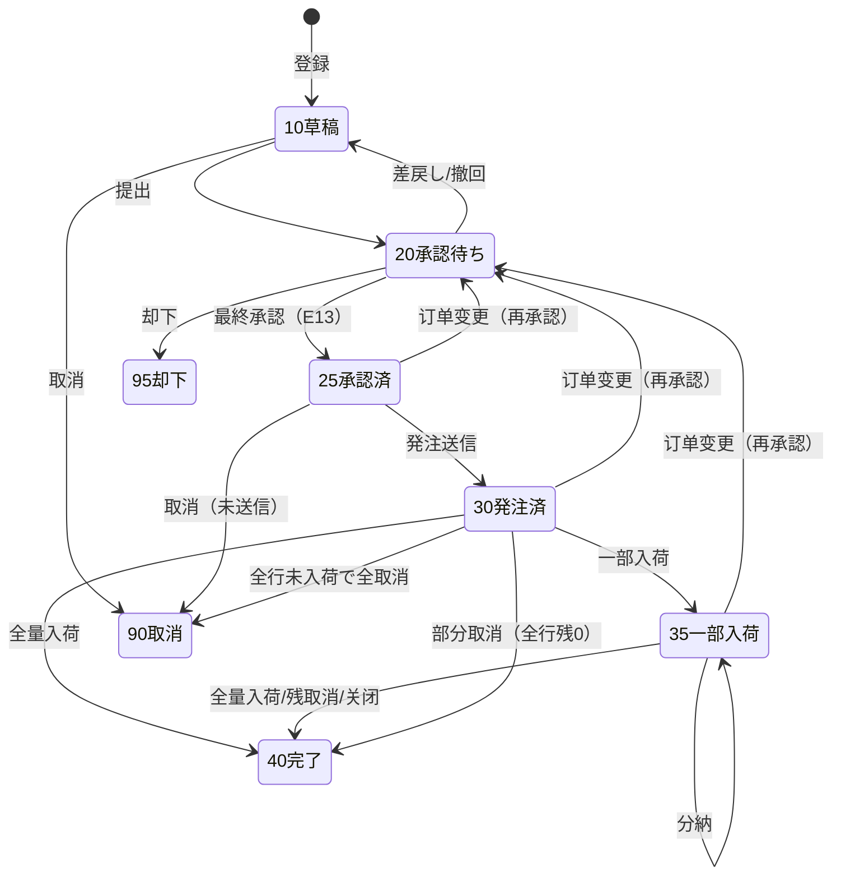
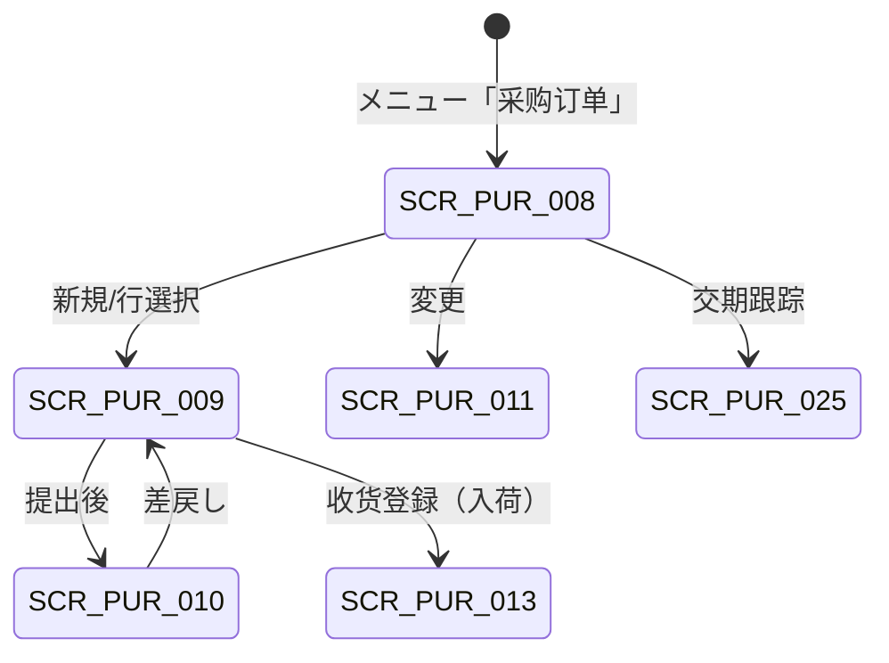

# 采购订单管理 详细设计书（発注管理 詳細設計書）

| 項目 | 内容 |
|---|---|
| 文書名 | 采购订单管理 详细设计书（発注管理 詳細設計書） |
| 文書番号 | DSN-PUR-003 |
| 版数 | v1.0 |
| 作成日 | 2026-10-20 |
| 作成者 | purchase-designer |
| 承認者 | 未承認（レビュー待ち） |
| 状態 | ドラフト（レビュー中） |
| 関連文書 | [業務域概要](00-overview.md) / [共通項目定義](../00-common/01-common-item-definitions.md) / [画面共通規格](../00-common/02-common-screen-spec.md) / [API 共通規格](../00-common/03-common-api-spec.md) / [共通業務規則](../00-common/08-common-business-rules.md) / [跨域流程](../00-common/09-cross-domain-flow.md) / [代码一覧](../00-common/06-code-list.md) / [请购管理](01-requisition.md) / [询价比价](02-rfq-comparison.md) / [收货与检验](04-receipt-iqc.md) |

---

## 1. 機能概要

| 項目 | 内容 |
|---|---|
| 機能 ID | F-PUR-007 采购订单登记 / F-PUR-008 采购订单审批 / F-PUR-009 采购订单变更 / F-PUR-010 采购订单取消与关闭 |
| 機能名 | 采购订单（Purchase Order / 発注） |
| 目的 | 将承认済请购或询价中选结果转为对供应商的订货契约，明确品目・数量・单价・税码・交期・收货仓库・超收容差；通过金额分级审批与订单变更版本管理，保证「发注内容・变更履历・入荷进度・请求进度」可追溯，并作为收货・三单匹配・暂估的基准单据 |
| 利用者・ロール | 采购员（登録・送信・变更申请）、采购经理/分管副总/总经理（承认）、仓管员（入荷进度参照）、财务（匹配基准参照） |
| 利用シーン | ① 请购转单后的订单确认与发注；② 询价中选后批量生成订单；③ 紧急/试作采购的手工订单；④ 供应商产能变化导致的交期变更；⑤ 价格调整（钢材市场波动）导致的单价变更 |
| 優先度 | P0（登録・承認・送信・取消）/ P1（变更・关闭） |
| 画面 ID | SCR-PUR-008（一览）、SCR-PUR-009（登録編集）、SCR-PUR-010（审批）、SCR-PUR-011（变更） |
| 関連 IF | IF-PUR-001（PO 送信 第一版（実装順 P2））、E13 `purchase.order.approved` |

### 1.1 機能分解

| 機能 ID | 機能名 | 概要 | 優先度 |
|---|---|---|---|
| F-PUR-007 | 采购订单登记 | 手工/请购转单/询价中选からのPO作成、取价、MOQ・准入チェック | P0 |
| F-PUR-008 | 采购订单审批 | 金额阶梯审批、E13 発行、発注送信 | P0 |
| F-PUR-009 | 采购订单变更 | 数量/单价/交期变更、版数管理、再承認、再送信 | P1 |
| F-PUR-010 | 采购订单取消与关闭 | 未入荷取消、残数量取消、手動关闭 | P0 |

---

## 2. 業務要件・業務ルール

### 2.1 前提条件

| # | 前提条件 | 成立しない場合の挙動 |
|---|---|---|
| 1 | 供应商为 MDM 准入済（`status=APPROVED`）且未停止 | 供应商不可选；保存時 `MSG-PUR-003` |
| 2 | 物料有效且可采购；采购单位与库存单位换算率已设定 | 保存時 `MSG-PUR-002` |
| 3 | 采购价格（MDM）或询价中选价或最近成交价存在，或允许手工定价 | 取价失败時、手工入力（理由必須）へ誘導 `MSG-PUR-049` |
| 4 | 收货仓库有效且属于当前工厂 | 保存時 `MSG-COM-049` |
| 5 | 税码为有效业务税码（进项，`tax_type=11`） | 保存時 `MSG-COM-049` |
| 6 | 会計期間状態 = OPEN | 登録・变更拒否 `MSG-COM-071` |
| 7 | WF 已配置采购订单审批流程 | 提出失敗 `MSG-COM-073` |

### 2.2 業務ルール

| # | ルール | 根拠 | 関連項目 |
|---|---|---|---|
| BR-01 | 采购订单必须指定供应商、需求部门、采购员、收货仓库、订单日期；订单日期不得早于系统日 − 7 日 | 社内采购规程（示例企业） | `order_date` |
| BR-02 | 取价优先级（高→低）：① 框架合同价（P2）→ ② MDM 有效采购价格（供应商 + 物料 + 订单日）→ ③ 询价中选价 → ④ 最近 90 天同供应商同物料成交价 → ⑤ 手工输入。取价结果记入 `price_source_type`，手工输入须填写定价理由 | 本域设计、09 §11 | `unit_price`、`price_source_type` |
| BR-03 | 订单单价与有效采购价格表不一致（差异 > 0.5%）时警告；手工定价或与最近成交价差异 > 10% 时红色警示 | 价格异常管理（BAT-PUR-007） | `price_source_type` |
| BR-04 | MOQ 校验：`mdm_supplier_material.moq`（供給範囲単位）を第一参照とし、未登録時は `mdm_material.min_order_qty` / `mdm_purchase_price.moq` の順でフォールバック。订单数量 < MOQ 时警告，并提示按 MOQ/発注倍数调整；不调整时须填写理由 | 08 §5、MDM 02/90（`mdm_supplier_material.moq` 追加契約） | `moq`、`quantity` |
| BR-05 | 交期校验：`delivery_date` ≥ 订单日；`delivery_date` < 订单日 + 供应商标准提前期时警告（可能无法按期交货） | 本域设计 | `delivery_date`、`lead_time_days` |
| BR-06 | 金额分级审批按 [08 §8.1](../00-common/08-common-business-rules.md)：税込金额 < 5,000 / 5,000～50,000 / 50,000～500,000 / ≥ 500,000 元。**PR 承认済由来の PO は承認経路を短縮可**：50 万元未満は采购经理の 1 段（`wf_approval_matrix` の `pr_approved` 変数で制御） | 08 §8.1 | `total_amount_with_tax` |
| BR-07 | 最终承認時に E13 `purchase.order.approved` を発行する（購読者：INT。第一版（実装順 P2） 供應商送信のみ）。発注送信は承認後の別操作（25→30） | 09 §3、§4.2 | `po_status`、E13 |
| BR-08 | 発注送信方式：① 帳票出力（PRT-PUR-003）+ メール添付、② 供应商门户（第一版・実装順 P2）、③ EDI（第一版・実装順 P2）。送信日時・方式・送信者を記録し、再送信も履歴を残す | 本域设计 | `sent_at`、`sent_method` |
| BR-09 | 供应商确认（回执）は手動登録（门户回执は実装順 P2）。`supplier_confirm_at`・`supplier_promised_date` を記録し、交期跟踪の基準とする | 本域设计 | `supplier_promised_date` |
| BR-10 | 承認済（25）以降の数量・単価・交期変更は「订单变更」専用機能で行う。变更前内容を `pur_purchase_order_his` にスナップショット保存し、`version_no` を +1、再承認を必須とする | 08 §3.3-3、本域设计 | `version_no`、`pur_purchase_order_his` |
| BR-11 | 变更制約：① 数量は入荷済数量（`received_qty`）未満にできない；② 入荷済の行は削除不可；③ 変更後金額が承認閾値を跨ぐ場合は経路再判定；④ 承認待ち中は追加変更不可 | 本域设计 | `received_qty`、`po_status` |
| BR-12 | 取消条件：10（草稿）/20（承認待ちは撤回後）/25（未送信）は全取消可；30/35 は未入荷残数量の取消のみ可（部分取消）；入荷済数量は取消不可（返品処理 E16 を使用）；40 は取消不可 | 08 §3.3-4、09 §4.3 | `cancel_reason` |
| BR-13 | 部分取消後の行状態：残数量 0 → 40 完了、一部入荷あり → 35、未入荷で全取消 → 90 取消。全行 40/90 → PO ヘッダ 40（全取消は 90） | 08 §3.2 | `line_status`、`po_status` |
| BR-14 | 手動关闭（40）：残数量を切捨てる場合、理由必須・采购经理承認。关闭後は追加入荷不可 | 本域设计 | `close_reason` |
| BR-15 | PO 承認前の取消・却下時は、请购由来数量を请购へ戻す（[01](01-requisition.md) PRC-PUR-003-02）。承認後取消は戻さない | 08 §3.3、01 §BR-11 | `converted_qty` |
| BR-16 | 外貨订单（第一版・実装順 P2）は為替レートを伝票に保持し、換算は CNY 換算額を会計に渡す。P0 実装時点は CNY のみ | 09 §11、06 §3 | `currency_code`、`exchange_rate` |
| BR-17 | 税込/税抜：単価は税抜を基本。税込入力時は税抜換算（08 §4.2-7）し、税込単価も保持可 | 08 §4.1 | `tax_rate`、`price_terms` |
| BR-18 | 発注後の入荷・請求進捗は PO 明細の累計項目で管理する：`received_qty`（入荷）・`accepted_qty`（合格）・`rejected_qty`（不合格）・`returned_qty`（退货）・`invoiced_qty`（请求）・`remain_qty`（残） | 本域设计 | 各数量項目 |
| BR-19 | 全数量入荷（部分取消含む）で PO を 40 完了とする。入荷数量が発注数量を超える場合は超收容差（[04](04-receipt-iqc.md) BR-05）に従う | 09 §4.3 | `po_status` |
| BR-20 | 帳票・送信・変更・取消は監査ログと变更履歴に記録する。承認後の発注書は版数（`version_no`）を印字する | 01 §12、01 §13 | — |

### 2.3 計算式・判定式

| # | 対象 | 算式 | 丸め | 例（示例值） |
|---|---|---|---|---|
| CALC-01 | 明細金額（税抜） | 発注数量 × 税抜単価 | 四捨五入 2 桁 | 28,000.0000 KGM × 5.650000 = 158,200.00 |
| CALC-02 | 明細税額 | 明細金額 × 税率 | 四捨五入 2 桁 | 158,200.00 × 13% = 20,566.00 |
| CALC-03 | 税抜合計 / 税額合計 / 税込合計 | Σ明細 / Σ明細税額 / 税抜+税額 | — | 434,400.00 / 56,472.00 / 490,872.00 |
| CALC-04 | 残数量 | 発注数量 − 入荷数量 − 取消数量 | 数量 4 桁 | 28,000 − 12,000 − 0 = 16,000.0000 |
| CALC-05 | 入荷进度率 | 入荷数量 ÷ 発注数量 | 比率 4 桁 | 12,000 ÷ 28,000 = 42.86% |
| CALC-06 | 税込単価→税抜単価 | 税込単価 ÷ (1 + 税率) | 四捨五入 6 桁 | 6.384500 ÷ 1.13 = 5.650000 |
| CALC-07 | 超收上限（明細） | `発注数量 × (1 + 超收容差率)`、個数単位は最低 `発注数量 + 1` | 数量 4 桁 | 28,000 × 1.05 = 29,400.0000 |
| CALC-08 | 价格差异率 | (订单単価 − 价格表単価) ÷ 价格表単価 | 比率 4 桁 | (5.650 − 5.600) ÷ 5.600 = 0.89% |
| CALC-09 | MOQ 推奨数量 | ceil(発注数量 ÷ MOQ 倍数) × MOQ 倍数 | 整数 | ceil(2,800 ÷ 2,000) × 2,000 = 4,000 |

### 2.4 状態遷移



| 遷移 | トリガ | 権限 | 更新項目 | メッセージ |
|---|---|---|---|---|
| 10→20 | 提交 | `purchase:order:submit` | `po_status=20`、`process_instance_id` | `MSG-PUR-054` |
| 20→25 | E31/E32 最終承認 | システム（WF） | `po_status=25`、`approved_at`、`approver_id`、E13 発行 | — |
| 20→10 | 差戻し/撤回 | 承認者/申請者 | `po_status=10`、`reject_reason` | `MSG-PUR-055` |
| 20→95 | 却下 | 承認者 | `po_status=95`、`reject_reason` | `MSG-PUR-056` |
| 25→30 | 発注送信 | `purchase:order:send` | `po_status=30`、`sent_at`、`sent_method`、`sent_by` | `MSG-PUR-057` |
| 30/35→35 | 一部入荷（E14） | システム（INV/PUR イベント） | `received_qty` 累加、`line_status=35`、`po_status=35` | — |
| 30/35→40 | 全量入荷 or 残取消 or 关闭 | システム/`purchase:order:cancel` | `po_status=40`、`closed_at`、`close_reason` | `MSG-PUR-058` |
| 25/30/35→20 | 变更提交 | `purchase:order:change` | `po_status=20`、`pending_change=true`、`version_no+1`、his 退避 | `MSG-PUR-059` |
| 20→（元状態） | 变更承認 | WF | `po_status` 復帰、`pending_change=false`、`change_approved_at` | `MSG-PUR-060` |
| 20→（元状態） | 变更却下 | WF | his から復元、`pending_change=false` | `MSG-PUR-061` |
| 10/25→90 | 取消 | `purchase:order:cancel` | `po_status=90`、`cancel_reason`、请购数量戻し | `MSG-PUR-062` |
| 30→90 | 全行未入荷で全取消 | 同上 | 同上 | `MSG-PUR-062` |

---

## 3. 関連機能

| 関係 | 機能 ID | 機能名 | 関係内容 |
|---|---|---|---|
| 上流 | F-PUR-001～003 | 请购管理 | 请购转单生成 PO |
| 上流 | F-PUR-004～006 | 询价比价 | 中选结果生成 PO |
| 上流 | F-MDM-005/011 | 供应商・采购价格 | 准入状態・取价 |
| 下流 | F-PUR-011/012 | 收货确认 | PO 明細への入荷累計 |
| 下流 | F-PUR-017/018 | 采购发票・三单匹配 | 匹配基准（PO 単価・数量） |
| 下流 | F-PUR-020 | 暂估・应付 | 暂估金额基准（PO 単価） |
| 下流 | F-PUR-023 | 交期跟踪 | 未入荷残・交期の追跡 |
| 下流 | F-PUR-022 | 预付款申请 | `prepay_ratio` に基づく前払 |
| 関連 | F-WF-003/004 | 审批・待办 | 承認フロー |
| 関連 | F-INT（P2） | PO 送信 | IF-PUR-001 |

---

## 4. 画面設計

### 4.1 画面一覧

| 画面 ID | 画面名 | 類型 | 概要 |
|---|---|---|---|
| SCR-PUR-008 | 采购订单一覧 | 一覧検索 | 状態・供应商・交期・未入荷残での検索、一括送信・導出 |
| SCR-PUR-009 | 采购订单登録編集 | 登録編集 | ヘッダ + 明細 + 入荷/請求進捗タブ + 変更履歴タブ |
| SCR-PUR-010 | 采购订单审批 | ワークフロー | 承認画面（WF 共通画面。PO 固有の表示項目のみ定義） |
| SCR-PUR-011 | 采购订单变更 | 登録編集 | 変更前後の対比、変更理由、再承認提出 |

### 4.2 画面遷移



### 4.3 画面レイアウト（SCR-PUR-009）

```
┌───────────────────────────────────────────────────────────────────────────────┐
│ パンくず：ホーム > 采购管理 > 采购订单登録編集                    [状態バッジ] │
├───────────────────────────────────────────────────────────────────────────────┤
│〔ヘッダ〕订单号[PO2610200001] 类型[标准▼] 来源[请购 PR2610200001] 版本[1]     │
│ 供应商[S000001 宝山钢铁股份有限公司] 需求部门[D030 生产部] 采购员[E000201]    │
│ 订单日[2026-10-20] 收货仓库[WH01 原料仓▼] 付款条件[NET30▼] 结算[电汇▼]        │
│ 币种[CNY] 预付款比例[0%] 合同号[________] 供应商订单号[________]              │
├───────────────────────────────────────────────────────────────────────────────┤
│〔ツールバー〕[保存][提交][撤回][送信][变更][取消][关闭][打印][复制]           │
├───────────────────────────────────────────────────────────────────────────────┤
│〔明細〕行|物料|数量|单位|单价|金额|税额|约定交期|希望交期|仓库|已入荷|已请求|  │
│        残|行状态|价格来源                                                   │
│ 10|1001000001 50W470 0.50×1250×C|28,000|KGM|5.650000|158,200.00|20,566.00|  │
│    |2026-11-03|2026-11-05|WH01|12,000|0|16,000|一部入荷|价格表             │
│ 20|1004000001 QZY-2/180 φ1.00mm|2,000|KGM|78.500000|157,000.00|20,410.00|  │
│    |2026-11-06|2026-11-08|WH01|0|0|2,000|未入荷|价格表                     │
├───────────────────────────────────────────────────────────────────────────────┤
│〔フッタ〕税抜 434,400.00  税額 56,472.00  税込 490,872.00  入荷进度 21.2%      │
├───────────────────────────────────────────────────────────────────────────────┤
│〔タブ〕 明細 | 入荷/請求進捗 | 変更履歴 | 审批履历 | 关联单据 | 附件            │
└───────────────────────────────────────────────────────────────────────────────┘
```

### 4.4 画面項目定義

#### 4.4.1 SCR-PUR-009 ヘッダ項目

| No | 項目 ID | 項目名 | 種別 | 型/桁 | 必須 | 初期値 | 入力チェック | データソース | DB 項目 | 権限 | 備考 |
|---|---|---|---|---|---|---|---|---|---|---|---|
| 1 | `poNo` | 订单号 | テキスト | VARCHAR(32) | ○ | 自動採番 | `PO{YYMMDD}{4桁}` | 採番 | `po_no` | 参照のみ | — |
| 2 | `poType` | 订单类型 | 選択 | SMALLINT | ○ | 1 标准 | 1 标准/2 框架/3 试作 | 固定値 | `po_type` | 編集可 | — |
| 3 | `sourceType` | 来源类型 | テキスト | VARCHAR(32) | 自動 | MANUAL | REQUISITION/RFQ/MANUAL/MRP/CONTRACT | — | `source_type` | 参照のみ | 请购/询价由来は自動 |
| 4 | `sourceId`/`sourceNo` | 来源单据 | リンク | BIGINT/VARCHAR(32) | 自動 | 空 | — | 上流单据 | `source_id` | 参照のみ | リンク遷移 |
| 5 | `supplierId` | 供应商 | 選択 | BIGINT | ○ | 空 | 准入済（`MSG-PUR-003`） | `mdm_supplier` | `supplier_id` | 編集可 | 変更時は価格再取得 |
| 6 | `supplierCode`/`supplierName` | 供应商编码・名称 | テキスト | VARCHAR(20/200) | 自動 | 空 | — | `mdm_supplier` | 同名項目 | 参照のみ | スナップショット |
| 7 | `supplierContact` | 供应商联系人 | テキスト | VARCHAR(100) | △ | MDM 既定 | — | `mdm_supplier` | `supplier_contact` | 編集可 | 帳票印字 |
| 8 | `departmentId` | 需求部门 | 選択 | BIGINT | ○ | 请购部門 | コード存在 | `sys_department` | `department_id` | 編集可 | — |
| 9 | `buyerId` | 采购员 | 選択 | BIGINT | ○ | ログインユーザ | 権限保有者 | `sys_user` | `buyer_id` | 編集可 | — |
| 10 | `factoryId` | 工厂 | 選択 | BIGINT | ○ | CZ01 | コード存在 | `mdm_factory` | `factory_id` | 編集可 | — |
| 11 | `warehouseId` | 收货仓库 | 選択 | BIGINT | ○ | WH01 | コード存在・有効 | `mdm_warehouse` | `warehouse_id` | 編集可 | 明細で上書き可 |
| 12 | `orderDate` | 订单日 | 日付 | DATE | ○ | 当日 | ≥ 当日 − 7 日 | — | `order_date` | 編集可 | 承認日と異なる |
| 13 | `currencyCode` | 币种 | 選択 | VARCHAR(8) | ○ | CNY | ISO 4217 | `mdm_currency` | `currency_code` | 参照のみ | 既定 CNY（外貨は実装順 P2） |
| 14 | `exchangeRate` | 汇率 | 数値 | NUMERIC(18,8) | △ | 1.00000000 | > 0 | `mdm_exchange_rate` | `exchange_rate` | 参照のみ | 第一版（実装順 P2） |
| 15 | `priceTerms` | 价格基准 | ラジオ | SMALLINT | ○ | 1 税抜 | 1 税抜/2 税込 | 固定値 | `price_terms` | 編集可 | — |
| 16 | `settlementType` | 结算方式 | 選択 | VARCHAR(20) | ○ | BANK_TRANSFER | 06 §8.1 | `mdm_settlement_method` | `settlement_type` | 編集可 | — |
| 17 | `paymentTermCode` | 付款条件 | 選択 | VARCHAR(20) | ○ | 供应商默认 | 06 §8.2 | `mdm_payment_term` | `payment_term_code` | 編集可 | — |
| 18 | `prepayRatio` | 预付款比例 | 数値 | NUMERIC(7,4) | △ | 0.0000 | 0～100（%） | — | `prepay_ratio` | 編集可 | 预付款申请の基準 |
| 19 | `freightAmount` | 运费 | 数値 | NUMERIC(18,2) | △ | 0.00 | ≥ 0 | — | `freight_amount` | 編集可 | 买方承担时 |
| 20 | `totalAmount` | 税抜合計 | 数値 | NUMERIC(18,2) | 自動 | 0.00 | — | Σ 明細 | `total_amount` | 参照のみ | — |
| 21 | `taxAmount` | 税額合計 | 数値 | NUMERIC(18,2) | 自動 | 0.00 | — | Σ 明細 | `tax_amount` | 参照のみ | — |
| 22 | `totalAmountWithTax` | 税込合計 | 数値 | NUMERIC(18,2) | 自動 | 0.00 | — | 計算 | `total_amount_with_tax` | 参照のみ | 承認金额判定 |
| 23 | `contractNo` | 合同号 | テキスト | VARCHAR(64) | △ | 空 | 桁数 | — | `contract_no` | 編集可 | — |
| 24 | `externalNo` | 供应商订单号 | テキスト | VARCHAR(64) | △ | 空 | 桁数 | 外部 | `external_no` | 編集可 | 供应商回执番号 |
| 25 | `sentAt`/`sentMethod` | 送信日時・方式 | テキスト | TIMESTAMPTZ/SMALLINT | 自動 | 空 | — | — | `sent_at`/`sent_method` | 参照のみ | 1 印刷/2 メール/3 门户/4 EDI |
| 26 | `supplierConfirmAt` | 供应商确认日時 | 日時 | TIMESTAMPTZ | △ | 空 | ≥ 送信日時 | — | `supplier_confirm_at` | 編集可 | 回执登録 |
| 27 | `poStatus` | 状态 | バッジ | SMALLINT | 自動 | 10 | — | — | `po_status` | 参照のみ | 10/20/25/30/35/40/90/95 |
| 28 | `versionNo` | 订单版数 | 数値 | INT | 自動 | 1 | — | — | `version_no` | 参照のみ | 変更で +1 |
| 29 | `remark` | 备注 | テキストエリア | VARCHAR(500) | △ | 空 | 桁数 | — | `remark` | 編集可 | — |
| 30 | `attachments` | 附件 | 添付 | — | △ | 空 | 01 §9 | `sys_attachment` | — | 編集可 | 見積書・仕様書・注文書控 |

#### 4.4.2 SCR-PUR-009 明細項目

| No | 項目 ID | 項目名 | 種別 | 型/桁 | 必須 | 初期値 | 入力チェック | データソース | DB 項目 | 備考 |
|---|---|---|---|---|---|---|---|---|---|---|
| 1 | `lineNo` | 行番号 | 数値 | INT | 自動 | 10 刻み | — | — | `line_no` | 保存時振り直し |
| 2 | `prLineId` | 来源请购行 | テキスト | BIGINT | △ | 空 | 请购行存在 | `pur_purchase_requisition_line` | `pr_line_id` | 请购由来 |
| 3 | `rfqQuotationLineId` | 来源报价行 | テキスト | BIGINT | △ | 空 | 报价行存在 | `pur_supplier_quotation_line` | `rfq_quotation_line_id` | 询价由来 |
| 4 | `materialId`/`materialCode`/`materialName`/`spec` | 物料 | 選択ダイアログ | BIGINT/VARCHAR | ○ | 请购/询价由来 | 有効・采购品（`MSG-PUR-002`） | `mdm_material` | 同名項目 | スナップショット |
| 5 | `uomCode` | 采购单位 | 選択 | VARCHAR(8) | ○ | 物料采购单位 | 同一单位组 | `mdm_uom` | `uom_code` | — |
| 6 | `conversionRate` | 换算率 | 数値 | NUMERIC(18,8) | 自動 | 物料默认 | > 0 | `mdm_uom_conversion` | `conversion_rate` | 基本单位換算 |
| 7 | `quantity` | 発注数量 | 数値 | NUMERIC(18,4) | ○ | 请购残量 | > 0、≥ 入荷済数量（变更時） | — | `quantity` | 取引単位 |
| 8 | `baseQuantity` | 基本单位数量 | 数値 | NUMERIC(18,4) | 自動 | 数量×换算率 | — | 計算 | `base_quantity` | 在庫連携 |
| 9 | `unitPrice` | 税抜単価 | 数値 | NUMERIC(18,6) | ○ | 取价（BR-02） | ≥ 0、6 桁 | `mdm_purchase_price` | `unit_price` | — |
| 10 | `taxCode` | 税码（进项） | 選択 | VARCHAR(32) | ○ | `VAT13-IN` | `tax_type=11` | `mdm_tax_code` | `tax_code` | — |
| 11 | `taxRate` | 税率（快照） | 数値 | NUMERIC(7,4) | 自動 | 税码値 | — | `mdm_tax_code` | `tax_rate` | 登録時点保持 |
| 12 | `amount` | 金額（税抜） | 数値 | NUMERIC(18,2) | 自動 | 0.00 | — | 計算 | `amount` | — |
| 13 | `taxAmount` | 税額 | 数値 | NUMERIC(18,2) | 自動 | 0.00 | — | 計算 | `tax_amount` | — |
| 14 | `deliveryDate` | 约定交期 | 日付 | DATE | ○ | 请购希望交期 | ≥ 订单日（警告付き） | — | `delivery_date` | 帳票印字 |
| 15 | `requiredDate` | 希望交期 | 日付 | DATE | △ | 请购希望交期 | ≥ 当日 | — | `required_date` | 内部管理用 |
| 16 | `supplierPromisedDate` | 供应商承诺交期 | 日付 | DATE | △ | 空 | — | 回执 | `supplier_promised_date` | 交期跟踪基準 |
| 17 | `warehouseId` | 收货仓库 | 選択 | BIGINT | ○ | ヘッダ仓库 | コード存在 | `mdm_warehouse` | `warehouse_id` | 行単位 |
| 18 | `receivingToleranceRate` | 超收容差率 | 数値 | NUMERIC(7,4) | △ | MDM 既定値（品目→分類→仕入先→会社の優先順） | 0～100（%） | MDM 既定 > PUR 上書き規則（優先順） | `receiving_tolerance_rate` | 明細上書きのみ保持 |
| 19 | `moq` | 最小起订量 | 数値 | NUMERIC(18,4) | △ | 供应商默认 | ≥ 0 | `mdm_supplier_material` | `moq` | MOQ チェック |
| 20 | `priceSourceType` | 价格来源 | テキスト | SMALLINT | 自動 | 1 价格表 | 1 价格表/2 RFQ/3 最近成交/4 手工/5 合同 | — | `price_source_type` | 手工は理由必須 |
| 21 | `priceDiffReason` | 定价理由 | テキスト | VARCHAR(500) | △ | 空 | 手工/差异 >10% 时必填 | — | `price_diff_reason` | — |
| 22 | `receivedQty` | 已入荷数量 | 数値 | NUMERIC(18,4) | 自動 | 0 | — | E14 累計 | `received_qty` | 参照のみ |
| 23 | `acceptedQty` | 合格数量 | 数値 | NUMERIC(18,4) | 自動 | 0 | — | E15 累計 | `accepted_qty` | 参照のみ |
| 24 | `rejectedQty` | 不合格数量 | 数値 | NUMERIC(18,4) | 自動 | 0 | — | E15 累計 | `rejected_qty` | 参照のみ |
| 25 | `returnedQty` | 退货数量 | 数値 | NUMERIC(18,4) | 自動 | 0 | — | E16 累計 | `returned_qty` | 参照のみ |
| 26 | `invoicedQty` | 已请求数量 | 数値 | NUMERIC(18,4) | 自動 | 0 | — | E17 累計 | `invoiced_qty` | 参照のみ |
| 27 | `remainQty` | 未入荷残 | 数値 | NUMERIC(18,4) | 自動 | = 数量 | — | 計算 | 導出 | 参照のみ |
| 28 | `isBatchManaged` | 批次管理 | チェック | BOOLEAN | 自動 | 物料属性 | — | `mdm_material` | `is_batch_managed` | 收货時に批次必須 |
| 29 | `lineStatus` | 行状态 | バッジ | SMALLINT | 自動 | 10 | — | — | `line_status` | 10/30/35/40/90 |
| 30 | `lineRemark` | 行备注 | テキスト | VARCHAR(500) | △ | 空 | 桁数 | — | `line_remark` | — |

### 4.5 イベント処理

| No | イベント | トリガ | 処理内容 | 呼出 API | 画面遷移 | 備考 |
|---|---|---|---|---|---|---|
| 1 | 検索 | 検索ボタン | 一覧取得 | `GET /api/purchase/purchase-orders` | 同一画面 | — |
| 2 | 新規 | 新規ボタン | 空の登録画面（採番は保存時） | — | SCR-PUR-009 | 请购/询价からの遷移は引継ぎ |
| 3 | 保存 | 保存ボタン | 入力チェック→取价→金額再計算→保存 | `POST`/`PUT /api/purchase/purchase-orders` | 同画面 | 二重送信防止 |
| 4 | 取价 | 供应商/物料/订单日変更 | 取价優先順位で単価自動セット、差異警告 | `GET /api/purchase/prices` | — | 手動変更可 |
| 5 | 提交 | 提交ボタン | 保存→承認経路取得→WF 提出 | `POST .../{id}/submit` | 同画面 | 承認経路未設定 `MSG-COM-073` |
| 6 | 撤回/差戻し | 撤回ボタン | 状態 20→10 | `POST .../{id}/withdraw` | 同画面 | — |
| 7 | 送信 | 送信ボタン | 帳票出力・送信記録、状態 30 | `POST .../{id}/send` | 同画面 | P0 実装時点は印刷/メール手動 |
| 8 | 供应商确认 | 回执登録 | `supplier_confirm_at`・`supplier_promised_date` 登録 | `PUT .../{id}`（部分更新） | — | 交期跟踪へ反映 |
| 9 | 变更 | 变更ボタン | 変更画面へ（変更前スナップショット） | — | SCR-PUR-011 | 25/30/35 のみ |
| 10 | 取消 | 取消ボタン | 条件検証→取消（部分取消含む） | `POST .../{id}/cancel` | 一覧へ | 请购数量戻し連動 |
| 11 | 关闭 | 关闭ボタン | 残量切捨て→40 | `POST .../{id}/close` | 一覧へ | 理由必須・采购经理 |
| 12 | 打印 | 打印ボタン | PRT-PUR-003 出力 | `POST .../{id}/print` | — | 版数印字 |
| 13 | 複製 | 複製ボタン | ヘッダ+明細コピーで新規草稿 | — | SCR-PUR-009（新規） | 新規採番 |
| 14 | 入荷進捗タブ | タブクリック | 関連 GR・IQC・入库・請求状況取得 | `GET .../{id}/progress` | — | 遅延ロード |

### 4.6 一覧画面仕様（SCR-PUR-008）

| 項目 | 内容 |
|---|---|
| 検索条件 | 订单号、供应商、状态（複数）、订单日期範囲、交期範囲、未入荷残あり、采购员、物料关键字、超期フラグ |
| 既定検索条件 | 全社 + 状態 25/30/35（未完了）+ 当季度 |
| ソート | 既定：订单日時降順。他：交期昇順、金额降順、未入荷残降順 |
| ページング | 20/50/100/200 |
| 一括操作 | 提交、送信、导出 |
| 表示列 | 订单号、版本、供应商、状态、订单日、税込金額、入荷进度、最迟交期、未入荷残、采购员 |
| エクスポート | Excel ≤10,000 件、超過は非同期 |

### 4.7 表示制御

| 条件 | 対象 | 制御 |
|---|---|---|
| `po_status` ∉ {10} | ヘッダ・明細の編集項目 | 参照のみ |
| `po_status ∈ {20,25,30,35,40,90,95}` | 删除行・明細追加 | 非表示 |
| `po_status = 25` かつ未送信 | 送信ボタン | 表示 |
| `po_status ∈ {25,30,35}` | 变更ボタン | 表示（変更権限あり） |
| `po_status ∈ {10,25,30,35}` | 取消ボタン | 表示（権限あり） |
| `po_status ∈ {30,35}` かつ 全行入荷済 | 关闭ボタン | 非表示 |
| `pending_change = true` | 変更ボタン・編集項目 | 非活性（`MSG-PUR-063`） |
| 権限なし | 金額・単価項目 | 非表示（API も返さない） |
| 入荷済数量 > 0 | 当該行の数量項目 | 参照のみ（入荷済数以上維持） |

---

## 5. 入力チェック仕様

| No | チェック ID | 対象項目 | 種別 | 条件 | タイミング | メッセージ ID |
|---|---|---|---|---|---|---|
| 1 | CHK-PUR-003-01 | 供应商 | 必須・コード存在 | 准入済・有効 | 保存時 | `MSG-PUR-003` |
| 2 | CHK-PUR-003-02 | 明細行数 | 相関 | 1～1,000 行 | 保存時 | `MSG-COM-047` |
| 3 | CHK-PUR-003-03 | 数量 | 必須・範囲 | > 0、小数 4 桁 | 保存時 | `MSG-COM-047` |
| 4 | CHK-PUR-003-04 | 税抜単価 | 必須・範囲 | ≥ 0、小数 6 桁 | 保存時 | `MSG-COM-048` |
| 5 | CHK-PUR-003-05 | 税码 | コード存在 | `tax_type=11`・有効 | 保存時 | `MSG-COM-049` |
| 6 | CHK-PUR-003-06 | 约定交期 | 相関 | ≥ 订单日 | 保存時 | `MSG-PUR-064` |
| 7 | CHK-PUR-003-07 | 订单日 | 範囲 | ≥ 当日 − 7 日、≤ 当日 + 365 日 | 保存時 | `MSG-PUR-065` |
| 8 | CHK-PUR-003-08 | 取价差異 | 業務 | 単価 vs 价格表差 > 0.5% → 警告、>10% → 強警告 | 取价・保存時 | `MSG-PUR-048`（W） |
| 9 | CHK-PUR-003-09 | 手工定价 | 業務 | `price_source_type=MANUAL` 时定价理由必須 | 保存時 | `MSG-PUR-066` |
| 10 | CHK-PUR-003-10 | MOQ | 業務 | 数量 ≥ MOQ（不足時警告・理由） | 保存時 | `MSG-PUR-050`（W） |
| 11 | CHK-PUR-003-11 | 提前期 | 業務 | 交期 ≥ 订单日 + 提前期（不足時警告） | 保存時 | `MSG-PUR-053`（W） |
| 12 | CHK-PUR-003-12 | 税込合計 | 相関 | サーバ再計算値と一致（不一致時は再計算値で上書き） | 保存時 | `MSG-COM-051` |
| 13 | CHK-PUR-003-13 | 数量（变更） | 相関 | ≥ `received_qty` | 变更保存時 | `MSG-PUR-051` |
| 14 | CHK-PUR-003-14 | 取消数量 | 相関 | ≤ 発注数量 − 入荷数量 | 取消時 | `MSG-PUR-052` |
| 15 | CHK-PUR-003-15 | 状態整合 | 業務 | 操作が現在状態で許可 | 各操作 | `MSG-COM-034` |
| 16 | CHK-PUR-003-16 | 期間状態 | 業務 | 会計期間 ≠ CLOSED | 保存・变更時 | `MSG-COM-071` |
| 17 | CHK-PUR-003-17 | 楽観排他 | 排他 | `version`・`version_no` 一致 | 更新時 | `MSG-COM-033` |
| 18 | CHK-PUR-003-18 | 変更承認重複 | 業務 | `pending_change=false` | 变更提交時 | `MSG-PUR-063` |

---

## 6. 処理詳細

### 6.1 処理一覧

| 処理 ID | 処理名 | 契機 | トランザクション | 排他 |
|---|---|---|---|---|
| PRC-PUR-007-01 | 订单登録 | 保存（新規） | 要 | 採番行ロック |
| PRC-PUR-007-02 | 订单更新 | 保存（編集） | 要 | 楽観排他 |
| PRC-PUR-007-03 | 取价処理 | 取价ボタン・保存 | 不要（参照） | — |
| PRC-PUR-007-04 | 入荷進捗反映 | E14/E15/E16/E17 受信 | 要 | 楽観排他 |
| PRC-PUR-008-01 | 提出・撤回 | 提出/撤回 | 要 | 楽観排他 |
| PRC-PUR-008-02 | 承認結果反映 | E31/E32 受信 | 要 | 冪等（eventId） |
| PRC-PUR-008-03 | 発注送信 | 送信 | 要 | 楽観排他 |
| PRC-PUR-009-01 | 訂单变更申請 | 变更提交 | 要 | 楽観排他 + スナップショット |
| PRC-PUR-009-02 | 変更改承認/却下 | E31/E32 受信 | 要 | 冪等 |
| PRC-PUR-010-01 | 訂单取消 | 取消 | 要 | PO 行ロック + 请购戻し |
| PRC-PUR-010-02 | 訂单关闭 | 关闭 | 要 | 楽観排他 |

### 6.2 処理手順（正常系）

**PRC-PUR-007-03 取价処理**

1. 明細ごとに、订单日時点で有効な価格を優先順位（BR-02）で検索する。
2. ① 框架合同（P2）→ ② `mdm_purchase_price`（`supplier_id`+`material_id`+`order_date` BETWEEN `valid_from` AND `valid_to`）→ ③ 当該 PO の `rfq_quotation_line_id` 中选价 → ④ `pur_purchase_order_line` の直近 90 日同供应商同物料单价 → ⑤ NULL（手工入力待ち）。
3. 取价結果と `price_source_type` を返す。②④ の単価は税抜に正規化する（税込単価の場合 CALC-06）。
4. 手動変更や取价差異が閾値を超える場合は警告情報を返す（`warnings[]`）。

**PRC-PUR-007-01 訂单登録**

1. Bean Validation・権限・データ範囲を検証する。
2. 会計期間（OPEN）・供应商准入・物料有効・税码有効を検証する。
3. 取价（PRC-PUR-007-03）を実行し、明細金額・税額・合計を再計算する（CALC-01～03）。
4. MOQ・交期・取价差異の警告判定を行う（CHK-08～11）。
5. `sys_sequence` から `PO{YYMMDD}{4桁}` を採番する（`sequence_key=PUR_PURCHASE_ORDER`）。
6. `pur_purchase_order`（`po_status=10`、`version_no=1`）と `pur_purchase_order_line` を INSERT する。
7. 請购/询价由来の場合は `source_type`/`source_id` と明細の `pr_line_id`/`rfq_quotation_line_id` を設定する。
8. 監査ログ（CREATE）を記録し、詳細を返す。

**PRC-PUR-008-01 提出・撤回**

1. 状態 10（提出）または 20（撤回）を確認する。
2. 明細 1 行以上・金額再計算・税込金額で承認経路を取得する（`pr_approved` 変数により短縮経路判定、BR-06）。
3. 提出：WF に `businessType=PURCHASE_ORDER` で送信し、`po_status=20`、`process_instance_id` を保存。
4. 撤回：WF に撤回要求を送信し、`po_status=10` に戻す（既処理承認者がいる場合は不可 `MSG-PUR-055`）。
5. 監査ログ（SUBMIT/WITHDRAW）・通知を記録する。

**PRC-PUR-008-02 承認結果反映**

1. `eventId` で冪等排除し、対象 PO を `FOR UPDATE` で取得する。
2. 最終承認：`po_status=25`、`approved_at`、`approver_id` を更新し、Outbox に E13 を登録する（同一トランザクション）。E13 payload は [91-api-design.md](91-api-design.md) §7 を正とする。
3. 却下：`po_status=95`、`reject_reason`。承認前のため請购数量戻し（PRC-PUR-003-02）を実行する。
4. 差戻し：`po_status=10`。
5. 通知（申請者・購買部門）と監査ログ（APPROVE/REJECT）を記録する。

**PRC-PUR-008-03 発注送信**

1. `po_status=25` を確認する（未承認は送信不可 `MSG-COM-034`）。
2. 送信方式（1 印刷/2 メール/3 门户/4 EDI）を選択し、PRT-PUR-003 を出力する（印刷の場合）。
3. P2 実装では INT へ E13 済みデータを送信（IF-PUR-001）。P0 実装時点は送信記録のみ。
4. `po_status=30`、`sent_at`、`sent_by`、`sent_method` を保存する。再送信時は送信履歴（監査ログ）を追加し、状態は 30 のまま。
5. 供应商・購買部門へ通知（08 §13.3）。

**PRC-PUR-009-01 訂单变更申請**

1. `po_status ∈ {25,30,35}` かつ `pending_change=false` を確認する（`MSG-PUR-063`）。
2. 変更内容（数量・単価・交期・行追加・行取消）を検証する：数量 ≥ `received_qty`（`MSG-PUR-051`）、入荷済行の削除不可（`MSG-PUR-052`）、税込金額再計算。
3. 変更前のヘッダ・明細全項目を JSONB で `pur_purchase_order_his`（`change_type`、`change_reason`、`before_data`）に保存する。
4. PO に新内容を反映し、`after_data` を his に追記、`version_no+1`、`pending_change=true`、`po_status=20`（元状態は `his`/`before_status` に保持）。
5. 変更後金額で承認経路を再取得し、WF に `businessType=PURCHASE_ORDER_CHANGE` で提出する。
6. 監査ログ（UPDATE/SUBMIT）を記録する。

**PRC-PUR-009-02 変更改承認/却下**

1. `eventId` 冪等排除、PO ロック。
2. 承認：`po_status` を変更前状態（25/30/35）へ戻し、`pending_change=false`、`change_approved_at` を記録。変更後の内容で E13 を再発行（`eventVersion` は +0、`aggregateVersion=version_no`）。
3. 却下：`pur_purchase_order_his.before_data` からヘッダ・明細を復元し、`po_status` を変更前状態へ戻す。復元はヘッダ項目と数量・単価・交期のみ（入荷累計は変更しない）。
4. 差戻し：`po_status` を変更前状態へ戻し、`pending_change=false`（再変更可）。
5. 通知・監査ログ（APPROVE/REJECT）を記録する。

**PRC-PUR-010-01 訂单取消**

1. PO を `FOR UPDATE` でロックし、状態を確認する（10/25 は全取消、30/35 は残数量取消のみ、40 は不可）。
2. 取消数量を計算する：`cancel_qty = quantity − received_qty − cancelled_qty`（行単位）。`cancel_qty < 0` は `MSG-PUR-052`。
3. 行の `cancelled_qty` を加算し、`line_status` を再計算する（残 0 → 40/90、一部入荷 → 35）。
4. 全行 40/90 の場合、`po_status=40/90`、`cancel_reason`、`closed_at` を保存する。
5. 請购由来の場合、取消数量分の `converted_qty` を戻し、请购状態を再計算する（[01](01-requisition.md) PRC-PUR-003-02）。
6. 承認前（10/20）の全取消は `po_status=90` とし、請购数量を全量戻す。
7. 監査ログ（CANCEL）・通知を記録する。

### 6.3 例外処理

| No | 異常条件 | 検知箇所 | 処理 | ロールバック | メッセージ ID |
|---|---|---|---|---|---|
| 1 | 承認経路未設定 | 提出 | 提出中止 | 全体 | `MSG-COM-073` |
| 2 | 楽観排他競合 | 保存・状態操作 | 再取得促し | 全体 | `MSG-COM-033` |
| 3 | 期間締切済 | 保存・变更 | 拒否 | 全体 | `MSG-COM-071` |
| 4 | 供应商無効化（保存後） | 送信 | 警告し送信可（既存契約は有効）、新規発注は不可 | — | `MSG-PUR-003`（W） |
| 5 | 入荷済行の数量減 | 变更 | 拒否 | 全体 | `MSG-PUR-051` |
| 6 | 変更承認中の再変更 | 变更 | 拒否 | 全体 | `MSG-PUR-063` |
| 7 | 全行入荷済で取消 | 取消 | 拒否（返品処理へ誘導） | 全体 | `MSG-PUR-052` |
| 8 | 採番失敗 | 登録 | ロールバック | 全体 | `MSG-COM-080` |

### 6.4 冪等性・再実行

- `POST /{id}/submit`・`/send`・`/cancel`・`/change` は `Idempotency-Key` 必須。
- E31/E32・E14/E15/E16/E17 の購読処理は `eventId` で冪等化し、累計数量の二重加算を防ぐ。
- 変更承認/却下は `(processInstanceId, result)` で二重反映を排除する。
- 送信は再送可能（状態 30 のまま、送信履歴を追記）。

---

## 7. API 設計

| No | メソッド | パス | 権限 | 概要 | リクエスト | レスポンス | 主なエラー |
|---|---|---|---|---|---|---|---|
| 1 | GET | `/api/purchase/purchase-orders` | `purchase:order:view` | 一覧 | 検索条件 | `PageResult<PurchaseOrderListDto>` | 3001 |
| 2 | GET | `/api/purchase/purchase-orders/{id}` | `purchase:order:view` | 詳細 | — | `PurchaseOrderDetailDto` | 4001 |
| 3 | POST | `/api/purchase/purchase-orders` | `purchase:order:create` | 登録 | `PurchaseOrderCreateDto` | 詳細（201） | 1001/40002/40003 |
| 4 | PUT | `/api/purchase/purchase-orders/{id}` | `purchase:order:update` | 更新（草稿） | `PurchaseOrderUpdateDto` + `version` | 詳細 | 4002/4003 |
| 5 | POST | `/api/purchase/purchase-orders/{id}/submit` | `purchase:order:submit` | 提出 | `{version, comment?}` | 詳細 | 4002/80001 |
| 6 | POST | `/api/purchase/purchase-orders/{id}/withdraw` | `purchase:order:submit` | 撤回 | `{version}` | 詳細 | 4002 |
| 7 | POST | `/api/purchase/purchase-orders/{id}/send` | `purchase:order:send` | 発注送信 | `{version, sentMethod, sentTo?}` | 詳細 | 4002 |
| 8 | POST | `/api/purchase/purchase-orders/{id}/change` | `purchase:order:change` | 变更申請 | `PurchaseOrderChangeDto` | 詳細 | 40034/40035/40050 |
| 9 | GET | `/api/purchase/purchase-orders/{id}/changes` | `purchase:order:view` | 变更履历 | — | `PurchaseOrderHisDto[]` | 4001 |
| 10 | POST | `/api/purchase/purchase-orders/{id}/cancel` | `purchase:order:cancel` | 取消 | `{version, lines[{lineNo, cancelQty}], reason}` | 詳細 | 40035/40049 |
| 11 | POST | `/api/purchase/purchase-orders/{id}/close` | `purchase:order:cancel` | 关闭 | `{version, reason}` | 詳細 | 4002 |
| 12 | GET | `/api/purchase/purchase-orders/{id}/progress` | `purchase:order:view` | 入荷・請求進捗 | — | `PurchaseOrderProgressDto` | 4001 |
| 13 | POST | `/api/purchase/purchase-orders/{id}/print` | `purchase:order:print` | 発注書出力 | — | PDF | 4001 |
| 14 | POST | `/api/purchase/purchase-orders/batch-submit` | `purchase:order:submit` | 一括提出 | `{ids[]}` | `BatchResultDto` | — |
| 15 | POST | `/api/purchase/purchase-orders/batch-send` | `purchase:order:send` | 一括送信 | `{ids[], sentMethod}` | `BatchResultDto` | — |

### 7.1 登録リクエスト例

```json
{
  "poType": 1,
  "supplierId": "1845000000000002001",
  "departmentId": "1845000000000000030",
  "buyerId": "1845000000000000201",
  "factoryId": "1845000000000000001",
  "warehouseId": "1845000000000000101",
  "orderDate": "2026-10-20",
  "currencyCode": "CNY",
  "priceTerms": 1,
  "settlementType": "BANK_TRANSFER",
  "paymentTermCode": "NET30",
  "prepayRatio": "0.0000",
  "freightAmount": "0.00",
  "sourceType": "REQUISITION",
  "sourceId": "1845678901234567890",
  "remark": "YE3-100L1-4 十一月生产计划用料",
  "lines": [
    {
      "prLineId": "1845678901234567891",
      "materialId": "1845000000000001001",
      "uomCode": "KGM",
      "quantity": "28000.0000",
      "unitPrice": "5.650000",
      "taxCode": "VAT13-IN",
      "deliveryDate": "2026-11-03",
      "requiredDate": "2026-11-05",
      "warehouseId": "1845000000000000101",
      "receivingToleranceRate": "5.0000"
    }
  ]
}
```

### 7.2 詳細レスポンス例（抜粋）

```json
{
  "code": 0,
  "message": "ok",
  "data": {
    "id": "1845678901234567900",
    "poNo": "PO2610200001",
    "versionNo": 1,
    "poStatus": 30,
    "statusName": "発注済",
    "supplierId": "1845000000000002001",
    "supplierCode": "S000001",
    "supplierName": "宝山钢铁股份有限公司",
    "orderDate": "2026-10-20",
    "sentAt": "2026-10-21T09:30:00+08:00",
    "sentMethod": 2,
    "currencyCode": "CNY",
    "totalAmount": "434400.00",
    "taxAmount": "56472.00",
    "totalAmountWithTax": "490872.00",
    "version": 3,
    "lines": [
      {
        "lineNo": 10,
        "materialCode": "1001000001",
        "materialName": "冷轧无取向电工钢带",
        "spec": "50W470 0.50mm×1000mm 卷料",
        "quantity": "28000.0000",
        "uomCode": "KGM",
        "baseQuantity": "28000.0000",
        "unitPrice": "5.650000",
        "taxCode": "VAT13-IN",
        "taxRate": "13.0000",
        "amount": "158200.00",
        "taxAmount": "20566.00",
        "deliveryDate": "2026-11-03",
        "supplierPromisedDate": "2026-11-03",
        "receivedQty": "12000.0000",
        "acceptedQty": "12000.0000",
        "invoicedQty": "0.0000",
        "remainQty": "16000.0000",
        "priceSourceType": 1,
        "lineStatus": 35
      }
    ]
  }
}
```

### 7.3 变更リクエスト例

```json
{
  "version": 3,
  "changeReason": "供应商 11 月产能调整，约定交期由 11-03 延至 11-10",
  "lines": [
    {
      "lineNo": 10,
      "quantity": "28000.0000",
      "unitPrice": "5.650000",
      "deliveryDate": "2026-11-10"
    }
  ]
}
```

### 7.4 エラー例

```json
{
  "code": 40034,
  "message": "变更后的数量不能低于已入荷数量（已入荷 12,000.0000 KGM）。",
  "data": {
    "fieldErrors": [
      { "field": "lines[0].quantity", "message": "不能低于已入荷数量 12000.0000" }
    ]
  }
}
```

---

## 8. データ更新仕様

| テーブル | 操作 | 更新項目 | 更新条件 | トリガ |
|---|---|---|---|---|
| `pur_purchase_order` | INSERT | 全項目（`po_status=10`、`version_no=1`） | 登録 | PRC-PUR-007-01 |
| `pur_purchase_order` | UPDATE | ヘッダ項目・金額・`po_status`・`sent_at`・`version_no` | 変更/送信/承認 | 各 PRC |
| `pur_purchase_order_line` | INSERT/UPDATE | 明細項目、累計数量（`received_qty` 等）、`line_status`、`cancelled_qty` | 登録/変更/入荷/取消 | 各 PRC・イベント |
| `pur_purchase_order_his` | INSERT/UPDATE | `version_no`、`change_type`、`change_reason`、`before_data`、`after_data`、`before_status`、`approval_status` | 変更申請/承認/却下 | PRC-PUR-009 |
| `pur_purchase_requisition(_line)` | UPDATE | `converted_qty`、状態 | 取消・却下返回 | PRC-PUR-009/010 |
| `sys_outbox_event` | INSERT | E13 `purchase.order.approved` | 承認 | PRC-PUR-008-02 |
| `sys_audit_log` | INSERT | 操作ログ | 全操作 | 各 PRC |

スナップショット対象：`supplier_code`/`supplier_name`/`supplier_contact`、`material_code`/`material_name`/`spec`、`uom_code`、`tax_code`/`tax_rate`、`exchange_rate`、`payment_term_code`。

---

## 9. エラー処理・メッセージ

| メッセージ ID | 種別 | 本文 | 発生条件 | 利用者への対処 | ログ |
|---|---|---|---|---|---|
| MSG-PUR-048 | W | 订单单价与有效采购价格（{0} {1}）不一致，价差 {2}%，请确认。 | 取价差異 > 0.5% | 単価確認 or 理由入力 | INFO |
| MSG-PUR-049 | W | 未找到有效采购价格，已取最近成交价 {0}（{1}）或请手工定价。 | 取价不能 | 単価入力・理由 | INFO |
| MSG-PUR-050 | W | 订单数量低于最小起订量 {0}，建议按 MOQ 调整或填写理由。 | MOQ 不足 | 数量調整 or 理由 | INFO |
| MSG-PUR-051 | E | 订单数量不能低于已入荷数量 {0}。 | 变更で入荷済割れ | 数量修正 | WARN |
| MSG-PUR-052 | E | 已入荷数量不能取消，错误处理请使用采购退货（E16）。 | 入荷済行の取消 | 返品処理へ | WARN |
| MSG-PUR-053 | W | 约定交期早于供应商标准提前期（{0} 天），可能无法按期交货。 | 交期 < LT | 交期調整 | INFO |
| MSG-PUR-054 | I | 采购订单已提交审批，当前审批人：{0}。 | 提出成功 | — | INFO |
| MSG-PUR-055 | E | 当前状态不允许撤回（已有审批人处理）。 | 撤回不可 | 承認者へ差戻し依頼 | WARN |
| MSG-PUR-056 | E | 采购订单已被却下。 | 却下状態 | 修正→再提出 | WARN |
| MSG-PUR-057 | I | 采购订单 {0} 已发送（方式：{1}）。 | 送信成功 | — | INFO |
| MSG-PUR-058 | I | 采购订单 {0} 已关闭，未入荷残 {1} 不再处理。 | 关闭成功 | — | INFO |
| MSG-PUR-059 | I | 变更申请已提交（版本 {0}），请在审批完成前不要重复变更。 | 变更提交 | — | INFO |
| MSG-PUR-060 | I | 变更已批准，订单版本更新为 v{0}。 | 変更改承認 | — | INFO |
| MSG-PUR-061 | I | 变更被却下，订单已恢复为变更前内容。 | 変更改却下 | 内容確認 | INFO |
| MSG-PUR-062 | I | 采购订单已取消（取消数量 {0}）。 | 取消成功 | — | INFO |
| MSG-PUR-063 | E | 该订单存在未完成的变更审批，不能重复变更或编辑。 | `pending_change=true` | 承認完了後に再操作 | WARN |
| MSG-PUR-064 | E | 约定交期不能早于订单日。 | 交期 < 订单日 | 交期修正 | WARN |
| MSG-PUR-065 | E | 订单日超出允许范围（当日 − 7 日 ～ 当日 + 365 日）。 | 日付範囲外 | 日付修正 | WARN |
| MSG-PUR-066 | E | 手工定价时必须填写定价理由。 | 手工定价理由なし | 理由入力 | WARN |
| MSG-PUR-067 | W | 降价/涨价幅度超过 10%（前次 {0} → 本次 {1}），请确认。 | 价格異常 | 確認・理由 | INFO |

---

## 10. 権限・セキュリティ

| 種別 | 内容 |
|---|---|
| 画面権限 | SCR-PUR-008/009/011：`purchase:order:view`；編集 `create/update`；送信 `send`；変更 `change`；取消/关闭 `cancel`；承認 SCR-PUR-010：`purchase:order:approve` |
| 操作権限 | 提出・撤回・承認・送信・変更・取消・关闭・印刷・导出 |
| 項目権限 | 単価・金額は購買/財務のみ。倉管員・部門担当には非表示（API も返さない） |
| データ範囲 | 採購員は全社、部門担当は自部門発注分のみ参照 |
| 監査ログ | CREATE/UPDATE/SUBMIT/APPROVE/REJECT/SEND/CANCEL/CLOSE/PRINT を記録。単価・金額・状態の before/after 必須 |
| 機密 | 供应商見積・単価は競争情報。エクスポートは権限制御 |

---

## 11. 性能・非機能

| 項目 | 目標値 | 前提 |
|---|---|---|
| 一覧検索 | 2 秒以内 | `(po_status, supplier_id, delivery_date)` 複合索引 |
| 詳細取得 | 1 秒以内 | 明細 1,000 行以下 |
| 登録・更新 | 3 秒以内 | 取价 50 行 |
| 变更（100 行） | 3 秒以内 | スナップショット含む |
| 同時実行 | 30 ユーザ | 楽観排他 |
| 最大件数 | 年 12,000 件 / 明細 60,000 行 | 5 年 400,000 行 |

---

## 12. テスト観点

| No | 観点 ID | 分類 | 観点 | 期待結果 |
|---|---|---|---|---|
| 1 | TST-F-PUR-007-01 | 正常系 | 请购由来 PO 登録 | `source_type=REQUISITION`、`pr_line_id` 設定、金額計算一致 |
| 2 | TST-F-PUR-007-02 | 正常系 | 取价優先順位（价格表あり） | `price_source_type=1`、単価が価格表と一致 |
| 3 | TST-F-PUR-007-03 | 境界値 | 价格表なし・最近成交あり | `price_source_type=3`、単価が最近成交价 |
| 4 | TST-F-PUR-007-04 | 異常系 | 手工定价で理由なし | `MSG-PUR-066` |
| 5 | TST-F-PUR-007-05 | 業務 | MOQ 未満の数量 | 警告 `MSG-PUR-050`、保存可（理由） |
| 6 | TST-F-PUR-008-01 | 正常系 | 提出→承認→送信 | 状態 10→20→25→30、E13 が Outbox に登録 |
| 7 | TST-F-PUR-008-02 | 境界値 | 税込金額 5,000 元ちょうど | 承認経路が規則どおり |
| 8 | TST-F-PUR-008-03 | 業務 | PR 承認済由来の 50 万円未満 PO | 采购经理 1 段の短縮経路 |
| 9 | TST-F-PUR-008-04 | 異常系 | 承認経路未設定 | `MSG-COM-073`、状態 10 のまま |
| 10 | TST-F-PUR-009-01 | 正常系 | 交期変更→再承認 | `version_no=2`、his に before/after、状態復帰 |
| 11 | TST-F-PUR-009-02 | 異常系 | 入荷済数量未満への変更 | `MSG-PUR-051` |
| 12 | TST-F-PUR-009-03 | 異常系 | 変更承認中の再変更 | `MSG-PUR-063` |
| 13 | TST-F-PUR-009-04 | 業務 | 変更却下 | 変更前内容に復元、入荷累計は不変 |
| 14 | TST-F-PUR-010-01 | 正常系 | 残数量のみ取消 | 取消数量が `cancelled_qty` に記録、行 40、PO 40 |
| 15 | TST-F-PUR-010-02 | 異常系 | 入荷済行の全取消 | `MSG-PUR-052` |
| 16 | TST-F-PUR-010-03 | 業務 | 承認前取消 | PO 90、请购 `converted_qty` 戻し |
| 17 | TST-F-PUR-010-04 | 排他 | 同時入荷と同時取消 | 楽観排他でどちらかが `MSG-COM-033` |

---

## 13. 未決事項

| # | 事項 | 理由 | 暫定仕様 | 担当 | 期限 |
|---|---|---|---|---|---|
| 1 | 框架合同/一揽子订单的取价与释放机制 | 框架合同建模属 MDM/P2 | P0 実装時点は `poType=2` を保持するが合同連携は未実装 | mdm-designer | 第一版（実装順 P2） |
| 2 | PO 送信の INT 連携形式（メール添付/门户/EDI） | 集成域 第一版（実装順 P2） | P0 実装時点は印刷 + メール手動、`sent_method` のみ記録 | integration 担当 | 第一版（実装順 P2） |
| 3 | 变更履歴の明細レベル差分表示 | `before_data`/`after_data` に全項目 JSON 保存で対応 | P1 は項目単位の差分表示。行追加・削除の対応付けは `line_no` 基準 | purchase-designer | 第一版（実装順 P1） |
| 4 | 承認後の価格遡及変更（既入荷分への影響） | 既入荷分の単価変更は在庫原価・暫估に影響するため FIN/INV と調整が必要 | 変更は未入荷数量のみに適用。既入荷分は「価格差異」として三単マッチで処理 | finance-designer / inventory-designer | 第一版（実装順 P1） |

---

## 14. 改訂履歴

| 版数 | 日付 | 変更内容 | 変更者 |
|---|---|---|---|
| v1.0 | 2026-10-20 | 初版：F-PUR-007～010（訂单登録・承認・変更・取消）、取价優先順位、状態遷移、画面項目定義、E13、テスト観点 | purchase-designer |
| v1.1 | 2026-10-20 | 红队第 2 轮修复：E13 購読者を INT のみに更新、MOQ 参照・超收容差既定を MDM 正本へ（上書きのみ）、E13 payload とサンプル金額を整合 | purchase-designer |
