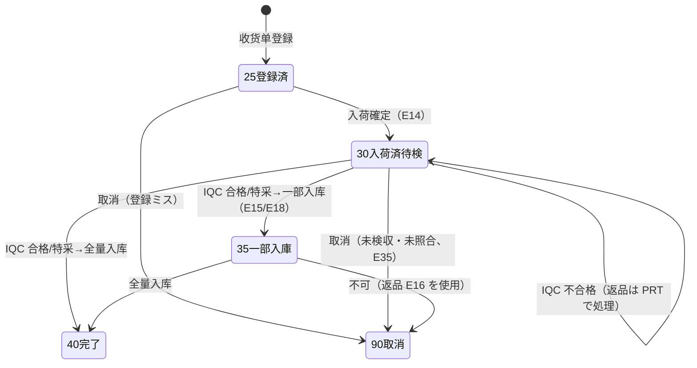
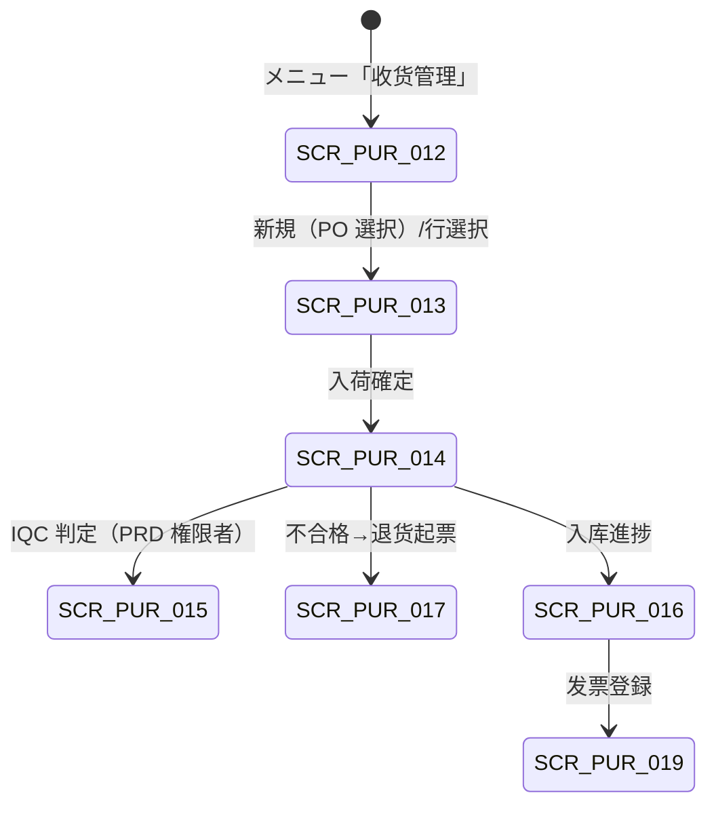

# 收货与来料检验 详细设计书（入荷検収・受入検査 詳細設計書）

| 項目 | 内容 |
|---|---|
| 文書名 | 收货与来料检验 详细设计书（入荷検収・受入検査 詳細設計書） |
| 文書番号 | DSN-PUR-004 |
| 版数 | v1.0 |
| 作成日 | 2026-10-20 |
| 作成者 | purchase-designer |
| 承認者 | 未承認（レビュー待ち） |
| 状態 | ドラフト（レビュー中） |
| 関連文書 | [業務域概要](00-overview.md) / [共通項目定義](../00-common/01-common-item-definitions.md) / [画面共通規格](../00-common/02-common-screen-spec.md) / [API 共通規格](../00-common/03-common-api-spec.md) / [共通業務規則](../00-common/08-common-business-rules.md) / [跨域流程](../00-common/09-cross-domain-flow.md) / [采购订单](03-purchase-order.md) / [采购退货](05-return.md) / [库存管理](../05-inventory/02-inbound-outbound.md) / [生产质量管理](../06-production/06-quality-management.md) |

---

## 1. 機能概要

| 項目 | 内容 |
|---|---|
| 機能 ID | F-PUR-011 收货单登记 / F-PUR-012 收货确认与待检跟踪 / F-PUR-013 来料检验判定与处置 / F-PUR-014 采购入库跟踪 |
| 機能名 | 收货・来料检验（Goods Receipt / IQC） |
| 目的 | 对供应商到货进行数量・批次・外观的接收登记，执行超收容差判定与分纳管理；入荷确定后通过 E14 触发「待检在庫・IQC 起票・仕入暂估」三联动，接收 IQC 判定（E15）后驱动「合格可用 / 特采 / 不合格退货」三种处置，并跟踪 INV 的待检→可用状态转换与入库完成（E18），保证实物、在庫、暂估、应付四者一致 |
| 利用者・ロール | 仓管员（收货登録・確認・入庫跟踪）、采购员（超收例外申请・退货起票）、采购经理（超收例外承认）、质检员/品质经理（IQC 判定・特采承認・PRD 域操作）、财务（暂估参照） |
| 利用シーン | ① 供应商送货到厂，仓管按 PO 收货并确认入荷；② 分批到货（分纳）的残量跟踪；③ 超收/短收/早到货的例外处理；④ IQC 判定不合格时的退货・特采・挑选处置；⑤ 收货后发现单证错误时在「未検収・未照合」条件下的取消 |
| 優先度 | P0 |
| 画面 ID | SCR-PUR-012（一览）、SCR-PUR-013（登録編集）、SCR-PUR-014（确认・待检跟踪）、SCR-PUR-015（IQC 判定）、SCR-PUR-016（入库跟踪） |
| 関連 IF | IF-PUR-004（E14→PRD IQC 起票）、IF-PUR-005（E15 判定受信）、IF-PUR-006（E14/E16/E35→INV）、IF-PUR-009（PDA 收货 Phase 1.5） |

### 1.1 機能分解

| 機能 ID | 機能名 | 概要 | 優先度 |
|---|---|---|---|
| F-PUR-011 | 收货单登记 | PO 参照・数量・批次・超收容差・分纳・收货单作成 | P0 |
| F-PUR-012 | 收货确认与待检跟踪 | 入荷确定（E14）、待检在庫跟踪、收货取消（E35） | P0 |
| F-PUR-013 | 来料检验判定与处置 | E15 受信・判定反映、合格/特采/不合格处置、退货起票 | P0 |
| F-PUR-014 | 采购入库跟踪 | INV 入库进度（E18）確認、异常补正 | P0 |

---

## 2. 業務要件・業務ルール

### 2.1 前提条件

| # | 前提条件 | 成立しない場合の挙動 |
|---|---|---|
| 1 | PO 状态 ∈ {30,35}（発注済・一部入荷） | PO 選択不可；保存時 `MSG-PUR-080` |
| 2 | 收货数量 ≤ PO 未入荷残 + 超收容差 | 保存時 `MSG-PUR-068`（超容差） |
| 3 | 物料批次管理标志、保质期标志、检验要求标志已由 MDM 设定 | 批次号必須等の制御不能 |
| 4 | 仓库・库位有效；仓管员对该仓库有数据权限 | 403 / `code=3002` |
| 5 | IQC 检验标准（`prd_inspection_standard`）已设定（检验要求物料） | IQC 起票不可，收货保留（`MSG-PUR-081`） |
| 6 | 会計期間 = OPEN | 登録・確認拒否 `MSG-COM-071` |

### 2.2 業務ルール

| # | ルール | 根拠 | 関連項目 |
|---|---|---|---|
| BR-01 | 收货单必须关联采购订单（`source_type=PURCHASE_ORDER`），按 PO 明细分纳收货；同一 PO 行可多次收货（分纳） | 09 §4.2、本域设计 | `po_id`、`po_line_id` |
| BR-02 | 超收容差：**既定値は MDM 正本**（品目→分類→仕入先→会社の優先順、`mdm_material.over_receipt_tolerance_pct` 等）。本域は既定値を再定義せず、①PO 明細 `receiving_tolerance_rate`（明細上書き）②`pur_tolerance_rule`（`rule_type=1`、例外上書き・`priority` 小を優先）③超容差時の例外承認、の 3 層で**上書き規則と優先順位のみ**を定義する。判定順：PO 明細 > PUR 上書き規則 > MDM 既定。容差内は警告（`MSG-PUR-069`）して受入可、超過は受入拒否（例外承認 `MSG-PUR-068`） | 09 §4.3、08 §5、MDM 04/90（既定値の正本） | `receiving_tolerance_rate`、`pur_tolerance_rule` |
| BR-03 | 容差超過でも業務上必要な場合、采购经理の「超收例外承认」により受入可（`over_receipt_approved_by`・`over_receipt_reason` 必須）。承認記録は監査ログに残す | 09 §4.3 | `over_receipt_approval` |
| BR-04 | 早入荷：`receipt_date < delivery_date − 3 日` の場合は警告（倉庫の受入能力・保管場所確認）。遅入荷：`receipt_date > delivery_date` は `late_days` を記録し、供应商绩效（F-PUR-026）へ連携 | 本域设计 | `early_flag`、`late_days` |
| BR-05 | 批次管理物料（`is_batch_managed=true`）は `batch_no` 必須。批次号は ① 供应商批次があればそのまま保持（`{仕入先コード}-{YYYYMMDD}-{2 位}`、90-data `batch-number-rule.csv` BN-LOT）② 無ければ購買材料批号 `{YYMMDD}P{3 位流水}`（BN-P、在庫域が入荷時に採番）。保质期物料は `production_date`・`expiry_date` 必須 | 01 §9、08 §5 | `batch_no` |
| BR-06 | 序列号管理物料（Phase 1.5）は受入時にシリアル一覧を JSONB で記録する | 本域设计 | `serial_nos` |
| BR-07 | 免检物料（`inspection_required=false`）は入荷確定時に `inspection_status=0`（検査不要）とし、E15 を待たずに可用化対象とする（E14 の payload に `inspectionRequired=false` 相当を含める運用は 09 契約外のため、PRD 側で免検判定） | 本域设计 | `inspection_status` |
| BR-08 | 入荷確定（confirm）：`receipt_status` 25→30、E14 発行。E14 購読者：INV（待検在庫）、PRD（IQC 起票）、FIN（仕入暫估計上 J01） | 09 §3、§4.1 | `receipt_status` |
| BR-09 | IQC 判定（PRD 域 `prd_inspection`、E15）を受信し、明細の `inspection_status` を更新する：`PASS→3 合格`、`CONCESSION→4 特采`、`REJECT→5 不合格`。判定結果・検査員・判定日時・サンプル数・不良数を保存する | 09 §3、§8 | `inspection_status` |
| BR-10 | 合格数量・特采数量は可用化対象（INV が E15 購読で待検→可用の状態変換を実行）。不合格数量は不合格状態のまま返品・選別・廃棄の対象 | 09 §8 | `accepted_qty`、`concession_qty`、`rejected_qty` |
| BR-11 | 入库は INV の責任で実行する。PUR は E18 `inventory.txn.posted` を受信して `stocked_qty`・`stocked_at` を更新し、入库进度を表示する（PUR は在庫を直接更新しない） | 09（Lead 裁定 2026-10-20） | `stocked_qty` |
| BR-12 | 收货单取消（E35 `purchase.receipt.cancelled`）：**未検収（IQC 未完了）かつ未照合（三単マッチ未実行）**の場合のみ可能。取消時は `receipt_status=90`、E35 発行により INV の待検在庫取消・FIN の暂估冲回・PRD の IQC タスク取消が行われる。已入庫可用化または已匹配の場合は取消不可（`MSG-PUR-075`）→ 返品（E16）で処理 | 09 §3 E35、§4.3 | `receipt_status` |
| BR-13 | 收货单確認後は明細数量・批次の変更不可。誤りの訂正は取消（未検収・未照合時）または返品・追加収貨で処理 | 08 §3.3-3 | `receipt_status` |
| BR-14 | 数量整合：`received_qty = accepted_qty + concession_qty + rejected_qty`（退货時は `returned_qty` を別管理）。`stocked_qty = accepted_qty + concession_qty − returned_qty`（INV 実績と一致すること） | 本域设计 | 各数量項目 |
| BR-15 | 收货单の `receipt_status` は 25（登録済・承認不要）→30（入荷済・待検）→35（一部入库）→40（全量入库）→90（取消）。PO 明細の累計 `received_qty` は入荷確定時に加算する | 08 §3.2 | `receipt_status` |
| BR-16 | 来料检验的样本量・判定基准由质量部在 `prd_inspection_standard` 维护，抽样按 [GB/T 2828.1-2012《计数抽样检验程序 第1部分：按接收质量限（AQL）检索的逐批检验抽样计划》]【実データ】执行。PUR 域不重新定义检验标准 | 09 §8、PRD 域 | `inspection_id` |
| BR-17 | 特采（让步接收）须经品质经理 + 采购经理承認（重要件追加技术部经理），承认后方可按特采入库；特采品在庫に「特采」属性を保持し、トレーサビリティを確保する | 09 §8、08 §8.1 | `concession_qty` |
| BR-18 | IQC 不合格の処置：① 返品（PRT 起票、E16）② 全数選別（選別後合格分は追加検査・入库、不良分は返品）③ 特采（承認）④ 廃棄（供应商同意・社内承認）。処置選択は F-PUR-013 で行い、結果を不入荷明细に記録 | 09 §4.3、§8 | `disposition` |
| BR-19 | 收货数量の修正は取消→再登録。遡及修正禁止（08 §6.1 在庫取引） | 08 §6.1 | — |
| BR-20 | 帳票（PRT-PUR-004 入荷検収書）は入荷確定時に出力可能。IQC 判定後に「検査結果欄」を追記印字できる（再出力可） | 02 §14、92 | — |

### 2.3 計算式・判定式

| # | 対象 | 算式 | 丸め | 例（示例值） |
|---|---|---|---|---|
| CALC-01 | 未入荷残 | `発注数量 − 累計入荷数量 − 取消数量` | 数量 4 桁 | 28,000 − 12,000 = 16,000.0000 |
| CALC-02 | 超收容差上限（累计） | `発注数量 × (1 + 容差率)`（容差率は PO 明細 > PUR 上書き規則 > MDM 既定の順で解決）。個数単位は `max(上式, 発注数量 + 1)` | 数量 4 桁 | 28,000 × 1.05 = 29,400.0000（5% は MDM 既定値の例） |
| CALC-03 | 超收数量 | `累計入荷数量 − 発注数量`（>0 のとき超收） | 数量 4 桁 | 28,600 − 28,000 = 600.0000 |
| CALC-04 | 明細金額（入荷） | 入荷数量 × PO 税抜単価 | 四捨五入 2 桁 | 12,000 × 5.65 = 67,800.00 |
| CALC-05 | 暂估金额（FIN J01 用） | Σ(入荷数量 × PO 税抜単価) | 2 桁 | 67,800.00 |
| CALC-06 | 入库进度率 | `(入庫済数量 + 特采入庫) ÷ 入荷数量` | 比率 4 桁 | (11,700 + 0) ÷ 12,000 = 97.50% |
| CALC-07 | 数量整合チェック | `入荷 = 合格 + 特采 + 不合格`（差 ≠ 0 で異常） | — | 600 = 588 + 0 + 12 |
| CALC-08 | 遅延日数 | `入荷日 − 約定交期`（>0 が遅延） | 整数（日） | 2026-11-06 − 2026-11-03 = 3 |

### 2.4 状態遷移



| 遷移 | トリガ | 権限 | 更新項目 | メッセージ |
|---|---|---|---|---|
| [*]→25 | 收货单保存 | `purchase:receipt:create` | `receipt_status=25` | `MSG-PUR-084` |
| 25→30 | 入荷確定 | `purchase:receipt:create` | `receipt_status=30`、`confirmed_at`、E14 発行 | `MSG-PUR-076` |
| 30→35 | IQC 合格/特采 → 一部入库 | システム（E15/E18） | `inspection_status`、`accepted_qty`、`stocked_qty`、`receipt_status=35` | — |
| 30/35→40 | 全量入库 | システム（E18） | `stocked_qty`、`receipt_status=40` | `MSG-PUR-082` |
| 25→90 | 取消（登録ミス） | `purchase:receipt:create` | `receipt_status=90` | `MSG-PUR-085` |
| 30→90 | 取消（未検収・未照合） | `purchase:receipt:cancel` | `receipt_status=90`、E35 発行、PO 累計戻し | `MSG-PUR-077` |

明細レベルのサブ状態：

| `inspection_status` | 名称 | 意味 | 後続 |
|---|---|---|---|
| 0 | 検査不要 | 免检物料 | 直接可用化対象 |
| 1 | 待检 | E14 発行済・IQC 起票待ち/検査待ち | IQC 開始（PRD） |
| 2 | 检验中 | PRD が検査実行中 | 判定待ち |
| 3 | 合格 | PASS | 可用化・入库 |
| 4 | 特采 | CONCESSION（承認済） | 可用化・入库（特采属性） |
| 5 | 不合格 | REJECT | 返品・選別・廃棄 |

---

## 3. 関連機能

| 関係 | 機能 ID | 機能名 | 関係内容 |
|---|---|---|---|
| 上流 | F-PUR-007～010 | 采购订单 | PO 承認済・未入荷残の参照 |
| 上流 | F-MDM-001 | 物料主数据 | 批次/序列/保质期/检验要求/免检属性 |
| 下流 | F-PRD-012 | 质量管理（IQC） | E14 で IQC 起票、E15 で判定返却 |
| 下流 | F-INV-002 | 采购入库 | E14 で待検入庫、E15 で状態変換、E18 で実績通知 |
| 下流 | F-INV-004 | 批次・序列・状态 | 批次/序列/在庫状态の管理 |
| 下流 | F-PUR-015/016 | 采购退货 | 不合格分の返品（E16） |
| 下流 | F-PUR-017/018 | 采购发票・三单匹配 | 受入数量を正とする匹配 |
| 参照 | F-PUR-023 | 交期跟踪 | 入荷日・遅延日数 |
| 参照 | F-PUR-026 | 供应商绩效 | IQC 合格率・遅延データ |

---

## 4. 画面設計

### 4.1 画面一覧

| 画面 ID | 画面名 | 類型 | 概要 |
|---|---|---|---|
| SCR-PUR-012 | 收货单一覧 | 一覧検索 | 状態・PO・供应商・入荷日での検索、未検収一覧 |
| SCR-PUR-013 | 收货单登録編集 | 登録編集 | PO 参照・明細数量・批次・超收判定・確認 |
| SCR-PUR-014 | 收货确认与待检跟踪 | 参照詳細 | 入荷確定後の待検在庫・IQC 進捗・取消 |
| SCR-PUR-015 | 来料检验判定（IQC） | ワークフロー | PRD 域の検査判定画面（PUR 側は判定結果参照と処置選択） |
| SCR-PUR-016 | 采购入库跟踪 | 参照詳細 | INV の入库进度（E18）・異常時の再処理 |

### 4.2 画面遷移



### 4.3 画面レイアウト（SCR-PUR-013）

```
┌────────────────────────────────────────────────────────────────────────────────┐
│ パンくず：ホーム > 采购管理 > 收货单登録編集                        [状態バッジ] │
├────────────────────────────────────────────────────────────────────────────────┤
│〔ヘッダ〕收货单号[GR2610200001] 采购订单[PO2610200001▼] 供应商[S000001 宝山钢铁]│
│ 入荷日[2026-11-03] 收货仓库[WH01 原料仓▼] 送り状番号[SF-20261103-001]           │
│ 运输公司[順豊速運] 收货人[E000301 李强] 检验要求[要▼]                           │
├────────────────────────────────────────────────────────────────────────────────┤
│〔ツールバー〕[保存][入荷确定][取消][打印入荷検収書][刷新PO残]                    │
├────────────────────────────────────────────────────────────────────────────────┤
│〔明細〕行|物料|発注数量|未入荷残|本次收货|累计收货|可收上限|超收|批次号|        │
│        生产日期|有效期|金额|检验|入库|操作                                       │
│ 10|1001000001 50W470|28,000|16,000|16,000|28,000|29,400|无|S000001-20261101-01|  │
│    |-|-|90,400.00|待检|0.0000|删除                                              │
│ 20|1004000001 QZY-2/180|2,000|2,000|2,000|2,000|2,100|无|S000006-20261101-01|       │
│    |-|-|157,000.00|待检|0.0000|删除                                              │
│ 30|4001000001 6205-2RS|2,000|2,000|2,050|2,050|2,100|警告|S000013-20261103-01|      │
│    |-|-|26,240.00|待检|0.0000|删除                                              │
├────────────────────────────────────────────────────────────────────────────────┤
│〔フッタ〕入荷数量合計 46,050  入荷金額 273,640.00  超收警告 1 行                 │
└────────────────────────────────────────────────────────────────────────────────┘
```

### 4.4 画面項目定義

#### 4.4.1 SCR-PUR-013 ヘッダ項目

| No | 項目 ID | 項目名 | 種別 | 型/桁 | 必須 | 初期値 | 入力チェック | データソース | DB 項目 | 備考 |
|---|---|---|---|---|---|---|---|---|---|---|
| 1 | `receiptNo` | 收货单号 | テキスト | VARCHAR(32) | ○ | 自動採番 | `GR{YYMMDD}{4桁}` | 採番 | `receipt_no` | 入荷確定時に採番でも可（設計：保存時に採番） |
| 2 | `poId` | 采购订单 | 選択 | BIGINT | ○ | 空 | 状態 30/35・未入荷残 > 0 | `pur_purchase_order` | `po_id` | PO 選択で明細自動展開 |
| 3 | `supplierId` | 供应商 | テキスト | BIGINT | 自動 | PO 从属 | — | `mdm_supplier` | `supplier_id` | スナップショット |
| 4 | `receiptDate` | 入荷日 | 日付 | DATE | ○ | 当日 | ≤ 当日 + 1 日、会計期間 OPEN | — | `receipt_date` | 遅延判定基準 |
| 5 | `warehouseId` | 收货仓库 | 選択 | BIGINT | ○ | WH01 | コード存在・有効 | `mdm_warehouse` | `warehouse_id` | 明細上書き可 |
| 6 | `receivingUserId` | 收货人 | 選択 | BIGINT | ○ | ログインユーザ | 倉管権限 | `sys_user` | `receiving_user_id` | — |
| 7 | `deliveryNoteNo` | 送り状番号 | テキスト | VARCHAR(64) | △ | 空 | 桁数 | 外部 | `delivery_note_no` | 伝票照合 |
| 8 | `carrier` | 运输公司 | テキスト | VARCHAR(100) | △ | 空 | 桁数 | — | `carrier` | — |
| 9 | `inspectionRequired` | 检验要求 | ラジオ | BOOLEAN | ○ | 物料属性 | — | `mdm_material` | `inspection_required` | 免检の場合 false |
| 10 | `receiptStatus` | 状态 | バッジ | SMALLINT | 自動 | 25 | — | — | `receipt_status` | 25/30/35/40/90 |
| 11 | `confirmedAt` | 入荷确定日時 | 日時 | TIMESTAMPTZ | 自動 | 空 | — | — | `confirmed_at` | — |
| 12 | `totalReceivedAmount` | 入荷金額（税抜） | 数値 | NUMERIC(18,2) | 自動 | 0.00 | — | Σ 明細 | `total_received_amount` | 暂估基準 |
| 13 | `cancelReason` | 取消理由 | テキストエリア | VARCHAR(500) | △ | 空 | 取消時必須 | — | `cancel_reason` | E35 payload |
| 14 | `remark` | 备注 | テキストエリア | VARCHAR(500) | △ | 空 | 桁数 | — | `remark` | — |
| 15 | `attachments` | 附件 | 添付 | — | △ | 空 | 01 §9 | `sys_attachment` | — | 送り状写真等 |

#### 4.4.2 SCR-PUR-013 明細項目

| No | 項目 ID | 項目名 | 種別 | 型/桁 | 必須 | 初期値 | 入力チェック | データソース | DB 項目 | 備考 |
|---|---|---|---|---|---|---|---|---|---|---|
| 1 | `lineNo` | 行番号 | 数値 | INT | 自動 | 10 刻み | — | — | `line_no` | — |
| 2 | `poLineId` | PO 明細 | テキスト | BIGINT | ○ | 空 | PO 明細に存在・未入荷残 > 0 | `pur_purchase_order_line` | `po_line_id` | — |
| 3 | `materialCode`/`materialName`/`spec` | 物料 | テキスト | VARCHAR | 自動 | 空 | — | PO 明細 | 同名項目 | スナップショット |
| 4 | `orderedQty` | 発注数量 | 数値 | NUMERIC(18,4) | 自動 | PO 値 | — | PO 明細 | 導出 | 参照のみ |
| 5 | `remainQty` | 未入荷残 | 数値 | NUMERIC(18,4) | 自動 | 計算 | — | CALC-01 | 導出 | 参照のみ |
| 6 | `receivedQty` | 本次收货数量 | 数値 | NUMERIC(18,4) | ○ | 未入荷残 | > 0、≤ 可收上限（CALC-02） | — | `received_qty` | 容差超は承認要 |
| 7 | `cumulativeReceivedQty` | 累计收货数量 | 数値 | NUMERIC(18,4) | 自動 | 計算 | — | CALC-03 | 導出 | 参照のみ |
| 8 | `allowedReceiveQty` | 可收上限 | 数値 | NUMERIC(18,4) | 自動 | 計算 | — | CALC-02 | 導出 | 参照のみ |
| 9 | `overReceiptFlag` | 超收标志 | チェック | BOOLEAN | 自動 | false | — | 計算 | `over_receipt_flag` | true 时警告 |
| 10 | `overReceiptQty` | 超收数量 | 数値 | NUMERIC(18,4) | 自動 | 0 | — | CALC-03 | `over_receipt_qty` | — |
| 11 | `overReceiptReason` | 超收理由 | テキスト | VARCHAR(500) | △ | 空 | 超收時必須 | — | `over_receipt_reason` | — |
| 12 | `overReceiptApprovedBy` | 超收承认者 | テキスト | BIGINT | △ | 空 | — | — | `over_receipt_approved_by` | 采购经理承認 |
| 13 | `uomCode` | 单位 | テキスト | VARCHAR(8) | 自動 | PO 値 | — | PO 明細 | `uom_code` | — |
| 14 | `baseReceivedQty` | 基本单位数量 | 数値 | NUMERIC(18,4) | 自動 | 数量×换算率 | — | 計算 | `base_received_qty` | 在庫連携 |
| 15 | `unitPrice` | PO 税抜単価 | 数値 | NUMERIC(18,6) | 自動 | PO 値 | — | PO 明細 | `unit_price` | 暂估基準 |
| 16 | `amount` | 入荷金額 | 数値 | NUMERIC(18,2) | 自動 | 0.00 | — | 計算 | `amount` | — |
| 17 | `taxCode`/`taxRate` | 税码・税率 | テキスト | VARCHAR/NUMERIC | 自動 | PO 値 | — | PO 明細 | 同名項目 | — |
| 18 | `batchNo` | 批次号 | テキスト | VARCHAR(64) | △ | 自動採番候補 | 批次管理物料で必須 | — | `batch_no` | BR-05 |
| 19 | `productionDate` | 生产日期 | 日付 | DATE | △ | 空 | ≤ 入荷日 | — | `production_date` | 保质期物料必須 |
| 20 | `expiryDate` | 有效期 | 日付 | DATE | △ | 空 | > 生产日期 | — | `expiry_date` | 保质期物料必須 |
| 21 | `serialNos` | 序列号 | テキスト | JSONB | △ | 空 | 序列管理物料で必須 | — | `serial_nos` | Phase 1.5 |
| 22 | `warehouseId` | 收货仓库 | 選択 | BIGINT | ○ | ヘッダ値 | コード存在 | `mdm_warehouse` | `warehouse_id` | — |
| 23 | `locationCode` | 库位 | 選択 | VARCHAR(32) | △ | 空 | コード存在 | `mdm_warehouse_bin` | `location_code` | — |
| 24 | `inspectionStatus` | 检验状态 | バッジ | SMALLINT | 自動 | 0/1 | — | E15 | `inspection_status` | 0～5 |
| 25 | `acceptedQty` | 合格数量 | 数値 | NUMERIC(18,4) | 自動 | 0 | — | E15 | `accepted_qty` | 参照のみ |
| 26 | `concessionQty` | 特采数量 | 数値 | NUMERIC(18,4) | 自動 | 0 | — | E15 | `concession_qty` | 参照のみ |
| 27 | `rejectedQty` | 不合格数量 | 数値 | NUMERIC(18,4) | 自動 | 0 | — | E15 | `rejected_qty` | 参照のみ |
| 28 | `stockedQty` | 入库数量 | 数値 | NUMERIC(18,4) | 自動 | 0 | — | E18 | `stocked_qty` | 参照のみ |
| 29 | `returnedQty` | 退货数量 | 数値 | NUMERIC(18,4) | 自動 | 0 | — | E16 | `returned_qty` | 参照のみ |
| 30 | `lateDays` | 延迟日数 | 数値 | INT | 自動 | 計算 | — | CALC-08 | `late_days` | — |
| 31 | `earlyFlag` | 早入荷 | チェック | BOOLEAN | 自動 | false | — | 計算 | `early_flag` | — |

### 4.5 イベント処理

| No | イベント | トリガ | 処理内容 | 呼出 API | 画面遷移 | 備考 |
|---|---|---|---|---|---|---|
| 1 | 検索 | 検索ボタン | 一覧取得 | `GET /api/purchase/receipts` | 同一画面 | 未検収一覧は `inspectionStatus=1` |
| 2 | 新規 | 新規ボタン | PO 選択ダイアログ→未入荷残 > 0 の PO 明細展開 | `GET /api/purchase/purchase-orders?status=30,35` | SCR-PUR-013 | — |
| 3 | PO 選択 | PO 選択 | PO 明細・単価・税码・批次属性を取得し明細生成 | `GET .../purchase-orders/{id}` | — | 残量 0 の行は除外 |
| 4 | 数量入力 | 数量変更 | 可收上限・超收・早入荷・金額を再計算 | — | — | 前端 + サーバ再計算 |
| 5 | 批次採番 | 批次欄フォーカス | 批次号候補を生成（BR-05） | `GET /api/purchase/receipts/batch-suggestion` | — | 手動変更可 |
| 6 | 保存 | 保存ボタン | 入力チェック→採番→保存 | `POST`/`PUT /api/purchase/receipts` | 同画面 | — |
| 7 | 入荷确定 | 入荷确定ボタン | 数量・容差・期間チェック→状態 30→E14 発行 | `POST .../{id}/confirm` | SCR-PUR-014 | 二重送信防止 |
| 8 | 超收例外申請 | 超收承認申請 | 采购经理承認依頼（WF または権限者直接承認） | `POST .../{id}/over-receipt-approve` | — | BR-03 |
| 9 | 取消 | 取消ボタン | E35 条件検証（未検収・未照合）→状態 90→E35 発行 | `POST .../{id}/cancel` | 一覧 | 条件不成立 `MSG-PUR-075` |
| 10 | IQC 判定参照 | 行選択 | PRD 検査結果（inspection_id）を参照表示 | `GET /api/production/inspections/{id}` | SCR-PUR-015 | PRD 権限で判定操作 |
| 11 | 不合格处置 | 処置ボタン | 返品（PRT 起票）/選別/廃棄の選択 | `POST /api/purchase/returns/from-receipt` | SCR-PUR-017 | 不確定時は保留可 |
| 12 | 入库進捗 | 進捗タブ | INV 在庫取引（E18）状況取得 | `GET .../{id}/stocking-status` | SCR-PUR-016 | 異常時は INV へ再処理要求 |
| 13 | 打印 | 印刷ボタン | PRT-PUR-004 出力（検査結果欄含む） | `POST .../{id}/print` | — | 再出力可 |

### 4.6 一覧画面仕様（SCR-PUR-012）

| 項目 | 内容 |
|---|---|
| 検索条件 | 收货单号、PO 号、供应商、状态（複数）、入荷日期範囲、检验状态、仓库、超收のみ、未検収のみ |
| 既定検索条件 | 全社 + 状態 25/30/35 + 今月 |
| ソート | 既定：入荷日時降順 |
| ページング | 20/50/100/200 |
| 一括操作 | 导出、入荷確定（複数選択時は全件成功 or 全件失敗） |
| 表示列 | 收货单号、PO 号、供应商、状态、入荷日、数量合計、检验状態（待检/合格/特采/不合格）、入库进度、超收 |
| エクスポート | Excel ≤10,000 件、非同期可 |

### 4.7 表示制御

| 条件 | 対象 | 制御 |
|---|---|---|
| `receipt_status ≠ 25` | ヘッダ・明細の編集項目 | 参照のみ |
| `receipt_status = 30/35` かつ IQC 未完了・未照合 | 取消ボタン | 表示（権限あり） |
| `receipt_status = 30/35` かつ 已照合 or 已入庫 | 取消ボタン | 非表示（`MSG-PUR-075`） |
| 超收 | 当該行 | 黄色背景 + 理由必須 |
| `inspection_status = 5` | 当該行 | 赤背景 + 「退货/選別/廃棄」処置ボタン |
| 免检物料 | 检验列 | 「検査不要」表示 |
| 権限なし | 金額・単価 | 非表示（API も返さない） |

---

## 5. 入力チェック仕様

| No | チェック ID | 対象項目 | 種別 | 条件 | タイミング | メッセージ ID |
|---|---|---|---|---|---|---|
| 1 | CHK-PUR-004-01 | PO | 必須・状態 | 状態 30/35、未入荷残 > 0 | 保存時 | `MSG-PUR-080` |
| 2 | CHK-PUR-004-02 | 收货数量 | 必須・範囲 | > 0、≤ 可收上限（容差内） | 保存時 | `MSG-PUR-068` / `MSG-PUR-069`（W） |
| 3 | CHK-PUR-004-03 | 超收理由 | 必須 | 超收時入力 | 入荷確定時 | `MSG-PUR-070` |
| 4 | CHK-PUR-004-04 | 批次号 | 必須 | 批次管理物料 | 入荷確定時 | `MSG-PUR-073` |
| 5 | CHK-PUR-004-05 | 生产日期/有效期 | 必須・相関 | 保质期物料、production < expiry | 保存時 | `MSG-COM-040`/`MSG-COM-045` |
| 6 | CHK-PUR-004-06 | 入荷日 | 範囲 | ≤ 当日 + 1 日 | 保存時 | `MSG-PUR-083` |
| 7 | CHK-PUR-004-07 | 早入荷 | 業務 | 入荷日 < 約定交期 − 3 日 → 警告 | 保存時 | `MSG-PUR-072`（W） |
| 8 | CHK-PUR-004-08 | 期間状態 | 業務 | 会計期間 ≠ CLOSED | 保存・確定時 | `MSG-COM-071` |
| 9 | CHK-PUR-004-09 | 数量整合 | 業務 | `入荷 = 合格 + 特采 + 不合格`（IQC 後） | E15 処理時 | `MSG-PUR-074` |
| 10 | CHK-PUR-004-10 | 取消条件 | 業務 | 未検収（`inspection_status ∈ {1,2}` を含む・完了前）かつ未照合 | 取消時 | `MSG-PUR-075` |
| 11 | CHK-PUR-004-11 | 状態整合 | 業務 | 操作が現在状態で許可 | 各操作 | `MSG-COM-034` |
| 12 | CHK-PUR-004-12 | 楽観排他 | 排他 | `version` 一致 | 保存・確定 | `MSG-COM-033` |
| 13 | CHK-PUR-004-13 | 入库数量整合 | 業務 | `stocked_qty ≤ accepted_qty + concession_qty − returned_qty` | E18 処理時 | `MSG-PUR-086` |

---

## 6. 処理詳細

### 6.1 処理一覧

| 処理 ID | 処理名 | 契機 | トランザクション | 排他 |
|---|---|---|---|---|
| PRC-PUR-011-01 | 收货登録 | 保存 | 要 | 採番行ロック |
| PRC-PUR-011-02 | 超收判定 | 数量変更・保存 | 不要（計算） | — |
| PRC-PUR-012-01 | 入荷確定 | 入荷確定 | 要（PO 累計更新 + Outbox） | PO 行ロック |
| PRC-PUR-012-02 | 收货取消（E35） | 取消 | 要（PO 累計戻し + Outbox） | 排他 + 条件検証 |
| PRC-PUR-013-01 | IQC 判定反映（E15） | イベント | 要 | 冪等（eventId） |
| PRC-PUR-013-02 | 不合格処置 | 処置選択 | 要（PRT 起票除く） | 楽観排他 |
| PRC-PUR-014-01 | 入库実績反映（E18） | イベント | 要 | 冪等（eventId） |

### 6.2 処理手順（正常系）

**PRC-PUR-011-02 超收判定**

```
function judgeOverReceipt(poLine, receiptLines):
    orderedQty   = poLine.quantity
    receivedSoFar = poLine.receivedQty            # 既存入荷累計（承認済 GR のみ）
    thisQty       = sum(l.receivedQty for l in receiptLines where l.poLineId == poLine.id)
    cumulative    = receivedSoFar + thisQty
    toleranceRate = poLine.receivingToleranceRate ?? purOverrideRule(OVER_RECEIPT, supplier, material) ?? mdmDefault(scopePriority)  # MDM 既定（品目→分類→仕入先→会社）。PUR は上書きのみ定義
    allowedTotal  = orderedQty × (1 + toleranceRate)
    if uomIsPiece(poLine.uomCode):                 # PCE/SET/DZN 等の個数単位
        allowedTotal = max(allowedTotal, orderedQty + 1)
    if cumulative > allowedTotal:
        return REJECT(MSG-PUR-068, allowedTotal)   # 容差超過：受入拒否（例外承認申請可）
    elif cumulative > orderedQty:
        return WARN(MSG-PUR-069, overQty = cumulative - orderedQty)   # 超收：警告して受入可
    else:
        return OK
```

**PRC-PUR-012-01 入荷確定**

1. 收货单を `SELECT ... FOR UPDATE` でロックし、状態 25 を確認する。
2. 明細ごとに PO 明細をロックし、累計入荷数量・可收上限を再検証する（PRC-PUR-011-02）。容差超過は `MSG-PUR-068` で中止（例外承認済みの場合を除く）。
3. 数量整合・批次必須・期間状態を再検証する。
4. `receipt_status=30`、`confirmed_at`、`confirmed_by` を更新し、PO 明細の `received_qty` を加算、PO 明細/ヘッダの状態を再計算する（35/40）。
5. Outbox に E14 `purchase.receipt.posted` を同一トランザクションで登録する（payload は [91](91-api-design.md) §7）。
6. 監査ログ（UPDATE/POST）を記録し、倉庫・品質・財務・購買担当へ通知する。
7. 帳票（PRT-PUR-004）出力可能状態にする。
8. 応答：更新後の收货单（`inspection_status=1` 待检を含む）。

**PRC-PUR-012-02 收货取消（E35）**

1. 收货单・PO をロックし、以下をすべて満たすことを検証する：① `receipt_status=30`（35/40 は不可）② IQC 未完了（明細の `inspection_status ∉ {3,4,5}`、PRD 検査が未判定）③ 未照合（`pur_invoice_match` に当該 `receipt_line_id` の確定レコードなし）④ 会計期間 OPEN。
2. 条件不成立時は `MSG-PUR-075` で終了し、返品処理（E16）を案内する。
3. `receipt_status=90`、`cancel_reason`、`cancelled_at`、`cancelled_by` を保存する。
4. PO 明細の `received_qty` から取消数量を減算し、PO 状態を再計算する（35→30 等）。
5. Outbox に E35 `purchase.receipt.cancelled` を登録する（payload：`receiptId`、`receiptNo`、`orderId`、`reason`、`reversedLines[{materialId,batchNo,qty,unitPrice,amount}]`、`amount`、`cancelledAt`。金額は 09 §3 E35 改訂に準拠し、FIN の暂估戻しを可能にする））。
6. 監査ログ（CANCEL）と通知（品質・財務・購買）を記録する。

**PRC-PUR-013-01 IQC 判定反映（E15）**

1. `sys_event_consume_log` で `eventId` 重複排除、`inspectionType=IQC`・`sourceType=RECEIPT`・`sourceId` が対象 GR を指すことを確認する。
2. `result` に応じ明細の `inspection_status` を更新する（PASS→3、CONCESSION→4、REJECT→5）。`lines` の明細対応は `materialId` + `batchNo`（または `receiptLineId` があればそれを優先）で突合する。
3. `accepted_qty`・`concession_qty`・`rejected_qty`・`sample_qty`・`defect_qty`・`inspection_id`・`inspected_at` を保存する。
4. 数量整合（CALC-07）を検証し、不一致は `MSG-PUR-074`（W）としてアラートログに記録（受入は継続）。
5. 合格/特采は INV 側の状態変換（E15 購読）を待つ。不合格は「退货/選別/廃棄」待ちとして画面に表示する。
6. 監査ログ（UPDATE）・通知（購買・倉庫）を記録する。数量はサーバ側で再計算し、`received_qty` を超える値は拒否する（`MSG-PUR-086`）。

**PRC-PUR-014-01 入库実績反映（E18）**

1. `eventId` 冪等排除。`txnType=PI` かつ `sourceType=RECEIPT` の在庫取引のみ対象とする（他出庫・退货は対象外）。
2. 在庫取引明細（`materialId`、`batchNo`、`qty`）と收货明細を突合し、`stocked_qty` を加算（上限：`accepted_qty + concession_qty − returned_qty`）。
3. `stocked_at` を更新し、`stocked_qty == accepted_qty + concession_qty − returned_qty` になった行を入库完了とする。
4. 全行入库完了なら `receipt_status=40`、一部なら 35 に更新し、PO 明細の `accepted_qty` を同期する。
5. 監査ログ（UPDATE）を記録する。不整合（上限超過・対象明細なし）は `MSG-PUR-086` でアラートし、INV に再処理を依頼する。

**PRC-PUR-013-02 不合格処置**

1. 対象行の `inspection_status=5` と `rejected_qty > 0` を確認する。
2. 処置種別（1 退货 / 2 全数選別 / 3 特采 / 4 廃棄）を選択する。
3. 退货：`POST /api/purchase/returns/from-receipt` で PRT 起票（[05](05-return.md)）。数量は `rejected_qty` 以下。
4. 全数選別：選別結果（合格/不合格）を記録し、合格分は追加検査後に `accepted_qty` へ振替（`inspection_status=3` 相当の追加判定が必要）、不合格分は返品。
5. 特采：承認記録（承認者・理由）を `concession_qty` に反映（PRD 側 NCR 承認と整合）。
6. 廃棄：社内承認後、INV の廃棄（`SC_OUT`）へ指示（在庫責任は INV）。
7. 監査ログ（UPDATE）と通知を記録する。

### 6.3 例外処理

| No | 異常条件 | 検知箇所 | 処理 | ロールバック | メッセージ ID |
|---|---|---|---|---|---|
| 1 | 超收容差超過 | 保存・入荷確定 | 受入拒否（例外承認待ち） | 全体 | `MSG-PUR-068` |
| 2 | 批次号未入力 | 入荷確定 | 確定拒否 | 全体 | `MSG-PUR-073` |
| 3 | IQC 未完了で取消以外の入库 | 入库跟踪 | 入库不可（待機表示） | — | `MSG-PUR-079` |
| 4 | 取消条件不成立 | 取消 | 取消拒否・返品案内 | 全体 | `MSG-PUR-075` |
| 5 | E15 と入荷数量の不整合 | E15 処理 | 警告・アラート（受入継続） | 部分 | `MSG-PUR-074` |
| 6 | E18 数量が上限超過 | E18 処理 | 上限まで反映しアラート | 部分 | `MSG-PUR-086` |
| 7 | 期間締切済 | 保存・確定 | 拒否 | 全体 | `MSG-COM-071` |
| 8 | 採番失敗 | 保存 | ロールバック（欠番許容） | 全体 | `MSG-COM-080` |
| 9 | IQC 検査標準未設定 | 入荷確定（前） | 入荷確定は可（IQC 起票失敗をアラート） | — | `MSG-PUR-081`（E） |

### 6.4 冪等性・再実行

- E14・E15・E18・E35 の送受信はすべて `eventId` で冪等化。E14 の二重送信（Outbox 再送）でも PO 累計を二重加算しない（`(source_type, source_id)` でも検知）。
- 入荷確定・取消は `Idempotency-Key` 必須（24 時間）。
- 超收例外承認は同じ申請の二重承認を排除（`over_receipt_approved_by` 設定済みなら再承認不可）。
- BAT-PUR-004 が IQC 判定待ち滞留・E18 未着を日次監視し、再処理を促す。

---

## 7. API 設計

| No | メソッド | パス | 権限 | 概要 | リクエスト | レスポンス | 主なエラー |
|---|---|---|---|---|---|---|---|
| 1 | GET | `/api/purchase/receipts` | `purchase:receipt:view` | 一覧 | 検索条件 | `PageResult<ReceiptListDto>` | 3001 |
| 2 | GET | `/api/purchase/receipts/{id}` | `purchase:receipt:view` | 詳細 | — | `ReceiptDetailDto` | 4001 |
| 3 | POST | `/api/purchase/receipts/from-order` | `purchase:receipt:create` | PO から收货单作成 | `{poId, receiptDate, warehouseId, lines[]}` | `ReceiptDetailDto`（201） | 40060/40061 |
| 4 | PUT | `/api/purchase/receipts/{id}` | `purchase:receipt:create` | 更新（25 のみ） | `ReceiptUpdateDto` + `version` | 詳細 | 4002/4003 |
| 5 | POST | `/api/purchase/receipts/{id}/confirm` | `purchase:receipt:create` | 入荷確定（E14） | `{version}` | 詳細 | 4002/40040/40042 |
| 6 | POST | `/api/purchase/receipts/{id}/over-receipt-approve` | `purchase:receipt:override` | 超收例外承認 | `{version, lines[], reason}` | 詳細 | 4002/40040 |
| 7 | POST | `/api/purchase/receipts/{id}/cancel` | `purchase:receipt:cancel` | 取消（E35） | `{version, reason}` | 詳細 | 40047 |
| 8 | GET | `/api/purchase/receipts/pending-inspection` | `purchase:receipt:view` | 待検一覧 | 検索条件 | `PageResult<ReceiptLineInspectionDto>` | — |
| 9 | GET | `/api/purchase/receipts/{id}/inspections` | `purchase:receipt:view` | IQC 結果参照 | — | `InspectionResultDto[]` | 4001 |
| 10 | GET | `/api/purchase/receipts/{id}/stocking-status` | `purchase:receipt:view` | 入库進捗 | — | `StockingStatusDto` | 4001 |
| 11 | POST | `/api/purchase/receipts/{id}/dispositions` | `purchase:return:create` | 不合格処置 | `{lineNo, disposition, qty, reason}` | `{returnId?}` | 4002/40060 |
| 12 | POST | `/api/purchase/receipts/{id}/print` | `purchase:receipt:print` | 入荷検収書出力 | `{withInspectionResult?}` | PDF | 4001 |
| 13 | GET | `/api/purchase/receipts/batch-suggestion` | `purchase:receipt:create` | 批次号候補 | `{poLineId, receiptDate}` | `{batchNo}` | — |

> IQC 判定そのものは PRD 域 API（`POST /api/production/inspections/{id}/judge`）で実行する。PUR 側は判定結果の参照と処置のみを提供する（[00-overview](00-overview.md) §11 責任分界）。

### 7.1 入荷確定レスポンス例（抜粋）

```json
{
  "code": 0,
  "message": "ok",
  "data": {
    "id": "1845678901234568100",
    "receiptNo": "GR2610210001",
    "poNo": "PO2610200001",
    "receiptStatus": 30,
    "statusName": "入荷済待検",
    "confirmedAt": "2026-11-03T10:25:00+08:00",
    "totalReceivedAmount": "273640.00",
    "lines": [
      {
        "lineNo": 10,
        "materialCode": "1001000001",
        "materialName": "冷轧无取向电工钢带",
        "spec": "50W470 0.50mm×1000mm 卷料",
        "receivedQty": "16000.0000",
        "uomCode": "KGM",
        "batchNo": "S000001-20261101-01",
        "unitPrice": "5.650000",
        "amount": "90400.00",
        "taxCode": "VAT13-IN",
        "inspectionStatus": 1,
        "inspectionStatusName": "待检",
        "acceptedQty": "0.0000",
        "rejectedQty": "0.0000",
        "stockedQty": "0.0000"
      }
    ]
  }
}
```

### 7.2 超收リクエスト例（例外承認）

```json
{
  "version": 2,
  "reason": "供应商按整炉生产，单炉 1,050 PCE，超收 50 PCE（2.5%，容差内补充记录）",
  "lines": [
    { "lineNo": 30, "approvedQty": "2050.0000", "overReceiptQty": "50.0000" }
  ]
}
```

### 7.3 取消（E35）リクエスト例

```json
{
  "version": 3,
  "reason": "送り状の数量を誤入力（実数量 15,000 KGM に対し 16,000 KGM で登録）。取消後に再登録する。"
}
```

### 7.4 エラー例

```json
{
  "code": 40040,
  "message": "收货数量超过可收上限（29,400.0000 KGM），如需超收请由采购经理例外承认。",
  "data": {
    "fieldErrors": [
      { "field": "lines[0].receivedQty", "message": "超过可收上限" }
    ]
  }
}
```

---

## 8. データ更新仕様

| テーブル | 操作 | 更新項目 | 更新条件 | トリガ |
|---|---|---|---|---|
| `pur_receipt` | INSERT | 全項目（`receipt_status=25`） | 收货登録 | PRC-PUR-011-01 |
| `pur_receipt` | UPDATE | `receipt_status`、`confirmed_at/by`、`total_received_amount`、`cancel_reason`、`version+1` | 確定・取消 | PRC-PUR-012 |
| `pur_receipt_line` | INSERT/UPDATE | 明細項目、`inspection_status`、`inspection_id`、`accepted_qty`/`concession_qty`/`rejected_qty`/`stocked_qty`、`inspection_*` | 登録・E15・E18 | 各 PRC |
| `pur_purchase_order_line` | UPDATE | `received_qty`、`accepted_qty`、`rejected_qty`、`line_status` | 入荷確定・取消・E15 | PRC-PUR-012/013 |
| `pur_purchase_order` | UPDATE | `po_status` | 入荷進捗再計算 | PRC-PUR-012 |
| `pur_tolerance_rule` | SELECT | 超收容差（参照のみ） | 判定 | PRC-PUR-011-02 |
| `sys_outbox_event` | INSERT | E14 / E35 | 確定・取消 | PRC-PUR-012 |
| `sys_audit_log` | INSERT | 操作ログ | 全操作 | 各 PRC |
| `sys_event_consume_log` | INSERT | 消費ログ | E15/E18 | PRC-PUR-013/014 |

スナップショット：`supplier_code`/`supplier_name`、`material_code`/`material_name`/`spec`、`uom_code`、`unit_price`、`tax_code`/`tax_rate`（PO 登録時点を保持）。

---

## 9. エラー処理・メッセージ

| メッセージ ID | 種別 | 本文 | 発生条件 | 利用者への対処 | ログ |
|---|---|---|---|---|---|
| MSG-PUR-068 | E | 收货数量超过可收上限（{0}），不能收货。 | 容差超過 | 数量修正 or 采购经理例外承認 | WARN |
| MSG-PUR-069 | W | 超收：累计收货 {0} 超过订单数量 {1}，超收 {2}（容差内），已记录。 | 容差内超收 | 理由追記・承認 | INFO |
| MSG-PUR-070 | E | 超收必须填写超收理由并经采购经理承认。 | 超收理由なし | 理由入力・承認依頼 | WARN |
| MSG-PUR-071 | E | 该订单行已全部收货，不能再收货。 | 残量 0 | PO 状態確認 | WARN |
| MSG-PUR-072 | W | 早于约定交期 {0} 天到货，请确认仓库接收与保管能力。 | 早入荷 | 倉庫確認 | INFO |
| MSG-PUR-073 | E | 批次管理物料必须输入批次号。 | 批次号なし | 批次入力 | WARN |
| MSG-PUR-074 | W | 收货数量与检验数量合计不一致（入荷 {0}、合格 {1}、特采 {2}、不合格 {3}），请确认。 | 数量不整合 | 検査結果・数量確認 | WARN |
| MSG-PUR-075 | E | 收货单已入库或已匹配发票，不能取消；错误处理请使用采购退货。 | E35 条件不成立 | 返品処理へ | WARN |
| MSG-PUR-076 | I | 收货单 {0} 已确认入荷，待检在庫已登记（E14）。 | 入荷確定 | — | INFO |
| MSG-PUR-077 | I | 收货单 {0} 已取消，待检在庫・暂估・IQC 已冲回（E35）。 | 取消成功 | — | INFO |
| MSG-PUR-078 | W | IQC 判定为不合格，请执行退货、全数選別或特采处理。 | 不合格 | 処置選択 | INFO |
| MSG-PUR-079 | E | 该收货单的 IQC 尚未完成，不能进行入库/退货以外的操作。 | 検査未完了 | 判定待ち | WARN |
| MSG-PUR-080 | E | 采购订单不存在、状态不允许收货或已无未入荷残。 | PO 状態不整合 | PO 確認 | WARN |
| MSG-PUR-081 | E | 未找到该物料的检验标准，IQC 无法起票，请联系质量部。 | 検査標準なし | 質量部へ連絡 | ERROR |
| MSG-PUR-082 | I | 收货单 {0} 已全量入库，订单行完成。 | 入库完了 | — | INFO |
| MSG-PUR-083 | E | 入荷日超出允许范围（≤ 当日 + 1 日）。 | 日付不正 | 日付修正 | WARN |
| MSG-PUR-084 | I | 收货单已保存（{0}），请确认后执行入荷确定。 | 保存成功 | 確定へ | INFO |
| MSG-PUR-085 | I | 收货单已取消（登録ミス）。 | 未確定取消 | — | INFO |
| MSG-PUR-086 | W | 入库数量与检验合格数量不一致（入库 {0}、合格 {1}、特采 {2}、退货 {3}），请联系库存管理员。 | E18 不整合 | INV へ連絡 | WARN |

---

## 10. 権限・セキュリティ

| 種別 | 内容 |
|---|---|
| 画面権限 | SCR-PUR-012/014/016：`purchase:receipt:view`；SCR-PUR-013：`purchase:receipt:create`；SCR-PUR-015：`production:inspection:judge`（PRD） |
| 操作権限 | create（收货登録・確定）/ cancel（E35 取消）/ override（超收例外）/ dispositions（不合格処置）/ print / export |
| 項目権限 | 金額・単価は倉管員に非表示可（設定）。検査結果は品質・購買・倉庫が参照可 |
| データ範囲 | 仓管員は担当仓库のみ。購買は全社、品質は全社 |
| 監査ログ | CREATE/UPDATE/POST（入荷確定）/CANCEL/PRINT を記録。数量・状態の before/after 必須 |
| 機密 | 仕入単価は購買・財務のみ。帳票の単価印字は権限で制御 |

---

## 11. 性能・非機能

| 項目 | 目標値 | 前提 |
|---|---|---|
| 一覧検索 | 2 秒以内 | `(receipt_status, receipt_date)` 索引 |
| 詳細取得 | 1 秒以内 | 明細 500 行以下 |
| 入荷確定 | 3 秒以内 | PO 行ロック・Outbox 含む |
| E15 処理 | 1 秒以内/イベント | 明細 500 行 |
| 同時実行 | 20 ユーザ（倉庫 3 名同時） | 行ロック |
| 最大件数 | 年 18,000 件 / 明細 90,000 行 | 5 年 600,000 行 |

---

## 12. テスト観点

| No | 観点 ID | 分類 | 観点 | 期待結果 |
|---|---|---|---|---|
| 1 | TST-F-PUR-011-01 | 正常系 | PO から 2 行の收货单作成・保存 | 状態 25、採番 `GR`、PO 残量表示が正しい |
| 2 | TST-F-PUR-011-02 | 正常系 | 分纳（1 回目 12,000 / 2 回目 16,000） | 累計 28,000、PO 35→40 |
| 3 | TST-F-PUR-011-03 | 境界値 | 容差上限ちょうど（29,400 KGM） | 受入可（警告 `MSG-PUR-069`） |
| 4 | TST-F-PUR-011-04 | 境界値 | 容差上限 +1（29,401 KGM） | `MSG-PUR-068`、受入拒否 |
| 5 | TST-F-PUR-011-05 | 境界値 | 個数単位 2,000 PCE + 1 個 | 受入可（下限 `発注+1` の規則） |
| 6 | TST-F-PUR-011-06 | 異常系 | 批次管理物料で批次号空 | `MSG-PUR-073` |
| 7 | TST-F-PUR-011-07 | 業務 | 早入荷（交期 8 日前） | 警告 `MSG-PUR-072`、受入可 |
| 8 | TST-F-PUR-012-01 | 正常系 | 入荷確定 | 状態 30、E14 が Outbox 登録、PO 累計加算 |
| 9 | TST-F-PUR-012-02 | 異常系 | E14 二重送信（Outbox 再送） | PO 累計が二重加算されない |
| 10 | TST-F-PUR-012-03 | 業務 | 未検収・未照合で取消 | 状態 90、E35 発行、PO 累計戻し |
| 11 | TST-F-PUR-012-04 | 異常系 | 入庫済（35）で取消 | `MSG-PUR-075` |
| 12 | TST-F-PUR-012-05 | 異常系 | 照合済で取消 | `MSG-PUR-075` |
| 13 | TST-F-PUR-013-01 | 正常系 | E15 PASS 受信 | 明細 `inspection_status=3`、`accepted_qty` 反映 |
| 14 | TST-F-PUR-013-02 | 正常系 | E15 CONCESSION 受信（承認済） | `inspection_status=4`、`concession_qty` 反映 |
| 15 | TST-F-PUR-013-03 | 正常系 | E15 REJECT 受信（12 PCE/600） | `inspection_status=5`、`rejected_qty=12` |
| 16 | TST-F-PUR-013-04 | 異常系 | E15 数量が入荷数量超過 | `MSG-PUR-086`、値は入荷数量で上限クリップ |
| 17 | TST-F-PUR-013-05 | 業務 | 不合格 12 PCE から退货起票 | PRT 起票、`rejected_qty` 連動 |
| 18 | TST-F-PUR-014-01 | 正常系 | E18 受信（合格 11,700 入库） | `stocked_qty=11,700`、进度 97.5% |
| 19 | TST-F-PUR-014-02 | 業務 | 全量入库 | `receipt_status=40`、PO 行 40 |
| 20 | TST-F-PUR-014-03 | 異常系 | E18 が合格数量超過 | `MSG-PUR-086` アラート、上限クリップ |

---

## 13. 未決事項

| # | 事項 | 理由 | 暫定仕様 | 担当 | 期限 |
|---|---|---|---|---|---|
| 1 | 免检物料的 E14 運用（IQC 起票スキップ） | 09 の E14 契約に `inspectionRequired` が無い。PRD 側で免検判定するか、payload 追加が必要 | PRD が `mdm_material.inspection_stage = 0`（免检）を参照して IQC 起票をスキップし、E15 相当の自動 PASS を返す運用を想定 | production-designer / Lead | 2026-10-27 |
| 2 | 全数選別（100% 選別）後の再検査フロー | PRD の再検査・追加検査の起票方法が未定義 | 選別後に PRD で追加検査を起票、合格分を `accepted_qty` へ振替 | production-designer | Phase 1.5 |
| 3 | 特采承認の最終権限（重要件） | 顧客要求・製品安全上の重要件は技術部長の承認が必要か業務未確定 | Phase 1 は品質经理 + 采购经理。重要件は技術部長を追加 | 品質部 | 2026-10-27 |
| 4 | PDA/条码收货（Phase 1.5） | INT 域の実装待ち | Phase 1 は PC 入力。批次号は手入力/候補選択 | integration 担当 | Phase 1.5 |

---

## 14. 改訂履歴

| 版数 | 日付 | 変更内容 | 変更者 |
|---|---|---|---|
| v1.0 | 2026-10-20 | 初版：F-PUR-011～014（收货・超收容差・IQC・入库跟踪）、E14/E15/E18/E35 連携、状態遷移、画面項目定義、テスト観点 | purchase-designer |
| v1.1 | 2026-10-20 | 红队第 2 轮修复：E35 金額項目（unitPrice/amount）を 09 改訂へ追随、超收容差は MDM 既定＋PUR 上書きのみに整理（二重定義解消） | purchase-designer |
