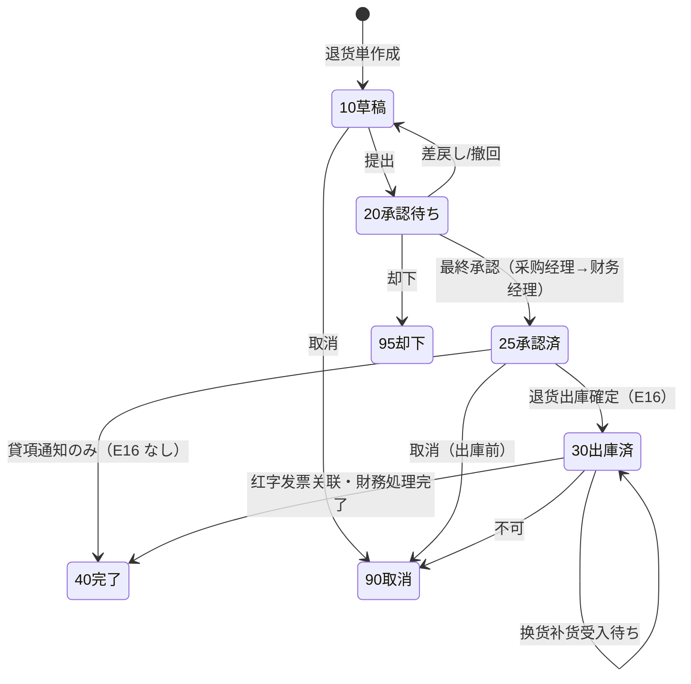
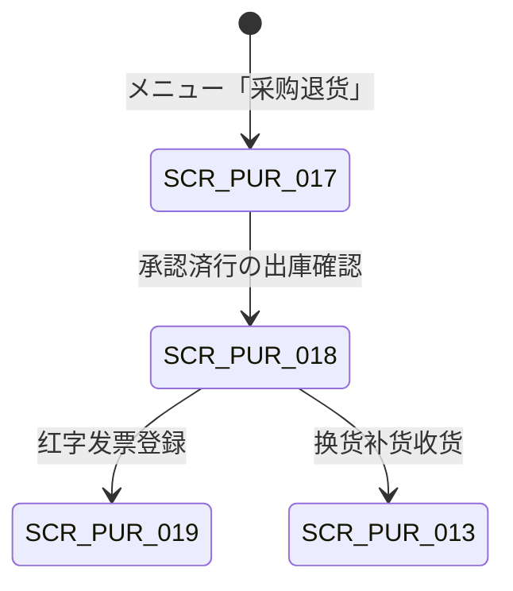

# 采购退货管理 详细设计书（仕入返品管理 詳細設計書）

| 項目 | 内容 |
|---|---|
| 文書名 | 采购退货管理 详细设计书（仕入返品管理 詳細設計書） |
| 文書番号 | DSN-PUR-005 |
| 版数 | v1.0 |
| 作成日 | 2026-10-20 |
| 作成者 | purchase-designer |
| 承認者 | 未承認（レビュー待ち） |
| 状態 | ドラフト（レビュー中） |
| 関連文書 | [業務域概要](00-overview.md) / [共通項目定義](../00-common/01-common-item-definitions.md) / [API 共通規格](../00-common/03-common-api-spec.md) / [共通業務規則](../00-common/08-common-business-rules.md) / [跨域流程](../00-common/09-cross-domain-flow.md) / [收货与来料检验](04-receipt-iqc.md) / [采购发票与应付](06-purchase-invoice-ap.md) / [库存管理](../05-inventory/02-inbound-outbound.md) / [财务管理](../07-finance/03-ap-payment.md) |

---

## 1. 機能概要

| 項目 | 内容 |
|---|---|
| 機能 ID | F-PUR-015 采购退货申请 / F-PUR-016 采购退货出库确认 |
| 機能名 | 采购退货（Purchase Return / 仕入返品） |
| 目的 | 对来料检验不合格、数量不足、错发、规格不符等原因的已收货品，执行「退货申请→审批→退货出库（E16）→红字发票/应付冲减」的完整逆处理；对已开票部分通过红字发票与进项税额转出保证应付与税一致；对换货需求联动补货收货，保持实物、在庫、暂估、应付、增值税五者一致 |
| 利用者・ロール | 采购员（退货起票）、采购经理/财务经理（承認）、仓管员（退货出库確認）、财务会计（红字发票登记・应付冲减確認） |
| 利用シーン | ① IQC 不合格（12 PCE 尺寸超差）→退货；② 到货数量少于送り状 →数量差异退货；③ 供应商错发型号 →退货+补货（换货）；④ 包装破损 →退货；⑤ 已入库后发现质量问题的社内选别后退货 |
| 優先度 | P0 |
| 画面 ID | SCR-PUR-017（一覧・登録編集）、SCR-PUR-018（出庫確認） |
| 関連 IF | IF-PUR-006（E16→INV/FIN）、IF-PUR-007（紅字发票→FIN） |

### 1.1 機能分解

| 機能 ID | 機能名 | 概要 | 優先度 |
|---|---|---|---|
| F-PUR-015 | 采购退货申请 | 退货単作成（来源：GR/IQC/PO）、数量・理由・処置、承認提出 | P0 |
| F-PUR-016 | 采购退货出库确认 | 承認済退货の出庫確認（E16）、红字发票关联、换货补货、完了 | P0 |

---

## 2. 業務要件・業務ルール

### 2.1 前提条件

| # | 前提条件 | 成立しない場合の挙動 |
|---|---|---|
| 1 | 来源收货单已确认（`receipt_status ∈ {30,35,40}`）且存在可退货数量 | 退货不可；`MSG-PUR-087` |
| 2 | 质量退貨は IQC 不合格数量（`rejected_qty`）> 0 | 起票不可 |
| 3 | 退货対象の在庫が存在する（INV 照会で数量確認） | 出庫時に在庫不足 `MSG-PUR-089` |
| 4 | 已开票の場合は紅字发票（または贷项通知）が取得可能 | 未取得でも退货出庫は可。但し完了（40）は紅字关联後 |
| 5 | 会計期間 = OPEN | 登録・出庫拒否 `MSG-COM-071` |
| 6 | WF 承認経路（PRT 全額：采购经理 → 财务经理）設定済 | 提出不可 `MSG-COM-073` |

### 2.2 業務ルール

| # | ルール | 根拠 | 関連項目 |
|---|---|---|---|
| BR-01 | 退货类型：1 质量退货（IQC 不合格）/ 2 数量差异退货 / 3 错发退货 / 4 换货 / 5 仅贷项通知（不退货）。类型决定后续流程（是否出庫・是否补货・是否红字） | 本域设计 | `return_type` |
| BR-02 | 退货数量上限：`min(received_qty − returned_qty, 可退数量)`。质量退货 ≤ `rejected_qty − 已退货`；其他类型 ≤ `accepted_qty − 已退货` | 本域设计 | `return_qty` |
| BR-03 | 退货来源必须追溯到收货明细（`receipt_line_id`），实现「GR→PRT→红字发票→应付冲减」链路；来源为 IQC 时必须指定 `inspection_id` 与不合格批次 | 09 §3 E16、本域设计 | `source_type`/`source_id` |
| BR-04 | 退货単審批按 08 §8.1：全額 采购经理 → 财务经理（顺送）。承认前可撤回/差戻し，承认后不可修改数量 | 08 §8.1 | `return_status` |
| BR-05 | 未开票の退货：出庫確定（E16）により FIN が仕入暫估を戻す（J04：借 应付账款-暂估 / 贷 原材料）。この場合、紅字发票は不要 | 09 §7.2 J04、§4.3 | `invoice_status` |
| BR-06 | 已开票の退货：供应商が红字增值税专用发票（或数电票红字）を発行し、PUR が `pur_invoice`（`invoice_type=50 红字`、`original_invoice_id`）として登録する。红字发票注册后通过三单匹配（负数匹配）冲减应付，並びに进项税额转出を FIN が処理する（J04） | 09 §7.2 J04、本域设计 | `original_invoice_id`、`credit_note_status` |
| BR-07 | 红字发票は退货単と紐付ける（`pur_return.credit_note_invoice_id`）。红字发票が未登録の間、退货単は `credit_note_status=1 待开` とし、完了（40）不可 | 本域设计 | `credit_note_status` |
| BR-08 | 换货（`return_type=4`）：退货出庫（E16）と補貨受入（新規 GR、`source_type=RETURN_REPLACE`）をセットで処理する。補貨数量 = `replacement_qty`。補貨は原則として元 PO 単価を適用し、数量差のみ三単匹配で調整する | 本域设计 | `replacement_qty` |
| BR-09 | 仅贷项通知（`return_type=5`）：現品は返送せず、価格調整・品質補償等を红字发票/贷项通知のみで処理する。在庫変動なし（E16 発行しない） | 本域设计 | `handling_type=4` |
| BR-10 | 退貨出庫は INV が実行する（`PR_OUT` 取引）。PUR は出庫確定（E16 発行）のみ行い、在庫残高は更新しない | 09（Lead 裁定 2026-10-20） | E16 |
| BR-11 | 退貨出庫後は取消不可。返送済み品の再受入は新規 GR で処理する（補貨・返修戻入） | 08 §3.3-4 | `return_status` |
| BR-12 | 退貨にかかる運賃・手数料は原則供应商負担。社内負担の場合は `freight_burden` に記録し、FIN に連携する（P1） | 本域设计 | `freight_burden` |
| BR-13 | 退貨理由コードは 1 質量不合格 / 2 数量不足 / 3 错发 / 4 规格不符 / 5 包装破损 / 6 价格差异 / 9 其他。理由コードと処置（返送/廃棄/選別/貸項）の妥当性をチェックする | 本域设计 | `reason_code` |
| BR-14 | 退貨単は監査ログと在庫取引（E18 `PR_OUT`）・仕訳（J04）と関連付けて保存する。保存期間は会計関連 10 年（08 §12） | 08 §12 | — |
| BR-15 | 退货による应付冲减額は「退货数量 × PO 税抜単価」とし、税額は红字发票の税額を正とする（税額差異が生じた場合は FIN で調整） | 08 §4、本域设计 | `tax_amount` |

### 2.3 計算式・判定式

| # | 対象 | 算式 | 丸め | 例（示例值） |
|---|---|---|---|---|
| CALC-01 | 可退数量 | `入荷数量 − 既存退貨数量`（質量退貨は `不合格数量 − 既存退貨`） | 数量 4 桁 | 600 − 0 = 600.0000 |
| CALC-02 | 退货金額（税抜） | 退货数量 × PO 税抜単価 | 四捨五入 2 桁 | 12 × 156.000000 = 1,872.00 |
| CALC-03 | 退货税額 | 退货金額 × 税率（红字发票税額を優先） | 四捨五入 2 桁 | 1,872.00 × 13% = 243.36 |
| CALC-04 | 退货税込金額 | 税抜 + 税額 | 2 桁 | 2,115.36 |
| CALC-05 | 换货补货数量 | `replacement_qty`（= 退货数量、部分换货可） | 数量 4 桁 | 12.0000 |
| CALC-06 | 红字发票匹配金額 | 红字发票税抜金額 = −(退货金額) ± 容差 | 2 桁 | −1,872.00 |
| CALC-07 | 应付冲减后余额 | 原应付余额 − 退货税込金額 − 红字发票調整 | 2 桁 | FIN 側で計算（PUR は通知のみ） |

### 2.4 状態遷移



| 遷移 | トリガ | 権限 | 更新項目 | メッセージ |
|---|---|---|---|---|
| [*]→10 | 退货単作成 | `purchase:return:create` | `return_status=10`、採番 `PRT` | `MSG-PUR-090` |
| 10→20 | 提出 | `purchase:return:create` | `return_status=20`、`process_instance_id` | `MSG-PUR-091` |
| 20→25 | E31/E32 最終承認 | システム（WF） | `return_status=25`、`approved_at/by` | — |
| 20→10/95 | 差戻し・却下 | 承認者 | 状態・`reject_reason` | `MSG-PUR-092` |
| 25→30 | 出庫確定（E16） | `purchase:return:ship` | `return_status=30`、`shipped_at`、E16 発行 | `MSG-PUR-088` |
| 25→40 | 貸項通知（返送なし） | `purchase:return:ship` | `return_status=40`、`completed_at` | `MSG-PUR-093` |
| 30→40 | 红字发票关联・FIN 完了 | `purchase:return:ship` | `return_status=40`、`credit_note_invoice_id`、`completed_at` | `MSG-PUR-094` |
| 10/25→90 | 取消 | `purchase:return:create` | `return_status=90`、`cancel_reason` | `MSG-PUR-095` |

---

## 3. 関連機能

| 関係 | 機能 ID | 機能名 | 関係内容 |
|---|---|---|---|
| 上流 | F-PUR-011～013 | 收货・IQC | 不合格数量・可退数量の参照、退货起票 |
| 上流 | F-PUR-007 | 采购订单 | PO 単価・税码（退货金額の基準） |
| 下流 | F-INV-002/004 | 库存出库・状态 | E16 で `PR_OUT` 出庫、不合格状態からの除却 |
| 下流 | F-FIN-003 | 应付管理 | E16 で買挂/暂估冲减（J04）、红字发票による进项税额转出 |
| 下流 | F-PUR-017 | 采购发票登记 | 红字发票登録（`invoice_type=50`） |
| 関連 | F-PUR-011 | 收货 | 换货补货 GR（`source_type=RETURN_REPLACE`） |
| 関連 | F-PUR-026 | 供应商绩效 | 退货率（品質指標） |

---

## 4. 画面設計

### 4.1 画面一覧

| 画面 ID | 画面名 | 類型 | 概要 |
|---|---|---|---|
| SCR-PUR-017 | 采购退货単一覧・登録編集 | LIST + EDIT | 一覧検索と登録編集（2 モード） |
| SCR-PUR-018 | 采购退货出庫確認 | EDIT | 承認済退货の出庫確定・红字发票关联・完了 |

### 4.2 画面遷移



### 4.3 画面レイアウト（SCR-PUR-017 編集モード）

```
┌──────────────────────────────────────────────────────────────────────────────┐
│ パンくず：ホーム > 采购管理 > 采购退货単                        [状態バッジ]  │
├──────────────────────────────────────────────────────────────────────────────┤
│〔ヘッダ〕退货单号[PRT2611050001] 退货类型[质量退货▼] 来源[收货 GR2611050002]  │
│ 供应商[S000009 日月重工股份有限公司] 退货日[2026-11-05] 仓库[WH01 原料仓▼]             │
│ 处理方式[退款▼] 原发票[PIV2611010003] 红字状态[待开] 运费负担[供应商▼]       │
├──────────────────────────────────────────────────────────────────────────────┤
│〔ツールバー〕[保存][提交][撤回][取消][打印]                                   │
├──────────────────────────────────────────────────────────────────────────────┤
│〔明細〕行|物料|批次号|入荷数量|不合格数量|退货数量|单价|金额|税额|             │
│        退货理由|处置|换货数量|已开票                                           │
│ 10|1003000001 HT200 机座毛坯|S000009-20261101-01|600|12|12|156.000000|            │
│    |1,872.00|243.36|1 质量不合格|退回供应商|0|是                              │
├──────────────────────────────────────────────────────────────────────────────┤
│〔フッタ〕退货数量 12  税抜 1,872.00  税額 243.36  税込 2,115.36               │
└──────────────────────────────────────────────────────────────────────────────┘
```

### 4.4 画面項目定義

#### 4.4.1 SCR-PUR-017 ヘッダ項目

| No | 項目 ID | 項目名 | 種別 | 型/桁 | 必須 | 初期値 | 入力チェック | データソース | DB 項目 | 備考 |
|---|---|---|---|---|---|---|---|---|---|---|
| 1 | `returnNo` | 退货单号 | テキスト | VARCHAR(32) | ○ | 自動採番 | `PRT{YYMMDD}{4桁}` | 採番 | `return_no` | 参照のみ |
| 2 | `returnType` | 退货类型 | 選択 | SMALLINT | ○ | 1 质量退货 | 1 質量/2 数量差異/3 錯発/4 換貨/5 貸項 | 固定値 | `return_type` | 類型で後続制御 |
| 3 | `sourceType` | 来源类型 | テキスト | VARCHAR(32) | ○ | RECEIPT | RECEIPT/INSPECTION/PURCHASE_ORDER/MANUAL | — | `source_type` | — |
| 4 | `sourceId`/`sourceNo` | 来源单据 | テキスト | BIGINT/VARCHAR(32) | ○ | 空 | 来源が存在 | `pur_receipt`/`prd_inspection` | `source_id` | リンク遷移 |
| 5 | `supplierId` | 供应商 | テキスト | BIGINT | 自動 | 来源从属 | — | `mdm_supplier` | `supplier_id` | スナップショット |
| 6 | `returnDate` | 退货日 | 日付 | DATE | ○ | 当日 | ≥ 入荷日、≤ 当日 | — | `return_date` | — |
| 7 | `warehouseId` | 出库仓库 | 選択 | BIGINT | ○ | 入荷倉庫 | コード存在・在庫あり | `mdm_warehouse` | `warehouse_id` | — |
| 8 | `handlingType` | 处理方式 | 選択 | SMALLINT | ○ | 1 退款 | 1 退款/2 换货/3 返修/4 贷项通知 | 固定値 | `handling_type` | 4 は出庫なし |
| 9 | `originalInvoiceId` | 原发票 | 選択 | BIGINT | △ | 空 | 已开票時必須 | `pur_invoice` | `original_invoice_id` | 红字发票の元 |
| 10 | `creditNoteStatus` | 红字发票状态 | バッジ | SMALLINT | 自動 | 0 | — | — | `credit_note_status` | 0 不要/1 待开/2 已开/3 已冲 |
| 11 | `creditNoteInvoiceId` | 红字发票 | テキスト | BIGINT | △ | 空 | 红字发票登録後セット | `pur_invoice` | `credit_note_invoice_id` | — |
| 12 | `freightBurden` | 运费负担 | 選択 | SMALLINT | △ | 1 供应商 | 1 供应商/2 本公司 | 固定値 | `freight_burden` | — |
| 13 | `returnStatus` | 状态 | バッジ | SMALLINT | 自動 | 10 | — | — | `return_status` | 10/20/25/30/40/90/95 |
| 14 | `totalAmount`/`taxAmount`/`totalAmountWithTax` | 税抜・税額・税込合計 | 数値 | NUMERIC(18,2) | 自動 | 0.00 | — | Σ 明細 | 同名項目 | — |
| 15 | `reason` | 退货原因 | テキストエリア | VARCHAR(500) | ○ | 空 | 桁数 ≤500 | — | `reason` | 必須 |
| 16 | `attachments` | 附件 | 添付 | — | △ | 空 | 01 §9 | `sys_attachment` | — | 不合格報告・写真 |
| 17 | `version` | 版数 | 数値 | INT | 自動 | 0 | — | — | `version` | 楽観排他 |

#### 4.4.2 SCR-PUR-017 明細項目

| No | 項目 ID | 項目名 | 種別 | 型/桁 | 必須 | 初期値 | 入力チェック | データソース | DB 項目 | 備考 |
|---|---|---|---|---|---|---|---|---|---|---|
| 1 | `lineNo` | 行番号 | 数値 | INT | 自動 | 10 刻み | — | — | `line_no` | — |
| 2 | `receiptLineId` | 来源收货明细 | テキスト | BIGINT | ○ | 空 | 来源明细存在 | `pur_receipt_line` | `receipt_line_id` | 自動展開 |
| 3 | `materialCode`/`materialName`/`spec` | 物料 | テキスト | VARCHAR | 自動 | 空 | — | 收货明细 | 同名項目 | スナップショット |
| 4 | `batchNo` | 批次号 | テキスト | VARCHAR(64) | △ | 来源値 | 批次管理物料で必須 | `pur_receipt_line` | `batch_no` | — |
| 5 | `receivedQty` | 入荷数量 | 数値 | NUMERIC(18,4) | 自動 | 来源値 | — | 收货明细 | 導出 | 参照のみ |
| 6 | `rejectedQty` | 不合格数量 | 数値 | NUMERIC(18,4) | 自動 | 来源値 | — | 收货明细 | 導出 | 参照のみ |
| 7 | `returnQty` | 退货数量 | 数値 | NUMERIC(18,4) | ○ | 0 | > 0、≤ 可退数量（CALC-01） | — | `return_qty` | — |
| 8 | `uomCode` | 单位 | テキスト | VARCHAR(8) | 自動 | 来源値 | — | 收货明细 | `uom_code` | — |
| 9 | `unitPrice` | PO 税抜単価 | 数値 | NUMERIC(18,6) | 自動 | 来源値 | — | PO 明細 | `unit_price` | — |
| 10 | `amount` | 退货金額 | 数値 | NUMERIC(18,2) | 自動 | 0.00 | — | 計算 | `amount` | — |
| 11 | `taxCode`/`taxRate`/`taxAmount` | 税码・税率・税額 | テキスト/数値 | — | 自動 | 来源値 | — | PO 明細 | 同名項目 | — |
| 12 | `reasonCode` | 退货理由 | 選択 | SMALLINT | ○ | 空 | 1～6/9 | 固定値 | `reason_code` | BR-13 |
| 13 | `disposition` | 处置方式 | 選択 | SMALLINT | ○ | 1 退回供应商 | 1 退回/2 报废/3 换货待补/4 挑选返工 | 固定値 | `disposition` | — |
| 14 | `replacementQty` | 换货数量 | 数値 | NUMERIC(18,4) | △ | 0 | ≤ 退货数量 | — | `replacement_qty` | 换货時 |
| 15 | `invoiceStatus` | 发票状态 | ラジオ | SMALLINT | ○ | 0 未开票 | 0 未开票/1 已开票 | `pur_invoice` | `invoice_status` | 已开票→红字 |
| 16 | `originalInvoiceLineId` | 原发票明细 | テキスト | BIGINT | △ | 空 | 已开票時必須 | `pur_invoice_line` | `original_invoice_line_id` | — |
| 17 | `replacementReceiptId` | 补货收货单 | テキスト | BIGINT | 自動 | 空 | — | `pur_receipt` | `replacement_receipt_id` | 补货後セット |
| 18 | `remark` | 行备注 | テキスト | VARCHAR(500) | △ | 空 | 桁数 | — | `line_remark` | — |

### 4.5 イベント処理

| No | イベント | トリガ | 処理内容 | 呼出 API | 画面遷移 | 備考 |
|---|---|---|---|---|---|---|
| 1 | 検索 | 検索ボタン | 一覧取得 | `GET /api/purchase/returns` | 同一画面 | — |
| 2 | 新規 | 新規ボタン | 空の登録画面 | — | SCR-PUR-017（編集） | — |
| 3 | 来源選択 | 收货单選択 | 可退明細を展開（不合格/合格数量・批次） | `GET /api/purchase/receipts/{id}` | — | 行追加 |
| 4 | 数量入力 | 退货数量変更 | 可退数量・金額・税額を再計算 | — | — | — |
| 5 | 已开票切替 | 发票状态変更 | 原发票選択を必須化・红字要否判定 | `GET /api/purchase/invoices?receiptLineId=` | — | — |
| 6 | 保存 | 保存ボタン | 入力チェック→採番→保存 | `POST`/`PUT /api/purchase/returns` | 同画面 | — |
| 7 | 提交 | 提交ボタン | WF 提出（全額経路） | `POST .../{id}/submit` | 同画面 | — |
| 8 | 撤回 | 撤回ボタン | 20→10 | `POST .../{id}/withdraw` | 同画面 | — |
| 9 | 出庫確定 | 出庫ボタン | 在庫確認→状態 30→E16 発行 | `POST .../{id}/ship` | SCR-PUR-018 | 出庫は INV 実行 |
| 10 | 红字发票关联 | 红字登録ボタン | 红字发票登録画面へ（PIV 负数） | — | SCR-PUR-019 | 已开票時 |
| 11 | 完了 | 完了ボタン | 红字关联・FIN 完了確認→40 | `POST .../{id}/complete` | 一覧 | 条件付き |
| 12 | 取消 | 取消ボタン | 10/25 のみ取消 | `POST .../{id}/cancel` | 一覧 | 30 以降不可 |
| 13 | 打印 | 打印ボタン | PRT-PUR-005 出力 | `POST .../{id}/print` | — | — |

### 4.6 一覧画面仕様（SCR-PUR-017 一覧モード）

| 項目 | 内容 |
|---|---|
| 検索条件 | 退货单号、退货类型、状态（複数）、供应商、退货日期範囲、来源 GR 号、红字状态 |
| 既定検索条件 | 全社 + 状態 10/20/25/30 + 当月 |
| ソート | 既定：登録日時降順 |
| ページング | 20/50/100/200 |
| 一括操作 | 导出 |
| 表示列 | 退货单号、类型、状态、供应商、退货日、退货数量、税込金額、红字状态、来源 GR |

### 4.7 表示制御

| 条件 | 対象 | 制御 |
|---|---|---|
| `return_status ≠ 10` | 編集項目 | 参照のみ |
| `return_type = 5`（貸項） | 出庫数量・仓库 | 非表示（出庫なし） |
| `invoice_status = 0` | 原发票・红字状態 | 非表示/不要 |
| `return_status = 30` かつ `credit_note_status = 1` | 完了ボタン | 非活性（红字待ち） |
| 権限なし | 金額項目 | 非表示（API も返さない） |
| 库存不足（出庫時） | 出庫ボタン | エラー表示 `MSG-PUR-089` |

---

## 5. 入力チェック仕様

| No | チェック ID | 対象項目 | 種別 | 条件 | タイミング | メッセージ ID |
|---|---|---|---|---|---|---|
| 1 | CHK-PUR-005-01 | 退货数量 | 必須・範囲 | > 0、≤ 可退数量 | 保存時 | `MSG-PUR-087` |
| 2 | CHK-PUR-005-02 | 来源收货明细 | 必須 | 存在・入荷済 | 保存時 | `MSG-PUR-087` |
| 3 | CHK-PUR-005-03 | 批次号 | 必須 | 批次管理物料 | 保存時 | `MSG-PUR-073` |
| 4 | CHK-PUR-005-04 | 退货理由 | 必須 | コード選択 | 保存時 | `MSG-COM-040` |
| 5 | CHK-PUR-005-05 | 原发票 | 相関 | 已开票時必須 | 保存時 | `MSG-PUR-096` |
| 6 | CHK-PUR-005-06 | 换货数量 | 相関 | ≤ 退货数量 | 保存時 | `MSG-COM-045` |
| 7 | CHK-PUR-005-07 | 期间状态 | 業務 | 会計期間 ≠ CLOSED | 保存・出庫 | `MSG-COM-071` |
| 8 | CHK-PUR-005-08 | 库存 | 業務 | 出庫時在庫 ≥ 退货数量 | 出庫確定 | `MSG-PUR-089` |
| 9 | CHK-PUR-005-09 | 红字关联 | 業務 | 已开票かつ未红字の場合、完了不可 | 完了時 | `MSG-PUR-097` |
| 10 | CHK-PUR-005-10 | 状态整合 | 業務 | 操作が現在状態で許可 | 各操作 | `MSG-COM-034` |
| 11 | CHK-PUR-005-11 | 楽観排他 | 排他 | `version` 一致 | 保存・状態操作 | `MSG-COM-033` |

---

## 6. 処理詳細

### 6.1 処理一覧

| 処理 ID | 処理名 | 契機 | トランザクション | 排他 |
|---|---|---|---|---|
| PRC-PUR-015-01 | 退货単作成/更新 | 保存 | 要 | 楽観排他 |
| PRC-PUR-015-02 | 提出・撤回 | 提出/撤回 | 要 | 楽観排他 |
| PRC-PUR-015-03 | 承認結果反映 | E31/E32 | 要 | 冪等 |
| PRC-PUR-016-01 | 退货出庫確定 | 出庫 | 要（E16 Outbox） | 在庫確認 + 楽観排他 |
| PRC-PUR-016-02 | 红字发票关联 | 红字登録後 | 要 | 楽観排他 |
| PRC-PUR-016-03 | 换货补货收货 | 补货到着 | 要 | GR 登録に準ずる |

### 6.2 処理手順（正常系）

**PRC-PUR-015-01 退货単作成**

1. 入力チェック・権限・データ範囲を検証する。
2. 来源收货単（GR）と明細を取得し、可退数量（CALC-01）を再計算する。
3. 已在庫（INV 照会）と突合し、出庫可能数量を確認する（不足時は保存可・出庫時エラー）。
4. 退货金額・税額・税込を計算する（CALC-02～04）。
5. `sys_sequence` から `PRT{YYMMDD}{4桁}` を採番する。
6. `pur_return`（`return_status=10`）と `pur_return_line` を INSERT し、`invoice_status` に応じ `credit_note_status=1`（已开票）または 0 を設定する。
7. 監査ログ（CREATE）を記録し、詳細を返す。

**PRC-PUR-015-02 提出・撤回**

1. 状態 10（提出）／20（撤回）を確認する。
2. 税込金額で承認経路（PRT 全額：采购经理→财务经理）を取得し、WF へ `businessType=PURCHASE_RETURN` で提出する。
3. `return_status=20`、`process_instance_id` を保存。撤回時は 10 に戻す。
4. 監査ログ（SUBMIT/WITHDRAW）・通知を記録する。

**PRC-PUR-015-03 承認結果反映（E31/E32）**

1. `eventId` 冪等排除・対象退货単ロック。
2. 最終承認：`return_status=25`、`approved_at/by` を更新。
3. 却下：`return_status=95`、`reject_reason`。差戻し：10。
4. 通知・監査ログを記録する。

**PRC-PUR-016-01 退货出庫確定**

1. `return_status=25`、`handling_type != 4`（貸項以外）を確認する。
2. INV の在庫照会（同期参照）で、各明細の在庫数量 ≥ 退货数量を検証する（不足時 `MSG-PUR-089`）。
3. 在庫状態を確認する：質量退貨は「不合格」状態、その他は「可用」状態から出庫する（状態変換は INV が実行）。
4. Outbox に E16 `purchase.return.confirmed` を同一トランザクションで登録する（payload は [91](91-api-design.md) §7）。
5. `return_status=30`、`shipped_at`、`shipped_by` を更新し、收货明細の `returned_qty` を加算、`pur_receipt_line.rejected_qty`/`accepted_qty` の整合を再計算する。
6. 監査ログ（POST/CANCEL）と通知（倉庫・財務・購買）を記録する。
7. 応答：出庫済退货単。INV 側で `PR_OUT` 在庫取引が確定すると E18 で `inv_stock_txn` と紐付く。

**PRC-PUR-016-02 红字发票关联・完了**

1. `return_status=30`、`invoice_status=1`（已开票）の場合、红字发票（`pur_invoice.invoice_type=50`、`original_invoice_id` 一致）の登録済みを確認する。
2. 红字发票の三単マッチ（[06](06-purchase-invoice-ap.md)）が確定（`matched_status=40`）していることを確認する。
3. `credit_note_status=2`、`credit_note_invoice_id` を保存し、`return_status=40`、`completed_at` を更新する。
4. FIN へ E17（红字发票匹配確定）が発行済みであることを確認し、若未発行なら再処理を依頼する。
5. 監査ログ（UPDATE）・通知を記録する。

**換货（`handling_type=2`）**

1. 退货出庫確定（E16）後、`replacement_qty > 0` の明細について補貨待ち状態とする。
2. 供应商补货到着時、元 PO を参照した新規 GR（`source_type=RETURN_REPLACE`、`source_id=return_id`）を作成し、入荷確定・IQC を通常フローで実行する。
3. 補貨 GR 確定後、`pur_return_line.replacement_receipt_id` を設定し、退货単を 40 完了とする（红字发票は価格差がある場合のみ）。
4. 換货不产生应付增减（数量等価交換）。運賃差・品質補償がある場合は紅字/貸項で調整する。

**僅貸項通知（`handling_type=4`・`return_type=5`）**

1. 出庫は行わない（E16 発行しない）。
2. 供应商から貸項通知（红字发票）を受領し、`pur_invoice`（红字）を登録する。
3. 红字发票の匹配確定後、退货単を 40 完了とする。在庫・原価への影響なし（値引処理は FIN で処理）。

### 6.3 例外処理

| No | 異常条件 | 検知箇所 | 処理 | ロールバック | メッセージ ID |
|---|---|---|---|---|---|
| 1 | 可退数量超過 | 保存 | 拒否 | 全体 | `MSG-PUR-087` |
| 2 | 在庫不足（出庫） | 出庫確定 | 拒否・在庫照会へ誘導 | 全体 | `MSG-PUR-089` |
| 3 | 承認経路未設定 | 提出 | 拒否 | 全体 | `MSG-COM-073` |
| 4 | 已开票で红字未登録のまま完了 | 完了 | 拒否 | 全体 | `MSG-PUR-097` |
| 5 | 出庫後の取消 | 取消 | 拒否（返送済） | — | `MSG-PUR-098` |
| 6 | E16 送信失敗 | Outbox | リトライ→デッドレター→アラート | 部分 | `MSG-COM-080` |
| 7 | 补货数量不一致 | 换货 GR | 警告・不一致理由記録 | — | `MSG-PUR-099`（W） |

### 6.4 冪等性・再実行

- 出庫確定は `Idempotency-Key` + `return_status=25` の状態検証で二重出庫を防止する。
- E16 は `eventId` で冪等、`(source_type, source_id)` の一意性でも二重計上を防止する。
- 红字发票の二重登録は `(supplier_id, invoice_code, invoice_number)` の一意制約で防止する（[06](06-purchase-invoice-ap.md) BR-04）。
- 換货補貨 GR は元退货単との対応（`return_id`）で二重受入を防止する。

---

## 7. API 設計

| No | メソッド | パス | 権限 | 概要 | リクエスト | レスポンス | 主なエラー |
|---|---|---|---|---|---|---|---|
| 1 | GET | `/api/purchase/returns` | `purchase:return:view` | 一覧 | 検索条件 | `PageResult<ReturnListDto>` | 3001 |
| 2 | GET | `/api/purchase/returns/{id}` | `purchase:return:view` | 詳細 | — | `ReturnDetailDto` | 4001 |
| 3 | POST | `/api/purchase/returns/from-receipt` | `purchase:return:create` | 收货単から退货単起票 | `{receiptId, lines[], returnType, handlingType, reason}` | `ReturnDetailDto`（201） | 40060/40070 |
| 4 | POST | `/api/purchase/returns` | `purchase:return:create` | 手工起票（貸項等） | `ReturnCreateDto` | 詳細（201） | 1001/40060 |
| 5 | PUT | `/api/purchase/returns/{id}` | `purchase:return:create` | 更新（10 のみ） | `ReturnUpdateDto` + `version` | 詳細 | 4002/4003 |
| 6 | POST | `/api/purchase/returns/{id}/submit` | `purchase:return:create` | 提出 | `{version}` | 詳細 | 4002/80001 |
| 7 | POST | `/api/purchase/returns/{id}/withdraw` | `purchase:return:create` | 撤回 | `{version}` | 詳細 | 4002 |
| 8 | POST | `/api/purchase/returns/{id}/ship` | `purchase:return:ship` | 出庫確定（E16） | `{version}` | 詳細 | 4002/40070 |
| 9 | POST | `/api/purchase/returns/{id}/complete` | `purchase:return:ship` | 完了（红字关联） | `{version, creditNoteInvoiceId?}` | 詳細 | 40078 |
| 10 | POST | `/api/purchase/returns/{id}/cancel` | `purchase:return:create` | 取消（10/25） | `{version, reason}` | 詳細 | 4002/40079 |
| 11 | GET | `/api/purchase/returns/{id}/progress` | `purchase:return:view` | 出庫・红字進捗 | — | `ReturnProgressDto` | 4001 |
| 12 | POST | `/api/purchase/returns/{id}/print` | `purchase:return:print` | 退货単出力（PRT-PUR-005） | — | PDF | 4001 |

### 7.1 出庫確定レスポンス例（抜粋）

```json
{
  "code": 0,
  "message": "ok",
  "data": {
    "id": "1845678901234568200",
    "returnNo": "PRT2611050001",
    "returnStatus": 30,
    "statusName": "出庫済",
    "returnType": 1,
    "handlingType": 1,
    "shippedAt": "2026-11-05T15:10:00+08:00",
    "totalAmount": "1872.00",
    "taxAmount": "243.36",
    "totalAmountWithTax": "2115.36",
    "creditNoteStatus": 1,
    "lines": [
      {
        "lineNo": 10,
        "materialCode": "1003000001",
        "materialName": "灰铸铁机座毛坯",
        "spec": "HT200 YE3-100 机座",
        "batchNo": "S000009-20261101-01",
        "returnQty": "12.0000",
        "uomCode": "PCE",
        "unitPrice": "156.000000",
        "amount": "1872.00",
        "reasonCode": 1,
        "disposition": 1,
        "invoiceStatus": 1
      }
    ]
  }
}
```

### 7.2 E16 発行 payload 例

```json
{
  "eventId": "5c2a1f0e-7b3d-4e8a-9f21-0a1b2c3d4e5f",
  "eventType": "purchase.return.confirmed",
  "eventVersion": 1,
  "occurredAt": "2026-11-05T15:10:00+08:00",
  "source": "erp-purchase",
  "tenantId": 0,
  "companyId": 1,
  "aggregateType": "pur_return",
  "aggregateId": "1845678901234568200",
  "aggregateNo": "PRT2611050001",
  "aggregateVersion": 4,
  "idempotencyKey": "purchase.return.confirmed:1845678901234568200:4",
  "payload": {
    "returnId": "1845678901234568200",
    "returnNo": "PRT2611050001",
    "receiptId": "1845678901234568100",
    "amount": "1872.00",
    "taxAmount": "243.36",
    "lines": [
      {
        "materialId": "1845000000000001101",
        "materialCode": "1003000001",
        "qty": "12.0000",
        "uomCode": "PCE",
        "batchNo": "S000009-20261101-01",
        "warehouseId": "1845000000000000101",
        "unitPrice": "156.000000",
        "taxRate": "13.0000",
        "amount": "1872.00",
        "taxAmount": "243.36"
      }
    ],
    "returnDate": "2026-11-05",
    "handlingType": 1,
    "reason": "IQC 不合格（尺寸超差），供应商同意退货"
  }
}
```

### 7.3 エラー例

```json
{
  "code": 40060,
  "message": "退货数量超过可退货数量（最多 12.0000 PCE）。",
  "data": {
    "fieldErrors": [
      { "field": "lines[0].returnQty", "message": "超过可退货数量" }
    ]
  }
}
```

---

## 8. データ更新仕様

| テーブル | 操作 | 更新項目 | 更新条件 | トリガ |
|---|---|---|---|---|
| `pur_return` | INSERT | 全項目（`return_status=10`） | 作成 | PRC-PUR-015-01 |
| `pur_return` | UPDATE | `return_status`、`approved_at/by`、`shipped_at`、`credit_note_status`、`credit_note_invoice_id`、`completed_at`、`cancel_reason` | 提出・承認・出庫・完了・取消 | 各 PRC |
| `pur_return_line` | INSERT/UPDATE | 明細項目、`replacement_receipt_id` | 作成・补货 | PRC-PUR-015/016 |
| `pur_receipt_line` | UPDATE | `returned_qty`、数量整合（`rejected_qty`/`accepted_qty` の見直し） | 出庫確定 | PRC-PUR-016-01 |
| `pur_purchase_order_line` | UPDATE | `returned_qty` | 出庫確定 | PRC-PUR-016-01 |
| `pur_invoice` | INSERT/UPDATE | 红字发票登録（`invoice_type=50`、`original_invoice_id`） | 红字登録 | F-PUR-017 経由 |
| `sys_outbox_event` | INSERT | E16 | 出庫確定 | PRC-PUR-016-01 |
| `sys_audit_log` | INSERT | 操作ログ | 全操作 | 各 PRC |

スナップショット：`supplier_code`/`supplier_name`、`material_code`/`material_name`/`spec`、`batch_no`、`unit_price`、`tax_code`/`tax_rate`。

---

## 9. エラー処理・メッセージ

| メッセージ ID | 種別 | 本文 | 発生条件 | 利用者への対処 | ログ |
|---|---|---|---|---|---|
| MSG-PUR-087 | E | 退货数量超过可退货数量（最多 {0}）。 | 可退数量超過 | 数量修正 | WARN |
| MSG-PUR-088 | I | 退货出库已确认（E16），已通知库存与财务。 | 出庫確定 | — | INFO |
| MSG-PUR-089 | E | 库存不足，当前可用数量：{0}，不能出库。 | 在庫不足 | 在庫確認・数量修正 | WARN |
| MSG-PUR-090 | I | 退货単已作成（{0}），请提交审批。 | 作成成功 | 提出へ | INFO |
| MSG-PUR-091 | I | 退货単已提交审批（采购经理→财务经理）。 | 提出成功 | — | INFO |
| MSG-PUR-092 | E | 退货単已被差戻し/却下，请修正后重新提交。 | 差戻/却下 | 修正→再提出 | WARN |
| MSG-PUR-093 | I | 貸項通知処理が完了しました（出庫なし）。 | 貸項完了 | — | INFO |
| MSG-PUR-094 | I | 退货単 {0} 已完成（红字发票 {1} 已关联）。 | 完了成功 | — | INFO |
| MSG-PUR-095 | I | 退货単已取消。 | 取消成功 | — | INFO |
| MSG-PUR-096 | E | 已开票的退货必须选择原发票。 | 原发票未選択 | 原发票選択 | WARN |
| MSG-PUR-097 | E | 已开票的退货必须登记红字发票后才能完成。 | 红字未登録 | 红字发票登録 | WARN |
| MSG-PUR-098 | E | 退货已出库，不能取消；如需返送请使用新收货单。 | 出庫後取消 | 新規 GR | WARN |
| MSG-PUR-099 | W | 换货补货数量（{0}）与退货数量（{1}）不一致，请确认。 | 補貨数量不一致 | 数量確認 | INFO |

---

## 10. 権限・セキュリティ

| 種別 | 内容 |
|---|---|
| 画面権限 | SCR-PUR-017/018：`purchase:return:view`；編集 `create`；出庫 `ship`；承認 `approve`（WF） |
| 操作権限 | create / submit / withdraw / ship / complete / cancel / print / export |
| 項目権限 | 金額・単価は購買・財務・倉庫（金額非表示設定可） |
| データ範囲 | 購買は全社、倉庫は担当倉庫、財務は全社 |
| 監査ログ | CREATE/UPDATE/SUBMIT/APPROVE/SHIP/COMPLETE/CANCEL/PRINT を記録。数量・金額・状態の before/after 必須 |
| 機密 | 返品理由に品質情報を含むため、参照は購買・品質・財務に限定（倉庫は数量のみ） |

---

## 11. 性能・非機能

| 項目 | 目標値 | 前提 |
|---|---|---|
| 一覧検索 | 2 秒以内 | 年 900 件 |
| 詳細取得 | 1 秒以内 | 明細 200 行以下 |
| 出庫確定 | 3 秒以内 | 在庫照会・Outbox 含む |
| 同時実行 | 10 ユーザ | — |
| 最大件数 | 年 900 件 / 明細 2,000 行 | 5 年 13,000 行 |

---

## 12. テスト観点

| No | 観点 ID | 分類 | 観点 | 期待結果 |
|---|---|---|---|---|
| 1 | TST-F-PUR-015-01 | 正常系 | IQC 不合格 12 PCE から退货単作成 | 可退数量 12、金額 1,872.00、採番 `PRT` |
| 2 | TST-F-PUR-015-02 | 異常系 | 可退数量 +1 で作成 | `MSG-PUR-087` |
| 3 | TST-F-PUR-015-03 | 正常系 | 提出→承認（采购经理→财务经理） | 状態 20→25、承認者記録 |
| 4 | TST-F-PUR-015-04 | 異常系 | 已开票で原发票未選択 | `MSG-PUR-096` |
| 5 | TST-F-PUR-016-01 | 正常系 | 出庫確定 | 状態 30、E16 発行、`returned_qty` 加算 |
| 6 | TST-F-PUR-016-02 | 異常系 | 在庫不足で出庫 | `MSG-PUR-089`、状態変化なし |
| 7 | TST-F-PUR-016-03 | 異常系 | 出庫後の取消 | `MSG-PUR-098` |
| 8 | TST-F-PUR-016-04 | 業務 | 已开票→红字登録→完了 | `credit_note_status=2`、状態 40 |
| 9 | TST-F-PUR-016-05 | 異常系 | 红字未登録で完了 | `MSG-PUR-097` |
| 10 | TST-F-PUR-016-06 | 業務 | 换货：出庫→补货 GR→完了 | `replacement_receipt_id` 設定、状態 40 |
| 11 | TST-F-PUR-016-07 | 業務 | 僅貸項（返送なし） | E16 発行されない、在庫変動なし、状態 40 |
| 12 | TST-F-PUR-016-08 | 冪等 | E16 二重送信 | FIN で二重冲减されない |
| 13 | TST-F-PUR-016-09 | 権限 | `purchase:return:ship` なしで出庫 | ボタン非表示・API 403 |

---

## 13. 未決事項

| # | 事項 | 理由 | 暫定仕様 | 担当 | 期限 |
|---|---|---|---|---|---|
| 1 | 红字发票信息表（红字确认单）との連携 | 中国增值税红字发票需税局红字确认信息表/数电票红字确认，接口属 INT Phase 2 | Phase 1 は供应商から受領した红字发票を手動登録（`invoice_type=50`）。紅字確認单番号は `remark` に保持 | integration 担当 / finance-designer | Phase 2 |
| 2 | 返修（handling_type=3）の戻入フロー | 返修品の再受入は「新規 GR」か「返修専用入荷」か業務未確定 | Phase 1 は新規 GR（`source_type=RETURN_REPAIR`）で受入 | 品質部 / purchase-designer | Phase 1.5 |
| 3 | 退货運賃・手数料の会計処理 | 社内負担時の科目（販売費/製造費用）が FIN 未確定 | Phase 1 は `freight_burden` を記録し、FIN が手動仕訳 | finance-designer | Phase 1.5 |
| 4 | 退货率の供应商绩效指標化 | 現行の绩效指標に返品率が未定義 | Phase 1 は参考値として `pur_return` から集計、正式指標は F-PUR-026 で検討 | purchase-designer | 2026-10-27 |

---

## 14. 改訂履歴

| 版数 | 日付 | 変更内容 | 変更者 |
|---|---|---|---|
| v1.0 | 2026-10-20 | 初版：F-PUR-015/016（退货申請・出庫確認）、E16、红字发票・進項税転出、换货・貸項、画面項目定義、テスト観点 | purchase-designer |
| v1.1 | 2026-10-20 | 红队第 2 轮修复：E16 payload に unitPrice/taxRate/amount/taxAmount を追加（09 §3 改訂）、invoice_type を 10/20/30/40/50 に統一 | purchase-designer |
