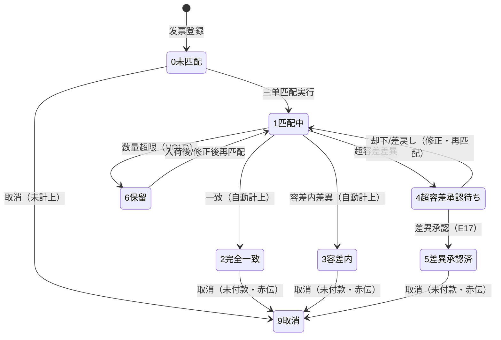
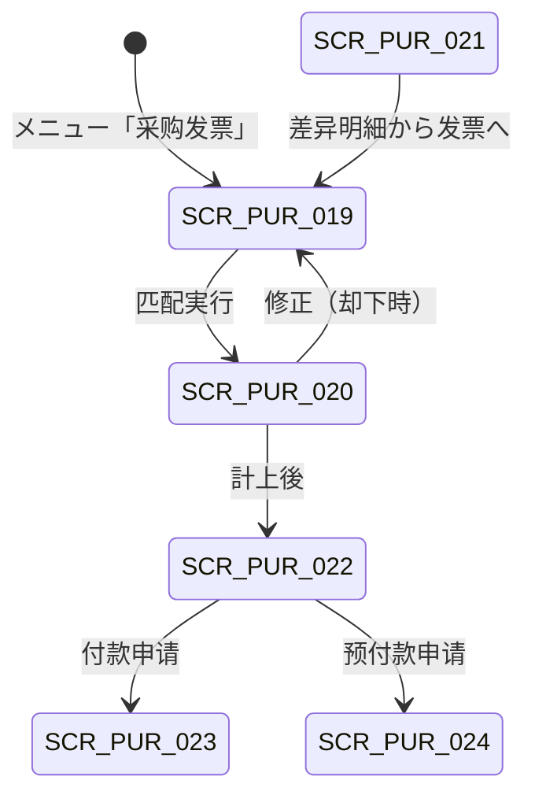

# 采购发票与应付 详细设计书（仕入請求書・買掛管理 詳細設計書）

| 項目 | 内容 |
|---|---|
| 文書名 | 采购发票与应付 详细设计书（仕入請求書・買掛管理 詳細設計書） |
| 文書番号 | DSN-PUR-006 |
| 版数 | v1.0 |
| 作成日 | 2026-10-20 |
| 作成者 | purchase-designer |
| 承認者 | 未承認（レビュー待ち） |
| 状態 | ドラフト（レビュー中） |
| 関連文書 | [業務域概要](00-overview.md) / [共通項目定義](../00-common/01-common-item-definitions.md) / [API 共通規格](../00-common/03-common-api-spec.md) / [DB 共通規格](../00-common/04-common-db-spec.md) / [共通業務規則](../00-common/08-common-business-rules.md) / [跨域流程](../00-common/09-cross-domain-flow.md) / [收货与来料检验](04-receipt-iqc.md) / [采购退货](05-return.md) / [财务管理](../07-finance/03-ap-payment.md) |

---

## 1. 機能概要

| 項目 | 内容 |
|---|---|
| 機能 ID | F-PUR-017 采购发票登记 / F-PUR-018 三单匹配与差异处理 / F-PUR-019 采购对账单 / F-PUR-020 应付・暂估确认与冲回 / F-PUR-021 付款申请（采购发起）/ F-PUR-022 预付款申请 |
| 機能名 | 采购发票・三单匹配・应付（PIV / 3-way Match / AP） |
| 目的 | 登记供应商发票（增值税专用/普通/数电票/红字），按**字段级规则**执行「采购订单（PO）・收货单（GR）・采购发票（PIV）」三单匹配，判定数量・单价・金额・税额差异并分流为「自动通过・差异承认・保留」；匹配确定后通过 E17 通知财务执行暂估冲回与买挂计上（J01～J04），并向供应商对账、付款申请与预付款提供采购侧依据 |
| 利用者・ロール | 财务会计（发票登记・匹配执行・对账）、财务经理/财务总监（差异承認）、采购员（发票催收・对账确认・付款申请发起）、仓管员（受入数量参照） |
| 利用シーン | ① 供应商开具增值税专用发票后的登记与三单匹配；② 单价小幅调整（容差内）的自动通过；③ 钢材涨价导致单价差异超容差时的差异理由+承認；④ 短装/超发导致数量差异时的保留与后续处理；⑤ 月结时的「入荷済未請求（暂估）台账」确认；⑥ 月次供应商对账；⑦ 依据应付/预付款条件向财务发起付款申请 |
| 優先度 | P0（发票登记・三单匹配・暂估应付・付款申请入口）/ P1（对账单・预付款・批量匹配） |
| 画面 ID | SCR-PUR-019（发票登记）、SCR-PUR-020（三单匹配与差异）、SCR-PUR-021（对账单）、SCR-PUR-022（应付/暂估台账）、SCR-PUR-023（付款申请）、SCR-PUR-024（预付款申请） |
| 関連 IF | IF-PUR-007（E17→FIN、E28 受信）、IF-PUR-002（电子发票采集 第一版（実装順 P2）） |

### 1.1 機能分解

| 機能 ID | 機能名 | 概要 | 優先度 |
|---|---|---|---|
| F-PUR-017 | 采购发票登记 | 专票/普票/数电票/红字发票の登録、明細の PO/GR 紐付、検証 | P0 |
| F-PUR-018 | 三单匹配与差异处理 | 数量・単価・金額・税額の字段級匹配、容差判定、差異承認、E17 | P0 |
| F-PUR-019 | 采购对账单 | 月次供应商对账（GR/PIV/PRT/付款）・差异确认 | P1 |
| F-PUR-020 | 应付・暂估确认与冲回 | 暂估台账（入荷済未請求）、E17 連携、月結チェック | P0 |
| F-PUR-021 | 付款申请（采购发起） | AP 明細から FIN へ PA 起票、E28 で支払完了表示 | P1 |
| F-PUR-022 | 预付款申请 | PO の `prepay_ratio` に基づく前払申請、冲抵跟踪 | P1 |

---

## 2. 業務要件・業務ルール

### 2.1 前提条件

| # | 前提条件 | 成立しない場合の挙動 |
|---|---|---|
| 1 | 供应商已准入且税号（`tax_no`）在 MDM 有效 | 発票登録不可 `MSG-PUR-111` |
| 2 | 至少存在入荷済（GR 确认）数量 > 0 的明细 | 匹配不能；保留状態 |
| 3 | 发票代码/号码未登録（同一供应商 + 代码 + 号码唯一） | 登録拒否 `MSG-PUR-100` |
| 4 | 税码（进项・`tax_type=11`）有效，税率与发票记载一致 | 税額差异として処理 |
| 5 | 会計期間 = OPEN（登録・計上時） | 拒否 `MSG-COM-071` |
| 6 | WF 差異承認経路設定済（財務经理；≥50,000 元は財務总监を追加） | 提出不可 `MSG-COM-073` |

### 2.2 業務ルール

#### 2.2.1 发票登记

| # | ルール | 根拠 | 関連項目 |
|---|---|---|---|
| BR-01 | 发票类型（Lead 裁定 2026-10-20 に統一）：`10` 增值税专用发票 / `20` 增值税普通发票 / `30` 数电票（增值税专用发票）/ `40` 数电票（普通发票）/ `50` 红字发票（专票・普票・数电共通）。進項税額の控除可否：`10`・`30` は可、`20`・`40` は不可、`50` は紅字冲減（FIN 処理） | 06 §7、税法規定（増値税専用発票） | `invoice_type` |
| BR-02 | 发票必须记录「发票代码（`invoice_code`）+ 发票号码（`invoice_number`）+ 开票日期 + 销方税号」；数电票的 20 位号码记入 `invoice_number`，`invoice_code` 可空。同一供应商下 `(invoice_code, invoice_number)` 唯一 | 发票管理办法 | 同上 |
| BR-03 | 发票销方名称・税号必须与 MDM 供应商一致（名称差异仅空白/括号可容認，税号完全一致）。不一致时拒绝（`MSG-PUR-111`） | 三流一致（发票流・資金流・物流）要求 | `supplier_id`、`supplier_tax_no` |
| BR-04 | 发票金额合计 = Σ明细金额（税抜）且税額合计 = Σ明细税額，差异 > 0.01 元时拒绝（`MSG-PUR-101`） | 08 §4 | 各合計項目 |
| BR-05 | 红字发票（`invoice_type=50`）必须指定原发票（`original_invoice_id`），且金额为负数；红字发票的匹配执行负数匹配（冲减已计上应付） | 09 §7.2 J04、税法 | `original_invoice_id` |
| BR-06 | 已计上应付（`ap_status=1`）的发票不可修改；错误处理为「取消→再登记」或红字发票（取消需未付款） | 08 §3.3-3 | `ap_status` |
| BR-07 | 发票可跨多张 PO/GR 合并开票（明细行分别指定 PO/GR）；一张发票明细最多 1,000 行 | 本域设计 | 明細 |
| BR-08 | 发票登记时进行「重复发票检查」：同一 `(supplier_id, invoice_code, invoice_number)` 已存在则拒绝；同一金额・同一供应商・近似日期的发票给出警告（潜在重复） | 内部控制（示例企业） | — |
| BR-09 | 发票查验（真伪）P0 実装時点 为手工确认（`verified_flag`），P2 実装で通过 INT 数电票查验接口自动校验 | 本域设计、未決 | `verified_flag` |

#### 2.2.2 三单匹配

| # | ルール | 根拠 | 関連項目 |
|---|---|---|---|
| BR-10 | 匹配三要素：**PO（発注数量・税抜単価・税码）↔ GR（受入数量・入荷日・批次）↔ PIV（请求数量・请求単価・税額）**。匹配颗粒度为「发票明细 × 收货明细」 | 09 §4.2 步骤 8、§4.3 | `pur_invoice_match` |
| BR-11 | 数量基准：以**受入数量（`accepted_qty` + `concession_qty` − `returned_qty`）** 为可请求上限。发票请求数量 ≤ 未请求残（累计）；超出部分为数量差异（`QTY_OVER`），保留（HOLD），不确认应付 | 09 §4.3「受入数量を正とする」 | `matched_qty` |
| BR-12 | 单价基准：`PO 税抜単価`。差异率 = `(发票税抜単価 − PO 税抜単価) ÷ PO 税抜単価`；差异额 = `(发票税抜単価 − PO 税抜単価) × 匹配数量` | 本域设计、09 §4.3 | `price_diff` |
| BR-13 | 容差规则由 `pur_tolerance_rule` 管理，默认值：**单价差异 ±1% 或 ±10 元**（绝对额优先时按规则配置）、**数量差异 0（按受入数量为上限）**、**税额差异 ±0.02 元/行**、**金额差异 ±10 元**。规则优先级：物料 > 物料分类 > 供应商 > 公司默认；有效期间管理 | 09 §4.3、本域设计 | `pur_tolerance_rule` |
| BR-14 | 匹配判定三态：① **完全一致**（数量・单价・税额均无差异）→ 自动通过；② **容差内差异**（全部差异在容差内）→ 自动通过并记录差异；③ **超容差差异** → 必须输入差异理由（代码+说明）并经財務经理承認（差异额 ≥ 50,000 元追加財務总监）；④ **数量超限（HOLD）** → 超出数量不确认，发票保持保留状态，待入荷或供应商修正 | 本域设计 | `match_status` |
| BR-15 | 差异理由代码：`PRICE_CONTRACT`（合同/协议价格）、`PRICE_MARKET`（市场价格波动）、`PRICE_FREIGHT`（运费/包装计入价格）、`PRICE_DISCOUNT`（供应商折让）、`PRICE_ROUNDING`（计算/汇率尾差）、`QTY_SHORTAGE`（短装）、`QTY_OVER`（超发）、`QTY_RETURN`（退货未处理完）、`TAX_RATE_CHANGE`（税率调整）、`TAX_ROUNDING`（税额尾差）、`FREIGHT_SEPARATE`（运费另计）、`QUALITY_COMPENSATION`（质量补偿）、`OTHER`。代码与会计处理的对应见 2.2.3 | 本域设计 | `diff_reason_code` |
| BR-16 | 差异会计处理（`accounting_treatment`）：1 调整存货成本（差异额小或货在库，移动加权平均法调整，08 §6.4）；2 当期损益（管理费用 `6602` / 营业外支出 `6711`）；3 应付调整（供应商折让・不调整存货）；4 供应商贷项（红字发票冲减）；5 运费资本化（计入存货成本）。默认按理由代码映射（见 6.2 表），可由承認者変更 | 09 §7.2 J03、08 §6.4 | `accounting_treatment` |
| BR-17 | 自动/手动：容差内且参数 `pur.match.auto.post=true` → 匹配確定と同時に E17 を発行（自动计上）；否则匹配结果保存为「待计上」，由会计确认后发 E17 | 本域设计 | `ap_status` |
| BR-18 | 匹配基数的唯一性：同一收货明细的可请求数量 = `accepted_qty + concession_qty − returned_qty − 已请求数量（已匹配確定分）`。匹配確定后 `pur_receipt_line.invoiced_qty` 更新；取消发票时戻す | 本域设计 | `invoiced_qty` |
| BR-19 | 红字发票匹配：数量・金额均为负，冲减对应原发票的已计上金额；红字匹配确定后同样发 E17（`matchedStatus=CANCELLED` 相当，金额为负），FIN 执行应付冲减与进项税额转出 | 09 §7.2 J04 | — |
| BR-20 | 匹配结果与判定过程全部保存（谁・何时・用什么规则・差异多少），保存期間 10 年（会計関連） | 08 §12、01 §12 | `pur_invoice_match` |

#### 2.2.3 暂估・应付・对账・付款

| # | ルール | 根拠 | 関連項目 |
|---|---|---|---|
| BR-21 | 暂估：GR 入荷確定（E14）時に FIN が「入荷数量 × PO 税抜単価」で仕入暫估を計上する（J01：借 原材料 `1403` / 贷 应付账款-暂估 `2202`）。PUR は `E14` 発行のみで金額計算は FIN 側 | 09 §7.2 J01 | `pur_receipt` |
| BR-22 | 发票匹配確定（E17）時、FIN は「① 暂估冲回（J02：借 应付账款-暂估 / 贷 原材料）→ ② 采购发票确认（J03：借 原材料・应交税费-进项税额 `2221` / 贷 应付账款 `2202`）→ ③ 差异処理（BR-16）」を実行する。PUR は E17 の payload（金額・税額・差异額・treatment）で指示する | 09 §7.2 J01～J04 | E17 |
| BR-23 | 入荷済未請求（暂估残高）：月结时仍未匹配的 GR（`invoiced_qty < accepted_qty + concession_qty − returned_qty`）は暂估のまま月结する（09 §10.3 チェック #3）。翌月に发票到着で冲回・確認する | 09 §4.3、§10.3 | 台账 |
| BR-24 | 跨期处理：入荷と発票が別期間の場合、暫估は入荷期、冲回+確認は発票期に計上する。年结後の前期分差异は FIN が「以前年度损益调整 `6901`」で処理する（PUR は差異理由を保持） | 08 §10、09 §10.3 | — |
| BR-25 | 对账单：按供应商 + 月份生成，包含期初应付余额、本期 GR（受入）、本期 PIV（发票）、本期 PRT（退货）、本期付款、期末应付余额；与 FIN 应付明细及供应商提供的对账单核对，差异项目须逐项确认（`pur_statement_line`） | 本域设计 | `pur_statement` |
| BR-26 | 付款申请：PUR 画面选择已计上的应付（AP）明细 → 调用 FIN API 创建 PA（`paymentType=NORMAL`）；金额 ≤ AP 未付余额；付款日 ≥ 发票到期日（提前付款需财务经理承認）。PA 単据本体归 FIN，PUR 不保存 | 09（Lead 裁定 2026-10-20）、08 §8.1 | PA（FIN） |
| BR-27 | 预付款申请：PO 的 `prepay_ratio > 0` 时，按「PO 税込金额 × 比例 − 已预付金额」申请；`prepay_ratio` 上限 100%。预付冲抵由 FIN 在发票确认时执行，PUR 在 PO 画面显示预付残 | 本域设计、08 §8.1 | `prepay_ratio` |
| BR-28 | 付款完了（E28 `finance.payment.completed`）を受信し、AP 明細の支払状態を「支払済」に更新（PUR 側は参照表示のみ、消込は FIN） | 09 §3 E28 | — |
| BR-29 | 发票登记后超过 N 日（默认 30 日）未匹配/未计上的，BAT-PUR-010 提醒；超过 60 日的保留发票，需财务经理确认继续保留或退回供应商 | 本域设计 | `match_status` |

### 2.3 計算式・判定式

| # | 対象 | 算式 | 丸め | 例（示例值） |
|---|---|---|---|---|
| CALC-01 | 可请求数量（行） | `accepted_qty + concession_qty − returned_qty − 已请求数量` | 数量 4 桁 | 588 + 0 − 0 − 0 = 588.0000 |
| CALC-02 | 匹配数量（发票行 × 收货行） | `min(发票剩余数量, 收货可请求残)` | 数量 4 桁 | min(600, 588) = 588.0000 |
| CALC-03 | 数量差异 | `发票数量 − 匹配数量`（>0 は HOLD 対象） | 数量 4 桁 | 600 − 588 = 12.0000 |
| CALC-04 | 单价差异率 | `(发票税抜単価 − PO 税抜単価) ÷ PO 税抜単価` | 比率 4 桁（%） | (5.72 − 5.65) ÷ 5.65 = 1.2389% |
| CALC-05 | 单价差异额 | `(发票税抜単価 − PO 税抜単価) × 匹配数量` | 2 桁 | 0.07 × 16,000 = 1,120.00 |
| CALC-06 | 发票行金額（税抜） | 发票数量 × 发票税抜単価 | 2 桁 | 16,000 × 5.72 = 91,520.00 |
| CALC-07 | 发票行税額 | 发票行金額 × 税率 | 2 桁 | 91,520.00 × 13% = 11,897.60 |
| CALC-08 | 税额差异 | `发票税額 − (匹配数量 × PO 税抜単価 × 税率)` | 2 桁 | 11,897.60 − 11,752.00 = 145.60 |
| CALC-09 | 差异合计（匹配単位） | 单价差异额 + 税额差异 + 金额尾差 | 2 桁 | 1,120.00 + 145.60 = 1,265.60 |
| CALC-10 | 容差判定 | `|差异| ≤ max(率容差 × 基准, 绝对容差)` | — | 1.2389% > 1% → 超容差 |
| CALC-11 | 暂估残高 | Σ（`accepted_qty + concession_qty − returned_qty − invoiced_qty` × PO 税抜単価） | 2 桁 | 未請求 588 − 588 = 0（当該 GR は消込済） |
| CALC-12 | 预付款可申请額 | `PO 税込金額 × prepay_ratio − 已预付税込額` | 2 桁 | 490,872 × 30% − 0 = 147,261.60 |
| CALC-13 | 对账期末应付 | `期初应付 + 本期发票（税込） − 本期付款 − 本期退货（税込）` | 2 桁 | FIN 側計算と一致すること |

### 2.4 状態遷移

#### 2.4.1 采购发票（PIV）

> PIV の状態は 08 §3.1 の伝票状態（10/20/25/30/35/40/90/95）ではなく、`pur_invoice.matched_status` と `ap_status` で管理する（[00-overview](00-overview.md) §3.5 注記）。以下は `matched_status` の遷移である。



| 遷移（`matched_status`） | トリガ | 権限 | 更新項目 | メッセージ |
|---|---|---|---|---|
| [*]→0 | 发票登録 | `purchase:invoice:create` | `matched_status=0`、`ap_status=0`、採番 `PIV` | `MSG-PUR-112` |
| 0→1 | 匹配開始 | `purchase:match:run` | `matched_status=1` | — |
| 1→3 | 容差内自動通過 | システム | `matched_status=3`、`ap_status=1`、E17 | `MSG-PUR-104` |
| 1→2 | 完全一致 | システム | `matched_status=2`、`ap_status=1`、E17 | — |
| 1→4 | 超容差（差異承認待ち） | システム | `matched_status=4`、差異理由必須 | `MSG-PUR-105` |
| 4→5 | 差異承認（E31） | `purchase:match:approve` | `matched_status=5`、`ap_status=1`、E17 | `MSG-PUR-107` |
| 1→6 | 数量超限 HOLD | システム | `matched_status=6` | `MSG-PUR-106` |
| 6→1 | 再匹配 | `purchase:match:run` | `matched_status=1` | — |
| 2/3/5→9 | 取消（赤传） | `purchase:invoice:cancel` | `matched_status=9`、`ap_status=9`、`invoiced_qty` 戻し | `MSG-PUR-108` |

> `ap_status`（0 未計上 / 1 已計上 / 2 部分付款 / 3 支払済 / 9 取消）は E17 発行時に 1、E28 受信時に 3、部分支払時に 2 となる（FIN が買挂残を管理し、PUR は参照表示のみ）。

#### 2.4.2 应付/支払（FIN 域・PUR 表示）

| 状態 | 意味 | PUR 側表示 |
|---|---|---|
| 0 未计上 | 发票未匹配確定 | 发票明細「未计上」 |
| 1 已计上 | E17 発行済、FIN で買挂計上 | 「已计上」 |
| 2 部分付款 | FIN で一部支払済 | 「部分支払済」 |
| 3 付款済 | E28 受信 | 「支払済」 |
| 9 取消 | 赤伝処理済 | 「取消」 |

---

## 3. 関連機能

| 関係 | 機能 ID | 機能名 | 関係内容 |
|---|---|---|---|
| 上流 | F-PUR-007～010 | 采购订单 | 単価・数量・税码の匹配基準 |
| 上流 | F-PUR-011～014 | 收货・IQC・入库 | 受入数量・批次・可請求数量 |
| 上流 | F-PUR-015/016 | 采购退货 | 已开票退货の红字发票 |
| 上流 | F-MDM-005 | 供应商主数据 | 名称・税号・付款条件 |
| 下流 | F-FIN-003 | 应付管理 | E17 で買挂計上・暂估戻し・差異処理 |
| 下流 | F-FIN-002 | 凭证 | J01～J04 自動仕訳 |
| 下流 | F-FIN-005 | 出纳 | 付款実行（PA→PMT） |
| 参照 | F-PUR-019 | 对账单 | 月次照合 |
| 参照 | F-PUR-020 | 暂估台账 | 月結チェック |

---

## 4. 画面設計

### 4.1 画面一覧

| 画面 ID | 画面名 | 類型 | 概要 |
|---|---|---|---|
| SCR-PUR-019 | 采购发票登记 | 登録編集 | 发票ヘッダ・明細・PO/GR 紐付・検証 |
| SCR-PUR-020 | 三单匹配与差异处理 | 参照詳細 | 匹配結果一覧・差異内訳・理由入力・承認状況 |
| SCR-PUR-021 | 采购对账单 | 参照詳細 | 月次対賬明細・差異確認・FIN 残高照合 |
| SCR-PUR-022 | 应付/暂估台账 | 一覧検索 | 入荷済未請求一覧・AP 明細・付款状態 |
| SCR-PUR-023 | 付款申请（采购发起） | 登録編集 | AP 明細選択→金額・付款日→FIN PA 起票 |
| SCR-PUR-024 | 预付款申请 | 登録編集 | PO 選択・prepay_ratio に基づく申請 |

### 4.2 画面遷移



### 4.3 画面レイアウト（SCR-PUR-020 三单匹配）

```
┌──────────────────────────────────────────────────────────────────────────────────┐
│ 三单匹配  PIV2611050001  供应商[S000001 宝山钢铁]  发票号码[2511200001]         │
│ 开票日 2026-11-01  金额 91,520.00 / 税 11,897.60 / 合计 103,417.60  状態[差异承認待ち]│
├──────────────────────────────────────────────────────────────────────────────────┤
│〔サマリ〕匹配 2 行  完全一致 0 / 容差内 1 / 超容差 1 / 保留 0  差异合計 1,265.60    │
├──────────────────────────────────────────────────────────────────────────────────┤
│〔明細〕行|物料|PO数量|受入済|可請求|請求数量|PO単価|請求単価|差異率|差異額|       │
│        税額差異|判定|理由コード|承認処理                                          │
│ 10|1001000001 50W470|28,000|28,000|0|16,000|5.650000|5.720000|1.2389%|          │
│    |1,120.00|145.60|超容差|PRICE_MARKET|要承認                                    │
│ 20|1001000001 50W470|28,000|28,000|0|12,000|5.650000|5.680000|0.5310%|         │
│    |360.00|46.80|容差内|PRICE_ROUNDING|自動通過                                  │
├──────────────────────────────────────────────────────────────────────────────────┤
│〔フッタ〕[再匹配] [差异理由入力] [提交差異承認] [保留] [匹配確定・計上]           │
└──────────────────────────────────────────────────────────────────────────────────┘
```

### 4.4 画面項目定義

#### 4.4.1 SCR-PUR-019 发票ヘッダ項目

| No | 項目 ID | 項目名 | 種別 | 型/桁 | 必須 | 初期値 | 入力チェック | データソース | DB 項目 | 備考 |
|---|---|---|---|---|---|---|---|---|---|---|
| 1 | `invoiceNo` | 登记番号 | テキスト | VARCHAR(32) | ○ | 自動採番 | `PIV{YYMMDD}{4桁}` | 採番 | `invoice_no` | 参照のみ |
| 2 | `invoiceType` | 发票类型 | 選択 | SMALLINT | ○ | 10 增值税专票 | 10/20/30/40/50 | 固定値 | `invoice_type` | 50 红字时原发票必須 |
| 3 | `originalInvoiceId` | 原发票 | 選択 | BIGINT | △ | 空 | 红字時必須・未取消 | `pur_invoice` | `original_invoice_id` | 红字のみ |
| 4 | `supplierId` | 供应商 | 選択 | BIGINT | ○ | 空 | 准入済・有効 | `mdm_supplier` | `supplier_id` | — |
| 5 | `supplierTaxNo` | 销方税号（发票記載） | テキスト | VARCHAR(32) | ○ | MDM 值 | MDM 税号と一致（`MSG-PUR-111`） | `mdm_supplier` | `supplier_tax_no` | 三流一致 |
| 6 | `invoiceCode` | 发票代码 | テキスト | VARCHAR(32) | △ | 空 | 数电票以外は必須 | 外部 | `invoice_code` | — |
| 7 | `invoiceNumber` | 发票号码 | テキスト | VARCHAR(32) | ○ | 空 | 一意（供应商+代码+号码） | 外部 | `invoice_number` | 数电票 20 位 |
| 8 | `invoiceDate` | 开票日期 | 日付 | DATE | ○ | 空 | ≤ 登録日 + 1 日、会計期間 OPEN | — | `invoice_date` | — |
| 9 | `registrationDate` | 登记日期 | 日付 | DATE | ○ | 当日 | — | — | `registration_date` | — |
| 10 | `currencyCode` | 币种 | 選択 | VARCHAR(8) | ○ | CNY | ISO 4217 | `mdm_currency` | `currency_code` | 既定 CNY（外貨は実装順 P2） |
| 11 | `exchangeRate` | 汇率 | 数値 | NUMERIC(18,8) | △ | 1.00000000 | > 0 | `mdm_exchange_rate` | `exchange_rate` | 第一版（実装順 P2） |
| 12 | `priceTerms` | 金额基准 | ラジオ | SMALLINT | ○ | 1 税抜 | 1 税抜/2 税込 | 固定値 | `price_terms` | 税込入力時は税抜換算 |
| 13 | `totalAmount` | 税抜合計 | 数値 | NUMERIC(18,2) | 自動 | 0.00 | = Σ明細（差 >0.01 拒絕） | 明細計算 | `total_amount` | — |
| 14 | `taxAmount` | 税額合計 | 数値 | NUMERIC(18,2) | 自動 | 0.00 | = Σ明細税額 | 明細計算 | `tax_amount` | — |
| 15 | `totalAmountWithTax` | 价税合计 | 数値 | NUMERIC(18,2) | 自動 | 0.00 | = 税抜 + 税額 | 計算 | `total_amount_with_tax` | 帳票・API 照合 |
| 16 | `matchedStatus` | 匹配状态 | バッジ | SMALLINT | 自動 | 0 | — | — | `matched_status` | 0/1/2/3/4/5/6/9 |
| 17 | `apStatus` | 计上状态 | バッジ | SMALLINT | 自動 | 0 | — | E17/E28 | `ap_status` | 0 未計上/1 已計上/2 部分付款/3 支払済/9 取消 |
| 18 | `diffTotalAmount` | 差异合计 | 数値 | NUMERIC(18,2) | 自動 | 0.00 | — | 匹配計算 | `diff_total_amount` | — |
| 19 | `verifiedFlag` | 发票查验 | チェック | BOOLEAN | △ | false | — | 手動/INT | `verified_flag` | 第一版（実装順 P2） 自動化 |
| 20 | `remark` | 备注 | テキストエリア | VARCHAR(500) | △ | 空 | 桁数 | — | `remark` | 红字確認单号等 |
| 21 | `attachments` | 附件 | 添付 | — | △ | 空 | 01 §9 | `sys_attachment` | — | 发票扫描/XML |
| 22 | `version` | 版数 | 数値 | INT | 自動 | 0 | — | — | `version` | 楽観排他 |

#### 4.4.2 SCR-PUR-019 发票明細項目

| No | 項目 ID | 項目名 | 種別 | 型/桁 | 必須 | 初期値 | 入力チェック | データソース | DB 項目 | 備考 |
|---|---|---|---|---|---|---|---|---|---|---|
| 1 | `lineNo` | 行番号 | 数値 | INT | 自動 | 10 刻み | — | — | `line_no` | — |
| 2 | `poId`/`poNo` | 采购订单 | 選択 | BIGINT/VARCHAR | △ | 空 | 空時は自動解析（同一供应商・物料） | `pur_purchase_order` | `po_id` | — |
| 3 | `poLineId` | PO 明細 | 選択 | BIGINT | △ | 空 | PO 明細と物料一致 | `pur_purchase_order_line` | `po_line_id` | — |
| 4 | `receiptId`/`receiptLineId` | 收货単/明細 | 選択 | BIGINT | △ | 空 | 空時は FIFO 自動割当 | `pur_receipt(_line)` | `receipt_id`/`receipt_line_id` | — |
| 5 | `materialId`/`materialCode`/`materialName`/`spec` | 物料 | 選択 | BIGINT/VARCHAR | ○ | 空 | PO 明細と一致 | `mdm_material` | 同名項目 | スナップショット |
| 6 | `invoiceQty` | 请求数量 | 数値 | NUMERIC(18,4) | ○ | 可請求残 | > 0（红字は < 0） | — | `invoice_qty` | 単位精度 4 桁 |
| 7 | `uomCode` | 单位 | テキスト | VARCHAR(8) | ○ | PO 値 | PO と一致（換算可） | `mdm_uom` | `uom_code` | — |
| 8 | `invoiceUnitPrice` | 请求税抜単価 | 数値 | NUMERIC(18,6) | ○ | PO 単価 | ≥ 0、6 桁 | — | `invoice_unit_price` | — |
| 9 | `taxCode` | 税码（进项） | 選択 | VARCHAR(32) | ○ | PO 値 | `tax_type=11`・有効 | `mdm_tax_code` | `tax_code` | 税率変更時は新税码 |
| 10 | `taxRate` | 税率 | 数値 | NUMERIC(7,4) | ○ | 税码値 | 0～100 | `mdm_tax_code` | `tax_rate` | 发票記載税率 |
| 11 | `invoiceAmount` | 税抜金額 | 数値 | NUMERIC(18,2) | 自動 | 0.00 | = 数量 × 単価 | 計算 | `invoice_amount` | — |
| 12 | `taxAmount` | 税額 | 数値 | NUMERIC(18,2) | 自動 | 0.00 | = 金額 × 税率 | 計算 | `tax_amount` | — |
| 13 | `totalAmount` | 税込金額 | 数値 | NUMERIC(18,2) | 自動 | 0.00 | — | 計算 | `total_amount` | — |
| 14 | `originalInvoiceLineId` | 原发票明細 | テキスト | BIGINT | △ | 空 | 红字時必須 | `pur_invoice_line` | `original_invoice_line_id` | 红字のみ |
| 15 | `remark` | 行备注 | テキスト | VARCHAR(500) | △ | 空 | 桁数 | — | `line_remark` | — |

#### 4.4.3 SCR-PUR-020 匹配結果項目（`pur_invoice_match`）

| No | 項目 ID | 項目名 | 種別 | 型/桁 | 説明 |
|---|---|---|---|---|---|
| 1 | `invoiceLineNo` | 发票行 | 数値 | INT | 対象发票明細 |
| 2 | `poNo`/`poLineNo` | PO | 文字列 | — | 匹配基准 |
| 3 | `receiptNo`/`receiptLineNo` | GR | 文字列 | — | 受入基准 |
| 4 | `poQty`/`orderedQty` | 発注数量 | 数値 | NUMERIC(18,4) | PO 数量 |
| 5 | `receivedQty` | 受入数量 | 数値 | NUMERIC(18,4) | 可請求上限（CALC-01） |
| 6 | `matchedQty` | 匹配数量 | 数値 | NUMERIC(18,4) | CALC-02 |
| 7 | `invoiceQty` | 请求数量 | 数値 | NUMERIC(18,4) | — |
| 8 | `qtyDiff` | 数量差异 | 数値 | NUMERIC(18,4) | CALC-03 |
| 9 | `poUnitPrice`/`invoiceUnitPrice` | 単価 | 数値 | NUMERIC(18,6) | — |
| 10 | `priceDiffRate` | 単価差异率 | 数値 | NUMERIC(7,4) | CALC-04 |
| 11 | `priceDiffAmount` | 単価差异額 | 数値 | NUMERIC(18,2) | CALC-05 |
| 12 | `taxDiffAmount` | 税額差异 | 数値 | NUMERIC(18,2) | CALC-08 |
| 13 | `diffTotalAmount` | 差异合计 | 数値 | NUMERIC(18,2) | CALC-09 |
| 14 | `diffType` | 差异类型 | 選択 | SMALLINT | 1 数量 / 2 単価 / 3 金額 / 4 税額 / 5 複合 |
| 15 | `diffReasonCode` | 差异理由 | 選択 | VARCHAR(32) | BR-15 のコード |
| 16 | `diffReasonText` | 差异理由説明 | テキスト | VARCHAR(500) | 必須（超容差時） |
| 17 | `matchStatus` | 判定 | バッジ | SMALLINT | 1 一致 / 2 容差内 / 3 超容差 / 4 承認済 / 5 拒否 / 6 保留 |
| 18 | `accountingTreatment` | 会计处理 | 選択 | SMALLINT | BR-16 の 1～5 |
| 19 | `autoMatched` | 自動匹配 | チェック | BOOLEAN | true/false |
| 20 | `approvedBy`/`approvedAt` | 承認者・日時 | テキスト/日時 | — | 差異承認 |

#### 4.4.4 SCR-PUR-021 采购对账单 項目定義

| No | 項目 ID | 項目名 | 区分 | 種別 | 型/桁 | 必須 | 初期値 | 入力チェック | データソース | DB 項目 | 備考 |
|---|---|---|---|---|---|---|---|---|---|---|---|
| 1 | `statementNo` | 对账单号 | ヘッダ | テキスト | VARCHAR(32) | ○ | 自動採番 | 形式 `PST{YYMMDD}{4桁}`（08 §2.1） | 採番 | `pur_statement.statement_no` | 参照のみ |
| 2 | `supplierId` | 供应商 | 検索 | 選択 | BIGINT | ○ | 空 | 取引実績のある供應商 | `mdm_supplier` | `supplier_id` | — |
| 3 | `periodCode` | 対象期間 | 検索 | 選択 | VARCHAR(7) | ○ | 前月 | `YYYY-MM`・未来月不可 | `fin_period` | `period_code` | — |
| 4 | `statementDate` | 対账基準日 | ヘッダ | 日付 | DATE | ○ | 生成日 | 期間内 | — | `statement_date` | — |
| 5 | `openingBalance` | 期初買挂残高 | ヘッダ | 数値 | NUMERIC(18,2) | 自動 | 前月期末 | — | FIN 買挂残（同期参照） | `opening_balance` | 差異時は赤字 |
| 6 | `periodReceiptAmount` | 本期受入額 | ヘッダ | 数値 | NUMERIC(18,2) | 自動 | 集計 | — | `pur_receipt`（税込） | `period_receipt_amount` | 参考表示 |
| 7 | `periodInvoiceAmount` | 本期発票額 | ヘッダ | 数値 | NUMERIC(18,2) | 自動 | 集計 | — | `pur_invoice`（税込） | `period_invoice_amount` | — |
| 8 | `periodReturnAmount` | 本期退貨額 | ヘッダ | 数値 | NUMERIC(18,2) | 自動 | 集計 | — | `pur_return`（税込） | `period_return_amount` | — |
| 9 | `periodPaymentAmount` | 本期支払額 | ヘッダ | 数値 | NUMERIC(18,2) | 自動 | 集計 | — | FIN 支払実績（E28） | `period_payment_amount` | — |
| 10 | `closingBalance` | 期末買挂残高 | ヘッダ | 数値 | NUMERIC(18,2) | 自動 | 計算 | 期初+発票−退貨−支払 | 計算 | `closing_balance` | FIN 残高と一致必須（`MSG-PUR-110`） |
| 11 | `diffCount` | 差異件数 | ヘッダ | 数値 | INT | 自動 | 0 | — | 明細の `diffFlag` 集計 | `diff_count` | — |
| 12 | `statementStatus` | 状態 | ヘッダ | バッジ | SMALLINT | 自動 | 10 | — | — | `statement_status` | 10 作成中/30 送付済/40 確認完了/90 取消 |
| 13 | `sourceType` | 明細種別 | 明細 | テキスト | VARCHAR(32) | ○ | — | RECEIPT/PURCHASE_ORDER/RETURN/INVOICE/PAYMENT | 計算 | `pur_statement_line.source_type` | — |
| 14 | `sourceNo` | 伝票番号 | 明細 | リンク | VARCHAR(32) | ○ | — | — | 各伝票 | `source_no` | 権限ある伝票のみリンク |
| 15 | `businessDate` | 業務日 | 明細 | 日付 | DATE | ○ | — | 期間内 | 各伝票 | `business_date` | — |
| 16 | `description` | 摘要 | 明細 | テキスト | VARCHAR(200) | △ | 自動 | 桁数 | 生成 | `description` | — |
| 17 | `debitAmount` | 買挂増 | 明細 | 数値 | NUMERIC(18,2) | 自動 | 0.00 | ≥ 0 | 計算 | `debit_amount` | 受入・発票 |
| 18 | `creditAmount` | 買挂減 | 明細 | 数値 | NUMERIC(18,2) | 自動 | 0.00 | ≥ 0 | 計算 | `credit_amount` | 退貨・支払 |
| 19 | `balanceAmount` | 残高 | 明細 | 数値 | NUMERIC(18,2) | 自動 | 0.00 | — | 累計計算 | `balance_amount` | — |
| 20 | `diffFlag` | 差異フラグ | 明細 | チェック | BOOLEAN | 自動 | false | — | 照合結果 | `diff_flag` | true は理由必須 |
| 21 | `diffReason` | 差異理由 | 明細 | テキスト | VARCHAR(500) | △ | 空 | 差異時必須 | — | `diff_reason` | — |

#### 4.4.5 SCR-PUR-023／SCR-PUR-024 付款申請・預付款申請 項目定義

| No | 項目 ID | 項目名 | 画面 | 種別 | 型/桁 | 必須 | 初期値 | 入力チェック | データソース | 備考 |
|---|---|---|---|---|---|---|---|---|---|---|
| 1 | `supplierId` | 供应商 | 023/024 | 選択 | BIGINT | ○ | 対象 AP の供應商 | 買挂残 > 0 | `mdm_supplier` | — |
| 2 | `invoiceIds` | 対象发票 | 023 | 複数選択 | BIGINT[] | ○ | 空 | 已計上・未払残 > 0 | `pur_invoice` | — |
| 3 | `poId` | 対象 PO | 024 | 選択 | BIGINT | ○ | 空 | `prepay_ratio > 0`・状態 25/30/35 | `pur_purchase_order` | — |
| 4 | `amount` | 申請金額 | 023/024 | 数値 | NUMERIC(18,2) | ○ | 未払残／可申請額 | > 0、≤ 未払残（CALC-12） | 計算 | `MSG-PUR-113`/`MSG-PUR-115` |
| 5 | `plannedPaymentDate` | 支払予定日 | 023/024 | 日付 | DATE | ○ | 発票日 + 付款条件 | ≥ 当日、≥ 到期日（提前は理由+承認） | `mdm_payment_term` | — |
| 6 | `paymentType` | 支払種別 | 023/024 | ラジオ | SMALLINT | 自動 | NORMAL/PREPAYMENT | — | — | FIN PA の種別 |
| 7 | `remark` | 備考 | 023/024 | テキスト | VARCHAR(500) | △ | 空 | 桁数 | — | — |
| 8 | `paNo` | PA 番号 | 023/024 | テキスト | VARCHAR(32) | 自動 | 空 | — | FIN API 返却 | 参照のみ（PA 本体は FIN 保有） |

### 4.5 イベント処理

| No | イベント | トリガ | 処理内容 | 呼出 API | 画面遷移 | 備考 |
|---|---|---|---|---|---|---|
| 1 | 検索 | 検索ボタン | 一覧取得 | `GET /api/purchase/invoices` | 同一画面 | — |
| 2 | 新規 | 新規ボタン | 空の登録画面 | — | SCR-PUR-019 | — |
| 3 | PO/GR 紐付 | 明細行の参照 | 未請求の GR 明細を FIFO 表示・選択 | `GET /api/purchase/invoices/available-lines?supplierId=&materialId=` | — | 自動割当も可 |
| 4 | 金額再計算 | 数量・単価・税率変更 | 金額・税額・合計再計算 | — | — | サーバ再計算 |
| 5 | 保存 | 保存ボタン | 検証→採番→保存（`matched_status=0`） | `POST`/`PUT /api/purchase/invoices` | 同画面 | 二重送信防止 |
| 6 | 匹配実行 | 匹配ボタン | 三单匹配→判定→結果保存 | `POST .../{id}/match` | SCR-PUR-020 | — |
| 7 | 差異理由入力 | 理由入力 | 理由コード+説明を保存 | `PUT .../{id}/match-lines` | 同画面 | 超容差時必須 |
| 8 | 差異承認提出 | 提交承認 | WF 提出（財務经理→財務总监） | `POST .../{id}/submit-diff` | 同画面 | — |
| 9 | 計上（E17） | 匹配確定ボタン | ap_status=1、E17 発行 | `POST .../{id}/post` | SCR-PUR-022 | 自動計上設定時は不要 |
| 10 | 保留解除 | 再匹配 | HOLD 解除→再匹配 | `POST .../{id}/match` | 同画面 | — |
| 11 | 取消 | 取消ボタン | 未計上は取消可、計上済は赤伝必要 | `POST .../{id}/cancel` | 一覧 | — |
| 12 | 対賬へ | 対賬ボタン | 対账单画面へ | — | SCR-PUR-021 | — |

### 4.6 一覧画面仕様（SCR-PUR-022 应付/暂估台账）

| 項目 | 内容 |
|---|---|
| 検索条件 | 供应商、期间（YYYY-MM）、状态（未請求/請求済/保留/支払済）、PO 号、物料、金额範囲、逾期 |
| 既定検索条件 | 全社 + 未請求残あり + 当月 |
| ソート | 既定：入荷日降順。他：供应商、金額、滞留日数 |
| ページング | 20/50/100/200 |
| 表示列 | 供应商、PO 号、收货单号、入荷日、物料、受入数量、已請求数量、未請求残、PO 単価、暂估残高、滞留日数、状态、发票番号 |
| 一括操作 | 导出（PRT-PUR-011）、付款申请へ |
| 照合 | 期末に FIN の买挂残高と照合（差異は SCR-PUR-021） |

### 4.7 表示制御

| 条件 | 対象 | 制御 |
|---|---|---|
| `ap_status = 1`（計上済） | 編集・削除 | 参照のみ |
| `matched_status ∈ {4,6}` | 計上ボタン | 非活性（承認/HOLD 解除待ち） |
| `matched_status = 5`（差異承認済） | 計上ボタン | 表示 |
| 红字发票 | 数量・単価 | 負数入力のみ可 |
| 権限なし | 金額・単価 | 非表示（API も返さない） |
| 期間締切済 | 登録・計上 | 拒否 |

---

## 5. 入力チェック仕様

| No | チェック ID | 対象項目 | 種別 | 条件 | タイミング | メッセージ ID |
|---|---|---|---|---|---|---|
| 1 | CHK-PUR-006-01 | 发票番号 | 一意 | `(supplier_id, invoice_code, invoice_number)` 未登録 | 保存時 | `MSG-PUR-100` |
| 2 | CHK-PUR-006-02 | 销方税号 | 一致 | MDM 供应商税号と一致 | 保存時 | `MSG-PUR-111` |
| 3 | CHK-PUR-006-03 | 发票金额合计 | 相関 | 合計 = Σ明細（差 ≤ 0.01） | 保存時 | `MSG-PUR-101` |
| 4 | CHK-PUR-006-04 | 红字原发票 | 相関 | 存在・未取消・金額負数 | 保存時 | `MSG-PUR-109` |
| 5 | CHK-PUR-006-05 | 请求数量 | 範囲 | 数量 > 0（红字 < 0）、≤ 可請求残（HOLD 警告） | 保存・匹配時 | `MSG-PUR-106` |
| 6 | CHK-PUR-006-06 | 请求税抜単価 | 範囲 | ≥ 0、税抜換算値保持 | 保存時 | `MSG-COM-048` |
| 7 | CHK-PUR-006-07 | 税码・税率 | コード存在 | `tax_type=11`・有効 | 保存時 | `MSG-COM-049` |
| 8 | CHK-PUR-006-08 | 匹配数量 | 相関 | 累计请求 ≤ 受入数量 | 匹配時 | `MSG-PUR-106` |
| 9 | CHK-PUR-006-09 | 超容差理由 | 必須 | 超容差差异に理由コード+説明 | 差異承認提出時 | `MSG-PUR-105` |
| 10 | CHK-PUR-006-10 | 期間状態 | 業務 | 会計期間 ≠ CLOSED | 登録・計上時 | `MSG-COM-071` |
| 11 | CHK-PUR-006-11 | 状態整合 | 業務 | 操作が現在状態で許可 | 各操作 | `MSG-COM-034` |
| 12 | CHK-PUR-006-12 | 楽観排他 | 排他 | `version` 一致 | 保存・匹配・計上 | `MSG-COM-033` |
| 13 | CHK-PUR-006-13 | 付款申請額 | 範囲 | ≤ AP 未払残、≥ 最小金額 | 付款申請時 | `MSG-PUR-113` |
| 14 | CHK-PUR-006-14 | 預付款比例 | 範囲 | 0 ≤ 累計預付 ≤ PO 税込 × `prepay_ratio` | 預付款申請時 | `MSG-PUR-115` |
| 15 | CHK-PUR-006-15 | 対账期間 | 相関 | `periodCode` が当月以前・未确定期間 | 対账生成時 | `MSG-PUR-113` |
| 16 | CHK-PUR-006-16 | 対账残高一致 | 業務 | 期末買挂残高 = FIN 買挂残高（差異 0） | 対账確認時 | `MSG-PUR-110` |

---

## 6. 処理詳細

### 6.1 処理一覧

| 処理 ID | 処理名 | 契機 | トランザクション | 排他 |
|---|---|---|---|---|
| PRC-PUR-017-01 | 发票登録 | 保存 | 要 | 一意制約 + 採番 |
| PRC-PUR-018-01 | 三单匹配 | 匹配実行 | 要（結果保存） | 发票・GR 明細ロック |
| PRC-PUR-018-02 | 差異承認提出/反映 | WF | 要 | 冪等（eventId） |
| PRC-PUR-018-03 | 計上（E17） | 計上 | 要（Outbox） | 楽観排他 |
| PRC-PUR-020-01 | 暂估台账更新 | E14/E17 受信 | 要 | 冪等 |
| PRC-PUR-019-01 | 対账单生成 | 月次/手動 | 要 | 供应商ロック |
| PRC-PUR-021-01 | 付款申請（FIN 連携） | 申請 | 要（FIN API 呼出は補償付き） | AP 明細ロック |
| PRC-PUR-022-01 | 預付款申請 | 申請 | 要（同上） | PO ロック |

### 6.2 三单匹配アルゴリズム（詳細）

```
# 入力: invoice（PIV ヘッダ+明細）、after 状態 10 登録済
# 出力: matchResult[]（pur_invoice_match 行）、invoice.matched_status、ap_status

function matchInvoice(invoice):
    result = []
    totalDiff = 0
    for line in invoice.lines:
        # ① 対象 PO 明細の解決
        poLine = line.poLineId != null
                    ? loadPoLine(line.poLineId)
                    : resolvePoLine(invoice.supplierId, line.materialId, line.invoiceDate)
        if poLine == null: return HOLD(line, "PO_NOT_FOUND")

        # ② 可請求明細（GR）の取得：FIFO、未請求残 > 0
        candidates = loadReceiptLines(poLine.id)
                       .filter(r -> (r.acceptedQty + r.concessionQty - r.returnedQty - r.invoicedQty) > 0)
                       .orderBy(r -> r.receiptDate)
        invoiceRemain = |line.invoiceQty|
        matchedQtyAll = 0
        for r in candidates while invoiceRemain > 0:
            available    = r.acceptedQty + r.concessionQty - r.returnedQty - r.invoicedQty
            matchedQty   = min(invoiceRemain, available)
            if matchedQty <= 0: continue

            # ③ 差異計算（match 単位）
            qtyDiff       = line.invoiceQty - matchedQtyAll - matchedQty   # 最後の行で残差
            priceDiffRate = (line.invoiceUnitPrice - poLine.unitPrice) / poLine.unitPrice
            priceDiffAmt  = (line.invoiceUnitPrice - poLine.unitPrice) * matchedQty
            taxDiffAmt    = line.taxAmount * (matchedQty / line.invoiceQty)
                              - matchedQty * poLine.unitPrice * poLine.taxRate
            diffTotal     = priceDiffAmt + taxDiffAmt

            # ④ 容差判定（ルール解決：物料 > 分類 > 供应商 > 公司）
            pTol = getTolerance(PRICE_DIFF, invoice, poLine, invoiceDate)
            qTol = getTolerance(QTY_DIFF,   invoice, poLine, invoiceDate)
            tTol = getTolerance(TAX_DIFF,   invoice, poLine, invoiceDate)
            aTol = getTolerance(AMOUNT_DIFF, invoice, poLine, invoiceDate)

            priceOk = abs(priceDiffRate) <= pTol.rate
                        or abs(priceDiffAmt) <= pTol.absolute   # 絶対額優先（規則設定）
            taxOk   = abs(taxDiffAmt) <= tTol.absolute
            amtOk   = abs(diffTotal) <= aTol.absolute

            # ⑤ 判定
            if qtyDiff > qTol.absolute:                 # 受入数量を超える請求 → 保留
                status = HOLD; reason = QTY_OVER
            elif priceDiffRate == 0 and taxDiffAmt == 0 and diffTotal == 0:
                status = FULL_MATCH                     # 完全一致
            elif priceOk and taxOk and amtOk:
                status = WITHIN_TOLERANCE               # 容差内（自動通過）
            else:
                status = EXCEED_TOLERANCE               # 超容差（差異承認必須）

            result.append(MatchRecord(line, r, matchedQty, qtyDiff, priceDiffRate,
                                      priceDiffAmt, taxDiffAmt, diffTotal, status))
            matchedQtyAll += matchedQty
            invoiceRemain -= matchedQty

        # ⑥ 請求数量が受入数量を超える残差
        if invoiceRemain > 0:
            result.append(UnmatchedRemainder(line, invoiceRemain, status=HOLD, reason=QTY_OVER))

    # ⑦ 集計判定
    if any HOLD:                 invoice.matchedStatus = 6 保留
    elif any EXCEED_TOLERANCE:   invoice.matchedStatus = 4 差異承認待ち
    elif any WITHIN_TOLERANCE:   invoice.matchedStatus = 3 容差内（自動通過）
    else:                        invoice.matchedStatus = 2 完全一致

    invoice.diffTotalAmount = sum(r.diffTotal for r in result)
    return result
```

**差異理由コードと会計処理（`accounting_treatment`）のマッピング**

| 理由コード | 主な発生原因 | 既定の会計処理 | 備考 |
|---|---|---|---|
| `PRICE_CONTRACT` | 合同/协议价格调整 | 1 调整存货成本 | 在庫分は原価調整、出庫済分は当期原価 |
| `PRICE_MARKET` | 钢材・銅材市場価格変動 | 1 调整存货成本（在庫）/ 2 当期損益（僅少・出庫済） | 金額閾値は `sys_param` |
| `PRICE_FREIGHT` | 运费・包装費の価格内包 | 1 调整存货成本 | 運費は J05 で別計上も可 |
| `PRICE_DISCOUNT` | 供应商折让 | 3 应付调整 | 仕入価格の遡及値引 |
| `PRICE_ROUNDING` | 単価計算・為替尾差 | 1 调整存货成本（僅少） | 仅少差异 |
| `QTY_SHORTAGE` | 短装（請求数量 < 受入数量） | — | 可請求残として保留、差異なし |
| `QTY_OVER` | 超発（請求数量 > 受入数量） | — | HOLD、入荷後に再マッチ |
| `QTY_RETURN` | 退货未処理完 | — | 退货完了後に再マッチ |
| `TAX_RATE_CHANGE` | 税率変更（税込価格不変） | 1 调整存货成本 | 税抜価格が変わるため |
| `TAX_ROUNDING` | 税額端数差 | 1 调整存货成本（僅少） | ±0.02/行以内 |
| `FREIGHT_SEPARATE` | 運費別建て（J05） | 5 运费资本化 | 運費発票は別途 |
| `QUALITY_COMPENSATION` | 品質補償（貸項） | 4 供应商贷项 | 红字/貸項 |
| `OTHER` | その他 | 承認者が選択 | 説明必須 |

**差異承認の要否**

| 条件 | 承認 |
|---|---|
| 完全一致・容差内差異 | 承認不要（自動通過。ただし `diffTotalAmount > 0` の記録は必須） |
| 超容差差異（差异额 < 50,000 元） | 財務经理（1 段） |
| 超容差差異（差异额 ≥ 50,000 元） | 財務经理 → 財務总监（顺送） |
| 数量超限（HOLD） | 承認ではなく入荷待ち/修正待ち（保留） |
| 红字发票差异 | 財務经理承認（赤伝処理） |

### 6.3 处理手順（正常系）

**PRC-PUR-017-01 发票登録**

1. Bean Validation・権限・データ範囲を検証する。
2. 供应商（准入・税号一致）・税码（進項）・期間状態を検証する。
3. 明細の PO/GR 紐付を解決し（未指定は自動解析）、可請求残を計算する。
4. 金額・税額・合計を再計算し、合計一致を検証する（CHK-03）。
5. 重複発票チェック（CHK-01）を実行する。
6. `sys_sequence` から `PIV{YYMMDD}{4桁}` を採番する。
7. `pur_invoice`（`matched_status=0`、`ap_status=0`）と `pur_invoice_line` を INSERT する。
8. 監査ログ（CREATE）を記録し、詳細を返す。

**PRC-PUR-018-01 三单匹配**

1. 发票を `FOR UPDATE` でロックし、`matched_status ∈ {0,1,6}` を確認する。
2. 対象 PO 明細・GR 明細をロックし、可請求残（CALC-01）を取得する。
3. 6.2 のアルゴリズムで「发票行 × 收货行」の匹配レコードを生成する。
4. 容差ルールを `pur_tolerance_rule` から解決し、判定（一致/容差内/超容差/HOLD）を確定する。
5. `pur_invoice_match` を INSERT（既存結果は再匹配時に削除→再作成、`version` 管理）し、`pur_invoice.matched_status`・`diff_total_amount` を更新する。
6. 全行「一致/容差内」かつ `pur.match.auto.post=true` の場合：`ap_status=1` とし、Outbox に E17 を登録（payload は [91](91-api-design.md) §7）。`pur_receipt_line.invoiced_qty`・`pur_purchase_order_line.invoiced_qty` を加算する。
7. 超容差がある場合：差異理由入力待ち（`matched_status=4`）とし、承認経路を取得して WF へ提出可能にする。
8. HOLD がある場合：`matched_status=6` とし、保留理由・不足数量を表示する。
9. 監査ログ（UPDATE/MATCH）を記録する。

**PRC-PUR-018-02 差異承認**

1. 承認結果（E31/E32）を受信し、`eventId` で冪等化する。
2. 承認：`pur_invoice_match.match_status=4`（承認済）、`approved_by/at`、`accounting_treatment` を保存し、`pur_invoice.matched_status=5`、`ap_status=1`、Outbox に E17 を登録する。
3. 却下/差戻し：`match_status=5`（拒否）または `matched_status=1` に戻し、理由を保存する。
4. 監査ログ（APPROVE/REJECT）・通知を記録する。

**PRC-PUR-018-03 計上（E17）**

1. `matched_status ∈ {3,5}` かつ `ap_status=0` を確認する（手動計上モード）。
2. `ap_status=1`、`ap_posted_at`、`posted_by` を更新する。
3. Outbox に E17 `purchase.invoice.matched` を同一トランザクションで登録する。payload には `invoiceId`、`invoiceNo`、`supplierId`、`amount`（税抜）、`taxAmount`、`taxRate`、`matchedStatus`、`diffAmount`、`diffTreatment`、明細（`poLineId`、`receiptLineId`、`qty`、`price`、`taxAmount`、`diffType`、`diffAmount`）を含める。
4. 監査ログ（POST）・通知（財務・購買）を記録する。
5. FIN 側で J02 暂估冲回 + J03 買挂計上が実行され、E17 処理完了後に買挂残が更新される。

**PRC-PUR-020-01 暂估台账更新**

1. E14 受信時（または FIN の暫估計上後に PUR 側で参照）：`pur_receipt_line` の入荷数量・PO 単価から「入荷済未請求」残を再計算する。
2. E17 受信時：`pur_invoice_match` の `matched_qty` を `pur_receipt_line.invoiced_qty` に反映し、未請求残を減算する。
3. E16（退货）受信時：`returned_qty` を加算し、未請求残を再計算する（已請求分の退货は红字发票で処理）。
4. 月结时（BAT-PUR-003）：未請求残 > 0 の一覧（PRT-PUR-011）を出力し、FIN の暂估残高と照合する（09 §10.3 チェック #3）。
5. 差異があれば `MSG-PUR-110` でアラートし、FIN とデータ補正を行う。

**PRC-PUR-019-01 对账单生成**

1. 供应商 + 期间（YYYY-MM）を指定する。
2. 期初应付余额（FIN から同期参照、または前月对账单の期末）を取得する。
3. 期間内の GR（受入税抜額）、PIV（发票税抜額・税額）、PRT（退货税抜額）、付款（E28 実績）を集計する。
4. 明细行（`pur_statement_line`、`source_type`/`source_id` 付き）を生成し、`期初 + 发票 − 付款 − 退货 = 期末` を検証する。
5. `pur_statement`（`statement_status=10`）を保存し、供应商へ送付（`30 发送済`）。
6. 供应商确认後 `40 確認完了` とし、差异项目は理由付きで記録する。
7. 監査ログ（CREATE/SEND/CONFIRM）を記録する。

**PRC-PUR-021-01 付款申请（FIN 連携）**

1. 対象 AP 明細（`pur_invoice` で `ap_status ∈ {1}`、未払残 > 0）を選択する。
2. 合計金額 ≤ 未払残、付款日 ≥ 到期日（提前時は理由+財務经理承認）を検証する。
3. FIN 公開 API `POST /api/finance/payment-requests`（`paymentType=NORMAL`、`supplierId`、`amount`、`plannedPaymentDate`、`sourceType=PUR_INVOICE`、`sourceIds[]`）を呼び出す。
4. FIN が PA を作成したら PA 番号を画面に表示し、PUR 側には PA を保存しない（参照のみ）。呼出失敗時はリトライ（冪等キー = 申請 ID）。
5. E28 受信時、対象 AP の `ap_status=3`（支払済）に表示更新する。
6. 監査ログ（CREATE/SUBMIT）を記録する。

**PRC-PUR-022-01 预付款申请**

1. PO（`prepay_ratio > 0`、`po_status ∈ {25,30,35}`）を選択する。
2. 可申請額 = PO 税込金額 × `prepay_ratio` − 既預付額（CALC-12）を計算する。
3. FIN API `POST /api/finance/payment-requests`（`paymentType=PREPAYMENT`、`poId`、`supplierId`、`amount`）を呼び出す。
4. FIN が PA を作成後、预付残を FIN から参照表示する。发票确认時の冲抵は FIN が実行する。
5. 監査ログを記録する。

### 6.4 例外処理

| No | 異常条件 | 検知箇所 | 処理 | ロールバック | メッセージ ID |
|---|---|---|---|---|---|
| 1 | 重複发票 | 登録 | 拒否 | 全体 | `MSG-PUR-100` |
| 2 | 税号不一致 | 登録 | 拒否（三流一致） | 全体 | `MSG-PUR-111` |
| 3 | 合計不一致 | 登録 | 拒否 | 全体 | `MSG-PUR-101` |
| 4 | 数量超限 | 匹配 | HOLD（対象外数量は計上しない） | 部分 | `MSG-PUR-106` |
| 5 | 超容差・理由なし | 差異承認提出 | 拒否 | 全体 | `MSG-PUR-105` |
| 6 | PO/GR 未発見 | 匹配 | HOLD・手動紐付要求 | 部分 | `MSG-PUR-102` |
| 7 | 期間締切済 | 登録・計上 | 拒否 | 全体 | `MSG-COM-071` |
| 8 | 計上済发票の変更 | 更新 | 拒否（赤伝処理へ） | 全体 | `MSG-PUR-108` |
| 9 | FIN API 呼出失敗（付款申請） | 申請 | リトライ→失敗時エラー表示・記録 | 全体 | `MSG-PUR-114` |
| 10 | 红字发票の原发票不一致 | 登録 | 拒否 | 全体 | `MSG-PUR-109` |

### 6.5 冪等性・再実行

- 发票登録は `(supplier_id, invoice_code, invoice_number)` の一意制約で二重登録を防止する。
- 三单匹配は `PurInvoiceMatchService` 内で发票ロック + `version` 検証。再匹配時は既存 `pur_invoice_match` を削除して再生成する（`ap_status=1` の計上済は再匹配不可）。
- E17 は `eventId` で冪等、`(source_type='PURCHASE_INVOICE', source_id=invoice_id)` の一意性で二重計上を防止する。
- E28 受信は `paymentId` で冪等化する。
- 付款申請は `Idempotency-Key` 必須。FIN 側 PA 作成の重複を防ぐ。

---

## 7. API 設計

| No | メソッド | パス | 権限 | 概要 | リクエスト | レスポンス | 主なエラー |
|---|---|---|---|---|---|---|---|
| 1 | GET | `/api/purchase/invoices` | `purchase:invoice:view` | 一覧 | 検索条件 | `PageResult<InvoiceListDto>` | 3001 |
| 2 | GET | `/api/purchase/invoices/{id}` | `purchase:invoice:view` | 詳細 | — | `InvoiceDetailDto` | 4001 |
| 3 | POST | `/api/purchase/invoices` | `purchase:invoice:create` | 登録 | `InvoiceCreateDto` | 詳細（201） | 40070/40071/40082 |
| 4 | PUT | `/api/purchase/invoices/{id}` | `purchase:invoice:create` | 更新（未計上） | `InvoiceUpdateDto` + `version` | 詳細 | 4002/40078 |
| 5 | POST | `/api/purchase/invoices/{id}/match` | `purchase:match:run` | 三单匹配 | `{version, lines?}` | `InvoiceMatchResultDto` | 4002/40072/40076 |
| 6 | GET | `/api/purchase/invoices/{id}/match-result` | `purchase:invoice:view` | 匹配結果取得 | — | `InvoiceMatchResultDto` | 4001 |
| 7 | PUT | `/api/purchase/invoices/{id}/match-lines` | `purchase:match:run` | 差異理由・会計処理保存 | `{matches:[{id, diffReasonCode, diffReasonText, accountingTreatment}]}` | 匹配結果 | 4002/40075 |
| 8 | POST | `/api/purchase/invoices/{id}/submit-diff` | `purchase:match:approve` | 差異承認提出 | `{version, comment?}` | 詳細 | 4002/80001 |
| 9 | POST | `/api/purchase/invoices/{id}/post` | `purchase:match:run` | 計上（E17 発行） | `{version}` | 詳細 | 4002/40078 |
| 10 | POST | `/api/purchase/invoices/{id}/cancel` | `purchase:invoice:cancel` | 取消（赤伝） | `{version, reason}` | 詳細 | 4002/40078 |
| 11 | GET | `/api/purchase/invoices/available-lines` | `purchase:invoice:create` | 未請求 GR 明細取得 | `{supplierId, materialId?, dateFrom?}` | `AvailableLineDto[]` | — |
| 12 | POST | `/api/purchase/invoices/batch-match` | `purchase:match:run` | 一括匹配 | `{ids[]}` | `BatchResultDto` | — |
| 13 | GET | `/api/purchase/invoice-matches` | `purchase:invoice:view` | 匹配結果検索 | 検索条件 | `PageResult<MatchDto>` | 3001 |
| 14 | GET | `/api/purchase/accruals` | `purchase:ap:view` | 入荷済未請求一覧 | 検索条件 | `PageResult<AccrualDto>` | — |
| 15 | GET | `/api/purchase/statements` | `purchase:statement:view` | 対账单一覧 | 検索条件 | `PageResult<StatementListDto>` | — |
| 16 | POST | `/api/purchase/statements/generate` | `purchase:statement:confirm` | 対账单生成 | `{supplierId, periodCode}` | `StatementDetailDto` | 40090 |
| 17 | POST | `/api/purchase/statements/{id}/send` | `purchase:statement:confirm` | 送付 | `{version}` | 詳細 | 4002 |
| 18 | POST | `/api/purchase/statements/{id}/confirm` | `purchase:statement:confirm` | 確認完了 | `{version}` | 詳細 | 4002/40090 |
| 19 | POST | `/api/purchase/payment-requests` | `purchase:payment:create` | 付款申請（FIN PA 起票） | `{invoiceIds[], amount, plannedPaymentDate, remark?}` | `{paId, paNo}` | 40090/40091 |
| 20 | POST | `/api/purchase/prepayment-requests` | `purchase:payment:create` | 预付款申請（FIN PA 起票） | `{poId, amount, plannedPaymentDate, remark?}` | `{paId, paNo}` | 40095 |
| 21 | GET | `/api/purchase/payment-status` | `purchase:ap:view` | 支払状況（E28 反映） | `{invoiceId}` | `{apStatus, paidAmount, paidAt}` | — |

### 7.1 发票登録リクエスト例

```json
{
  "invoiceType": 10,
  "invoiceCode": "032001900111",
  "invoiceNumber": "2511200001",
  "invoiceDate": "2026-11-01",
  "supplierId": "1845000000000002001",
  "supplierTaxNo": "91310000100000000X",
  "currencyCode": "CNY",
  "priceTerms": 1,
  "remark": "10 月分纳入分",
  "lines": [
    {
      "poId": "1845678901234567900",
      "poLineId": "1845678901234567901",
      "receiptId": "1845678901234568100",
      "receiptLineId": "1845678901234568101",
      "materialId": "1845000000000001001",
      "invoiceQty": "16000.0000",
      "uomCode": "KGM",
      "invoiceUnitPrice": "5.720000",
      "taxCode": "VAT13-IN",
      "taxRate": "13.0000"
    }
  ]
}
```

### 7.2 三单匹配結果レスポンス例

```json
{
  "code": 0,
  "message": "ok",
  "data": {
    "invoiceId": "1845678901234568300",
    "invoiceNo": "PIV2611050001",
    "matchedStatus": 4,
    "matchedStatusName": "超容差待承认",
    "diffTotalAmount": "1265.60",
    "summary": { "fullMatch": 0, "withinTolerance": 0, "exceedTolerance": 1, "hold": 0 },
    "matches": [
      {
        "id": "1845678901234568310",
        "invoiceLineNo": 10,
        "poNo": "PO2610200001",
        "poLineNo": 10,
        "receiptNo": "GR2611030001",
        "receiptLineNo": 10,
        "poQty": "28000.0000",
        "receivedQty": "28000.0000",
        "matchedQty": "16000.0000",
        "invoiceQty": "16000.0000",
        "qtyDiff": "0.0000",
        "poUnitPrice": "5.650000",
        "invoiceUnitPrice": "5.720000",
        "priceDiffRate": "1.2389",
        "priceDiffAmount": "1120.00",
        "taxDiffAmount": "145.60",
        "diffTotalAmount": "1265.60",
        "diffType": 5,
        "matchStatus": 3,
        "diffReasonCode": null,
        "accountingTreatment": 1
      }
    ]
  }
}
```

### 7.3 差異承認リクエスト例

```json
{
  "version": 2,
  "matches": [
    {
      "id": "1845678901234568310",
      "diffReasonCode": "PRICE_MARKET",
      "diffReasonText": "10 月热轧基价上涨 120 元/吨，供应商按 11 月执行价 5.72 元/KGM 开票（合同附价格调整函）",
      "accountingTreatment": 1
    }
  ]
}
```

### 7.4 E17 `purchase.invoice.matched` payload 例

```json
{
  "eventId": "9d8c7b6a-5f4e-4d3c-8b2a-1f0e9d8c7b6a",
  "eventType": "purchase.invoice.matched",
  "eventVersion": 1,
  "occurredAt": "2026-11-05T16:40:00+08:00",
  "source": "erp-purchase",
  "tenantId": 0,
  "companyId": 1,
  "aggregateType": "pur_invoice",
  "aggregateId": "1845678901234568300",
  "aggregateNo": "PIV2611050001",
  "aggregateVersion": 3,
  "idempotencyKey": "purchase.invoice.matched:1845678901234568300:3",
  "payload": {
    "invoiceId": "1845678901234568300",
    "invoiceNo": "PIV2611050001",
    "supplierId": "1845000000000002001",
    "amount": "91520.00",
    "taxAmount": "11897.60",
    "taxRate": "13.0000",
    "matchedStatus": "MATCHED_WITH_DIFF",
    "diffAmount": "1265.60",
    "diffTreatment": "ADJUST_INVENTORY",
    "lines": [
      {
        "poLineId": "1845678901234567901",
        "receiptLineId": "1845678901234568101",
        "qty": "16000.0000",
        "price": "5.720000",
        "taxAmount": "11897.60",
        "diffType": 5,
        "diffAmount": "1265.60"
      }
    ]
  }
}
```

> **契約一致**：payload の項目は 09 §3（Lead 2026-10-20 改訂）の E17 契約と同名・同構成とする。`lines[]` は `poLineId`・`receiptLineId`・`qty`（匹配数量）・`price`（発票税抜単価）・`taxAmount`・`diffType`（1 数量/2 単価/3 金額/4 税額/5 複合）・`diffAmount`。実装内部の DTO 名（例 `matchedQty`→`qty`、`invoiceUnitPrice`→`price`）は任意だが、**イベント送出時に 09 名へ変換する**（[91](91-api-design.md) §7.5 の対応表）。

### 7.5 エラー例

```json
{
  "code": 40076,
  "message": "发票请求数量超过可请求数量（可请求 588.0000 PCE），超出部分将保留。",
  "data": {
    "fieldErrors": [
      { "field": "lines[2].invoiceQty", "message": "请求数量 600 超过可请求数量 588" }
    ]
  }
}
```

---

## 8. データ更新仕様

| テーブル | 操作 | 更新項目 | 更新条件 | トリガ |
|---|---|---|---|---|
| `pur_invoice` | INSERT | 全項目（`matched_status=0`、`ap_status=0`） | 登録 | PRC-PUR-017-01 |
| `pur_invoice` | UPDATE | `matched_status`、`diff_total_amount`、`ap_status`、`ap_posted_at`、`version+1` | 匹配・計上・取消 | PRC-PUR-018 |
| `pur_invoice_line` | INSERT/UPDATE | 明細項目 | 登録・修正 | PRC-PUR-017 |
| `pur_invoice_match` | INSERT/DELETE | 匹配結果全項目（再匹配時は削除→再作成） | 匹配 | PRC-PUR-018-01 |
| `pur_invoice_match` | UPDATE | `diff_reason_code`、`diff_reason_text`、`accounting_treatment`、`match_status`、`approved_by/at` | 理由入力・承認 | PRC-PUR-018-02 |
| `pur_receipt_line` | UPDATE | `invoiced_qty` | 計上・取消 | PRC-PUR-018-03 |
| `pur_purchase_order_line` | UPDATE | `invoiced_qty` | 計上・取消 | PRC-PUR-018-03 |
| `pur_statement` / `pur_statement_line` | INSERT/UPDATE | 対账ヘッダ・明細・状態 | 対账生成・送付・確認 | PRC-PUR-019-01 |
| `sys_outbox_event` | INSERT | E17 `purchase.invoice.matched` | 計上・差異承認 | PRC-PUR-018-02/03 |
| `sys_audit_log` | INSERT | 操作ログ | 全操作 | 各 PRC |

スナップショット：`supplier_code`/`supplier_name`/`supplier_tax_no`、`material_code`/`material_name`/`spec`、`uom_code`、`tax_code`/`tax_rate`（发票記載値を保持）。

---

## 9. エラー処理・メッセージ

| メッセージ ID | 種別 | 本文 | 発生条件 | 利用者への対処 | ログ |
|---|---|---|---|---|---|
| MSG-PUR-100 | E | 该发票号码已登记（发票代码 {0} / 号码 {1}），不能重复登记。 | 一意制約違反 | 既存发票を確認 | WARN |
| MSG-PUR-101 | E | 发票合计金额与明细合计不一致（差额 {0}）。 | 合計不一致 | 明細修正 | WARN |
| MSG-PUR-102 | E | 未找到可匹配的采购订单/收货单，请手工指定或确认入荷。 | PO/GR 未発見 | 手動紐付 | WARN |
| MSG-PUR-103 | W | 匹配存在差异：单价差异 {0}（{1}%）、数量差异 {2}、税额差异 {3}。 | 差異あり | 内容確認 | INFO |
| MSG-PUR-104 | W | 差异在容差范围内，已自动通过（差异金额 {0}）。 | 容差内自動通過 | — | INFO |
| MSG-PUR-105 | E | 差异超出容差，必须输入差异理由并提交承认。 | 超容差理由なし | 理由入力・承認提出 | WARN |
| MSG-PUR-106 | E | 发票请求数量超过可请求数量（累计已请求 {0}，可请求 {1}），超出部分保留。 | 数量超限 | 入荷待ち・数量修正 | WARN |
| MSG-PUR-107 | I | 发票 {0} 匹配完成，已通知财务计上应付（E17）。 | 計上成功 | — | INFO |
| MSG-PUR-108 | E | 该发票已计上应付，不能修改/取消；请使用红字发票处理。 | 計上済操作 | 赤伝処理 | WARN |
| MSG-PUR-109 | E | 红字发票必须指定原发票且金额为负数。 | 红字不備 | 原发票・金額修正 | WARN |
| MSG-PUR-110 | W | 暂估台账与财务暂估残高不一致（差 {0}），请与财务核对。 | 台账差異 | FIN と照合 | WARN |
| MSG-PUR-111 | E | 发票销方税号与供应商主数据不一致（发票 {0} / 主数据 {1}），不能登记。 | 税号不一致 | 供应商 or 发票確認 | ERROR |
| MSG-PUR-112 | I | 采购发票已保存（{0}），请执行三单匹配。 | 登録成功 | 匹配実行 | INFO |
| MSG-PUR-113 | E | 付款申请金额超过应付未付余额（未付 {0}）。 | 金額超過 | 金額修正 | WARN |
| MSG-PUR-114 | E | 财务系统付款申请创建失败（{0}），请稍后重试或联系财务。 | FIN API 失敗 | 再試行・FIN 連絡 | ERROR |
| MSG-PUR-115 | E | 预付款申请金额超过订单允许比例（可申请 {0}）。 | 預付比例超過 | 金額修正 | WARN |
| MSG-PUR-116 | I | 已提交付款申请（PA 号 {0}），审批与付款由财务执行。 | PA 起票成功 | — | INFO |

---

## 10. 権限・セキュリティ

| 種別 | 内容 |
|---|---|
| 画面権限 | SCR-PUR-019：`purchase:invoice:create`；SCR-PUR-020：`purchase:match:run`/`view`；SCR-PUR-021：`purchase:statement:view`；SCR-PUR-022：`purchase:ap:view`；SCR-PUR-023/024：`purchase:payment:create` |
| 操作権限 | 发票登録・匹配・差異承認・計上・取消・対账・付款申請 |
| 項目権限 | 単価・金額は財務・購買のみ。倉庫・部門担当は非表示（API も返さない） |
| データ範囲 | 財務・購買は全社、部門担当は自部門発注分の参照のみ |
| 監査ログ | CREATE/UPDATE/MATCH/APPROVE/POST/CANCEL/PRINT/EXPORT を記録。金額・差異・状態の before/after 必須 |
| 機密 | 銀行口座（支払先）はマスキング（01 §15）。发票图像は権限制御 |

---

## 11. 性能・非機能

| 項目 | 目標値 | 前提 |
|---|---|---|
| 一覧検索 | 2 秒以内 | `(matched_status, supplier_id, invoice_date)` 索引 |
| 三单匹配（50 行 × 5 GR） | 3 秒以内 | `(po_line_id, invoiced_qty)` 索引 |
| 詳細取得 | 1 秒以内 | 明細 1,000 行 |
| 対账单生成（1 供应商 1 月） | 5 秒以内 | 明細 5,000 行 |
| 同時実行 | 20 ユーザ | 行ロック |
| 最大件数 | 年 9,000 件 / 明細 54,000 行 / 匹配 54,000 行 | 5 年 360,000 行 |

---

## 12. テスト観点

| No | 観点 ID | 分類 | 観点 | 期待結果 |
|---|---|---|---|---|
| 1 | TST-F-PUR-017-01 | 正常系 | 専票の登録（2 行） | 採番 `PIV`、金額・税額・合計一致 |
| 2 | TST-F-PUR-017-02 | 異常系 | 同一发票番号の再登録 | `MSG-PUR-100` |
| 3 | TST-F-PUR-017-03 | 異常系 | 税号不一致 | `MSG-PUR-111` |
| 4 | TST-F-PUR-017-04 | 異常系 | 合計不一致（差 0.02） | `MSG-PUR-101` |
| 5 | TST-F-PUR-018-01 | 正常系 | 完全一致（数量・単価・税額） | `matched_status=2`、自動計上、E17 |
| 6 | TST-F-PUR-018-02 | 正常系 | 単価差異 0.78% 容差内（6205: 12.80→12.90） | `matched_status=3`、差額 200.00、自動計上 |
| 7 | TST-F-PUR-018-03 | 正常系 | 単価差異 1.2389% 超容差（50W470: 5.65→5.72） | `matched_status=4`、差異 1,120.00、理由必須 |
| 8 | TST-F-PUR-018-04 | 異常系 | 超容差で理由なし承認提出 | `MSG-PUR-105` |
| 9 | TST-F-PUR-018-05 | 正常系 | 差異承認（財務经理）→計上 | `matched_status=5`、E17 発行 |
| 10 | TST-F-PUR-018-06 | 正常系 | 数量差異（HT200: 受入 588 / 請求 600） | HOLD、588 のみ計上可、12 は保留 |
| 11 | TST-F-PUR-018-07 | 正常系 | 部分入荷・分割发票（2 回請求） | 各回の可請求残が正しく減算 |
| 12 | TST-F-PUR-018-08 | 境界値 | 税額差異 0.02 元/行 | 容差内（自動） |
| 13 | TST-F-PUR-018-09 | 境界値 | 税額差異 0.03 元/行 | 超容差（差異承認） |
| 14 | TST-F-PUR-018-10 | 業務 | 红字发票（−12 PCE）匹配 | 負数計上、FIN で買挂冲减・進項転出 |
| 15 | TST-F-PUR-018-11 | 冪等 | E17 二重送信 | FIN で二重計上されない |
| 16 | TST-F-PUR-018-12 | 排他 | 2 人が同時に計上 | 後勝ちせず `MSG-COM-033` |
| 17 | TST-F-PUR-019-01 | 正常系 | 対账单生成（GR+PIV+PRT+付款） | 期初+発票−付款−退貨=期末 が一致 |
| 18 | TST-F-PUR-020-01 | 業務 | 入荷済未請求一覧 | 未請求残 = 受入−請求 が一致、FIN 暂估残高と一致 |
| 19 | TST-F-PUR-021-01 | 正常系 | 付款申請→FIN PA 作成 | PA 番号返却、E28 で「支払済」表示 |
| 20 | TST-F-PUR-022-01 | 境界値 | 預付款 30% の上限ちょうど | 申請可、超過で `MSG-PUR-115` |

---

## 13. 未決事項

| # | 事項 | 理由 | 暫定仕様 | 担当 | 期限 |
|---|---|---|---|---|---|
| 1 | 数电票の自動取得・查验 | INT 域 第一版（実装順 P2）（税局接口・数电票平台） | P0 実装時点は手動登録＋`verified_flag` 手動確認 | integration 担当 | 第一版（実装順 P2） |
| 2 | 红字确认单（红字发票信息表）の取扱い | 中国税務手続きの詳細が INT/FIN 未確定 | 红字発票の `remark` に確認单番号を保持。帳票・API は 第一版（実装順 P2） 拡張 | finance-designer / integration 担当 | 第一版（実装順 P2） |
| 3 | 外貨建て発票の換算・為替差損益 | 第一版（実装順 P2） 多通貨 | P0 実装時点は CNY のみ。`exchange_rate` 項目のみ保持 | finance-designer | 第一版（実装順 P2） |
| 4 | 差异金额の会計処理閾値 | 「調整存貨成本」と「当期損益」の振分け基準が社内規程未確定 | 差異額 < 10,000 元かつ在庫比率 > 50% は原価調整、その他は当期損益（`sys_param` で変更可） | 財務部 | 2026-10-27 |
| 5 | 支払予定日・支払条件の起算日 | FIN の PA 設計と整合が必要（検収日基準/発票日基準） | P0 実装時点は発票日 + 付款条件（NET30 等）。FIN と協議 | finance-designer | 第一版（実装順 P1） |

> 已解決（Lead 2026-10-20）：対账单番号プレフィックス `PST`（13 桁、日次）は 08 §2.1 に追加承認済み。本域は `PST{YYMMDD}{4桁}` で設計（§4.4.4、[90](90-db-design.md) §5.18）。

---

## 14. 改訂履歴

| 版数 | 日付 | 変更内容 | 変更者 |
|---|---|---|---|
| v1.0 | 2026-10-20 | 初版：F-PUR-017～022（発票登録・三单匹配・対账・暂估应付・付款申請・預付款）、字段級匹配規則・容差・差異理由・会計処理・J01～J04 連携、画面項目定義、E17、テスト観点。E17 payload を 09 §3 と逐字一致に調整（Lead 2026-10-20 裁定） | purchase-designer |
| v1.1 | 2026-10-20 | 红队第 2 轮修复：invoice_type を 10/20/30/40/50 に統一、税码は 06 §7 基礎码 21 件＋業務税码を参照、E17 契約整合を維持 | purchase-designer |
