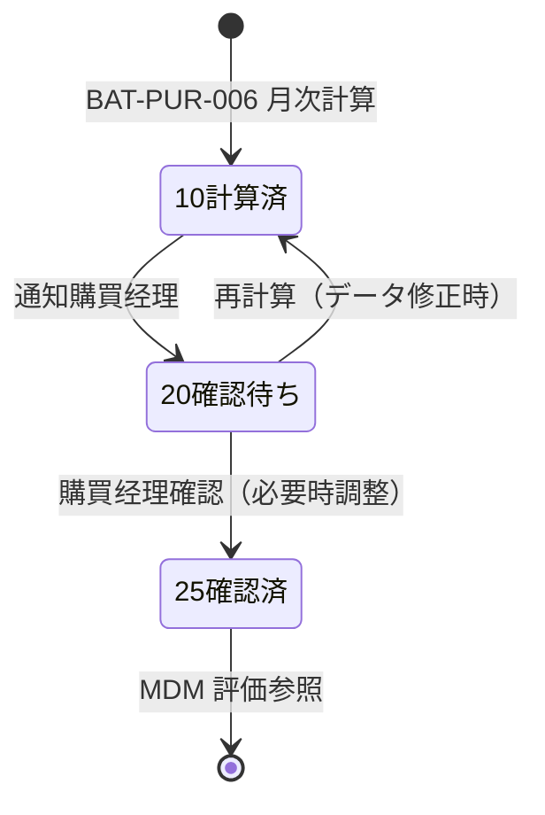
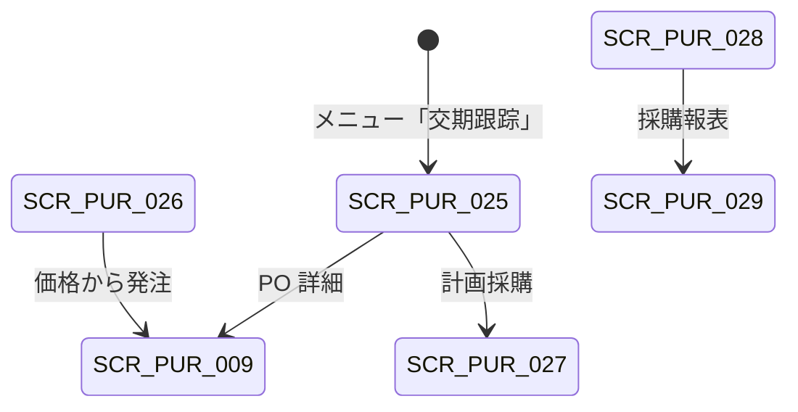

# 交期跟踪・采购价格・计划采购・绩效 详细设计书（納期フォロー・購買価格・計画購買・仕入先評価 詳細設計書）

| 項目 | 内容 |
|---|---|
| 文書名 | 交期跟踪・采购价格・计划采购・绩效 详细设计书（納期フォロー・購買価格・計画購買・仕入先評価 詳細設計書） |
| 文書番号 | DSN-PUR-007 |
| 版数 | v1.0 |
| 作成日 | 2026-10-20 |
| 作成者 | purchase-designer |
| 承認者 | 未承認（レビュー待ち） |
| 状態 | ドラフト（レビュー中） |
| 関連文書 | [業務域概要](00-overview.md) / [共通項目定義](../00-common/01-common-item-definitions.md) / [API 共通規格](../00-common/03-common-api-spec.md) / [共通業務規則](../00-common/08-common-business-rules.md) / [跨域流程](../00-common/09-cross-domain-flow.md) / [采购订单](03-purchase-order.md) / [收货与来料检验](04-receipt-iqc.md) / [主数据](../02-mdm/00-overview.md) / 报表分析（RPT 域、別設計書） |

---

## 1. 機能概要

| 項目 | 内容 |
|---|---|
| 機能 ID | F-PUR-023 交期跟踪与催货 / F-PUR-024 采购价格管理 / F-PUR-025 计划采购 / F-PUR-026 供应商绩效评价 / F-PUR-027 采購报表 |
| 機能名 | 采购执行管理（納期フォロー・購買価格・計画購買・仕入先評価・購買レポート） |
| 目的 | ① 未入荷 PO 的纳期可视化与催货活动记录，降低断料风险；② 采购价格的取价规则・成交价历史・价格趋势・异常监控，支撑价格合理性；③ 将 MRP 计划订单转换为请购（计划采购），减少手工需求录入；④ 按月计算供应商的交付・质量・价格・响应绩效并与 MDM 供应商评估联动；⑤ 提供采购额・价格趋势・交付达成等域内操作报表 |
| 利用者・ロール | 采购员（交期跟踪・催货・计划采购）、采购经理（绩效确认・价格异常确认）、计划员（计划采购建议）、财务/总经理（报表参照） |
| 利用シーン | ① 每日晨会前的未入荷清单确认与催货电话记录；② 钢材涨价时的价格趋势确认与供应商谈判依据；③ MRP 运行后采购员批量将计划订单转为请购；④ 季度供应商评审前的绩效数据确认；⑤ 月度采购分析会议 |
| 優先度 | P1（第一版（実装順 P1）。交期跟踪的「未入荷一览」在 P0 実装時点 即可用） |
| 画面 ID | SCR-PUR-025（交期跟踪看板）、SCR-PUR-026（采购价格查询）、SCR-PUR-027（计划采购建议）、SCR-PUR-028（供应商绩效）、SCR-PUR-029（采购报表） |
| 関連 IF | IF-PUR-003（MRP 计划订单受信）、IF-PUR-008（E03/E04 受信） |

### 1.1 機能分解

| 機能 ID | 機能名 | 概要 | 優先度 |
|---|---|---|---|
| F-PUR-023 | 交期跟踪与催货 | 未入荷一覧・遅延分類・催货記録・日次提醒・看板 | P1 |
| F-PUR-024 | 采购价格管理 | 取价・成交价历史・価格趨勢・価格異常検知（MDM 価格参照） | P1 |
| F-PUR-025 | 计划采购 | MRP 計画オーダー受信→請購自動/一括作成、安全在庫補貨 | P1 |
| F-PUR-026 | 供应商绩效评价 | 交付/質量/価格/響応指標の月次計算・評分・等級・MDM 連携 | P1 |
| F-PUR-027 | 采購报表 | 購買額・価格趨勢・交付達成・未入荷・集中度の集計 | P1 |

---

## 2. 業務要件・業務ルール

### 2.1 前提条件

| # | 前提条件 | 成立しない場合の挙動 |
|---|---|---|
| 1 | PO 明細に `delivery_date`（約定交期）または `supplier_promised_date`（供应商承诺）が設定済 | 未設定は `delivery_date` を基準（警告表示） |
| 2 | 入荷実績（`pur_receipt_line`）と IQC 結果（`inspection_status`）が存在する | 績效は対象外（取引なし） |
| 3 | MDM に有効な採購価格（`mdm_purchase_price`）が存在する | 取価不可（`MSG-PUR-049`） |
| 4 | PRD の MRP が実行済みで計画订单が存在する（計画採購） | 一覧 0 件 |
| 5 | 报表用の集計テーブル（BAT-PUR-009）が更新済み | 前日以前のデータを表示 |

### 2.2 業務ルール

#### 2.2.1 交期跟踪

| # | ルール | 根拠 | 関連項目 |
|---|---|---|---|
| BR-01 | 跟踪対象：`po_status ∈ {30,35}` かつ `remain_qty > 0` の PO 明細。完了・取消・全入荷は対象外 | 本域设计 | `remain_qty`（派生・不落库：`quantity − received_qty − cancelled_qty`） |
| BR-02 | 基準日：`supplier_promised_date` があればそれを優先、なければ `delivery_date`（約定交期）を使用 | 本域设计 | `delivery_date` |
| BR-03 | 遅延日数 = `基準日 − 当サーバ日`（負値が遅延）。分類：正常（> 3 日）/ 臨期（0～3 日）/ 遅延（−1～−7 日）/ 厳重遅延（< −7 日）/ 超期未入荷（< −30 日、取消候補） | 本域设计 | `delay_days`、`delay_level` |
| BR-04 | 催货记录：电话・メール・门户・現場・その他の手段で、日付・内容・供应商新承诺交期・次回フォロー日・担当者を記録する。1 PO 明細に複数記録可 | 本域设计 | `pur_delivery_followup` |
| BR-05 | 催货后供应商承诺交期変化（`supplier_promised_date`）を記録し、遅延判定の基準日を更新する（変更履歴は催货记录 + PO 变更履歴に残す） | 本域设计 | `supplier_promised_date` |
| BR-06 | 日次バッチ（BAT-PUR-001）が「遅延・厳重遅延・超期未入荷」を抽出し、購買担当・購買経理へ站内通知する。BAT-PUR-002 が超期未入荷の取消候補を抽出する | 08 §13.3 | — |
| BR-07 | 超期未入荷（30 日以上遅延）の PO は、取消候補として購買经理の判断対象とする（取消は PO の残数量取消で処理） | 08 §3.3、09 §4.3 | — |
| BR-08 | 交期跟踪のデータ（遅延日数・催货回数）は供应商绩效（F-PUR-026）の交付指標に連携する | 本域设计 | — |

#### 2.2.2 采购价格管理

| # | ルール | 根拠 | 関連項目 |
|---|---|---|---|
| BR-09 | PUR は採購価格の**所有権を持たない**（MDM の `mdm_purchase_price` を参照）。PUR は取价・成交价历史・価格趨勢・異常検知を提供する | 09 §11 マスタ参照規約 | `mdm_purchase_price` |
| BR-10 | 取价優先順位は [03](03-purchase-order.md) BR-02 の 5 段階。PUR の「采购价格查询」は有効期間内の价格表・最近成交价・询价中选价・框架合同价を並列表示する | 本域设计 | `price_source_type` |
| BR-11 | 成交价历史：`pur_purchase_order_line` の `unit_price` を PO 日・供应商・物料単位で集計し、直近 12 か月の推移を表示する | 本域设计 | — |
| BR-12 | 价格趨勢：月次の加重平均単価（数量加重）を物料・供应商・物料分类単位で集計する。外貨は CNY 換算（第一版・実装順 P2） | 本域设计 | — |
| BR-13 | 価格異常検知（BAT-PUR-007）：新規 PO 単価が「前回同条件単価 ± 10%」または「直近 3 か月加重平均 ± 10%」を超える場合、警告リストを生成する。購買经理が確認し、必要に応じて理由を `price_diff_reason` に記録する | 本域设计 | — |
| BR-14 | 価格適用率（KPI）：`価格表/詢价/合同に基づく発注行数 ÷ 全発注行数`。手工定価行は「非適用」として集計する | 本域设计 | `price_source_type` |
| BR-15 | 询价中选价の MDM 価格表反映は P1 実装では手動待办（[02](02-rfq-comparison.md) 未決 #2）。PUR は中选价を `pur_supplier_quotation_line` に保持する | 本域设计 | — |

#### 2.2.3 计划采购

| # | ルール | 根拠 | 関連項目 |
|---|---|---|---|
| BR-16 | 计划采购的输入：PRD 的 MRP 计划订单（`prd_mrp_plan_order`、購入品のみ）和安全库存补货建议。PUR 不自行计算 MRP | 09 §6.1 | `source_type=MRP/SAFETY_STOCK` |
| BR-17 | PUR 提供两种转换方式：① PRD 调用 PUR API 自动生成请购草稿（`POST /api/purchase/purchase-requisitions/from-plan`，`Idempotency-Key = plannedOrderId`）；② 采购员在 SCR-PUR-027 选择计划订单批量转换 | 本域设计 | `source_id` |
| BR-18 | 批量转换规则：同一供应商・同一收货仓库・同一希望交期（±3 日）的计划订单合并为 1 张请购；不同供应商分单。合并后行项目保留计划订单号（`source_id`） | 本域设计 | — |
| BR-19 | 转换后的请购为 10 草稿，采购员可调整数量（≥ 计划订单建议量、受 MOQ/批量规则约束）后提交审批。已转换的计划订单不可重复转换（幂等） | 本域设计 | — |
| BR-20 | MRP 建议数量与请购数量不一致时，记录差异理由（`plan_diff_reason`：季节调整/库存盘点/供应商 MOQ/手工判断） | 本域设计 | `remark` |

#### 2.2.4 供应商绩效

| # | ルール | 根拠 | 関連項目 |
|---|---|---|---|
| BR-21 | 計算周期：月次（毎月 1 日、前月分）。対象供应商：当月に入荷実績または発注実績がある供应商 | 本域设计 | `period_code` |
| BR-22 | 指標定義（すべて 0～100 点に正規化）：① **交付达成率** = 按期入荷行数 ÷ 已入荷行数 × 100（按期 = 実入荷日 ≤ 基準日）；② **数量达成率** = Σ入荷数量 ÷ Σ発注数量 × 100（上限 100）；③ **质量合格率** = Σ合格数量 ÷ Σ受入数量 × 100（IQC 結果）；④ **退货率** = Σ退貨数量 ÷ Σ受入数量 × 100（減点）；⑤ **価格競争力** = 100 − (当該供应商の数量加重平均単価 ÷ 同类物料の全体加重平均単価 − 1) × 100（上限 100・下限 0）；⑥ **響応速度** = 100 − 平均(报价日 − 询价发出日) × 10（下限 0） | 本域设计（示例企业評価基準） | `pur_supplier_performance` |
| BR-23 | 総合評分 = 交付 35% + 質量 35% + 価格 20% + 響応 10%。等級：A ≥ 90 / B ≥ 80 / C ≥ 70 / D < 70。取引がない指標は基準点（交付 80・質量 80・価格 70・響応 80）で補完し、`insufficient_data=true` を記録 | 本域设计 | `total_score`、`grade` |
| BR-24 | 評分の確定：BAT-PUR-006 が計算 → 購買经理が SCR-PUR-028 で確認・必要なら手動調整（調整理由必須）→ 確定（`confirmed_by`）。確定後は MDM 供应商评估（F-MDM-015）が参照可能 | 本域设计 | `confirmed_at` |
| BR-25 | 等級 D の供应商は新規発注時に警告（PO 登録時 `MSG-PUR-117`）。3 か月連続 D は MDM の供应商资格見直し対象として通知する | 本域设计 | — |
| BR-26 | 績效データは意思決定の参考であり、自動的に発注停止等の強制措置は行わない（業務判断は購買经理） | 本域设计 | — |

#### 2.2.5 采購报表

| # | ルール | 根拠 | 関連項目 |
|---|---|---|---|
| BR-27 | 域内报表（PRT-PUR-008～010・013）は本域が提供し、跨域汇总分析は RPT 域（10-analytics）が本域データを参照して作成する。二重定義しない | 09 §12、10-analytics | — |
| BR-28 | 採購額の口径：**発注基準**（PO 税抜金額・`order_date` 基準）を正式とし、**入荷基準**（GR 税抜金額）・**請求基準**（PIV 税抜金額）を参考値として併記する。レポートには口径を明記する | 本域设计 | `total_amount` |
| BR-29 | 集計は BAT-PUR-009 が日次で `pur_supplier_performance` とは別の集計ビュー/テーブル（または RPT 域の集計）へ書き出す。画面は集計結果を参照し、都度全件集計しない | 本域设计 | — |
| BR-30 | レポート出力（印刷・Excel）は権限制御し、監査ログ（PRINT/EXPORT）を記録する | 01 §12、02 §14 | — |

### 2.3 計算式・判定式

| # | 対象 | 算式 | 丸め | 例（示例值） |
|---|---|---|---|---|
| CALC-01 | 遅延日数 | `基準日 − 当日`（負値が遅延） | 整数（日） | 基準日 2026-11-03、当日 2026-11-10 → −7 |
| CALC-02 | 交付达成率 | 按期入荷行数 ÷ 已入荷行数 × 100 | 2 桁 | 28 ÷ 30 × 100 = 93.33 |
| CALC-03 | 数量达成率 | min(100, Σ入荷数量 ÷ Σ発注数量 × 100) | 2 桁 | min(100, 29,800 ÷ 28,000 × 100) = 100.00 |
| CALC-04 | 质量合格率 | Σ合格数量 ÷ Σ受入数量 × 100 | 2 桁 | 11,988 ÷ 12,000 × 100 = 99.90 |
| CALC-05 | 退货率 | Σ退貨数量 ÷ Σ受入数量 × 100 | 2 桁 | 12 ÷ 12,000 × 100 = 0.10 |
| CALC-06 | 価格競争力 | `100 − (当該単価 ÷ 全体平均単価 − 1) × 100`（0～100 にクリップ） | 2 桁 | 5.65 ÷ 5.70 → 100 − (−0.88) = 100 → 100.00（下限 0） |
| CALC-07 | 響応速度 | `100 − 平均応答日数 × 10`（0～100） | 2 桁 | 平均 1.5 日 → 100 − 15 = 85.00 |
| CALC-08 | 総合評分 | 交付×0.35 + 質量×0.35 + 価格×0.20 + 響応×0.10 | 2 桁 | 93.33×0.35 + 99.90×0.35 + 100×0.20 + 85×0.10 = 96.13 |
| CALC-09 | 価格適用率 | 適用行数 ÷ 全行数 × 100 | 2 桁 | 95 ÷ 100 × 100 = 95.00 |
| CALC-10 | 数量加重平均単価 | Σ(数量 × 単価) ÷ Σ数量 | 6 桁 | 例：5.652143 |
| CALC-11 | 価格異常率 | `(今回単価 − 基準単価) ÷ 基準単価 × 100`、`\|率\| > 10%` で警告 | 4 桁（%） | (5.72 − 5.40) ÷ 5.40 = 5.93%（非警告） |
| CALC-12 | 未入荷残高（発注残） | Σ(`remain_qty` × PO 税抜単価) | 2 桁 | 16,000 × 5.65 = 90,400.00 |
| CALC-13 | 采购集中度（上位 5 社） | 上位 5 供应商採購額 ÷ 全採購額 × 100 | 2 桁 | — |

### 2.4 状態遷移

#### 2.4.1 供应商绩效（`pur_supplier_performance`）



#### 2.4.2 催货记录（`pur_delivery_followup`）

催货记录は追記専用（更新・削除しない）。訂正は新規レコード追加（`correct_flag=true`）で対応する。

#### 2.4.3 计划采购建议

| 状態（PRD 側） | PUR 側の扱い |
|---|---|
| 計画オーダー（未承認） | 参照のみ（変換不可） |
| 承認済（未転換） | 変換可能（`converted=false`） |
| 変換済 | `source_id` で紐付、再変換不可（`MSG-PUR-118`） |
| 取消 | 変換ボタン非表示 |

---

## 3. 関連機能

| 関係 | 機能 ID | 機能名 | 関係内容 |
|---|---|---|---|
| 上流 | F-PUR-007～010 | 采购订单 | 未入荷残・成交价・交期の参照 |
| 上流 | F-PUR-011～014 | 收货・IQC | 受入数量・合格数量・入荷日の供給 |
| 上流 | F-PUR-004～006 | 询价比价 | 报价响应データ・中选価 |
| 上流 | F-MDM-011 | 採購価格 | 価格表の参照（所有権は MDM） |
| 上流 | F-MDM-015 | 供应商评估 | 績效データの提供（MDM が評価を所有） |
| 上流 | F-PRD-009 | MRP | 計画オーダーの供給 |
| 下流 | F-PUR-001 | 请购管理 | 計画→請購変換 |
| 連携 | F-RPT-003/004 | 报表分析 | 採購分析へのデータ提供 |

---

## 4. 画面設計

### 4.1 画面一覧

| 画面 ID | 画面名 | 類型 | 概要 |
|---|---|---|---|
| SCR-PUR-025 | 交期跟踪看板 | ダッシュボード | KPI カード + 未入荷一覧 + 催货记录 + 分類フィルタ |
| SCR-PUR-026 | 采购价格查询 | 一覧検索 | 価格表・成交价・価格趨勢・適用率・異常一覧 |
| SCR-PUR-027 | 计划采购建议 | 一覧検索 | MRP 計画オーダー一覧・一括変換・合并規則 |
| SCR-PUR-028 | 供应商绩效 | 参照詳細 | 月次績效・指標内訳・等級・確認・推移 |
| SCR-PUR-029 | 采購报表 | 一覧検索 | 採購額・価格趨勢・交付達成・未入荷・集中度 |

### 4.2 画面遷移



### 4.3 画面レイアウト（SCR-PUR-025 交期跟踪看板）

```
┌────────────────────────────────────────────────────────────────────────────────┐
│ 交期跟踪  [日付 2026-11-10]  [工厂 全部▼]  [采购员 全部▼]  [刷新]              │
├────────────────────────────────────────────────────────────────────────────────┤
│〔KPI〕未入荷件数 42 | 臨期 8 | 遅延 5 | 厳重遅延 3 | 超期未入荷 2 | 按期率 93.3%│
├────────────────────────────────────────────────────────────────────────────────┤
│〔遅延リスト〕                                                                  │
│ 遅延区分 | PO号 | 供应商 | 物料 | 未入荷残 | 基準日 | 遅延日 | 最終催货 | 次回 │
│ 厳重遅延 | PO2610200001 | S000001 宝山钢铁 | 50W470 | 16,000 KGM | 2026-11-03 |│
│          | −7 | 2026-11-08 電話（担当：王） | 2026-11-12 | [催货登録]          │
│ 遅延     | PO2610180007 | S000008 中信特钢 | 45# 钢 | 2,000 KGM | 2026-11-09 |  │
│          | −1 | 2026-11-09 メール | 2026-11-13 | [催货登録]                   │
├────────────────────────────────────────────────────────────────────────────────┤
│〔催货登録ダイアログ〕手段[電話▼] 内容[____] 新承诺交期[____] 次回[____] [保存]  │
└────────────────────────────────────────────────────────────────────────────────┘
```

### 4.4 画面項目定義

#### 4.4.1 SCR-PUR-025 交期跟踪（検索条件・一覧）

| No | 項目 ID | 項目名 | 種別 | 型/桁 | 必須 | 初期値 | 入力チェック | データソース | DB 項目 | 備考 |
|---|---|---|---|---|---|---|---|---|---|---|
| 1 | `asOfDate` | 基準日 | 日付 | DATE | ○ | 当日 | — | — | — | 遅延判定基準 |
| 2 | `factoryId` | 工厂 | 選択 | BIGINT | — | 全部 | — | `mdm_factory` | `factory_id` | — |
| 3 | `buyerId` | 采购员 | 選択 | BIGINT | — | 全部 | — | `sys_user` | `buyer_id` | — |
| 4 | `delayLevel` | 遅延区分 | 複数選択 | SMALLINT | — | 全部 | 1～5 | 固定値 | 導出 | 正常/臨期/遅延/厳重/超期 |
| 5 | `supplierId` | 供应商 | 選択 | BIGINT | — | 全部 | — | `mdm_supplier` | `supplier_id` | — |
| 6 | `poNo` | PO 号 | テキスト | VARCHAR(32) | — | 空 | 部分一致 | — | `po_no` | — |
| 7 | `materialKeyword` | 物料 | テキスト | VARCHAR(64) | — | 空 | 部分一致 | — | `material_code`/`name` | — |
| 8 | `remainQty` | 未入荷残 | 数値 | NUMERIC(18,4) | — | 全件 | > 0 | 計算 | `remain_qty` | — |
| 9 | `delayDays` | 遅延日数 | 数値 | INT | — | — | — | CALC-01 | 導出 | 赤黒表示 |
| 10 | `lastFollowupDate` | 最終催貨日 | 日付 | DATE | — | — | — | `pur_delivery_followup` | `followup_date` | — |
| 11 | `nextFollowupDate` | 次回催貨日 | 日付 | DATE | — | — | — | 同上 | `next_followup_date` | 期限超過は赤字 |

#### 4.4.2 SCR-PUR-025 催货登録ダイアログ

| No | 項目 ID | 項目名 | 種別 | 型/桁 | 必須 | 初期値 | 入力チェック | DB 項目 | 備考 |
|---|---|---|---|---|---|---|---|---|---|
| 1 | `poId`/`poLineId` | 対象 PO 明細 | テキスト | BIGINT | ○ | 選択行 | — | `po_id`/`po_line_id` | — |
| 2 | `followupDate` | 催货日 | 日付 | DATE | ○ | 当日 | ≤ 当日 | `followup_date` | — |
| 3 | `followupMethod` | 手段 | 選択 | SMALLINT | ○ | 1 電話 | 1 電話/2 メール/3 门户/4 現場/5 その他 | `followup_method` | — |
| 4 | `content` | 内容 | テキストエリア | VARCHAR(1000) | ○ | 空 | 桁数 | `content` | 会話メモ |
| 5 | `supplierPromisedDate` | 新承诺交期 | 日付 | DATE | △ | 空 | ≥ 当日 | `supplier_promised_date` | PO 明細を更新 |
| 6 | `nextFollowupDate` | 次回催貨日 | 日付 | DATE | △ | 3 日後 | ≥ 当日 | `next_followup_date` | — |
| 7 | `followupBy` | 担当者 | テキスト | BIGINT | 自動 | ログインユーザ | — | `followup_by` | — |

#### 4.4.3 SCR-PUR-026 采购价格查询

| No | 項目 ID | 項目名 | 種別 | 型/桁 | データソース | DB 項目 | 備考 |
|---|---|---|---|---|---|---|---|
| 1 | `materialCode`/`materialName`/`spec` | 物料 | テキスト | VARCHAR | `mdm_material` | — | 検索キー |
| 2 | `supplierId`/`supplierName` | 供应商 | 選択 | BIGINT | `mdm_supplier` | — | — |
| 3 | `validFrom`/`validTo` | 有効期間 | 日付 | DATE | `mdm_purchase_price` | — | 検索条件 |
| 4 | `price` | 税抜価格 | 数値 | NUMERIC(18,6) | `mdm_purchase_price` | — | 表示 |
| 5 | `currencyCode`/`taxCode` | 币种・税码 | テキスト | — | `mdm_purchase_price` | — | — |
| 6 | `moq`/`leadTimeDays` | MOQ・提前期 | 数値 | — | `mdm_supplier_material` | — | — |
| 7 | `lastOrderPrice` | 最近成交价 | 数値 | NUMERIC(18,6) | `pur_purchase_order_line` | — | 直近 90 日 |
| 8 | `lastOrderDate` | 最近成交日 | 日付 | DATE | 同上 | — | — |
| 9 | `priceTrend` | 価格趨勢 | グラフ | — | 月次加重平均 | — | 12 か月 |
| 10 | `priceApplyRate` | 価格適用率 | 数値 | NUMERIC(7,4) | 集計 | — | KPI |
| 11 | `priceAnomaly` | 異常フラグ | バッジ | — | BAT-PUR-007 | — | 警告一覧 |

#### 4.4.4 SCR-PUR-027 计划采购建议

| No | 項目 ID | 項目名 | 種別 | 型/桁 | 必須 | 初期値 | データソース | 備考 |
|---|---|---|---|---|---|---|---|---|
| 1 | `planOrderNo` | 計画オーダー番号 | テキスト | VARCHAR(32) | — | — | `prd_mrp_plan_order` | — |
| 2 | `materialCode`/`materialName` | 物料 | テキスト | — | — | — | PRD | — |
| 3 | `requiredQty` | 推奨発注数量 | 数値 | NUMERIC(18,4) | ○ | 計画数量 | PRD MRP | 調整可 |
| 4 | `requiredDate` | 希望交期 | 日付 | DATE | ○ | 計画納期 | PRD MRP | — |
| 5 | `suggestedSupplierId` | 推奨供应商 | 選択 | BIGINT | ○ | MDM 既定 | `mdm_supplier` | 変更可 |
| 6 | `warehouseId` | 收货仓库 | 選択 | BIGINT | ○ | 既定 | `mdm_warehouse` | — |
| 7 | `planDiffReason` | 数量差异理由 | 選択 | SMALLINT | △ | 空 | 固定値 | 計画と異なる場合 |
| 8 | `converted` | 変換済 | チェック | BOOLEAN | — | false | — | 変換後 true |

#### 4.4.5 SCR-PUR-028 供应商绩效

| No | 項目 ID | 項目名 | 種別 | 型/桁 | データソース | 備考 |
|---|---|---|---|---|---|---|
| 1 | `periodCode` | 対象期間 | テキスト | VARCHAR(7) | `pur_supplier_performance` | 既定：前月 |
| 2 | `supplierCode`/`supplierName` | 供应商 | テキスト | — | — | — |
| 3 | `deliveryScore`/`qualityScore`/`priceScore`/`responseScore` | 指標得点 | 数値 | NUMERIC(7,2) | 計算 | CALC-02～07 |
| 4 | `totalScore` | 総合評分 | 数値 | NUMERIC(7,2) | CALC-08 | — |
| 5 | `grade` | 等級 | バッジ | CHAR(1) | A/B/C/D | 色：A=緑/B=青/C=橙/D=赤 |
| 6 | `receiptLineCount`/`onTimeLineCount` | 入荷行数・按期行数 | 数値 | INT | 実績 | — |
| 7 | `inspectionQty`/`acceptedQty` | 受入・合格数量 | 数値 | NUMERIC(18,4) | IQC | — |
| 8 | `insufficientData` | データ不足 | チェック | BOOLEAN | — | 基準点補完の明示 |
| 9 | `confirmedBy`/`confirmedAt` | 確認者・日時 | テキスト/日時 | — | — | — |
| 10 | `adjustReason` | 調整理由 | テキスト | VARCHAR(500) | — | 手動調整時必須 |
| 11 | `trend` | 推移グラフ | グラフ | — | 過去 12 か月 | — |

### 4.5 イベント処理

| No | イベント | トリガ | 処理内容 | 呼出 API | 画面遷移 | 備考 |
|---|---|---|---|---|---|---|
| 1 | 看板刷新 | 刷新ボタン | KPI・未入荷一覧取得 | `GET /api/purchase/tracking` | 同一画面 | 3 秒以内 |
| 2 | 催货登録 | 催货登録ボタン | 記録保存・PO 明細の `supplier_promised_date` 更新 | `POST /api/purchase/delivery-followups` | 同画面 | 追記専用 |
| 3 | 遅延通知確認 | 通知リンク | 対象 PO へ遷移 | `GET .../purchase-orders/{id}` | SCR-PUR-009 | — |
| 4 | 価格検索 | 検索ボタン | 価格表・成交价・趨勢取得 | `GET /api/purchase/prices` | 同画面 | — |
| 5 | 価格異常確認 | 異常一覧行選択 | 対象 PO・理由確認 | `GET /api/purchase/price-anomalies` | SCR-PUR-009 | — |
| 6 | 計画一覧 | 検索ボタン | MRP 計画オーダー取得 | `GET /api/purchase/plan-suggestions` | 同画面 | PRD 参照 |
| 7 | 一括変換 | 変換ボタン | 合并規則→請購草稿作成 | `POST /api/purchase/plan-suggestions/convert` | SCR-PUR-002 | 二重変換防止 |
| 8 | 績效確認 | 確認ボタン | 評分確定 | `POST /api/purchase/supplier-performances/{id}/confirm` | 同画面 | 購買经理 |
| 9 | 績效再計算 | 再計算ボタン | BAT と同一ロジックで再計算 | `POST /api/purchase/supplier-performances/recalculate` | 同画面 | 手動実行 |
| 10 | 报表出力 | 出力ボタン | 帳票・Excel 出力 | `POST /api/purchase/exports` | — | 非同期可 |

### 4.6 一覧・帳票仕様（SCR-PUR-029）

| 項目 | 内容 |
|---|---|
| 帳票 | PRT-PUR-007 交期跟踪表 / PRT-PUR-008 採購明細表 / PRT-PUR-009 価格趨勢表 / PRT-PUR-010 交付達成率表 / PRT-PUR-013 績效評価表（詳細は [92](92-report-batch-design.md)） |
| 検索条件 | 期間、工厂、部門、供应商、物料分类、采购员 |
| 出力形式 | Excel（.xlsx）≤10,000 件、PDF（帳票）、超過は非同期ジョブ |
| 権限 | `purchase:report:view` / `purchase:report:export` |

### 4.7 表示制御

| 条件 | 対象 | 制御 |
|---|---|---|
| データ未集計（BAT 未実行） | KPI カード | 「集計中」表示・最終更新時刻 |
| 権限なし | 金額・単価・績效 | 非表示（API も返さない） |
| 等級 D | 供应商名 | 赤バッジ表示 |
| `insufficientData=true` | 績效指標 | 「データ不足（基準点補完）」注記 |
| 計画オーダー変換済 | 変換ボタン | 非活性 |

---

## 5. 入力チェック仕様

| No | チェック ID | 対象項目 | 種別 | 条件 | タイミング | メッセージ ID |
|---|---|---|---|---|---|---|
| 1 | CHK-PUR-007-01 | 催货日 | 範囲 | ≤ 当日 | 保存時 | `MSG-PUR-119` |
| 2 | CHK-PUR-007-02 | 催货内容 | 必須 | 入力あり | 保存時 | `MSG-COM-040` |
| 3 | CHK-PUR-007-03 | 新承诺交期 | 範囲 | ≥ 当日、PO 交期と異なる場合は理由推奨 | 保存時 | `MSG-PUR-120` |
| 4 | CHK-PUR-007-04 | 計画→請購変換数 | 範囲 | > 0、≤ 100 件/回 | 変換時 | `MSG-PUR-121` |
| 5 | CHK-PUR-007-05 | 変換済重複 | 業務 | 同一計画オーダーを再変換しない | 変換時 | `MSG-PUR-118` |
| 6 | CHK-PUR-007-06 | 績效調整理由 | 必須 | 手動調整時に理由 | 確定時 | `MSG-PUR-122` |
| 7 | CHK-PUR-007-07 | 期間指定 | 相関 | from ≤ to | 検索時 | `MSG-COM-046` |

---

## 6. 処理詳細

### 6.1 処理一覧

| 処理 ID | 処理名 | 契機 | トランザクション | 排他 |
|---|---|---|---|---|
| PRC-PUR-023-01 | 交期跟踪抽出 | BAT-PUR-001/002・画面 | 不要（読取・集計） | — |
| PRC-PUR-023-02 | 催货記録登録 | 催货登録 | 要 | 楽観排他（PO 明細） |
| PRC-PUR-024-01 | 価格趨勢集計 | BAT-PUR-009・画面 | 不要（集計） | — |
| PRC-PUR-024-02 | 価格異常検知 | BAT-PUR-007 | 不要（検知・アラート） | — |
| PRC-PUR-025-01 | 計画→請購変換 | 変換 | 要 | 計画オーダーロック・冪等 |
| PRC-PUR-026-01 | 績效月次計算 | BAT-PUR-006 | 要（月次一括） | 期間ロック |
| PRC-PUR-026-02 | 績效確定 | 確認 | 要 | 楽観排他 |
| PRC-PUR-027-01 | 採購集計 | BAT-PUR-009 | 要（集計テーブル更新） | — |

### 6.2 処理手順（正常系）

**PRC-PUR-023-01 交期跟踪抽出**

1. `po_status ∈ {30,35}` かつ `remain_qty > 0` の PO 明細を抽出する。
2. 基準日 = `supplier_promised_date` ?? `delivery_date`。CALC-01 で遅延日数を計算し、BR-03 の分類を付与する。
3. 最終催货日・次回催货日を `pur_delivery_followup` から取得する。
4. 分類別件数・按期率を集計し、KPI と一覧を返す。
5. BAT-PUR-001 では、遅延・厳重遅延・超期未入荷について購買担当・購買经理へ通知（站内、設定でメール）する。BAT-PUR-002 は超期未入荷（30 日以上）を取消候補リストとして出力する。

**PRC-PUR-023-02 催货記録登録**

1. 対象 PO 明細を `FOR UPDATE` でロックする。
2. 入力チェック（CHK-01～03）を実行する。
3. `pur_delivery_followup` を INSERT（追記専用）する。
4. `supplier_promised_date` が入力された場合、PO 明細を更新し、PO 变更履歴（`pur_purchase_order_his`、`change_type=交期`）にも記録する。
5. 監査ログ（CREATE）を記録する。

**PRC-PUR-024-01 価格趨勢集計**

1. 対象期間・物料・供应商を指定し、`pur_purchase_order_line` の確定 PO（状態 ≥ 25）から `Σ(数量 × 税抜単価) ÷ Σ数量` を算出する（CALC-10）。
2. 月次・四半期・年次の系列を生成し、前月比・前年比を計算する。
3. 有効な `mdm_purchase_price` と比較し、乖離率を表示する。
4. 外貨は CNY 換算（第一版・実装順 P2）。為替レートは PO 登録時点の値を保持する。

**PRC-PUR-024-02 価格異常検知**

1. 前日確定の PO 明細（状態 ≥ 25）を対象とする。
2. 基準単価 = ① 同供应商・同物料の直近 3 か月加重平均（優先）② 直近同条件の最終成交价。
3. CALC-11 で異常率を計算し、`\|率\| > 10%` の行を `pur_price_anomaly` 相当の警告リスト（または RPT 警告センター）へ出力する。
4. 購買经理は警告を確認し、必要に応じ `price_diff_reason` を追記する（記録のみ、処理は止めない）。

**PRC-PUR-025-01 計画→請購変換**

1. 選択された計画オーダー（`prd_mrp_plan_order`、購入品・承認済・未変換）を取得し、ロックする。
2. 変換済チェック（`source_type=MRP` かつ `source_id=plannedOrderId` の PR が存在しないこと）を行う。
3. 合并規則（BR-18）に従い、供应商・倉庫・希望交期でグループ化する。
4. グループごとに `PR{YYMMDD}{4桁}` を採番し、`pur_purchase_requisition`（`source_type=MRP`、`source_id` はグループ先頭計画番号、`pr_type=2 计划采购`）と明細（`source_line_id` に計画オーダー行）を作成する。
5. 計画数量との差異がある場合は `plan_diff_reason` を保存する。
6. `Idempotency-Key = plannedOrderId` により二重変換を防止し、変換結果（PR 番号一覧）を返す。
7. 監査ログ（CREATE）を記録する。

**PRC-PUR-026-01 績效月次計算**

1. 対象期間（前月）・対象供应商（当月取引あり）を抽出する。
2. 交付：`pur_receipt`/`pur_receipt_line` から入荷行数・按期行数（実入荷日 ≤ 基準日）を集計（CALC-02）。
3. 数量：`pur_purchase_order_line` の発注数量と入荷数量（CALC-03）。
4. 質量：`pur_receipt_line` の `accepted_qty`/`rejected_qty`（IQC 結果）から合格率・退货率（CALC-04/05）。
5. 価格：`pur_purchase_order_line` の数量加重平均単価と同类物料平均単価から競争力（CALC-06）。
6. 響応：`pur_supplier_quotation` の `quote_date − rfq.issued_at` の平均（CALC-07）。
7. CALC-08 で総合評分と等級を計算し、`pur_supplier_performance` に UPSERT（`(period_code, supplier_id)` 一意）する。
8. データ不足指標は基準点で補完し `insufficient_data=true` を記録する。
9. 購買经理へ確認通知を送る。

**PRC-PUR-027-01 採購集計**

1. 日次で、期間・工厂・部門・供应商・物料分類別の採購額（発注基準/入荷基準/請求基準）、未入荷残、価格適用率、集中度を集計する。
2. 集計結果を RPT 域の集計テーブルまたは PUR の集計ビューへ保存する（画面はこれを参照）。
3. 集計失敗・差異（例：GR 合計 ≠ PO 累計）はアラートし、月結チェックへ連携する。

### 6.3 例外処理

| No | 異常条件 | 検知箇所 | 処理 | ロールバック | メッセージ ID |
|---|---|---|---|---|---|
| 1 | 基準日未設定（交期なし） | 交期跟踪 | `delivery_date` を基準、警告表示 | — | `MSG-PUR-123`（W） |
| 2 | 計画オーダー変換済 | 変換 | スキップし结果一覧に返す | 部分 | `MSG-PUR-118` |
| 3 | PRD サービス停止 | 計画一覧 | 取得失敗・再試行表示 | — | `MSG-COM-081` |
| 4 | 績效計算データ不足 | 績效 | 基準点補完・注記 | — | — |
| 5 | 為替レート未設定（外貨） | 価格趨勢 | 該当行を除外し警告 | 部分 | `MSG-PUR-041` |
| 6 | 集計テーブル未更新 | 报表 | 前回集計時刻を表示 | — | `MSG-PUR-124`（W） |
| 7 | 一括変換上限超過 | 変換 | 拒否（≤100 件/回） | 全体 | `MSG-PUR-121` |

### 6.4 冪等性・再実行

- 計画→請購変換：`Idempotency-Key=plannedOrderId` + `source_type/source_id` の一意チェックで二重作成を防止。
- 績效月次計算：`(period_code, supplier_id)` の UPSERT で再実行しても重複しない（確定後の再計算は `confirmed_at` を要確認）。
- 集計バッチは全件再計算（冪等）。
- 価格異常検知は検知時点のスナップショットを保持し、再実行時は同日分を置換する。

---

## 7. API 設計

| No | メソッド | パス | 権限 | 概要 | リクエスト | レスポンス | 主なエラー |
|---|---|---|---|---|---|---|---|
| 1 | GET | `/api/purchase/tracking` | `purchase:tracking:view` | 交期跟踪 KPI・一覧 | `{asOfDate, factoryId?, buyerId?, delayLevel?}` | `TrackingDashboardDto` | 3001 |
| 2 | GET | `/api/purchase/tracking/backorders` | `purchase:tracking:view` | 未入荷一覧 | 検索条件 | `PageResult<BackorderDto>` | — |
| 3 | POST | `/api/purchase/delivery-followups` | `purchase:tracking:followup` | 催货登録 | `DeliveryFollowupCreateDto` | `DeliveryFollowupDto`（201） | 1001/4002 |
| 4 | GET | `/api/purchase/delivery-followups` | `purchase:tracking:view` | 催货履歴 | `{poLineId}` | `DeliveryFollowupDto[]` | — |
| 5 | GET | `/api/purchase/prices` | `purchase:price:view` | 採購価格照会 | `{materialId?, supplierId?, date?}` | `PurchasePriceDto[]` | 4001 |
| 6 | GET | `/api/purchase/price-history` | `purchase:price:view` | 成交价历史・趨勢 | `{materialId, supplierId?, months=12}` | `PriceHistoryDto` | 4001 |
| 7 | GET | `/api/purchase/price-anomalies` | `purchase:price:view` | 価格異常一覧 | `{dateFrom, dateTo}` | `PageResult<PriceAnomalyDto>` | — |
| 8 | GET | `/api/purchase/plan-suggestions` | `purchase:plan:view` | MRP 計画オーダー一覧 | `{dateFrom, dateTo, materialKeyword?}` | `PageResult<PlanSuggestionDto>` | 4001 |
| 9 | POST | `/api/purchase/plan-suggestions/convert` | `purchase:plan:convert` | 計画→請購変換 | `{planOrderIds[], groupBy, comment?}` | `{prNos[]}` | 40010/40011 |
| 10 | GET | `/api/purchase/supplier-performances` | `purchase:performance:view` | 績效一覧 | `{periodCode, grade?}` | `PageResult<SupplierPerformanceDto>` | — |
| 11 | GET | `/api/purchase/supplier-performances/{id}` | `purchase:performance:view` | 績效詳細・推移 | — | `SupplierPerformanceDetailDto` | 4001 |
| 12 | POST | `/api/purchase/supplier-performances/{id}/confirm` | `purchase:performance:calculate` | 績效確定 | `{version, adjustReason?}` | 詳細 | 4002/40010 |
| 13 | POST | `/api/purchase/supplier-performances/recalculate` | `purchase:performance:calculate` | 再計算 | `{periodCode, supplierIds?}` | `{count}` | 4001 |
| 14 | POST | `/api/purchase/exports` | `purchase:report:export` | 报表非同期出力 | `{reportId, params}` | `{jobId}`（202） | — |
| 15 | GET | `/api/purchase/jobs/{jobId}` | `purchase:report:view` | ジョブ状態 | — | `JobStatusDto` | — |
| 16 | POST | `/api/purchase/purchase-requisitions/from-plan` | `purchase:plan:convert`（内部呼出） | PRD からの計画請購自動作成 | `{planOrderId, lines[]}` | `{prId, prNo}` | 40010/40011 |

### 7.1 交期跟踪レスポンス例（抜粋）

```json
{
  "code": 0,
  "message": "ok",
  "data": {
    "asOfDate": "2026-11-10",
    "kpi": {
      "openLineCount": 42,
      "dueSoonCount": 8,
      "delayedCount": 5,
      "severeDelayedCount": 3,
      "overdueNotReceivedCount": 2,
      "onTimeRate": "93.33"
    },
    "backorders": [
      {
        "poNo": "PO2610200001",
        "poLineNo": 10,
        "supplierCode": "S000001",
        "supplierName": "宝山钢铁股份有限公司",
        "materialCode": "1001000001",
        "materialName": "冷轧无取向电工钢带",
        "spec": "50W470 0.50mm×1000mm 卷料",
        "remainQty": "16000.0000",
        "uomCode": "KGM",
        "baseDate": "2026-11-03",
        "delayDays": -7,
        "delayLevel": 4,
        "delayLevelName": "厳重遅延",
        "lastFollowupDate": "2026-11-08",
        "nextFollowupDate": "2026-11-12",
        "buyerName": "E000201 陈鹏"
      }
    ]
  }
}
```

### 7.2 計画変換レスポンス例

```json
{
  "code": 0,
  "message": "ok",
  "data": {
    "prNos": ["PR2611110001", "PR2611110002"],
    "convertedCount": 5,
    "skipped": [
      { "planOrderNo": "PLN2611100007", "reason": "已转换（PR2611080003）" }
    ]
  }
}
```

### 7.3 績效レスポンス例

```json
{
  "code": 0,
  "message": "ok",
  "data": {
    "periodCode": "2026-10",
    "supplierCode": "S000001",
    "supplierName": "宝山钢铁股份有限公司",
    "deliveryScore": "93.33",
    "qualityScore": "99.90",
    "priceScore": "100.00",
    "responseScore": "85.00",
    "totalScore": "96.13",
    "grade": "A",
    "receiptLineCount": 30,
    "onTimeLineCount": 28,
    "inspectionQty": "12000.0000",
    "acceptedQty": "11988.0000",
    "insufficientData": false,
    "confirmedAt": "2026-11-01T10:00:00+08:00"
  }
}
```

---

## 8. データ更新仕様

| テーブル | 操作 | 更新項目 | 更新条件 | トリガ |
|---|---|---|---|---|
| `pur_delivery_followup` | INSERT | 全項目（追記専用） | 催货登録 | PRC-PUR-023-02 |
| `pur_purchase_order_line` | UPDATE | `supplier_promised_date` | 催货記録（新承诺交期） | PRC-PUR-023-02 |
| `pur_purchase_order_his` | INSERT | 交期変更履歴 | 同上 | PRC-PUR-023-02 |
| `pur_purchase_requisition(_line)` | INSERT | 計画→請購 | 変換 | PRC-PUR-025-01 |
| `pur_supplier_performance` | UPSERT | 指標・評分・等級・`confirmed_at/by` | 月次計算・確定 | PRC-PUR-026 |
| 集計テーブル（RPT 域または PUR 集計ビュー） | INSERT/UPDATE | 採購額・趨勢・達成率 | BAT-PUR-009 | PRC-PUR-027-01 |
| `sys_audit_log` | INSERT | 操作ログ | 全操作 | 各 PRC |

---

## 9. エラー処理・メッセージ

| メッセージ ID | 種別 | 本文 | 発生条件 | 利用者への対処 | ログ |
|---|---|---|---|---|---|
| MSG-PUR-117 | W | 该供应商当前绩效等级为 {0}，是否继续发注？ | 等級 D の PO 登録 | 発注判断・理由記録 | INFO |
| MSG-PUR-118 | W | 该计划订单已转换（{0}），不能重复转换。 | 変換済 | 既存請購参照 | INFO |
| MSG-PUR-119 | E | 催货日不能晚于今天。 | 未来日 | 日付修正 | WARN |
| MSG-PUR-120 | W | 供应商承诺交期晚于希望交期 {0} 天，已记录延迟。 | 交期遅延 | PO 变更・代替調達検討 | INFO |
| MSG-PUR-121 | E | 一次最多转换 100 件计划订单，请分批执行。 | 上限超過 | 分割実行 | WARN |
| MSG-PUR-122 | E | 手动调整绩效评分时必须填写调整理由。 | 調整理由なし | 理由入力 | WARN |
| MSG-PUR-123 | W | 该订单未设定约定交期，按订单日 + 提前期计算。 | 交期未設定 | 交期登録 | WARN |
| MSG-PUR-124 | W | 采购报表尚未完成当日集計（最終更新：{0}），显示前一日数据。 | 集計未更新 | 再集計待ち | INFO |
| MSG-PUR-125 | I | 催货记录已保存。 | 保存成功 | — | INFO |

---

## 10. 権限・セキュリティ

| 種別 | 内容 |
|---|---|
| 画面権限 | SCR-PUR-025：`purchase:tracking:view`；催货登録は `purchase:tracking:followup`；SCR-PUR-026：`purchase:price:view`；SCR-PUR-027：`purchase:plan:view`/`convert`；SCR-PUR-028：`purchase:performance:view`/`calculate`；SCR-PUR-029：`purchase:report:view` |
| 項目権限 | 価格・成交价は購買・財務・総経理のみ。一般部門は交期のみ参照 |
| データ範囲 | 購買は全社、部門担当は自部門分の交期参照のみ |
| 監査ログ | 催货記録・計画変換・績效確定・帳票出力を記録 |
| 機密 | 価格・供应商評分は機密扱い。エクスポートは権限制御・マスキング不要（個人情報なし） |

---

## 11. 性能・非機能

| 項目 | 目標値 | 前提 |
|---|---|---|
| 交期跟踪 KPI | 2 秒以内 | 未入荷 500 行以下・索引 |
| 未入荷一覧 | 2 秒以内 | `(po_status, delivery_date)` 索引 |
| 価格趨勢（12 か月） | 2 秒以内 | 集計テーブル参照 |
| 計画一覧 | 2 秒以内 | PRD API 参照 |
| 績效月次バッチ | 10 分以内 | 供应商 800 社・取引行 50,000 |
| 日次集計バッチ | 30 分以内 | 前日分 |

---

## 12. テスト観点

| No | 観点 ID | 分類 | 観点 | 期待結果 |
|---|---|---|---|---|
| 1 | TST-F-PUR-023-01 | 正常系 | 未入荷一覧の遅延分類 | 遅延日数・区分が CALC-01/BR-03 と一致 |
| 2 | TST-F-PUR-023-02 | 正常系 | 催货記録登録・新承诺交期 | 記録保存、PO 明細更新、履歴記録 |
| 3 | TST-F-PUR-023-03 | 異常系 | 未来日の催货日 | `MSG-PUR-119` |
| 4 | TST-F-PUR-023-04 | 業務 | 超期未入荷 30 日の抽出 | 取消候補リストに表示 |
| 5 | TST-F-PUR-024-01 | 正常系 | 価格趨勢（12 か月） | 月次加重平均が CALC-10 と一致 |
| 6 | TST-F-PUR-024-02 | 業務 | 価格異常（+12%） | 警告リストに表示 |
| 7 | TST-F-PUR-024-03 | 業務 | 価格適用率 | 手工定価行が非適用として集計 |
| 8 | TST-F-PUR-025-01 | 正常系 | 計画 5 件を 2 グループに変換 | PR 2 張作成、`source_type=MRP` |
| 9 | TST-F-PUR-025-02 | 冪等 | 同一計画の再変換 | `MSG-PUR-118`、追加作成なし |
| 10 | TST-F-PUR-025-03 | 異常系 | 101 件変換 | `MSG-PUR-121` |
| 11 | TST-F-PUR-026-01 | 正常系 | 月次績效計算（例：S000001） | 交付 93.33・質量 99.90・総合 96.13・等級 A |
| 12 | TST-F-PUR-026-02 | 境界値 | 総合 90.00 ちょうど | 等級 A |
| 13 | TST-F-PUR-026-03 | 境界値 | 総合 89.99 | 等級 B |
| 14 | TST-F-PUR-026-04 | 業務 | データ不足の指標 | 基準点補完・`insufficientData=true` |
| 15 | TST-F-PUR-026-05 | 異常系 | 手動調整理由なし | `MSG-PUR-122` |
| 16 | TST-F-PUR-027-01 | 正常系 | 採購額 3 口径（発注/入荷/請求） | 各口径の合計が一致・差异明示 |

---

## 13. 未決事項

| # | 事項 | 理由 | 暫定仕様 | 担当 | 期限 |
|---|---|---|---|---|---|
| 1 | 績效指標の重み・基準点 | 社内評価規程が未確定（示例値で設定） | 交付 35% / 質量 35% / 価格 20% / 響応 10%、基準点は 80/80/70/80 | 購買部・MDM 担当 | 2026-10-27 |
| 2 | 計画採購の自動化範囲 | PRD が請購を自動作成するか、PUR で一括確認するか運用未定 | P0 実装時点は PRD からの API 作成 + PUR 一括変換の併用 | production-designer / 購買部 | 第一版（実装順 P1） |
| 3 | 価格異常検知の閾値・通知先 | 業務ルール未確定 | 前回 ±10%・3 か月平均 ±10%、購買经理へ站内通知 | 購買部 | 2026-10-27 |
| 4 | 采購分析报表の RPT 域との分担 | RPT 域の設計待ち（10-analytics） | 域内操作报表は PUR、跨域汇总は RPT。PRT-PUR-008～010 は PUR が提供 | analytics 担当 / Lead | 第一版（実装順 P1） |
| 5 | 交期跟踪の供应商通知（メール/门户） | INT 第一版（実装順 P2） | P0 実装時点は站内通知のみ、供应商通知は手動 | integration 担当 | 第一版（実装順 P2） |

---

## 14. 改訂履歴

| 版数 | 日付 | 変更内容 | 変更者 |
|---|---|---|---|
| v1.0 | 2026-10-20 | 初版：F-PUR-023～027（交期跟踪・価格管理・計画採購・績效・采購報表）、指標算式・変換規則・画面項目定義・API・テスト観点 | purchase-designer |
| v1.1 | 2026-10-21 | `remain_qty` を派生・不落库と明記；`prd_planned_order`→`prd_mrp_plan_order` | 业务分析 |
