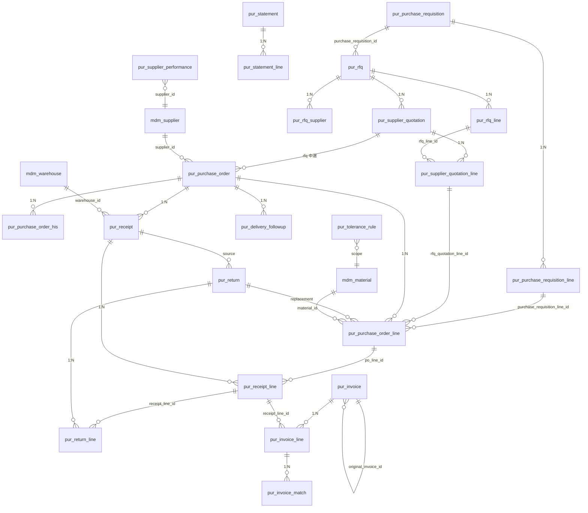

# 采购管理 数据库设计书（購買管理 データベース設計書）

| 項目 | 内容 |
|---|---|
| 文書名 | 采购管理 数据库设计书（購買管理 データベース設計書） |
| 文書番号 | DSN-PUR-090 |
| 版数 | v1.0 |
| 作成日 | 2026-10-20 |
| 作成者 | purchase-designer |
| 承認者 | 未承認（レビュー待ち） |
| 状態 | ドラフト（レビュー中） |
| 関連文書 | [業務域概要](00-overview.md) / [DB 共通規格](../00-common/04-common-db-spec.md) / [共通項目定義](../00-common/01-common-item-definitions.md) / [跨域流程](../00-common/09-cross-domain-flow.md) / [API 設計](91-api-design.md) |

---

## 1. 設計方針

### 1.1 本域データモデルの特徴

| # | 方針 | 内容 |
|---|---|---|
| 1 | プレフィックス | 全テーブル `pur_`（[04 §2.1](../00-common/04-common-db-spec.md)） |
| 2 | 論理削除なし | 本域はすべて取引・履歴・ログ・設定テーブル。取消は `*_status=90` で表現し、物理削除・論理削除を行わない（01 §2.3、04 §3）。`deleted` 列は付与しない |
| 3 | 監査カラム | `id`／`tenant_id`／`company_id`（明細・関連・履歴も親と同値を冗長保持。2026-10-21 決定）／`created_at`／`created_by`／`updated_at`／`updated_by`／`version` を全テーブルに付与（追記専用ログは `version`・`updated_*` を省略） |
| 4 | 金額・数量 | `NUMERIC(18,2)`（金額）／`NUMERIC(18,6)`（単価）／`NUMERIC(18,4)`（数量）／`NUMERIC(7,4)`（率）。`FLOAT`/`DOUBLE` 禁止（01 §6） |
| 5 | スナップショット | 取引先名・品名・仕様・税码・税率・単位・為替レートは伝票に保持し、マスタ変更の影響を排除（04 §12） |
| 6 | 累計項目 | 伝票明細に `received_qty`／`accepted_qty`／`rejected_qty`／`returned_qty`／`invoiced_qty`／`cancelled_qty` を持ち、進捗を JOIN なしで参照可能とする。`remain_qty` は導出（保存しない） |
| 7 | イベント整合 | イベント発行は `sys_outbox_event` に同一トランザクションで記録（09 §10.1）。重複処理は `sys_event_consume_log` で排除 |
| 8 | 一意制約 | 業務一意索引は `(tenant_id, company_id, 業務キー)` 先頭（例外は §6.1）。部分一意（`WHERE deleted = FALSE`）は論理削除テーブルがないため不要 |
| 9 | コメント | 全テーブル・全カラムに `COMMENT ON` を付与（04 §6）。本設計書では DDL 内コメントで代替し、実装時に `COMMENT ON` を展開する |
| 10 | データ量 | [04 §13](../00-common/04-common-db-spec.md) の見積に準拠。`pur_receipt_line`・`pur_invoice_line`・`pur_invoice_match` が最大規模（5 年 60 万行規模） |

### 1.2 状態コードの格納

状態は `SMALLINT`（10/20/25/30/35/40/90/95、および本域扩展 0/1/2/6/9 等）。名称は DB に保存せず、API/画面で解決する（01 §7.2）。

---

**RLS**：全 `pur_*` テーブルは `ENABLE ROW LEVEL SECURITY` + `FORCE ROW LEVEL SECURITY` とし、ポリシーは `tenant_id = current_setting('app.tenant_id')::bigint` のみで判定する（`company_id` は RLS に含めずアプリ層で制御。[00-common 10](../00-common/10-rls-and-db-roles.md)）。

## 2. 共通カラム定義

以下を全テーブルの共通カラムとし、各テーブルの項目定義では業務カラムのみ記載する（共通カラムは [01 §2.1](../00-common/01-common-item-definitions.md) を正とする）。

```sql
id          BIGINT       NOT NULL,                 -- 主キー（雪花 ID）
tenant_id   BIGINT       NOT NULL DEFAULT current_setting('app.tenant_id')::bigint,       -- 租户（字面量默认租户禁止）
company_id  BIGINT       NOT NULL,       -- 公司（ヘッダのみ・既定値なし）
created_at  TIMESTAMPTZ  NOT NULL DEFAULT now(),
created_by  BIGINT       NOT NULL DEFAULT 0,
updated_at  TIMESTAMPTZ  NOT NULL DEFAULT now(),   -- 追記専用ログは省略
updated_by  BIGINT       NOT NULL DEFAULT 0,       -- 追記専用ログは省略
version     INT          NOT NULL DEFAULT 0,       -- 楽観排他（追記専用ログは省略）
remark      VARCHAR(500),                          -- 備考（任意）
ext_data    JSONB,                                 -- 拡張項目（ヘッダのみ任意）
```

---

## 3. ER 図



---

## 4. テーブル一覧

| # | 物理名 | 論理名 | 種別 | 主キー以外の一意キー | 更新元機能 | 件数見積（5 年） |
|---|---|---|---|---|---|---|
| 1 | `pur_purchase_requisition` | 请购单 | 伝票ヘッダ | `(tenant_id, company_id, pr_no)` | F-PUR-001/002/003 | 17,000 |
| 2 | `pur_purchase_requisition_line` | 请购单明细 | 伝票明細 | `(tenant_id, company_id, purchase_requisition_id, line_no)` | 同上 | 68,000 |
| 3 | `pur_rfq` | 询价单 | 伝票ヘッダ | `(tenant_id, company_id, rfq_no)` | F-PUR-004 | 3,300 |
| 4 | `pur_rfq_line` | 询价单明细 | 伝票明細 | `(tenant_id, company_id, rfq_id, line_no)` | F-PUR-004 | 13,200 |
| 5 | `pur_rfq_supplier` | 询价供应商 | 関連 | `(tenant_id, company_id, rfq_id, supplier_id)` | F-PUR-004/005 | 16,500 |
| 6 | `pur_supplier_quotation` | 供应商报价 | 伝票ヘッダ | `(tenant_id, company_id, rfq_id, supplier_id)` | F-PUR-005 | 27,500 |
| 7 | `pur_supplier_quotation_line` | 供应商报价明细 | 伝票明細 | `(tenant_id, company_id, quotation_id, rfq_line_id)` | F-PUR-005/006 | 110,000 |
| 8 | `pur_purchase_order` | 采购订单 | 伝票ヘッダ | `(tenant_id, company_id, po_no)` | F-PUR-007～010 | 80,000 |
| 9 | `pur_purchase_order_line` | 采购订单明细 | 伝票明細 | `(tenant_id, company_id, purchase_order_id, line_no)` | F-PUR-007～011 | 400,000 |
| 10 | `pur_purchase_order_his` | 采购订单变更履历 | 履歴 | `(tenant_id, company_id, purchase_order_id, version_no)` | F-PUR-009 | 40,000 |
| 11 | `pur_receipt` | 收货单 | 伝票ヘッダ | `(tenant_id, company_id, receipt_no)` | F-PUR-011/012 | 120,000 |
| 12 | `pur_receipt_line` | 收货单明细 | 伝票明細 | `(tenant_id, company_id, receipt_id, line_no)` | F-PUR-011～014 | 600,000 |
| 13 | `pur_return` | 采购退货单 | 伝票ヘッダ | `(tenant_id, company_id, return_no)` | F-PUR-015/016 | 6,000 |
| 14 | `pur_return_line` | 采购退货单明细 | 伝票明細 | `(tenant_id, company_id, return_id, line_no)` | F-PUR-015/016 | 13,000 |
| 15 | `pur_invoice` | 采购发票登记 | 伝票ヘッダ | `(tenant_id, company_id, invoice_no)`／`(tenant_id, company_id, supplier_id, COALESCE(invoice_code,''), invoice_number)` | F-PUR-017/018 | 60,000 |
| 16 | `pur_invoice_line` | 采购发票明细 | 伝票明細 | `(tenant_id, company_id, invoice_id, line_no)` | F-PUR-017/018 | 360,000 |
| 17 | `pur_invoice_match` | 三单匹配结果 | 履歴 | `(tenant_id, company_id, invoice_line_id, receipt_line_id)` | F-PUR-018 | 360,000 |
| 18 | `pur_statement` | 采购对账单 | 伝票ヘッダ | `(tenant_id, company_id, statement_no)`／`(tenant_id, company_id, supplier_id, period_code)` | F-PUR-019 | 14,000 |
| 19 | `pur_statement_line` | 采购对账单明细 | 伝票明細 | `(tenant_id, company_id, statement_id, line_no)` | F-PUR-019 | 210,000 |
| 20 | `pur_tolerance_rule` | 容差规则 | 設定 | `(tenant_id, company_id, rule_type, scope_level, scope_id, valid_from)` | F-PUR-011/018 | 50（マスタ相当） |
| 21 | `pur_delivery_followup` | 催货记录 | ログ（追記） | `(id)` のみ | F-PUR-023 | 30,000 |
| 22 | `pur_supplier_performance` | 供应商绩效快照 | 集計 | `(tenant_id, company_id, period_code, supplier_id)` | F-PUR-026 | 48,000 |

---

## 5. テーブル定義

### 5.1 pur_purchase_requisition（请购单）

| 項目 | 内容 |
|---|---|
| テーブル物理名 | `pur_purchase_requisition` |
| テーブル論理名 | 请购单（購買依頼） |
| 種別 | 伝票ヘッダ |
| 更新元機能 | F-PUR-001/002/003、F-PUR-025 |
| データ量見積 | 初期 2,000 / 年 3,000 / 5 年 17,000 |
| 保存期間 | 10 年（会計関連は 30 年に準拠、08 §12） |

**概要**：部門の購買要求を表す P2P 起点伝票。1 行 = 1 請購単。承認後は転単により PO へ引き継がれる。

```sql
CREATE TABLE pur_purchase_requisition (
    id                    BIGINT       NOT NULL,
    tenant_id             BIGINT       NOT NULL DEFAULT current_setting('app.tenant_id')::bigint,
    company_id            BIGINT       NOT NULL,
    pr_no                 VARCHAR(32)  NOT NULL,                  -- 请购单号 PR{YYMMDD}{4桁}
    pr_type               SMALLINT     NOT NULL DEFAULT 1,        -- 1通常/2计划/3紧急/4费用性
    source_type           VARCHAR(32)  NOT NULL DEFAULT 'MANUAL', -- MANUAL/MRP/SAFETY_STOCK
    source_id             BIGINT,
    department_id         BIGINT       NOT NULL,
    applicant_id          BIGINT       NOT NULL,
    factory_id            BIGINT       NOT NULL,
    warehouse_id          BIGINT       NOT NULL,
    required_date         DATE         NOT NULL,
    budget_check_status   SMALLINT     NOT NULL DEFAULT 0,        -- 0未检查/1通过/2警告/3超预算
    budget_subject_code   VARCHAR(32),
    currency_code         VARCHAR(8)   NOT NULL DEFAULT 'CNY',
    total_amount          NUMERIC(18,2) NOT NULL DEFAULT 0,
    tax_amount            NUMERIC(18,2) NOT NULL DEFAULT 0,
    total_amount_with_tax NUMERIC(18,2) NOT NULL DEFAULT 0,
    reason                VARCHAR(500) NOT NULL,
    external_no           VARCHAR(64),
    pr_status             SMALLINT     NOT NULL DEFAULT 10,       -- 10/20/25/30/35/40/90/95
    submitted_at          TIMESTAMPTZ,
    approved_at           TIMESTAMPTZ,
    approver_id           BIGINT,
    process_instance_id   VARCHAR(64),
    closed_at             TIMESTAMPTZ,
    close_reason          VARCHAR(500),
    cancel_reason         VARCHAR(500),
    remark                VARCHAR(500),
    ext_data              JSONB,
    version               INT          NOT NULL DEFAULT 0,
    created_at            TIMESTAMPTZ  NOT NULL DEFAULT now(),
    created_by            BIGINT       NOT NULL DEFAULT 0,
    updated_at            TIMESTAMPTZ  NOT NULL DEFAULT now(),
    updated_by            BIGINT       NOT NULL DEFAULT 0,
    CONSTRAINT pk_pur_purchase_requisition PRIMARY KEY (id),
    CONSTRAINT uk_pur_purchase_requisition_no UNIQUE (tenant_id, company_id, pr_no),
    CONSTRAINT fk_pur_purchase_requisition_dept FOREIGN KEY (tenant_id, department_id) REFERENCES sys_department (tenant_id, id),
    CONSTRAINT fk_pur_purchase_requisition_applicant FOREIGN KEY (tenant_id, applicant_id) REFERENCES sys_user (tenant_id, id),
    CONSTRAINT fk_pur_purchase_requisition_factory FOREIGN KEY (tenant_id, factory_id) REFERENCES mdm_factory (tenant_id, id),
    CONSTRAINT fk_pur_purchase_requisition_wh FOREIGN KEY (tenant_id, warehouse_id) REFERENCES mdm_warehouse (tenant_id, id),
    CONSTRAINT ck_pur_purchase_requisition_status CHECK (pr_status IN (10,20,25,30,35,40,90,95)),
    CONSTRAINT ck_pur_purchase_requisition_amount CHECK (total_amount >= 0 AND tax_amount >= 0)
);
```

| No | 物理名 | 論理名 | 型/桁 | NULL | PK | FK/参照先 | 既定値 | 備考 |
|---|---|---|---|---|---|---|---|---|
| 1 | `pr_no` | 请购单号 | VARCHAR(32) | NOT NULL | — | — | — | `PR{YYMMDD}{4桁}`（08 §2.1） |
| 2 | `pr_type` | 请购类型 | SMALLINT | NOT NULL | — | — | 1 | 1 通常/2 计划/3 紧急/4 费用性 |
| 3 | `source_type` | 来源类型 | VARCHAR(32) | NOT NULL | — | — | MANUAL | MANUAL/MRP/SAFETY_STOCK |
| 4 | `source_id` | 来源单据 ID | BIGINT | NULL | — | `prd_mrp_plan_order.id`（論理参照） | NULL | MRP 由来時 |
| 5 | `department_id` | 需求部门 | BIGINT | NOT NULL | — | `sys_department.id` | — | 承認経路・データ権限 |
| 6 | `applicant_id` | 申请人 | BIGINT | NOT NULL | — | `sys_user.id` | — | 自己承認禁止判定 |
| 7 | `factory_id` | 工厂 | BIGINT | NOT NULL | — | `mdm_factory.id` | — | CZ01/WX01 |
| 8 | `warehouse_id` | 收货仓库 | BIGINT | NOT NULL | — | `mdm_warehouse.id` | — | 明細で上書き可 |
| 9 | `required_date` | 希望交期 | DATE | NOT NULL | — | — | — | ≥ 当日 |
| 10 | `budget_check_status` | 预算检查结果 | SMALLINT | NOT NULL | — | — | 0 | 0 未/1 通过/2 警告/3 超预算 |
| 11 | `budget_subject_code` | 预算科目 | VARCHAR(32) | NULL | — | FIN 预算科目（P2） | NULL | FIN 予算連携で使用（第一版） |
| 12 | `currency_code` | 币种 | VARCHAR(8) | NOT NULL | — | `mdm_currency.currency_code` | CNY | ISO 4217 |
| 13 | `total_amount` | 税抜合計 | NUMERIC(18,2) | NOT NULL | — | — | 0 | Σ明細 |
| 14 | `tax_amount` | 税額合計 | NUMERIC(18,2) | NOT NULL | — | — | 0 | Σ明細税額 |
| 15 | `total_amount_with_tax` | 税込合計 | NUMERIC(18,2) | NOT NULL | — | — | 0 | 承認金額判定 |
| 16 | `reason` | 申请理由 | VARCHAR(500) | NOT NULL | — | — | — | 必須 |
| 17 | `external_no` | 外部参考号 | VARCHAR(64) | NULL | — | — | NULL | 技術通知単号等 |
| 18 | `pr_status` | 状态 | SMALLINT | NOT NULL | — | — | 10 | 10/20/25/30/35/40/90/95 |
| 19 | `submitted_at` | 提出日時 | TIMESTAMPTZ | NULL | — | — | NULL | — |
| 20 | `approved_at` | 承認日時 | TIMESTAMPTZ | NULL | — | — | NULL | — |
| 21 | `approver_id` | 最終承認者 | BIGINT | NULL | — | `sys_user.id` | NULL | — |
| 22 | `process_instance_id` | WF プロセス ID | VARCHAR(64) | NULL | — | `ACT_HI_PROCINST`（論理参照） | NULL | — |
| 23 | `closed_at`/`close_reason` | 关闭日時・理由 | TIMESTAMPTZ/VARCHAR(500) | NULL | — | — | NULL | — |
| 24 | `cancel_reason` | 取消理由 | VARCHAR(500) | NULL | — | — | NULL | 取消時必須 |
| 25 | `remark`/`ext_data` | 備考・拡張 | VARCHAR(500)/JSONB | NULL | — | — | NULL | 01 §10 |

**索引**

| No | 索引名 | 種別 | 対象列 | 目的 |
|---|---|---|---|---|
| 1 | `uk_pur_purchase_requisition_no` | UNIQUE | (`tenant_id`, `company_id`, `pr_no`) | 伝票番号一意 |
| 2 | `idx_pur_purchase_requisition_status_date` | B-Tree | (`tenant_id`, `company_id`, `pr_status`, `required_date` DESC) | 状態別一覧・未完了検索 |
| 3 | `idx_pur_purchase_requisition_dept` | B-Tree | (`tenant_id`, `company_id`, `department_id`, `pr_status`) | 部門別一覧・データ権限 |
| 4 | `idx_pur_purchase_requisition_applicant` | B-Tree | (`tenant_id`, `company_id`, `applicant_id`) | 申請者検索 |
| 5 | `idx_pur_purchase_requisition_source` | B-Tree | (`tenant_id`, `company_id`, `source_type`, `source_id`) | MRP 由来自動請購の重複チェック |

**制約・整合性**

| 制約 ID | 内容 | 実現方法 | エラーメッセージ |
|---|---|---|---|
| CK-01 | `pr_status` は許可値のみ | CHECK | `MSG-COM-034` |
| CK-02 | 金額は非負 | CHECK | `MSG-COM-048` |
| FK-01～04 | 部門・申請者・工厂・倉庫の参照 | FK | `MSG-COM-049` |
| UK-01 | `(tenant_id, company_id, pr_no)` 一意 | UNIQUE | `MSG-COM-050` |

**更新仕様**：INSERT は F-PUR-001（登録）・F-PUR-025（計画変換）。UPDATE は提出・承認・転単・取消・关闭の各状態遷移時（[01](01-requisition.md) §8）。

---

### 5.2 pur_purchase_requisition_line（请购单明细）

| 項目 | 内容 |
|---|---|
| テーブル物理名 | `pur_purchase_requisition_line` |
| テーブル論理名 | 请购单明细 |
| 種別 | 伝票明細 |
| 更新元機能 | F-PUR-001/003/025 |
| データ量見積 | 初期 8,000 / 年 12,000 / 5 年 68,000 |

**概要**：请购する品目・数量・参考単価・転単進捗を保持する。1 行 = 1 品目。

```sql
CREATE TABLE pur_purchase_requisition_line (
    id                      BIGINT       NOT NULL,
    tenant_id               BIGINT       NOT NULL DEFAULT current_setting('app.tenant_id')::bigint,
    company_id              BIGINT       NOT NULL,                 -- 公司 ID（親と同値を冗長保持。2026-10-21 決定）
    purchase_requisition_id BIGINT       NOT NULL,
    line_no                 INT          NOT NULL,
    material_id             BIGINT       NOT NULL,
    material_code           VARCHAR(20)  NOT NULL,
    material_name           VARCHAR(200) NOT NULL,
    spec                    VARCHAR(200),
    uom_code                VARCHAR(8)   NOT NULL,
    quantity                NUMERIC(18,4) NOT NULL,
    estimated_unit_price    NUMERIC(18,6),
    estimated_amount        NUMERIC(18,2) NOT NULL DEFAULT 0,
    tax_code                VARCHAR(32)  NOT NULL,
    tax_rate                NUMERIC(7,4) NOT NULL,
    tax_amount              NUMERIC(18,2) NOT NULL DEFAULT 0,
    required_date           DATE         NOT NULL,
    supplier_suggest_id     BIGINT,
    purpose                 VARCHAR(200) NOT NULL,
    converted_qty           NUMERIC(18,4) NOT NULL DEFAULT 0,
    line_status             SMALLINT     NOT NULL DEFAULT 10,
    line_remark             VARCHAR(500),
    version                 INT          NOT NULL DEFAULT 0,
    created_at              TIMESTAMPTZ  NOT NULL DEFAULT now(),
    created_by              BIGINT       NOT NULL DEFAULT 0,
    updated_at              TIMESTAMPTZ  NOT NULL DEFAULT now(),
    updated_by              BIGINT       NOT NULL DEFAULT 0,
    CONSTRAINT pk_pur_purchase_requisition_line PRIMARY KEY (id),
    CONSTRAINT uk_pur_purchase_requisition_line_no UNIQUE (tenant_id, company_id, purchase_requisition_id, line_no),
    CONSTRAINT fk_pur_purchase_requisition_line_pr FOREIGN KEY (purchase_requisition_id)
        REFERENCES pur_purchase_requisition (id) ON DELETE RESTRICT,
    CONSTRAINT fk_pur_purchase_requisition_line_material FOREIGN KEY (tenant_id, material_id) REFERENCES mdm_material (tenant_id, id),
    CONSTRAINT fk_pur_purchase_requisition_line_supplier FOREIGN KEY (tenant_id, supplier_suggest_id) REFERENCES mdm_supplier (tenant_id, id),
    CONSTRAINT ck_pur_purchase_requisition_line_qty CHECK (quantity > 0 AND converted_qty >= 0),
    CONSTRAINT ck_pur_purchase_requisition_line_status CHECK (line_status IN (10,30,35,40,90))
);
```

| No | 物理名 | 論理名 | 型/桁 | NULL | PK | FK/参照先 | 既定値 | 備考 |
|---|---|---|---|---|---|---|---|---|
| 1 | `purchase_requisition_id` | 请购单 ID | BIGINT | NOT NULL | — | `pur_purchase_requisition.id` | — | 親 |
| 2 | `line_no` | 行番号 | INT | NOT NULL | — | — | — | 10 刻み |
| 3 | `material_id` | 物料 ID | BIGINT | NOT NULL | — | `mdm_material.id` | — | — |
| 4 | `material_code` | 物料编码 | VARCHAR(20) | NOT NULL | — | — | — | スナップショット（10 桁） |
| 5 | `material_name` | 品名 | VARCHAR(200) | NOT NULL | — | — | — | スナップショット |
| 6 | `spec` | 规格 | VARCHAR(200) | NULL | — | — | NULL | 例 `50W470 0.50mm×1000mm 卷料` |
| 7 | `uom_code` | 采购单位 | VARCHAR(8) | NOT NULL | — | `mdm_uom.uom_code` | — | PCE/KGM 等 |
| 8 | `quantity` | 请购数量 | NUMERIC(18,4) | NOT NULL | — | — | — | > 0 |
| 9 | `estimated_unit_price` | 预计单价（税抜） | NUMERIC(18,6) | NULL | — | `mdm_purchase_price`（参照） | NULL | 参考値 |
| 10 | `estimated_amount` | 预计金额（税抜） | NUMERIC(18,2) | NOT NULL | — | — | 0 | 数量×単価 |
| 11 | `tax_code` | 税码（进项） | VARCHAR(32) | NOT NULL | — | `mdm_tax_code.tax_code` | — | `tax_type=11` |
| 12 | `tax_rate` | 税率（快照） | NUMERIC(7,4) | NOT NULL | — | — | — | 登録時点保持 |
| 13 | `tax_amount` | 税額 | NUMERIC(18,2) | NOT NULL | — | — | 0 | — |
| 14 | `required_date` | 希望交期 | DATE | NOT NULL | — | — | — | ≥ 当日 |
| 15 | `supplier_suggest_id` | 推荐供应商 | BIGINT | NULL | — | `mdm_supplier.id` | NULL | 紧急请购で必須 |
| 16 | `purpose` | 用途 | VARCHAR(200) | NOT NULL | — | — | — | 例「定子冲片」 |
| 17 | `converted_qty` | 已转单数量 | NUMERIC(18,4) | NOT NULL | — | — | 0 | ≤ quantity |
| 18 | `line_status` | 行状态 | SMALLINT | NOT NULL | — | — | 10 | 10/30/35/40/90 |
| 19 | `line_remark` | 行备注 | VARCHAR(500) | NULL | — | — | NULL | — |

**索引**：`uk_pur_purchase_requisition_line_no`（一意）、`idx_pur_purchase_requisition_line_material`（`tenant_id`, `company_id`, `material_id`）、`idx_pur_purchase_requisition_line_status`（`tenant_id`, `company_id`, `line_status`）。
**更新仕様**：INSERT は请购登録・計画変換。UPDATE は `converted_qty`／`line_status`（転単・戻し）。

---

### 5.3 pur_rfq（询价单）

| 項目 | 内容 |
|---|---|
| テーブル物理名 | `pur_rfq` |
| テーブル論理名 | 询价单（見積依頼） |
| 種別 | 伝票ヘッダ |
| 更新元機能 | F-PUR-004/006 |
| データ量見積 | 初期 300 / 年 600 / 5 年 3,300 |

**概要**：複数供应商への見積依頼を表す。1 行 = 1 询价単。中選結果は报价明細に保持する。

```sql
CREATE TABLE pur_rfq (
    id                   BIGINT       NOT NULL,
    tenant_id            BIGINT       NOT NULL DEFAULT current_setting('app.tenant_id')::bigint,
    company_id           BIGINT       NOT NULL,
    rfq_no               VARCHAR(32)  NOT NULL,
    rfq_type             SMALLINT     NOT NULL DEFAULT 1,      -- 1一般/2紧急/3年度框架
    purchase_requisition_id BIGINT,
    department_id        BIGINT       NOT NULL,
    buyer_id             BIGINT       NOT NULL,
    currency_code        VARCHAR(8)   NOT NULL DEFAULT 'CNY',
    price_terms          SMALLINT     NOT NULL DEFAULT 1,      -- 1税抜/2税込
    freight_bearer       SMALLINT     NOT NULL DEFAULT 1,      -- 1买方/2卖方/3到付
    quote_deadline       TIMESTAMPTZ  NOT NULL,
    rfq_status           SMALLINT     NOT NULL DEFAULT 10,     -- 10/30/35/40/90
    total_est_amount     NUMERIC(18,2) NOT NULL DEFAULT 0,
    exception_reason     VARCHAR(500),
    awarded_at           TIMESTAMPTZ,
    awarded_by           BIGINT,
    total_award_amount   NUMERIC(18,2),
    cancel_reason        VARCHAR(500),
    remark               VARCHAR(500),
    ext_data             JSONB,
    version              INT          NOT NULL DEFAULT 0,
    created_at           TIMESTAMPTZ  NOT NULL DEFAULT now(),
    created_by           BIGINT       NOT NULL DEFAULT 0,
    updated_at           TIMESTAMPTZ  NOT NULL DEFAULT now(),
    updated_by           BIGINT       NOT NULL DEFAULT 0,
    CONSTRAINT pk_pur_rfq PRIMARY KEY (id),
    CONSTRAINT uk_pur_rfq_no UNIQUE (tenant_id, company_id, rfq_no),
    CONSTRAINT fk_pur_rfq_pr FOREIGN KEY (purchase_requisition_id) REFERENCES pur_purchase_requisition (id),
    CONSTRAINT fk_pur_rfq_dept FOREIGN KEY (tenant_id, department_id) REFERENCES sys_department (tenant_id, id),
    CONSTRAINT ck_pur_rfq_status CHECK (rfq_status IN (10,30,35,40,90)),
    CONSTRAINT ck_pur_rfq_deadline CHECK (quote_deadline > created_at)
);
```

| No | 物理名 | 論理名 | 型/桁 | NULL | FK/参照先 | 備考 |
|---|---|---|---|---|---|---|
| 1 | `rfq_no` | 询价单号 | VARCHAR(32) | NOT NULL | — | `RFQ{YYMMDD}{4桁}` |
| 2 | `rfq_type` | 询价类型 | SMALLINT | NOT NULL | — | 1 一般/2 紧急/3 年度框架 |
| 3 | `purchase_requisition_id` | 来源请购 | BIGINT | NULL | `pur_purchase_requisition.id` | 手工询价可空 |
| 4 | `department_id` | 需求部门 | BIGINT | NOT NULL | `sys_department.id` | — |
| 5 | `buyer_id` | 采购负责人 | BIGINT | NOT NULL | `sys_user.id` | — |
| 6 | `currency_code` | 币种 | VARCHAR(8) | NOT NULL | `mdm_currency.currency_code` | CNY |
| 7 | `price_terms` | 报价基准 | SMALLINT | NOT NULL | — | 1 税抜/2 税込 |
| 8 | `freight_bearer` | 运费承担 | SMALLINT | NOT NULL | — | 1 买方/2 卖方/3 到付 |
| 9 | `quote_deadline` | 报价截止 | TIMESTAMPTZ | NOT NULL | — | > 作成日時 |
| 10 | `rfq_status` | 状态 | SMALLINT | NOT NULL | — | 10/30/35/40/90 |
| 11 | `total_est_amount` | 预计金额合计 | NUMERIC(18,2) | NOT NULL | — | Σ目安金額 |
| 12 | `exception_reason` | 单一来源理由 | VARCHAR(500) | NULL | — | 供应商 < 2 家 |
| 13 | `awarded_at`/`awarded_by` | 中选日時・者 | TIMESTAMPTZ/BIGINT | NULL | `sys_user.id` | — |
| 14 | `total_award_amount` | 中选金额（税込） | NUMERIC(18,2) | NULL | — | — |

**索引**：`uk_pur_rfq_no`、`idx_pur_rfq_status_deadline`（`tenant_id`, `company_id`, `rfq_status`, `quote_deadline`）、`idx_pur_rfq_pr`（`tenant_id`, `company_id`, `purchase_requisition_id`）。

---

### 5.4 pur_rfq_line（询价单明细）

| 項目 | 内容 |
|---|---|
| テーブル物理名 | `pur_rfq_line` |
| テーブル論理名 | 询价单明细 |
| 種別 | 伝票明細 |
| 更新元機能 | F-PUR-004/006 |
| データ量見積 | 初期 1,200 / 年 2,400 / 5 年 13,200 |

```sql
CREATE TABLE pur_rfq_line (
    id                  BIGINT       NOT NULL,
    tenant_id           BIGINT       NOT NULL DEFAULT current_setting('app.tenant_id')::bigint,
    company_id              BIGINT       NOT NULL,                 -- 公司 ID（親と同値を冗長保持。2026-10-21 決定）
    rfq_id              BIGINT       NOT NULL,
    line_no             INT          NOT NULL,
    purchase_requisition_line_id BIGINT,
    material_id         BIGINT       NOT NULL,
    material_code       VARCHAR(20)  NOT NULL,
    material_name       VARCHAR(200) NOT NULL,
    spec                VARCHAR(200),
    uom_code            VARCHAR(8)   NOT NULL,
    quantity            NUMERIC(18,4) NOT NULL,
    required_date       DATE         NOT NULL,
    target_price        NUMERIC(18,6),
    benchmark_price     NUMERIC(18,6),
    tax_code            VARCHAR(32)  NOT NULL,
    selected_supplier_id BIGINT,
    line_status         SMALLINT     NOT NULL DEFAULT 10,
    line_remark         VARCHAR(500),
    version             INT          NOT NULL DEFAULT 0,
    created_at          TIMESTAMPTZ  NOT NULL DEFAULT now(),
    created_by          BIGINT       NOT NULL DEFAULT 0,
    updated_at          TIMESTAMPTZ  NOT NULL DEFAULT now(),
    updated_by          BIGINT       NOT NULL DEFAULT 0,
    CONSTRAINT pk_pur_rfq_line PRIMARY KEY (id),
    CONSTRAINT uk_pur_rfq_line_no UNIQUE (tenant_id, company_id, rfq_id, line_no),
    CONSTRAINT fk_pur_rfq_line_rfq FOREIGN KEY (rfq_id) REFERENCES pur_rfq (id) ON DELETE RESTRICT,
    CONSTRAINT fk_pur_rfq_line_pr_line FOREIGN KEY (purchase_requisition_line_id) REFERENCES pur_purchase_requisition_line (id),
    CONSTRAINT fk_pur_rfq_line_material FOREIGN KEY (tenant_id, material_id) REFERENCES mdm_material (tenant_id, id),
    CONSTRAINT fk_pur_rfq_line_supplier FOREIGN KEY (tenant_id, selected_supplier_id) REFERENCES mdm_supplier (tenant_id, id),
    CONSTRAINT ck_pur_rfq_line_qty CHECK (quantity > 0),
    CONSTRAINT ck_pur_rfq_line_status CHECK (line_status IN (10,30,35,40,90))
);
```

| No | 物理名 | 論理名 | 型/桁 | NULL | FK/参照先 | 備考 |
|---|---|---|---|---|---|---|
| 1 | `rfq_id` | 询价単 ID | BIGINT | NOT NULL | `pur_rfq.id` | — |
| 2 | `purchase_requisition_line_id` | 来源请购行 | BIGINT | NULL | `pur_purchase_requisition_line.id` | 请购由来 |
| 3 | `material_id`/`material_code`/`material_name`/`spec` | 物料 | BIGINT/VARCHAR | NOT NULL/NULL | `mdm_material.id` | スナップショット |
| 4 | `uom_code` | 单位 | VARCHAR(8) | NOT NULL | `mdm_uom.uom_code` | — |
| 5 | `quantity` | 询价数量 | NUMERIC(18,4) | NOT NULL | — | > 0 |
| 6 | `required_date` | 希望交期 | DATE | NOT NULL | — | — |
| 7 | `target_price` | 目安単価 | NUMERIC(18,6) | NULL | — | 税抜 |
| 8 | `benchmark_price` | 基准价（最近成交） | NUMERIC(18,6) | NULL | — | — |
| 9 | `tax_code` | 税码 | VARCHAR(32) | NOT NULL | `mdm_tax_code.tax_code` | 进项 |
| 10 | `selected_supplier_id` | 中选供应商 | BIGINT | NULL | `mdm_supplier.id` | 中选後 |
| 11 | `line_status` | 行状态 | SMALLINT | NOT NULL | — | 10/30/35/40/90 |

**索引**：`uk_pur_rfq_line_no`、`idx_pur_rfq_line_material`（`tenant_id`, `company_id`, `material_id`）、`idx_pur_rfq_line_pr_line`（`tenant_id`, `company_id`, `purchase_requisition_line_id`）。

---

### 5.5 pur_rfq_supplier（询价供应商）

| 項目 | 内容 |
|---|---|
| テーブル物理名 | `pur_rfq_supplier` |
| テーブル論理名 | 询价供应商（見積依頼先） |
| 種別 | 関連 |
| 更新元機能 | F-PUR-004/005 |
| データ量見積 | 初期 1,500 / 年 3,000 / 5 年 16,500 |

```sql
CREATE TABLE pur_rfq_supplier (
    id              BIGINT       NOT NULL,
    tenant_id       BIGINT       NOT NULL DEFAULT current_setting('app.tenant_id')::bigint,
    company_id              BIGINT       NOT NULL,                 -- 公司 ID（親と同値を冗長保持。2026-10-21 決定）
    rfq_id          BIGINT       NOT NULL,
    supplier_id     BIGINT       NOT NULL,
    supplier_code   VARCHAR(20)  NOT NULL,
    supplier_name   VARCHAR(200) NOT NULL,
    contact_name    VARCHAR(100),
    contact_phone   VARCHAR(30),
    sent_at         TIMESTAMPTZ,
    response_status SMALLINT     NOT NULL DEFAULT 0,   -- 0未发送/1已发送/2已报价/3拒绝/4超时
    remark          VARCHAR(500),
    created_at      TIMESTAMPTZ  NOT NULL DEFAULT now(),
    created_by      BIGINT       NOT NULL DEFAULT 0,
    updated_at      TIMESTAMPTZ  NOT NULL DEFAULT now(),
    updated_by      BIGINT       NOT NULL DEFAULT 0,
    version         INT          NOT NULL DEFAULT 0,
    CONSTRAINT pk_pur_rfq_supplier PRIMARY KEY (id),
    CONSTRAINT uk_pur_rfq_supplier UNIQUE (tenant_id, company_id, rfq_id, supplier_id),
    CONSTRAINT fk_pur_rfq_supplier_rfq FOREIGN KEY (rfq_id) REFERENCES pur_rfq (id) ON DELETE RESTRICT,
    CONSTRAINT fk_pur_rfq_supplier_supplier FOREIGN KEY (tenant_id, supplier_id) REFERENCES mdm_supplier (tenant_id, id),
    CONSTRAINT ck_pur_rfq_supplier_status CHECK (response_status IN (0,1,2,3,4))
);
```

| No | 物理名 | 論理名 | 型/桁 | NULL | FK/参照先 | 備考 |
|---|---|---|---|---|---|---|
| 1 | `rfq_id` | 询价単 ID | BIGINT | NOT NULL | `pur_rfq.id` | — |
| 2 | `supplier_id` | 供应商 | BIGINT | NOT NULL | `mdm_supplier.id` | — |
| 3 | `supplier_code`/`supplier_name` | 供应商コード・名称 | VARCHAR(20/200) | NOT NULL | — | スナップショット |
| 4 | `contact_name`/`contact_phone` | 連絡先 | VARCHAR(100/30) | NULL | — | マスキング対象 |
| 5 | `sent_at` | 送信日時 | TIMESTAMPTZ | NULL | — | 发出時 |
| 6 | `response_status` | 回答状態 | SMALLINT | NOT NULL | — | 0 未送信/1 送信済/2 報価済/3 拒否/4 期限切れ |

**索引**：`uk_pur_rfq_supplier`、`idx_pur_rfq_supplier_supplier`（`tenant_id`, `company_id`, `supplier_id`）。

---

### 5.6 pur_supplier_quotation（供应商报价）

| 項目 | 内容 |
|---|---|
| テーブル物理名 | `pur_supplier_quotation` |
| テーブル論理名 | 供应商报价（見積回答） |
| 種別 | 伝票ヘッダ |
| 更新元機能 | F-PUR-005/006 |
| データ量見積 | 初期 2,500 / 年 5,000 / 5 年 27,500 |

**概要**：1 供应商 × 1 询价単 = 1 报价。供应商报价に独立した採番は行わず（08 §2.1 に該当プレフィックスなし）、`(rfq_id, supplier_id)` を業務キーとする。

```sql
CREATE TABLE pur_supplier_quotation (
    id                  BIGINT       NOT NULL,
    tenant_id           BIGINT       NOT NULL DEFAULT current_setting('app.tenant_id')::bigint,
    company_id              BIGINT       NOT NULL,                 -- 公司 ID（親と同値を冗長保持。2026-10-21 決定）
    rfq_id              BIGINT       NOT NULL,
    supplier_id         BIGINT       NOT NULL,
    quotation_no        VARCHAR(64),                  -- 供应商側の見積番号（外部）
    quote_date          DATE         NOT NULL,
    currency_code       VARCHAR(8)   NOT NULL DEFAULT 'CNY',
    exchange_rate       NUMERIC(18,8) NOT NULL DEFAULT 1,
    price_terms         SMALLINT     NOT NULL DEFAULT 1,
    freight_amount      NUMERIC(18,2) NOT NULL DEFAULT 0,
    payment_term_code   VARCHAR(20),
    valid_from          DATE         NOT NULL,
    valid_to            DATE         NOT NULL,
    total_amount        NUMERIC(18,2) NOT NULL DEFAULT 0,
    tax_amount          NUMERIC(18,2) NOT NULL DEFAULT 0,
    total_amount_with_tax NUMERIC(18,2) NOT NULL DEFAULT 0,
    remark              VARCHAR(500),
    version             INT          NOT NULL DEFAULT 0,
    created_at          TIMESTAMPTZ  NOT NULL DEFAULT now(),
    created_by          BIGINT       NOT NULL DEFAULT 0,
    updated_at          TIMESTAMPTZ  NOT NULL DEFAULT now(),
    updated_by          BIGINT       NOT NULL DEFAULT 0,
    CONSTRAINT pk_pur_supplier_quotation PRIMARY KEY (id),
    CONSTRAINT uk_pur_supplier_quotation UNIQUE (tenant_id, company_id, rfq_id, supplier_id),
    CONSTRAINT fk_pur_supplier_quotation_rfq FOREIGN KEY (rfq_id) REFERENCES pur_rfq (id) ON DELETE RESTRICT,
    CONSTRAINT fk_pur_supplier_quotation_supplier FOREIGN KEY (tenant_id, supplier_id) REFERENCES mdm_supplier (tenant_id, id),
    CONSTRAINT ck_pur_supplier_quotation_valid CHECK (valid_to >= valid_from),
    CONSTRAINT ck_pur_supplier_quotation_rate CHECK (exchange_rate > 0)
);
```

| No | 物理名 | 論理名 | 型/桁 | NULL | FK/参照先 | 備考 |
|---|---|---|---|---|---|---|
| 1 | `rfq_id`/`supplier_id` | 询价・供应商 | BIGINT | NOT NULL | `pur_rfq.id`/`mdm_supplier.id` | 一意キー |
| 2 | `quotation_no` | 供应商报价番号 | VARCHAR(64) | NULL | — | 外部番号そのまま |
| 3 | `quote_date` | 报价日 | DATE | NOT NULL | — | ≤ 截止日 |
| 4 | `currency_code`/`exchange_rate` | 币种・汇率 | VARCHAR(8)/NUMERIC(18,8) | NOT NULL | `mdm_currency` | 既定 CNY（rate=1）。外貨は実装順 P2（第一版） |
| 5 | `price_terms` | 报价基準 | SMALLINT | NOT NULL | — | 1 税抜/2 税込 |
| 6 | `freight_amount` | 运费 | NUMERIC(18,2) | NOT NULL | — | 买方承担时 |
| 7 | `payment_term_code` | 付款条件 | VARCHAR(20) | NULL | `mdm_payment_term.payment_term_code` | 06 §8.2 |
| 8 | `valid_from`/`valid_to` | 報価有効期間 | DATE | NOT NULL | — | 期限切れは中选不可 |
| 9 | `total_amount`/`tax_amount`/`total_amount_with_tax` | 合計 | NUMERIC(18,2) | NOT NULL | — | 税抜・税額・税込 |

**索引**：`uk_pur_supplier_quotation`、`idx_pur_supplier_quotation_supplier`（`tenant_id`, `company_id`, `supplier_id`, `quote_date`）。

---

### 5.7 pur_supplier_quotation_line（供应商报价明细）

| 項目 | 内容 |
|---|---|
| テーブル物理名 | `pur_supplier_quotation_line` |
| テーブル論理名 | 供应商报价明细 |
| 種別 | 伝票明細 |
| 更新元機能 | F-PUR-005/006 |
| データ量見積 | 初期 10,000 / 年 20,000 / 5 年 110,000 |

```sql
CREATE TABLE pur_supplier_quotation_line (
    id                   BIGINT       NOT NULL,
    tenant_id            BIGINT       NOT NULL DEFAULT current_setting('app.tenant_id')::bigint,
    company_id              BIGINT       NOT NULL,                 -- 公司 ID（親と同値を冗長保持。2026-10-21 決定）
    quotation_id         BIGINT       NOT NULL,
    rfq_line_id          BIGINT       NOT NULL,
    material_id          BIGINT       NOT NULL,
    material_code        VARCHAR(20)  NOT NULL,
    material_name        VARCHAR(200) NOT NULL,
    spec                 VARCHAR(200),
    quoted_qty           NUMERIC(18,4) NOT NULL,
    uom_code             VARCHAR(8)   NOT NULL,
    quoted_unit_price    NUMERIC(18,6) NOT NULL,
    tax_code             VARCHAR(32)  NOT NULL,
    tax_rate             NUMERIC(7,4) NOT NULL,
    comparison_unit_price NUMERIC(18,6) NOT NULL,       -- 可比単価（CALC-01）
    moq                  NUMERIC(18,4),
    lead_time_days       INT          NOT NULL,
    valid_to             DATE,
    price_score          NUMERIC(7,2),
    delivery_score       NUMERIC(7,2),
    quality_score        NUMERIC(7,2),
    total_score          NUMERIC(7,2),
    rank_no              INT,
    is_selected          BOOLEAN      NOT NULL DEFAULT FALSE,
    selected_qty         NUMERIC(18,4),
    selected_reason      VARCHAR(500),
    price_diff_reason    VARCHAR(500),
    remark               VARCHAR(500),
    version              INT          NOT NULL DEFAULT 0,
    created_at           TIMESTAMPTZ  NOT NULL DEFAULT now(),
    created_by           BIGINT       NOT NULL DEFAULT 0,
    updated_at           TIMESTAMPTZ  NOT NULL DEFAULT now(),
    updated_by           BIGINT       NOT NULL DEFAULT 0,
    CONSTRAINT pk_pur_supplier_quotation_line PRIMARY KEY (id),
    CONSTRAINT uk_pur_supplier_quotation_line UNIQUE (tenant_id, company_id, quotation_id, rfq_line_id),
    CONSTRAINT fk_pur_supplier_quotation_line_q FOREIGN KEY (quotation_id) REFERENCES pur_supplier_quotation (id) ON DELETE RESTRICT,
    CONSTRAINT fk_pur_supplier_quotation_line_rfq_line FOREIGN KEY (rfq_line_id) REFERENCES pur_rfq_line (id),
    CONSTRAINT fk_pur_supplier_quotation_line_material FOREIGN KEY (tenant_id, material_id) REFERENCES mdm_material (tenant_id, id),
    CONSTRAINT ck_pur_supplier_quotation_line_price CHECK (quoted_unit_price >= 0 AND quoted_qty > 0),
    CONSTRAINT ck_pur_supplier_quotation_line_score CHECK (total_score IS NULL OR total_score >= 0)
);
```

| No | 物理名 | 論理名 | 型/桁 | NULL | 備考 |
|---|---|---|---|---|---|
| 1 | `quotation_id`/`rfq_line_id` | 报价・询价行 | BIGINT | NOT NULL | 一意キー |
| 2 | `quoted_qty` | 可供应数量 | NUMERIC(18,4) | NOT NULL | > 0 |
| 3 | `quoted_unit_price` | 报价税抜単価 | NUMERIC(18,6) | NOT NULL | 税込入力時は換算後 |
| 4 | `tax_code`/`tax_rate` | 税码・税率 | VARCHAR(32)/NUMERIC(7,4) | NOT NULL | 进项 |
| 5 | `comparison_unit_price` | 可比単価 | NUMERIC(18,6) | NOT NULL | 税抜+運費分摊 |
| 6 | `moq` | 最小起订量 | NUMERIC(18,4) | NULL | — |
| 7 | `lead_time_days` | 交貨天数 | INT | NOT NULL | 交期評分 |
| 8 | `valid_to` | 行別有效期 | DATE | NULL | ヘッダ上書き |
| 9 | `price_score`/`delivery_score`/`quality_score`/`total_score` | 評分 | NUMERIC(7,2) | NULL | 比価計算時 |
| 10 | `rank_no` | 排名 | INT | NULL | — |
| 11 | `is_selected`/`selected_qty`/`selected_reason` | 中选 | BOOLEAN/NUMERIC/VARCHAR | NULL | 行単位 1 社 |
| 12 | `price_diff_reason` | 価格差異理由 | VARCHAR(500) | NULL | 目安比 > 10% |

**索引**：`uk_pur_supplier_quotation_line`、`idx_pur_supplier_quotation_line_rfq_line`（`tenant_id`, `company_id`, `rfq_line_id`）、`idx_pur_supplier_quotation_line_selected`（`tenant_id`, `company_id`, `is_selected`）。

---

### 5.8 pur_purchase_order（采购订单）

| 項目 | 内容 |
|---|---|
| テーブル物理名 | `pur_purchase_order` |
| テーブル論理名 | 采购订单（発注書） |
| 種別 | 伝票ヘッダ |
| 更新元機能 | F-PUR-007～010、F-PUR-003/006（転単・PO 生成） |
| データ量見積 | 初期 20,000 / 年 12,000 / 5 年 80,000 |
| 保存期間 | 10 年 |

**概要**：供应商への発注を表す P2P 中核伝票。1 行 = 1 発注単。変更は `version_no` で版管理する。

```sql
CREATE TABLE pur_purchase_order (
    id                     BIGINT       NOT NULL,
    tenant_id              BIGINT       NOT NULL DEFAULT current_setting('app.tenant_id')::bigint,
    company_id             BIGINT       NOT NULL,
    po_no                  VARCHAR(32)  NOT NULL,
    po_type                SMALLINT     NOT NULL DEFAULT 1,        -- 1标准/2框架/3试作
    source_type            VARCHAR(32)  NOT NULL DEFAULT 'MANUAL', -- REQUISITION/RFQ/MRP/MANUAL/CONTRACT
    source_id              BIGINT,
    supplier_id            BIGINT       NOT NULL,
    supplier_code          VARCHAR(20)  NOT NULL,
    supplier_name          VARCHAR(200) NOT NULL,
    supplier_contact       VARCHAR(100),
    department_id          BIGINT       NOT NULL,
    buyer_id               BIGINT       NOT NULL,
    factory_id             BIGINT       NOT NULL,
    warehouse_id           BIGINT       NOT NULL,
    order_date             DATE         NOT NULL,
    currency_code          VARCHAR(8)   NOT NULL DEFAULT 'CNY',
    exchange_rate          NUMERIC(18,8) NOT NULL DEFAULT 1,
    price_terms            SMALLINT     NOT NULL DEFAULT 1,        -- 1税抜/2税込
    settlement_type        VARCHAR(20)  NOT NULL DEFAULT 'BANK_TRANSFER',
    payment_term_code      VARCHAR(20)  NOT NULL,
    prepay_ratio           NUMERIC(7,4) NOT NULL DEFAULT 0,        -- 0～100(%)
    freight_amount         NUMERIC(18,2) NOT NULL DEFAULT 0,
    total_amount           NUMERIC(18,2) NOT NULL DEFAULT 0,
    tax_amount             NUMERIC(18,2) NOT NULL DEFAULT 0,
    total_amount_with_tax  NUMERIC(18,2) NOT NULL DEFAULT 0,
    po_status              SMALLINT     NOT NULL DEFAULT 10,       -- 10/20/25/30/35/40/90/95
    sent_at                TIMESTAMPTZ,
    sent_method            SMALLINT,                               -- 1印刷/2メール/3门户/4EDI
    sent_by                BIGINT,
    supplier_confirm_at    TIMESTAMPTZ,
    approved_at            TIMESTAMPTZ,
    approver_id            BIGINT,
    process_instance_id    VARCHAR(64),
    version_no             INT          NOT NULL DEFAULT 1,        -- 変更版数
    pending_change         BOOLEAN      NOT NULL DEFAULT FALSE,    -- 変更承認待ち
    change_approved_at     TIMESTAMPTZ  NULL,                      -- 変更承認日時（03 §状態遷移 20→元状態）
    contract_no            VARCHAR(64),
    external_no            VARCHAR(64),
    closed_at              TIMESTAMPTZ,
    close_reason           VARCHAR(500),
    cancel_reason          VARCHAR(500),
    remark                 VARCHAR(500),
    ext_data               JSONB,
    version                INT          NOT NULL DEFAULT 0,
    created_at             TIMESTAMPTZ  NOT NULL DEFAULT now(),
    created_by             BIGINT       NOT NULL DEFAULT 0,
    updated_at             TIMESTAMPTZ  NOT NULL DEFAULT now(),
    updated_by             BIGINT       NOT NULL DEFAULT 0,
    CONSTRAINT pk_pur_purchase_order PRIMARY KEY (id),
    CONSTRAINT uk_pur_purchase_order_no UNIQUE (tenant_id, company_id, po_no),
    CONSTRAINT fk_pur_purchase_order_supplier FOREIGN KEY (tenant_id, supplier_id) REFERENCES mdm_supplier (tenant_id, id),
    CONSTRAINT fk_pur_purchase_order_dept FOREIGN KEY (tenant_id, department_id) REFERENCES sys_department (tenant_id, id),
    CONSTRAINT fk_pur_purchase_order_buyer FOREIGN KEY (tenant_id, buyer_id) REFERENCES sys_user (tenant_id, id),
    CONSTRAINT fk_pur_purchase_order_factory FOREIGN KEY (tenant_id, factory_id) REFERENCES mdm_factory (tenant_id, id),
    CONSTRAINT fk_pur_purchase_order_wh FOREIGN KEY (tenant_id, warehouse_id) REFERENCES mdm_warehouse (tenant_id, id),
    CONSTRAINT ck_pur_purchase_order_status CHECK (po_status IN (10,20,25,30,35,40,90,95)),
    CONSTRAINT ck_pur_purchase_order_prepay CHECK (prepay_ratio >= 0 AND prepay_ratio <= 100),
    CONSTRAINT ck_pur_purchase_order_amount CHECK (total_amount >= 0)
);
```

| No | 物理名 | 論理名 | 型/桁 | NULL | FK/参照先 | 備考 |
|---|---|---|---|---|---|---|
| 1 | `po_no` | 订单号 | VARCHAR(32) | NOT NULL | — | `PO{YYMMDD}{4桁}` |
| 2 | `po_type` | 订单类型 | SMALLINT | NOT NULL | — | 1 标准/2 框架/3 试作 |
| 3 | `source_type`/`source_id` | 来源 | VARCHAR(32)/BIGINT | NOT NULL/NULL | 上流伝票 | REQUISITION/RFQ/MRP/MANUAL/CONTRACT |
| 4 | `supplier_id`+snapshot | 供应商 | BIGINT/VARCHAR | NOT NULL | `mdm_supplier.id` | 名称・連絡先スナップショット |
| 5 | `department_id`/`buyer_id` | 部門・購買担当 | BIGINT | NOT NULL | `sys_department`/`sys_user` | — |
| 6 | `factory_id`/`warehouse_id` | 工厂・倉庫 | BIGINT | NOT NULL | `mdm_factory`/`mdm_warehouse` | — |
| 7 | `order_date` | 订单日 | DATE | NOT NULL | — | 承認日と区別 |
| 8 | `currency_code`/`exchange_rate` | 币种・汇率 | VARCHAR(8)/NUMERIC(18,8) | NOT NULL | `mdm_currency` | 外貨対応（第一版） |
| 9 | `price_terms` | 价格基準 | SMALLINT | NOT NULL | — | 1 税抜/2 税込 |
| 10 | `settlement_type`/`payment_term_code` | 決済方法・支払条件 | VARCHAR(20) | NOT NULL | `mdm_settlement_method`/`mdm_payment_term` | 06 §8 |
| 11 | `prepay_ratio` | 预付款比例 | NUMERIC(7,4) | NOT NULL | — | 0～100% |
| 12 | `total_amount`/`tax_amount`/`total_amount_with_tax` | 合計 | NUMERIC(18,2) | NOT NULL | — | 承認金額判定 |
| 13 | `po_status` | 状态 | SMALLINT | NOT NULL | — | 10/20/25/30/35/40/90/95 |
| 14 | `sent_at`/`sent_method`/`sent_by` | 送信情報 | TIMESTAMPTZ/SMALLINT/BIGINT | NULL | — | 発注送信履歴 |
| 15 | `supplier_confirm_at` | 供应商确认日時 | TIMESTAMPTZ | NULL | — | 回执登録 |
| 16 | `approved_at`/`approver_id`/`process_instance_id` | 承認情報 | TIMESTAMPTZ/BIGINT/VARCHAR | NULL | — | E13 発行契機 |
| 17 | `version_no` | 订单版数 | INT | NOT NULL | — | 変更で +1 |
| 18 | `pending_change` | 変更承認待ち | BOOLEAN | NOT NULL | — | true の間は再変更不可 |
| 19 | `change_approved_at` | 変更承認日時 | TIMESTAMPTZ | NULL | — | 変更承認時に記録（[03](03-purchase-order.md) 20→元状態） |
| 20 | `contract_no`/`external_no` | 合同号・供应商订单号 | VARCHAR(64) | NULL | — | 外部参照 |
| 21 | `closed_at`/`close_reason`/`cancel_reason` | 关闭・取消 | TIMESTAMPTZ/VARCHAR(500) | NULL | — | — |

**索引**

| No | 索引名 | 種別 | 対象列 | 目的 |
|---|---|---|---|---|
| 1 | `uk_pur_purchase_order_no` | UNIQUE | (`tenant_id`, `company_id`, `po_no`) | 伝票番号一意 |
| 2 | `idx_pur_purchase_order_status_date` | B-Tree | (`tenant_id`, `company_id`, `po_status`, `order_date` DESC) | 一覧・未完了 |
| 3 | `idx_pur_purchase_order_supplier` | B-Tree | (`tenant_id`, `company_id`, `supplier_id`, `po_status`) | 供应商別・対账 |
| 4 | `idx_pur_purchase_order_buyer` | B-Tree | (`tenant_id`, `company_id`, `buyer_id`, `po_status`) | 購買担当別 |
| 5 | `idx_pur_purchase_order_source` | B-Tree | (`tenant_id`, `company_id`, `source_type`, `source_id`) | 请购・询价由来の追跡 |

---

### 5.9 pur_purchase_order_line（采购订单明细）

| 項目 | 内容 |
|---|---|
| テーブル物理名 | `pur_purchase_order_line` |
| テーブル論理名 | 采购订单明细 |
| 種別 | 伝票明細 |
| 更新元機能 | F-PUR-007～014（入荷・IQC・請求の累計反映を含む） |
| データ量見積 | 初期 100,000 / 年 60,000 / 5 年 400,000 |

**概要**：発注明細と入荷・請求の累計進捗を保持する。`remain_qty` は `quantity − received_qty − cancelled_qty` の導出値のため保存しない。

```sql
CREATE TABLE pur_purchase_order_line (
    id                       BIGINT       NOT NULL,
    tenant_id                BIGINT       NOT NULL DEFAULT current_setting('app.tenant_id')::bigint,
    company_id              BIGINT       NOT NULL,                 -- 公司 ID（親と同値を冗長保持。2026-10-21 決定）
    purchase_order_id        BIGINT       NOT NULL,
    line_no                  INT          NOT NULL,
    purchase_requisition_line_id BIGINT,
    rfq_quotation_line_id    BIGINT,
    material_id              BIGINT       NOT NULL,
    material_code            VARCHAR(20)  NOT NULL,
    material_name            VARCHAR(200) NOT NULL,
    spec                     VARCHAR(200),
    uom_code                 VARCHAR(8)   NOT NULL,
    conversion_rate          NUMERIC(18,8) NOT NULL DEFAULT 1,
    quantity                 NUMERIC(18,4) NOT NULL,
    base_quantity            NUMERIC(18,4) NOT NULL,
    unit_price               NUMERIC(18,6) NOT NULL,
    tax_code                 VARCHAR(32)  NOT NULL,
    tax_rate                 NUMERIC(7,4) NOT NULL,
    amount                   NUMERIC(18,2) NOT NULL DEFAULT 0,
    tax_amount               NUMERIC(18,2) NOT NULL DEFAULT 0,
    delivery_date            DATE         NOT NULL,
    required_date            DATE,
    supplier_promised_date   DATE,
    warehouse_id             BIGINT       NOT NULL,
    receiving_tolerance_rate NUMERIC(5,4),          -- 比率（0.05=5%、MDM over_receipt_tolerance_rate と同型）
    moq                      NUMERIC(18,4),
    price_source_type        SMALLINT     NOT NULL DEFAULT 1,   -- 1価格表/2RFQ/3最近成交/4手工/5合同
    price_source_id          BIGINT,
    price_diff_reason        VARCHAR(500),
    received_qty             NUMERIC(18,4) NOT NULL DEFAULT 0,
    accepted_qty             NUMERIC(18,4) NOT NULL DEFAULT 0,
    rejected_qty             NUMERIC(18,4) NOT NULL DEFAULT 0,
    returned_qty             NUMERIC(18,4) NOT NULL DEFAULT 0,
    invoiced_qty             NUMERIC(18,4) NOT NULL DEFAULT 0,
    cancelled_qty            NUMERIC(18,4) NOT NULL DEFAULT 0,
    is_batch_managed         BOOLEAN      NOT NULL DEFAULT FALSE,
    line_status              SMALLINT     NOT NULL DEFAULT 10,  -- 10/30/35/40/90
    line_remark              VARCHAR(500),
    version                  INT          NOT NULL DEFAULT 0,
    created_at               TIMESTAMPTZ  NOT NULL DEFAULT now(),
    created_by               BIGINT       NOT NULL DEFAULT 0,
    updated_at               TIMESTAMPTZ  NOT NULL DEFAULT now(),
    updated_by               BIGINT       NOT NULL DEFAULT 0,
    CONSTRAINT pk_pur_purchase_order_line PRIMARY KEY (id),
    CONSTRAINT uk_pur_purchase_order_line_no UNIQUE (tenant_id, company_id, purchase_order_id, line_no),
    CONSTRAINT fk_pur_purchase_order_line_po FOREIGN KEY (purchase_order_id) REFERENCES pur_purchase_order (id) ON DELETE RESTRICT,
    CONSTRAINT fk_pur_purchase_order_line_pr_line FOREIGN KEY (purchase_requisition_line_id) REFERENCES pur_purchase_requisition_line (id),
    CONSTRAINT fk_pur_purchase_order_line_quote_line FOREIGN KEY (rfq_quotation_line_id) REFERENCES pur_supplier_quotation_line (id),
    CONSTRAINT fk_pur_purchase_order_line_material FOREIGN KEY (tenant_id, material_id) REFERENCES mdm_material (tenant_id, id),
    CONSTRAINT fk_pur_purchase_order_line_wh FOREIGN KEY (tenant_id, warehouse_id) REFERENCES mdm_warehouse (tenant_id, id),
    CONSTRAINT ck_pur_purchase_order_line_qty CHECK (quantity > 0 AND received_qty >= 0 AND cancelled_qty >= 0),
    CONSTRAINT ck_pur_purchase_order_line_price CHECK (unit_price >= 0),
    CONSTRAINT ck_pur_purchase_order_line_status CHECK (line_status IN (10,30,35,40,90))
);
```

| No | 物理名 | 論理名 | 型/桁 | NULL | 備考 |
|---|---|---|---|---|---|
| 1 | `purchase_order_id`/`line_no` | 親・行番号 | BIGINT/INT | NOT NULL | 一意キー |
| 2 | `purchase_requisition_line_id` | 来源请购行 | BIGINT | NULL | 请购由来 |
| 3 | `rfq_quotation_line_id` | 来源报价行 | BIGINT | NULL | 询价由来 |
| 4 | `material_id`+snapshot | 物料 | BIGINT/VARCHAR | NOT NULL | スナップショット |
| 5 | `uom_code`/`conversion_rate` | 単位・換算率 | VARCHAR(8)/NUMERIC(18,8) | NOT NULL | 基本単位換算 |
| 6 | `quantity`/`base_quantity` | 発注数量・基本単位数量 | NUMERIC(18,4) | NOT NULL | 取引単位/在庫単位 |
| 7 | `unit_price`/`tax_code`/`tax_rate`/`amount`/`tax_amount` | 単価・税・金額 | NUMERIC/VARCHAR | NOT NULL | 税抜単価・进项税码 |
| 8 | `delivery_date`/`required_date`/`supplier_promised_date` | 約定・希望・承诺交期 | DATE | NOT NULL/NULL | 交期跟踪基準 |
| 9 | `warehouse_id` | 收货仓库 | BIGINT | NOT NULL | 行単位 |
| 10 | `receiving_tolerance_rate` | 超收容差率 | NUMERIC(5,4) | NULL | 行上書き（比率。0.05=5%、MDM `over_receipt_tolerance_rate` と同型）、NULL は規則既定 |
| 11 | `moq` | 最小起订量 | NUMERIC(18,4) | NULL | MOQ 判定 |
| 12 | `price_source_type`/`price_source_id`/`price_diff_reason` | 価格来源・理由 | SMALLINT/BIGINT/VARCHAR(500) | NOT NULL/NULL | 取价監査 |
| 13 | `received_qty`/`accepted_qty`/`rejected_qty`/`returned_qty`/`invoiced_qty`/`cancelled_qty` | 累計数量 | NUMERIC(18,4) | NOT NULL | E14/E15/E16/E17 で更新 |
| 14 | `is_batch_managed` | 批次管理 | BOOLEAN | NOT NULL | 收货時批次必須 |
| 15 | `line_status` | 行状态 | SMALLINT | NOT NULL | 10/30/35/40/90 |

**索引**：`uk_pur_purchase_order_line_no`、`idx_pur_purchase_order_line_material`（`tenant_id`, `company_id`, `material_id`, `line_status`）、`idx_pur_purchase_order_line_delivery`（`tenant_id`, `company_id`, `delivery_date`, `line_status`）、`idx_pur_purchase_order_line_pr_line`（`tenant_id`, `company_id`, `purchase_requisition_line_id`）。

---

### 5.10 pur_purchase_order_his（采购订单变更履历）

| 項目 | 内容 |
|---|---|
| テーブル物理名 | `pur_purchase_order_his` |
| テーブル論理名 | 采购订单变更履历 |
| 種別 | 履歴（追記） |
| 更新元機能 | F-PUR-009 |
| データ量見積 | 年 8,000 / 5 年 40,000 |

```sql
CREATE TABLE pur_purchase_order_his (
    id               BIGINT       NOT NULL,
    tenant_id        BIGINT       NOT NULL DEFAULT current_setting('app.tenant_id')::bigint,
    company_id              BIGINT       NOT NULL,                 -- 公司 ID（親と同値を冗長保持。2026-10-21 決定）
    purchase_order_id BIGINT      NOT NULL,
    version_no       INT          NOT NULL,
    change_type      SMALLINT     NOT NULL,          -- 1数量/2単価/3交期/4取消行/5行追加/9その他
    change_reason    VARCHAR(500) NOT NULL,
    before_status    SMALLINT,
    after_status     SMALLINT,
    before_data      JSONB        NOT NULL,          -- 変更前ヘッダ・明細スナップショット
    after_data       JSONB,
    approval_status  SMALLINT     NOT NULL DEFAULT 10, -- 10申請中/25承認/95却下
    approved_at      TIMESTAMPTZ,
    approved_by      BIGINT,
    changed_at       TIMESTAMPTZ  NOT NULL DEFAULT now(),
    changed_by       BIGINT       NOT NULL DEFAULT 0,
    CONSTRAINT pk_pur_purchase_order_his PRIMARY KEY (id),
    CONSTRAINT uk_pur_purchase_order_his UNIQUE (tenant_id, company_id, purchase_order_id, version_no),
    CONSTRAINT fk_pur_purchase_order_his_po FOREIGN KEY (purchase_order_id) REFERENCES pur_purchase_order (id) ON DELETE RESTRICT,
    CONSTRAINT ck_pur_purchase_order_his_type CHECK (change_type IN (1,2,3,4,5,9))
);
```

| No | 物理名 | 論理名 | 型/桁 | NULL | 備考 |
|---|---|---|---|---|---|
| 1 | `purchase_order_id`/`version_no` | PO・版数 | BIGINT/INT | NOT NULL | 一意キー |
| 2 | `change_type` | 変更区分 | SMALLINT | NOT NULL | 1 数量/2 単価/3 交期/4 取消行/5 行追加/9 その他 |
| 3 | `change_reason` | 変更理由 | VARCHAR(500) | NOT NULL | 必須 |
| 4 | `before_status`/`after_status` | 変更前後状態 | SMALLINT | NULL | 承認後の復帰用 |
| 5 | `before_data`/`after_data` | 変更前後スナップショット | JSONB | NOT NULL/NULL | 却下時の復元用 |
| 6 | `approval_status`/`approved_at`/`approved_by` | 承認情報 | SMALLINT/TIMESTAMPTZ/BIGINT | NOT NULL/NULL | — |
| 7 | `changed_at`/`changed_by` | 変更日時・者 | TIMESTAMPTZ/BIGINT | NOT NULL | — |

**索引**：`uk_pur_purchase_order_his`、`idx_pur_purchase_order_his_date`（`tenant_id`, `company_id`, `changed_at` DESC）。

### 5.11 pur_receipt（收货单）

| 項目 | 内容 |
|---|---|
| テーブル物理名 | `pur_receipt` |
| テーブル論理名 | 收货单（入荷検収書） |
| 種別 | 伝票ヘッダ |
| 更新元機能 | F-PUR-011/012 |
| データ量見積 | 初期 30,000 / 年 18,000 / 5 年 120,000 |

**概要**：到貨の受領記録。入荷確定（E14）で待検在庫・IQC・暂估がトリガされる。

```sql
CREATE TABLE pur_receipt (
    id                   BIGINT       NOT NULL,
    tenant_id            BIGINT       NOT NULL DEFAULT current_setting('app.tenant_id')::bigint,
    company_id           BIGINT       NOT NULL,
    receipt_no           VARCHAR(32)  NOT NULL,
    purchase_order_id    BIGINT       NOT NULL,
    supplier_id          BIGINT       NOT NULL,
    supplier_code        VARCHAR(20)  NOT NULL,
    supplier_name        VARCHAR(200) NOT NULL,
    receipt_date         DATE         NOT NULL,
    warehouse_id         BIGINT       NOT NULL,
    receiving_user_id    BIGINT       NOT NULL,
    delivery_note_no     VARCHAR(64),
    carrier              VARCHAR(100),
    receipt_status       SMALLINT     NOT NULL DEFAULT 25,       -- 25/30/35/40/90
    confirmed_at         TIMESTAMPTZ,
    confirmed_by         BIGINT,
    total_received_amount NUMERIC(18,2) NOT NULL DEFAULT 0,
    cancel_reason        VARCHAR(500),
    cancelled_at         TIMESTAMPTZ,
    cancelled_by         BIGINT,
    remark               VARCHAR(500),
    ext_data             JSONB,
    version              INT          NOT NULL DEFAULT 0,
    created_at           TIMESTAMPTZ  NOT NULL DEFAULT now(),
    created_by           BIGINT       NOT NULL DEFAULT 0,
    updated_at           TIMESTAMPTZ  NOT NULL DEFAULT now(),
    updated_by           BIGINT       NOT NULL DEFAULT 0,
    CONSTRAINT pk_pur_receipt PRIMARY KEY (id),
    CONSTRAINT uk_pur_receipt_no UNIQUE (tenant_id, company_id, receipt_no),
    CONSTRAINT fk_pur_receipt_po FOREIGN KEY (purchase_order_id) REFERENCES pur_purchase_order (id) ON DELETE RESTRICT,
    CONSTRAINT fk_pur_receipt_supplier FOREIGN KEY (tenant_id, supplier_id) REFERENCES mdm_supplier (tenant_id, id),
    CONSTRAINT fk_pur_receipt_wh FOREIGN KEY (tenant_id, warehouse_id) REFERENCES mdm_warehouse (tenant_id, id),
    CONSTRAINT fk_pur_receipt_user FOREIGN KEY (tenant_id, receiving_user_id) REFERENCES sys_user (tenant_id, id),
    CONSTRAINT ck_pur_receipt_status CHECK (receipt_status IN (25,30,35,40,90))
);
```

| No | 物理名 | 論理名 | 型/桁 | NULL | FK/参照先 | 備考 |
|---|---|---|---|---|---|---|
| 1 | `receipt_no` | 收货单号 | VARCHAR(32) | NOT NULL | — | `GR{YYMMDD}{4桁}` |
| 2 | `purchase_order_id` | 采购订单 | BIGINT | NOT NULL | `pur_purchase_order.id` | 必ず PO 由来 |
| 3 | `supplier_id`+snapshot | 供应商 | BIGINT/VARCHAR | NOT NULL | `mdm_supplier.id` | 名称スナップショット |
| 4 | `receipt_date` | 入荷日 | DATE | NOT NULL | — | 遅延判定 |
| 5 | `warehouse_id` | 收货仓库 | BIGINT | NOT NULL | `mdm_warehouse.id` | — |
| 6 | `receiving_user_id` | 收货人 | BIGINT | NOT NULL | `sys_user.id` | 倉管員 |
| 7 | `delivery_note_no`/`carrier` | 送り状番号・運送会社 | VARCHAR(64/100) | NULL | — | 外部参照 |
| 9 | `receipt_status` | 状态 | SMALLINT | NOT NULL | — | 25/30/35/40/90 |
| 10 | `confirmed_at`/`confirmed_by` | 入荷確定日時・者 | TIMESTAMPTZ/BIGINT | NULL | `sys_user.id` | E14 発行時 |
| 11 | `total_received_amount` | 入荷金額（税抜） | NUMERIC(18,2) | NOT NULL | — | 暂估基準 |
| 12 | `cancel_reason`/`cancelled_at`/`cancelled_by` | 取消情報 | VARCHAR(500)/TIMESTAMPTZ/BIGINT | NULL | — | E35 発行時 |

**索引**：`uk_pur_receipt_no`、`idx_pur_receipt_status_date`（`tenant_id`, `company_id`, `receipt_status`, `receipt_date` DESC）、`idx_pur_receipt_po`（`tenant_id`, `company_id`, `purchase_order_id`）、`idx_pur_receipt_supplier`（`tenant_id`, `company_id`, `supplier_id`, `receipt_date`）。

---

### 5.12 pur_receipt_line（收货单明细）

| 項目 | 内容 |
|---|---|
| テーブル物理名 | `pur_receipt_line` |
| テーブル論理名 | 收货单明细 |
| 種別 | 伝票明細 |
| 更新元機能 | F-PUR-011～014 |
| データ量見積 | 初期 150,000 / 年 90,000 / 5 年 600,000 |

**概要**：入荷数量・批次・IQC 判定・入庫数量を保持する。三单匹配の受入数量の正は本テーブル。

```sql
CREATE TABLE pur_receipt_line (
    id                    BIGINT       NOT NULL,
    tenant_id             BIGINT       NOT NULL DEFAULT current_setting('app.tenant_id')::bigint,
    company_id              BIGINT       NOT NULL,                 -- 公司 ID（親と同値を冗長保持。2026-10-21 決定）
    receipt_id            BIGINT       NOT NULL,
    line_no               INT          NOT NULL,
    purchase_order_line_id BIGINT      NOT NULL,
    material_id           BIGINT       NOT NULL,
    material_code         VARCHAR(20)  NOT NULL,
    material_name         VARCHAR(200) NOT NULL,
    spec                  VARCHAR(200),
    uom_code              VARCHAR(8)   NOT NULL,
    received_qty          NUMERIC(18,4) NOT NULL,
    base_received_qty     NUMERIC(18,4) NOT NULL,
    unit_price            NUMERIC(18,6) NOT NULL,
    tax_code              VARCHAR(32)  NOT NULL,
    tax_rate              NUMERIC(7,4) NOT NULL,
    amount                NUMERIC(18,2) NOT NULL DEFAULT 0,
    batch_no              VARCHAR(64),
    production_date       DATE,
    expiry_date           DATE,
    serial_nos            JSONB,
    inspection_flag       BOOLEAN      NOT NULL,                -- スナップショット：mdm_material.inspection_stage ∈ {10,40}
    inspection_id         BIGINT,                               -- PRD 検査単（論理参照）
    inspection_status     SMALLINT     NOT NULL DEFAULT 1,      -- 0不要/1待检/2检验中/3合格/4特采/5不合格
    sample_qty            NUMERIC(18,4),
    defect_qty            NUMERIC(18,4),
    accepted_qty          NUMERIC(18,4) NOT NULL DEFAULT 0,
    concession_qty        NUMERIC(18,4) NOT NULL DEFAULT 0,
    rejected_qty          NUMERIC(18,4) NOT NULL DEFAULT 0,
    stocked_qty           NUMERIC(18,4) NOT NULL DEFAULT 0,
    stocked_at            TIMESTAMPTZ,
    returned_qty          NUMERIC(18,4) NOT NULL DEFAULT 0,
    invoiced_qty          NUMERIC(18,4) NOT NULL DEFAULT 0,
    warehouse_id          BIGINT       NOT NULL,
    location_code         VARCHAR(32),
    over_receipt_flag     BOOLEAN      NOT NULL DEFAULT FALSE,
    over_receipt_qty      NUMERIC(18,4) NOT NULL DEFAULT 0,
    over_receipt_reason   VARCHAR(500),
    over_receipt_approved_by BIGINT,
    early_flag            BOOLEAN      NOT NULL DEFAULT FALSE,
    late_days             INT          NOT NULL DEFAULT 0,
    disposition           SMALLINT,                             -- 1返品/2廃棄/3換貨/4選別
    line_remark           VARCHAR(500),
    version               INT          NOT NULL DEFAULT 0,
    created_at            TIMESTAMPTZ  NOT NULL DEFAULT now(),
    created_by            BIGINT       NOT NULL DEFAULT 0,
    updated_at            TIMESTAMPTZ  NOT NULL DEFAULT now(),
    updated_by            BIGINT       NOT NULL DEFAULT 0,
    CONSTRAINT pk_pur_receipt_line PRIMARY KEY (id),
    CONSTRAINT uk_pur_receipt_line_no UNIQUE (tenant_id, company_id, receipt_id, line_no),
    CONSTRAINT fk_pur_receipt_line_receipt FOREIGN KEY (receipt_id) REFERENCES pur_receipt (id) ON DELETE RESTRICT,
    CONSTRAINT fk_pur_receipt_line_po_line FOREIGN KEY (purchase_order_line_id) REFERENCES pur_purchase_order_line (id),
    CONSTRAINT fk_pur_receipt_line_material FOREIGN KEY (tenant_id, material_id) REFERENCES mdm_material (tenant_id, id),
    CONSTRAINT fk_pur_receipt_line_wh FOREIGN KEY (tenant_id, warehouse_id) REFERENCES mdm_warehouse (tenant_id, id),
    CONSTRAINT ck_pur_receipt_line_qty CHECK (received_qty > 0 AND accepted_qty >= 0 AND rejected_qty >= 0),
    CONSTRAINT ck_pur_receipt_line_inspection CHECK (inspection_status IN (0,1,2,3,4,5))
);
```

| No | 物理名 | 論理名 | 型/桁 | NULL | 備考 |
|---|---|---|---|---|---|
| 1 | `receipt_id`/`line_no` | 親・行番号 | BIGINT/INT | NOT NULL | 一意キー |
| 2 | `purchase_order_line_id` | PO 明細 | BIGINT | NOT NULL | 累計入荷の紐付 |
| 3 | `material_id`+snapshot | 物料 | BIGINT/VARCHAR | NOT NULL | スナップショット |
| 4 | `uom_code`/`received_qty`/`base_received_qty` | 単位・入荷数量 | VARCHAR/NUMERIC | NOT NULL | 基本単位換算 |
| 5 | `unit_price`/`tax_code`/`tax_rate`/`amount` | PO 単価・税・金額 | NUMERIC/VARCHAR | NOT NULL | 暂估基準 |
| 6 | `batch_no`/`production_date`/`expiry_date`/`serial_nos` | 批次・期限・序列 | VARCHAR/DATE/JSONB | NULL | 批次管理物料で必須 |
| 7 | `inspection_flag`/`inspection_id`/`inspection_status` | 入庫検査要否・IQC | BOOLEAN/BIGINT/SMALLINT | NOT NULL/NULL | `inspection_flag` は入荷確定時に `inspection_stage ∈ {10,40}` で true（NOT NULL スナップショット、マスタ変更後も不変）。false のとき `inspection_status=0`。`inspection_status` 0～5 |
| 8 | `sample_qty`/`defect_qty` | 検査数量 | NUMERIC(18,4) | NULL | E15 反映 |
| 9 | `accepted_qty`/`concession_qty`/`rejected_qty` | 合格・特采・不合格 | NUMERIC(18,4) | NOT NULL | E15 反映 |
| 10 | `stocked_qty`/`stocked_at` | 入庫数量・日時 | NUMERIC/TIMESTAMPTZ | NOT NULL/NULL | E18 反映 |
| 11 | `returned_qty`/`invoiced_qty` | 退货・請求累計 | NUMERIC(18,4) | NOT NULL | E16/E17 反映 |
| 12 | `warehouse_id`/`location_code` | 倉庫・庫位 | BIGINT/VARCHAR(32) | NOT NULL/NULL | — |
| 13 | `over_receipt_flag`/`over_receipt_qty`/`over_receipt_reason`/`over_receipt_approved_by` | 超收 | BOOLEAN/NUMERIC/VARCHAR/BIGINT | NOT NULL/NULL | 容差超過承認記録 |
| 14 | `early_flag`/`late_days` | 早入荷・遅延日数 | BOOLEAN/INT | NOT NULL | 绩效連携 |
| 15 | `disposition` | 不合格処置 | SMALLINT | NULL | 1 返品/2 廃棄/3 換貨/4 選別 |

**索引**：`uk_pur_receipt_line_no`、`idx_pur_receipt_line_po_line`（`tenant_id`, `company_id`, `purchase_order_line_id`, `inspection_status`）、`idx_pur_receipt_line_material`（`tenant_id`, `company_id`, `material_id`, `receipt_id`）、`idx_pur_receipt_line_inspection`（`tenant_id`, `company_id`, `inspection_status`, `stocked_qty`）、`idx_pur_receipt_line_batch`（`tenant_id`, `company_id`, `batch_no`）。

---

### 5.13 pur_return（采购退货单）

| 項目 | 内容 |
|---|---|
| テーブル物理名 | `pur_return` |
| テーブル論理名 | 采购退货单（仕入返品） |
| 種別 | 伝票ヘッダ |
| 更新元機能 | F-PUR-015/016 |
| データ量見積 | 初期 1,500 / 年 900 / 5 年 6,000 |

```sql
CREATE TABLE pur_return (
    id                   BIGINT       NOT NULL,
    tenant_id            BIGINT       NOT NULL DEFAULT current_setting('app.tenant_id')::bigint,
    company_id           BIGINT       NOT NULL,
    return_no            VARCHAR(32)  NOT NULL,
    return_type          SMALLINT     NOT NULL DEFAULT 1,      -- 1質量/2数量/3錯発/4換貨/5貸項
    source_type          VARCHAR(32)  NOT NULL,                -- RECEIPT/INSPECTION/PURCHASE_ORDER/MANUAL
    source_id            BIGINT,
    supplier_id          BIGINT       NOT NULL,
    supplier_code        VARCHAR(20)  NOT NULL,
    supplier_name        VARCHAR(200) NOT NULL,
    return_date          DATE         NOT NULL,
    warehouse_id         BIGINT       NOT NULL,
    handling_type        SMALLINT     NOT NULL DEFAULT 1,      -- 1退款/2换货/3返修/4貸項
    original_invoice_id  BIGINT,
    credit_note_status   SMALLINT     NOT NULL DEFAULT 0,      -- 0不要/1待开/2已开/3已冲
    credit_note_invoice_id BIGINT,
    freight_burden       SMALLINT,                             -- 1供应商/2本社
    return_status        SMALLINT     NOT NULL DEFAULT 10,     -- 10/20/25/30/40/90/95
    approved_at          TIMESTAMPTZ,
    approved_by          BIGINT,
    process_instance_id  VARCHAR(64),
    shipped_at           TIMESTAMPTZ,
    shipped_by           BIGINT,
    completed_at         TIMESTAMPTZ,
    cancel_reason        VARCHAR(500),
    reason               VARCHAR(500) NOT NULL,
    total_amount         NUMERIC(18,2) NOT NULL DEFAULT 0,
    tax_amount           NUMERIC(18,2) NOT NULL DEFAULT 0,
    total_amount_with_tax NUMERIC(18,2) NOT NULL DEFAULT 0,
    remark               VARCHAR(500),
    ext_data             JSONB,
    version              INT          NOT NULL DEFAULT 0,
    created_at           TIMESTAMPTZ  NOT NULL DEFAULT now(),
    created_by           BIGINT       NOT NULL DEFAULT 0,
    updated_at           TIMESTAMPTZ  NOT NULL DEFAULT now(),
    updated_by           BIGINT       NOT NULL DEFAULT 0,
    CONSTRAINT pk_pur_return PRIMARY KEY (id),
    CONSTRAINT uk_pur_return_no UNIQUE (tenant_id, company_id, return_no),
    CONSTRAINT fk_pur_return_supplier FOREIGN KEY (tenant_id, supplier_id) REFERENCES mdm_supplier (tenant_id, id),
    CONSTRAINT fk_pur_return_wh FOREIGN KEY (tenant_id, warehouse_id) REFERENCES mdm_warehouse (tenant_id, id),
    CONSTRAINT fk_pur_return_orig_invoice FOREIGN KEY (original_invoice_id) REFERENCES pur_invoice (id),
    CONSTRAINT ck_pur_return_type CHECK (return_type IN (1,2,3,4,5)),
    CONSTRAINT ck_pur_return_status CHECK (return_status IN (10,20,25,30,40,90,95)),
    CONSTRAINT ck_pur_return_handling CHECK (handling_type IN (1,2,3,4))
);
```

| No | 物理名 | 論理名 | 型/桁 | NULL | 備考 |
|---|---|---|---|---|---|
| 1 | `return_no` | 退货单号 | VARCHAR(32) | NOT NULL | `PRT{YYMMDD}{4桁}` |
| 2 | `return_type` | 退货类型 | SMALLINT | NOT NULL | 1 質量/2 数量/3 錯発/4 換貨/5 貸項 |
| 3 | `source_type`/`source_id` | 来源 | VARCHAR(32)/BIGINT | NOT NULL/NULL | GR/IQC/PO/MANUAL |
| 4 | `supplier_id`+snapshot | 供应商 | BIGINT/VARCHAR | NOT NULL | — |
| 5 | `return_date`/`warehouse_id` | 退货日・出庫倉庫 | DATE/BIGINT | NOT NULL | — |
| 6 | `handling_type` | 処理方式 | SMALLINT | NOT NULL | 1 退款/2 換貨/3 返修/4 貸項 |
| 7 | `original_invoice_id`/`credit_note_status`/`credit_note_invoice_id` | 原発票・紅字 | BIGINT/SMALLINT/BIGINT | NULL/NOT NULL | 已開票時の逆処理 |
| 8 | `return_status` | 状态 | SMALLINT | NOT NULL | 10/20/25/30/40/90/95 |
| 9 | `approved_at`/`approved_by`/`process_instance_id` | 承認 | TIMESTAMPTZ/BIGINT/VARCHAR | NULL | — |
| 10 | `shipped_at`/`shipped_by`/`completed_at` | 出庫・完了 | TIMESTAMPTZ/BIGINT | NULL | E16 発行時 |
| 11 | `total_amount`/`tax_amount`/`total_amount_with_tax` | 合計 | NUMERIC(18,2) | NOT NULL | 税抜・税額・税込 |
| 12 | `reason`/`cancel_reason` | 理由 | VARCHAR(500) | NOT NULL/NULL | 取消時必須 |

**索引**：`uk_pur_return_no`、`idx_pur_return_status_date`（`tenant_id`, `company_id`, `return_status`, `return_date` DESC）、`idx_pur_return_supplier`（`tenant_id`, `company_id`, `supplier_id`）、`idx_pur_return_credit`（`tenant_id`, `company_id`, `credit_note_status`, `return_status`）。

---

### 5.14 pur_return_line（采购退货单明细）

| 項目 | 内容 |
|---|---|
| テーブル物理名 | `pur_return_line` |
| テーブル論理名 | 采购退货单明细 |
| 種別 | 伝票明細 |
| 更新元機能 | F-PUR-015/016 |
| データ量見積 | 初期 3,000 / 年 2,000 / 5 年 13,000 |

```sql
CREATE TABLE pur_return_line (
    id                    BIGINT       NOT NULL,
    tenant_id             BIGINT       NOT NULL DEFAULT current_setting('app.tenant_id')::bigint,
    company_id              BIGINT       NOT NULL,                 -- 公司 ID（親と同値を冗長保持。2026-10-21 決定）
    return_id             BIGINT       NOT NULL,
    line_no               INT          NOT NULL,
    receipt_id            BIGINT,
    receipt_line_id       BIGINT       NOT NULL,
    material_id           BIGINT       NOT NULL,
    material_code         VARCHAR(20)  NOT NULL,
    material_name         VARCHAR(200) NOT NULL,
    spec                  VARCHAR(200),
    batch_no              VARCHAR(64),
    uom_code              VARCHAR(8)   NOT NULL,
    return_qty            NUMERIC(18,4) NOT NULL,
    unit_price            NUMERIC(18,6) NOT NULL,
    tax_code              VARCHAR(32)  NOT NULL,
    tax_rate              NUMERIC(7,4) NOT NULL,
    amount                NUMERIC(18,2) NOT NULL DEFAULT 0,
    tax_amount            NUMERIC(18,2) NOT NULL DEFAULT 0,
    reason_code           SMALLINT     NOT NULL,      -- 1質量/2数量不足/3錯発/4規格不符/5包装破損/6価格差異/9その他
    disposition           SMALLINT     NOT NULL,      -- 1退回/2報廃/3換貨待補/4選別返工
    replacement_qty       NUMERIC(18,4) NOT NULL DEFAULT 0,
    replacement_receipt_id BIGINT,
    invoice_status        SMALLINT     NOT NULL DEFAULT 0, -- 0未開票/1已開票
    original_invoice_line_id BIGINT,
    line_remark           VARCHAR(500),
    version               INT          NOT NULL DEFAULT 0,
    created_at            TIMESTAMPTZ  NOT NULL DEFAULT now(),
    created_by            BIGINT       NOT NULL DEFAULT 0,
    updated_at            TIMESTAMPTZ  NOT NULL DEFAULT now(),
    updated_by            BIGINT       NOT NULL DEFAULT 0,
    CONSTRAINT pk_pur_return_line PRIMARY KEY (id),
    CONSTRAINT uk_pur_return_line_no UNIQUE (tenant_id, company_id, return_id, line_no),
    CONSTRAINT fk_pur_return_line_return FOREIGN KEY (return_id) REFERENCES pur_return (id) ON DELETE RESTRICT,
    CONSTRAINT fk_pur_return_line_receipt_line FOREIGN KEY (receipt_line_id) REFERENCES pur_receipt_line (id),
    CONSTRAINT fk_pur_return_line_material FOREIGN KEY (tenant_id, material_id) REFERENCES mdm_material (tenant_id, id),
    CONSTRAINT fk_pur_return_line_replacement FOREIGN KEY (replacement_receipt_id) REFERENCES pur_receipt (id),
    CONSTRAINT fk_pur_return_line_orig_invoice_line FOREIGN KEY (original_invoice_line_id) REFERENCES pur_invoice_line (id),
    CONSTRAINT ck_pur_return_line_qty CHECK (return_qty > 0 AND replacement_qty >= 0),
    CONSTRAINT ck_pur_return_line_reason CHECK (reason_code IN (1,2,3,4,5,6,9))
);
```

| No | 物理名 | 論理名 | 型/桁 | NULL | 備考 |
|---|---|---|---|---|---|
| 1 | `return_id`/`line_no` | 親・行番号 | BIGINT/INT | NOT NULL | 一意キー |
| 2 | `receipt_id`/`receipt_line_id` | 来源收货 | BIGINT | NULL/NOT NULL | 追溯キー |
| 3 | `material_id`+snapshot | 物料 | BIGINT/VARCHAR | NOT NULL | — |
| 4 | `batch_no` | 批次号 | VARCHAR(64) | NULL | 批次管理物料で必須 |
| 5 | `uom_code`/`return_qty` | 単位・退货数量 | VARCHAR/NUMERIC | NOT NULL | ≤ 可退数量 |
| 6 | `unit_price`/`tax_code`/`tax_rate`/`amount`/`tax_amount` | 単価・税・金額 | NUMERIC/VARCHAR | NOT NULL | PO 単価基準 |
| 7 | `reason_code`/`disposition` | 理由・処置 | SMALLINT | NOT NULL | 1～6/9・1～4 |
| 8 | `replacement_qty`/`replacement_receipt_id` | 換貨 | NUMERIC/BIGINT | NOT NULL/NULL | 補貨 GR |
| 9 | `invoice_status`/`original_invoice_line_id` | 発票状態・原発票行 | SMALLINT/BIGINT | NOT NULL/NULL | 已開票→紅字 |

**索引**：`uk_pur_return_line_no`、`idx_pur_return_line_receipt_line`（`tenant_id`, `company_id`, `receipt_line_id`）、`idx_pur_return_line_material`（`tenant_id`, `company_id`, `material_id`）。

---

### 5.15 pur_invoice（采购发票登记）

| 項目 | 内容 |
|---|---|
| テーブル物理名 | `pur_invoice` |
| テーブル論理名 | 采购发票登记（仕入請求書） |
| 種別 | 伝票ヘッダ |
| 更新元機能 | F-PUR-017/018 |
| データ量見積 | 初期 15,000 / 年 9,000 / 5 年 60,000 |
| 保存期間 | 10 年（会計関連 30 年、08 §12） |

**概要**：供应商発票の登録と三单匹配状態を保持する。1 行 = 1 発票（PIV）。红字発票は `invoice_type=50`・負数金額。

```sql
CREATE TABLE pur_invoice (
    id                     BIGINT       NOT NULL,
    tenant_id              BIGINT       NOT NULL DEFAULT current_setting('app.tenant_id')::bigint,
    company_id             BIGINT       NOT NULL,
    invoice_no             VARCHAR(32)  NOT NULL,                 -- 登記番号 PIV{YYMMDD}{4桁}
    invoice_type           SMALLINT     NOT NULL DEFAULT 10,      -- 10增值税专票/20增值税普票/30数电专票/40数电普票/50红字发票
    original_invoice_id    BIGINT,
    supplier_id            BIGINT       NOT NULL,
    supplier_code          VARCHAR(20)  NOT NULL,
    supplier_name          VARCHAR(200) NOT NULL,
    supplier_tax_no        VARCHAR(32)  NOT NULL,
    invoice_code           VARCHAR(32),
    invoice_number         VARCHAR(32)  NOT NULL,
    invoice_date           DATE         NOT NULL,
    registration_date      DATE         NOT NULL,
    currency_code          VARCHAR(8)   NOT NULL DEFAULT 'CNY',
    exchange_rate          NUMERIC(18,8) NOT NULL DEFAULT 1,
    price_terms            SMALLINT     NOT NULL DEFAULT 1,
    total_amount           NUMERIC(18,2) NOT NULL DEFAULT 0,
    tax_amount             NUMERIC(18,2) NOT NULL DEFAULT 0,
    total_amount_with_tax  NUMERIC(18,2) NOT NULL DEFAULT 0,
    matched_status         SMALLINT     NOT NULL DEFAULT 0,       -- 0未匹配/1匹配中/2一致/3容差内/4超容差/5差異承認済/6保留/9取消
    ap_status              SMALLINT     NOT NULL DEFAULT 0,       -- 0未計上/1已計上/2部分付款/3付款済/9取消
    diff_total_amount      NUMERIC(18,2) NOT NULL DEFAULT 0,
    verified_flag          BOOLEAN      NOT NULL DEFAULT FALSE,
    ap_posted_at           TIMESTAMPTZ,
    ap_posted_by           BIGINT,
    cancel_reason          VARCHAR(500),
    remark                 VARCHAR(500),
    ext_data               JSONB,
    version                INT          NOT NULL DEFAULT 0,
    created_at             TIMESTAMPTZ  NOT NULL DEFAULT now(),
    created_by             BIGINT       NOT NULL DEFAULT 0,
    updated_at             TIMESTAMPTZ  NOT NULL DEFAULT now(),
    updated_by             BIGINT       NOT NULL DEFAULT 0,
    CONSTRAINT pk_pur_invoice PRIMARY KEY (id),
    CONSTRAINT uk_pur_invoice_no UNIQUE (tenant_id, company_id, invoice_no),
    CONSTRAINT fk_pur_invoice_supplier FOREIGN KEY (tenant_id, supplier_id) REFERENCES mdm_supplier (tenant_id, id),
    CONSTRAINT fk_pur_invoice_original FOREIGN KEY (original_invoice_id) REFERENCES pur_invoice (id),
    CONSTRAINT ck_pur_invoice_type CHECK (invoice_type IN (10,20,30,40,50)),
    CONSTRAINT ck_pur_invoice_matched CHECK (matched_status IN (0,1,2,3,4,5,6,9)),
    CONSTRAINT ck_pur_invoice_ap CHECK (ap_status IN (0,1,2,3,9))
);
-- 数電票は invoice_code が NULL のため、COALESCE で発票番号の一意性を保証する
CREATE UNIQUE INDEX uk_pur_invoice_number ON pur_invoice
    (tenant_id, company_id, supplier_id, COALESCE(invoice_code, ''), invoice_number);
```

| No | 物理名 | 論理名 | 型/桁 | NULL | 備考 |
|---|---|---|---|---|---|
| 1 | `invoice_no` | 登記番号 | VARCHAR(32) | NOT NULL | `PIV{YYMMDD}{4桁}` |
| 2 | `invoice_type` | 发票类型 | SMALLINT | NOT NULL | 10 增值税专票/20 增值税普票/30 数电专票/40 数电普票/50 红字发票 |
| 3 | `original_invoice_id` | 原発票 | BIGINT | NULL | 紅字時必須 |
| 4 | `supplier_id`+snapshot | 供应商 | BIGINT/VARCHAR | NOT NULL | 税号をスナップショット |
| 5 | `invoice_code`/`invoice_number` | 発票コード・番号 | VARCHAR(32) | NULL/NOT NULL | 数電票 20 桁 |
| 6 | `invoice_date`/`registration_date` | 開票日・登録日 | DATE | NOT NULL | 期間判定 |
| 7 | `currency_code`/`exchange_rate` | 币种・汇率 | VARCHAR(8)/NUMERIC(18,8) | NOT NULL | 外貨対応（第一版） |
| 8 | `total_amount`/`tax_amount`/`total_amount_with_tax` | 税抜・税額・价税合計 | NUMERIC(18,2) | NOT NULL | 発票記載値 |
| 9 | `matched_status` | 匹配状态 | SMALLINT | NOT NULL | 0/1/2/3/4/5/6/9 |
| 10 | `ap_status` | 計上状態 | SMALLINT | NOT NULL | 0 未/1 已/2 部分/3 済/9 取消 |
| 11 | `diff_total_amount` | 差異合計 | NUMERIC(18,2) | NOT NULL | 匹配結果 |
| 12 | `verified_flag` | 発票査験 | BOOLEAN | NOT NULL | INT 査験連携で自動化（第一版） |
| 13 | `ap_posted_at`/`ap_posted_by` | 計上日時・者 | TIMESTAMPTZ/BIGINT | NULL | E17 発行時 |

**索引**：`uk_pur_invoice_no`、`uk_pur_invoice_number`、`idx_pur_invoice_match_status`（`tenant_id`, `company_id`, `matched_status`, `invoice_date` DESC）、`idx_pur_invoice_supplier`（`tenant_id`, `company_id`, `supplier_id`, `invoice_date`）、`idx_pur_invoice_ap`（`tenant_id`, `company_id`, `ap_status`, `registration_date`）。

---

### 5.16 pur_invoice_line（采购发票明细）

| 項目 | 内容 |
|---|---|
| テーブル物理名 | `pur_invoice_line` |
| テーブル論理名 | 采购发票明细 |
| 種別 | 伝票明細 |
| 更新元機能 | F-PUR-017/018 |
| データ量見積 | 初期 90,000 / 年 54,000 / 5 年 360,000 |

```sql
CREATE TABLE pur_invoice_line (
    id                     BIGINT       NOT NULL,
    tenant_id              BIGINT       NOT NULL DEFAULT current_setting('app.tenant_id')::bigint,
    company_id              BIGINT       NOT NULL,                 -- 公司 ID（親と同値を冗長保持。2026-10-21 決定）
    invoice_id             BIGINT       NOT NULL,
    line_no                INT          NOT NULL,
    purchase_order_id      BIGINT,
    purchase_order_line_id BIGINT,
    receipt_id             BIGINT,
    receipt_line_id        BIGINT,
    material_id            BIGINT       NOT NULL,
    material_code          VARCHAR(20)  NOT NULL,
    material_name          VARCHAR(200) NOT NULL,
    spec                   VARCHAR(200),
    invoice_qty            NUMERIC(18,4) NOT NULL,
    uom_code               VARCHAR(8)   NOT NULL,
    invoice_unit_price     NUMERIC(18,6) NOT NULL,
    tax_code               VARCHAR(32)  NOT NULL,
    tax_rate               NUMERIC(7,4) NOT NULL,
    invoice_amount         NUMERIC(18,2) NOT NULL DEFAULT 0,
    tax_amount             NUMERIC(18,2) NOT NULL DEFAULT 0,
    total_amount           NUMERIC(18,2) NOT NULL DEFAULT 0,
    original_invoice_line_id BIGINT,
    line_remark            VARCHAR(500),
    version                INT          NOT NULL DEFAULT 0,
    created_at             TIMESTAMPTZ  NOT NULL DEFAULT now(),
    created_by             BIGINT       NOT NULL DEFAULT 0,
    updated_at             TIMESTAMPTZ  NOT NULL DEFAULT now(),
    updated_by             BIGINT       NOT NULL DEFAULT 0,
    CONSTRAINT pk_pur_invoice_line PRIMARY KEY (id),
    CONSTRAINT uk_pur_invoice_line_no UNIQUE (tenant_id, company_id, invoice_id, line_no),
    CONSTRAINT fk_pur_invoice_line_invoice FOREIGN KEY (invoice_id) REFERENCES pur_invoice (id) ON DELETE RESTRICT,
    CONSTRAINT fk_pur_invoice_line_po_line FOREIGN KEY (purchase_order_line_id) REFERENCES pur_purchase_order_line (id),
    CONSTRAINT fk_pur_invoice_line_receipt_line FOREIGN KEY (receipt_line_id) REFERENCES pur_receipt_line (id),
    CONSTRAINT fk_pur_invoice_line_material FOREIGN KEY (tenant_id, material_id) REFERENCES mdm_material (tenant_id, id),
    CONSTRAINT fk_pur_invoice_line_orig_line FOREIGN KEY (original_invoice_line_id) REFERENCES pur_invoice_line (id),
    CONSTRAINT ck_pur_invoice_line_qty CHECK (invoice_qty <> 0),
    CONSTRAINT ck_pur_invoice_line_tax CHECK (tax_rate >= 0 AND tax_rate <= 100)
);
```

| No | 物理名 | 論理名 | 型/桁 | NULL | 備考 |
|---|---|---|---|---|---|
| 1 | `invoice_id`/`line_no` | 親・行番号 | BIGINT/INT | NOT NULL | 一意キー |
| 2 | `purchase_order_id`/`purchase_order_line_id` | PO | BIGINT | NULL | 匹配基準 |
| 3 | `receipt_id`/`receipt_line_id` | GR | BIGINT | NULL | 受入基準 |
| 4 | `material_id`+snapshot | 物料 | BIGINT/VARCHAR | NOT NULL | スナップショット |
| 5 | `invoice_qty` | 請求数量 | NUMERIC(18,4) | NOT NULL | 紅字は負数 |
| 6 | `uom_code`/`invoice_unit_price` | 単位・請求単価 | VARCHAR/NUMERIC | NOT NULL | 税抜 |
| 7 | `tax_code`/`tax_rate`/`tax_amount` | 税 | VARCHAR/NUMERIC | NOT NULL | 発票記載 |
| 8 | `invoice_amount`/`total_amount` | 税抜金額・税込金額 | NUMERIC(18,2) | NOT NULL | — |
| 9 | `original_invoice_line_id` | 原発票行 | BIGINT | NULL | 紅字時 |

**索引**：`uk_pur_invoice_line_no`、`idx_pur_invoice_line_po_line`（`tenant_id`, `company_id`, `purchase_order_line_id`）、`idx_pur_invoice_line_receipt_line`（`tenant_id`, `company_id`, `receipt_line_id`）、`idx_pur_invoice_line_material`（`tenant_id`, `company_id`, `material_id`）。

### 5.17 pur_invoice_match（三单匹配结果）

| 項目 | 内容 |
|---|---|
| テーブル物理名 | `pur_invoice_match` |
| テーブル論理名 | 三单匹配结果 |
| 種別 | 履歴（匹配判定記録） |
| 更新元機能 | F-PUR-018 |
| データ量見積 | 初期 90,000 / 年 54,000 / 5 年 360,000 |
| 保存期間 | 10 年（会計関連） |

**概要**：发票明細 × 收货明細の匹配判定を 1 レコードで保持する。差異理由・会計処理・承認情報を記録し、監査証跡とする。

```sql
CREATE TABLE pur_invoice_match (
    id                    BIGINT       NOT NULL,
    tenant_id             BIGINT       NOT NULL DEFAULT current_setting('app.tenant_id')::bigint,
    company_id              BIGINT       NOT NULL,                 -- 公司 ID（親と同値を冗長保持。2026-10-21 決定）
    invoice_id            BIGINT       NOT NULL,
    invoice_line_id       BIGINT       NOT NULL,
    purchase_order_id     BIGINT       NOT NULL,
    purchase_order_line_id BIGINT      NOT NULL,
    receipt_id            BIGINT       NOT NULL,
    receipt_line_id       BIGINT       NOT NULL,
    material_id           BIGINT       NOT NULL,
    po_qty                NUMERIC(18,4) NOT NULL,
    received_qty          NUMERIC(18,4) NOT NULL,
    previously_invoiced_qty NUMERIC(18,4) NOT NULL DEFAULT 0,
    matched_qty           NUMERIC(18,4) NOT NULL,
    invoice_qty           NUMERIC(18,4) NOT NULL,
    qty_diff              NUMERIC(18,4) NOT NULL DEFAULT 0,
    po_unit_price         NUMERIC(18,6) NOT NULL,
    invoice_unit_price    NUMERIC(18,6) NOT NULL,
    price_diff_rate       NUMERIC(9,6) NOT NULL DEFAULT 0,     -- 比率（例 0.012389）
    price_diff_amount     NUMERIC(18,2) NOT NULL DEFAULT 0,
    po_tax_rate           NUMERIC(7,4) NOT NULL,
    invoice_tax_rate      NUMERIC(7,4) NOT NULL,
    tax_diff_amount       NUMERIC(18,2) NOT NULL DEFAULT 0,
    diff_total_amount     NUMERIC(18,2) NOT NULL DEFAULT 0,
    diff_type             SMALLINT     NOT NULL DEFAULT 0,     -- 0なし/1数量/2単価/3金額/4税額/5複合
    diff_reason_code      VARCHAR(32),
    diff_reason_text      VARCHAR(500),
    accounting_treatment  SMALLINT,                            -- 1調整存貨/2当期損益/3応付調整/4貸項/5運費資本化
    match_status          SMALLINT     NOT NULL DEFAULT 1,     -- 1一致/2容差内/3超容差/4承認済/5拒否/6保留
    auto_matched          BOOLEAN      NOT NULL DEFAULT FALSE,
    approved_by           BIGINT,
    approved_at           TIMESTAMPTZ,
    remark                VARCHAR(500),
    version               INT          NOT NULL DEFAULT 0,
    created_at            TIMESTAMPTZ  NOT NULL DEFAULT now(),
    created_by            BIGINT       NOT NULL DEFAULT 0,
    updated_at            TIMESTAMPTZ  NOT NULL DEFAULT now(),
    updated_by            BIGINT       NOT NULL DEFAULT 0,
    CONSTRAINT pk_pur_invoice_match PRIMARY KEY (id),
    CONSTRAINT uk_pur_invoice_match UNIQUE (tenant_id, company_id, invoice_line_id, receipt_line_id),
    CONSTRAINT fk_pur_invoice_match_invoice FOREIGN KEY (invoice_id) REFERENCES pur_invoice (id) ON DELETE RESTRICT,
    CONSTRAINT fk_pur_invoice_match_invoice_line FOREIGN KEY (invoice_line_id) REFERENCES pur_invoice_line (id),
    CONSTRAINT fk_pur_invoice_match_po_line FOREIGN KEY (purchase_order_line_id) REFERENCES pur_purchase_order_line (id),
    CONSTRAINT fk_pur_invoice_match_receipt_line FOREIGN KEY (receipt_line_id) REFERENCES pur_receipt_line (id),
    CONSTRAINT fk_pur_invoice_match_material FOREIGN KEY (tenant_id, material_id) REFERENCES mdm_material (tenant_id, id),
    CONSTRAINT ck_pur_invoice_match_status CHECK (match_status IN (1,2,3,4,5,6)),
    CONSTRAINT ck_pur_invoice_match_type CHECK (diff_type IN (0,1,2,3,4,5)),
    CONSTRAINT ck_pur_invoice_match_treatment CHECK (accounting_treatment IS NULL OR accounting_treatment BETWEEN 1 AND 5)
);
```

| No | 物理名 | 論理名 | 型/桁 | NULL | 備考 |
|---|---|---|---|---|---|
| 1 | `invoice_id`/`invoice_line_id` | 発票・発票行 | BIGINT | NOT NULL | — |
| 2 | `purchase_order_id`/`purchase_order_line_id` | PO | BIGINT | NOT NULL | 匹配基準 |
| 3 | `receipt_id`/`receipt_line_id` | GR | BIGINT | NOT NULL | 受入基準 |
| 4 | `material_id` | 物料 | BIGINT | NOT NULL | — |
| 5 | `po_qty`/`received_qty`/`previously_invoiced_qty` | 発注・受入・既請求 | NUMERIC(18,4) | NOT NULL | 可請求残計算 |
| 6 | `matched_qty`/`invoice_qty`/`qty_diff` | 匹配・請求・数量差異 | NUMERIC(18,4) | NOT NULL | — |
| 7 | `po_unit_price`/`invoice_unit_price`/`price_diff_rate`/`price_diff_amount` | 単価・差異 | NUMERIC | NOT NULL | 差异率は比率保持（0.012389 = 1.2389%） |
| 8 | `po_tax_rate`/`invoice_tax_rate`/`tax_diff_amount` | 税率・税額差異 | NUMERIC | NOT NULL | — |
| 9 | `diff_total_amount`/`diff_type` | 差異合計・類型 | NUMERIC/SMALLINT | NOT NULL | 0 なし/1 数量/2 単価/3 金額/4 税額/5 複合 |
| 10 | `diff_reason_code`/`diff_reason_text` | 差異理由 | VARCHAR(32/500) | NULL | 超容差時必須 |
| 11 | `accounting_treatment` | 会計処理 | SMALLINT | NULL | 1 調整存貨/2 当期損益/3 応付調整/4 貸項/5 運費資本化 |
| 12 | `match_status` | 判定 | SMALLINT | NOT NULL | 1 一致/2 容差内/3 超容差/4 承認済/5 拒否/6 保留 |
| 13 | `auto_matched` | 自動匹配 | BOOLEAN | NOT NULL | — |
| 14 | `approved_by`/`approved_at` | 差異承認 | BIGINT/TIMESTAMPTZ | NULL | — |

**索引**：`uk_pur_invoice_match`、`idx_pur_invoice_match_invoice`（`tenant_id`, `company_id`, `invoice_id`, `match_status`）、`idx_pur_invoice_match_po_line`（`tenant_id`, `company_id`, `purchase_order_line_id`）、`idx_pur_invoice_match_status`（`tenant_id`, `company_id`, `match_status`, `created_at`）、`idx_pur_invoice_match_receipt_line`（`tenant_id`, `company_id`, `receipt_line_id`）。

---

### 5.18 pur_statement（采购对账单）

| 項目 | 内容 |
|---|---|
| テーブル物理名 | `pur_statement` |
| テーブル論理名 | 采购对账单（買掛照合書） |
| 種別 | 伝票ヘッダ |
| 更新元機能 | F-PUR-019 |
| データ量見積 | 初期 2,000 / 年 2,400 / 5 年 14,000 |
| 備考 | 伝票番号プレフィックス `PST`（08 §2.1 に規定） |

```sql
CREATE TABLE pur_statement (
    id                     BIGINT       NOT NULL,
    tenant_id              BIGINT       NOT NULL DEFAULT current_setting('app.tenant_id')::bigint,
    company_id             BIGINT       NOT NULL,
    statement_no           VARCHAR(32)  NOT NULL,            -- PST{YYMMDD}{4桁}
    supplier_id            BIGINT       NOT NULL,
    supplier_code          VARCHAR(20)  NOT NULL,
    supplier_name          VARCHAR(200) NOT NULL,
    period_code            VARCHAR(7)   NOT NULL,            -- YYYY-MM
    statement_date         DATE         NOT NULL,
    opening_balance        NUMERIC(18,2) NOT NULL DEFAULT 0, -- 期初買挂残
    period_receipt_amount  NUMERIC(18,2) NOT NULL DEFAULT 0, -- 本期受入（税込）
    period_invoice_amount  NUMERIC(18,2) NOT NULL DEFAULT 0, -- 本期発票（税込）
    period_return_amount   NUMERIC(18,2) NOT NULL DEFAULT 0, -- 本期退貨（税込）
    period_payment_amount  NUMERIC(18,2) NOT NULL DEFAULT 0, -- 本期支払
    closing_balance        NUMERIC(18,2) NOT NULL DEFAULT 0, -- 期末買挂残
    diff_count             INT          NOT NULL DEFAULT 0,
    statement_status       SMALLINT     NOT NULL DEFAULT 10,  -- 10作成中/30送付済/40確認完了/90取消
    sent_at                TIMESTAMPTZ,
    confirmed_at           TIMESTAMPTZ,
    confirmed_by           BIGINT,
    cancel_reason          VARCHAR(500),
    remark                 VARCHAR(500),
    version                INT          NOT NULL DEFAULT 0,
    created_at             TIMESTAMPTZ  NOT NULL DEFAULT now(),
    created_by             BIGINT       NOT NULL DEFAULT 0,
    updated_at             TIMESTAMPTZ  NOT NULL DEFAULT now(),
    updated_by             BIGINT       NOT NULL DEFAULT 0,
    CONSTRAINT pk_pur_statement PRIMARY KEY (id),
    CONSTRAINT uk_pur_statement_no UNIQUE (tenant_id, company_id, statement_no),
    CONSTRAINT uk_pur_statement_period UNIQUE (tenant_id, company_id, supplier_id, period_code),
    CONSTRAINT fk_pur_statement_supplier FOREIGN KEY (tenant_id, supplier_id) REFERENCES mdm_supplier (tenant_id, id),
    CONSTRAINT ck_pur_statement_status CHECK (statement_status IN (10,30,40,90)),
    CONSTRAINT ck_pur_statement_period CHECK (period_code ~ '^[0-9]{4}-[0-9]{2}$')
);
```

| No | 物理名 | 論理名 | 型/桁 | NULL | 備考 |
|---|---|---|---|---|---|
| 1 | `statement_no` | 対账单番号 | VARCHAR(32) | NOT NULL | `PST{YYMMDD}{4桁}` |
| 2 | `supplier_id`+snapshot | 供应商 | BIGINT/VARCHAR | NOT NULL | — |
| 3 | `period_code` | 対象期間 | VARCHAR(7) | NOT NULL | YYYY-MM |
| 4 | `statement_date` | 対账基準日 | DATE | NOT NULL | — |
| 5 | `opening_balance`/`closing_balance` | 期初・期末残高 | NUMERIC(18,2) | NOT NULL | FIN 買挂残と照合 |
| 6 | `period_receipt_amount`/`period_invoice_amount`/`period_return_amount`/`period_payment_amount` | 本期増減 | NUMERIC(18,2) | NOT NULL | 税込金額 |
| 7 | `diff_count` | 差異件数 | INT | NOT NULL | 明細の `diff_flag` 集計 |
| 8 | `statement_status` | 状態 | SMALLINT | NOT NULL | 10/30/40/90 |
| 9 | `sent_at`/`confirmed_at`/`confirmed_by` | 送付・確認 | TIMESTAMPTZ/BIGINT | NULL | — |

**索引**：`uk_pur_statement_no`、`uk_pur_statement_period`、`idx_pur_statement_status`（`tenant_id`, `company_id`, `statement_status`, `period_code`）。

---

### 5.19 pur_statement_line（采购对账单明细）

| 項目 | 内容 |
|---|---|
| テーブル物理名 | `pur_statement_line` |
| テーブル論理名 | 采购对账单明细 |
| 種別 | 伝票明細 |
| 更新元機能 | F-PUR-019 |
| データ量見積 | 初期 30,000 / 年 36,000 / 5 年 210,000 |

```sql
CREATE TABLE pur_statement_line (
    id                BIGINT       NOT NULL,
    tenant_id         BIGINT       NOT NULL DEFAULT current_setting('app.tenant_id')::bigint,
    company_id              BIGINT       NOT NULL,                 -- 公司 ID（親と同値を冗長保持。2026-10-21 決定）
    statement_id      BIGINT       NOT NULL,
    line_no           INT          NOT NULL,
    source_type       VARCHAR(32)  NOT NULL,        -- RECEIPT/PURCHASE_ORDER/RETURN/INVOICE/PAYMENT
    source_id         BIGINT       NOT NULL,
    source_no         VARCHAR(32),
    business_date     DATE         NOT NULL,
    material_id       BIGINT,
    description       VARCHAR(200),
    debit_amount      NUMERIC(18,2) NOT NULL DEFAULT 0,   -- 買挂増（受入・発票）
    credit_amount     NUMERIC(18,2) NOT NULL DEFAULT 0,   -- 買挂減（退貨・支払）
    balance_amount    NUMERIC(18,2) NOT NULL DEFAULT 0,   -- 累計残高
    diff_flag         BOOLEAN      NOT NULL DEFAULT FALSE,
    diff_reason       VARCHAR(500),
    remark            VARCHAR(500),
    created_at        TIMESTAMPTZ  NOT NULL DEFAULT now(),
    created_by        BIGINT       NOT NULL DEFAULT 0,
    CONSTRAINT pk_pur_statement_line PRIMARY KEY (id),
    CONSTRAINT uk_pur_statement_line_no UNIQUE (tenant_id, company_id, statement_id, line_no),
    CONSTRAINT fk_pur_statement_line_statement FOREIGN KEY (statement_id) REFERENCES pur_statement (id) ON DELETE RESTRICT,
    CONSTRAINT fk_pur_statement_line_material FOREIGN KEY (tenant_id, material_id) REFERENCES mdm_material (tenant_id, id),
    CONSTRAINT ck_pur_statement_line_amount CHECK (debit_amount >= 0 AND credit_amount >= 0)
);
```

| No | 物理名 | 論理名 | 型/桁 | NULL | 備考 |
|---|---|---|---|---|---|
| 1 | `statement_id`/`line_no` | 親・行番号 | BIGINT/INT | NOT NULL | 一意キー |
| 2 | `source_type`/`source_id`/`source_no` | 来源 | VARCHAR(32)/BIGINT/VARCHAR | NOT NULL/NULL | GR/PO/PRT/PIV/PAYMENT |
| 3 | `business_date` | 業務日 | DATE | NOT NULL | 対账日付 |
| 4 | `material_id`/`description` | 物料・摘要 | BIGINT/VARCHAR | NULL | 明細表示 |
| 5 | `debit_amount`/`credit_amount`/`balance_amount` | 増・減・残 | NUMERIC(18,2) | NOT NULL | 買挂増減 |
| 6 | `diff_flag`/`diff_reason` | 差異 | BOOLEAN/VARCHAR(500) | NOT NULL/NULL | 差異確認 |

**索引**：`uk_pur_statement_line_no`、`idx_pur_statement_line_source`（`tenant_id`, `company_id`, `source_type`, `source_id`）。

---

### 5.20 pur_tolerance_rule（容差规则）

| 項目 | 内容 |
|---|---|
| テーブル物理名 | `pur_tolerance_rule` |
| テーブル論理名 | 容差规则（許容差設定） |
| 種別 | 設定 |
| 更新元機能 | F-PUR-011（超收）・F-PUR-018（三单匹配） |
| データ量見積 | 初期 50（マスタ相当） |

**概要**：MDM が「品目→物料分類→仕入先→会社」の優先順で**既定値**を定義し（`mdm_material.over_receipt_tolerance_rate` 等）、本表は PUR の**上書き規則（例外許容）のみ**を保持する。既定値の重複定義は行わない（Lead 裁定 2026-10-20）。上書きは PO 明細 `receiving_tolerance_rate` > 本表（`priority` 小）> MDM 既定 の順で解決する。

```sql
CREATE TABLE pur_tolerance_rule (
    id               BIGINT       NOT NULL,
    tenant_id        BIGINT       NOT NULL DEFAULT current_setting('app.tenant_id')::bigint,
    company_id       BIGINT       NOT NULL,
    rule_type        SMALLINT     NOT NULL,     -- 1超收/2単価差異/3数量差異/4税額差異/5金額差異
    rule_name        VARCHAR(100) NOT NULL,
    scope_level      SMALLINT     NOT NULL DEFAULT 1, -- 1公司/2供应商/3供应商分类/4物料分類/5物料
    scope_id         BIGINT,                    -- スコープ対象 ID（scope_level=1 は NULL）
    threshold_type   SMALLINT     NOT NULL DEFAULT 1, -- 1率(%)/2金額/3数量
    threshold_value  NUMERIC(18,6) NOT NULL DEFAULT 0,
    abs_threshold    NUMERIC(18,2),             -- 絶対額容差（率と併用可）
    over_receipt_min_qty NUMERIC(18,4),         -- 個数単位の最低追加許容（例 1）
    valid_from       DATE         NOT NULL,
    valid_to         DATE,
    priority         INT          NOT NULL DEFAULT 100,       -- 小さいほど優先
    is_active        BOOLEAN      NOT NULL DEFAULT TRUE,
    remark           VARCHAR(500),
    version          INT          NOT NULL DEFAULT 0,
    created_at       TIMESTAMPTZ  NOT NULL DEFAULT now(),
    created_by       BIGINT       NOT NULL DEFAULT 0,
    updated_at       TIMESTAMPTZ  NOT NULL DEFAULT now(),
    updated_by       BIGINT       NOT NULL DEFAULT 0,
    CONSTRAINT pk_pur_tolerance_rule PRIMARY KEY (id),
    CONSTRAINT ck_pur_tolerance_rule_type CHECK (rule_type IN (1,2,3,4,5)),
    CONSTRAINT ck_pur_tolerance_rule_scope CHECK (scope_level BETWEEN 1 AND 5),
    CONSTRAINT ck_pur_tolerance_rule_threshold CHECK (threshold_type IN (1,2,3) AND threshold_value >= 0),
    CONSTRAINT ck_pur_tolerance_rule_period CHECK (valid_to IS NULL OR valid_to >= valid_from)
);
CREATE UNIQUE INDEX uk_pur_tolerance_rule ON pur_tolerance_rule
    (tenant_id, company_id, rule_type, scope_level, scope_id, valid_from) NULLS NOT DISTINCT;
```

| No | 物理名 | 論理名 | 型/桁 | NULL | 備考 |
|---|---|---|---|---|---|
| 1 | `rule_type` | 規則種別 | SMALLINT | NOT NULL | 1 超收/2 単価差異/3 数量差異/4 税額差異/5 金額差異 |
| 2 | `rule_name` | 規則名 | VARCHAR(100) | NOT NULL | 管理用名称 |
| 3 | `scope_level`/`scope_id` | 適用スコープ（上書き用） | SMALLINT/BIGINT | NOT NULL/NULL | 1 公司（例外上書きのみ）/2 供应商/3 供應商分類/4 物料分類/5 物料 |
| 4 | `threshold_type`/`threshold_value` | 閾値種別・値 | SMALLINT/NUMERIC(18,6) | NOT NULL | 1 率(%)/2 金額/3 数量 |
| 5 | `abs_threshold` | 絶対額容差 | NUMERIC(18,2) | NULL | 率と併用 |
| 6 | `over_receipt_min_qty` | 個数単位最低追加 | NUMERIC(18,4) | NULL | 例 1 PCE |
| 7 | `valid_from`/`valid_to` | 有効期間 | DATE | NOT NULL/NULL | 有効期間管理 |
| 8 | `priority` | 優先度 | INT | NOT NULL | 小さいほど優先 |
| 9 | `is_active` | 有効 | BOOLEAN | NOT NULL | 無効化は false |

**索引**：`uk_pur_tolerance_rule`、`idx_pur_tolerance_rule_lookup`（`tenant_id`, `company_id`, `rule_type`, `scope_level`, `is_active`, `valid_from`）。

**既定データ（例）**

| rule_type | scope_level | threshold_type | threshold_value | abs_threshold | over_receipt_min_qty |
|---|---|---|---|---|---|
| 1 超收 | 1 公司 | 1 率 | 5.000000 | — | 1.0000 |
| 2 単価差異 | 1 公司 | 1 率 | 1.000000 | 10.00 | — |
| 3 数量差異 | 1 公司 | 3 数量 | 0 | — | — |
| 4 税額差異 | 1 公司 | 2 金額 | — | 0.02 | — |
| 5 金額差異 | 1 公司 | 2 金額 | — | 10.00 | — |

---

### 5.21 pur_delivery_followup（催货记录）

| 項目 | 内容 |
|---|---|
| テーブル物理名 | `pur_delivery_followup` |
| テーブル論理名 | 催货记录（納期フォロー履歴） |
| 種別 | ログ（追記専用） |
| 更新元機能 | F-PUR-023 |
| データ量見積 | 年 6,000 / 5 年 30,000 |

```sql
CREATE TABLE pur_delivery_followup (
    id                  BIGINT       NOT NULL,
    tenant_id           BIGINT       NOT NULL DEFAULT current_setting('app.tenant_id')::bigint,
    company_id              BIGINT       NOT NULL,                 -- 公司 ID（親と同値を冗長保持。2026-10-21 決定）
    purchase_order_id   BIGINT       NOT NULL,
    purchase_order_line_id BIGINT    NOT NULL,
    followup_date       DATE         NOT NULL,
    followup_method     SMALLINT     NOT NULL DEFAULT 1,  -- 1電話/2メール/3门户/4現場/5その他
    content             VARCHAR(1000) NOT NULL,
    supplier_promised_date DATE,
    next_followup_date  DATE,
    followup_by         BIGINT       NOT NULL,
    correct_flag        BOOLEAN      NOT NULL DEFAULT FALSE, -- 訂正レコード
    remark              VARCHAR(500),
    created_at          TIMESTAMPTZ  NOT NULL DEFAULT now(),
    created_by          BIGINT       NOT NULL DEFAULT 0,
    CONSTRAINT pk_pur_delivery_followup PRIMARY KEY (id),
    CONSTRAINT fk_pur_delivery_followup_po FOREIGN KEY (purchase_order_id) REFERENCES pur_purchase_order (id) ON DELETE RESTRICT,
    CONSTRAINT fk_pur_delivery_followup_po_line FOREIGN KEY (purchase_order_line_id) REFERENCES pur_purchase_order_line (id),
    CONSTRAINT ck_pur_delivery_followup_method CHECK (followup_method IN (1,2,3,4,5))
);
```

| No | 物理名 | 論理名 | 型/桁 | NULL | 備考 |
|---|---|---|---|---|---|
| 1 | `purchase_order_id`/`purchase_order_line_id` | 対象 PO 明細 | BIGINT | NOT NULL | — |
| 2 | `followup_date` | 催货日 | DATE | NOT NULL | ≤ 当日 |
| 3 | `followup_method` | 手段 | SMALLINT | NOT NULL | 1 電話/2 メール/3 門戸/4 現場/5 その他 |
| 4 | `content` | 内容 | VARCHAR(1000) | NOT NULL | 会話メモ |
| 5 | `supplier_promised_date` | 新承诺交期 | DATE | NULL | PO 明細へ反映 |
| 6 | `next_followup_date` | 次回フォロー日 | DATE | NULL | リマインド |
| 7 | `followup_by` | 担当者 | BIGINT | NOT NULL | `sys_user.id` |
| 8 | `correct_flag` | 訂正フラグ | BOOLEAN | NOT NULL | 追記専用のため訂正は新規行 |

**索引**：`idx_pur_delivery_followup_po_line`（`tenant_id`, `company_id`, `purchase_order_line_id`, `followup_date` DESC）、`idx_pur_delivery_followup_next`（`tenant_id`, `company_id`, `next_followup_date`）、`idx_pur_delivery_followup_date`（`tenant_id`, `company_id`, `followup_date` DESC）。

---

### 5.22 pur_supplier_performance（供应商绩效快照）

| 項目 | 内容 |
|---|---|
| テーブル物理名 | `pur_supplier_performance` |
| テーブル論理名 | 供应商绩效快照 |
| 種別 | 集計 |
| 更新元機能 | F-PUR-026 |
| データ量見積 | 年 9,600 / 5 年 48,000 |

```sql
CREATE TABLE pur_supplier_performance (
    id                     BIGINT       NOT NULL,
    tenant_id              BIGINT       NOT NULL DEFAULT current_setting('app.tenant_id')::bigint,
    company_id             BIGINT       NOT NULL,
    period_code            VARCHAR(7)   NOT NULL,          -- YYYY-MM
    supplier_id            BIGINT       NOT NULL,
    supplier_code          VARCHAR(20)  NOT NULL,
    supplier_name          VARCHAR(200) NOT NULL,
    receipt_line_count     INT          NOT NULL DEFAULT 0,
    on_time_line_count     INT          NOT NULL DEFAULT 0,
    delivery_score         NUMERIC(7,2) NOT NULL DEFAULT 0,
    ordered_qty            NUMERIC(18,4) NOT NULL DEFAULT 0,
    received_qty           NUMERIC(18,4) NOT NULL DEFAULT 0,
    quantity_achievement_rate NUMERIC(7,2) NOT NULL DEFAULT 0,
    inspection_qty         NUMERIC(18,4) NOT NULL DEFAULT 0,
    accepted_qty           NUMERIC(18,4) NOT NULL DEFAULT 0,
    quality_score          NUMERIC(7,2) NOT NULL DEFAULT 0,
    return_rate            NUMERIC(7,4) NOT NULL DEFAULT 0,
    price_score            NUMERIC(7,2) NOT NULL DEFAULT 0,
    response_score         NUMERIC(7,2) NOT NULL DEFAULT 0,
    total_score            NUMERIC(7,2) NOT NULL DEFAULT 0,
    grade                  CHAR(1),
    insufficient_data      BOOLEAN      NOT NULL DEFAULT FALSE,
    calc_at                TIMESTAMPTZ  NOT NULL DEFAULT now(),
    confirmed_at           TIMESTAMPTZ,
    confirmed_by           BIGINT,
    adjust_reason          VARCHAR(500),
    remark                 VARCHAR(500),
    version                INT          NOT NULL DEFAULT 0,
    created_at             TIMESTAMPTZ  NOT NULL DEFAULT now(),
    created_by             BIGINT       NOT NULL DEFAULT 0,
    updated_at             TIMESTAMPTZ  NOT NULL DEFAULT now(),
    updated_by             BIGINT       NOT NULL DEFAULT 0,
    CONSTRAINT pk_pur_supplier_performance PRIMARY KEY (id),
    CONSTRAINT uk_pur_supplier_performance UNIQUE (tenant_id, company_id, period_code, supplier_id),
    CONSTRAINT fk_pur_supplier_performance_supplier FOREIGN KEY (tenant_id, supplier_id) REFERENCES mdm_supplier (tenant_id, id),
    CONSTRAINT ck_pur_supplier_performance_period CHECK (period_code ~ '^[0-9]{4}-[0-9]{2}$'),
    CONSTRAINT ck_pur_supplier_performance_score CHECK (total_score >= 0 AND total_score <= 100),
    CONSTRAINT ck_pur_supplier_performance_grade CHECK (grade IS NULL OR grade IN ('A','B','C','D'))
);
```

| No | 物理名 | 論理名 | 型/桁 | NULL | 備考 |
|---|---|---|---|---|---|
| 1 | `period_code`/`supplier_id` | 期間・供應商 | VARCHAR(7)/BIGINT | NOT NULL | 一意キー |
| 2 | `receipt_line_count`/`on_time_line_count` | 入荷行数・按期行数 | INT | NOT NULL | 交付達成率の元 |
| 3 | `delivery_score` | 交付得点 | NUMERIC(7,2) | NOT NULL | 0～100 |
| 4 | `ordered_qty`/`received_qty`/`quantity_achievement_rate` | 発注・入荷・数量達成率 | NUMERIC | NOT NULL | — |
| 5 | `inspection_qty`/`accepted_qty`/`quality_score`/`return_rate` | 検査・合格・質量得点・退貨率 | NUMERIC | NOT NULL | 0～100 |
| 6 | `price_score`/`response_score` | 価格・響応得点 | NUMERIC(7,2) | NOT NULL | 0～100 |
| 7 | `total_score`/`grade` | 総合評分・等級 | NUMERIC(7,2)/CHAR(1) | NOT NULL/NULL | A/B/C/D |
| 8 | `insufficient_data` | データ不足 | BOOLEAN | NOT NULL | 基準点補完 |
| 9 | `calc_at`/`confirmed_at`/`confirmed_by`/`adjust_reason` | 計算・確定 | TIMESTAMPTZ/BIGINT/VARCHAR(500) | NOT NULL/NULL | 購買经理確定 |

**索引**：`uk_pur_supplier_performance`、`idx_pur_supplier_performance_supplier`（`tenant_id`, `company_id`, `supplier_id`, `period_code` DESC）、`idx_pur_supplier_performance_grade`（`tenant_id`, `company_id`, `period_code`, `grade`）。

---

## 6. インデックス一覧（横断）

| # | テーブル | 索引名 | 種別 | 対象列 | 目的 |
|---|---|---|---|---|---|
| 1 | 全ヘッダ | `uk_*_no` | UNIQUE | (`tenant_id`, `company_id`, 伝票番号) | 伝票番号一意 |
| 2 | `pur_purchase_order` | `idx_pur_purchase_order_status_date` | B-Tree | (`tenant_id`, `company_id`, `po_status`, `order_date` DESC) | 未完了 PO 一覧 |
| 3 | `pur_purchase_order_line` | `idx_pur_purchase_order_line_delivery` | B-Tree | (`tenant_id`, `company_id`, `delivery_date`, `line_status`) | 交期跟踪・未入荷抽出 |
| 4 | `pur_receipt_line` | `idx_pur_receipt_line_po_line` | B-Tree | (`tenant_id`, `company_id`, `purchase_order_line_id`, `inspection_status`) | 三单匹配・待検一覧 |
| 5 | `pur_invoice_match` | `idx_pur_invoice_match_status` | B-Tree | (`tenant_id`, `company_id`, `match_status`, `created_at`) | 差異滞留監視（BAT-PUR-004） |
| 6 | `pur_receipt` | `idx_pur_receipt_status_date` | B-Tree | (`tenant_id`, `company_id`, `receipt_status`, `receipt_date` DESC) | 收货一覧・月結照合 |
| 7 | `pur_return` | `idx_pur_return_credit` | B-Tree | (`tenant_id`, `company_id`, `credit_note_status`, `return_status`) | 紅字待ち抽出 |
| 8 | `pur_statement` | `uk_pur_statement_period` | UNIQUE | (`tenant_id`, `company_id`, `supplier_id`, `period_code`) | 対账重複防止 |
| 9 | `pur_delivery_followup` | `idx_pur_delivery_followup_next` | B-Tree | (`tenant_id`, `company_id`, `next_followup_date`) | 日次リマインド |
| 10 | `pur_supplier_performance` | `uk_pur_supplier_performance` | UNIQUE | (`tenant_id`, `company_id`, `period_code`, `supplier_id`) | 月次 UPSERT |
| 11 | `pur_invoice` | `uk_pur_invoice_number` | UNIQUE | §5 `pur_invoice` DDL のとおり（`tenant_id`, `company_id` 先頭） | 発票二重登録防止（BR-08） |
| 12 | `pur_tolerance_rule` | `uk_pur_tolerance_rule` | UNIQUE | (`tenant_id`, `company_id`, `rule_type`, `scope_level`, `scope_id`, `valid_from`) NULLS NOT DISTINCT | 上書き規則重複防止 |

> 更新系テーブルの索引は 1 テーブル 5 本以内を目安とする（04 §7）。上記以外の過剰索引は追加しない。

### 6.1 一意索引の先頭列ルールと例外（2026-10-21、05-inventory と同一方針）

- 業務一意索引（`uk_`）は DDL 本文・本一覧とも `(tenant_id, company_id, 業務キー)` で始める。
- `tenant_id` は `NOT NULL DEFAULT current_setting('app.tenant_id')::bigint`（字面量默认租户禁止）。`company_id` は NOT NULL・既定値なし（全テーブル。明細・関連・履歴を含む）。
- **例外なし**：「親 ID 先頭」の例外は全域で廃止（蓝色大肥鱼 2026-10-21 決定）。明細・関連・履歴テーブル 13 表（`pur_delivery_followup` を含む）も `company_id BIGINT NOT NULL` を持ち、旧「親 ID 先頭」一意制約 12 件は `(tenant_id, company_id, 親 ID, …)` 先頭（例：`UNIQUE (tenant_id, company_id, purchase_requisition_id, line_no)`）。テナント級一意の例外は [00-common/04](../00-common/04-common-db-spec.md) §6.1 第 4 条のとおり（本域は該当なし）。
- **G2-20**：非一意の btree 索引（`idx_`）も `tenant_id` 先頭（次に `company_id`）とする（sys/V202610210707）。GIN 索引は対象外。`uk_` を company_id 先頭と書いてはならない（蓝色大肥鱼 2026-10-21 決定）。

---

## 7. 制約・整合性（横断）

| # | 制約 | 実現方法 | 関連テーブル |
|---|---|---|---|
| 1 | 伝票番号の完全一意 | UNIQUE（`(tenant_id, company_id, 伝票番号)` 先頭） | 全ヘッダ |
| 2 | 発票番号の一意（同一供应商） | UNIQUE INDEX (`tenant_id`, `company_id`, `supplier_id`, COALESCE(`invoice_code`,''), `invoice_number`)（数電票の NULL 対応） | `pur_invoice` |
| 3 | 数量の非負・正値 | CHECK（受入 > 0、累計 ≥ 0 等） | 各明細 |
| 4 | 累計数量の整合（受入 = 合格 + 特采 + 不合格） | アプリ検証 + 日次照合バッチ（BAT-PUR-003/004） | `pur_receipt_line` |
| 5 | 請求数量 ≤ 受入数量 | アプリ検証（匹配） | `pur_invoice_match` |
| 6 | 退货数量 ≤ 可退数量 | アプリ検証 | `pur_return_line` |
| 7 | 状態値の妥当性 | CHECK | 各伝票 |
| 8 | 親子の参照整合（CASCADE 禁止） | FK `ON DELETE RESTRICT` | 明細 |
| 9 | マスタ参照整合 | 複合 FK `(tenant_id, x_id) REFERENCES mdm_*/sys_* (tenant_id, id)`（sys/V202610210707 と同一規約。単列 FK 禁止、跨租户参照は 23503） | 各テーブル |
| 10 | 二重計上防止 | E17 の `(source_type, source_id)` 一意（`sys_outbox_event` と FIN 側） | イベント |
| 11 | 二重マッチ防止 | UNIQUE (`tenant_id`, `company_id`, `invoice_line_id`, `receipt_line_id`) | `pur_invoice_match` |
| 12 | 期間締切 | アプリ検証（`fin_period.status`） | 全登録系 |
| 13 | 批次管理物料の批次号必須 | アプリ検証（PO 明細 `is_batch_managed` を継承。他テーブル参照のため DB CHECK 不可） | `pur_receipt_line`・`pur_return_line` |
| 14 | 超収上限（累計） | アプリ検証（`pur_tolerance_rule`、[04](04-receipt-iqc.md) CALC-02） | `pur_receipt_line` |

---

## 8. データ量見積・保存期間

| テーブル | 初期 | 年間増加 | 5 年後 | 保存期間 | 備考 |
|---|---|---|---|---|---|
| `pur_purchase_requisition` | 2,000 | 3,000 | 17,000 | 10 年 | — |
| `pur_purchase_requisition_line` | 8,000 | 12,000 | 68,000 | 10 年 | — |
| `pur_rfq` | 300 | 600 | 3,300 | 10 年 | — |
| `pur_rfq_line` | 1,200 | 2,400 | 13,200 | 10 年 | — |
| `pur_rfq_supplier` | 1,500 | 3,000 | 16,500 | 10 年 | — |
| `pur_supplier_quotation` | 2,500 | 5,000 | 27,500 | 10 年 | — |
| `pur_supplier_quotation_line` | 10,000 | 20,000 | 110,000 | 10 年 | — |
| `pur_purchase_order` | 20,000 | 12,000 | 80,000 | 10 年 | — |
| `pur_purchase_order_line` | 100,000 | 60,000 | 400,000 | 10 年 | — |
| `pur_purchase_order_his` | — | 8,000 | 40,000 | 10 年 | — |
| `pur_receipt` | 30,000 | 18,000 | 120,000 | 10 年 | — |
| `pur_receipt_line` | 150,000 | 90,000 | 600,000 | 10 年 | 最大規模 |
| `pur_return` | 1,500 | 900 | 6,000 | 10 年 | — |
| `pur_return_line` | 3,000 | 2,000 | 13,000 | 10 年 | — |
| `pur_invoice` | 15,000 | 9,000 | 60,000 | 10 年 | — |
| `pur_invoice_line` | 90,000 | 54,000 | 360,000 | 10 年 | — |
| `pur_invoice_match` | 90,000 | 54,000 | 360,000 | 10 年 | 監査証跡 |
| `pur_statement` | 2,000 | 2,400 | 14,000 | 10 年 | — |
| `pur_statement_line` | 30,000 | 36,000 | 210,000 | 10 年 | — |
| `pur_tolerance_rule` | 50 | — | 50 | 無期限 | 設定 |
| `pur_delivery_followup` | — | 6,000 | 30,000 | 3 年（その後アーカイブ可） | ログ |
| `pur_supplier_performance` | — | 9,600 | 48,000 | 5 年 | 集計 |

> 合計（5 年後）：約 245 万行。最大テーブル `pur_receipt_line`（60 万行）。
> パーティション・アーカイブは第一版の範囲で、年間 90 万行超のテーブルのみ対象とする（実装順は P2）。

---

## 9. 更新タイミング一覧

| テーブル | INSERT 契機 | UPDATE 契機 | 更新元機能/イベント |
|---|---|---|---|
| `pur_purchase_requisition` | 请购登録・計画変換 | 提出・承認（E31/E32）・転単・取消・关闭 | F-PUR-001/002/003/025 |
| `pur_purchase_requisition_line` | 同上 | `converted_qty`・`line_status`（転単/戻し） | F-PUR-003 |
| `pur_rfq` | 询价作成 | 发出・中选・取消 | F-PUR-004/006 |
| `pur_rfq_line` | 同上 | `line_status`・`selected_supplier_id` | F-PUR-004/006 |
| `pur_rfq_supplier` | 供应商邀请 | 送信・回答状態 | F-PUR-004/005 |
| `pur_supplier_quotation` | 报价登録 | 报价修正 | F-PUR-005 |
| `pur_supplier_quotation_line` | 同上 | 評分・中选 | F-PUR-005/006 |
| `pur_purchase_order` | 転単・中选・手工 | 提出・承認（E13）・送信・変更・取消・关闭 | F-PUR-007～010 |
| `pur_purchase_order_line` | 同上 | 入荷累計（E14/E35）・IQC（E15）・請求（E17）・取消 | F-PUR-007～014 |
| `pur_purchase_order_his` | 変更申請 | 承認/却下 | F-PUR-009 |
| `pur_receipt` | 收货登録 | 入荷確定（E14）・入庫進捗（E18）・取消（E35） | F-PUR-011/012/014 |
| `pur_receipt_line` | 同上 | IQC 判定（E15）・入庫（E18）・退货（E16）・請求（E17） | F-PUR-011～014 |
| `pur_return` | 退货作成 | 提出・承認・出庫（E16）・完了・取消 | F-PUR-015/016 |
| `pur_return_line` | 同上 | 補貨受入・紅字紐付 | F-PUR-015/016 |
| `pur_invoice` | 発票登録 | 匹配・差異承認・計上（E17）・取消 | F-PUR-017/018 |
| `pur_invoice_line` | 同上 | 明細修正（未計上のみ） | F-PUR-017 |
| `pur_invoice_match` | 匹配実行 | 差異理由・承認 | F-PUR-018 |
| `pur_statement` | 対账生成 | 送付・確認 | F-PUR-019 |
| `pur_statement_line` | 同上 | 差異確認 | F-PUR-019 |
| `pur_tolerance_rule` | 設定登録 | 有効期間・値変更 | 設定 |
| `pur_delivery_followup` | 催货登録 | なし（追記専用） | F-PUR-023 |
| `pur_supplier_performance` | BAT-PUR-006 | 確定・再計算 | F-PUR-026 |

---

## 10. 改訂履歴

| 版数 | 日付 | 変更内容 | 変更者 |
|---|---|---|---|
| v1.0 | 2026-10-20 | 初版：22 テーブル（请购・询价・报价・订单・变更履歴・收货・退货・発票・匹配・対账・容差・催货・績效）の DDL・項目定義・索引・制約・データ量見積 | purchase-designer |
| v1.1 | 2026-10-20 | 红队第 2 轮修复：invoice_type コードを 10/20/30/40/50 に統一、pur_tolerance_rule を MDM 既定への上書き規則に限定（二重定義解消）、E16/E35 金額項目を 09 改訂に追従 | purchase-designer |
| v1.2 | 2026-10-21 | 第一版全量化：`company_id` 既定値 1 を削除、業務一意索引を `(tenant_id, company_id, …)` 先頭に統一（DDL・一覧）、§6.1 例外一覧追加、段階表記を削除 | 业务分析 |
| v1.3 | 2026-10-21 | 明細・関連・履歴 12 一意制約を `(tenant_id, …)` 先頭に変更し §6.1 例外を廃止；PO ヘッダに `change_approved_at` 追加；ER 図列名を DDL に統一；`uk_pur_tolerance_rule` を `scope_id` NULLS NOT DISTINCT に変更；`prd_planned_order`→`prd_mrp_plan_order` | 业务分析 |
| v1.4 | 2026-10-21 | 明細・関連・履歴 13 テーブルに `company_id` を付与（明細も親と同値を冗長保持、06 と同じ書き方に全域統一） | 业务分析 |
| v1.5 | 2026-10-21 | sys/mdm への単列 FK 33 件を複合 FK `(tenant_id, x_id) → (tenant_id, id)` に変更（0707 規約）、§6.1 例外記述を更新、§7 #9 を複合 FK に（蓝色大肥鱼 2026-10-21 決定） | 业务分析 |
| v1.6 | 2026-10-21 | 明細・関連・履歴 13 表に `company_id BIGINT NOT NULL` を追加、親 ID 先頭の一意制約 12 件を `(tenant_id, company_id, …)` 先頭に変更（§4 一覧・§7 #11 含む）、§6.1 注記削除・例外一覧に `uk_sys_user_username`（`(tenant_id, username)`、テナント単位）を追加（蓝色大肥鱼 2026-10-21 決定）。G2-20：非一意 btree `idx_` も `tenant_id` 先頭（次に `company_id`）、GIN 除外に修正 | 业务分析 |
| v1.7 | 2026-10-21 | 非一意 btree 索引（`idx_`）35 箇所を `tenant_id` 先頭（`company_id` がある表は次に `company_id`）に変更（DDL・索引一覧。既存迁移の索引は sys/V202610210707 と同一列。GIN は対象外。蓝色大肥鱼 2026-10-21 決定） | 业务分析 |
| v1.8 | 2026-10-21 | main（#31）取込み後の再整合：一意索引・非一意 btree 索引を `tenant_id`（＋`company_id`）先頭に再適用、テナント級一意は 00-common/04 §6.1 第 4 条に従う（蓝色大肥鱼 2026-10-21 決定） | 业务分析 |
