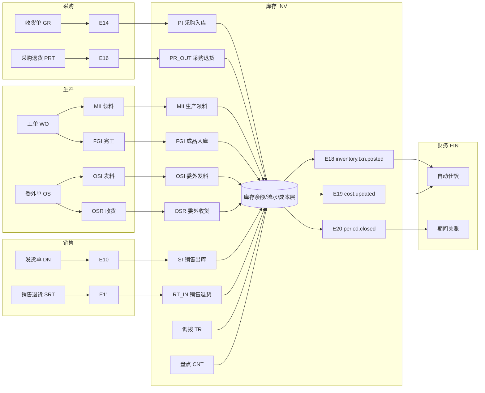

# 库存管理 业务域概要书（在庫管理 業務概要書）

| 項目 | 内容 |
|---|---|
| 文書名 | 库存管理 业务域概要书（在庫管理 業務概要書） |
| 文書番号 | DSN-INV-000 |
| 版数 | v1.0 |
| 作成日 | 2026-10-20 |
| 作成者 | inventory-designer |
| 承認者 | 未承認（レビュー待ち） |
| 状態 | ドラフト（レビュー中） |
| 関連文書 | [体系总览](../README.md) / [共通项目定义](../00-common/01-common-item-definitions.md) / [共通业务规则](../00-common/08-common-business-rules.md) / [跨域流程](../00-common/09-cross-domain-flow.md) / [DB 共通规格](../00-common/04-common-db-spec.md) |

---

## 1. 业务概要

### 1.1 目的

库存管理域（INV）是采购、销售、生产、财务四个域之间的**库存数量与金额的唯一更新责任域**。本域负责：入库、出库、调拨、盘点、批次/序列号、库存状态、移动加权平均成本、预留（引当）、月结与库存报表。任何其他业务域**不得直接更新库存余额**，只能通过本域公开服务或领域事件驱动本域过账（[09 跨域流程](../00-common/09-cross-domain-flow.md) 第 2.2 节「更新责任の一元化」）。

本域设计目标：

1. 库存数量与金额在**任何时点可追溯到每一笔事务**（事务流水 + 余额 + 成本层三者可对账）。
2. 并发扣减下**不出现负库存、不出现超卖、不出现余额与流水不一致**（P0 硬约束）。
3. 与财务的契约唯一：每笔库存事务的类型 → 成本口径 → 会计仕訳 → 领域事件，一一对应且可机械校验。
4. 支撑批次/序列号全链路追溯（采购收货 → 入库 → 领料 → 生产 → 入库 → 发货 → 客户）。

### 1.2 适用范围

| 项目 | 内容 |
|---|---|
| 対象会社・拠点 | 华东精密电机股份有限公司 / 常州总装厂（工厂 1）・无锡零部件厂（工厂 2） |
| 対象倉庫 | WH01 原料仓（无锡零部件厂 WX01 内）・WH02 半成品仓（常州总装厂 CZ01 内）・WH03 成品仓（CZ01 内）；WX01 的半成品暂存区以 WH01 内库区/库位管理（第一版 增设独立仓）（[90-data/demo-company.md](../90-data/demo-company.md) §3） |
| 対象機能範囲 | 库存查询、入出库（采购/销售/生产/委外/其他）、调拨、盘点、批次/序列号、库存状态、成本计算与调整、预留、条码/PDA、月结、库存报表 |
| 対象外 | 采购收货单（GR）与来料检验（IQC）的检验判定 → PUR/PRD 域；销售发货通知（DN）与销售确认 → SAL 域；工单、领料申请、报工 → PRD 域；会计凭证生成与总账 → FIN 域；仓库主数据与条码规则定义 → MDM 域；经营分析看板与跨域 KPI → RPT 域 |
| 前提 | MDM 的物料（批次/序列号/保质期/安全库存标志）、仓库/库位、计量单位、条码规则已启用；SYS 的采番、权限、参数、期间功能可用；FIN 的会计期间已建立 |

### 1.3 业务上の狙い（KPI）

| KPI | 定义・算式 | 目标値 | 実現する機能 ID |
|---|---|---|---|
| 库存准确率 | 1 − 盘点差异金额 ÷ 账面库存金额（月度） | ≥ 99.5%【示例值】 | F-INV-010、F-INV-021 |
| 库存周转率 | 期间出库成本 ÷ 平均库存金额（平均 =（期初+期末）÷ 2） | ≥ 6 次/年【示例值】 | F-INV-017、F-INV-021 |
| 呆滞库存占比 | 库龄 > 365 天库存金额 ÷ 库存总金额 | ≤ 5%【示例值】 | F-INV-015 |
| 缺货率（可用量 < 安全库存） | 低于安全库存的物料数 ÷ 有库存管理物料数 | ≤ 2%【示例值】 | F-INV-016 |
| 出入库过账时效 | 从来源单据确认到库存过账成功的平均时长 | ≤ 1 分钟 | F-INV-002〜008、F-INV-013 |
| 月结时效 | 库存月结开始到 `inventory.period.closed` 发行 | ≤ 30 分钟 | F-INV-020 |
| 批次追溯响应 | 从批次号反查「来源供应商 → 客户」全链路 | ≤ 3 秒 | F-INV-011 |

> KPI 目标值均为【示例值】（企业内部管理目标，仮定値），实际以企业年度经营目标设定。

---

## 2. 库存管理基本定義（唯一の定義源）

> 本章是本域**所有数量、状态、事务、成本、期间定义的单一定义源**。域内其他文書（01〜07、90〜94）一律引用本章，不得再定义。

### 2.1 库存维度与粒度

库存余额的最小管理单位（`inv_stock_balance` 唯一键）：

```
公司(company_id) × 仓库(warehouse_id) × 库位(location_id) × 物料(material_id) × 批次(batch_id) × 库存状态(stock_status)
```

| 维度 | 说明 | 缺失时的取值 |
|---|---|---|
| 公司 | 首期固定 `1`（单公司） | 不可为空 |
| 仓库 | 库存保管场所；跨仓调拨以源/目标两个仓库体现 | 不可为空 |
| 库位 | 仓库内货架/层/位（`mdm_warehouse_bin`） | 未启用库位管理的仓库取 `0`（表示「无库位」） |
| 物料 | 基本单位管理（[01 共通项目定义](../00-common/01-common-item-definitions.md) 第 6 章） | 不可为空 |
| 批次 | 物料启用批次管理时必填（`inv_batch`） | 非批次管理取 `0` |
| 库存状态 | 10/20/30/40/50（见 2.2） | 不可为空 |

**事务粒度**：`inv_stock_txn`（事务头，1 张业务单据 = 1 个事务头）+ `inv_stock_txn_line`（事务行，1 行 = 1 个「仓库×物料×批次×状态×库位」的变动）。序列号管理物料**按序列号逐行**（每行数量 = 1）。

**金额与数量精度**（引用 [01 共通项目定义](../00-common/01-common-item-definitions.md) 第 6 章，不重复定义）：

| 项目 | 型 | 说明 |
|---|---|---|
| 库存数量 `qty_*` | `NUMERIC(18,4)` | 基本单位（PCE/KGM…） |
| 库存金额 `amount_*` | `NUMERIC(18,2)` | CNY |
| 平均单价 `avg_unit_cost` / `unit_cost` | `NUMERIC(18,6)` | 元/基本单位 |
| 事务数量 `qty` | `NUMERIC(18,4)` | 恒 > 0，方向由 `direction` 表示 |

### 2.2 库存状态定义（`stock_status`）

| 代码 | 名称 | 含义 | 是否计入可用量 | 主要迁移 |
|---|---|---|---|---|
| `10` | 待检（INSPECTION） | 采购/生产入库后待 IQC/FQC 判定 | 不计入 | 10→20（合格/特採）、10→40（不合格）、10→50（拒收报废） |
| `20` | 可用（AVAILABLE） | 可正常出库/引当 | 计入 | 10→20（检验合格）、20→30（冻结）、20→40/50（判不合格/报废） |
| `30` | 冻结（FROZEN） | 质量/财务/客户原因冻结，禁止出库 | 不计入 | 30→20（解冻，需审批） |
| `40` | 不合格（REJECT） | 判定不合格待处理（退货/返工/报废） | 不计入 | 40→50（报废）、40→20（返工后合格，需审批） |
| `50` | 报废待处理（SCRAP_PENDING） | 已决定报废但未实际出库 | 不计入 | → 出库（SC_OUT）后余额为 0 |

规则：

1. 库存状态是**余额行的一部分**，状态间转换不改变「现存总量」，只改变可用量（`ST_OUT` + `ST_IN` 成对事务，见 2.4）。
2. 采购/委外入库（`PI`/`OSR`）：`inspection_stage ∈ {10,40}` → `inspection_flag=true` → `10` 待检（IQC）；否则直入 `20`（参数 `inv_receipt_default_status`）。详见 [02 §2.6.1a](02-inbound-outbound.md)。
3. 生产完工入库（`FGI`）：`inspection_stage ∈ {30,40}` → true → `10` 待检（FQC），E15 合格后 `20`；否则直入 `20`。E24 在 `inspection_flag=true` 时若 `stockStatus≠10` 则 `MSG-INV-065`。不合格转 `40`。[09 §8](../00-common/09-cross-domain-flow.md)、[02 §2.6.1a](02-inbound-outbound.md)。
4. 销售退货入库（`RT_IN`）：可用品进入 `20`，不良品进入 `40`（不得进入可用）。
5. 冻结/解冻、不合格→可用必须走 `F-INV-014` 状态转换并记录理由、审批（解除冻结需 `inventory:status:change` 权限 + 审计日志）。

### 2.3 数量定义与可用量公式（唯一算式）

| 术语 | 定义（本域唯一口径） |
|---|---|
| **现存量**（`qty_on_hand`） | 某物料在指定仓库/批次下**所有库存状态**的余额合计 = Σ`inv_stock_balance.qty_on_hand`（不过滤 status） |
| **预定量 / 引当量**（`qty_reserved`） | 受注/工单已锁定、尚未出库的数量 = Σ`inv_stock_balance.qty_reserved`（仅 `status=20` 行有值） |
| **待检量** | Σ`qty_on_hand` WHERE `stock_status = 10` |
| **冻结量** | Σ`qty_on_hand` WHERE `stock_status = 30` |
| **不合格量** | Σ`qty_on_hand` WHERE `stock_status = 40` |
| **报废待处理量** | Σ`qty_on_hand` WHERE `stock_status = 50` |
| **可用量**（`available_qty`） | 见下式 |
| **在途量** | 跨仓调拨单已出库未入库的数量 + 采购在途（PO 未收货数量，仅报表用，不进入余额） |
| **安全库存** | `mdm_material.safety_stock_qty`（按物料+仓库覆盖。`mdm_material_warehouse` は MDM 第一版 予約、本期は未提供）；仅用于预警，不占用库存 |
| **再订货点** | 安全库存 + 采购提前期内的平均日耗 × 提前期天数（参数化，见 [07-reports](07-reports.md) 第 4 章） |

**可用量公式（P0 唯一算式，禁止在其他文書出现不同写法）**：

```
可用量 = 现存量 − 引当量 − 待检量 − 冻结量 − 不合格量 − 报废待处理量
       = Σ(qty_on_hand WHERE stock_status = 20) − Σ(qty_reserved)
       = 可用状态余额 − 可用状态引当量
```

说明：

- 等价写法：`可用量 = 可用状态现存量 − 预定量`。两种写法在数据上恒等，实现时以第二条（`status=20` 行聚合）为**计算式**，第一条为**业务说明式**。
- `qty_reserved` 仅允许出现在 `status=20` 的行，且 `qty_reserved ≤ qty_on_hand`（DB 约束 `ck_inv_stock_balance_reserved`）。
- 引当（预留）以「仓库 × 物料 × 批次」为单位占用，**不改变库存状态**，只增加 `qty_reserved`。
- 负库存 P0 禁止（`sys_param.allow_negative_stock = false`）；可用量 < 0 在数据库层面不可产生（余额行 `qty_on_hand ≥ 0` 且 `qty_reserved ≤ qty_on_hand`）。
- 余额行与流水一致性的校验口径见 [90-db-design](90-db-design.md) 第 6 章、[92-report-batch-design](92-report-batch-design.md) 的 `BAT-INV-002`。

### 2.4 库存事务类型总表（`inv_stock_txn.txn_type`）

> 与 [09 跨域流程](../00-common/09-cross-domain-flow.md) 第 7.1 节**一一对应，不新增、不改名**。方向、成本、来源单据、可否冲销、对应仕訳的完整定义见 [02-inbound-outbound](02-inbound-outbound.md) 第 2 章。

| # | 代码 | 取引種別 | 方向 | 库存增减 | 成本口径 | 来源单据/事件 | 可否冲销 | 仕訳（09 §7.2） |
|---|---|---|---|---|---|---|---|---|
| 1 | `PI` | 采购入库（待检/可用） | IN | + | 采购价 + 运费分摊 + 关税 + 其他归属费用 | 收货单 GR / E14 | 可 | J01（暂估）→J03（发票） |
| 2 | `SI` | 销售出库 | OUT | − | 移动加权平均 | 发货单 DN / E10 | 可 | J06 |
| 3 | `MII` | 生产领料 | OUT | − | 移动加权平均 | 工单 WO / E22 | 可 | J11 |
| 4 | `MIR` | 生产退料 | IN | + | 领料时原价 | 工单 WO / E36 | 可 | J12 |
| 5 | `FGI` | 成品/半成品入库 | IN | + | 完工成本（FIN 提供） | 工单完工 E24 | 可 | J16 |
| 6 | `OSI` | 委外发料 | OUT | − | 移动加权平均 | 委外单 OS / E25 | 可 | J17 |
| 7 | `OSR` | 委外收货 | IN | + | 材料成本 + 加工费 | 委外单 OS / E26 | 可 | J18 |
| 8 | `TR_OUT` | 调拨出库 | OUT | −（转在途） | 移动加权平均 | 调拨单 TR | 可 | 无损益（内部转移） |
| 9 | `TR_IN` | 调拨入库 | IN | +（在途转库存） | 调拨出库成本 | 调拨单 TR | 可 | 无损益（内部转移） |
| 10 | `ADJ_IN` | 盘盈 | IN | + | 当前平均单价 | 盘点单 CNT | 可 | J19 |
| 11 | `ADJ_OUT` | 盘亏 | OUT | − | 当前平均单价 | 盘点单 CNT | 可 | J20（批准 J21） |
| 12 | `SC_IN` | 报废转入（不良品仓/状态） | IN | +（状态间） | 移动加权平均 | 报废决定/质量判定 | 可 | 无损益（状态移动） |
| 13 | `SC_OUT` | 报废出库（实际除却） | OUT | − | 移动加权平均 | 报废单/质量判定 | 可 | 按原因（管理费用/营业外支出） |
| 14 | `AOI` | 其他入库（赠品/借入/期初） | IN | + | 设定原价（手工/参数） | 其他入库单 AOI | 可 | 按业务原因（FIN 定义） |
| 15 | `AOO` | 其他出库（领用/借出/样品） | OUT | − | 移动加权平均 | 其他出库单 AOO | 可 | 按业务原因（FIN 定义） |
| 16 | `RT_IN` | 销售退货入库 | IN | + | 原销售出库原价 | 销售退货单 SRT / E11 | 可 | J23（红字 J22） |
| 17 | `PR_OUT` | 采购退货出库 | OUT | − | 原入库价 | 采购退货单 PRT / E16 | 可 | J04 |
| 18 | `ST_IN` | 状态转换入（转入某状态） | IN | 0（状态间） | 不重算（沿用原单价） | 状态转换/检验判定 | 可 | 无仕訳（状态のみ） |
| 19 | `ST_OUT` | 状态转换出（转出某状态） | OUT | 0（状态间） | 不重算 | 同上 | 可 | 无仕訳（状态のみ） |

**共通规则**：

1. **方向**：`direction`（+1 IN / −1 OUT）由 `txn_type` 唯一决定并在应用层与 DB CHECK 双重约束；`qty` 恒为正数，余额变动 = `direction × qty`。
2. **冲销**：冲销 = 新建一笔**同一 `txn_type`** 的事务，`is_reversal = true`、`reversal_of_txn_id = 原事务`、方向取反；原事务置 `txn_status = 90`。业务退货（RT_IN/PR_OUT）与冲销是两回事：退货是业务事实，冲销是错误订正（[08 共通业务规则](../00-common/08-common-business-rules.md) 第 13.1 节）。
3. **成对状态转换**：一次状态转换生成 `ST_OUT`（转出状态）+ `ST_IN`（转入状态）两条事务，以 `pair_key` 关联；两条事务在同一数据库事务内完成，数量净变动 = 0。
4. **禁止新增事务类型**：如业务确需新类型（如寄售、组装拆卸），须先由 Lead 修订 [09 跨域流程](../00-common/09-cross-domain-flow.md) 第 7.1 节，本域不得自行扩展。
5. **事务不可修改**：`txn_status=30`（已过账）后禁止修改数量/金额；只能冲销后重做（[08 共通业务规则](../00-common/08-common-business-rules.md) 第 13.1 节「在庫訂正」）。
6. **遡及禁止**：`txn_date` 必须 ≥ 该（仓库×物料×批次）最后事务日 `inv_stock_balance.last_txn_date`，且所属期间必须为 `OPEN`（见 2.6）。

### 2.5 计价定义（移动加权平均）

| 項目 | 定義 | 詳細 |
|---|---|---|
| 计价方法 | 移动加权平均法（第一版 唯一方法） | [08 共通业务规则](../00-common/08-common-business-rules.md) 第 6 章 |
| 成本计算单位 | **仓库 × 物料 × 批次**（非批次管理物料为 仓库 × 物料，`batch_id=0`） | [05-costing](05-costing.md) 第 2 章 |
| 入库成本构成 | 采购单价（税抜）+ 运费分摊 + 关税 + 其他可直接归属费用 | 若为制造品：完工成本（FIN 计算，`FGI` 引用） |
| 平均单价 | 同一成本计算单位的所有状态行共享一个 `avg_unit_cost`；计算式 `(Σ旧金额 + 入库金额) ÷ (Σ旧数量 + 入库数量)`，6 位小数四舍五入 | 见 05-costing 第 3 章 |
| 出库金额 | `出库数量 × 出库前该成本计算单位的平均单价`，2 位小数四舍五入 | 先锁余额再计算，防止并发取值不一致 |
| 金额守恒 | Σ`inv_stock_txn_line.amount`（按单位）= `inv_stock_balance.amount_on_hand`；成本层剩余金额合计 = 余额金额合计 | 由 `BAT-INV-002` 日次校验 |
| 负数金额禁止 | 任何余额行 `amount_on_hand ≥ 0`；成本调整导致负数时拒绝（`MSG-INV-037`） | — |
| 成本调整 | 发票价差/运费差异 → `inv_cost_adjustment`，更新余额金额与平均单价，已出库部分转当期损益；**不产生库存事务**（数量不变），发 `E19` | [05-costing](05-costing.md) 第 6 章 |

### 2.6 库存期间与关账定义

| 項目 | 定義 |
|---|---|
| 期间单位 | 月次（`YYYY-MM`），与 FIN 会计期间同粒度；由 `inv_period` 管理 |
| 期间状态 | `10` 未开始（FUTURE）/`20` 开放（OPEN）/`40` 已关账（CLOSED）/`90` 已年结（YEAR_CLOSED） |
| 事务登记 | 仅允许在 `20` 开放的期间登记；`40`/`90` 期间拒绝（`MSG-COM-071`/`MSG-INV-042`） |
| 月结顺序 | ①库存月结（BAT-INV-001）→ ②成本重算/差异 → ③FIN 原价计算 → ④FIN 期间关账（`fin_period`）（[08 共通业务规则](../00-common/08-common-business-rules.md) 第 10 章） |
| 关账后 | 禁止新增/修改当期库存事务；修正只能在下一开放期间调整（不追溯）；管理员可 reopen（`inventory:period:reopen`，必须审计 + Lead 审批） |
| 与 FIN 的关系 | INV 的 `inv_period` 与 FIN 的 `fin_period` 状态双向同步：FIN 关账后 INV 不允许 reopen；INV 未关账则 FIN 不可关账（E20/E30 契约） |

---

## 3. 組織とロール

| ロール | 所属 | 主な操作 | 関連機能 ID | 権限コード（例） |
|---|---|---|---|---|
| 仓管员 | 仓储部 | 入出库执行、拣货、库位移动、扫码、实盘录入 | F-INV-002〜010、F-INV-018 | `inventory:stock-txn:create`、`inventory:stocktake:enter`、`inventory:barcode:scan` |
| 仓库主管 | 仓储部 | 入库/出库确认、调拨审批、盘点差异确认、冻结/解冻审批 | F-INV-009、F-INV-010、F-INV-014 | `inventory:stock-txn:post`、`inventory:transfer:approve`、`inventory:stocktake:approve` |
| 质检员 | 质量部 | 检验判定、状态转换（待检→可用/不合格） | F-INV-014 | `inventory:status:change`（仅待检→可用/不合格） |
| 计划员 | 生产部 | 库存查询、预留查看、补货建议处理 | F-INV-001、F-INV-016、F-INV-019 | `inventory:stock-balance:view`、`inventory:replenishment:view` |
| 采购员/采购经理 | 采购部 | 采购入库确认、采购退货出库、补货转请购 | F-INV-002、F-INV-008 | `inventory:stock-txn:view`、`inventory:replenishment:generate` |
| 销售员/销售经理 | 销售部 | 可用量查询、批次可用明细查询、预留查看 | F-INV-001、F-INV-019 | `inventory:stock-balance:view`、`inventory:reservation:view` |
| 会计/成本会计 | 财务部 | 成本查询、成本调整、库存月结、报表 | F-INV-017、F-INV-020、F-INV-021 | `inventory:cost:view`、`inventory:cost:adjust`、`inventory:period:close` |
| 财务经理 | 财务部 | 成本调整审批、盘点差异审批、月结审批 | F-INV-010、F-INV-017、F-INV-020 | `inventory:stocktake:approve`、`inventory:cost:approve`、`inventory:period:close` |
| 系统管理员 | 信息部 | 参数、权限、期间初始化、异常数据修复（受审计） | — | `inventory:period:reopen` |
| 审计员 | 内审 | 全量参照（只读）、追溯查询、导出 | F-INV-011、F-INV-013 | `inventory:*:view` |

### 3.1 承認経路（本域関連）

引用 [08 共通业务规则](../00-common/08-common-business-rules.md) 第 8.1 节与 [90-data/approval-matrix.md](../90-data/approval-matrix.md)：

| 対象 | 条件（金額は税込/評価額） | 承認経路 | 方式 |
|---|---|---|---|
| 盘盈盘亏（盘点差异调整） | 差异金额 < 10,000 元 | 仓库主管 → 财务经理 | 順送 |
| 盘盈盘亏（盘点差异调整） | 差异金额 ≥ 10,000 元 | 仓库主管 → 财务经理 → 总经理 | 順送 |
| 库存冻结/解冻 | 全件 | 仓库主管（解冻另需质量/财务确认） | 或签 |
| 在庫成本調整 | 差異金額 < 1,000 元 | 财务经理 | 或签 |
| 在庫成本調整 | 差異金額 ≥ 1,000 元 | 财务经理 → 财务总监 | 順送 |
| 在庫調撥（跨倉） | 移動金額 < 10,000 元 | 仓库主管 | 或签 |
| 在庫調撥（跨倉） | 移動金額 ≥ 10,000 元 | 仓库主管 → 财务经理 | 順送 |
| 在庫状態変換（待検→不合格/報廃） | 全件 | 质量主管 → 仓库主管 | 順送 |
| 其他入出库（AOI/AOO） | 金額 ≥ 10,000 元 | 仓库主管 → 财务经理 | 順送 |
| 库存月结 | 全件 | 财务经理确认（执行者不可自审） | 或签 |

> 金额阈值与路径由 `wf_approval_matrix` 参数化管理，不得硬编码。上表は [08 §8.1](../00-common/08-common-business-rules.md) の 2026-10-20 追補（調撥・成本調整・状態変換・其他入出庫）を反映し、金額は【示例值】。

---

## 4. 業務フロー

### 4.1 全体フロー（在庫を中心とした4域連携）



### 4.2 処理手順（主要シナリオ）

| # | 手順 | 実施者 | システム処理 | 入力 | 出力・イベント | 異常時 |
|---|---|---|---|---|---|---|
| 1 | 采购收货（PUR） | 仓管 | GR 登记，发 E14 | 到货数量、PO | GR / E14 | 超收容差 → PUR 拒绝 |
| 2 | 采购入库过账（INV） | 系统（E14 订阅）/仓管确认 | 生成 `PI`（GRI 单号），余额+待检量，成本层登记；发 E18 | E14 payload | GRI / PI / E18 | 重复事件（幂等）、批次号冲突 |
| 3 | 来料检验合格（PRD） | 质检员 | 发 E15 → INV 状态转换 `ST_OUT(10)`+`ST_IN(20)`，可用量增加 | 检验结果 | 状态转换 / E18 | 判定与在库数量不符 |
| 4 | 受注引当（SAL 发 E06） | 系统 | 按仓库/批次规则预留，写 `inv_reservation*`，`qty_reserved` 增加；发 E09 | E06 payload | E09 | 可用不足 → PARTIAL/SHORTAGE |
| 5 | 出荷确定（SAL 发 E10） | 仓管拣货扫描 | 生成 `SI`（SDO 单号），按移动平均出库，扣减 `qty_reserved`（消耗预留）；发 E18 | E10 payload | SDO / SI / E18 | 库存不足/冻结/过期批次 → 拒绝 |
| 6 | 生产领料（PRD 发 E22） | 仓管 | 生成 `MII`，出库；发 E18 | 工单、BOM 用量 | MII / E18 | 批次指定不可用 |
| 7 | 完工入库（PRD 发 E24） | 仓管 | 生成 `FGI`，入库；发 E18 | 完工数量、批次 | FGI / E18 | 完工成本未确定 → 按暂估单价 |
| 8 | 委外发料/收货（E25/E26） | 仓管 | 生成 `OSI`/`OSR`；发 E18 | 委外单 | OSI/OSR / E18 | 加工费未到 → 暂估 |
| 9 | 调拨（INV） | 仓管 | 创建 TR → 出库 `TR_OUT`（在途）→ 收货 `TR_IN`；发 E18 | 源/目标仓、批次 | TR / E18 | 在途数量、部分收货 |
| 10 | 盘点（INV） | 仓管/主管/财务 | 盘点计划 → 盘点单 → 实盘 → 差异 → 审批 → `ADJ_IN`/`ADJ_OUT`；发 E18 | 实盘数量 | CNT / E18 | 差异超阈值 → 上级审批 |
| 11 | 其他入库/出库（INV） | 仓管 | 生成 `AOI`/`AOO`；发 E18 | 原因、物料、数量 | AOI/AOO / E18 | 原因必填、审批 |
| 12 | 成本调整（FIN 发票价差） | 成本会计 | `inv_cost_adjustment` 更新金额/单价；发 E19 | 发票差异额 | E19 / 调整单 | 期间已关账 → 拒绝 |
| 13 | 库存月结（INV） | 会计 | BAT-INV-001：检查 → 收发存汇总 → 关账 `inv_period`；发 E20 | 期间 | E20 / 报表 | 未过账事务/对账差异 → 中断 |

### 4.3 関連業務域との連携（発行・購読イベント）

**本域が発行するイベント**（[09 跨域流程](../00-common/09-cross-domain-flow.md) 第 3 章の契約に従う）：

| イベント | 発行契機 | 購読者 | 主なペイロード | 本域の実装箇所 |
|---|---|---|---|---|
| `inventory.reservation.updated`（E09） | 引当成功/一部/不足/解除/消耗 | SAL/PRD | reservationId, sourceType, sourceId, lines[{materialId, warehouseId, reservedQty, shortageQty}], status | [06-reservation-barcode-close](06-reservation-barcode-close.md) |
| `inventory.txn.posted`（E18） | 每笔库存事务过账成功 | FIN/SAL/PUR/PRD | txnId, txnNo, txnType, warehouseId, lines[{materialId, batchNo, qty, unitCost, amount}], bizDate, sourceType, sourceId；追加項目 `stockDocId`・`stockDocNo`（PRD/PUR/SAL への伝票番号返却）、`totalQty`・`totalAmount`、`sourceEventAt` | [02-inbound-outbound](02-inbound-outbound.md) §2.7 |
| `inventory.cost.updated`（E19） | 平均单价变化/成本调整确定 | FIN/PRD | materialId, warehouseId, batchNo, avgUnitCost, adjustmentAmount, effectiveDate | [05-costing](05-costing.md) |
| `inventory.period.closed`（E20） | 库存月结完成 | FIN/SAL/PUR/PRD | periodCode, closedAt | [06-reservation-barcode-close](06-reservation-barcode-close.md) |
| `inventory.period.reopened`（E37） | 库存期間再開（FIN 承認後） | FIN/SAL/PUR/PRD | periodCode, reason, approvedBy, reopenedAt | [06-reservation-barcode-close](06-reservation-barcode-close.md) |

**本域が購読するイベント**：

| イベント | 発行者 | 本域の処理 | 冪等キー |
|---|---|---|---|
| `mdm.material.changed`（E01） | MDM | 物料属性缓存更新（批次/序列号/保质期/安全库存标志） | eventId |
| `sales.order.approved`（E06） | SAL | 受注引当 → 发 E09 | eventId |
| `sales.order.changed`（E07） | SAL | 引当数量增减 | eventId + aggregateVersion |
| `sales.order.cancelled`（E08） | SAL | 全部释放引当 → E09（RELEASED） | eventId |
| `sales.delivery.confirmed`（E10） | SAL | 生成 `SI` 销售出库（SDO） | eventId |
| `sales.return.confirmed`（E11） | SAL | 生成 `RT_IN` 销售退货入库 | eventId |
| `purchase.receipt.posted`（E14） | PUR | 生成 `PI` 采购入库（GRI，待检） | eventId |
| `quality.inspection.completed`（E15） | PRD | 状態変換（`resultCode` 20/30→可用、40/50→不合格）。E14/E24 未過账時は `inv_event_wait` に保留 | eventId |
| `system.department.changed`（E38） | SYS | 部門・データ範囲キャッシュ更新 | eventId |
| `mdm.warehouse.changed`（E39） | MDM | 倉庫/庫区/庫位の参照キャッシュ更新、既存在庫の整合確認 | eventId |
| `purchase.return.confirmed`（E16） | PUR | 生成 `PR_OUT` 采购退货出库 | eventId |
| `purchase.receipt.cancelled`（E35） | PUR | 待検 `PI` の反向取消（IQC 完了・引当/出庫・照合済は不可） | eventId |
| `production.workorder.released`（E21） | PRD | 工单材料引当 → E09 | eventId |
| `production.material.issued`（E22） | PRD | 生成 `MII` 生产领料 | eventId |
| `production.workorder.completed`（E24） | PRD | 生成 `FGI` 完工入库（既定 `10 待检`）。E15 が先行していれば同一 TX で適用 | eventId |
| `production.material.returned`（E36） | PRD | 生成 `MIR` 生产退料（在庫戻入、材料費戻し J12） | eventId |
| `production.outsourcing.issued`（E25） | PRD | 生成 `OSI` 委外发料 | eventId |
| `production.outsourcing.received`（E26） | PRD | 生成 `OSR` 委外收货 | eventId |
| `workflow.task.completed`（E31） | WF | 盘点差异/成本调整审批结果回写 | taskId + result |
| `finance.period.closed`（E30）/`system.period.status.changed`（E34） | FIN/SYS | 期间状态缓存更新，禁止向已关账期间登记 | eventId |

> 事件エンベロープ・Outbox・冪等・再送は [09 跨域流程](../00-common/09-cross-domain-flow.md) 第 2.3、10 章に従う。本域は**イベント購読で在庫を更新する唯一の実装者**であり、購読ハンドラは `sys_event_consume_log` で eventId を重複排除する。

---

## 5. 機能一覧

| 機能 ID | 機能名 | 概要 | 画面 ID | 種別 | 優先度 | 状態 | 詳細設計書 |
|---|---|---|---|---|---|---|---|
| F-INV-001 | 库存查询 | 现存量/可用量/锁定/待检/冻结/在途，按仓库/物料/批次/库位/状态多条件查询与汇总 | SCR-INV-001 | 照会 | P0 | 設計済 | [01-stock-query.md](01-stock-query.md) |
| F-INV-002 | 采购入库 | 来源收货单（E14），生成 GRI，待检入库，成本构成登记 | SCR-INV-004 | 登録 | P0 | 設計済 | [02-inbound-outbound.md](02-inbound-outbound.md) |
| F-INV-003 | 销售出库 | 来源发货单（E10），生成 SDO，按移动平均出库、消耗预留 | SCR-INV-005 | 登録 | P0 | 設計済 | [02-inbound-outbound.md](02-inbound-outbound.md) |
| F-INV-004 | 生产领料/退料 | 来源工单（MII=E22、MIR=E36），生成 MII/MIR，按 BOM 用量/实发 | SCR-INV-006 | 登録 | P1 | 設計済 | [02-inbound-outbound.md](02-inbound-outbound.md) |
| F-INV-005 | 产成品/半成品入库 | 来源工单完工（E24），生成 FGI，完工成本入库 | SCR-INV-007 | 登録 | P1 | 設計済 | [02-inbound-outbound.md](02-inbound-outbound.md) |
| F-INV-006 | 委外发料/收货 | 来源委外单（E25/E26），生成 OSI/OSR | SCR-INV-008 | 登録 | P1 | 設計済 | [02-inbound-outbound.md](02-inbound-outbound.md) |
| F-INV-007 | 其他入库 | 盘盈以外（赠品/借入/期初/样品），生成 AOI | SCR-INV-009 | 登録 | P0 | 設計済 | [02-inbound-outbound.md](02-inbound-outbound.md) |
| F-INV-008 | 其他出库 | 盘亏以外（领用/借出/样品/捐赠），生成 AOO/SC_OUT | SCR-INV-010 | 登録 | P0 | 設計済 | [02-inbound-outbound.md](02-inbound-outbound.md) |
| F-INV-009 | 库存调拨 | 同仓移库、跨仓调拨、在途跟踪、部分收货 | SCR-INV-011、012 | 登録 | P0 | 設計済 | [03-transfer-count.md](03-transfer-count.md) |
| F-INV-010 | 库存盘点 | 盘点计划→盘点单→实盘→差异→审批→调整 | SCR-INV-013〜015 | 登録 | P0 | 設計済 | [03-transfer-count.md](03-transfer-count.md) |
| F-INV-011 | 批次管理 | 批号规则、批次主档、批次追溯、效期预警 | SCR-INV-016、017 | 照会/登録 | P0 | 設計済 | [04-batch-serial-status.md](04-batch-serial-status.md) |
| F-INV-012 | 序列号管理 | 序列号入库/出库/退货/报废全生命周期 | SCR-INV-018 | 照会 | P1 | 設計済 | [04-batch-serial-status.md](04-batch-serial-status.md) |
| F-INV-013 | 库存事务流水 | 全部事务查询、来源追溯、反向冲销、导出 | SCR-INV-002、003 | 照会 | P0 | 設計済 | [01-stock-query.md](01-stock-query.md) |
| F-INV-014 | 库存状态转换 | 可用/待检/冻结/不合格/报废待处理之间的转换，成对 ST 事务 | SCR-INV-019 | 登録 | P0 | 設計済 | [04-batch-serial-status.md](04-batch-serial-status.md) |
| F-INV-015 | 库龄与呆滞分析 | 库龄分段、呆滞判定、库龄快照 | SCR-INV-020 | 照会 | P1 | 設計済 | [07-reports.md](07-reports.md) |
| F-INV-016 | 安全库存与补货建议 | 安全库存/再订货点计算、补货建议生成、转请购 | SCR-INV-021 | バッチ/照会 | P1 | 設計済 | [07-reports.md](07-reports.md) |
| F-INV-017 | 移动加权平均成本计算与重算 | 入库成本构成、出库成本、成本调整、重新计价 | SCR-INV-022、023 | バッチ/登録 | P0 | 設計済 | [05-costing.md](05-costing.md) |
| F-INV-018 | 条码/PDA 扫码出入库 | 扫码作业、重复扫/错仓/错批次异常处理、离线补传 | SCR-INV-026 | 登録 | P1 | 設計済 | [06-reservation-barcode-close.md](06-reservation-barcode-close.md) |
| F-INV-019 | 库存预留/锁定 | 受注/工单引当、释放、消耗、过期自动释放 | SCR-INV-024 | 登録 | P0 | 設計済 | [06-reservation-barcode-close.md](06-reservation-barcode-close.md) |
| F-INV-020 | 库存期间月结/关账 | 月结检查、收发存汇总、期间关账/重开 | SCR-INV-025 | バッチ | P0 | 設計済 | [06-reservation-barcode-close.md](06-reservation-barcode-close.md) |
| F-INV-021 | 库存报表 | 收发存汇总、明细账、库龄、周转、流水、追溯报告 | SCR-INV-020、003 | 帳票 | P0 | 設計済 | [07-reports.md](07-reports.md) |
| F-INV-022 | 组装拆卸 | 组装/拆卸业务的库存处理（第一版対象。TODO：設計が未作成） | — | 登録 | P2 | 概要設計 | [07-reports.md](07-reports.md) |
| F-INV-023 | 寄售库存 | 供应商寄售/客户寄售库存（第一版対象。TODO：設計が未作成） | — | 登録 | P2 | 概要設計 | [07-reports.md](07-reports.md) |

> 状態：未設計/設計中/設計済/レビュー済/承認済。優先度：P0/P1/P2 は**すべて第一版の範囲**で、実装順序のみを表す（P0 先行）。

---

## 6. 画面一覧

| 画面 ID | 画面名 | 類型 | 機能 ID | 権限コード（主） | 遷移元 | 遷移先 |
|---|---|---|---|---|---|---|
| SCR-INV-001 | 库存查询（现存量照会） | 一覧検索 | F-INV-001 | `inventory:stock-balance:view` | 菜单 | SCR-INV-002、016 |
| SCR-INV-002 | 库存事务流水照会 | 一覧検索 | F-INV-013 | `inventory:stock-txn:view` | 菜单、001 | SCR-INV-003 |
| SCR-INV-003 | 库存明细账（台帳） | 一覧検索 | F-INV-013 | `inventory:stock-txn:view` | 001、002 | — |
| SCR-INV-004 | 采购入库单（GRI）登録 | 登録編集 | F-INV-002 | `inventory:stock-txn:create` | 待処理一覧、E14 通知 | 001 |
| SCR-INV-005 | 销售出库单（SDO）登録 | 登録編集 | F-INV-003 | `inventory:stock-txn:create` | 拣货任务、E10 通知 | 001 |
| SCR-INV-006 | 生产领料/退料单（MII/MIR）登録 | 登録編集 | F-INV-004 | `inventory:stock-txn:create` | E22/E36 通知 | 001 |
| SCR-INV-007 | 生产入库单（FGI）登録 | 登録編集 | F-INV-005 | `inventory:stock-txn:create` | E24 通知 | 001 |
| SCR-INV-008 | 委外发料/收货单（OSI/OSR）登録 | 登録編集 | F-INV-006 | `inventory:stock-txn:create` | E25/E26 通知 | 001 |
| SCR-INV-009 | 其他入库单（AOI）登録 | 登録編集 | F-INV-007 | `inventory:stock-txn:create` | 菜单 | 001 |
| SCR-INV-010 | 其他出库单（AOO）登録 | 登録編集 | F-INV-008 | `inventory:stock-txn:create` | 菜单 | 001 |
| SCR-INV-011 | 库存调拨单（TR）登録 | 登録編集 | F-INV-009 | `inventory:transfer:create` | 菜单 | SCR-INV-012 |
| SCR-INV-012 | 调拨在途跟踪 | 一覧検索 | F-INV-009 | `inventory:transfer:view` | 011 | 011（受入） |
| SCR-INV-013 | 盘点计划登録 | 登録編集 | F-INV-010 | `inventory:stocktake:create` | 菜单 | SCR-INV-014 |
| SCR-INV-014 | 盘点单（实盘入力） | 登録編集 | F-INV-010 | `inventory:stocktake:enter` | 013 | SCR-INV-015 |
| SCR-INV-015 | 盘点差异承认・调整 | 登録編集 | F-INV-010 | `inventory:stocktake:approve` | 014、WF 待办 | 013 |
| SCR-INV-016 | 批次追溯照会 | 一覧検索 | F-INV-011 | `inventory:batch:trace` | 菜单、001 | — |
| SCR-INV-017 | 批次效期预警 | 一覧検索 | F-INV-011 | `inventory:batch:view` | 菜单 | 016 |
| SCR-INV-018 | 序列号照会 | 一覧検索 | F-INV-012 | `inventory:serial:view` | 菜单、001 | — |
| SCR-INV-019 | 库存状态转换 | 登録編集 | F-INV-014 | `inventory:status:change` | 001 | — |
| SCR-INV-020 | 库龄・呆滞分析 | 一覧検索 | F-INV-015、021 | `inventory:report:view` | 菜单 | 002 |
| SCR-INV-021 | 安全库存・补货建议 | 一覧検索 | F-INV-016 | `inventory:replenishment:view` | 菜单 | 采购请购（PUR） |
| SCR-INV-022 | 成本查询（移动平均） | 一覧検索 | F-INV-017 | `inventory:cost:view` | 菜单、001 | SCR-INV-023 |
| SCR-INV-023 | 成本调整单登録 | 登録編集 | F-INV-017 | `inventory:cost:adjust` | 022、E17 通知 | 022 |
| SCR-INV-024 | 库存预留照会・释放 | 一覧検索 | F-INV-019 | `inventory:reservation:view` | 菜单 | — |
| SCR-INV-025 | 库存月结执行 | ウィザード | F-INV-020 | `inventory:period:close` | 菜单 | SCR-INV-003 |
| SCR-INV-026 | PDA 扫码作業 | ウィザード | F-INV-018 | `inventory:barcode:scan` | PDA 终端 | 004〜010 |

> 画面類型は [02 画面共通规格](../00-common/02-common-screen-spec.md) 第 2 章に従う。画面 004〜010 は同一の「入出库単票」フレームを共用し、`txn_type` により項目の表示/必須を切り替える（[02-inbound-outbound](02-inbound-outbound.md) 第 4 章）。

---

## 7. 帳票一覧

| 帳票 ID | 帳票名 | 出力タイミング | 帳票種別 | 機能 ID | 詳細 |
|---|---|---|---|---|---|
| PRT-INV-001 | 采购入库单（GRI） | 入库过账后 | 伝票 | F-INV-002 | [92-report-batch-design](92-report-batch-design.md) |
| PRT-INV-002 | 销售出库单（SDO） | 出库过账后 | 伝票 | F-INV-003 | 同上 |
| PRT-INV-003 | 生产领料单/退料单（MII/MIR） | 过账后 | 伝票 | F-INV-004 | 同上 |
| PRT-INV-004 | 生产入库单（FGI） | 过账后 | 伝票 | F-INV-005 | 同上 |
| PRT-INV-005 | 委外发料单/收货单（OSI/OSR） | 过账后 | 伝票 | F-INV-006 | 同上 |
| PRT-INV-006 | 库存调拨单（TR） | 出库/收货后 | 伝票 | F-INV-009 | 同上 |
| PRT-INV-007 | 盘点单/盘点表（CNT） | 盘点开始・登记后 | 伝票 | F-INV-010 | 同上 |
| PRT-INV-008 | 盘点差异报告 | 差异确认后 | 集計表 | F-INV-010 | 同上 |
| PRT-INV-009 | 库存收发存汇总表 | 手动/月结 | 集計表 | F-INV-021 | 同上 |
| PRT-INV-010 | 库存明细账（台账） | 手动 | 帳簿 | F-INV-021 | 同上 |
| PRT-INV-011 | 库龄分析表 | 手动/月次 | 集計表 | F-INV-015 | 同上 |
| PRT-INV-012 | 库存周转率表 | 手动/月次 | 集計表 | F-INV-021 | 同上 |
| PRT-INV-013 | 库存事务流水表 | 手动 | 一覧表 | F-INV-013 | 同上 |
| PRT-INV-014 | 批次追溯报告 | 手动 | 一覧表 | F-INV-011 | 同上 |
| PRT-INV-015 | 安全库存・补货建议表 | 手动/日次 | 一覧表 | F-INV-016 | 同上 |
| PRT-INV-016 | 库存余额表（月末） | 月结后 | 集計表 | F-INV-020 | 同上 |
| PRT-INV-017 | 条码标签（物料/批次/库位/序列号） | 手动 | ラベル | F-INV-018 | 同上 |

---

## 8. バッチ一覧

| バッチ ID | バッチ名 | 起動方式 | 実行時間帯 | 処理概要 | 冪等性 |
|---|---|---|---|---|---|
| BAT-INV-001 | 库存月结 | 月次/手動 | 月初第 1 営業日 02:00 | 月结前置检查 → 收发存汇总 → 期间关账 → 发行 E20 → 输出 PRT-INV-016 | 条件付き（同一期间重复执行 = 检查后跳过） |
| BAT-INV-002 | 库存日次对账 | 日次 | 毎日 03:00 | 余额 vs 流水 vs 成本层三方对账；差异告警 | 再実行可 |
| BAT-INV-003 | 库龄快照计算 | 日次/月次 | 毎日 03:30 | 按成本层剩余数量计算库龄分段，写入 `inv_age_snapshot` | 再実行可（按日覆盖） |
| BAT-INV-004 | 安全库存・补货建议生成 | 日次 | 毎日 04:00 | 计算安全库存/再订货点/建议数量，写 `inv_replenishment` | 再実行可（按日覆盖） |
| BAT-INV-005 | 批次效期预警 | 日次 | 毎日 04:30 | 按保质期阈值生成预警（站内/邮件） | 再実行可（当日去重） |
| BAT-INV-006 | 预留过期自动释放 | 日次/時次 | 毎時 00 分 | 释放超过 `expire_date` 的预留，发 E09 | 再実行可 |
| BAT-INV-007 | 事件补偿・差异检测 | 日次 | 毎日 05:00 | 检测「事件已发未处理」「事务已过账未发 E18」「来源单据已确认未过账」，自动重试/告警 | 再実行可 |
| BAT-INV-008 | 库存周转率统计 | 月次 | 月结后 | 计算期间/年化周转率，写 `rpt`（只读引用）或 `inv_stock_summary` 扩展列 | 再実行可 |
| BAT-INV-009 | 历史数据归档 | 月次 | 月初 06:00 | 将超过 10 年的事务归档至历史库（概要设计） | 条件付き |

---

## 9. テーブル一覧

| 物理名 | 論理名 | 種別 | 主な用途 | 更新元機能 ID | データ量見積 |
|---|---|---|---|---|---|
| `inv_stock_balance` | 库存余额 | 残高 | 仓库×物料×批次×状态×库位的数量/金额/平均单价 | F-INV-002〜010、014、017 | 初期 6 万 / 5 年後 8 万 |
| `inv_stock_txn` | 库存事务（头） | 伝票ヘッダ | 入出库/调拨/盘点/状态转换的事务头 | F-INV-002〜010、014 | 1,000 万 / 年 +500 万 |
| `inv_stock_txn_line` | 库存事务明细 | 伝票明細 | 每个物料/批次/状态/库位的变动行 | 同上 | 3,000 万 / 年 +1,500 万 |
| `inv_transfer` | 调拨单 | 伝票ヘッダ | 同仓移库/跨仓调拨/在途 | F-INV-009 | 初期 5 千 / 年 +6 千 |
| `inv_transfer_line` | 调拨单明细 | 伝票明細 | 调拨物料、出库/收货数量 | F-INV-009 | 初期 2 万 / 年 +2.5 万 |
| `inv_stocktake_plan` | 盘点计划 | 伝票ヘッダ | 盘点范围、周期、方式 | F-INV-010 | 初期 200 / 年 +240 |
| `inv_stocktake` | 盘点单 | 伝票ヘッダ | 账面快照、盘点状态、差异合计、审批 | F-INV-010 | 初期 1 千 / 年 +1.2 千 |
| `inv_stocktake_line` | 盘点单明细 | 伝票明細 | 账面/实盘/差异/原因/审批行 | F-INV-010 | 初期 10 万 / 年 +12 万 |
| `inv_batch` | 批次主档 | マスタ | 批号、类型、有效期、质检状态 | F-INV-011 | 初期 5 万 / 年 +6 万 |
| `inv_batch_genealogy` | 批次系谱 | 関連 | 批次追溯（父批次→子批次/消耗关系） | F-INV-011 | 初期 20 万 / 年 +25 万 |
| `inv_serial` | 序列号主档 | マスタ | 序列号身份、状态、出入库履历摘要 | F-INV-012 | 初期 2 万 / 年 +2 万 |
| `inv_serial_txn` | 序列号事务履历 | 履歴 | 序列号状态变化履历 | F-INV-012 | 初期 10 万 / 年 +10 万 |
| `inv_reservation` | 库存预留（头） | 伝票ヘッダ | 受注/工单引当头 | F-INV-019 | 初期 3 万 / 年 +3.6 万 |
| `inv_reservation_line` | 库存预留明细 | 伝票明細 | 引当行（物料/仓库/批次/数量） | F-INV-019 | 初期 15 万 / 年 +18 万 |
| `inv_cost_layer` | 成本层 | 残高/履歴 | 入库成本构成、剩余数量金额（库龄/重算基础） | F-INV-017 | 初期 500 万 / 年 +500 万 |
| `inv_cost_adjustment` | 成本调整单（头） | 伝票ヘッダ | 价差/运费差异调整头 | F-INV-017 | 初期 5 千 / 年 +6 千 |
| `inv_cost_adjustment_line` | 成本调整单明细 | 伝票明細 | 按物料/批次的调整金额与去向 | F-INV-017 | 初期 2 万 / 年 +2.4 万 |
| `inv_period` | 库存期间 | 設定 | 月次期间状态、关账信息 | F-INV-020 | 每年 12 / 5 年 60 |
| `inv_stock_summary` | 收发存汇总 | 集計 | 期间×仓库×物料 收发存 | F-INV-020 | 初期 20 万 / 年 +26 万 |
| `inv_age_snapshot` | 库龄快照 | 集計 | 库龄分段快照 | F-INV-015 | 初期 50 万 / 年 +60 万 |
| `inv_replenishment` | 补货建议 | 集計/設定 | 安全库存/再订货点/建议数量 | F-INV-016 | 初期 1 万 / 年 +1 万 |
| `inv_scan_log` | 扫码记录 | ログ | PDA 扫码记录、异常追溯 | F-INV-018 | 初期 100 万 / 年 +100 万 |
| `inv_event_wait` | 品質イベント保留 | 内部キュー | E15 先着時の待合せ（順序逆転） | F-INV-014、BAT-INV-007 | 初期 0 / 年 +1 万 |

> 全 23 表の詳細定義（DDL・項目定義・索引・制約・更新仕様）は [90-db-design](90-db-design.md) を正とする。データ量見積は [04 DB 共通规格](../00-common/04-common-db-spec.md) 第 13 章との整合を取っている。

---

## 10. 外部 IF 一覧

本域は**外部システムとの直接 IF を保有しない**（[09 跨域流程](../00-common/09-cross-domain-flow.md) 第 12 章の連携マトリクスで INV→INT の外部 IF は定義されていない）。関連する外部接点は INT 域が保有し、本域は業務 API を提供する。

| 関連 IF ID（INT 域保有） | 名称 | 相手先 | 方向 | 方式 | 本域の関与 |
|---|---|---|---|---|---|
| IF-INT-010 | 条码/PDA 接口 | PDA 手持终端 | 受信 | REST/离线补传 | 业务 API 提供方（F-INV-018） |
| IF-INT-003 | MES 接口 | MES | 双方向 | REST/消息 | 工单领料/完工入库的库存侧（F-INV-004、005） |
| IF-INT-005 | WMS 接口 | 外部 WMS | 双方向 | REST | 库存同步 |
| IF-INT-012 | 数据同步监控 | 内部 | — | — | 事件监控（E18/E19/E20） |

> 域内事件（E09/E18/E19/E20 及購読イベント）は**外部 IF ではなく領域事件**として扱い、IF ID を付与しない（[00 设计方针](../00-common/00-design-principles.md) 第 6.4 节）。

---

## 11. 権限一覧

| 権限コード | 対象機能 | 対象データ範囲 | 付与ロール |
|---|---|---|---|
| `inventory:stock-balance:view` | F-INV-001 | 全社（データ権限で倉庫絞込） | 仓管员、主管、计划员、销售、采购、会计、审计 |
| `inventory:stock-balance:export` | F-INV-001 | 全社 | 主管、会计、审计 |
| `inventory:stock-txn:view` | F-INV-013、021 | 全社 | 仓管员、主管、采购、销售、生产、会计、审计 |
| `inventory:stock-txn:create` | F-INV-002〜008 | 自仓库 | 仓管员 |
| `inventory:stock-txn:update` | F-INV-002〜010 | 自仓库（草稿のみ） | 仓管员 |
| `inventory:stock-txn:post` | F-INV-002〜010 | 自仓库 | 仓管员、仓库主管 |
| `inventory:stock-txn:reverse` | F-INV-013 | 自仓库 | 仓库主管（及财务经理） |
| `inventory:stock-txn:export` | F-INV-013、021 | 全社 | 主管、会计、审计 |
| `inventory:stock-txn:print` | F-INV-002〜010 | 自仓库 | 仓管员、主管 |
| `inventory:status:change` | F-INV-014 | 自仓库/质检范围 | 质检员（待检→可用/不合格）、仓库主管（冻结/解冻） |
| `inventory:batch:view` | F-INV-011、017 | 全社 | 仓管员、主管、质检、计划、会计 |
| `inventory:batch:trace` | F-INV-011、016 | 全社 | 主管、质检、销售、审计 |
| `inventory:serial:view` | F-INV-012、018 | 全社 | 主管、质检、销售、售后 |
| `inventory:reservation:view` | F-INV-019、024 | 全社 | 计划员、销售、仓管、主管 |
| `inventory:reservation:create` | F-INV-019 | 全社（内部调用） | 系统（SAL/PRD 事件处理）、计划员 |
| `inventory:reservation:release` | F-INV-019、024 | 全社 | 计划员、销售经理、仓库主管 |
| `inventory:transfer:view` | F-INV-009、012 | 全社 | 仓管员、主管、计划、会计 |
| `inventory:transfer:create` | F-INV-009、011 | 自仓库 | 仓管员 |
| `inventory:transfer:approve` | F-INV-011 | 全社 | 仓库主管、财务经理（大额） |
| `inventory:transfer:ship` | F-INV-011 | 自仓库 | 仓管员 |
| `inventory:transfer:receive` | F-INV-012 | 目标仓库 | 仓管员 |
| `inventory:transfer:cancel` | F-INV-011、012 | 自仓库 | 仓库主管 |
| `inventory:stocktake:view` | F-INV-010、013〜015 | 全社 | 仓管员、主管、会计、审计 |
| `inventory:stocktake:create` | F-INV-013 | 自仓库 | 仓库主管、会计 |
| `inventory:stocktake:enter` | F-INV-014 | 自仓库 | 仓管员 |
| `inventory:stocktake:submit` | F-INV-014 | 自仓库 | 仓库主管 |
| `inventory:stocktake:approve` | F-INV-015 | 全社 | 财务经理（阈值内）、总经理（超阈值） |
| `inventory:stocktake:adjust` | F-INV-015 | 全社 | 会计（审批后执行） |
| `inventory:cost:view` | F-INV-017、022 | 全社 | 会计、成本会计、财务经理、审计 |
| `inventory:cost:adjust` | F-INV-023 | 全社 | 成本会计 |
| `inventory:cost:approve` | F-INV-023 | 全社 | 财务经理、财务总监 |
| `inventory:cost:recalc` | F-INV-017、022 | 全社 | 成本会计、财务经理 |
| `inventory:period:view` | F-INV-020、025 | 全社 | 会计、财务经理、审计 |
| `inventory:period:close` | F-INV-020 | 全社 | 财务经理、会计（执行者不可自审） |
| `inventory:period:reopen` | F-INV-020 | 全社 | 系统管理员（需 Lead/财务总监审批） |
| `inventory:replenishment:view` | F-INV-016、021 | 全社 | 计划员、采购、主管 |
| `inventory:replenishment:generate` | F-INV-021 | 全社 | 计划员、采购员 |
| `inventory:report:view` | F-INV-015、021 | 全社 | 主管、会计、审计、计划 |
| `inventory:report:export` | F-INV-021 | 全社 | 主管、会计、审计 |
| `inventory:barcode:scan` | F-INV-018、026 | 自仓库 | 仓管员（PDA 终端） |
| `inventory:barcode:print` | F-INV-018 | 自仓库 | 仓管员、主管 |

> 権限コードは [00 设计方针](../00-common/00-design-principles.md) 第 6.6 节の形式。データ権限（倉庫/工場）は SQL に強制注入し、画面の表示制御のみに依存しない（[03 API 共通规格](../00-common/03-common-api-spec.md) 第 4 章）。

---

## 12. 他域との依存関係

| 依存先 | 依存内容 | 方向 | 契約 |
|---|---|---|---|
| MDM | 物料（批次/序列号/保质期/安全库存标志/检验必需）、仓库/库位、计量单位、条码规则 | 参照 | [02-mdm](../02-mdm/00-overview.md) / E01 |
| PUR | 收货单 GR（E14）、采购退货 PRT（E16） | 受信 | [09 §4、E14/E16](../00-common/09-cross-domain-flow.md) |
| SAL | 受注（E06/E07/E08）、发货 DN（E10）、销售退货 SRT（E11）、可用量照会 | 受信/同期参照 | [09 §5、E06〜E11](../00-common/09-cross-domain-flow.md) |
| PRD | 工单下达 E21、领料 E22、完工 E24、委外 E25/E26、检验判定 E15 | 受信 | [09 §6、E15/E21/E22/E24/E25/E26](../00-common/09-cross-domain-flow.md) |
| FIN | 会计期间状态、自动仕訳、成本核算结果（完工成本）、成本差异 | 送信/参照 | [09 §7、E18/E19/E20](../00-common/09-cross-domain-flow.md) |
| WF | 盘点差异审批、成本调整审批、调拨审批 | 送信/受信 | [09 §9、E31/E32](../00-common/09-cross-domain-flow.md) |
| SYS | 采番、权限、参数、审计日志、期间、附件 | 同期呼出 | [01-system](../01-system/00-overview.md) |
| RPT | 提供库存数据集（只读）：`inv_stock_balance`、`inv_stock_summary`、`inv_age_snapshot` | 参照提供 | 10-analytics 域（报表分析，設計は同域の詳細設計書）；报表边界见 [07-reports](07-reports.md) 第 2 章 |

---

## 13. 用語（本域固有）

| 用語 | 説明 | 対応英語/日文 |
|---|---|---|
| 现存量 | 指定仓库/物料/批次下所有库存状态的余额合计 | On-hand Quantity / 現有在庫量 |
| 可用量 | 现存量 − 引当量 − 待检量 − 冻结量 − 不合格量 − 报废待处理量 | Available Quantity / 引当可能量 |
| 引当（预留） | 受注/工单对库存的预先锁定，不改变库存状态 | Reservation / Allocation / 引当 |
| 待检量 | 已入库但未完成检验判定的数量（状态 10） | Inspection Quantity / 検査待ち数量 |
| 冻结量 | 因质量/财务/客户原因禁止出库的数量（状态 30） | Frozen Quantity / 凍結数量 |
| 在途量 | 跨仓调拨已出库未入库的数量 | In-transit Quantity / 輸送中数量 |
| 库存事务 | 库存数量/金额/状态的一次变动记录（`inv_stock_txn`） | Stock Transaction / 在庫取引 |
| 库存状态 | 待检/可用/冻结/不合格/报废待处理（10/20/30/40/50） | Stock Status / 在庫ステータス |
| 成本层 | 每次入库形成的成本构成与剩余金额记录（`inv_cost_layer`） | Cost Layer / 原価レイヤ |
| 成本计算单位 | 仓库 × 物料 × 批次（移动平均的计算对象） | Costing Unit / 原価計算単位 |
| 批次系谱 | 父批次与子批次之间的生产消耗/拆分关系 | Batch Genealogy / ロット系譜 |
| 库龄 | 从入库日到基准日的经过天数，按成本层剩余数量分段 | Inventory Age / 在庫滞留期間 |
| 呆滞料 | 库龄超过阈值且无出库记录的库存 | Slow-moving Inventory / 滞留在庫 |
| 盘点差异 | 实盘数量 − 账面数量（时点快照还原后） | Inventory Variance / 棚卸差異 |
| 盘点冻结 | 盘点期间禁止指定仓库/物料的事务登记 | Stocktake Freeze / 棚卸凍結 |
| 收发存 | 期初 + 入库 − 出库 = 期末的汇总口径 | Receipt-Issue-Balance / 受払残高 |
| 库存月结 | 月度库存期间关账处理（BAT-INV-001） | Inventory Period Close / 在庫月次締め |

---

## 14. 未決事項

| # | 事項 | 理由 | 暫定仕様 | 担当 | 期限 |
|---|---|---|---|---|---|
| 1 | 90-data の出典 URL の一部が【要確認】 | data-researcher の 90-data は 2026-10-20 に全量受領済（material-master 54 件・warehouse-location・batch-number-rule・accounting-subjects 86 件・bom/routing・approval-matrix）。ただし `sources.md` の一部 URL（GB/T 12904 等）は【要確認】のまま | 本域の引用（GB/T 18347/12904/18284、GB/T 2521.1-2016、GB/T 6099.5-2025、GB 18613-2020、GB/T 28575-2020、CAS 科目）は 06-code-list と 90-data に整合済。URL 確定後に sources.md を正とする | data-researcher / inventory-designer | 2026-10-27 |
| 2 | （**已裁决・08 §2.1 追補済**）GRI/SDO/MII/MIR/FGI/OSI/OSR 单据归属 | Lead 裁決 2026-10-20：INV が在庫側伝票を**単一所有・採番**（[08 §2.1:70](../00-common/08-common-business-rules.md)）。PRD は要求/実績のみ | 02 §2.7 に `stockDocId/stockDocNo` 返却を明記済。PRD 側の重複採番は第 2 轮で除去 | Lead / inventory-designer | 完了 2026-10-20 |
| 3 | （**已追補 08 §8.1**）调拨・成本调整・状態変換・其他入出库の承認阈值 | Lead が [08 §8.1](../00-common/08-common-business-rules.md) に 2026-10-20 追補済（跨倉調撥 10,000 元、成本調整 1,000 元、状態変換 待検→不合格/報廃、其他入出庫 ≥10,000 元） | 本表 3.1 と各文書の BR に反映済（本域で追加対応不要） | Lead / inventory-designer | 完了 2026-10-20 |
| 4 | `inv_stock_txn` 月次分区化 | [04 DB 共通规格](../00-common/04-common-db-spec.md) 第 8 章列为 第一版，但年 500 万行增长快 | 第一版 单表 + `txn_date` 索引，预留按 `txn_date` 分区迁移方案（90-db 第 8 章） | inventory-designer | 2026-11-15 |
| 5 | 与 10-analytics 的报表边界 | 任务要求「不冲突」；RPT 的库存分析 KPI 与本域报表可能重叠 | 本域只做**操作报表**（明细账/收发存/库龄明细/流水/盘点表/追溯），跨域汇总与看板归 RPT；RPT 只读引用本域 `inv_stock_summary`/`inv_age_snapshot` | Lead / inventory-designer / RPT 担当 | 2026-10-25 |
| 6 | `allow_negative_stock` 的 第一版 支持 | 08 §6.1 明确 P0 禁止；客户可能要求允许负库存 | P0 不实现（DB CHECK 硬约束）；第一版 若需允许，需新增迁移去除 CHECK 并改为应用层校验 + 告警 | Lead / inventory-designer | 2026-12-31 |
| 7 | 关税税率/HS 编码引用 | 真实税率与 HS 编码由 INT/FIN 域按 90-data `hs-code.csv` 维护；本域成本构成只引用金额，不定义税率 | 入库成本构成的关税金额由采购/FIN 提供；示例税率标【示例值，非真实税率】 | inventory-designer / data-researcher | 2026-10-25 |
| 8 | `inv_event_wait` の物理名（09 は `sys_event_wait`） | 09 §8 は `sys_event_wait` と記載するが、[04 DB 規格](../00-common/04-common-db-spec.md) のプレフィックス規約では SYS 所有。INV 実装のため暫定 | 暫定 `inv_event_wait`（INV 所有）。SYS 共通基盤提供時に移管（02 §13 #6） | Lead / system-workflow / inventory-designer | 2026-10-25 |
| 9 | 09 §3 E18 への追加項目反映 | INV は E18 に `stockDocId/stockDocNo/totalQty/totalAmount/sourceEventAt` を追加する（[02](02-inbound-outbound.md) §2.7）。09 本文の E18 行は「主な項目」のみで未記載 | Lead が 09 §3 E18 の備考に追加項目を追記する | Lead / inventory-designer | 2026-10-25 |

> 已决定事项（2026-10-20 Lead 裁决）：① 库存事务类型严格采用 09 §7.1 的 19 个代码，不新增；② `ST_IN`/`ST_OUT` 无独立单据号，以来源单据为 source、成对生成并以 `pair_key` 关联（已补入 [08 共通业务规则](../00-common/08-common-business-rules.md) §2.1）；③ 预留单 `RSV`+YYMMDD+4 桁、成本调整单 `CA`+YYMMDD+4 桁（日次），已补入 08 §2.1；④ `StockAvailabilityService` 作为同步 Query 服务供 SAL/PRD 照会（符合 09 §2.1）。

---

## 15. 改訂履歴

| 版数 | 日付 | 変更内容 | 変更者 |
|---|---|---|---|
| v1.0 | 2026-10-20 | 初版：业务概要、基本定义（库存维度/状态/可用量唯一算式/19 事务类型/计价/期间）、组织与权限、业务流程、機能 23 件、画面 26 件、帳票 17 件、バッチ 9 件、テーブル 22 件、IF・権限・依存関係・用語・未決事項 | inventory-designer |
| v1.1 | 2026-10-20 | Lead 追補 E36（`production.material.returned`）・E37（`inventory.period.reopened`）を反映：MIR 来源を E36、期間再開通知を E37 に変更し、発行/購読イベント表を更新 | system-workflow（validator） |
| v1.2 | 2026-10-20 | Lead 裁决を反映：承認経路表を 08 §8.1 追補（跨倉調撥 10,000 元・成本調整 1,000 元・状態変換・其他入出庫）に同期し、未決 #3 を「已追補」に更新 | inventory-designer |
| v1.3 | 2026-10-20 | 红队第 2 轮修复：①在庫状態コードを 09 §8 に合わせ 10=待検/20=可用へ改訂②E18 に `stockDocId/stockDocNo/totalQty/totalAmount/sourceEventAt` 追加③E15 resultCode 写像・E15/E24 順序逆転の `inv_event_wait`④E35 受入取消・E39 倉庫変更を購読追加⑤テーブル 23 件・未決 #2 を已裁决に更新 | inventory-designer |
