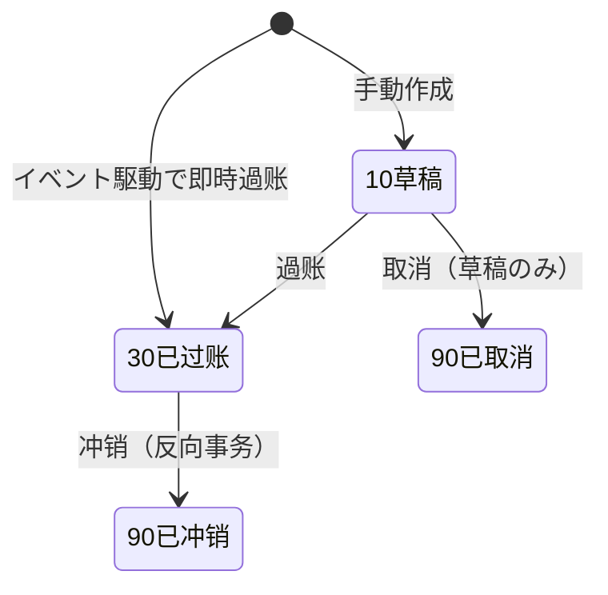
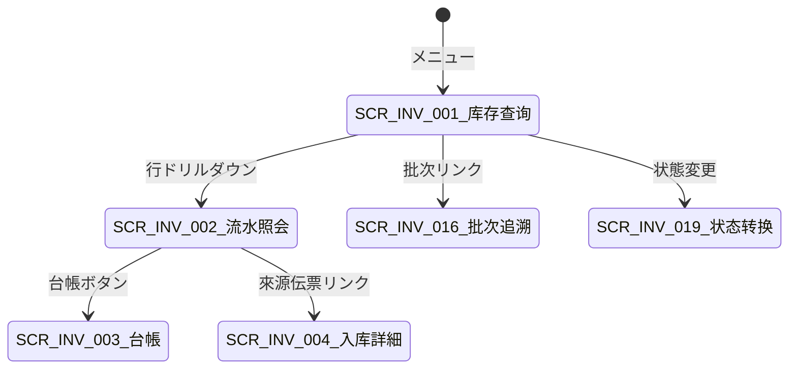

# 库存查询・库存事务流水 详细设计书（在庫照会・在庫取引照会 詳細設計書）

| 項目 | 内容 |
|---|---|
| 文書名 | 库存查询・库存事务流水 详细设计书（在庫照会・在庫取引照会 詳細設計書） |
| 文書番号 | DSN-INV-001 |
| 版数 | v1.0 |
| 作成日 | 2026-10-20 |
| 作成者 | inventory-designer |
| 承認者 | 未承認（レビュー待ち） |
| 状態 | ドラフト（レビュー中） |
| 関連文書 | [業務域概要](00-overview.md) / [共通項目定義](../00-common/01-common-item-definitions.md) / [画面共通規格](../00-common/02-common-screen-spec.md) / [API 共通規格](../00-common/03-common-api-spec.md) / [DB 共通規格](../00-common/04-common-db-spec.md) / [跨域流程](../00-common/09-cross-domain-flow.md) / [在庫入出庫](02-inbound-outbound.md) / [DB 設計](90-db-design.md) |

---

## 1. 機能概要

### 1.1 対象機能

| 項目 | F-INV-001 库存查询 | F-INV-013 库存事务流水 |
|---|---|---|
| 機能名 | 库存查询（现存量・可用量・引当・待检・冻结・在途） | 库存事务流水照会（含反向冲销） |
| 目的 | 任一业务人员在任何时点准确掌握「有多少、能用多少、在哪里、何时到期」，并为受注引当/出荷/领料提供**唯一可用量口径** | 全部库存变动可追溯、可对账、可冲销；是库存与财务、来源单据之间的事实依据 |
| 利用者・ロール | 仓管员、仓库主管、计划员、销售员/经理、采购员、会计、审计员 | 仓管员、主管、采购、销售、生产、会计、审计员、财务经理（冲销） |
| 利用シーン | 受注前可用量确认、拣货前批次确认、补货判断、盘点前账面确认、月结对账 | 出库与来源单据核对、余额差异调查、错误订正（冲销）、审计抽查 |
| 優先度 | P0 | P0 |
| 画面 ID | SCR-INV-001 | SCR-INV-002、SCR-INV-003 |
| 関連 IF | 無（外部 IF なし。同期 Query として SAL/PRD から `StockAvailabilityService` を呼出す） | 無 |

### 1.2 本機能が提供する唯一の数量口径

[00-overview](00-overview.md) 第 2.3 节的可用量公式在本机能中以 SQL/サービスとして実装し、**他の域・他の機能はこのサービスの結果以外の方法で可用量を算出してはならない**。

```
可用量 = Σ(qty_on_hand WHERE stock_status = 20) − Σ(qty_reserved WHERE stock_status = 20)
現存量 = Σ(qty_on_hand)（全状態）
待检量 = Σ(qty_on_hand WHERE stock_status = 10)
冻结量 = Σ(qty_on_hand WHERE stock_status = 30)
不合格量 = Σ(qty_on_hand WHERE stock_status = 40)
报废待处理量 = Σ(qty_on_hand WHERE stock_status = 50)
在途量 = 跨仓调拨已出库未受入数量（inv_transfer_line）+ 采购未受入数量（仅报表，不进入余额）
```

---

## 2. 業務要件・業務ルール

### 2.1 前提条件

| # | 前提条件 | 成立しない場合の挙動 |
|---|---|---|
| 1 | ログインユーザに `inventory:stock-balance:view`（または `inventory:stock-txn:view`）がある | 403 `MSG-COM-030`（API `code=3001`） |
| 2 | ユーザのデータ範囲（工場/倉庫）が検索条件に強制付与される | 範囲外の倉庫は結果に含めない（API `code=3002` は単票参照時） |
| 3 | 倉庫・物料・庫位マスタが有効（`status=1`、`deleted=false`） | 無効コードは検索条件で選択不可（`MSG-COM-049`） |
| 4 | 台帳照会（SCR-INV-003）は `inv_stock_txn` が过账済（`txn_status=30/90`）のみ対象 | 草稿は「未过账」表示のみ、残高に含めない |

### 2.2 業務ルール

| # | ルール | 根拠 | 関連項目 |
|---|---|---|---|
| BR-01 | 库存查询结果**不锁行**（READ COMMITTED、単一 SELECT/複数 SELECT は同一スナップショット保証なし）。画面に「基準時刻」を表示し、引当・出庫の最終判定は書込処理側で行う | [04 DB 共通規格](../00-common/04-common-db-spec.md) 第 11 章 | — |
| BR-02 | 可用量照会 API（`/available`）は SAL/PRD から同期呼出される。**照会結果は予約ではない**（ensure は引当 API/E06 購読で行う） | [09 跨域流程](../00-common/09-cross-domain-flow.md) 第 2.1 節 | `availableQty` |
| BR-03 | 既定では在庫 0 の行を表示しない（`includeZero=false`）。「0 も表示」チェックで全件表示 | 画面共通規格 4.2 | `includeZero` |
| BR-04 | 批次管理物料は批次単位で表示し、非批次管理物料は `batchNo` を空（`batch_id=0`）で表示する | [00-overview](00-overview.md) 2.1 | `batchNo` |
| BR-05 | 保管場所は倉庫単位と库位単位を切替表示する。库位管理しない倉庫は `locationCode = '-'` | MDM F-MDM-003 | `locationCode` |
| BR-06 | 一覧の既定ソートは「物料编码昇順 → 仓库编码昇順 → 批次号昇順 → 库存状态昇順」。ソート変更可 | 画面共通規格 4.2 | `sort` |
| BR-07 | 総件数が 100,000 件を超える検索は拒否し、条件追加を促す（`MSG-COM-052`） | 画面共通規格 4.2 | `total` |
| BR-08 | 事務流水は**追記専用**。画面上で数量・金額の直接修正は不可（冲销のみ）。沖销は `inventory:stock-txn:reverse` 権限 + 理由必須 | [08 共通業務規則](../00-common/08-common-business-rules.md) 13.1 | `reverse_reason` |
| BR-09 | 流水照会では「金額」項目を `inventory:cost:view` を持たないユーザに表示しない（API も返さない） | [01 共通項目定義](../00-common/01-common-item-definitions.md) 第 15 章 | `amount`、`unitCost` |
| BR-10 | 台帳（SCR-INV-003）の結存は「過账日時順」に積み上げる。同一 `txn_date` 内は `id`（雪花 ID）昇順 | 本設計 | `balanceQty` |
| BR-11 | 在途量は「已出庫未受入」の調撥数量のみ。単一倉庫視点では「出庫側 = 減少済」「受入側 = 未増加」をそれぞれ表示する | [03-transfer-count](03-transfer-count.md) | `inTransitQty` |
| BR-12 | 検索条件の日付範囲は両端含む。`dateFrom > dateTo` はエラー | 画面共通規格 4.1 | `txnDateFrom/To` |
| BR-13 | 照会結果の CSV/Excel 出力は権限 `inventory:stock-balance:export`/`inventory:stock-txn:export` が必要。1 回 10,000 件まで、超過は非同期ジョブ | 画面共通規格 4.4 | `export` |

### 2.3 計算式・判定式

| # | 対象 | 算式 | 丸め | 例 |
|---|---|---|---|---|
| CALC-01 | 可用量（単一物料・単一倉庫） | `Σ(qty_on_hand WHERE status=20) − Σ(qty_reserved WHERE status=20)` | 数量 4 桁（`NUMERIC` のまま） | 現存 600 − 引当 120 = 480.0000 KGM |
| CALC-02 | 現存量（全状態） | `Σ(qty_on_hand)` | 同上 | 500 + 100 = 600.0000 KGM |
| CALC-03 | 在途量（調撥） | `Σ(qty − received_qty) WHERE transfer_status IN (30,35)` | 同上 | 出庫 200、受入 80 → 在途 120.0000 PCE |
| CALC-04 | 在庫金額 | `Σ(amount_on_hand)` | 2 桁 | CNY 3,300.00 |
| CALC-05 | 平均単価（表示） | `Σ(amount_on_hand) ÷ Σ(qty_on_hand)`（同一 倉庫×物料×批次） | 6 桁四捨五入 | 3,300.00 ÷ 600 = 5.500000 |
| CALC-06 | 台帳結存数量 | `期初 + Σ(direction × qty)`（direction: IN=+1/OUT=−1） | 4 桁 | 0 + 500 − 120 + 300 − 80 = 600.0000 |

> 数量は `NUMERIC(18,4)`、金額は `NUMERIC(18,2)` で保持し、表示時のみ [01 共通項目定義](../00-common/01-common-item-definitions.md) 第 6.3 節に従って丸める。

### 2.4 状態遷移

照会機能のため伝票状態遷移は無い。ただし流水の `txn_status` は次に従う（[02-inbound-outbound](02-inbound-outbound.md) 第 5 章が正）：



---

## 3. 関連機能

| 関係 | 機能 ID | 機能名 | 関係内容 |
|---|---|---|---|
| 上流 | F-INV-002〜010、014、017 | 入出库/调拨/盘点/状态转换/成本 | 本機能が流水を参照・表示する |
| 下流 | F-INV-019 | 库存预留 | 可用量照会結果を引当判定に使用 |
| 参照 | F-MDM-001/003 | 物料/仓库库位 | 名称・単位・批次标志を参照 |
| 参照 | F-INV-011/012 | 批次/序列号 | 批次号・有效期・序列号状態を併記 |
| 関連 | F-INV-021 | 库存报表 | 台帳・流水から集計帳票を出力 |
| 外部 | — | SAL/PRD | `StockAvailabilityService` 同期照会（[09 §2.1](../00-common/09-cross-domain-flow.md)） |

---

## 4. 画面設計

### 4.1 画面一覧

| 画面 ID | 画面名 | 類型 | 概要 |
|---|---|---|---|
| SCR-INV-001 | 库存查询 | 一覧検索 | 現存量・可用量・引当・待検・凍結・在途を倉庫/物料/批次/庫位/状態で照会。明細ドリルダウンで流水へ |
| SCR-INV-002 | 库存事务流水照会 | 一覧検索 | 全トランザクションの照会・明細展開・沖销・帳票出力 |
| SCR-INV-003 | 库存明细账（台帳） | 一覧検索 | 物料/倉庫/批次別の入出庫と結存の推移（帳簿） |

### 4.2 画面遷移



### 4.3 画面レイアウト（SCR-INV-001）

```
┌──────────────────────────────────────────────────────────────────────────────┐
│ パンくず：ホーム > 库存管理 > 库存查询          基準時刻：2026-10-20 14:30:00 │
├──────────────────────────────────────────────────────────────────────────────┤
│〔検索条件〕                                                                   │
│  倉庫 [WH01▼]  物料 [1101…▼][コード/名称]   分類 [▼]   批次 [________]        │
│  庫位 [________]  在庫状態 [☑可用 ☑待検 ☑凍結 ☑不合格 ☑報廃]  □0も表示        │
│  表示単位 [○倉庫別 ○庫位別]  □有効期限順   [検索] [クリア] [詳細条件▽]        │
├──────────────────────────────────────────────────────────────────────────────┤
│〔ツールバー〕[流水照会][エクスポート][印刷]                                     │
├──────────────────────────────────────────────────────────────────────────────┤
│  No│倉庫  │庫位        │物料コード│品名             │批次      │状態│現存 │引当│可用 │
│   1│WH01  │WH01-A-01-01│1001000001│50W470 硅鋼片 0.5│261020P001│可用│500.0│120 │380.0│
│   2│WH01  │-           │1001000001│50W470 硅鋼片 0.5│261020P002│待検│120.0│0   │0.0  │
├──────────────────────────────────────────────────────────────────────────────┤
│〔合計〕現存 620.0000 KGM / 引当 120.0000 / 可用 380.0000 / 金額 CNY 3,374.00│
│〔ページング〕全 2 件  1/1 ページ  [<][1][>]                                     │
└──────────────────────────────────────────────────────────────────────────────┘
```

### 4.4 画面項目定義（SCR-INV-001 库存查询）

#### 4.4.1 検索条件

| No | 項目 ID | 項目名 | 区分 | 種別 | 型/桁 | 必須 | 初期値 | 入力チェック | データソース | DB 項目 | 権限 | 備考 |
|---|---|---|---|---|---|---|---|---|---|---|---|---|
| 1 | `warehouseIds` | 倉庫 | 検索 | 複数選択 | BIGINT[] | — | ログインユーザ既定倉庫 | コード存在 | `mdm_warehouse` | `inv_stock_balance.warehouse_id` | 参照可 | データ範囲外は選択肢に出さない |
| 2 | `materialId` | 物料 | 検索 | マスタ選択 | BIGINT | — | 空 | コード存在 | `mdm_material` | `material_id` | 参照可 | コード直接入力 + ダイアログ |
| 3 | `materialKeyword` | 物料キーワード | 検索 | テキスト | VARCHAR(100) | — | 空 | 部分一致（コード/名称/仕様） | `mdm_material` | `material_code/material_name/spec` | 参照可 | `pg_trgm` 使用 |
| 4 | `categoryCode` | 物料分類 | 検索 | 選択 | VARCHAR(64) | — | 空 | コード存在 | `mdm_material_category` | 結合 | 参照可 | 配下分類を含む |
| 5 | `batchNo` | 批次号 | 検索 | テキスト | VARCHAR(64) | — | 空 | 前方一致 | `inv_batch` | `batch_no` | 参照可 | — |
| 6 | `locationCode` | 庫位 | 検索 | テキスト | VARCHAR(32) | — | 空 | コード存在（倉庫指定時） | `mdm_warehouse_bin` | `location_id` | 参照可 | 倉庫未指定時は全倉庫 |
| 7 | `stockStatuses` | 在庫状態 | 検索 | 複数チェック | SMALLINT[] | — | 10,20,30,40,50（全選択） | 値域 10/20/30/40/50 | 固定値 | `stock_status` | 参照可 | 未選択 = 全状態 |
| 8 | `includeZero` | 0 も表示 | 検索 | チェック | BOOLEAN | — | false | — | — | `qty_on_hand > 0` 条件 | 参照可 | — |
| 9 | `displayUnit` | 表示単位 | 検索 | ラジオ | VARCHAR(16) | ○ | `WAREHOUSE` | WAREHOUSE/LOCATION | 固定値 | — | 参照可 | 倉庫別/庫位別 |
| 10 | `sort` | ソート | 検索 | 選択 | VARCHAR(64) | — | 约定（BR-06） | 許可列のみ | 固定値 | — | 参照可 | 既定ソートは BR-06 |
| 11 | `pageNum` | ページ番号 | 検索 | 数値 | INT | — | 1 | 1〜 | — | — | 参照可 | — |
| 12 | `pageSize` | ページサイズ | 検索 | 選択 | INT | — | 20 | 20/50/100/200 | — | — | 参照可 | 上限 200 |

#### 4.4.2 一覧項目

| No | 列 ID | 列名 | 幅 | ソート | 固定 | 表示形式 | 備考 |
|---|---|---|---|---|---|---|---|
| 1 | `warehouseCode` | 倉庫 | 100px | ○ | ○ | `WH01 - 原料倉` | — |
| 2 | `locationCode` | 庫位 | 150px | ○ | — | コード | 未管理は `-` |
| 3 | `materialCode` | 物料コード | 140px | ○ | ○ | リンク | クリックで物料詳細（MDM） |
| 4 | `materialName` | 品名 | 220px | — | — | テキスト | 仕様は別列 |
| 5 | `spec` | 仕様 | 180px | — | — | テキスト | 例 `0.5mm×1000mm` |
| 6 | `batchNo` | 批次号 | 150px | ○ | — | リンク | 批次追溯（SCR-INV-016） |
| 7 | `expiryDate` | 有効期限 | 110px | ○ | — | `yyyy-MM-dd` | 期限切間近は橙、超過は赤 |
| 8 | `stockStatusName` | 在庫状態 | 90px | ○ | ○ | バッジ | 10 橙（待検）/20 緑（可用）/30 青/40 赤/50 灰 |
| 9 | `qtyOnHand` | 現存数量 | 120px | ○ | — | `#,##0.0000 UOM` | 右寄せ |
| 10 | `qtyReserved` | 引当数量 | 120px | ○ | — | 同上 | 右寄せ |
| 11 | `qtyAvailable` | 可用数量 | 120px | ○ | — | 同上 | 右寄せ（**強調**） |
| 12 | `uomCode` | 単位 | 70px | — | — | コード | — |
| 13 | `amountOnHand` | 在庫金額 | 140px | ○ | — | `CNY #,##0.00` | `inventory:cost:view` なしは非表示 |
| 14 | `avgUnitCost` | 平均単価 | 120px | ○ | — | `#,##0.000000` | 同上 |
| 15 | `lastTxnDate` | 最終取引日 | 120px | ○ | — | `yyyy-MM-dd` | — |

#### 4.4.3 フッタ（合計）

| 項目 | 内容 |
|---|---|
| 合計行 | 検索条件一致分の `qty_on_hand`・`qty_reserved`・`qty_available`、`amount_on_hand` の合計（画面表示分ではなく全件合計） |
| 表示 | 数量は 4 桁、金額は `CNY` 2 桁。権限なしの場合は金額合計を非表示 |
| 総件数 | `total` を表示。100,000 件超は条件追加メッセージ |

### 4.5 画面項目定義（SCR-INV-002 库存事务流水照会）

#### 4.5.1 検索条件

| No | 項目 ID | 項目名 | 種別 | 型/桁 | 必須 | 初期値 | 入力チェック | DB 項目 | 備考 |
|---|---|---|---|---|---|---|---|---|---|
| 1 | `txnNo` | 事務番号 | テキスト | VARCHAR(32) | — | 空 | 前方一致 | `txn_no` | GRI/SDO/MII… |
| 2 | `txnTypes` | 事務種別 | 複数選択 | VARCHAR(16)[] | — | 全種別 | 19 種のみ | `txn_type` | コード名称は固定値 |
| 3 | `txnDateFrom/To` | 事務日範囲 | 日付範囲 | DATE | — | 当月 1 日〜当日 | 両端含む、`From ≤ To` | `txn_date` | — |
| 4 | `warehouseIds` | 倉庫 | 複数選択 | BIGINT[] | — | 既定倉庫 | コード存在 | `warehouse_id` | — |
| 5 | `materialKeyword` | 物料 | テキスト | VARCHAR(100) | — | 空 | 部分一致 | 結合 `mdm_material` | — |
| 6 | `batchNo` | 批次号 | テキスト | VARCHAR(64) | — | 空 | 前方一致 | `batch_no` | — |
| 7 | `sourceNo` | 來源伝票番号 | テキスト | VARCHAR(32) | — | 空 | 前方一致 | `source_no` | GR/DN/WO… |
| 8 | `sourceTypes` | 來源種別 | 複数選択 | VARCHAR(32)[] | — | 全 | 固定値 | `source_type` | 下記 4.6.2 |
| 9 | `txnStatuses` | 事務状態 | 複数選択 | SMALLINT[] | — | 30,90 | 10/20/30/90 | `txn_status` | 既定は確定分のみ |
| 10 | `isReversal` | 沖销のみ | チェック | BOOLEAN | — | false | — | `is_reversal` | — |
| 11 | `createdBy` | 登録者 | ユーザ選択 | BIGINT | — | 空 | 存在 | `posted_by/created_by` | — |

#### 4.5.2 一覧項目

| No | 列 ID | 列名 | 表示形式 | 備考 |
|---|---|---|---|---|
| 1 | `txnNo` | 事務番号 | リンク | クリックで詳細（展開/モーダル） |
| 2 | `txnType` | 事務種別 | バッジ + 名称 | IN は緑、OUT は赤系 |
| 3 | `txnDate` | 事務日 | `yyyy-MM-dd` | — |
| 4 | `warehouseCode` | 倉庫 | コード | — |
| 5 | `sourceNo` | 來源伝票 | リンク | 來源域へ遷移（権限ある場合のみ） |
| 6 | `partnerName` | 取引先 | テキスト | 供應商/顧客スナップショット |
| 7 | `totalQty` | 合計数量 | `#,##0.0000` | 基本単位合計 |
| 8 | `totalAmount` | 合計金額 | `CNY #,##0.00` | 権限なし非表示 |
| 9 | `txnStatusName` | 状態 | バッジ | 30 已過账/90 已沖销 |
| 10 | `isReversal` | 沖销 | アイコン | 沖销先リンク |
| 11 | `postedAt` | 過账日時 | ISO | — |

#### 4.5.3 イベント処理

| No | イベント | トリガ | 処理内容 | 呼出 API | 画面遷移 | エラー時 |
|---|---|---|---|---|---|---|
| 1 | 検索 | 検索ボタン/Enter | 条件検証（件数上限含む）→ 一覧取得 | `GET /api/inventory/stock-txns` | 同一画面 | エラーサマリ表示 |
| 2 | 行展開 | 行クリック/▽ | 明細行（`inv_stock_txn_line`）を遅延取得 | `GET /api/inventory/stock-txns/{id}` | 同一画面（アコーディオン） | 詳細取得失敗トースト |
| 3 | 來源伝票 | 來源リンク | 來源域の伝票詳細へ遷移（権限・モジュール公開 API 経由） | — | 他域画面 | 権限なしはリンク非表示 |
| 4 | 沖销 | 「沖销」ボタン | 確認ダイアログ（理由必須）→ 沖销 API → 結果反映 | `POST /api/inventory/stock-txns/{id}/reverse` | 同一画面 | `MSG-INV-023`/`MSG-INV-024` |
| 5 | 帳票出力 | 「印刷」ボタン | PRT-INV-013（流水表）を PDF 出力 | `POST /api/inventory/stock-txns/{id}/print` / 一覧印刷は別 API | 帳票プレビュー | 出力エラー |
| 6 | エクスポート | 「エクスポート」 | 非同期ジョブ起動 | `POST /api/inventory/exports` | ジョブ通知 | `MSG-COM-065` |

### 4.6 画面項目定義（SCR-INV-003 库存明细账）

| 項目 | 内容 |
|---|---|
| 類型 | 一覧検索（帳簿） |
| 必須条件 | 物料（単一）・倉庫（単一）・対象期間。批次は任意（指定時は単一） |
| 一覧列 | 事務日 / 事務番号 / 事務種別 / 摘要（來源伝票・取引先）/ 受入数量 / 受入金額 / 払出数量 / 払出金額 / 結存数量 / 結存金額 / 平均単価 / 状態 |
| 期初行 | 対象期間開始日前日時点の結存（`openingQty`/`openingAmount`）を先頭行に固定表示 |
| 結存算出 | CALC-06（`direction × qty`）。金額は `direction × amount`、平均単価は CALC-05 |
| ソート | `txn_date ASC, id ASC` 固定（画面で変更不可） |
| エクスポート | Excel（PRT-INV-010 相当）、最大 10,000 行、超過は非同期 |
| 権限 | `inventory:stock-txn:view`。金額列は `inventory:cost:view` が必要 |

### 4.7 表示制御

| 条件 | 対象項目/ボタン | 制御 |
|---|---|---|
| `inventory:cost:view` なし | 在庫金額・平均単価・合計金額 | 非表示（API も返さない） |
| データ範囲外の倉庫 | 検索結果 | 行を返さない（SQL 強制条件） |
| `txn_status ≠ 30` | 沖销ボタン | 非表示 |
| `txn_status = 90` または `is_reversal = true` | 沖销ボタン | 非表示（二重沖销不可） |
| 來源域の参照権限なし | 來源伝票リンク | リンクを出さない（テキスト表示） |
| ユーザが倉管員で `inventory:stock-txn:reverse` なし | 沖销ボタン | 非表示 |

---

## 5. 入力チェック仕様

| No | チェック ID | 対象項目 | 種別 | 条件 | タイミング | メッセージ ID |
|---|---|---|---|---|---|---|
| 1 | CHK-INV-001-01 | 倉庫 | コード存在 | 有効な `mdm_warehouse` に存在し、データ範囲内 | フォーカスアウト / 検索時 | `MSG-COM-049` |
| 2 | CHK-INV-001-02 | 物料 | コード存在 | 有効な `mdm_material` に存在 | フォーカスアウト / 検索時 | `MSG-COM-049` |
| 3 | CHK-INV-001-03 | 庫位 | 相関 | 倉庫指定時、庫位が当該倉庫に属する | 検索時 | `MSG-INV-058` |
| 4 | CHK-INV-001-04 | 在庫状態 | 値域 | 10/20/30/40/50 のいずれか | 入力時 | `MSG-COM-042` |
| 5 | CHK-INV-001-05 | 日付範囲 | 相関 | `txnDateFrom ≤ txnDateTo` | 検索時 | `MSG-COM-046` |
| 6 | CHK-INV-001-06 | 検索結果件数 | 業務 | 総件数 ≤ 100,000 | 検索後 | `MSG-COM-052` |
| 7 | CHK-INV-001-07 | ページサイズ | 値域 | 20/50/100/200 のみ | 入力時 | `MSG-COM-043` |
| 8 | CHK-INV-002-01 | 事務種別 | 値域 | 19 種のコードのみ | 検索時 | `MSG-COM-042` |
| 9 | CHK-INV-002-02 | 沖销理由 | 必須/桁 | 1〜500 文字、空白のみ不可 | 沖销実行時 | `MSG-COM-040`/`MSG-COM-041` |
| 10 | CHK-INV-002-03 | 沖销対象 | 業務 | `txn_status = 30` かつ `is_reversal = false` かつ 下流処理なし | 沖销実行時 | `MSG-INV-023`/`MSG-INV-024` |
| 11 | CHK-INV-003-01 | 物料・倉庫 | 必須 | 台帳照会では両方必須 | 検索時 | `MSG-COM-040` |

---

## 6. 処理詳細

### 6.1 処理一覧

| 処理 ID | 処理名 | 契機 | トランザクション | 排他 |
|---|---|---|---|---|
| PRC-INV-001-01 | 在庫残高照会 | SCR-INV-001 検索 | 不要（読取） | なし（READ COMMITTED） |
| PRC-INV-001-02 | 可用量照会（サービス） | SAL/PRD 同期呼出・引当前判定 | 不要 | なし |
| PRC-INV-001-03 | 批次別可用量照会 | 出荷拣货・PDA | 不要 | なし |
| PRC-INV-013-01 | 事務流水照会 | SCR-INV-002 検索 | 不要 | なし |
| PRC-INV-013-02 | 事務沖销 | SCR-INV-002「沖销」 | **要** | 残高行 `SELECT ... FOR UPDATE`（[02](02-inbound-outbound.md) 第 6 章） |
| PRC-INV-013-03 | 台帳照会 | SCR-INV-003 検索 | 不要 | なし |

### 6.2 処理手順（正常系）

**PRC-INV-001-01 在庫残高照会**

1. 権限 `inventory:stock-balance:view` を検証する（なければ `403`）。
2. 検索条件を検証する（第 5 章）。データ範囲（工場/倉庫）を SQL 条件に強制注入する。
3. `inv_stock_balance` を検索する。`displayUnit=WAREHOUSE` の場合は `GROUP BY warehouse_id, material_id, batch_id, stock_status` で集約する（库位は `MIN(location_code)` または `-`）。
4. 集計列を算出する：
   - `qty_on_hand = SUM(qty_on_hand)`、`qty_reserved = SUM(qty_reserved)`、`qty_available = SUM(CASE WHEN stock_status = 20 THEN qty_on_hand - qty_reserved ELSE 0 END)`
   - 期效・批次情報は `inv_batch` を LEFT JOIN（非批次は NULL）
   - 名称・単位は `mdm_material`/`mdm_uom` を JOIN
5. 合計行（条件一致全件）を別クエリで取得する（ページングと独立）。
6. 総件数を取得し、100,000 件超なら `MSG-COM-052` で中断する。
7. 応答を返す（`PageResult<StockBalanceDto>`）。画面に基準時刻（サーバ時刻）を表示する。

**PRC-INV-001-02 可用量照会（`StockAvailabilityService`）**

> SAL/PRD からの同期呼出用。HTTP: `GET /api/inventory/stock-balances/available`。**予約は行わない**（BR-02）。

1. `materialId` 必須、`warehouseId` 任意（未指定は全倉庫合算）を検証する。
2. 次 SQL を実行する（1 クエリで集約）：

```sql
SELECT b.material_id,
       COALESCE(SUM(b.qty_on_hand), 0)                                        AS on_hand_qty,
       COALESCE(SUM(b.qty_reserved), 0)                                        AS reserved_qty,
       COALESCE(SUM(CASE WHEN b.stock_status = 10 THEN b.qty_on_hand END), 0)  AS inspection_qty,
       COALESCE(SUM(CASE WHEN b.stock_status = 30 THEN b.qty_on_hand END), 0)  AS frozen_qty,
       COALESCE(SUM(CASE WHEN b.stock_status = 40 THEN b.qty_on_hand END), 0)  AS rejected_qty,
       COALESCE(SUM(CASE WHEN b.stock_status = 20 THEN b.qty_on_hand - b.qty_reserved END), 0) AS available_qty
  FROM inv_stock_balance b
 WHERE b.company_id = #{companyId}
   AND b.material_id = #{materialId}
   AND (#{warehouseId} IS NULL OR b.warehouse_id = #{warehouseId})
 GROUP BY b.material_id;
```

3. 行が無い場合は全項目 0 で返す（エラーにしない。引当時は 0 可用として扱う）。
4. 単位は `mdm_material.base_uom_code` を返す（換算は呼出側の責任、[08 §5](../00-common/08-common-business-rules.md)）。
5. 応答に `queriedAt`（サーバ時刻）を含める。

**PRC-INV-001-03 批次別可用量照会**

1. `materialId` + `warehouseId` 必須。`sort=FEFO`（既定、有効期限昇順 → 入庫日昇順 → 批次号）、`FIFO`（入庫日昇順 → 批次号）、`MANUAL`（批次号昇順）。
2. `inv_stock_balance`（`stock_status=20`）を `inv_batch` と JOIN し、批次ごとに `available_qty = qty_on_hand − qty_reserved` を算出する。`available_qty > 0` のみ返す。
3. 有効期限切れ批次（`expiry_date < 当日`）は `expired=true` を付け、出庫不可として返す（画面で赤表示）。ただし照会自体は拒否しない。
4. 応答は最大 500 批次。超過時は `MSG-COM-052`（条件追加を促す）。

**PRC-INV-013-01 事務流水照会**

1. 権限・データ範囲を検証する。
2. `inv_stock_txn` を検索条件で絞り、`inv_stock_txn_line` は一覧では取得しない（N+1 回避のため、明細は行展開時に取得）。
3. `txn_type` の名称・方向は固定コード表（Java enum）で解決する。`source_no` から來源域の伝票種別を判定し、リンク可否を返す。
4. 金額項目は `inventory:cost:view` がある場合のみ SELECT する（権限なしは NULL）。
5. `total` が 100,000 件超なら `MSG-COM-052`。

**PRC-INV-013-02 事務沖销**

1. `inventory:stock-txn:reverse` を検証する（なければ `403`）。
2. 対象事務を取得し、次を検証する：`txn_status = 30`、`is_reversal = false`、`reversal_of_txn_id IS NULL`、下流処理なし（同一來源の後続事務が無いこと。例：PI の後続 SI が存在する場合は拒否 → `MSG-INV-024`）。
3. 対象事務の明細を取得し、**反向事務**を 1 件生成する：`txn_type` は元と同一、`is_reversal = true`、`reversal_of_txn_id = 元 id`、`direction` は元の反対、`qty`/`amount`/`unit_cost` は元の値、`txn_status = 30`、`reverse_reason` 必須。
4. 元事務を `txn_status = 90`・`reversed_at = now()`・`reversed_by = ユーザ` に更新する（楽観排他 `version`）。
5. 残高を反向更新する（[02-inbound-outbound](02-inbound-outbound.md) 第 6 章のロック順序に従う）。数量不足になる場合は全体ロールバック（`MSG-INV-001`）。
6. 成本層を反向更新する（入庫層なら `remaining_qty` を減算し `status=90`、出庫なら層を戻す。詳細 [05-costing](05-costing.md) 第 7 章）。
7. `inventory.txn.posted`（E18）を Outbox に記録する（`txnType` は元と同一、`isReversal=true` を payload 追加項目で通知）。仕訳の赤伝は FIN 側が `isReversal` を見て生成する（[09 §7.2](../00-common/09-cross-domain-flow.md)）。
8. 監査ログ（REVERSE）を記録し、結果を返す。

**PRC-INV-013-03 台帳照会**

1. 対象（物料×倉庫×批次）の期間開始日前日までの残高を「期初」として算出する（`inv_stock_txn_line` の `direction × qty` 合計、金額同様）。
2. 期間内の事務を `txn_date ASC, id ASC` で取得する。
3. 各行に `direction` に応じた受入/払出数量・金額を割り当て、結存を累積計算する。
4. 権限なしの場合は金額列を NULL にする（数量のみ返す）。

### 6.3 例外処理

| No | 異常条件 | 検知箇所 | 処理 | ロールバック | メッセージ ID |
|---|---|---|---|---|---|
| 1 | 権限不足 | 処理冒頭 | 403 を返す | — | `MSG-COM-030` |
| 2 | データ範囲外の単票参照 | 詳細取得 | 403 | — | `MSG-COM-031` |
| 3 | 検索結果過多 | 件数取得後 | 検索中断 | — | `MSG-COM-052` |
| 4 | 沖销対象が既に沖销済 | 状態検証 | エラー | — | `MSG-INV-021` |
| 5 | 沖销で在庫不足（他出庫が先行） | 残高更新 | エラー、全体ロールバック | 全体 | `MSG-INV-001` |
| 6 | 沖销対象に下流処理あり | 下流チェック | エラー | — | `MSG-INV-024` |
| 7 | 対象事務が存在しない | 取得時 | 404 | — | `MSG-COM-032` |
| 8 | DB 接続断・タイムアウト | 全処理 | 500、`trace_id` 表示 | — | `MSG-COM-080` |

### 6.4 冪等性・再実行

- 照会系は冪等（副作用なし）。
- 沖销は `Idempotency-Key` ヘッダ必須。同一キーの再送は初回結果を返す（[03 API 共通規格](../00-common/03-common-api-spec.md) 第 9 章）。また `reversal_of_txn_id` の一意制約（1 事務 1 沖销）で二重沖销を DB レベルでも防止する。

---

## 7. API 設計

### 7.1 API 一覧

| # | メソッド | パス | 権限 | 概要 | 関連機能 |
|---|---|---|---|---|---|
| 1 | GET | `/api/inventory/stock-balances` | `inventory:stock-balance:view` | 在庫残高照会（ページング） | F-INV-001 |
| 2 | GET | `/api/inventory/stock-balances/available` | 内部（SAL/PRD 同期呼出）/ `inventory:stock-balance:view` | 可用量照会（集約） | F-INV-001、019 |
| 3 | GET | `/api/inventory/stock-balances/available-batches` | `inventory:stock-balance:view` | 批次別可用量（FEFO/FIFO） | F-INV-001、011 |
| 4 | GET | `/api/inventory/stock-balances/summary` | `inventory:stock-balance:view` | 物料別集約（横持ち表示） | F-INV-001 |
| 5 | GET | `/api/inventory/stock-balances/in-transit` | `inventory:transfer:view` | 在途量照会 | F-INV-009 |
| 6 | GET | `/api/inventory/stock-txns` | `inventory:stock-txn:view` | 事務流水一覧 | F-INV-013 |
| 7 | GET | `/api/inventory/stock-txns/{id}` | `inventory:stock-txn:view` | 事務詳細（明細含む） | F-INV-013 |
| 8 | POST | `/api/inventory/stock-txns/{id}/reverse` | `inventory:stock-txn:reverse` | 事務沖销 | F-INV-013 |
| 9 | GET | `/api/inventory/stock-txns/ledger` | `inventory:stock-txn:view` | 台帳（結存推移） | F-INV-013、021 |
| 10 | POST | `/api/inventory/exports` | `inventory:stock-balance:export` 等 | 非同期エクスポート | F-INV-001、013 |

### 7.2 リクエスト/レスポンス詳細

#### 7.2.1 `GET /api/inventory/stock-balances`

リクエスト（クエリ）：

| 項目 | 型 | 必須 | 説明 |
|---|---|---|---|
| `warehouseIds` | string（カンマ区切り） | — | 倉庫 ID |
| `materialId` | string | — | 物料 ID |
| `materialKeyword` | string | — | コード/名称/仕様の部分一致 |
| `batchNo` | string | — | 批次号（前方一致） |
| `locationCode` | string | — | 庫位コード |
| `stockStatuses` | string（カンマ区切り） | — | 10,20,30,40,50 |
| `includeZero` | boolean | — | 既定 false |
| `displayUnit` | string | — | `WAREHOUSE`（既定）/`LOCATION` |
| `sort` | string | — | `materialCode,asc` 等 |
| `pageNum` / `pageSize` | int | — | 既定 1 / 20 |

レスポンス（`Result<PageResult<StockBalanceDto>>`）：

```json
{
  "code": 0,
  "message": "ok",
  "data": {
    "list": [
      {
        "id": "1845678901234567001",
        "warehouseId": "1845000000000000001",
        "warehouseCode": "WH01",
        "warehouseName": "原料仓",
        "locationCode": "WH01-A-01-01",
        "materialId": "1845000000000000101",
        "materialCode": "1001000001",
        "materialName": "冷轧无取向电工钢带",
        "spec": "50W470 0.50mm×1000mm",
        "uomCode": "KGM",
        "batchNo": "261020P001",
        "expiryDate": null,
        "stockStatus": 20,
        "stockStatusName": "可用",
        "qtyOnHand": "500.0000",
        "qtyReserved": "120.0000",
        "qtyAvailable": "380.0000",
        "amountOnHand": "2750.00",
        "avgUnitCost": "5.500000",
        "lastTxnDate": "2026-10-18"
      }
    ],
    "total": 2,
    "pageNum": 1,
    "pageSize": 20,
    "pages": 1
  }
}
```

> 物料编码・品名・数量・単価は【示例値】（設計検証用）。実際の値は 90-data の `material-master.csv` を正とする。

エラー例（数量条件不備）：

```json
{
  "code": 1003,
  "message": "输入内容に誤りがあります",
  "data": {
    "fieldErrors": [
      { "field": "stockStatuses", "message": "库存状态只能选择 10/20/30/40/50。" }
    ]
  }
}
```

#### 7.2.2 `GET /api/inventory/stock-balances/available`

| 項目 | 型 | 必須 | 説明 |
|---|---|---|---|
| `materialId` | string | ○ | 物料 ID |
| `warehouseId` | string | — | 未指定なら全倉庫合算 |

レスポンス：

```json
{
  "code": 0,
  "message": "ok",
  "data": {
    "materialId": "1845000000000000101",
    "materialCode": "1001000001",
    "uomCode": "KGM",
    "onHandQty": "620.0000",
    "reservedQty": "120.0000",
    "inspectionQty": "120.0000",
    "frozenQty": "0.0000",
    "rejectedQty": "0.0000",
    "availableQty": "380.0000",
    "queriedAt": "2026-10-20T14:30:00+08:00"
  }
}
```

> 照会結果は予約ではない（BR-02）。SAL は引当結果（E09）を正とすること。

#### 7.2.3 `GET /api/inventory/stock-balances/available-batches`

リクエスト：`materialId`（必須）、`warehouseId`（必須）、`sort`（`FEFO` 既定 /`FIFO`/`MANUAL`）。

```json
{
  "code": 0,
  "message": "ok",
  "data": {
    "list": [
      {
        "batchId": "1845000000000000201",
        "batchNo": "261020P001",
        "productionDate": null,
        "expiryDate": null,
        "supplierBatchNo": "SCH20261015-01",
        "stockStatus": 20,
        "availableQty": "380.0000",
        "unitCost": "5.500000",
        "expired": false,
        "inboundDate": "2026-10-18"
      }
    ],
    "total": 1
  }
}
```

#### 7.2.4 `GET /api/inventory/stock-txns`

リクエスト例：`?txnTypes=PI,SI&txnDateFrom=2026-10-01&txnDateTo=2026-10-31&warehouseIds=...&pageNum=1&pageSize=20`

```json
{
  "code": 0,
  "message": "ok",
  "data": {
    "list": [
      {
        "id": "1845678901234567890",
        "txnNo": "GRI2610200001",
        "txnType": "PI",
        "txnTypeName": "采购入库",
        "direction": 1,
        "txnDate": "2026-10-20",
        "warehouseCode": "WH01",
        "sourceType": "PURCHASE_RECEIPT",
        "sourceNo": "GR2610200001",
        "partnerName": "常州某硅钢材料有限公司【示例值】",
        "totalQty": "500.0000",
        "totalAmount": "2800.00",
        "txnStatus": 30,
        "txnStatusName": "已过账",
        "isReversal": false,
        "postedAt": "2026-10-20T14:31:05+08:00",
        "postedBy": "E000123"
      }
    ],
    "total": 1,
    "pageNum": 1,
    "pageSize": 20,
    "pages": 1
  }
}
```

#### 7.2.5 `POST /api/inventory/stock-txns/{id}/reverse`

リクエスト：

```json
{
  "version": 1,
  "reason": "批次号录入错误，冲销后重新入库"
}
```

レスポンス（`Result<StockTxnDto>`）：反向事務の詳細（`txnNo` は元と同一、`isReversal=true`、`reversalOfTxnId` を含む）。

エラー例：

```json
{
  "code": 50021,
  "message": "该库存事务已冲销，不能重复冲销。",
  "data": null
}
```

#### 7.2.6 `GET /api/inventory/stock-txns/ledger`

| 項目 | 型 | 必須 | 説明 |
|---|---|---|---|
| `materialId` | string | ○ | 物料 ID |
| `warehouseId` | string | ○ | 倉庫 ID |
| `batchId` | string | — | 批次 ID（批次管理物料は必須） |
| `dateFrom` / `dateTo` | date | ○ | 対象期間 |

レスポンス：`openingQty/openingAmount`、`lines[]`（`txnDate, txnNo, txnType, summary, inQty, inAmount, outQty, outAmount, balanceQty, balanceAmount, avgUnitCost`）、`closingQty/closingAmount`。

---

## 8. データ更新仕様

| テーブル | 操作 | 更新項目 | 更新条件 | トリガ |
|---|---|---|---|---|
| `inv_stock_balance` | UPDATE | `qty_on_hand, qty_reserved, amount_on_hand, avg_unit_cost, last_txn_date, last_txn_id, version, updated_at, updated_by` | `id` 一致かつ `version` 一致 | PRC-INV-013-02（沖销） |
| `inv_stock_txn` | INSERT | 冲销事务（全項目） | — | PRC-INV-013-02 |
| `inv_stock_txn` | UPDATE | `txn_status=90, reversed_at, reversed_by, version` | 元事務 `id` + `version` | PRC-INV-013-02 |
| `inv_stock_txn_line` | INSERT | 冲销事务明细（direction 反転） | — | PRC-INV-013-02 |
| `inv_cost_layer` | UPDATE | `remaining_qty, remaining_amount, status` | `source_txn_line_id` 一致 | PRC-INV-013-02 |
| `sys_outbox_event` | INSERT | E18（沖销通知） | 同一トランザクション | PRC-INV-013-02 |
| `sys_audit_log` | INSERT | REVERSE 操作（前後値・理由） | — | PRC-INV-013-02 |

照会系は更新なし。

---

## 9. エラー処理・メッセージ

| メッセージ ID | 種別 | 本文 | 発生条件 | 利用者への対処 | ログ |
|---|---|---|---|---|---|
| `MSG-INV-001` | E | 库存不足，当前可用数量：{0} {1}。 | 沖销時に在庫不足 | 条件を確認し管理者に連絡 | WARN |
| `MSG-INV-021` | E | 该库存事务已冲销，不能重复冲销。 | `txn_status=90` | 最新情報を再取得 | WARN |
| `MSG-INV-023` | E | 未过账的库存事务不能冲销。 | `txn_status≠30` | 状態確認 | WARN |
| `MSG-INV-024` | E | 该库存事务存在后续业务处理，不能冲销。 | 下流処理あり | 下流の取消を先に行う | WARN |
| `MSG-INV-058` | E | 库位 {0} 不属于仓库 {1}。 | 庫位と倉庫の不一致 | 倉庫/庫位を修正 | — |
| `MSG-COM-030` | E | 您没有执行该操作的权限，请联系管理员。 | 権限不足 | 管理者へ | — |
| `MSG-COM-032` | E | 该数据已被删除或不存在，请刷新后重试。 | 対象不存在 | 再取得 | — |
| `MSG-COM-046` | E | 开始日期不能晚于结束日期。 | 日付範囲矛盾 | 修正 | — |
| `MSG-COM-049` | E | 所选数据不存在或已失效，请重新选择。 | コード不存在 | 再選択 | — |
| `MSG-COM-052` | E | 查询条件过于宽泛，请增加筛选条件（预计超过 {0} 件）。 | 件数超過 | 条件追加 | — |
| `MSG-COM-071` | E | 会计期间已结账，不能新增或修改该期间的数据。 | 沖销対象が締切期間 | 期間解除は管理者のみ | — |

---

## 10. 権限・セキュリティ

| 種別 | 内容 |
|---|---|
| 画面権限 | SCR-INV-001/002/003 は `inventory:stock-balance:view` / `inventory:stock-txn:view` |
| 操作権限 | 沖销は `inventory:stock-txn:reverse`、エクスポートは `inventory:stock-balance:export` / `inventory:stock-txn:export` |
| 項目権限 | 金額・平均単価は `inventory:cost:view` が必要（API も返さない） |
| データ範囲 | 工場/倉庫単位で SQL に強制注入（MyBatis-Plus DataPermissionInterceptor） |
| 監査ログ | 照会（条件・件数）、エクスポート、沖销（理由・前後値）を記録。照会ログは過負荷を避けるため、エクスポートと沖销のみ必須、照会は `trace_id` のみ記録（設定可） |

---

## 11. 性能・非機能

| 項目 | 目標値 | 前提 |
|---|---|---|
| 在庫照会（単一物料） | 1 秒以内 | `inv_stock_balance` 索引（`idx_inv_stock_balance_material_wh`） |
| 在庫照会（一覧 100 件） | 2 秒以内 | 残高 80,000 行、索引使用 |
| 可用量照会（API） | 200ms 以内 | 単一物料集約、引当処理前の常用呼出 |
| 流水照会（一覧 100 件） | 2 秒以内 | `inv_stock_txn` 1,000 万行、`txn_date` + `txn_type` 索引 |
| 台帳照会（1 物料 1 年） | 3 秒以内 | 約 5,000 行/年 |
| 同時実行 | 照会 50 ユーザ、沖销 5 並列 | 沖销は残高行ロックで直列化（対象行のみ） |
| エクスポート | 10,000 件/回、10 秒以内 | 非同期ジョブ（超過時） |

---

## 12. テスト観点

| No | 観点 ID | 分類 | 観点 | 期待結果 |
|---|---|---|---|---|
| 1 | TST-F-INV-001-01 | 正常系 | 単一物料の現存/可用/引当/待検を照会 | 各数量が残高表の実値と一致し、可用量 = 現存 − 引当 − 待検 − 凍結 − 不合格 となる |
| 2 | TST-F-INV-001-02 | 正常系 | 倉庫別/庫位別の切替表示 | 合計値が一致し、庫位未管理倉庫は `-` 表示 |
| 3 | TST-F-INV-001-03 | 境界値 | 在庫 0 の物料を `includeZero=false` で検索 | 結果に含まれない |
| 4 | TST-F-INV-001-04 | 境界値 | 在庫 0 の物料を `includeZero=true` で検索 | 0 数量で表示される |
| 5 | TST-F-INV-001-05 | 異常系 | `dateFrom > dateTo` | `MSG-COM-046` で中断 |
| 6 | TST-F-INV-001-06 | 異常系 | 検索結果 100,001 件 | `MSG-COM-052` で中断 |
| 7 | TST-F-INV-001-07 | 権限 | `inventory:cost:view` なしユーザ | 金額・平均単価が返らない |
| 8 | TST-F-INV-001-08 | 排他/整合 | 照会中に他ユーザが出庫 | 照会結果はスナップショット時点で、エラーにならない |
| 9 | TST-F-INV-001-09 | 正常系 | 可用量照会 API が SAL から呼ばれる | 200ms 以内、公式どおりの値 |
| 10 | TST-F-INV-001-10 | 正常系 | 批次別照会 FEFO | 有効期限昇順で返る |
| 11 | TST-F-INV-013-01 | 正常系 | 事務番号で流水照会 | 明細展開で行が取得できる |
| 12 | TST-F-INV-013-02 | 正常系 | PI を沖销 | 反向事務が生成され、残高が元に戻る |
| 13 | TST-F-INV-013-03 | 異常系 | 沖销済を再沖销 | `MSG-INV-021` |
| 14 | TST-F-INV-013-04 | 異常系 | 下流処理ありの PI を沖销 | `MSG-INV-024` |
| 15 | TST-F-INV-013-05 | 正常系 | 台帳の期初・結存 | 期初 + 入 − 出 = 期末、金額も一致 |
| 16 | TST-F-INV-013-06 | 排他 | 同一事務を 2 ユーザが同時沖销 | 片方のみ成功、他方は `MSG-INV-021`/`MSG-COM-033` |
| 17 | TST-F-INV-013-07 | 冪等 | 同一 Idempotency-Key で沖销再送 | 二重沖销されない |

---

## 13. 未決事項

| # | 事項 | 理由 | 暫定仕様 | 担当 | 期限 |
|---|---|---|---|---|---|
| 1 | 照会ログの記録範囲 | 全照会を監査ログに記録すると `sys_audit_log` が過負荷 | エクスポート・沖销のみ必須、照会はアプリログ（trace_id）のみ | inventory-designer / SYS 担当 | 2026-11-15 |
| 2 | 可用量照会のキャッシュ | 高頻度呼出（受注・MRP）で DB 負荷が懸念 | 当面は都度 SQL（残高 8 万行・索引で 200ms 以内を目標）。第一版 で Redis キャッシュ（無効化は E18/E19 契機） | inventory-designer | 2027-03-31 |
| 3 | 在庫 0 行の保持方針 | 残高が 0 になった行を削除するか保持するか | 保持する（`qty_on_hand=0` かつ `qty_reserved=0` の行は残す。履歴・最終取引日の参照のため）。物理削除しない | inventory-designer | 2026-11-15 |

---

## 14. 改訂履歴

| 版数 | 日付 | 変更内容 | 変更者 |
|---|---|---|---|
| v1.0 | 2026-10-20 | 初版：库存查询（現存/可用/引当/待検/凍結/在途）、流水照会・沖销、台帳、可用量照会サービス、API 10 件、画面 3 件 | inventory-designer |
| v1.1 | 2026-10-20 | 90-data 実データ（material-master/demo-company/warehouse-location/batch-number-rule）を反映：物料コード・単価例・倉庫構成を実値に整合し、画面/API サンプル値を修正 | inventory-designer |
| v1.2 | 2026-10-20 | 红队第 2 轮：在庫状態コードを 09 §8 改訂に合わせ 10=待検/20=可用へ変更（可用量・待検量の算式、照会 SQL、API 例） | inventory-designer |
