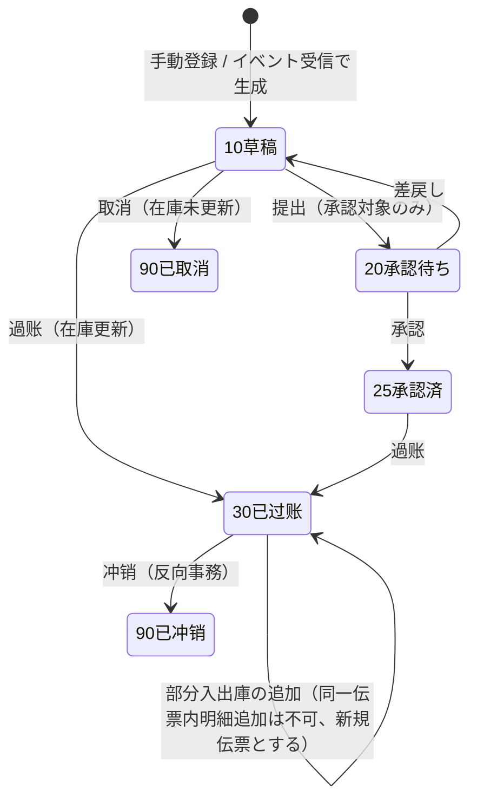
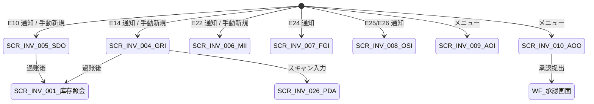

# 库存入出库 详细设计书（在庫入出庫 詳細設計書）

| 項目 | 内容 |
|---|---|
| 文書名 | 库存入出库 详细设计书（在庫入出庫 詳細設計書） |
| 文書番号 | DSN-INV-002 |
| 版数 | v1.0 |
| 作成日 | 2026-10-20 |
| 作成者 | inventory-designer |
| 承認者 | 未承認（レビュー待ち） |
| 状態 | ドラフト（レビュー中） |
| 関連文書 | [業務域概要](00-overview.md) / [在庫照会](01-stock-query.md) / [棚卸・移動](03-transfer-count.md) / [批次・序列号・状態](04-batch-serial-status.md) / [原価](05-costing.md) / [DB 設計](90-db-design.md) / [API 設計](91-api-design.md) / [跨域流程](../00-common/09-cross-domain-flow.md) |

---

## 1. 機能概要

本文件は在庫の**入庫・出庫（購買/販売/生産/委外/その他）**を扱う。全 19 種類の在庫取引のうち、`PI/SI/MII/MIR/FGI/OSI/OSR/AOI/AOO/SC_IN/SC_OUT/RT_IN/PR_OUT` の発生源・処理・原価・仕訳を定義する（`TR_OUT/TR_IN` は [03-transfer-count](03-transfer-count.md)、`ADJ_IN/ADJ_OUT` は [03-transfer-count](03-transfer-count.md)、`ST_IN/ST_OUT` は [04-batch-serial-status](04-batch-serial-status.md)）。

### 1.1 対象機能

| 機能 ID | 機能名 | 発生源 | トリガ | 画面 ID | 優先度 |
|---|---|---|---|---|---|
| F-INV-002 | 采购入库（GRI） | 收货单 GR（PUR） | イベント `purchase.receipt.posted`（E14）または手動 | SCR-INV-004 | P0 |
| F-INV-003 | 销售出库（SDO） | 发货单 DN（SAL） | イベント `sales.delivery.confirmed`（E10）または手動 | SCR-INV-005 | P0 |
| F-INV-004 | 生产领料/退料（MII/MIR） | 工单 WO（PRD） | イベント `production.material.issued`（E22：領料）/ `production.material.returned`（E36：退料）＋手動退料 | SCR-INV-006 | P1 |
| F-INV-005 | 产成品/半成品入库（FGI） | 工单完工（PRD） | イベント `production.workorder.completed`（E24） | SCR-INV-007 | P1 |
| F-INV-006 | 委外发料/收货（OSI/OSR） | 委外单 OS（PRD） | イベント `production.outsourcing.issued/received`（E25/E26） | SCR-INV-008 | P1 |
| F-INV-007 | 其他入库（AOI） | 无（手動） | 手動登録 | SCR-INV-009 | P0 |
| F-INV-008 | 其他出库（AOO/SC_OUT） | 无（手動）／質量判定 | 手動登録・NCR 承認 | SCR-INV-010 | P0 |

### 1.2 設計方針（責任分界）

1. 本域は**在庫数量・金額を更新する唯一の域**である。PUR/SAL/PRD は「事実の通知（イベント）」のみを行い、在庫更新は本域の購読ハンドラが実行する（[09 §2.2](../00-common/09-cross-domain-flow.md)）。
2. GRI/SDO/MII/MIR/FGI/OSI/OSR/AOI/AOO は**本域が採番・保持する在庫側伝票**であり、`inv_stock_txn.txn_no` に格納する（[08 §2.1「在庫側伝票の採番所有権」](../00-common/08-common-business-rules.md)、Lead 裁決 2026-10-20）。**MII/MIR/FGI/OSI/OSR は INV が単一所有・採番**し、PRD は要求/実績（`issueId`/`returnId`/`receiptId`）のみを保持する。INV は E18 の追加項目 `stockDocId`・`stockDocNo` で伝票を返却する（§2.7）。
3. イベント駆動の入出庫は「受信 → 検証 → 伝票生成（草稿）→ 過账 → E18 発行」を**同一 DB トランザクション**で実行する。途中失敗時は全体ロールバックし、Outbox のリトライで再処理する（冪等キー = `eventId`）。
4. イベントで受信した数量・単価は**参考値**であり、在庫数量・原価は本域が再計算して確定する（原価は移動平均、数量は単位换算後）。
5. 入出庫の**手動登録は AOI/AOO/SC_OUT のみ**。PI/SI/MII/FGI/OSI 等の手動起動は「来源伝票の再送・補正」目的に限定し、权限を分離する（`inventory:stock-txn:create` と `inventory:stock-txn:post`）。

---

## 2. 業務要件・業務ルール

### 2.1 前提条件

| # | 前提条件 | 成立しない場合の挙動 |
|---|---|---|
| 1 | 来源伝票が確定済（GR/E14、DN/E10、WO/E22/E24、OS/E25/E26 が有効） | イベントをデッドレター化し、`BAT-INV-007` で検知・アラート（`MSG-INV-055`） |
| 2 | 倉庫・庫位・物料・単位が有効 | エラー（`MSG-COM-049`/`MSG-INV-058`） |
| 3 | 対象期間（`txn_date` の `inv_period`）が `20 OPEN` | `MSG-INV-042`（期間已关账） |
| 4 | 物料の `is_batch_managed`/`is_serial_managed` に従い批次/序列号が指定済 | `MSG-INV-005`（批次必須）/`MSG-INV-010`（序列号必須） |
| 5 | 出庫の場合、対象在庫の可用量が足りる（`allow_negative_stock=false`） | `MSG-INV-001` |
| 6 | ユーザに `inventory:stock-txn:post`（手動時）またはシステム権限（イベント時）がある | `403`/ハンドラ失敗 |
| 7 | 同一来源（`source_type + source_id + txn_type`）の過账済事務が存在しない | 冪等スキップ（二重計上防止、[09 §10.2](../00-common/09-cross-domain-flow.md)） |

### 2.2 業務ルール

| # | ルール | 根拠 | 関連項目 |
|---|---|---|---|
| BR-01 | **19 種の事務類型のみ**使用する。新類型・別名の追加禁止（Lead 2026-10-20 裁決） | [09 §7.1](../00-common/09-cross-domain-flow.md) | `txn_type` |
| BR-02 | 入庫は「入库成本 = 采购价（税抜）+ 运费分摊 + 关税 + 其他归属费用」で成本層を形成する。費用の按分基準（金額/数量/重量）はパラメータ `inv_freight_alloc_base`（既定 `AMOUNT`） | [08 §6.1](../00-common/08-common-business-rules.md) | `purchase_amount/freight_amount/duty_amount` |
| BR-03 | 出庫原価は**出庫直前の移動平均単価**（同一 倉庫×物料×批次 の全状態行の Σ金額 ÷ Σ数量、6 桁丸め）× 出庫数量（2 桁丸め） | [08 §6.2](../00-common/08-common-business-rules.md) | `unit_cost/amount` |
| BR-04 | 采购入库直後の在庫は原則 `10 待检`。`mdm_material.inspection_stage = 0（免检）` の物料は `20 可用` に直入（パラメータ `inv_receipt_default_status`） | [00-overview](00-overview.md) 2.2 | `stock_status` |
| BR-05 | 出庫時に**予約（引当）を消費**する。予約がある場合は `qty_reserved` を減算し、予約数量を超える出庫は「予約外出庫」として警告（`MSG-INV-047`） | [06-reservation](06-reservation-barcode-close.md) | `qty_reserved` |
| BR-06 | 批次管理物料の出庫は**FEFO（有効期限順）→ FIFO（入庫日順）→ 手動指定**の優先順。指定批次が使用不可（期限切れ/凍結/引当済）の場合は拒否 | [00-overview](00-overview.md) 2.2、[04](04-batch-serial-status.md) | `batch_no` |
| BR-07 | 序列号管理物料は**1 明細行 = 1 序列号 = 数量 1**。数量と序列号数の不一致は拒否 | [04](04-batch-serial-status.md) | `serial_no` |
| BR-08 | 同一来源伝票の**部分入庫/部分出庫**を許容する（残数量は来源側で管理）。分割時の `source_line_no` で対応付ける | [09 §4.3/§5.3](../00-common/09-cross-domain-flow.md) | `source_line_no` |
| BR-09 | 過账済事務の数量・金額は変更禁止。訂正は「冲销 → 再登録」（[08 §13.1](../00-common/08-common-business-rules.md)） | [08 §13.1](../00-common/08-common-business-rules.md) | `txn_status` |
| BR-10 | **遡及取引禁止**：`txn_date` ≥ 当該（倉庫×物料×批次）の `last_txn_date`、かつ期間が `OPEN`。過去日での新規登録は拒否（`MSG-INV-025`） | [08 §6.1](../00-common/08-common-business-rules.md) | `txn_date` |
| BR-11 | 単位は基本単位（`mdm_material.base_uom_code`）で在庫更新する。購入/販売単位が異なる場合は換算率（登録時点のスナップショット）で換算し、4 桁丸め | [08 §5](../00-common/08-common-business-rules.md) | `uom_code`、`conversion_rate` |
| BR-12 | 入库/出库の**承認**：其他入库（AOI）金額 ≥ 10,000 元、其他出库（AOO）金額 ≥ 10,000 元、报废（SC_OUT）全件は承認必須（[08 §8.1](../00-common/08-common-business-rules.md) 追補、AOI/AOO ≥ 10,000 元は 倉庫主管 → 財務経理）【示例值】。イベント駆動（PI/SI/MII/FGI/OSI/OSR/RT_IN/PR_OUT）は来源側で承認済のため在庫側では承認しない | [08 §8.1](../00-common/08-common-business-rules.md) | `txn_status` |
| BR-13 | 出庫時の在庫不足は**即時エラー**（引当残で補える場合は引当分を消費）。自動でバックオーダー処理はしない（SAL 側の欠货管理に委ねる） | [09 §5.3](../00-common/09-cross-domain-flow.md) | — |
| BR-14 | 入出庫は「倉庫」単位。1 事務内で複数倉庫に跨ることは禁止（調撥は TR_OUT/TR_IN で分離） | 本設計 | `warehouse_id` |
| BR-15 | 過账時に `inventory.txn.posted`（E18）を必ず 1 事務 1 イベントで発行する（Outbox、同一トランザクション） | [09 §3](../00-common/09-cross-domain-flow.md) | E18 |
| BR-16 | イベントの業務日付（`bizDate`）が既存の `last_txn_date` より前の場合は、`txn_date = MAX(event.bizDate, last_txn_date)` で計上し、原本の業務日付を `inv_stock_txn.source_event_at` に保持する（遡及禁止と遅延受信の両立） | 本設計 | `txn_date`、`source_event_at` |
| BR-17 | E35 `purchase.receipt.cancelled` 受信時は、当該 `PI` の**待検（10）在庫**を反向事務で取り消す。IQC 完了（E15 適用済）・引当/出庫済・三単マッチ済の場合は取消不可（`MSG-INV-066`） | [09 §3 E35](../00-common/09-cross-domain-flow.md) | `is_reversal` |
| BR-18 | E39 `mdm.warehouse.changed` 受信時は倉庫・庫位キャッシュを更新する。`status=0` の倉庫に在庫残高が残る場合は `MSG-INV-067` でアラートし、在庫移管（TR）または調整を促す | [09 §3 E39](../00-common/09-cross-domain-flow.md) | `warehouse_id` |
| BR-19 | E15 の `resultCode` は §2.8 の写像で在庫状態へ変換する（`20 合格`→PASS、`30 特採`→CONCESSION、`40/50`→REJECT）。対象伝票の過账後に適用し、逆順時は `inv_event_wait` に保留する | [09 §8](../00-common/09-cross-domain-flow.md) | `stock_status` |
| BR-20 | E18 には `stockDocId`・`stockDocNo`（INV 採番伝票の返却）、`totalQty`・`totalAmount`、`sourceEventAt` を含める（後方互換の追加項目。`eventVersion` +0） | [08 §2.1](../00-common/08-common-business-rules.md)、09 §3 | E18 |

### 2.3 計算式・判定式

| # | 対象 | 算式 | 丸め | 例（【示例値】） |
|---|---|---|---|---|
| CALC-01 | 采购入库金额（行） | `数量 × 税抜単価 + 运费分摊 + 关税分摊 + 其他分摊` | 2 桁 | 500 KGM × 5.20 + 200.00 + 0 + 0 = **2,800.00** |
| CALC-02 | 运费分摊（行） | `运费总额 × 行金額 ÷ 対象行金額合計`（`inv_freight_alloc_base=AMOUNT`） | 2 桁（差额は最終行へ） | 800.00 × 2,600.00 ÷ 10,400.00 = 200.00 |
| CALC-03 | 入庫後平均単価 | `(旧Σ金額 + 入庫金額) ÷ (旧Σ数量 + 入庫数量)` | 6 桁四捨五入 | (500.00 + 2,800.00) ÷ (100 + 500) = **5.500000** |
| CALC-04 | 出庫金額（行） | `出庫数量 × 出庫前平均単価` | 2 桁四捨五入 | 120 × 5.500000 = **660.00** |
| CALC-05 | 出庫後残高 | `残数量 = 旧数量 − 出庫数量`、`残金額 = 旧金額 − 出庫金額` | 数量 4 桁 / 金額 2 桁 | 600 − 120 = 480；3,300.00 − 660.00 = 2,640.00 |
| CALC-06 | 行金額の検算 | `Σ行金額 = 事務ヘッダ total_amount`（差額 0 でなければ過账拒否） | 2 桁 | — |
| CALC-07 | 単位換算 | `基本単位数量 = 取引単位数量 × 換算率`、`逆算 = 基本単位数量 ÷ 換算率` | 4 桁四捨五入 | 4 巻 × 25 = 100.0000 KGM |
| CALC-08 | 序列号数チェック | `数量 = 序列号行数` かつ各行 `数量 = 1` | — | 5 PCE = 5 行 |

### 2.4 状態遷移（`inv_stock_txn.txn_status`）



| 遷移 | トリガ | 権限 | 更新項目 | メッセージ |
|---|---|---|---|---|
| 10→20 | 提出 | `inventory:stock-txn:submit` | `txn_status=20`、承認履歴 | `MSG-COM-005` |
| 20→25 | 承認完了 | WF コールバック（E31/E32） | `txn_status=25` | — |
| 10/25→30 | 過账 | `inventory:stock-txn:post` | `txn_status=30`、`posted_at/by`、在庫更新、E18 | `MSG-COM-003` |
| 30→90 | 冲销 | `inventory:stock-txn:reverse` | `txn_status=90`、`reversed_at/by`、反向事務生成 | `MSG-COM-012` |
| 10→90 | 取消 | `inventory:stock-txn:update` | `txn_status=90` | `MSG-COM-010` |

### 2.5 库存事务类型详细定义（19 种・09 §7.1 と一一対応）

> 下表が本域の**取引種別の正**である。方向 `direction`（+1/IN、−1/OUT）は `txn_type` から一意に決まり、DB CHECK と Java enum で二重に制約する。`qty` は常に正数。冲销は同一 `txn_type` で `is_reversal=true`・`direction` 反転。

| # | コード | 名称 | 方向 | 库存増減 | 成本口径 | 来源单据／トリガ | 可否冲销 | 冲销時の扱い | 仕訳（[09 §7.2](../00-common/09-cross-domain-flow.md)） | 在庫側承認 | 発行イベント |
|---|---|---|---|---|---|---|---|---|---|---|---|
| 1 | `PI` | 采购入库 | IN | 待检/可用 + | 采购价 + 运费分摊 + 关税 + 其他归属 | 收货单 GR / E14 / 手動（再送） | 可 | 反向事务，成本層も反向；下流出庫があれば不可 | J01（暂估）→ J03（发票） | 不要（PUR 承認済） | E18 |
| 2 | `SI` | 销售出库 | OUT | 可用 − | 移动加权平均 | 发货单 DN / E10 / 手動（再送） | 可 | 反向事务，引当を戻す（設定） | J06 | 不要（SAL 承認済） | E18 |
| 3 | `MII` | 生产领料 | OUT | 可用 −（予約消費） | 移动加权平均 | 工单 WO / E22 | 可 | 反向事务（未使用材料は MIR で戻すのが原則） | J11 | 不要（PRD 承認済） | E18 |
| 4 | `MIR` | 生产退料 | IN | 可用 +（元批次） | 領料時原価（=`MII` 明細の `unit_cost`） | 工单 WO / E36 | 可 | 反向事务 | J12 | 不要 | E18 |
| 5 | `FGI` | 成品/半成品入库 | IN | 可用 +／待检 + | 完工成本（FIN 提供）／暫估 | 工单完工 E24 | 可 | 反向事务 | J16 | 不要（PRD 承認済） | E18 |
| 6 | `OSI` | 委外发料 | OUT | 可用 −（予約消費） | 移动加权平均 | 委外单 OS / E25 | 可 | 反向事务 | J17 | 不要 | E18 |
| 7 | `OSR` | 委外收货 | IN | 可用 +／待检 + | 材料成本 + 加工費 | 委外单 OS / E26 | 可 | 反向事务 | J18 | 不要 | E18 |
| 8 | `TR_OUT` | 调拨出库 | OUT | 可用 −（在途へ） | 移动加权平均 | 调拨单 TR | 可 | 反向事务（在途取消は戻入 `TR_IN`） | 無（内部移動） | 承認設定による | E18 |
| 9 | `TR_IN` | 调拨入库 | IN | 可用 +（在途から） | `TR_OUT` の `unit_cost` を引継 | 调拨单 TR | 可 | 反向事务 | 無（内部移動） | 承認設定による | E18 |
| 10 | `ADJ_IN` | 盘盈 | IN | 可用 + | 現在平均単価 | 盘点单 CNT | 可 | 反向事务（差異承認後のみ） | J19 | 要（差異承認） | E18 |
| 11 | `ADJ_OUT` | 盘亏 | OUT | 可用 − | 現在平均単価 | 盘点单 CNT | 可 | 反向事务 | J20（批准 J21） | 要（差異承認） | E18 |
| 12 | `SC_IN` | 报废转入 | IN | 状態間（可用→报废待処理 50） | 移動平均（単価は変えない） | 質量判定／NCR／期限切れ判定 | 可 | 反向事务 | 無（状態移動） | 要（報廃決定） | E18 |
| 13 | `SC_OUT` | 报废出库 | OUT | 报废待処理 50 − | 移动加权平均 | 报废单（手動） | 可 | 反向事务（翌期間の修正のみ） | 按原因：管理費用 `6602`／営業外支出 `6711` | 要 | E18 |
| 14 | `AOI` | 其他入库 | IN | 可用 + | 設定原価（手動/参照単価） | 其他入库单 AOI（手動） | 可 | 反向事务 | 按原因（FIN 定義） | 金額閾値による | E18 |
| 15 | `AOO` | 其他出库 | OUT | 可用 − | 移动加权平均 | 其他出库单 AOO（手動） | 可 | 反向事务 | 按原因（FIN 定義） | 金額閾値による | E18 |
| 16 | `RT_IN` | 销售退货入库 | IN | 可用 +／不合格 40 + | 原销售出库原价（`SI` 明細の `unit_cost`） | 销售退货单 SRT / E11 | 可 | 反向事务 | J23（戻入）／J22（赤伝売上、FIN） | 不要 | E18 |
| 17 | `PR_OUT` | 采购退货出库 | OUT | 可用 −／待检 − | 原入库价（`PI` 明細の `unit_cost`） | 采购退货单 PRT / E16 | 可 | 反向事务 | J04 | 不要（PUR 承認済） | E18 |
| 18 | `ST_IN` | 状態転換入 | IN | 0（状態間） | 単価引継（再計算しない） | 状態転換／検査判定 E15 | 可 | 反向事务（対になる `ST_OUT` と同時） | 無 | 要（凍結解除等） | E18 |
| 19 | `ST_OUT` | 状態転換出 | OUT | 0（状態間） | 単価引継 | 同上 | 可 | 反向事务 | 無 | 同上 | E18 |

> 方向・在庫増減は `stock_status` を含めた「どの状態の残高が増減するか」を表す。`ST_IN/ST_OUT` は状態間移動のため数量純増減 0。`SC_IN` は状態移動（可用/不合格 → 报废待処理 50）であり数量純増減 0 だが、09 §7.1 の定義どおり「IN」として記録する（同一 `pair_key` で `SC_IN` 単独運用ではなく、`ST_OUT`+`SC_IN` の対で状態移動する実装も許容。本域は**状態移動は常に `ST_OUT`+`ST_IN` の対**とし、`SC_IN` は「報廃待ちへの移動」を明示する業務用として `ST_IN` の代替に使わない。→ 実装は `SC_IN` を「状態 50 への `ST_IN`」ではなく**独立した IN 事務**としては使用せず、報廃決定は `ST_OUT(40→)`+`ST_IN(→50)` の対で行い、`SC_OUT` で実除却する。この使い分けは [04](04-batch-serial-status.md) 第 5 章を正とする）

> **重要な実装注記**：`SC_IN`（报废转入）は 09 §7.1 に存在するが、状態移動の一般則（`ST_OUT`+`ST_IN` の対）と重複する。本域では「**报废決定（状態 50 への移動）は `ST_OUT`+`ST_IN` の対**」「**物理除却は `SC_OUT`**」とし、`SC_IN` は互換・外部連携用にコードを予約する（使用時は Lead 承認）。詳細は [04-batch-serial-status](04-batch-serial-status.md) 第 2.4〜2.5 章・未決事項。

### 2.6 各入出庫の業務ルール（発生源別）

#### 2.6.1 PI 采购入库（F-INV-002）

| 項目 | 内容 |
|---|---|
| 受信ペイロード | `receiptId, receiptNo, orderId, supplierId, lines[{materialId, receivedQty, uom, warehouseId, batchNo, unitPrice, amount}], amount, receivedAt`（[09 §3 E14](../00-common/09-cross-domain-flow.md)） |
| 生成単位 | `receiptNo` ごとに 1 事務。明細は GR 明細行と 1:1（部分入庫は GR 側で分割） |
| 倉庫 | E14 の `warehouseId` を優先。未指定は `mdm_material.default_warehouse_id`、それも無ければエラー（`MSG-INV-055`） |
| 批次 | E14 の `batchNo`（供應商批号または GR 採番済み）を採用。空で批次管理物料の場合は**批号規則で自動採番**（`{YYMMDD}P{3 桁}`、[04](04-batch-serial-status.md) 第 3 章）。`supplier_batch_no` に元の供应商批号を保持 |
| 状態 | 既定 `10 待检`。`inspection_required=false` は `20 可用` |
| 原価 | `unitPrice`（税抜）× 数量 + 運費按分 + 関税按分。運費・関税は E14 に含まれないため、**暫定 0** で過账し、後日 `inv_cost_adjustment`（F-INV-017）で調整する（[05](05-costing.md) 第 6 章） |
| 数量検証 | `receivedQty > 0`。単位変換（`uom` → 基本単位）。単価は 6 桁。金额検算（CALC-06） |
| 重複防止 | `source_type='PURCHASE_RECEIPT'` + `source_id=receiptId` + `txn_type='PI'` の過账済が存在すればスキップ（冪等） |
| 仕訳 | J01 借方 `1403 原材料` / 貸方 `2202 应付账款-暂估`。FIN が E18 を受けて起票 |
| 伝票所有 | `PI`（GRI）は INV が採番（[08 §2.1:70](../00-common/08-common-business-rules.md)）。PUR の `receiptId` は要求 ID（`source_type=PURCHASE_RECEIPT`、`source_id=receiptId`）であり、伝票番号ではない |
| 取消（E35） | `purchase.receipt.cancelled` 受信時は待検（10）在庫のみ反向で取消（`is_reversal=true`）。IQC 完了・引当/出庫・照合済は取消不可（`MSG-INV-066`、PRC-INV-002-08） |

#### 2.6.2 SI 销售出库（F-INV-003）

| 項目 | 内容 |
|---|---|
| 受信ペイロード | `deliveryId, deliveryNo, orderId, customerId, lines[{materialId, qty, uom, warehouseId, batchNo, serialNos[], unitPrice, taxRate, amount, taxAmount, costAmount?}], amount, taxAmount, deliveryDate`（[09 §3 E10](../00-common/09-cross-domain-flow.md)） |
| 生成単位 | `deliveryNo` ごとに 1 事務（SDO）。明細は DN 明細と 1:1 |
| 批次 | E10 の `batchNo` を採用。空の場合は FEFO/FIFO で自動決定し、結果を E18 で通知。指定批次が期限切れ/凍結/引当済で可用不足なら拒否 |
| 引当消費 | `sourceType='SALES_ORDER'` の有効予約を検索し、同一 `materialId`/`warehouseId`/`batchNo` の `qty_reserved` を消費（`consumed_qty` 加算・`qty_reserved` 減算）。予約が無い/不足の場合は予約外出庫として警告（`MSG-INV-047`）し、SAL へ E09 で不足を通知しない（出庫は成立させる） |
| 原価 | 出庫直前の移動平均（CALC-03/04）。`costAmount` が E10 にあっても**本域の計算値を正**とし、差異は E18 で通知 |
| 出庫後 | 予約の `consumed_qty` 更新、`inv_stock_txn.txn_status=30`、E18 発行。`sales.delivery.confirmed` は SAL が発行済のため、本域からの完了通知は E18 のみ |
| 仕訳 | J06 借方 `6401 主营业务成本` / 貸方 `1405 库存商品`（製品）または `1403 原材料`（部品販売） |

#### 2.6.3 MII/MIR 生产领料・退料（F-INV-004）

| 項目 | 内容 |
|---|---|
| MII 発生源 | E22 `production.material.issued`：`workOrderId, issueId, lines[{materialId, qty, batchNo, unitCost, amount}], amount, issuedAt`（[09 §3 E22](../00-common/09-cross-domain-flow.md)） |
| MII 生成単位 | `issueId` ごとに 1 事務。来源は工单（`source_type='WORK_ORDER'`、`source_id=workOrderId`、`source_no=workOrderNo`）、`source_line_no` に工单明細行 |
| MII 批次 | 工单下达（E21）時の引当批次を優先。引当が無い場合は FEFO/FIFO。BOM 代替品（`mdm_material_substitute`）は PRD が指定した場合のみ採用 |
| MII 数量 | 実発数量（E22 の `qty`）。BOM 理論値との差異は PRD 側で管理。`qty > 0` |
| MIR 発生源 | **E36 `production.material.returned`**：PRD が退料を確定・発行し、INV が購読して MIR（在庫戻入）を登録する（payload：`workOrderId, returnId, returnNo, lines[{materialId, qty, batchNo, unitCost}], returnReason, returnedAt`）。PRD 未導入時の暫定手段として INV 手動登録（来源=工单、退料理由必須）も許容 |
| MIR 原価 | 元 `MII` 明細の `unit_cost` を引継（`mii_line_id` 参照）。引継不能時は現在の移動平均（`MSG-INV-040` 警告） |
| MIR 批次 | 原則として元 `MII` の批次に戻す（ロット追跡維持）。批次が特定できない場合のみ新規批次 |
| 仕訳 | MII＝J11、MIR＝J12 |
| 伝票所有 | MII/MIR は INV が採番（[08 §2.1:70](../00-common/08-common-business-rules.md)）。PRD の `issueId`/`returnId` は要求 ID（`source_id`）であり、E18 の `stockDocNo` で INV 伝票番号を返却する |
| 出庫倉庫 | E21 `lines[].warehouseId`（引当倉庫）を第一優先。未引当分・E21 未受信時は `mdm_material` 既定倉庫（`inv_default_warehouse`）。E22 に `lines[].warehouseId` が追加された場合はそれを優先（09 改訂待ち、REV-012） |

#### 2.6.4 FGI 产成品/半成品入库（F-INV-005）

| 項目 | 内容 |
|---|---|
| 受信ペイロード | E24 `production.workorder.completed`：`workOrderId, completedQty, lines[{materialId, qty, batchNo, unitCost, amount, stockStatus}], costAmount, unitCost, inspectionId, inspectionResult, completedAt`（[09 §3 E24](../00-common/09-cross-domain-flow.md)） |
| 生成単位 | 工单完工ごとに 1 事務（FGI）。部分完工は複数事務可（`completedQty` 単位） |
| 批次 | 製造批番号を自動採番（`{YYMMDD}M{3 桁}`、[04](04-batch-serial-status.md) 第 3 章）。`expiry_date` は物料の `shelf_life_days` から算出 |
| 原価 | E24 の `unitCost`（FIN の完工原価）。`null` の場合は**暫定単価**（`mdm_material.standard_cost`、無ければ直近 `FGI` の平均単価、無ければ 0）で過账し、FIN の原価確定後に `inv_cost_adjustment` で調整（[05](05-costing.md) 第 6 章） |
| 状態 | 既定 `10 待检`（E24 の `stockStatus` を検証。検査必須は `10` 固定、`20 可用` は免检品のみで他は `MSG-INV-065`）。E15（FQC）の PASS/CONCESSION で `20 可用`、REJECT で `40 不合格` |
| 順序 | **E24 を先に過账し、E15 を後で適用**する（[09 §8](../00-common/09-cross-domain-flow.md)）。E15 が先着した場合は `inv_event_wait` に保留し、FGI 過账と同一 TX で適用する（§2.8） |
| 伝票所有 | `FGI` は INV が採番（[08 §2.1:70](../00-common/08-common-business-rules.md)）。PRD の `receiptId`/`completedQty` は要求 ID・実績であり、E18 の `stockDocNo` で返却する |
| 仕訳 | J16 借方 `1405 库存商品` / 貸方 `5001 生产成本` |

#### 2.6.5 OSI/OSR 委外发料・收货（F-INV-006）

| 項目 | 内容 |
|---|---|
| OSI 発生源 | E25 `production.outsourcing.issued`：`outsourcingOrderId, issueId, lines[{materialId, qty, unitCost, amount}], amount, issuedAt` |
| OSI 生成単位 | `issueId` ごとに 1 事務。来源 `OUTSOURCING_ORDER`。発料先は委外先（仕入先）だが在庫は当社倉庫から出庫（委託加工物資へ振替） |
| OSR 発生源 | E26 `production.outsourcing.received`：`outsourcingOrderId, receiptId, lines[{materialId, qty, unitCost, amount}], amount, processingFee, receivedAt` |
| OSR 原価 | `材料成本（E26 lines.unitCost × qty 合計）+ 加工費（processingFee 按分）`。加工費の按分基準は金額比（`inv_processing_fee_alloc_base`） |
| OSR 状態 | 既定 `10 待检`（委外品は IQC 対象）。`inspection_required=false` は `20 可用` |
| 仕訳 | OSI＝J17（借方 `1408 委托加工物资` / 貸方 `1403 原材料`）、OSR＝J18（借方 `1405/1403`・`2221 进项` / 貸方 `1408`・`2202`） |
| 伝票所有 | `OSI`/`OSR` は INV が採番（[08 §2.1:70](../00-common/08-common-business-rules.md)）。PRD の `issueId`/`receiptId` は要求 ID（`source_id`）、E18 の `stockDocNo` で返却する |

#### 2.6.6 AOI 其他入库（F-INV-007）

| 項目 | 内容 |
|---|---|
| 原因区分 | `10` 赠品受入 / `20` 借入 / `30` 期初投入 / `40` 样品受入 / `50` 盘盈以外の調整 / `60` 返品（販売以外） |
| 原価 | 原因 10/40/60：参照単価（`mdm_material.standard_cost` または直近入庫単価）を初期表示し、修正可（0 以上）。原因 20 借入：原価 0（数量のみ、返却時に AOO）。原因 30 期初：手動単価必須 |
| 状態 | 既定 `20 可用`。品質確認が必要な場合は手動で `10 待检` |
| 承認 | 金額 ≥ 10,000 元は WF 承認（[08 §8.1](../00-common/08-common-business-rules.md)：倉庫主管 → 財務経理）【示例值】。承認後に過账 |
| 对方 | 赠品/样品は仕入先または顧客を任意指定（スナップショット保持）。借入は借入先必須 |
| 仕訳 | 按原因（FIN が E18 を受けて `fin_voucher_template` で起票。例：赠品＝営業外収益 `6301` 等）。本域は金額のみ提供 |

#### 2.6.7 AOO/SC_OUT 其他出库・报废（F-INV-008）

| 項目 | 内容 |
|---|---|
| 原因区分（AOO） | `10` 部门领用 / `20` 借出 / `30` 样品出库 / `40` 捐赠 / `50` 研发试制 / `60` 返品（仕入先以外） |
| 原因区分（SC_OUT） | `10` 質量報廃（NCR 由来）/ `20` 破損 / `30` 期限切れ / `40` 研发試作消耗 / `50` その他 |
| 原価 | 移动加权平均（AOO/SC_OUT 共通） |
| 状態要件 | AOO は `20 可用` のみ可（`MSG-INV-011`）。SC_OUT は `50 报废待処理` のみ可（原則）。緊急時は `40 不合格` から直接 `SC_OUT` 可（承認必須） |
| 承認 | AOO 金額 ≥ 10,000 元、SC_OUT 全件は WF 承認（[08 §8.1](../00-common/08-common-business-rules.md) 追補）【示例值】 |
| 返却（借出） | 借出の返却は `AOI` 原因 20 で戻す（数量のみ、原価は借出時単価を引継） |
| 仕訳 | AOO 按原因（部門領用＝管理費用 `6602` 等）、SC_OUT 按原因（管理費用 `6602`／営業外支出 `6711`） |

### 2.7 在庫側伝票の所有権と `stock_doc_no` 返却（Lead 裁決 2026-10-20）

| 項目 | 内容 |
|---|---|
| 所有権 | `MII`（生産領料）`MIR`（生産退料）`FGI`（完成品入庫）`OSI`（委外発料）`OSR`（委外受入）は**INV が単一所有・採番**する（[08 §2.1「在庫側伝票の採番所有権」](../00-common/08-common-business-rules.md)）。`GRI`/`SDO` も INV 所有（PUR/SAL は来源事実のみを発行） |
| 採番 | `sys_sequence` の INV 採番キー（`INV_GRI`/`INV_SDO`/`INV_MII`/`INV_MIR`/`INV_FGI`/`INV_OSI`/`INV_OSR`）で発番し、`inv_stock_txn.txn_no` に 1:1 格納する。**PRD/PUR/SAL は同一プレフィックスを再採番しない** |
| 来源（要求）ID | PRD の `issueId`/`returnId`/`receiptId` は**要求 ID** として `inv_stock_txn.source_id` に保持する（`source_type` = `WORK_ORDER`/`OUTSOURCING_ORDER`）。伝票番号そのものではない |
| 返却 | 過账時の E18 に**追加項目** `stockDocId`（= `inv_stock_txn.id`）・`stockDocNo`（= `txn_no`）を含める。PRD は `sourceId` で自域要求行を特定し、`stockDocNo` を保持する（`eventVersion` +0） |
| 帳票 | 伝票帳票（PRT-INV-001〜005）は INV が発行し、PRD/PUR/SAL 画面では `stockDocNo` を参照表示するのみ |
| 二重計上防止 | `(source_type, source_id, txn_type)` の過账済一意制約（[90](90-db-design.md) 4.2）と E18 の `stockDocNo` 返却で、要求と伝票の対応が一意になる |

### 2.8 品質イベント E15 の消費ルールと順序逆転の保留

**resultCode → result → 在庫状態の写像**（[09 §8](../00-common/09-cross-domain-flow.md) 2026-10-20 改訂）

| PRD `resultCode` | 意味 | E15 `result` | INV の在庫変換 |
|---|---|---|---|
| 10 | 未検査 | 発行対象外 | 変換しない（E15 自体を受信しない） |
| 20 | 合格 | PASS | `10 待检` → `20 可用`（`ST_OUT(10)`+`ST_IN(20)`、`pair_key`） |
| 30 | 特採 | CONCESSION | `10 待检` → `20 可用`（特採識別を `remark` に記録） |
| 40 | 不合格 | REJECT | `10 待检` → `40 不合格`（NCR 処置の対象） |
| 50 | 廃棄 | REJECT | `10 待检` → `40 不合格`（NCR 承認後に `SC_OUT` で除却） |

**ペイロードの使い方**：`inspectionId/inspectionNo`（`source_type` = `INSPECTION`）、`inspectionType`（IQC/IPQC/FQC/OQC）、`warehouseId`（変換対象倉庫。必須）、`lines[{materialId, batchNo, sampleQty, defectQty, resultCode}]`。変換は `warehouseId + materialId + batchNo` で残高行を特定し、`lines[]` ごとに ST 対を生成する。ヘッダと行の `resultCode` が異なる場合は**行を優先**する。不正な `resultCode`（上記以外）は `MSG-INV-063` で拒否する。

**順序逆転（E15 が E14/E24 より先着）**：

1. E15 受信時、対象の `PI`/`FGI` が未過账（`inv_stock_txn` 未存在）の場合、`inv_event_wait` に `event_id`（一意）・`event_type`・`source_type/source_id`・`payload`・`waiting_for`（`PI`/`FGI`）を INSERT して ACK する。
2. E14/E24 の過账トランザクション内で `inv_event_wait` を検索し、該当 E15 を**同一トランザクションで適用**する（E24 は `10 待检` 計上直後に適用）。
3. 適用できなかった wait 行は `status=0`（待機）のまま残し、`BAT-INV-007` が再試行する。24 時間超は `MSG-INV-064` でアラートする（[92](92-report-batch-design.md)）。
4. 逆順（E24 が E15 より後着）は通常フロー（E24 で `10 待检` → E15 で `20 可用`）。
5. 冪等：`(source_type, source_id, txn_type)` の過账済一意制約で二重変換を防止し、`inv_event_wait` は `event_id` 一意で二重登録を防止する。

---


## 3. 関連機能

| 関係 | 機能 ID | 機能名 | 関係内容 |
|---|---|---|---|
| 上流 | — | E14/E10/E22/E24/E25/E26 | イベント受信 |
| 上流 | F-PUR-004/005/006 | 收货/IQC/采购退货 | 来源伝票 |
| 上流 | F-SAL-003/005/006 | 受注/发货/退货 | 来源伝票 |
| 上流 | F-PRD-004/005/007/008 | 工单/领料报工/完工/委外 | 来源伝票 |
| 下流 | F-INV-011/012 | 批次/序列号 | 批次採番・序列号登録 |
| 下流 | F-INV-017 | 成本计算 | 成本層・平均単価更新 |
| 下流 | F-INV-019 | 预留 | 引当消費 |
| 下流 | F-INV-021 | 报表 | 輸出帳票 |
| 参照 | F-MDM-001/003/004 | 物料/仓库/单位 | マスタ参照 |

---

## 4. 画面設計

### 4.1 画面一覧

| 画面 ID | 画面名 | 類型 | 概要 | 主な txn_type |
|---|---|---|---|---|
| SCR-INV-004 | 采购入库单（GRI）登録 | 登録編集 | E14 受信内容の確認・補正・過账。未指定倉庫/批次の補完 | PI |
| SCR-INV-005 | 销售出库单（SDO）登録 | 登録編集 | E10 受信内容の確認、批次指定・引当消費、検品後過账 | SI |
| SCR-INV-006 | 生产领料/退料单（MII/MIR）登録 | 登録編集 | 工单別の実発/退料、BOM 対比、批次指定 | MII/MIR |
| SCR-INV-007 | 生产入库单（FGI）登録 | 登録編集 | 完工数量・良品/不良、批次採番、完工原価確認 | FGI |
| SCR-INV-008 | 委外发料/收货单（OSI/OSR）登録 | 登録編集 | 委外先別発料/受入、加工費按分確認 | OSI/OSR |
| SCR-INV-009 | 其他入库单（AOI）登録 | 登録編集 | 原因別の入庫、単価入力、承認 | AOI |
| SCR-INV-010 | 其他出库单（AOO/SC_OUT）登録 | 登録編集 | 原因別の出庫、承認、報廃 | AOO/SC_OUT |

### 4.2 画面遷移



### 4.3 画面レイアウト（入出庫単票・共通フレーム／SCR-INV-004 例）

```
┌────────────────────────────────────────────────────────────────────────────────┐
│ パンくず：ホーム > 库存管理 > 采购入库        状態：[草稿]  文書番号：GRI2610200001 │
├────────────────────────────────────────────────────────────────────────────────┤
│〔ヘッダ〕                                                                        │
│  事務日 [2026-10-20]   倉庫 [WH01 原料倉▼]  來源 [GR2610200001🔍]                 │
│  仕入先 [S000045 - 常州某硅鋼材料有限公司【示例值】]  受入日 [2026-10-20]          │
│  検査 [要▼]  備考 [________________________]                                     │
├────────────────────────────────────────────────────────────────────────────────┤
│〔明細〕[行追加][行削除][從來源展開][再計算]                                        │
│ No│物料      │品名/仕様        │単位│数量   │批次      │状態│単価   │金額      │
│  1│1001000001│冷軋無取向電工鋼│KGM │500.00 │261020P001│待検│  5.20  │ 2,600.00│
│  2│1004000001│QZY-2/180 漆包線│KGM │100.00 │261020P002│待検│ 78.00  │ 7,800.00│
│  ＋運費按分   800.00  ＋関税 0.00                                                  │
├────────────────────────────────────────────────────────────────────────────────┤
│〔合計〕数量 600.0000 / 金額 CNY 11,200.00（税抜原価）                            │
│〔操作〕[保存][過账][取消][打印][スキャン読込]                                      │
└────────────────────────────────────────────────────────────────────────────────┘
```

### 4.4 画面項目定義（SCR-INV-004 采购入库单・代表例）

#### 4.4.1 ヘッダ項目

| No | 項目 ID | 項目名 | 区分 | 種別 | 型/桁 | 必須 | 初期値 | 入力チェック | データソース | DB 項目 | 権限 | 備考 |
|---|---|---|---|---|---|---|---|---|---|---|---|---|
| 1 | `txnNo` | 文書番号 | ヘッダ | テキスト | VARCHAR(32) | ○ | 自動採番 | — | `sys_sequence`（GRI） | `txn_no` | 参照のみ | 保存時に採番 |
| 2 | `txnType` | 事務種別 | ヘッダ | 表示 | VARCHAR(16) | ○ | `PI`（固定） | — | 固定値 | `txn_type` | 参照のみ | 画面ごとに固定 |
| 3 | `txnDate` | 事務日 | ヘッダ | 日付 | DATE | ○ | 受入日（E14 `receivedAt` の日付） | 期間 OPEN、遡及禁止 | — | `txn_date` | 編集可 | 未来日不可（`MSG-INV-025`） |
| 4 | `warehouseId` | 倉庫 | ヘッダ | 選択 | BIGINT | ○ | E14 の `warehouseId` | コード存在・データ範囲 | `mdm_warehouse` | `warehouse_id` | 編集可 | 変更時は行の庫位をクリア |
| 5 | `sourceNo` | 來源伝票番号 | ヘッダ | テキスト | VARCHAR(32) | ○ | E14 `receiptNo` | 存在・未処理 | `pur_receipt`（参照） | `source_no` | 参照のみ | リンクで PUR 画面へ |
| 6 | `supplierId` | 仕入先 | ヘッダ | マスタ選択 | BIGINT | ○ | E14 `supplierId` | コード存在 | `mdm_supplier` | `partner_id` | 編集可（例外時） | 名称はスナップショット |
| 7 | `supplierName` | 仕入先名 | ヘッダ | テキスト | VARCHAR(200) | ○ | マスタ名称 | — | スナップショット | `partner_name` | 参照のみ | マスタ変更の影響を受けない |
| 8 | `receivedDate` | 受入日 | ヘッダ | 日付 | DATE | ○ | E14 `receivedAt` | 実在日付 | — | `received_date` | 編集可 | — |
| 9 | `inspectionFlag` | 検査要否 | ヘッダ | チェック | BOOLEAN | ○ | 物料 `inspection_required` | — | `mdm_material` | `inspection_flag` | 編集可 | ON で状態 20 |
| 10 | `txnStatus` | 状態 | ヘッダ | 表示 | SMALLINT | ○ | 10 | — | 固定値 | `txn_status` | 参照のみ | バッジ表示 |
| 11 | `remark` | 備考 | ヘッダ | テキスト | VARCHAR(500) | — | 空 | 500 文字以内 | — | `remark` | 編集可 | — |
| 12 | `currencyCode` | 通貨 | ヘッダ | 表示 | VARCHAR(3) | ○ | CNY | — | 固定値 | `currency_code` | 参照のみ | Phase 1 は CNY 固定 |
| 13 | `totalQty` | 合計数量 | フッタ | 数値 | NUMERIC(18,4) | — | 自動 | — | 計算 | `total_qty` | 参照のみ | CALC-06 |
| 14 | `totalAmount` | 合計金額 | フッタ | 数値 | NUMERIC(18,2) | — | 自動 | — | 計算 | `total_amount` | 参照のみ | 権限なしは非表示 |

#### 4.4.2 明細項目

| No | 項目 ID | 項目名 | 種別 | 型/桁 | 必須 | 初期値 | 入力チェック | 計算 | DB 項目 | 備考 |
|---|---|---|---|---|---|---|---|---|---|---|
| 1 | `lineNo` | 行番号 | 数値 | INT | ○ | 10 刻み自動 | — | — | `line_no` | 保存時に振り直し |
| 2 | `materialCode` | 物料コード | マスタ選択 | VARCHAR(10) | ○ | E14 明細 | コード存在・有効 | — | `material_code` | — |
| 3 | `materialName` | 品名 | テキスト | VARCHAR(200) | ○ | マスタ | — | — | `material_name` | スナップショット |
| 4 | `spec` | 仕様 | テキスト | VARCHAR(200) | — | マスタ | — | — | `spec` | スナップショット |
| 5 | `uomCode` | 単位 | 選択 | VARCHAR(8) | ○ | 基本単位 | 単位グループ一致 | — | `uom_code` | 換算率スナップショット |
| 6 | `qty` | 数量 | 数値 | NUMERIC(18,4) | ○ | E14 `receivedQty` | > 0、4 桁 | — | `qty` | 基本単位換算後 |
| 7 | `batchNo` | 批次号 | テキスト | VARCHAR(64) | △ | E14 `batchNo` | 批次管理時必須・重複可（同一物料内で一意） | 自動採番（空時） | `batch_no` | 非批次管理は非表示 |
| 8 | `expiryDate` | 有効期限 | 日付 | DATE | △ | 批次マスタ | 入庫日 ≤ 期限 | 自動計算（`shelf_life_days`） | `expiry_date` | 批次管理のみ |
| 9 | `locationId` | 庫位 | 選択 | BIGINT | △ | 倉庫既定庫位 | 倉庫に属する | — | `location_id` | 庫位管理倉庫のみ必須 |
| 10 | `stockStatus` | 入庫状態 | 選択 | SMALLINT | ○ | 検査要否で 10（待検）/20（免检のみ可用） | 10/20 のみ | — | `stock_status` | 過账後は変更不可 |
| 11 | `unitPrice` | 税抜単価 | 数値 | NUMERIC(18,6) | ○ | E14 `unitPrice` | ≥ 0、6 桁 | — | `unit_cost` | 原価単価 |
| 12 | `purchaseAmount` | 采购金額 | 数値 | NUMERIC(18,2) | — | 自動 | — | `qty × unitPrice`（2 桁） | `purchase_amount` | 参照のみ |
| 13 | `freightAmount` | 運費按分 | 数値 | NUMERIC(18,2) | — | 0 | ≥ 0 | CALC-02 | `freight_amount` | ヘッダ按分から配賦 |
| 14 | `dutyAmount` | 関税按分 | 数値 | NUMERIC(18,2) | — | 0 | ≥ 0 | 按分 | `duty_amount` | 輸入品のみ |
| 15 | `amount` | 入庫金額 | 数値 | NUMERIC(18,2) | — | 自動 | 検算一致 | CALC-01 | `amount` | 参照のみ |
| 16 | `sourceLineNo` | 來源行番号 | 数値 | INT | — | E14 行 | — | — | `source_line_no` | 部分入庫の対応付け |
| 17 | `serialNos` | 序列号 | テキスト（複数） | VARCHAR(64)[] | △ | 空 | 序列号管理時必須・数量一致 | — | `serial_no` | スキャン入力可 |

#### 4.4.3 明細操作・イベント処理

| No | イベント | トリガ | 処理内容 | 呼出 API | 画面遷移 | エラー時 |
|---|---|---|---|---|---|---|
| 1 | 來源展開 | 「來源展開」ボタン | 來源伝票（GR）の未入庫明細を取得し、明細へ反映（既存行は保持） | `GET /api/inventory/sources/{sourceType}/{sourceId}/lines` | 同一画面 | `MSG-INV-055` |
| 2 | 行追加 | 「行追加」 | 末尾に空行追加（行番号 +10）。物料選択後にマスタ既定値を設定 | — | — | — |
| 3 | 物料選択 | 明細の物料セル | マスタ検索ダイアログ → 品名・仕様・単位・批次/序列号/検査要否を反映 | `GET /api/mdm/materials` | ダイアログ | — |
| 4 | 数量変更 | `qty` 変更 | 金額・合計を再計算（CALC-01/06）、批次/庫位の必須切替 | — | — | — |
| 5 | 単価変更 | `unitPrice` 変更 | 采购金額・入庫金額を再計算 | — | — | — |
| 6 | 運費入力 | ヘッダ運費 | 明細へ按分（CALC-02）し合計更新 | — | — | 按分差額は最終行 |
| 7 | スキャン読込 | 「スキャン読込」 | PDA スキャン結果（批次/序列号/庫位）を取り込む | `GET /api/inventory/scan-sessions/{id}` | 同一画面 | `MSG-INV-050` |
| 8 | 保存 | 「保存」 | 入力チェック → 登録（草稿）→ 採番 | `POST /api/inventory/stock-txns` | 同一画面（採番表示） | 項目エラー表示 |
| 9 | 過账 | 「過账」 | 二重送信防止 → 過账 API → 在庫更新・E18 | `POST /api/inventory/stock-txns/{id}/post` | SCR-INV-001（照会） | `MSG-INV-001/023/025/026/042` |
| 10 | 取消 | 「取消」 | 確認後、草稿を取消（在庫未更新） | `POST /api/inventory/stock-txns/{id}/cancel` | 一覧/照会へ | `MSG-INV-020` |
| 11 | 打印 | 「打印」 | PRT-INV-001（GRI）PDF 出力 | `POST /api/inventory/stock-txns/{id}/print` | 帳票プレビュー | — |
| 12 | 離脱 | 戻る/タブ閉 | 未保存変更があれば確認 | — | 前画面 | `MSG-COM-011` |

#### 4.4.4 一覧（待処理タスク）仕様

画面 004〜010 は「待処理タスク一覧」から遷移する。一覧は共通コンポーネント（`inventory:stock-txn:view`）を使用する。

| 項目 | 内容 |
|---|---|
| 表示 | 未過账の `inv_stock_txn`（`txn_status IN (10,20,25)`）+ 来源イベント未処理（`inv_pending_task` は設けず、`txn_status=10` で表現） |
| 検索 | 事務種別、倉庫、事務日、來源伝票番号、作成者 |
| 既定ソート | 事務日昇順（古い順）、次に登録日時昇順 |
| 行操作 | 詳細/編集、過账、取消、打印 |
| 件数 | 1 ページ 20 件、最大 200 |

### 4.5 画面差分（SCR-INV-005〜010）

| 画面 ID | ヘッダ差分 | 明細差分 | 固有操作・制約 |
|---|---|---|---|
| SCR-INV-005 SDO | 顧客（`customer_id/name`）、發貨單番号、出荷日、引当表示（予約残） | 出庫批次（FEFO 候補表示）、引当済/予約外フラグ、単価は非表示（原価は内部計算） | 「引当を消費」チェック（既定 ON）、検品後過账 |
| SCR-INV-006 MII/MIR | 工単番号、製品コード、退料モード（MII/MIR 切替） | BOM 所要量・実発数量・差異、替代品フラグ、戻入元 MII 行 | 退料時は元 MII 行選択必須、`unit_cost` 引継 |
| SCR-INV-007 FGI | 工単番号、良品数/不良数、完工日、FQC 判定 | 完工批次（自動採番）、完工単価（E24 `unitCost`、null 時は暫定単価表示）、不良明細 | 不良は `40 不合格` で入庫（または SC_OUT 直行） |
| SCR-INV-008 OSI/OSR | 委外単番号、委外先、発料/受入モード | 材料明細・加工費按分、受入検査要否 | 発料（OSI）と受入（OSR）を 1 画面で切替 |
| SCR-INV-009 AOI | 原因区分、对方（仕入先/顧客/借入先）、承認状態 | 単価入力可（原因 20 借入は 0 固定） | 金額閾値で承認提出 |
| SCR-INV-010 AOO/SC_OUT | 原因区分、相手（部門/借出先/顧客）、承認状態 | 库存状態選択（AOO=10、SC_OUT=50） | SC_OUT は `50 报废待処理` のみ、緊急時は承認付きで `40` から可 |

### 4.6 表示制御

| 条件 | 対象 | 制御 |
|---|---|---|
| `txn_status = 30/90` | 編集項目・保存・過账 | 参照のみ（保存/過账ボタン非表示） |
| 物料が非批次管理 | 批次号・有効期限 | 非表示（必須解除） |
| 物料が非序列号管理 | 序列号 | 非表示 |
| 倉庫が庫位未管理 | 庫位 | 非表示（`location_id=0`） |
| `inventory:cost:view` なし | 単価・金額・運費按分 | 非表示（API も返さない） |
| 金額 < 承認閾値 | 承認提出ボタン | 非表示（直接過账） |
| 過账失敗（在庫不足等） | 過账ボタン | エラー表示後、明細の該当行を赤ハイライト |

---

## 5. 入力チェック仕様

| No | チェック ID | 対象 | 種別 | 条件 | タイミング | メッセージ ID |
|---|---|---|---|---|---|---|
| 1 | CHK-INV-002-01 | 事務日 | 業務 | 対象期間が `OPEN`、かつ `txn_date ≥ last_txn_date` | 保存・過账時 | `MSG-INV-025`/`MSG-INV-042` |
| 2 | CHK-INV-002-02 | 倉庫 | 必須/存在 | 有効・データ範囲内 | 保存時 | `MSG-COM-040`/`MSG-COM-049` |
| 3 | CHK-INV-002-03 | 明細行数 | 必須 | 1 行以上、1,000 行以下 | 保存時 | `MSG-COM-047`/`MSG-COM-041` |
| 4 | CHK-INV-002-04 | 数量 | 範囲 | `qty > 0`、小数 4 桁以内 | 入力時 | `MSG-COM-047`/`MSG-COM-042` |
| 5 | CHK-INV-002-05 | 単価 | 範囲 | `unit_price ≥ 0`、小数 6 桁以内 | 入力時 | `MSG-COM-048`/`MSG-COM-042` |
| 6 | CHK-INV-002-06 | 金額検算 | 相関 | `Σ行金額 = total_amount`（差 0.01 以内は許容せず完全一致） | 保存・過账時 | `MSG-COM-051` |
| 7 | CHK-INV-002-07 | 批次 | 必須 | 批次管理物料で `batch_no` 必須 | 保存時 | `MSG-INV-005` |
| 8 | CHK-INV-002-08 | 批次 | 業務 | 非批次管理物料で `batch_no` 指定不可 | 保存時 | `MSG-INV-004` |
| 9 | CHK-INV-002-09 | 序列号 | 必須/相関 | 序列号管理物料：数量 = 序列号数、各行数量 1 | 保存時 | `MSG-INV-010`/`MSG-INV-007` |
| 10 | CHK-INV-002-10 | 序列号 | 一意 | 同一事務内で重複なし | 保存時 | `MSG-INV-008` |
| 11 | CHK-INV-002-11 | 庫位 | 相関 | 庫位が倉庫に属する | 保存時 | `MSG-INV-058` |
| 12 | CHK-INV-002-12 | 在庫不足 | 業務 | 出庫時 `可用量 ≥ 数量`（または予約残 ≥ 数量） | 過账時 | `MSG-INV-001` |
| 13 | CHK-INV-002-13 | 在庫状態 | 業務 | 出庫対象が `20 可用`（AOO/SI/MII/OSI）。`SC_OUT` は `50/40` | 過账時 | `MSG-INV-011`/`MSG-INV-012` |
| 14 | CHK-INV-002-14 | 有効期限 | 業務 | 期限切れ批次は出庫不可（`expired`） | 過账時 | `MSG-INV-015` |
| 15 | CHK-INV-002-15 | 來源伝票 | 業務 | 來源が確定済・二重処理なし | 保存・過账時 | `MSG-INV-055` |
| 16 | CHK-INV-002-16 | 承認状態 | 業務 | 承認対象は `25 承認済` でなければ過账不可 | 過账時 | `MSG-INV-012` |
| 17 | CHK-INV-002-17 | 単位 | 相関 | 同一単位グループ内、換算率 > 0 | 保存時 | `MSG-COM-042` |
| 18 | CHK-INV-002-18 | 状態遷移 | 業務 | `txn_status` が遷移表に存在する | 各操作時 | `MSG-COM-034` |

---

## 6. 処理詳細

### 6.1 処理一覧

| 処理 ID | 処理名 | 契機 | トランザクション | 排他 |
|---|---|---|---|---|
| PRC-INV-002-01 | 入庫事務の生成・過账（PI/FGI/OSR/RT_IN/MIR/AOI） | E14/E24/E26/E11/手動 | 要（5 秒以内） | 残高行 `FOR UPDATE`（6.3） |
| PRC-INV-003-01 | 出庫事務の生成・過账（SI/MII/OSI/PR_OUT/AOO/SC_OUT） | E10/E22/E16/手動 | 要 | 同上 |
| PRC-INV-002-02 | 伝票保存（草稿） | 画面保存 | 要 | 楽観排他（`version`） |
| PRC-INV-002-03 | 伝票取消（草稿） | 画面取消 | 要 | 楽観排他 |
| PRC-INV-002-04 | 沖销 | 画面/API | 要 | 残高行 `FOR UPDATE` |
| PRC-INV-002-05 | 來源展開 | 画面 | 不要（読取） | なし |
| PRC-INV-002-06 | 承認提出・コールバック | 画面/WF | 要 | 楽観排他 |
| PRC-INV-002-07 | E15 品質判定の在庫変換 | E15 購読 | 要 | 残高行 `FOR UPDATE` + `inv_event_wait` |
| PRC-INV-002-08 | E35 受入取消（PI 反向） | E35 購読 | 要 | 残高行 `FOR UPDATE` |
| PRC-INV-002-09 | E39 倉庫変更の反映・整合確認 | E39 購読 | 不要（キャッシュ）/要（アラート抽出） | なし |

### 6.2 処理手順（正常系）

**PRC-INV-002-01／003-01 在庫更新の共通フロー**

1. **受信・権限検証**：イベント駆動は `sys_event_consume_log` で `eventId` の重複を排除する。手動は `inventory:stock-txn:post` を検証する。
2. **来源検証**：来源伝票（`source_type + source_id`）の存在・状態・未処理を検証する。`(source_type, source_id, txn_type, txn_status=30)` の一意インデックスで二重過账を防ぐ。
3. **明細正規化**：単位換算（CALC-07）、数量 4 桁・単価 6 桁・金額 2 桁への丸め、行番号付与、同一ロットキーの集約（同一 `warehouse/material/batch/status/location` で同方向の行は合算）。
4. **業務検証**（第 5 章）：期間、遡及、批次/序列号、在庫状態、有効期限、在庫充足。
5. **伝票生成**：`inv_stock_txn`（`txn_status=10`）と `inv_stock_txn_line` を INSERT する。採番は `sys_sequence`（`GRI/SDO/MII/MIR/FGI/OSI/OSR/AOI/AOO`）。
6. **在庫過账**（6.3 のアルゴリズム）：残高行をロック順序どおりに更新し、`before/after` スナップショットを行に記録する。
7. **コスト層更新**：入庫は `inv_cost_layer` INSERT（構成内訳付き）、出庫は FIFO で層の `remaining_qty/amount` を減算する（[05](05-costing.md) 第 4 章）。
8. **関連マスタ更新**：`inv_batch`（新規批次・入出庫日・QC 状態）、`inv_serial`/`inv_serial_txn`（序列号状態）、`inv_reservation*`（引当消費）。
9. **伝票確定**：`txn_status=30`、`posted_at/by`、`total_qty/total_amount` を更新する。
10. **イベント発行**：`sys_outbox_event` に E18（同一 DB トランザクション）を INSERT する。平均単価が変化した場合は E19 も記録する（[05](05-costing.md) 第 5 章）。
11. **監査ログ**：POST 操作（前後値・来源・金額）を記録する。
12. **応答**：更新後の伝票詳細（明細含む）を返す。

**PRC-INV-002-04 沖销**

**PRC-INV-002-07 E15 品質判定の在庫変換**

1. `sys_event_consume_log` で `eventId` を重複排除する。ヘッダ／行の `resultCode` を §2.8 の写像で解決する（`20/30`→`20 可用`、`40/50`→`40 不合格`、`10` は対象外）。
2. `warehouseId` + `lines[].materialId/batchNo` で残高行を特定する。対象 `PI`/`FGI` が未過账なら `inv_event_wait` に保留して終了する（§2.8）。
3. `source_type`（`PURCHASE_RECEIPT`/`PRODUCTION_COMPLETION`）+ `source_id` で過账済 `PI`/`FGI` を検索し、`ST_OUT(10)`+`ST_IN(20|40)` の対を同一 TX で生成する（`pair_key`、`source_type='INSPECTION'`、`source_id=inspectionId`、`source_no=inspectionNo`）。
4. 残高・成本層を更新する（金額は再計算しない。BR-ST-03）。E18 を 2 件発行し、`fromStatus/toStatus/resultCode` を追加項目として含める。`inv_batch.qc_status` を更新する。
5. 監査ログ（QUALITY_CONVERT）と `inv_event_wait.status=1`（適用済）を記録する。

**PRC-INV-002-08 E35 受入取消（PI 反向）**

1. `receiptId` で `PI`（`source_type='PURCHASE_RECEIPT'`）を検索する。未過账なら何もしない（E14 未処理）。
2. IQC 適用済（`ST_*` に `source_type='INSPECTION'` が存在）・引当/出庫済・三単マッチ済の場合は取消不可（`MSG-INV-066`）。
3. 反向 `PI` を生成する（`is_reversal=true`、`reversal_of_txn_id`、`txn_date=受信当日`、`source_event_at=cancelledAt`）。待検在庫（10）と成本層を戻し、E18 を発行する。
4. 監査ログ（RECEIPT_CANCEL）を記録する。

**PRC-INV-002-09 E39 倉庫変更**

1. 倉庫・庫位キャッシュを更新する。
2. `status=0` の倉庫に在庫残高（`qty_on_hand > 0`）が残る場合、`MSG-INV-067` でアラートする（在庫移管 TR または調整を促す。自動処理しない）。

[01-stock-query](01-stock-query.md) PRC-INV-013-02 と同じ。本文件では「入出庫事務の沖销時の在庫・コスト層の戻し」を 6.3 に含める。

### 6.3 库存余额更新算法（核心設計）

#### 6.3.1 設計原則

| # | 原則 | 内容 |
|---|---|---|
| 1 | 更新主体の一元化 | `inv_stock_balance` を更新できるのは本域の `StockPostingManager` のみ。他域・他サービスは直接 UPDATE 禁止 |
| 2 | 悲観ロック | 残高更新は必ず `SELECT ... FOR UPDATE` で対象行をロックする（[04 DB 共通規格](../00-common/04-common-db-spec.md) 第 11 章） |
| 3 | ロック順序の固定 | `(warehouse_id, material_id, batch_no, stock_status, location_id)` の**昇順**でロックする（デッドロック回避） |
| 4 | 同一キーの集約 | 同一 `(warehouse, material, batch, status, location)` の明細はロック前に合算し、1 行 1 回ロックに正規化する |
| 5 | 负库存禁止 | 出庫後に `qty_on_hand < 0`、または可用状態で `qty_on_hand − qty_reserved < 0` となる場合は全体ロールバック（`MSG-INV-001`/`MSG-INV-053`） |
| 6 | 遡及禁止 | `txn_date < balance.last_txn_date` は拒否（`MSG-INV-025`） |
| 7 | ロック待ち短縮 | `SET LOCAL lock_timeout = '3000ms'`。タイムアウトは `MSG-INV-026`（`code=50026`） |
| 8 | デッドロック再試行 | SQLState `40P01` を捕捉し、最大 3 回指数バックオフ（50ms/200ms/800ms）で再試行。再試行時は伝票状態を再取得し、既に `30` なら成功として扱う（冪等） |
| 9 | 金額保存則 | 出庫金額は「出庫直前の移動平均」で計算し、残高金額 = 旧金額 − 出庫金額。成本層の残額合計 = 残高金額（`BAT-INV-002` で検証） |
| 10 | イベント順序逆転 | E15 先着時は `inv_event_wait` に保留し、E14/E24 の過账トランザクションで同一 TX 適用（§2.8） |
| 11 | 遅延イベント | `txn_date = MAX(event.bizDate, last_txn_date)`、原本日付は `source_event_at` に保持（BR-16） |
| 12 | 取消（E35） | 待検（10）在庫のみ反向可。検査適用済・引当/出庫済・照合済は拒否（BR-17） |

#### 6.3.2 擬似コード（過账）

```java
/**
 * 在庫過账の共通アルゴリズム。
 * @param cmd 正規化済みの過账コマンド（1 つの伝票 = 1 トランザクション）
 */
@Transactional(timeout = 5)                    // 長時間トランザクション禁止
public void post(PostingCommand cmd) {
    // 0. 前処理：期間・伝票状態・来源検証（第 5 章）
    assertPeriodOpen(cmd.txnDate);             // 10 未開始/40 已关账/90 已年结 → MSG-INV-042
    assertNotReversed(cmd.sourceType, cmd.sourceId, cmd.txnType);   // 二重過账 → 冪等スキップ

    // 1. 明細をロックキーで昇順ソート＋同一キー集約
    List<LineKey> keys = cmd.lines.stream()
        .map(l -> new LineKey(l.warehouseId, l.materialId, l.batchNo, l.stockStatus, l.locationId))
        .distinct()
        .sorted(LineKey::compareTo)            // warehouse, material, batchNo, status, location 昇順
        .toList();

    // 2. ロック確保（全キーを昇順に 1 回ずつ。他テーブルのロックを挟まない）
    Map<LineKey, BalanceRow> rows = new LinkedHashMap<>();
    for (LineKey k : keys) {
        BalanceRow row = balanceMapper.selectForUpdate(k);      // SELECT ... FOR UPDATE
        if (row == null) {
            balanceMapper.insertOnConflictDoNothing(k.toBalanceZero());  // 同値行の同時作成を許容
            row = balanceMapper.selectForUpdate(k);              // 再取得（必ず存在する）
        }
        rows.put(k, row);
    }

    // 3. 件数・金額チェック（全行）→ 4. 残高とコスト層の更新
    for (Line line : cmd.lines) {
        BalanceRow row = rows.get(line.key());
        long direction = cmd.directionOf(line.txnType);          // IN=+1, OUT=-1

        if (direction < 0) {                                     // ---- 出庫 ----
            // 出庫直前の平均単価（同グループ全状態行の合計から算出）
            CostGroup group = balanceMapper.selectGroupForUpdate(line.groupKey()); // 同(wh,mat,batch)
            BigDecimal avg = group.avgUnitCost6();               // Σamount ÷ Σqty、6 桁丸め
            BigDecimal amount = line.qty.multiply(avg).setScale(2, HALF_UP);
            assertAvailable(row, line.qty);                      // qty_on_hand - qty_reserved >= qty (status=20)
            row.qtyOnHand = row.qtyOnHand.subtract(line.qty);
            row.amountOnHand = row.amountOnHand.subtract(amount);
            row.avgUnitCost = group.newAvgAfterIssue(row.qtyOnHand, row.amountOnHand);
            line.unitCost = avg; line.amount = amount;
            consumeReservationIfAny(line);                       // qty_reserved 減算・consumed_qty 加算
            costLayer.consumeFifo(line);                         // 層の残数量を FIFO で減算
        } else {                                                 // ---- 入庫 ----
            BigDecimal amount = line.amount.setScale(2, HALF_UP); // 取得原価（構成済み）
            CostGroup group = balanceMapper.selectGroupForUpdate(line.groupKey());
            row.qtyOnHand = row.qtyOnHand.add(line.qty);
            row.amountOnHand = row.amountOnHand.add(amount);
            row.avgUnitCost = group.newAvgAfterReceipt(row.qtyOnHand, row.amountOnHand);
            costLayer.insert(line);                              // 層を新規作成（remaining=qty）
        }

        // 5. 遡及防止・整合チェック
        if (cmd.txnDate.isBefore(row.lastTxnDate)) throw new InventoryException(MSG_INV_025);
        if (row.qtyOnHand.signum() < 0) throw new InventoryException(MSG_INV_001);
        if (row.qtyReserved.signum() < 0 || row.qtyReserved.compareTo(row.qtyOnHand) > 0)
            throw new InventoryException(MSG_INV_053);

        // 6. 残高更新（楽観版数更新も併用：更新件数 0 は異常）
        int updated = balanceMapper.updateWithVersion(row);      // WHERE id=? AND version=?
        if (updated == 0) throw new ConcurrentUpdateException(MSG_COM_035);

        // 7. 明細に before/after を記録
        line.beforeQty = row.qtyBefore; line.afterQty = row.qtyOnHand;
        line.beforeAmount = row.amountBefore; line.afterAmount = row.amountOnHand;
        line.afterAvgCost = row.avgUnitCost;
    }

    // 8. 伝票確定・イベント・監査（同一トランザクション）
    txnMapper.markPosted(cmd.txnId, now(), currentUser());
    outbox.publish(EventEnvelope.of("inventory.txn.posted", cmd, cmd.lines,
                    cmd.sourceType, cmd.sourceId));          // E18
    outbox.publishIfCostChanged("inventory.cost.updated", cmd); // E19
    audit.log(POST, cmd);
}
```

#### 6.3.3 可用性チェックの擬似コード

```java
/** 出庫可否（status=20 の行のみ対象） */
void assertAvailable(BalanceRow row, BigDecimal qty) {
    if (row.stockStatus != 20) return;                        // 20 可用の行のみ対象（状態別チェックは呼出元で実施）
    BigDecimal available = row.qtyOnHand.subtract(row.qtyReserved);
    if (available.compareTo(qty) < 0) {
        // P0: DB CHECK（qty_on_hand >= 0 / qty_reserved <= qty_on_hand）と二重防御。
        //     設定で負在庫を許す設計にはしない（00-overview 2.3・未決 #6）。
        throw new InventoryException(MSG_INV_001, available, row.uomCode); // 出庫不可
    }
}
```

#### 6.3.4 同時実行シナリオと期待結果

| # | シナリオ | 手順 | 期待結果 |
|---|---|---|---|
| S1 | 同一残高への同時出庫（在庫 100、各 80） | 2 トランザクションが同時に `SI` 80 を要求 | 先にロックした方が成功（残 20）、後続は `MSG-INV-001`（可用 20）。**負庫にならない** |
| S2 | ロック順序の異なる 2 事務 | T1: 行A(物料A)→行B(物料B)、T2: 行B→行A | 両者とも `(warehouse, material, batch, status, location)` 昇順でロックするため、T1 が A→B、T2 も A→B の順で待機。デッドロック不発生 |
| S3 | 入庫と出庫の同時実行 | T1: PI +500、T2: SI 120 | ロック取得順に直列化。`SELECT FOR UPDATE` は最新コミット値を読むため、後続の出庫は更新後の平均単価で計算される（整合） |
| S4 | 残高行が存在しない状態での同時入庫 | 2 トランザクションが同一キーへ初回入庫 | `INSERT ... ON CONFLICT DO NOTHING` → 再 `SELECT FOR UPDATE` により 1 行に集約。二重作成なし（一意制約） |
| S5 | 状態変換と出庫の同時実行 | T1: `ST_OUT(10)`+`ST_IN(20)`、T2: `SI`（status=20） | 別行（status 10 と 20）をロック。T2 は変換完了前は待機し、変換後の残高で判定。中間状態（10 から出て 20 に入る前）は同一トランザクションのため外部から不可視 |
| S6 | 沖销と新規出庫の同時実行 | T1: PI 沖销、T2: SI | 残高行ロックで直列化。T1 後の在庫で T2 が判定される。不足なら `MSG-INV-001` |
| S7 | ロック待ちタイムアウト | 他ユーザが長時間ロック保持 | 3 秒で `MSG-INV-026`（`code=50026`）。ユーザは再実行 |
| S8 | デッドロック発生（想定外） | アプリ外の SQL 等 | `40P01` 捕捉 → 最大 3 回再試行 → 失敗時 `MSG-INV-026` + アラート |
| S9 | ホットロウ（同一物料に高頻度出庫） | 50 並列で同一物料を出庫 | 行ロックで直列化。TPS 上限は 1/ロック保持時間。緩和策：トランザクション短縮（5 秒以内）、明細集約、批次分散。Phase 2 で `SELECT FOR UPDATE SKIP LOCKED` 等の検討余地（[未決](#13-未決事項)） |
| S10 | 過账中の例外（数量検証失敗） | 3 行目で在庫不足 | 全行ロールバック。伝票は `10 草稿` のまま、在庫・コスト層・イベントは一切更新されない |
| S11 | E15 が E24 より先着 | E24 未過账の状態で E15（FQC 合格）を受信 | E15 は `inv_event_wait` に保留。E24 過账 TX 内で E15 を適用し、`10 待检`→`20 可用`。二重変換なし |
| S12 | E15 と E24 の同時到着 | E24 と E15 が並行して処理される | `inv_event_wait.event_id` 一意 + `(source_type, source_id, txn_type)` 一意で直列化。どちらが先でも最終状態は `20 可用`（または `40 不合格`）に収束 |

#### 6.3.5 遡及取引禁止のチェック

```sql
-- 過账前チェック（対象残高行ロック後）
SELECT 1
  FROM inv_stock_balance
 WHERE company_id = :companyId
   AND warehouse_id = :warehouseId
   AND material_id = :materialId
   AND batch_id = :batchId
   AND last_txn_date > :txnDate
 LIMIT 1;
-- 1 件でも返れば MSG-INV-025（遡及取引禁止）でロールバック
```

加えて `inv_period` の状態を確認する（`20 OPEN` のみ許可）。同一伝票内で複数明細の `last_txn_date` が異なる場合は、**最大値**を基準に判定する。

### 6.4 例外処理

| No | 異常条件 | 検知箇所 | 処理 | ロールバック | メッセージ ID |
|---|---|---|---|---|---|
| 1 | 在庫不足 | 残高更新 | エラー | 全体 | `MSG-INV-001` |
| 2 | ロックタイムアウト | `lock_timeout` | 再実行を促す | 全体 | `MSG-INV-026` |
| 3 | デッドロック | SQLState 40P01 | 3 回再試行、失敗でエラー | 全体 | `MSG-INV-026` |
| 4 | 期間締切 | 期間チェック | エラー | — | `MSG-INV-042` |
| 5 | 遡及取引 | 残高チェック | エラー | 全体 | `MSG-INV-025` |
| 6 | 批次/序列号不備 | 入力チェック | 項目エラー | — | `MSG-INV-005/010` |
| 7 | 来源二重処理 | 一意制約 | 冪等スキップ（成功扱い） | — | ログのみ |
| 8 | 来源伝票不整合 | 来源検証 | エラー、デッドレター | — | `MSG-INV-055` |
| 9 | 単位換算不能 | 正規化 | エラー | 全体 | `MSG-COM-042` |
| 10 | 金額検算不一致 | 検算 | エラー | 全体 | `MSG-COM-051` |
| 11 | 承認未完了 | 過账前 | エラー | — | `MSG-INV-012` |
| 12 | イベント発行失敗 | Outbox | ローカル TX は成功、配信リトライ | — | `BAT-INV-007` アラート |

### 6.5 冪等性・再実行

| 対象 | 仕様 |
|---|---|
| イベント駆動過账 | `sys_event_consume_log` で `eventId` を重複排除。`(source_type, source_id, txn_type)` の過账済一意制約で二重計上防止（[09 §10.2](../00-common/09-cross-domain-flow.md)） |
| 手動 API | `Idempotency-Key` ヘッダ必須（登録・過账・沖销）。同一キーの再送は初回結果を返す |
| 二重送信 | 画面ボタン無効化 + 冪等キー + DB 一意制約の三重防御 |
| Outbox 再送 | 伝票が既に `30` なら「成功」としてスキップし、イベントのみ再発行（`eventId` は再生成しない = 元の `eventId` を保持する設計のため、購読側で重複排除される） |
| バッチ再実行 | `BAT-INV-007` は未処理イベント・未過账伝票を検出して再試行。再実行しても二重計上しない |

---

## 7. API 設計

### 7.1 API 一覧

| # | メソッド | パス | 権限 | 概要 | 関連機能 |
|---|---|---|---|---|---|
| 1 | POST | `/api/inventory/stock-txns` | `inventory:stock-txn:create` | 入出庫伝票の登録（草稿。手動は AOI/AOO/SC_OUT のみ、他は補正用） | F-INV-002〜008 |
| 2 | PUT | `/api/inventory/stock-txns/{id}` | `inventory:stock-txn:update` | 草稿の更新（楽観排他） | 同上 |
| 3 | POST | `/api/inventory/stock-txns/{id}/submit` | `inventory:stock-txn:submit` | 承認提出（承認対象のみ） | AOI/AOO/SC_OUT |
| 4 | POST | `/api/inventory/stock-txns/{id}/post` | `inventory:stock-txn:post` | 過账（在庫更新） | 全入出庫 |
| 5 | POST | `/api/inventory/stock-txns/{id}/cancel` | `inventory:stock-txn:update` | 草稿取消 | 全入出庫 |
| 6 | POST | `/api/inventory/stock-txns/{id}/reverse` | `inventory:stock-txn:reverse` | 沖销 | F-INV-013 |
| 7 | POST | `/api/inventory/stock-txns/{id}/print` | `inventory:stock-txn:print` | 伝票 PDF 出力 | 各伝票 |
| 8 | GET | `/api/inventory/sources/{sourceType}/{sourceId}/lines` | `inventory:stock-txn:view` | 來源伝票の未処理明細取得 | 002〜008 |
| 9 | POST | `/api/inventory/stock-txns/scan-load` | `inventory:barcode:scan` | スキャン結果から明細生成 | F-INV-018 |
| 10 | GET | `/api/inventory/stock-txns/recalculate` | `inventory:cost:view` | 原価再計算プレビュー（保存しない） | F-INV-017 |

> API 詳細（リクエスト/レスポンス項目・全エラーコード）は [91-api-design](91-api-design.md) を正とする。以下は代表例。

### 7.2 代表 API 詳細

#### 7.2.1 `POST /api/inventory/stock-txns`（其他出库 AOO の登録例）

リクエスト：

```json
{
  "txnType": "AOO",
  "txnDate": "2026-10-20",
  "warehouseId": "1845000000000000001",
  "reasonType": 10,
  "partnerType": 3,
  "partnerId": "1845000000000000901",
  "partnerName": "生产部",
  "remark": "车间工装领用",
  "lines": [
    {
      "lineNo": 10,
      "materialId": "1845000000000000301",
      "uomCode": "PCE",
      "qty": "5.0000",
      "batchNo": null,
      "locationId": "0",
      "stockStatus": 20
    }
  ]
}
```

レスポンス（201）：

```json
{
  "code": 0,
  "message": "ok",
  "data": {
    "id": "1845678901234567900",
    "txnNo": "AOO2610200001",
    "txnType": "AOO",
    "txnStatus": 10,
    "txnStatusName": "草稿",
    "totalQty": "5.0000",
    "totalAmount": "0.00",
    "version": 0,
    "lines": [
      {
        "lineNo": 10,
        "materialId": "1845000000000000301",
        "materialCode": "4002000002",
        "materialName": "六角头螺栓 M8×25 8.8级",
        "uomCode": "PCE",
        "qty": "5.0000",
        "unitCost": null,
        "amount": null
      }
    ]
  }
}
```

> 出庫原価は過账時に確定するため、草稿時点では `unitCost/amount` は `null`（画面では「過账時に計算」と表示）。

#### 7.2.2 `POST /api/inventory/stock-txns/{id}/post`

リクエスト：

```json
{ "version": 0 }
```

レスポンス（200）：更新後の伝票詳細（`txnStatus=30`、`postedAt`、各行の `unitCost/amount/beforeQty/afterQty` を含む）。

エラー例（在庫不足）：

```json
{
  "code": 50001,
  "message": "库存不足，当前可用数量：20.0000 PCE。",
  "data": {
    "fieldErrors": [
      { "field": "lines[0].qty", "message": "可用数量不足（在第 10 行）" }
    ]
  }
}
```

#### 7.2.3 `GET /api/inventory/sources/{sourceType}/{sourceId}/lines`

`sourceType`：`PURCHASE_RECEIPT` / `SALES_DELIVERY` / `WORK_ORDER` / `OUTSOURCING_ORDER` / `SALES_RETURN` / `PURCHASE_RETURN`。

レスポンス（抜粋）：

```json
{
  "code": 0,
  "message": "ok",
  "data": {
    "sourceType": "PURCHASE_RECEIPT",
    "sourceId": "1845000000000001001",
    "sourceNo": "GR2610200001",
    "warehouseId": "1845000000000000001",
    "lines": [
      {
        "sourceLineNo": 10,
        "materialId": "1845000000000000101",
        "materialCode": "1001000001",
        "materialName": "冷轧无取向电工钢带",
        "spec": "50W470 0.50mm×1000mm",
        "uomCode": "KGM",
        "remainingQty": "500.0000",
        "unitPrice": "5.200000",
        "batchNo": "261020P001"
      }
    ]
  }
}
```

---

## 8. データ更新仕様

| テーブル | 操作 | 更新項目 | 更新条件 | トリガ |
|---|---|---|---|---|
| `inv_stock_txn` | INSERT | 全項目（`txn_no, txn_type, txn_date, warehouse_id, source_*, partner_*, txn_status=10/30, total_*, currency_code, version`） | — | PRC-INV-002-01/003-01 |
| `inv_stock_txn` | UPDATE | `txn_status, posted_at, posted_by, total_qty, total_amount, version` | `id` + `version` | 過账 |
| `inv_stock_txn` | UPDATE | `txn_status=20/25, version` | `id` + `version` | 承認提出/コールバック |
| `inv_stock_txn` | UPDATE | `txn_status=90, reversed_at, reversed_by, reverse_reason, version` | `id` + `version` | 沖销 |
| `inv_stock_txn_line` | INSERT | 全項目（`txn_id, line_no, material_*, uom, qty, direction, batch_*, stock_status, location_id, unit_cost, amount, purchase/freight/duty_amount, before_*, after_*, source_line_no, serial_no`） | — | 登録・過账 |
| `inv_stock_balance` | INSERT/UPDATE | `qty_on_hand, qty_reserved, amount_on_hand, avg_unit_cost, last_txn_date, last_txn_id, version` | ロックキー / `id` + `version` | 過账・沖销 |
| `inv_cost_layer` | INSERT/UPDATE | `inbound_*, remaining_qty, remaining_amount, status` | `source_txn_line_id` | 入庫・出庫・沖销 |
| `inv_batch` | INSERT/UPDATE | `batch_no, material_id, batch_type, supplier_*, production_date, expiry_date, qc_status, status, first_txn_id` | 批次一意キー | 入庫・状態変換 |
| `inv_serial` / `inv_serial_txn` | INSERT/UPDATE | 序列号状態・出入庫情報・履歴 | `serial_no` | 入出庫 |
| `inv_reservation_line` | UPDATE | `consumed_qty, released_qty, status` | `id` + `version` | 出庫（引当消費） |
| `inv_scan_log` | INSERT | スキャン結果・エラー | — | PDA 過账 |
| `sys_outbox_event` | INSERT | E18/E19 | 同一 TX | 過账 |
| `sys_audit_log` | INSERT | CREATE/POST/REVERSE | — | 各操作 |
| `inv_event_wait` | INSERT/UPDATE | `event_id, event_type, source_type, source_id, payload, waiting_for, status, retry_count, next_retry_at, applied_txn_id` | `event_id` 一意 / `id` | E15/E24 逆順、BAT-INV-007 |
| `inv_stock_txn` | INSERT | `source_event_at`（遅延イベントの原本業務日時） | — | 各イベント処理（BR-16） |

---

## 9. エラー処理・メッセージ

| メッセージ ID | 種別 | 本文 | 発生条件 | 利用者への対処 | ログ |
|---|---|---|---|---|---|
| `MSG-INV-001` | E | 库存不足，当前可用数量：{0} {1}。 | 出庫時の可用不足 | 数量を調整、または欠品として処理 | WARN |
| `MSG-INV-004` | E | 该物料未启用批次管理，不能指定批次。 | 非批次物料に批次指定 | 批次をクリア | — |
| `MSG-INV-005` | E | 该物料启用批次管理，必须指定批次。 | 批次管理物料の批次未入力 | 批次を指定 | — |
| `MSG-INV-006` | E | 批次 {0} 不存在或已失效。 | 批次が無効 | 有効な批次を選択 | — |
| `MSG-INV-007` | E | 序列号数量必须与行数量一致（数量 {0}、序列号 {1} 件）。 | 序列号数不一致 | 序列号を追加/削除 | — |
| `MSG-INV-008` | E | 序列号 {0} 重复。 | 序列号の重複 | 重複を除外 | — |
| `MSG-INV-010` | E | 该物料启用序列号管理，必须录入序列号。 | 序列号未入力 | 序列号を入力 | — |
| `MSG-INV-011` | E | 库存状态不允许出库（当前状态：{0}）。 | 状態 20/30/40/50 から出庫 | 状態を確認 | — |
| `MSG-INV-012` | E | 该事务当前状态不允许此操作（当前状态：{0}）。 | 状態遷移不正（承認前の過账等） | 状態を確認 | — |
| `MSG-INV-015` | E | 批次 {0} 已超过有效期（{1}），不能出库。 | 期限切れ批次の出庫 | 有効な批次を選択 | WARN |
| `MSG-INV-020` | E | 库存事务已过账，不能修改或取消。 | 過账後の編集・取消 | 沖销して再登録 | WARN |
| `MSG-INV-022` | E | 事务类型 {0} 不允许手工创建。 | 手動禁止類型（PI/SI 等） | 来源伝票から処理 | WARN |
| `MSG-INV-023` | E | 未过账的库存事务不能冲销。 | 状態 ≠ 30 | 状態確認 | — |
| `MSG-INV-024` | E | 该库存事务存在后续业务处理，不能冲销。 | 下流処理あり | 下流の取消を先に | WARN |
| `MSG-INV-025` | E | 事务日期 {0} 早于该物料最后交易日期 {1}，不允许追溯登记。 | 遡及取引 | 正しい日付で再登録 | WARN |
| `MSG-INV-026` | E | 库存数据正在被其他操作占用，请稍后重试。 | ロックタイムアウト・デッドロック | 再実行 | WARN |
| `MSG-INV-037` | E | 成本调整导致库存金额为负，不能调整。 | 成本調整で負金額 | 調整額を見直す | ERROR |
| `MSG-INV-040` | W | 无法取得退料原价，已按当前平均单价处理。 | MIR 単価引継不能 | 原価担当に確認 | WARN |
| `MSG-INV-042` | E | 库存期间 {0} 已关账，不能登记库存事务。 | 期間 40/90 | 期間解除は管理者のみ | — |
| `MSG-INV-053` | E | 不允许负库存出库。 | `allow_negative_stock=false` | 数量を見直す | — |
| `MSG-INV-055` | E | 来源单据 {0} 不存在、未确认或已处理。 | 来源不整合 | 来源伝票を確認 | WARN |
| `MSG-INV-056` | E | 库存事务数量与来源单据数量不一致。 | 数量不整合（部分入出庫の残超過） | 数量を修正 | — |
| `MSG-INV-063` | E | 检验判定结果代码（resultCode={0}）无效，无法换算库存状态。 | E15 の resultCode 不正 | PRD の判定を確認 | ERROR |
| `MSG-INV-064` | W | 检验判定对应的入库单据尚未过账，已保留待处理；24 小时内未处理将触发告警。 | E15 先着（inv_event_wait） | 入库処理（E14/E24）を確認 | WARN |
| `MSG-INV-065` | E | 完工入库的库存状态 {0} 不允许（检查必需品必须为 10 待检）。 | E24 の stockStatus 不正 | E24 の内容を確認 | WARN |
| `MSG-INV-066` | E | 该收货单已完成检验、已引当/出库或已核销，不能取消。 | E35 取消不可 | 返品処理（E16）で対応 | WARN |
| `MSG-INV-067` | W | 仓库 {0} 已停用，但仍存在库存余额 {1}，请安排移库或调整。 | E39 倉庫無効化と在庫残 | 在庫移管/調整を実施 | WARN |
| `MSG-COM-006` | I | 操作成功，但部分数据失败（成功 {0} 件，失败 {1} 件）。 | 一括処理の部分成功 | 失敗一覧を確認 | INFO |
| `MSG-COM-051` | E | 输入的金额与合计不一致，请确认。 | 金額検算不一致 | 明細を修正 | — |
| `MSG-COM-012` | C | 该操作不可撤销，是否继续？ | 過账・沖销前確認 | OK/キャンセル | — |

> 上表に無い共通メッセージは [05 共通消息一覧](../00-common/05-common-message-list.md) を参照。全メッセージの一覧は [93-messages](93-messages.md) を正とする。

---

## 10. 権限・セキュリティ

| 種別 | 内容 |
|---|---|
| 画面権限 | SCR-INV-004〜010 は `inventory:stock-txn:create` / `update` / `post`（画面ごとに `inventory:stock-txn:view` も必要） |
| 操作権限 | 承認提出 `inventory:stock-txn:submit`、沖销 `inventory:stock-txn:reverse`、打印 `inventory:stock-txn:print` |
| 項目権限 | 原価・金額は `inventory:cost:view` が必要（API も返さない） |
| データ範囲 | ユーザの倉庫範囲外は登録・参照不可（SQL 強制） |
| 職務分掌（SoD） | 登録者と過账者は分離可能（パラメータ `inv_segregate_create_post`）。棚卸調整は実施者・承認者・調整実行者を分離（[08 §9.2](../00-common/08-common-business-rules.md)） |
| 監査ログ | CREATE/UPDATE/POST/CANCEL/REVERSE/PRINT を前後値付きで記録。イベント駆動はシステムユーザ（`created_by=0`）+ 元イベント ID を記録 |
| 機密 | 金額・原価のマスキング（権限なし時） |

---

## 11. 性能・非機能

| 項目 | 目標値 | 前提 |
|---|---|---|
| 過账（1 伝票 10 明細） | 500ms 以内（P95） | 残高行ロック待ち含む。ホットロウ競合時は最大 3 秒 |
| イベント処理（E14 100 行） | 2 秒以内 | バッチ処理ではなくイベント単位 |
| 同時過账 | 20 並列 | 行ロック直列化。異なる物料なら並列可 |
| 1 日処理件数 | 5,000 伝票 | [04 §13](../00-common/04-common-db-spec.md) の在庫取引 500 万行/年から逆算 |
| エラー率 | < 0.1% | リトライ込み |

---

## 12. テスト観点

| No | 観点 ID | 分類 | 観点 | 期待結果 |
|---|---|---|---|---|
| 1 | TST-F-INV-002-01 | 正常系 | E14 から PI を生成・過账 | GRI 採番、残高 +500（待检）、E18 発行、成本層作成 |
| 2 | TST-F-INV-002-02 | 正常系 | 検査不要物料の PI | 残高が可用（20）に加算 |
| 3 | TST-F-INV-002-03 | 異常系 | 同一 E14 を 2 回受信 | 二重計上しない（冪等） |
| 4 | TST-F-INV-002-04 | 異常系 | 期間締切中の PI | `MSG-INV-042`、在庫未更新 |
| 5 | TST-F-INV-002-05 | 境界値 | 数量 0.0001 | 正常に過账（4 桁精度） |
| 6 | TST-F-INV-003-01 | 正常系 | E10 から SI、予約消費 | 残高減、予約 `consumed_qty` 増、E18 |
| 7 | TST-F-INV-003-02 | 異常系 | 在庫 100 で同時に 80×2 出庫 | 片方成功、片方 `MSG-INV-001`（S1） |
| 8 | TST-F-INV-003-03 | 異常系 | 期限切れ批次で出庫 | `MSG-INV-015` |
| 9 | TST-F-INV-003-04 | 正常系 | 引当不足時の出庫 | 警告 `MSG-INV-047` + 出庫成立 |
| 10 | TST-F-INV-004-01 | 正常系 | E22 から MII、BOM 対比 | 実発数量で出庫、材料費（J11）連携 |
| 11 | TST-F-INV-004-02 | 正常系 | MIR 退料 | 元 MII の原価で戻入、ロット維持 |
| 12 | TST-F-INV-005-01 | 正常系 | E24 から FGI | 製造批番号採番、完工原価で入庫、E18 |
| 13 | TST-F-INV-005-02 | 異常系 | 完工原価 null | 暫定単価で入庫し、警告表示・後日調整可 |
| 14 | TST-F-INV-006-01 | 正常系 | E25/E26 委外 | OSI 出庫→OSR 入庫、加工費按分 |
| 15 | TST-F-INV-007-01 | 正常系 | AOI 登録→承認→過账 | 承認なしは過账不可、承認後過账可 |
| 16 | TST-F-INV-008-01 | 正常系 | AOO 部門領用 | 移動平均で出庫、管理費用連携 |
| 17 | TST-F-INV-008-02 | 異常系 | AOO で `40 不合格` 在庫を出庫 | `MSG-INV-011` |
| 18 | TST-F-INV-002-06 | 排他 | S2（ロック順序） | デッドロックせず両方完了 |
| 19 | TST-F-INV-002-07 | 排他 | ロック待ち 3 秒超 | `MSG-INV-026`、在庫未更新 |
| 20 | TST-F-INV-002-08 | 境界値 | 遡及日付（last_txn_date より前） | `MSG-INV-025` |
| 21 | TST-F-INV-002-09 | 権限 | `inventory:cost:view` なし | 金額が返らない・非表示 |
| 22 | TST-F-INV-002-10 | 権限 | 倉庫範囲外の登録 | 403（`code=3002`） |
| 23 | TST-F-INV-002-11 | 冪等 | 同一 Idempotency-Key で過账再送 | 二重計上なし、初回結果返却 |
| 24 | TST-F-INV-002-12 | 整合 | 金額保存則（残高金額 = 旧 − 出庫） | 差 0、`BAT-INV-002` で差異なし |

---

## 13. 未決事項

| # | 事項 | 理由 | 暫定仕様 | 担当 | 期限 |
|---|---|---|---|---|---|
| 1 | 生产退料（MIR）のイベント契約（**已裁决**） | [09 §3](../00-common/09-cross-domain-flow.md) に E36 `production.material.returned` が追加された（2026-10-20 Lead 追補） | **已裁决：E36 により PRD が退料を発行、INV が購読して MIR を登録**（payload：workOrderId, returnId, returnNo, lines[{materialId, qty, batchNo, unitCost}], returnReason, returnedAt）。PRD 未導入時のみ手動登録を許容 | Lead / production-designer / inventory-designer | 完了（2026-10-20） |
| 2 | `SC_IN` の運用要否 | 09 §7.1 に `SC_IN` が定義されているが、状態移動は `ST_OUT`+`ST_IN` の対で実現でき、重複する | 「報廃決定＝`ST_OUT(→50)`+`ST_IN`」「物理除却＝`SC_OUT`」で運用し、`SC_IN` はコード予約（未使用）。使用する場合は Lead 承認 | Lead / inventory-designer | 2026-10-25 |
| 3 | （**已追補 08 §8.1**）其他入出庫・报废の承認閾値 | [08 §8.1](../00-common/08-common-business-rules.md) に 2026-10-20 追補済（AOI/AOO ≥ 10,000 元は 倉庫主管 → 財務経理） | BR-12 と 2.6.6/2.6.7 に反映済。SC_OUT 全件承認は本域運用として継続 | Lead / inventory-designer | 完了 2026-10-20 |
| 4 | ホットロウ対策 | 同一物料・同一倉庫への高頻度出庫で行ロック競合が発生し得る | Phase 1 は行ロック + トランザクション短縮 + 明細集約で運用。Phase 2 でロット別分散・非同期化を検討 | inventory-designer | 2027-03-31 |
| 5 | 運費・関税の按分基準 | 現状 `AMOUNT` 基準を既定としたが、重量基準が適切な品目もある | パラメータ `inv_freight_alloc_base`（AMOUNT/QTY/WEIGHT）で切替可。既定 AMOUNT | inventory-designer / purchase-designer | 2026-11-15 |
| 6 | `inv_event_wait` と `sys_event_wait` の物理名 | [09 §8](../00-common/09-cross-domain-flow.md) は `sys_event_wait` と記載するが、[04 DB 共通規格](../00-common/04-common-db-spec.md) のプレフィックス規約では SYS 域所有となる。INV 域実装のため暫定 `inv_event_wait` とする | 暫定 `inv_event_wait`（INV 所有）。SYS 共通基盤が提供される場合は移管する | Lead / system-workflow / inventory-designer | 2026-10-25 |
| 7 | E15 と E24 の同時受信時の順序保証 | イベントバスは順序を保証しない。`inv_event_wait` で吸収するが、再送・逆順の組合せテストが必要 | 実装時に S11/S12 のテストを必須化 | inventory-designer | 2026-11-15 |

---

## 14. 改訂履歴

| 版数 | 日付 | 変更内容 | 変更者 |
|---|---|---|---|
| v1.0 | 2026-10-20 | 初版：19 種の事務類型定義、PI/SI/MII/MIR/FGI/OSI/OSR/AOI/AOO/SC_OUT の業務ルール、画面 7 件（代表項目定義含む）、在庫残高更新アルゴリズム（擬似コード・同時実行 10 シナリオ）、API 10 件、エラー・権限・テスト観点 | inventory-designer |
| v1.1 | 2026-10-20 | Lead 追補 E36 `production.material.returned` を反映：MIR 発生源を E36 購読に変更し、未決 #1 を已裁决に更新 | system-workflow（validator） |
| v1.2 | 2026-10-20 | Lead 裁决：BR-12・2.6.6/2.6.7 の承認閾値を 08 §8.1 追補に同期（AOI/AOO ≥ 10,000 元は 倉庫主管→財務経理）、未決 #3 を「已追補」に更新 | inventory-designer |
| v1.3 | 2026-10-20 | 红队第 2 轮修复：①MII/MIR/FGI/OSI/OSR の INV 単一採番と E18 `stockDocNo` 返却（§2.7）②在庫状態コードを 09 §8 に合わせ 10=待検/20=可用へ全面改訂③E15 resultCode 写像と E15/E24 順序逆転の `inv_event_wait` 保留（§2.8）④E35 受入取消・E39 倉庫変更の購読追加⑤遅延イベントの計上日ルール（BR-16）⑥同時実行 S11/S12・メッセージ 063〜067 追加⑦E22 出庫倉庫のフォールバック（E21 引当倉庫→既定倉庫） | inventory-designer |
