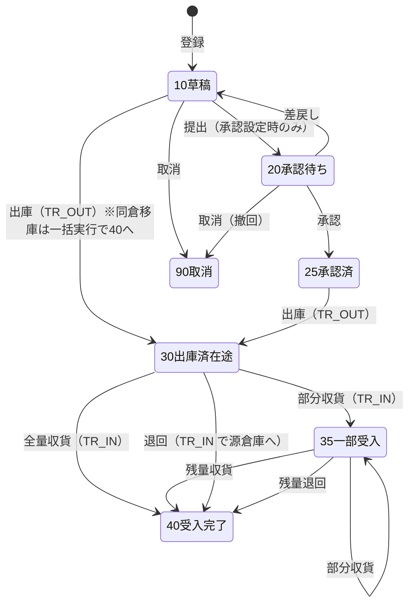
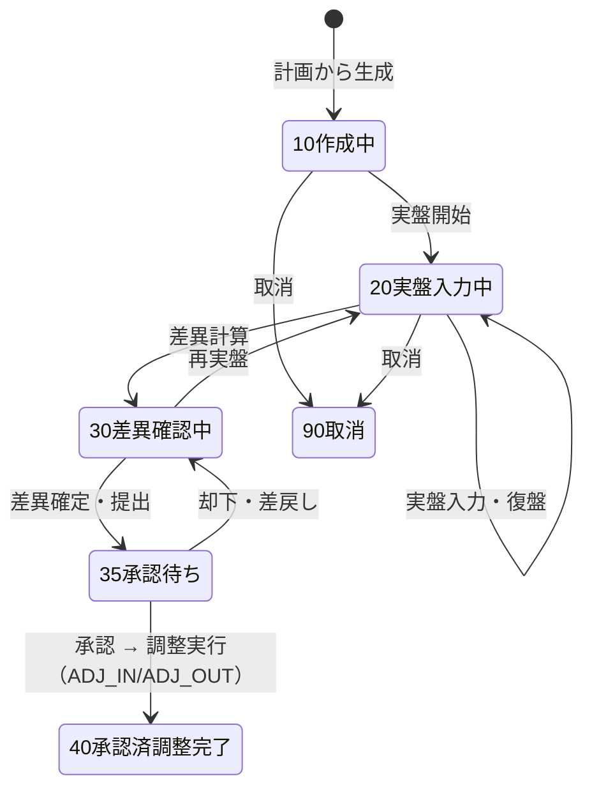
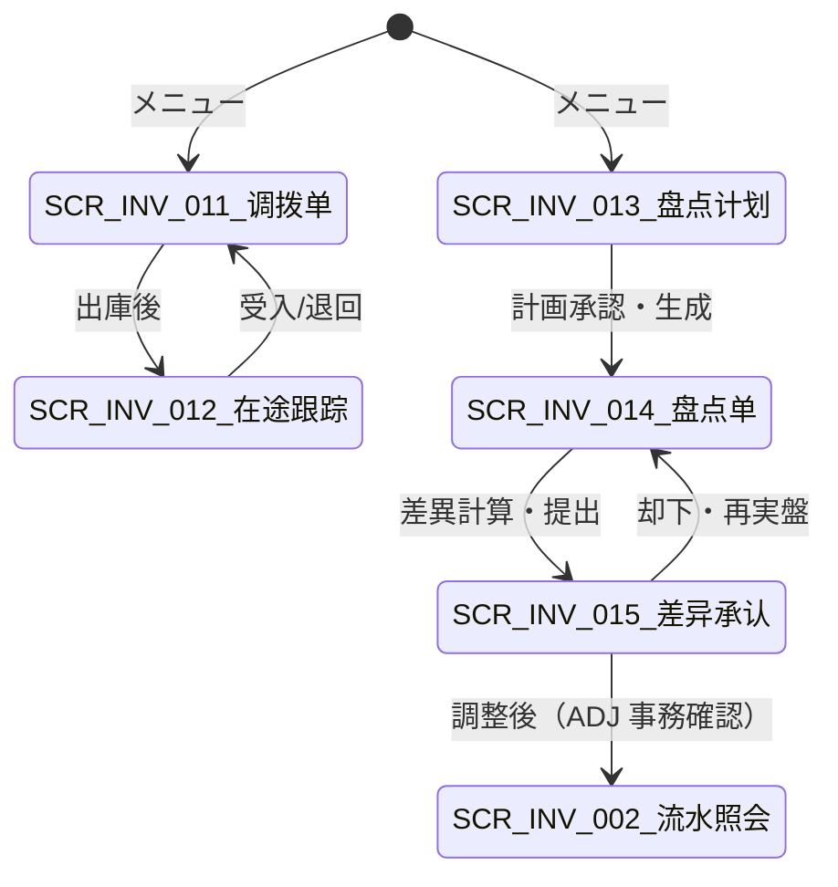

# 库存调拨・库存盘点 详细设计书（在庫移動・棚卸 詳細設計書）

| 項目 | 内容 |
|---|---|
| 文書名 | 库存调拨・库存盘点 详细设计书（在庫移動・棚卸 詳細設計書） |
| 文書番号 | DSN-INV-003 |
| 版数 | v1.0 |
| 作成日 | 2026-10-20 |
| 作成者 | inventory-designer |
| 承認者 | 未承認（レビュー待ち） |
| 状態 | ドラフト（レビュー中） |
| 関連文書 | [業務域概要](00-overview.md) / [在庫照会](01-stock-query.md) / [入出庫](02-inbound-outbound.md) / [批次・状態](04-batch-serial-status.md) / [原価](05-costing.md) / [DB 設計](90-db-design.md) / [API 設計](91-api-design.md) / [共通业务规则](../00-common/08-common-business-rules.md) |

---

## 1. 機能概要

### 1.1 対象機能

| 機能 ID | 機能名 | 概要 | 画面 ID | 優先度 |
|---|---|---|---|---|
| F-INV-009 | 库存调拨 | 同仓移库（库位间）、跨仓调拨（在途管理・部分收货・退回）、调拨单全生命周期 | SCR-INV-011、SCR-INV-012 | P0 |
| F-INV-010 | 库存盘点 | 盘点计划（全盘/循环/抽盘/重点）、盘点单（账面快照・实盘・差异）、差异审批、库存调整 | SCR-INV-013〜015 | P0 |

### 1.2 取引種別

| 取引種別 | 用途 | 方向 | 原価 |
|---|---|---|---|
| `TR_OUT` | 调拨出库（源仓库→在途） | OUT | 移动加权平均 |
| `TR_IN` | 调拨入库（在途→目标仓库、退回源仓库） | IN | `TR_OUT` の `unit_cost` を引継（再計算しない） |
| `ADJ_IN` | 盘盈（実在庫 > 帳簿） | IN | 現在平均単価 |
| `ADJ_OUT` | 盘亏（実在庫 < 帳簿） | OUT | 現在平均単価 |

> いずれも [09 §7.1](../00-common/09-cross-domain-flow.md) の定義に従う。調撥は**損益を発生させない**（内部移動）。棚卸差異は「待処理財産損溢」経由（J19/J20/J21、[09 §7.2](../00-common/09-cross-domain-flow.md)）。

---

## 2. 業務要件・業務ルール

### 2.1 前提条件

| # | 前提条件 | 成立しない場合の挙動 |
|---|---|---|
| 1 | 調撥：源・目標倉庫が有効、データ範囲内。同倉移庫は庫位管理倉庫のみ | エラー（`MSG-COM-049`/`MSG-INV-057`） |
| 2 | 調撥：出庫時点で源倉庫の可用量が足りる | `MSG-INV-001` |
| 3 | 棚卸：対象倉庫・範囲に有効な残高が存在する | 0 件なら `MSG-INV-062`（対象なし） |
| 4 | 棚卸：同一倉庫・同一範囲で未完了の盘点単が無い | `MSG-INV-032` |
| 5 | 棚卸：差異調整は承認済（`40 承認済`）でなければ実行不可 | `MSG-INV-033` |
| 6 | 対象期間が `OPEN`、かつ遡及禁止 | `MSG-INV-042`/`MSG-INV-025` |
| 7 | ユーザに `inventory:transfer:*` / `inventory:stocktake:*` の該当権限がある | `403` |

### 2.2 調撥の業務ルール

| # | ルール | 根拠 | 関連項目 |
|---|---|---|---|
| BR-TR-01 | 調撥種別：`10 同倉移庫`（同一倉庫内の庫位間移動）、`20 跨倉調撥`（倉庫間、在途あり）、`30 跨工場調撥`（第一版 予約、当面は 20 で運用） | 本設計 | `transfer_type` |
| BR-TR-02 | 同倉移庫は**1 操作で完結**する（`TR_OUT` と `TR_IN` を同一 DB トランザクションで生成、`pair_key` で関連付け、在途なし）。跨倉調撥は「出庫」と「収貨」を分離し、出庫から収貨までを**在途**として管理する | [09 §7.1](../00-common/09-cross-domain-flow.md) | `pair_key`、`transfer_status` |
| BR-TR-03 | 跨倉調撥の出庫で `TR_OUT`（源倉庫）を生成し、残数量を在途とする。収貨の都度 `TR_IN`（目標倉庫）を生成し、部分収貨を許容する | 本設計 | `shipped_qty/received_qty` |
| BR-TR-04 | **原価**：`TR_OUT` は源倉庫の移動平均単価。`TR_IN` は `TR_OUT` の `unit_cost` を引継ぎ、**再計算しない**（調撥前後で金額保存則を維持）。部分収貨時の端数は最終収貨行へ寄せる | 本設計、[08 §6](../00-common/08-common-business-rules.md) | `unit_cost` |
| BR-TR-05 | 調撥は**売上・仕入・費用を発生させない**。跨期調撥（出庫と収貨が別期間）は期末に「在途」として残し、FIN が在途物资 `1402` で処理する（本域は E18 で金額を通知） | [09 §7.1](../00-common/09-cross-domain-flow.md) | — |
| BR-TR-06 | 在途の取消：出庫後は「出庫取消」不可。未収貨数量の**退回**（`TR_IN` を源倉庫へ）のみ可。退回後は調撥単を `40 完了` とする | 本設計 | `return` |
| BR-TR-07 | 出庫前（`10/20/25`）は取消可能。取消は在庫未更新のため影響なし | [08 §13.1](../00-common/08-common-business-rules.md) | `cancel` |
| BR-TR-08 | 批次管理物料は批次を引き継ぐ（分割不可）。有效期・QC 状態も引継ぎ、目標倉庫でも同じ状態（`stock_status`）で受け入れる | [04](04-batch-serial-status.md) | `batch_no`、`stock_status` |
| BR-TR-09 | 承認：[08 §8.1](../00-common/08-common-business-rules.md) の追補（2026-10-20）に従い、跨倉調撥は **移動金額 < 10,000 元：倉庫主管（或签）／≥ 10,000 元：倉庫主管 → 財務経理（順送）**。同倉移庫は承認不要【示例值】 | [08 §8.1](../00-common/08-common-business-rules.md) | `transfer_status` |
| BR-TR-10 | 在途量 = `Σ(qty − received_qty) WHERE transfer_status IN (30,35)`。在途は経過日数を表示し、30 日超は滞留アラート | 本設計 | `in_transit_qty` |
| BR-TR-11 | 調撥先倉庫は「倉庫マスタの有効な倉庫」に限る。工場間の移動は目標倉庫の工場が異なることで表現する | [06-code-list §10](../00-common/06-code-list.md) | `factory_id` |

### 2.3 棚卸の業務ルール

| # | ルール | 根拠 | 関連項目 |
|---|---|---|---|
| BR-ST-01 | 盘点種別：`10 全盤`（倉庫全体）、`20 循環盤点`（分類/ロケーション別の計画的ローテーション）、`30 抽盤`（サンプル）、`40 重点盤点`（高額・重要物料） | 本設計 | `plan_type` |
| BR-ST-02 | 盘点計画を承認後、対象範囲の残高から**盘点単（账面スナップショット）を生成**する。スナップショット時点の `qty_on_hand` を `book_qty` として保存し、以後の入出庫と分離して差異を計算する | 本設計 | `book_qty`、`snapshot_at` |
| BR-ST-03 | 差異計算は**期間変動を還元**する：`調整数量 = 実盤数量 − (スナップショット時帳簿数量 + スナップショット後の純変動)`。これにより棚卸中の入出庫があっても正しい差異となる | 本設計（下記 CALC-02） | `net_movement` |
| BR-ST-04 | 凍結モード：`10 時点スナップショット`（既定、入出庫を止めない）、`20 全倉凍結`（対象倉庫の全入出庫を禁止）。全盤または高精度要求時に 20 を選択 | 本設計、[09 §10.3](../00-common/09-cross-domain-flow.md) | `freeze_mode` |
| BR-ST-05 | 差異理由は差異のある全行に必須：`10 管理不善` / `20 自然損耗` / `30 計量誤差` / `40 記録誤差` / `50 災害` / `60 その他`。理由により FIN の仕訳（管理費用/営業外支出）が変わる | [08 §7](../00-common/08-common-business-rules.md) | `diff_reason` |
| BR-ST-06 | 差異金額（絶対値合計）が 10,000 元未満は 倉庫主管 → 財務経理、10,000 元以上は 総経理まで承認（[08 §8.1](../00-common/08-common-business-rules.md)）。**承認なしの在庫調整は禁止** | [08 §7](../00-common/08-common-business-rules.md) | `approval` |
| BR-ST-07 | 調整は `ADJ_IN`（盤盈）/`ADJ_OUT`（盤亏）で実行し、原価は**調整実行時点の現在平均単価**。調整日は実行日（遡及禁止のため、スナップショット日ではなく実行日で計上） | [08 §6.1/§7](../00-common/08-common-business-rules.md) | `txn_date` |
| BR-ST-08 | 調整実行時に**最新の帳簿数量で差異を再計算**する（差異確認から承認までの間の入出庫を反映）。再計算結果が承認時の差異と異なる場合は、差異変更理由を記録し再承認を要する（金額が閾値を跨ぐ場合） | 本設計 | CALC-03 |
| BR-ST-09 | 高額・重要物料（`mdm_material.is_key_material=true`）で差異がある場合は**復盤（第二回実盤）**を必須とする。復盤数量を `re_counted_qty` に保存し、最終実盤数量は復盤優先 | 本設計 | `re_counted_qty` |
| BR-ST-10 | 盘点は停止可能（`90 取消`）。ただし `40 承認済`（調整済）は取消不可（沖销で対応） | [08 §13.1](../00-common/08-common-business-rules.md) | `take_status` |
| BR-ST-11 | 棚卸中の新規批次（実在庫に存在するが帳簿に無い）は、盤盈行に**新品番/新批次**を手入力でき、`ADJ_IN` で批次を新規作成する | 本設計 | `new_batch_no` |
| BR-ST-12 | 全倉凍結モードでは、対象倉庫の入出庫（`inv_stock_txn` の過账）を拒否する。凍結は盘点単の状態（`20/30`）で判定し、別テーブルを持たない | 本設計 | `assertWarehouseNotFrozen` |
| BR-ST-13 | 棚卸精度 KPI：`1 − Σ|差異金額| ÷ Σ帳簿金額`。月次で集計し [07-reports](07-reports.md) に出力 | [00-overview](00-overview.md) 1.3 | `accuracy` |
| BR-ST-14 | 盘点単の行は「倉庫×物料×批次×在庫状態×庫位」ごとに 1 行。在庫 0 でも対象範囲内なら行を作成（実在庫発見のため） | 本設計 | `stocktake_line` |

### 2.4 計算式・判定式

| # | 対象 | 算式 | 丸め | 例（【示例値】） |
|---|---|---|---|---|
| CALC-01 | 在途量（調撥） | `Σ(qty − received_qty) WHERE transfer_status IN (30,35)` | 数量 4 桁 | 200 − 80 = 120.0000 PCE |
| CALC-02 | 棚卸差異数量（表示時） | `実盤数量 − (スナップショット帳簿数量 + Σスナップショット後の direction×qty)` | 数量 4 桁 | 480 − (500 + (−20)) = 0.0000 |
| CALC-03 | 調整数量（実行時再計算） | `実盤数量 − (スナップショット帳簿数量 + 調整実行時までの純変動)` | 数量 4 桁 | 480 − (500 − 20) = 0.0000 |
| CALC-04 | 差異金額 | `調整数量 × 現在平均単価`（`ADJ_OUT` は負値） | 2 桁 | 12 × 5.500000 = 66.00 |
| CALC-05 | 棚卸精度 | `1 − Σ|差異金額| ÷ Σ帳簿金額` | 4 桁（率） | 1 − 66.00 ÷ 3,300.00 = 0.9800 |
| CALC-06 | 調撥 `TR_IN` 金額 | `受入数量 × TR_OUT 単価`（最終収貨で端数調整） | 2 桁 | 120 × 5.500000 = 660.00 |
| CALC-07 | 調撥原価保存則 | `Σ TR_OUT.amount = Σ TR_IN.amount`（同一調撥単） | 2 桁 | 差 0.00 |
| CALC-08 | 差異承認金額 | `Σ|差異金額|`（対象行全体） | 2 桁 | 10,329.00（< 10,000 か否かの判定に使用） |

### 2.5 状態遷移

**調撥単（`inv_transfer.transfer_status`）**



**盘点計画（`inv_stocktake_plan.plan_status`）**：`10 草稿 → 20 承認待ち → 25 承認済 → 30 実施中 → 40 完了` / `90 取消`

**盘点単（`inv_stocktake.take_status`）**



| 遷移 | トリガ | 権限 | 更新項目 | メッセージ |
|---|---|---|---|---|
| 調撥 10→30 | 出庫 | `inventory:transfer:ship` | 状態、`shipped_at`、`TR_OUT` 生成、E18 | `MSG-COM-003` |
| 調撥 30/35→40 | 受入/退回 | `inventory:transfer:receive` | 状態、`received_at`、`TR_IN` 生成、E18 | `MSG-COM-003` |
| 調撥 10→90 | 取消 | `inventory:transfer:cancel` | 状態 | `MSG-COM-010` |
| 棚卸 20→30 | 差異計算 | `inventory:stocktake:enter` | `diff_qty`/`diff_amount` 計算 | — |
| 棚卸 30→35 | 提出 | `inventory:stocktake:submit` | 状態、WF 起票 | `MSG-COM-005` |
| 棚卸 35→40 | 承認+調整 | `inventory:stocktake:approve`+`adjust` | 状態、`ADJ_*` 生成、E18 | `MSG-COM-003` |
| 棚卸 35→30 | 却下 | WF コールバック | 状態 → 30 | `MSG-INV-033` |

---

## 3. 関連機能

| 関係 | 機能 ID | 機能名 | 関係内容 |
|---|---|---|---|
| 上流 | F-INV-001 | 库存查询 | 対象在庫の確認 |
| 上流 | F-INV-019 | 预留 | 引当済在庫の扱い（棚卸時は `qty_reserved` を保持） |
| 下流 | F-INV-017 | 成本计算 | 調撥原価・棚卸差異原価 |
| 下流 | F-INV-020 | 月结 | 棚卸未完了チェック、在途チェック |
| 下流 | F-INV-021 | 报表 | 調撥単・盤点表・差異報告 |
| 関連 | F-WF-004 | 审批 | 調撥/盤点差異の承認 |
| 参照 | F-MDM-003 | 仓库库位 | 倉庫・庫位マスタ |

---

## 4. 画面設計

### 4.1 画面一覧

| 画面 ID | 画面名 | 類型 | 概要 |
|---|---|---|---|
| SCR-INV-011 | 库存调拨单（TR）登録 | 登録編集 | 同倉移庫/跨倉調撥の登録・出庫・受入・退回 |
| SCR-INV-012 | 调拨在途跟踪 | 一覧検索 | 在途調撥の一覧・経過日数・受入/退回 |
| SCR-INV-013 | 盘点计划登録 | 登録編集 | 盘点種別・範囲・凍結モード・日程の登録と承認 |
| SCR-INV-014 | 盘点单（实盘入力） | 登録編集 | 账面スナップショット・実盤入力（PDA/手入力/取込）・差異計算 |
| SCR-INV-015 | 盘点差异承认・调整 | 登録編集 | 差異理由・承認・調整実行（ADJ_IN/ADJ_OUT） |

### 4.2 画面遷移



### 4.3 画面レイアウト（SCR-INV-011 调拨单）

```
┌──────────────────────────────────────────────────────────────────────────────┐
│ パンくず：ホーム > 库存管理 > 库存调拨      状態：[草稿]   文書番号：TR2610200001│
├──────────────────────────────────────────────────────────────────────────────┤
│〔ヘッダ〕                                                                      │
│  調撥種別 [●同倉移庫 ○跨倉調撥▼]  調撥日 [2026-10-20]  理由 [____________]     │
│  源倉庫 [WH01 原料倉▼] 源庫位 [WH01-A-01-01▼]                                  │
│  目標倉庫 [WH02 半成品倉▼] 目標庫位 [______▼]（同倉移庫時のみ必須）             │
│  申請者 [E000123]  承認状態 [-]  備考 [______________________]                  │
├──────────────────────────────────────────────────────────────────────────────┤
│〔明細〕[行追加][行削除][FEFO 自動選択]                                          │
│ No│物料      │品名            │単位│調撥数量│可用量 │批次      │状態│単価    │
│  1│1001000001│冷軋無取向電工鋼│KGM │200.0000│380.00 │261020P001│可用│  5.50  │
├──────────────────────────────────────────────────────────────────────────────┤
│〔合計〕数量 200.0000 / 金額 CNY 1,100.00（内部移動・損益なし）                │
│〔操作〕[保存][提出][出庫][受入][退回][取消][打印]                                │
└──────────────────────────────────────────────────────────────────────────────┘
```

### 4.4 画面項目定義（SCR-INV-011 库存调拨单）

#### 4.4.1 ヘッダ項目

| No | 項目 ID | 項目名 | 区分 | 種別 | 型/桁 | 必須 | 初期値 | 入力チェック | データソース | DB 項目 | 権限 | 備考 |
|---|---|---|---|---|---|---|---|---|---|---|---|---|
| 1 | `transferNo` | 調撥番号 | ヘッダ | テキスト | VARCHAR(32) | ○ | 自動採番（TR） | — | `sys_sequence` | `transfer_no` | 参照のみ | 12 桁（08 §2.1） |
| 2 | `transferType` | 調撥種別 | ヘッダ | ラジオ | SMALLINT | ○ | 20 | 10/20/30 | 固定値 | `transfer_type` | 編集可 | 10=同倉移庫、20=跨倉調撥、30=跨工場（P2） |
| 3 | `transferDate` | 調撥日 | ヘッダ | 日付 | DATE | ○ | 当日 | 期間 OPEN、遡及禁止 | — | `transfer_date` | 編集可 | — |
| 4 | `fromWarehouseId` | 源倉庫 | ヘッダ | 選択 | BIGINT | ○ | ユーザ既定倉庫 | コード存在・データ範囲 | `mdm_warehouse` | `from_warehouse_id` | 編集可 | 出庫後は変更不可 |
| 5 | `fromLocationId` | 源庫位 | ヘッダ | 選択 | BIGINT | △ | 空 | 倉庫に属する・同倉移庫時必須 | `mdm_warehouse_bin` | `from_location_id` | 編集可 | 庫位管理倉庫のみ |
| 6 | `toWarehouseId` | 目標倉庫 | ヘッダ | 選択 | BIGINT | ○ | 空 | 源と異なる（跨倉）／同一（同倉） | `mdm_warehouse` | `to_warehouse_id` | 編集可 | — |
| 7 | `toLocationId` | 目標庫位 | ヘッダ | 選択 | BIGINT | △ | 空 | 同倉移庫時必須・源庫位と異なる | `mdm_warehouse_bin` | `to_location_id` | 編集可 | — |
| 8 | `reason` | 調撥理由 | ヘッダ | テキスト | VARCHAR(200) | ○ | 空 | 200 文字以内 | — | `reason` | 編集可 | 例「生産計画に伴う払出」 |
| 9 | `transferStatus` | 状態 | ヘッダ | 表示 | SMALLINT | ○ | 10 | — | 固定値 | `transfer_status` | 参照のみ | バッジ |
| 10 | `applicantId` | 申請者 | ヘッダ | 表示 | BIGINT | ○ | ログインユーザ | — | — | `applicant_id` | 参照のみ | — |
| 11 | `inTransitQty` | 在途数量 | フッタ | 表示 | NUMERIC(18,4) | — | 自動 | — | 計算 | `in_transit_qty` | 参照のみ | CALC-01 |

#### 4.4.2 明細項目

| No | 項目 ID | 項目名 | 種別 | 型/桁 | 必須 | 初期値 | 入力チェック | 計算 | DB 項目 |
|---|---|---|---|---|---|---|---|---|---|
| 1 | `lineNo` | 行番号 | 数値 | INT | ○ | 10 刻み | — | — | `line_no` |
| 2 | `materialCode` | 物料コード | マスタ選択 | VARCHAR(10) | ○ | 空 | コード存在・有効 | — | `material_id/code` |
| 3 | `materialName/spec` | 品名・仕様 | テキスト | VARCHAR(200) | ○ | マスタ | — | — | `material_name/spec` |
| 4 | `uomCode` | 単位 | 表示 | VARCHAR(8) | ○ | 基本単位 | — | — | `uom_code` |
| 5 | `qty` | 調撥数量 | 数値 | NUMERIC(18,4) | ○ | 0 | > 0、4 桁、可用量以内 | — | `qty` |
| 6 | `availableQty` | 可用量（参考） | 表示 | NUMERIC(18,4) | — | 自動 | — | 照会 | — |
| 7 | `batchNo` | 批次号 | テキスト | VARCHAR(64) | △ | 空 | 批次管理時必須・有効 | — | `batch_id/no` |
| 8 | `stockStatus` | 在庫状態 | 選択 | SMALLINT | ○ | 20 | 出庫可能状態のみ（10 待検/30 凍結は不可） | — | `stock_status` |
| 9 | `unitCost` | 単価（参考） | 表示 | NUMERIC(18,6) | — | 自動 | — | 移動平均 | `unit_cost` |
| 10 | `shippedQty` | 出庫済数量 | 表示 | NUMERIC(18,4) | — | 0 | — | — | `shipped_qty` |
| 11 | `receivedQty` | 受入済数量 | 表示 | NUMERIC(18,4) | — | 0 | ≤ 出庫済 | — | `received_qty` |
| 12 | `inTransitQty` | 在途数量 | 表示 | NUMERIC(18,4) | — | 自動 | — | `shipped − received` | `in_transit_qty` |

#### 4.4.3 イベント処理

| No | イベント | トリガ | 処理内容 | 呼出 API | 画面遷移 | エラー時 |
|---|---|---|---|---|---|---|
| 1 | 種別変更 | `transferType` 変更 | 同倉/跨倉で倉庫・庫位項目の表示/必須を切替 | — | — | — |
| 2 | 物料選択 | 明細セル | マスタ取得、批次/序列号/状態の選択肢を設定 | `GET /api/mdm/materials` | ダイアログ | — |
| 3 | FEFO 選択 | ボタン | 物料+源倉庫の批次候補を FEFO 順に取得し、批次・単価を設定 | `GET /api/inventory/stock-balances/available-batches` | 同一画面 | `MSG-INV-006` |
| 4 | 保存 | 「保存」 | 入力チェック → 登録（草稿） | `POST /api/inventory/transfers` | 同一画面 | 項目エラー |
| 5 | 提出 | 「提出」 | 承認フロー起票（承認設定時） | `POST /api/inventory/transfers/{id}/submit` | 同一画面 | `MSG-COM-073` |
| 6 | 出庫 | 「出庫」 | 確認 → 出庫 API（TR_OUT 生成、在途化） | `POST /api/inventory/transfers/{id}/ship` | SCR-INV-012 | `MSG-INV-001/026/042` |
| 7 | 受入 | 「受入」 | 受入数量入力ダイアログ → 受入 API（TR_IN） | `POST /api/inventory/transfers/{id}/receive` | SCR-INV-012 | `MSG-INV-028/027` |
| 8 | 退回 | 「退回」 | 残量を源倉庫へ戻す（TR_IN、理由必須） | `POST /api/inventory/transfers/{id}/return` | SCR-INV-012 | `MSG-INV-029` |
| 9 | 取消 | 「取消」 | 草稿/承認待ちのみ取消 | `POST /api/inventory/transfers/{id}/cancel` | 一覧へ | `MSG-INV-029` |
| 10 | 打印 | 「打印」 | PRT-INV-006 出力 | `POST /api/inventory/transfers/{id}/print` | 帳票プレビュー | — |

### 4.5 画面項目定義（SCR-INV-012 调拨在途跟踪）

| 項目 | 内容 |
|---|---|
| 検索条件 | 源倉庫/目標倉庫、調撥日範囲、状態（30/35）、物料、滞留日数（既定 30 日以上を強調） |
| 一覧列 | 調撥番号 / 調撥日 / 源倉庫 / 目標倉庫 / 明細数 / 出庫数量 / 受入数量 / **在途数量** / 在途日数 / 状態 / 申請者 |
| 行操作 | 受入（明細入力ダイアログ）、退回、詳細、打印 |
| サマリ | 在途数量合計、在途金額合計、30 日超件数 |
| 権限 | `inventory:transfer:view`、受入は `inventory:transfer:receive` |

### 4.6 画面項目定義（SCR-INV-013 盘点计划）

| No | 項目 ID | 項目名 | 種別 | 型/桁 | 必須 | 初期値 | 入力チェック | DB 項目 |
|---|---|---|---|---|---|---|---|---|
| 1 | `planNo` | 計画番号 | テキスト | VARCHAR(32) | ○ | 自動（CPI） | — | `plan_no` |
| 2 | `planName` | 計画名 | テキスト | VARCHAR(100) | ○ | 空 | 100 文字 | `plan_name` |
| 3 | `planType` | 盘点種別 | ラジオ | SMALLINT | ○ | 20 | 10/20/30/40 | `plan_type` |
| 4 | `warehouseId` | 対象倉庫 | 選択 | BIGINT | ○ | 空 | 有効・1 倉庫のみ | `warehouse_id` |
| 5 | `categoryCodes` | 対象分類 | 複数選択 | VARCHAR(4)[] | △ | 全分類 | 分類存在 | `scope_json.category_codes` |
| 6 | `materialIds` | 対象物料 | 複数選択 | BIGINT[] | △ | 空（全物料） | 有効 | `scope_json.material_ids` |
| 7 | `locationIds` | 対象庫位 | 複数選択 | BIGINT[] | △ | 空（全庫位） | 倉庫に属する | `scope_json.location_ids` |
| 8 | `stockStatuses` | 対象在庫状態 | 複数選択 | SMALLINT[] | ○ | 10,20,30,40,50 | 値域 | `scope_json.stock_statuses` |
| 9 | `freezeMode` | 凍結モード | ラジオ | SMALLINT | ○ | 10 | 10/20 | `freeze_mode` |
| 10 | `plannedStartDate` | 予定開始日 | 日付 | DATE | ○ | 翌営業日 | 実在日付 | `planned_start_date` |
| 11 | `plannedEndDate` | 予定終了日 | 日付 | DATE | ○ | 開始日+2 日 | ≥ 開始日 | `planned_end_date` |
| 12 | `planStatus` | 状態 | 表示 | SMALLINT | ○ | 10 | — | `plan_status` |
| 13 | `approvalComment` | 承認コメント | テキスト | VARCHAR(500) | — | 空 | 500 文字 | `approval_comment` |

### 4.7 画面項目定義（SCR-INV-014 盘点单・实盘入力）

#### 4.7.1 ヘッダ

| No | 項目 ID | 項目名 | 種別 | 型/桁 | 必須 | 初期値 | 入力チェック | DB 項目 |
|---|---|---|---|---|---|---|---|---|
| 1 | `stocktakeNo` | 盘点番号 | テキスト | VARCHAR(32) | ○ | 自動（CNT） | — | `stocktake_no` |
| 2 | `planNo` | 計画番号 | リンク | VARCHAR(32) | ○ | 計画から | — | `plan_id` |
| 3 | `warehouseId` | 倉庫 | 表示 | BIGINT | ○ | 計画から | — | `warehouse_id` |
| 4 | `takeDate` | 盘点基準日 | 日付 | DATE | ○ | 計画開始日 | 実在日付 | `take_date` |
| 5 | `snapshotAt` | スナップショット日時 | 表示 | TIMESTAMPTZ | ○ | 生成時刻 | — | `snapshot_at` |
| 6 | `freezeMode` | 凍結モード | 表示 | SMALLINT | ○ | 計画から | — | `freeze_mode` |
| 7 | `takeStatus` | 状態 | 表示 | SMALLINT | ○ | 10 | — | `take_status` |
| 8 | `totalLines` | 対象行数 | 表示 | INT | — | 自動 | — | `total_lines` |
| 9 | `countedLines` | 入力済行数 | 表示 | INT | — | 0 | — | `counted_lines` |
| 10 | `diffLines` | 差異行数 | 表示 | INT | — | 0 | — | `diff_lines` |
| 11 | `diffAmount` | 差異金額合計 | 表示 | NUMERIC(18,2) | — | 0 | — | `diff_amount` |

#### 4.7.2 明細

| No | 項目 ID | 項目名 | 種別 | 型/桁 | 必須 | 初期値 | 入力チェック | 計算 | DB 項目 |
|---|---|---|---|---|---|---|---|---|---|
| 1 | `lineNo` | 行番号 | 数値 | INT | ○ | 自動 | — | — | `line_no` |
| 2 | `materialCode` | 物料コード | 表示 | VARCHAR(10) | ○ | スナップショット | — | — | `material_code` |
| 3 | `materialName/spec` | 品名・仕様 | 表示 | VARCHAR(200) | ○ | スナップショット | — | — | `material_name/spec` |
| 4 | `batchNo` | 批次号 | 表示 | VARCHAR(64) | △ | スナップショット | — | — | `batch_no` |
| 5 | `stockStatus` | 在庫状態 | 表示 | SMALLINT | ○ | スナップショット | — | — | `stock_status` |
| 6 | `locationCode` | 庫位 | 表示 | VARCHAR(32) | — | スナップショット | — | — | `location_id` |
| 7 | `bookQty` | 帳簿数量 | 表示 | NUMERIC(18,4) | ○ | スナップショット | — | — | `book_qty` |
| 8 | `netMovement` | 期間変動 | 表示 | NUMERIC(18,4) | — | 自動 | — | 差異計算時に算出 | `net_movement` |
| 9 | `countedQty` | 実盤数量 | 数値 | NUMERIC(18,4) | ○ | 空 | ≥ 0、4 桁 | — | `counted_qty` |
| 10 | `reCountedQty` | 復盤数量 | 数値 | NUMERIC(18,4) | △ | 空 | ≥ 0、重点物料差異時必須 | — | `re_counted_qty` |
| 11 | `finalQty` | 最終実盤数量 | 表示 | NUMERIC(18,4) | — | 自動 | — | 復盤優先 | `final_qty` |
| 12 | `diffQty` | 差異数量 | 表示 | NUMERIC(18,4) | — | 自動 | — | CALC-02 | `diff_qty` |
| 13 | `unitCost` | 単価 | 表示 | NUMERIC(18,6) | — | 現在平均 | — | — | `unit_cost` |
| 14 | `diffAmount` | 差異金額 | 表示 | NUMERIC(18,2) | — | 自動 | — | CALC-04 | `diff_amount` |
| 15 | `diffReason` | 差異理由 | 選択 | SMALLINT | △ | 空 | 差異ありは必須 | — | `diff_reason` |
| 16 | `newBatchNo` | 新規批次号 | テキスト | VARCHAR(64) | △ | 空 | 盤盈かつ新批次時 | — | `new_batch_no` |
| 17 | `remark` | 備考 | テキスト | VARCHAR(200) | — | 空 | — | — | `remark` |

#### 4.7.3 イベント処理

| No | イベント | トリガ | 処理内容 | 呼出 API | 画面遷移 | エラー時 |
|---|---|---|---|---|---|---|
| 1 | 計画生成 | SCR-INV-013「生成」 | 対象残高スナップショット→盘点単作成（明細一括生成） | `POST /api/inventory/stocktake-plans/{id}/generate` | SCR-INV-014 | `MSG-INV-062` |
| 2 | 実盤開始 | 「実盤開始」 | 状態 10→20、凍結モード 20 なら凍結開始 | `POST /api/inventory/stocktakes/{id}/start` | 同一画面 | `MSG-INV-032` |
| 3 | 数量入力 | 明細セル | 実盤数量入力、未入力行カウント更新 | — | — | — |
| 4 | PDA スキャン | 「スキャン」 | 物料/批次/庫位をスキャンして該当行へ数量入力 | `POST /api/inventory/stocktakes/{id}/scan` | 同一画面 | `MSG-INV-050/051` |
| 5 | 取込 | 「Excel 取込」 | テンプレート取込（検証→実行の 2 段階） | `POST /api/inventory/stocktakes/{id}/import` | 同一画面 | `MSG-COM-063/064` |
| 6 | 差異計算 | 「差異計算」 | 実盤入力完了チェック → 差異・金額を計算 | `POST /api/inventory/stocktakes/{id}/calc-diff` | 状態 30 | `MSG-INV-035` |
| 7 | 提出 | 「提出」 | 差異確定 → WF 承認起票 | `POST /api/inventory/stocktakes/{id}/submit` | SCR-INV-015 | `MSG-COM-073` |
| 8 | 印刷 | 「印刷」 | PRT-INV-007（盘点表） | `POST /api/inventory/stocktakes/{id}/print` | 帳票プレビュー | — |

### 4.8 画面項目定義（SCR-INV-015 盘点差异承认・调整）

| 項目 | 内容 |
|---|---|
| 表示内容 | 盘点番号、倉庫、差異行一覧（物料/批次/状態/帳簿/実盤/差異/理由/単価/差異金額）、差異合計、承認経路、承認履歴 |
| 差異理由入力 | 30/35 状態で差異理由を変更可能（差異あり全行必須）。重点物料は復盤数量必須 |
| 操作 | 承認（WF）、却下、調整実行（`inventory:stocktake:adjust`）、差異報告印刷（PRT-INV-008） |
| 調整実行 | 最終帳簿で差異を再計算（CALC-03）→ `ADJ_IN`/`ADJ_OUT` を生成。再計算で差異が変わった場合は確認ダイアログ（`MSG-INV-036`） |
| 制約 | `take_status=40` は参照のみ。`35` 以外は調整実行ボタン非表示 |

### 4.9 表示制御

| 条件 | 対象 | 制御 |
|---|---|---|
| 調撥 `transfer_status IN (30,35,40,90)` | 編集・删除・出庫 | 参照のみ |
| 同倉移庫以外で `fromLocationId/toLocationId` | 庫位項目 | 庫位管理倉庫のみ表示 |
| `inventory:cost:view` なし | 単価・金額 | 非表示（API も返さない） |
| 盘点 `take_status NOT IN (20,30)` | 実盤数量入力 | 参照のみ |
| 盘点 `take_status ≠ 35` | 承認・調整実行 | 非表示 |
| 差異理由未入力 | 「差異確定」ボタン | 無効化 |
| 倉庫が全倉凍結中 | 入出庫画面 | 警告バナー「盘点中につき入出庫不可」 |

---

## 5. 入力チェック仕様

| No | チェック ID | 対象 | 種別 | 条件 | タイミング | メッセージ ID |
|---|---|---|---|---|---|---|
| 1 | CHK-INV-009-01 | 調撥種別 | 値域 | 10/20/30 | 保存時 | `MSG-COM-042` |
| 2 | CHK-INV-009-02 | 源・目標倉庫 | 相関 | 同倉移庫は同一、跨倉は異なる | 保存時 | `MSG-INV-031` |
| 3 | CHK-INV-009-03 | 庫位 | 必須/相関 | 同倉移庫は源・目標庫位必須、同一不可 | 保存時 | `MSG-INV-031`/`MSG-INV-057` |
| 4 | CHK-INV-009-04 | 調撥数量 | 範囲/業務 | > 0、出庫時に可用量以内（CALC-01） | 出庫時 | `MSG-INV-027`/`MSG-INV-001` |
| 5 | CHK-INV-009-05 | 批次 | 必須 | 批次管理物料必須、有効批次 | 保存時 | `MSG-INV-005/006` |
| 6 | CHK-INV-009-06 | 在庫状態 | 業務 | 出庫可能状態（20 のみ。凍結/待検は不可） | 出庫時 | `MSG-INV-011` |
| 7 | CHK-INV-009-07 | 受入数量 | 範囲 | > 0、`≤ 出庫済 − 受入済` | 受入時 | `MSG-INV-028` |
| 8 | CHK-INV-009-08 | 状態遷移 | 業務 | 遷移表に存在 | 各操作 | `MSG-INV-029` |
| 9 | CHK-INV-010-01 | 計画期間 | 相関 | 開始 ≤ 終了 | 保存時 | `MSG-COM-046` |
| 10 | CHK-INV-010-02 | 未完了盘点 | 業務 | 同一倉庫に `take_status IN (10,20,30,35)` が無い | 生成時 | `MSG-INV-032` |
| 11 | CHK-INV-010-03 | 対象範囲 | 業務 | 残高が 1 行以上 | 生成時 | `MSG-INV-062` |
| 12 | CHK-INV-010-04 | 実盤数量 | 範囲 | ≥ 0、4 桁、未入力行があると差異計算不可 | 差異計算時 | `MSG-COM-047`/`MSG-INV-036` |
| 13 | CHK-INV-010-05 | 復盤数量 | 業務 | 重点物料で差異ありの場合必須 | 差異計算時 | `MSG-INV-039` |
| 14 | CHK-INV-010-06 | 差異理由 | 必須 | 差異あり行は必須 | 提出時 | `MSG-COM-040` |
| 15 | CHK-INV-010-07 | 承認状態 | 業務 | 調整実行は `take_status=40` | 調整実行時 | `MSG-INV-033` |
| 16 | CHK-INV-010-08 | 調整再計算 | 業務 | 承認時差異と実行時差異の変化を確認 | 調整実行時 | `MSG-INV-036`（確認） |
| 17 | CHK-INV-010-09 | 期間・遡及 | 業務 | 調整日が OPEN 期間、`≥ last_txn_date` | 調整実行時 | `MSG-INV-042`/`MSG-INV-025` |

---

## 6. 処理詳細

### 6.1 処理一覧

| 処理 ID | 処理名 | 契機 | トランザクション | 排他 |
|---|---|---|---|---|
| PRC-INV-009-01 | 調撥単登録・更新 | 画面 | 要 | 楽観排他 |
| PRC-INV-009-02 | 調撥出庫（TR_OUT） | 「出庫」 | 要 | 残高行ロック（[02](02-inbound-outbound.md) 6.3） |
| PRC-INV-009-03 | 調撥受入（TR_IN） | 「受入」 | 要 | 同上 |
| PRC-INV-009-04 | 同倉移庫（TR_OUT+TR_IN 一括） | 「移庫実行」 | 要 | 同上（pair_key で 2 事務） |
| PRC-INV-009-05 | 調撥退回（TR_IN 源倉庫） | 「退回」 | 要 | 同上 |
| PRC-INV-009-06 | 調撥取消 | 「取消」 | 要 | 楽観排他 |
| PRC-INV-010-01 | 盘点計画登録・承認 | 画面 | 要 | 楽観排他 |
| PRC-INV-010-02 | 盘点単生成（スナップショット） | 計画から | 要 | 対象倉庫のアドバイザリロック（多重生成防止） |
| PRC-INV-010-03 | 実盤入力・取込 | 画面/PDA | 要（行単位） | 楽観排他（`version`） |
| PRC-INV-010-04 | 差異計算 | 「差異計算」 | 要 | 対象盘点単のみ |
| PRC-INV-010-05 | 差異承認（WF） | 提出/コールバック | 要 | 楽観排他 |
| PRC-INV-010-06 | 調整実行（ADJ_IN/ADJ_OUT） | 「調整実行」 | 要 | 残高行ロック（[02](02-inbound-outbound.md) 6.3） |

### 6.2 処理手順（正常系）

**PRC-INV-009-02 調撥出庫（TR_OUT）**

1. 調撥単の状態が `10/25` であることを検証する（承認設定時は `25` のみ）。
2. 明細ごとに源倉庫の利用可能在庫を検証する（`available_qty = qty_on_hand − qty_reserved`、状態 10）。
3. `inv_stock_txn`（`txn_type='TR_OUT'`、`source_type='TRANSFER'`、`source_id=transferId`、`txn_no=transfer_no`）を生成し、[02](02-inbound-outbound.md) 6.3 のアルゴリズムで在庫を減算する。原価は移動平均（CALC-04）。
4. `TR_OUT` の明細に `unit_cost`・`amount` を保存し、`inv_transfer_line` に `shipped_qty`・`shipped_at` を更新する。
5. 調撥単を `30 出庫済（在途）` に更新する（全量出庫時）。同倉移庫の場合は続けて `TR_IN` を生成する（下記）。
6. E18 を発行する（`sourceType='TRANSFER'`、`sourceId`、`txnType='TR_OUT'`）。
7. 監査ログ（SHIP）を記録する。

**PRC-INV-009-03 調撥受入（TR_IN）**

1. 調撥単が `30/35` であることを検証する。
2. 受入数量を検証する（`0 < 受入数量 ≤ 出庫済 − 受入済`）。
3. `TR_IN` を生成し、目標倉庫の残高を加算する。`unit_cost` は `TR_OUT` から引継（BR-TR-04）、金額は CALC-06（最終受入行で端数調整）。
4. 目標倉庫の庫位（`toLocationId`）へ配置する。
5. `inv_transfer_line.received_qty` を加算し、全量受入なら調撥単を `40 受入完了`、部分なら `35 一部受入` に更新する。
6. E18 を発行する（`txnType='TR_IN'`）。
7. 目標倉庫側の批次・序列号を登録する（[04](04-batch-serial-status.md)）。

**PRC-INV-009-04 同倉移庫**

1. 源・目標庫位が同一でないことを検証する。
2. `TR_OUT`（源庫位）と `TR_IN`（目標庫位）を**同一 DB トランザクション**で生成し、`pair_key = UUID` で関連付ける。原価は両者同一単価とし、金額保存則を維持する（CALC-07）。
3. 調撥単を `40 受入完了` に更新する（在途なし）。
4. E18 を 1 件（`txnType='TR_OUT'`、payload に `pairKey` と `TR_IN` 情報を含める）または 2 件（TR_OUT/TR_IN）発行する。**本域は 2 件発行**（FIN の在庫移動処理が取引単位で対称になるように）。
5. 監査ログを記録する。

**PRC-INV-010-02 盘点単生成**

1. 計画を検証する（`plan_status=25/30`、期間、未完了盘点なし）。
2. 対象範囲（倉庫・分類・物料・庫位・状態）で `inv_stock_balance` を検索し、**在庫 0 も含めて**明細を生成する（範囲指定がある場合は範囲内の全対象。全盤は在庫 0 行の物料もマスタから補完可能）。
3. 各行に `book_qty`（スナップショット数量）・`unit_cost`（現在平均）・`snapshot_at` を保存する。
4. `stocktake_no`（CNT）を採番し、`inv_stocktake` と `inv_stocktake_line` を一括 INSERT する。
5. 同一倉庫の未完了盘点を確認し、`inv_transfer`/`inv_stock_txn` の並行生成を防止するため `pg_advisory_xact_lock(hashtext('inv_stocktake:' || warehouse_id))` を取得する。
6. 計画を `30 実施中`、盘点単を `10 作成中` とする。

**PRC-INV-010-04 差異計算**

1. 実盤未入力行を検出する（`counted_qty IS NULL`）→ あれば `MSG-INV-036`。
2. 各行の `final_qty = COALESCE(re_counted_qty, counted_qty)` を確定する。
3. スナップショット後の純変動を `inv_stock_txn_line` から集計する：

```sql
SELECT COALESCE(SUM(l.direction * l.qty), 0) AS net_movement
  FROM inv_stock_txn_line l
  JOIN inv_stock_txn t ON t.id = l.txn_id
 WHERE l.company_id = :companyId
   AND l.warehouse_id = :warehouseId
   AND l.material_id = :materialId
   AND l.batch_id = :batchId
   AND l.stock_status = :stockStatus
   AND l.location_id = :locationId
   AND t.txn_status = 30
   AND (t.txn_date > :takeDate OR (t.txn_date = :takeDate AND t.id > :snapshotTxnId));
```

4. `diff_qty = final_qty − (book_qty + net_movement)`（CALC-02）。
5. `diff_amount = diff_qty × unit_cost`（CALC-04、負値あり）。差異行が `is_key_material` で復盤未入力なら `MSG-INV-039`。
6. 差異合計・差異行数をヘッダに更新し、状態を `30 差異確認中` にする。

**PRC-INV-010-06 調整実行（ADJ_IN/ADJ_OUT）**

1. 盘点単が `40 承認済` であることを検証する（BR-ST-06）。
2. 対象期間・遡及チェック（調整日 = 実行日）。
3. **最新帳簿で差異を再計算**する（CALC-03）。承認時差異と異なる場合は確認ダイアログ（差異変更理由を `remark` に記録）。差異が 0 の行は調整しない。
4. 差異方向に応じ `ADJ_IN`（diff > 0）／`ADJ_OUT`（diff < 0）を生成する。`source_type='STOCKTAKE'`、`source_id=stocktakeId`、`txn_no=stocktake_no`（CNT 番号を流用）、`txn_date=調整実行日`。
5. 原価は現在平均（`unit_cost`）。`ADJ_IN` の場合は成本層を新規作成、`ADJ_OUT` は FIFO で層を減算する（[05](05-costing.md) 第 4 章）。
6. 各 `stocktake_line` に `adjust_txn_line_id` を記録し、状態 `40 承認済（調整完了）` にする。
7. E18 を発行する（`txnType='ADJ_IN'/'ADJ_OUT'`）。棚卸差異は FIN が J19/J20 で「待処理財産損溢 `1901`」を経由し、承認後に J21 で費用/収益へ振替える（[09 §7.2](../00-common/09-cross-domain-flow.md)）。
8. 計画を `40 完了`、盘点単を `40` に更新し、凍結を解除する。

**PRC-INV-010-03 実盤入力（PDA/取込）**

1. 行の `version` を検証し、実盤数量を更新する（楽観排他）。
2. 数量は 4 桁以内、負値不可。入力済行数・進捗を更新する。
3. PDA の場合、`inv_scan_log` にスキャン記録を残す（重複スキャンは `MSG-INV-054` で警告し、数量は据え置き）。
4. Excel 取込は「検証（ドライラン）→ 実行」の 2 段階（[08 §13.2](../00-common/08-common-business-rules.md)）。10,000 行/回まで。

### 6.3 例外処理

| No | 異常条件 | 検知箇所 | 処理 | ロールバック | メッセージ ID |
|---|---|---|---|---|---|
| 1 | 調撥出庫で在庫不足 | 残高更新 | エラー | 全体 | `MSG-INV-001` |
| 2 | 受入数量超過 | 受入検証 | エラー | 全体 | `MSG-INV-028` |
| 3 | 在途の二重受入 | 状態検証 | エラー | — | `MSG-INV-028` |
| 4 | 調撥単の状態不正 | 状態検証 | エラー | — | `MSG-INV-029` |
| 5 | 同倉移庫で庫位同一 | 入力検証 | エラー | — | `MSG-INV-031` |
| 6 | 盘点対象なし | 生成時 | エラー | — | `MSG-INV-062` |
| 7 | 未入力行ありの差異計算 | 差異計算 | エラー | — | `MSG-INV-036` |
| 8 | 重点物料の復盤未入力 | 差異計算 | エラー | — | `MSG-INV-039` |
| 9 | 承認前の調整実行 | 調整実行 | エラー | — | `MSG-INV-033` |
| 10 | 調整時の期間締切・遡及 | 調整実行 | エラー | 全体 | `MSG-INV-042`/`MSG-INV-025` |
| 11 | 全倉凍結中の入出庫 | 過账チェック | エラー | — | `MSG-INV-032` |
| 12 | 盘点単生成の同時実行 | Advisory Lock | 後続は待機後、既存を検出 | — | `MSG-INV-032` |
| 13 | 差異再計算で差異変化（閾値跨ぎ） | 調整実行 | 確認ダイアログ→再承認 | — | `MSG-INV-036` |

### 6.4 冪等性・再実行

| 対象 | 仕様 |
|---|---|
| 調撥出庫・受入 | `TR_OUT`/`TR_IN` は `(source_type, source_id, txn_type)` の過账済一意制約で二重計上防止。部分受入は `txn_type` が同一のため、**受入ごとに別 `txn_no` を採番**し、`source_type='TRANSFER'` + `source_id` + `txn_type='TR_IN'` の一意制約は**付けない**（部分受入を許容）。代わりに `transfer_line.received_qty` の楽観排他で二重受入を防ぐ |
| 同倉移庫 | `pair_key` の一意制約で二重実行防止 |
| 盘点生成 | `pg_advisory_xact_lock` + 計画状態（`30` なら生成済み）で二重生成防止 |
| 調整実行 | `stocktake.take_status=40` + `stocktake_line.adjust_txn_line_id` の設定で二重調整防止。API は `Idempotency-Key` 必須 |
| 実盤入力 | 行 `version` による楽観排他。PDA のオフライン補伝は `Idempotency-Key`（端末 ID + ローカル連番）で重複排除 |

---

## 7. API 設計

### 7.1 API 一覧

| # | メソッド | パス | 権限 | 概要 |
|---|---|---|---|---|
| 1 | GET | `/api/inventory/transfers` | `inventory:transfer:view` | 調撥一覧 |
| 2 | GET | `/api/inventory/transfers/{id}` | `inventory:transfer:view` | 調撥詳細 |
| 3 | POST | `/api/inventory/transfers` | `inventory:transfer:create` | 調撥登録（草稿） |
| 4 | PUT | `/api/inventory/transfers/{id}` | `inventory:transfer:create` | 調撥更新（草稿） |
| 5 | POST | `/api/inventory/transfers/{id}/submit` | `inventory:transfer:create` | 承認提出 |
| 6 | POST | `/api/inventory/transfers/{id}/ship` | `inventory:transfer:ship` | 出庫（TR_OUT） |
| 7 | POST | `/api/inventory/transfers/{id}/receive` | `inventory:transfer:receive` | 受入（TR_IN） |
| 8 | POST | `/api/inventory/transfers/{id}/return` | `inventory:transfer:receive` | 退回（残量を源倉庫へ） |
| 9 | POST | `/api/inventory/transfers/{id}/cancel` | `inventory:transfer:cancel` | 取消 |
| 10 | GET | `/api/inventory/transfers/in-transit` | `inventory:transfer:view` | 在途一覧 |
| 11 | POST | `/api/inventory/transfers/{id}/print` | `inventory:transfer:print` | 調撥単 PDF |
| 12 | GET | `/api/inventory/stocktake-plans` | `inventory:stocktake:view` | 盘点計画一覧 |
| 13 | POST | `/api/inventory/stocktake-plans` | `inventory:stocktake:create` | 盘点計画登録 |
| 14 | POST | `/api/inventory/stocktake-plans/{id}/submit` | `inventory:stocktake:create` | 計画提出 |
| 15 | POST | `/api/inventory/stocktake-plans/{id}/generate` | `inventory:stocktake:create` | 盘点単生成 |
| 16 | GET | `/api/inventory/stocktakes` | `inventory:stocktake:view` | 盘点単一覧 |
| 17 | GET | `/api/inventory/stocktakes/{id}` | `inventory:stocktake:view` | 盘点単詳細（明細含む） |
| 18 | POST | `/api/inventory/stocktakes/{id}/start` | `inventory:stocktake:enter` | 実盤開始（凍結開始） |
| 19 | PUT | `/api/inventory/stocktakes/{id}/lines` | `inventory:stocktake:enter` | 実盤数量の一括更新 |
| 20 | POST | `/api/inventory/stocktakes/{id}/scan` | `inventory:barcode:scan` | PDA スキャン入力 |
| 21 | POST | `/api/inventory/stocktakes/{id}/import` | `inventory:stocktake:enter` | Excel 取込（2 段階） |
| 22 | POST | `/api/inventory/stocktakes/{id}/calc-diff` | `inventory:stocktake:enter` | 差異計算 |
| 23 | POST | `/api/inventory/stocktakes/{id}/submit` | `inventory:stocktake:submit` | 差異確定・承認提出 |
| 24 | POST | `/api/inventory/stocktakes/{id}/approve` | `inventory:stocktake:approve` | 承認（WF 連携時はコールバック） |
| 25 | POST | `/api/inventory/stocktakes/{id}/reject` | `inventory:stocktake:approve` | 却下 |
| 26 | POST | `/api/inventory/stocktakes/{id}/adjust` | `inventory:stocktake:adjust` | 調整実行（ADJ_IN/ADJ_OUT） |
| 27 | POST | `/api/inventory/stocktakes/{id}/cancel` | `inventory:stocktake:create` | 取消 |
| 28 | POST | `/api/inventory/stocktakes/{id}/print` | `inventory:stocktake:view` | 盘点表 PDF |

### 7.2 代表 API 詳細

#### 7.2.1 `POST /api/inventory/transfers`

```json
{
  "transferType": 20,
  "transferDate": "2026-10-20",
  "fromWarehouseId": "1845000000000000001",
  "fromLocationId": null,
  "toWarehouseId": "1845000000000000002",
  "toLocationId": null,
  "reason": "生産計画に伴う半成品払出",
  "lines": [
    {
      "lineNo": 10,
      "materialId": "1845000000000000101",
      "uomCode": "KGM",
      "qty": "200.0000",
      "batchNo": "261020P001",
      "stockStatus": 20
    }
  ]
}
```

レスポンス（201）：

```json
{
  "code": 0,
  "message": "ok",
  "data": {
    "id": "1845678901234568001",
    "transferNo": "TR2610200001",
    "transferType": 20,
    "transferStatus": 10,
    "transferStatusName": "草稿",
    "fromWarehouseCode": "WH01",
    "toWarehouseCode": "WH02",
    "totalQty": "200.0000",
    "inTransitQty": "0.0000",
    "version": 0,
    "lines": [
      {
        "lineNo": 10,
        "materialCode": "1001000001",
        "materialName": "冷轧无取向电工钢带",
        "batchNo": "261020P001",
        "qty": "200.0000",
        "shippedQty": "0.0000",
        "receivedQty": "0.0000",
        "inTransitQty": "0.0000"
      }
    ]
  }
}
```

#### 7.2.2 `POST /api/inventory/transfers/{id}/receive`

```json
{
  "version": 1,
  "lines": [
    { "lineId": "1845678901234568101", "receivedQty": "80.0000", "toLocationId": null }
  ],
  "receivedDate": "2026-10-21"
}
```

レスポンス：更新後の調撥詳細（`transferStatus=35`、`inTransitQty=120.0000`、生成された `TR_IN` の `txnNo`/`unitCost`）。

エラー例：

```json
{
  "code": 50028,
  "message": "受入数量超过在途数量（在途 120.0000 KGM）。",
  "data": {
    "fieldErrors": [
      { "field": "lines[0].receivedQty", "message": "受入数量不能超过在途数量" }
    ]
  }
}
```

#### 7.2.3 `PUT /api/inventory/stocktakes/{id}/lines`

```json
{
  "version": 3,
  "lines": [
    {
      "lineId": "1845678901234568201",
      "countedQty": "498.0000",
      "reCountedQty": null,
      "remark": "棚卸時に破損品 2 KGM を発見"
    }
  ]
}
```

#### 7.2.4 `POST /api/inventory/stocktakes/{id}/adjust`

リクエスト：

```json
{ "version": 5, "adjustDate": "2026-10-22", "confirmDiffChange": false }
```

レスポンス：

```json
{
  "code": 0,
  "message": "ok",
  "data": {
    "stocktakeNo": "CNT2610200001",
    "takeStatus": 40,
    "adjustTxnNo": "CNT2610200001",
    "adjustLines": [
      {
        "lineNo": 10,
        "materialCode": "1001000001",
        "batchNo": "261020P001",
        "diffQty": "-2.0000",
        "unitCost": "5.500000",
        "diffAmount": "-11.00",
        "txnType": "ADJ_OUT"
      }
    ],
    "totalDiffAmount": "-11.00"
  }
}
```

エラー例（承認前）：

```json
{
  "code": 50033,
  "message": "盘点差异尚未审批，不能执行库存调整。",
  "data": null
}
```

---

## 8. データ更新仕様

| テーブル | 操作 | 更新項目 | 更新条件 | トリガ |
|---|---|---|---|---|
| `inv_transfer` | INSERT/UPDATE | `transfer_no, transfer_type, transfer_date, from_warehouse_id, to_warehouse_id, from/to_location_id, transfer_status, reason, applicant_id, shipped_at, received_at, version` | `id` + `version` | PRC-INV-009-01〜06 |
| `inv_transfer_line` | INSERT/UPDATE | `material_id, batch_id/no, qty, shipped_qty, received_qty, in_transit_qty, unit_cost, amount, version` | `id` + `version` | 同上 |
| `inv_stock_txn` / `_line` | INSERT | `TR_OUT`/`TR_IN`/`ADJ_IN`/`ADJ_OUT` 事務 | — | 出庫・受入・調整 |
| `inv_stock_balance` | UPDATE | 数量・金額・平均単価・`last_txn_date`・`version` | ロックキー | 同上 |
| `inv_cost_layer` | INSERT/UPDATE | 入庫層の作成・FIFO 減算 | `source_txn_line_id` | 同上 |
| `inv_stocktake_plan` | INSERT/UPDATE | `plan_no, plan_type, scope_json, freeze_mode, planned_*, plan_status, version` | `id` + `version` | PRC-INV-010-01 |
| `inv_stocktake` | INSERT/UPDATE | `stocktake_no, plan_id, warehouse_id, take_date, snapshot_at, freeze_mode, take_status, total_lines, counted_lines, diff_lines, diff_amount, approval_*, version` | `id` + `version` | PRC-INV-010-02〜06 |
| `inv_stocktake_line` | INSERT/UPDATE | `book_qty, net_movement, counted_qty, re_counted_qty, final_qty, diff_qty, unit_cost, diff_amount, diff_reason, new_batch_no, adjust_txn_line_id, version` | `id` + `version` | 実盤入力・差異計算・調整 |
| `sys_outbox_event` | INSERT | E18（TR_OUT/TR_IN/ADJ_IN/ADJ_OUT） | 同一 TX | 出庫・受入・調整 |
| `sys_audit_log` | INSERT | SHIP/RECEIVE/RETURN/CANCEL/COUNT/ADJUST/APPROVE | — | 各操作 |

---

## 9. エラー処理・メッセージ

| メッセージ ID | 種別 | 本文 | 発生条件 | 利用者への対処 |
|---|---|---|---|---|
| `MSG-INV-001` | E | 库存不足，当前可用数量：{0} {1}。 | 調撥出庫で不足 | 数量を調整 |
| `MSG-INV-027` | E | 调拨数量超出可调拨量（可用 {0} {1}）。 | 出庫時の可用不足 | 数量または批次を変更 |
| `MSG-INV-028` | E | 受入数量超过在途数量（在途 {0} {1}）。 | 受入超過・二重受入 | 数量を修正 |
| `MSG-INV-029` | E | 调拨单当前状态不允许该操作（当前状态：{0}）。 | 状態不正 | 状態を確認 |
| `MSG-INV-031` | E | 同仓移库的源库位与目标库位不能相同／跨仓调拨的仓库不能相同。 | 倉庫・庫位の相関エラー | 修正 |
| `MSG-INV-032` | E | 该仓库存在未完成的盘点单，不能重复创建或执行入出库。 | 未完了盘点・全倉凍結中 | 盘点完了を待つ |
| `MSG-INV-033` | E | 盘点差异尚未审批，不能执行库存调整。 | 承認前の調整 | 承認を待つ |
| `MSG-INV-035` | W | 盘点差异金额 {0} 元超过阈值 {1} 元，需要上级审批。 | 承認閾値超過 | 承認フローへ |
| `MSG-INV-036` | E | 盘点数据不完整或差异发生变化：{0}。 | 未入力・差異変化 | 内容を確認し再提出 |
| `MSG-INV-039` | E | 重点物料存在盘点差异，必须录入复盘数量。 | 復盤未入力 | 復盤を実施 |
| `MSG-INV-042` | E | 库存期间 {0} 已关账，不能登记库存事务。 | 期間締切 | 管理者へ |
| `MSG-INV-057` | E | 该仓库未启用库位管理，不能进行同仓移库或指定库位。 | 庫位未管理倉庫 | 跨倉調撥で対応 |
| `MSG-COM-003` | I | 处理已完成。 | 出庫・受入・調整成功 | — |
| `MSG-COM-012` | C | 该操作不可撤销，是否继续？ | 出庫・調整前確認 | OK/キャンセル |

---

## 10. 権限・セキュリティ

| 種別 | 内容 |
|---|---|
| 画面権限 | 調撥：`inventory:transfer:view/create/approve/ship/receive/cancel/print`。棚卸：`inventory:stocktake:view/create/enter/submit/approve/adjust` |
| 操作権限 | 職務分掌（SoD）：①棚卸実施（実盤入力）⇔ 承認 ⇔ 調整実行を分離する（[08 §9.2](../00-common/08-common-business-rules.md) 第 7 号）。②調撥の申請と承認を分離 |
| 項目権限 | 原価・金額は `inventory:cost:view` が必要 |
| データ範囲 | 対象倉庫のデータ範囲を強制適用 |
| 監査ログ | 調撥（登録/出庫/受入/退回/取消）、棚卸（生成/実盤/差異/承認/調整）を前後値付きで記録 |
| 凍結 | 全倉凍結中の入出庫拒否は API 層で必ず実施（画面制御のみに依存しない） |

---

## 11. 性能・非機能

| 項目 | 目標値 | 前提 |
|---|---|---|
| 調撥出庫（10 明細） | 1 秒以内 | 残高行ロック含む |
| 調撥受入 | 1 秒以内 | — |
| 盘点単生成（5,000 行） | 30 秒以内 | バッチ INSERT、`inv_stock_balance` 索引 |
| 実盤入力（1 行） | 500ms 以内 | 楽観排他 |
| 差異計算（5,000 行） | 10 秒以内 | 純変動は集計 SQL で一括算出 |
| 調整実行（5,000 行） | 60 秒以内（非同期ジョブ可） | 明細数が多い場合はジョブ化（`BAT-INV-001` とは別） |
| 在途一覧 | 2 秒以内 | `transfer_status IN (30,35)` 部分索引 |

---

## 12. テスト観点

| No | 観点 ID | 分類 | 観点 | 期待結果 |
|---|---|---|---|---|
| 1 | TST-F-INV-009-01 | 正常系 | 跨倉調撥 出庫→部分受入→残受入 | 在途数量が正しく、TR_OUT/TR_IN の金額保存則が成立 |
| 2 | TST-F-INV-009-02 | 正常系 | 同倉移庫 | TR_OUT/TR_IN が pair_key で対生成、在途なし、原価不変 |
| 3 | TST-F-INV-009-03 | 異常系 | 在庫不足で出庫 | `MSG-INV-027`、在庫未更新 |
| 4 | TST-F-INV-009-04 | 異常系 | 在途超過の受入 | `MSG-INV-028` |
| 5 | TST-F-INV-009-05 | 正常系 | 在途退回 | 残量が源倉庫へ戻り、調撥 `40 完了` |
| 6 | TST-F-INV-009-06 | 境界値 | 受入数量 = 0 / 在途ちょうど | 0 はエラー、ちょうどは成功 |
| 7 | TST-F-INV-009-07 | 排他 | 同一調撥を 2 ユーザが同時受入 | 片方成功、他方 `MSG-COM-033`/`MSG-INV-028` |
| 8 | TST-F-INV-009-08 | 権限 | `inventory:transfer:ship` なし | 出庫ボタン非表示・API 403 |
| 9 | TST-F-INV-010-01 | 正常系 | 全盤：生成→実盤→差異→承認→調整 | ADJ_IN/ADJ_OUT 生成、帳簿 = 実盤、E18 発行 |
| 10 | TST-F-INV-010-02 | 正常系 | 期間変動ありの棚卸 | CALC-02 で変動還元され、差異が正しい |
| 11 | TST-F-INV-010-03 | 正常系 | 重点物料の復盤 | 復盤数量が優先される |
| 12 | TST-F-INV-010-04 | 異常系 | 未入力行ありで差異計算 | `MSG-INV-036` |
| 13 | TST-F-INV-010-05 | 異常系 | 承認前の調整実行 | `MSG-INV-033` |
| 14 | TST-F-INV-010-06 | 異常系 | 全倉凍結中の入出庫 | `MSG-INV-032`、在庫未更新 |
| 15 | TST-F-INV-010-07 | 境界値 | 差異金額ちょうど 10,000 元 | 上位承認経路（≥ 10,000） |
| 16 | TST-F-INV-010-08 | 整合 | 調整実行時の差異再計算 | 最新帳簿で再計算され、承認時との差が記録される |
| 17 | TST-F-INV-010-09 | 冪等 | 同一 Idempotency-Key で調整実行 | 二重調整なし |
| 18 | TST-F-INV-010-10 | 排他 | 盘点単生成の同時実行 | 1 つのみ生成（Advisory Lock） |

---

## 13. 未決事項

| # | 事項 | 理由 | 暫定仕様 | 担当 | 期限 |
|---|---|---|---|---|---|
| 1 | （**已追補 08 §8.1**）調撥・棚卸差異の承認閾値 | 08 §8.1 に 2026-10-20 追補済（跨倉調撥 10,000 元、棚卸差異 10,000 元） | BR-TR-09 を修正済（50,000 元の暫定値は廃止）。BR-ST-06（棚卸差異 10,000 元）は 08 §8.1 と既に整合 | Lead / inventory-designer | 完了 2026-10-20 |
| 2 | 跨期調撥の仕訳（在途物资 `1402`） | 出庫と受入が別期間の場合、FIN 側で在途処理が必要 | INV は `TR_OUT` の E18 で金額を通知し、在途は `inv_transfer` で管理。FIN が `1402` を使用するかは FIN 設計に委ねる | finance-designer / inventory-designer | 2026-10-30 |
| 3 | 棚卸差異の再計算ルール | 承認から実行までの期間に差異が変化した場合、再承認が必要か | 差異が承認時の金額から変化し閾値を跨ぐ場合は再承認。跨がない場合は自動続行＋ログ | Lead / finance-designer | 2026-10-30 |
| 4 | 全倉凍結の範囲 | 全倉凍結中に緊急出荷が必要な場合の例外運用が未定義 | 当面は凍結解除 → 出庫 → 再凍結の運用。例外権限（`inventory:stocktake:adjust` 保有者）での強制出庫は 第一版 | inventory-designer | 2027-03-31 |
| 5 | 盘点単の最大行数 | 全盤で 5 万行を超える倉庫が想定される場合の性能・UI 方針 | 1 盘点単 20,000 行まで。超過は倉庫分割または循環盤点で対応。差異計算・調整は非同期ジョブ化を検討 | inventory-designer | 2026-11-30 |

---

## 14. 改訂履歴

| 版数 | 日付 | 変更内容 | 変更者 |
|---|---|---|---|
| v1.0 | 2026-10-20 | 初版：調撥（同倉移庫/跨倉/在途/退回/部分受入）、棚卸（計画/スナップショット/変動還元/復盤/承認/調整）、画面 5 件、API 28 件、在途・差異の算式、例外・権限・テスト観点 | inventory-designer |
| v1.1 | 2026-10-20 | 90-data 実データを反映：単価例・金額保存則の数値例を整合（E36/E37 追補の影響なし） | inventory-designer |
| v1.2 | 2026-10-20 | 08 §8.1 追補を反映：BR-TR-09 を跨倉調撥 10,000 元閾値（倉庫主管／倉庫主管→財務経理）に修正し、未決 #1 を「已追補」に更新 | inventory-designer |
| v1.3 | 2026-10-20 | 红队第 2 轮：在庫状態コード改訂（出庫可能=20 可用、待検=10 待検）に伴う記載修正 | inventory-designer |
