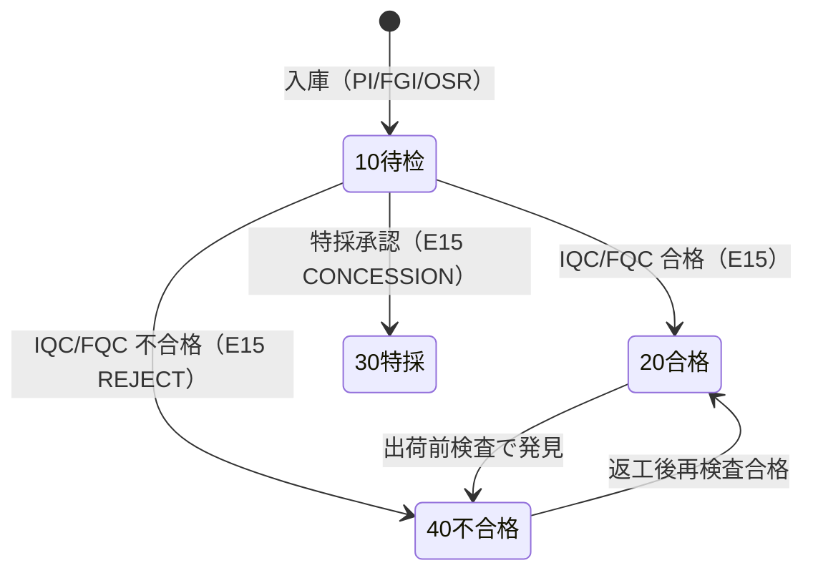
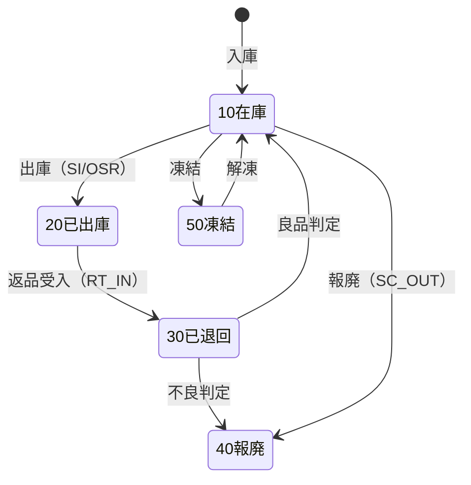

# 批次・序列号・库存状态 详细设计书（ロット・シリアル・在庫ステータス 詳細設計書）

| 項目 | 内容 |
|---|---|
| 文書名 | 批次・序列号・库存状态 详细设计书（ロット・シリアル・在庫ステータス 詳細設計書） |
| 文書番号 | DSN-INV-004 |
| 版数 | v1.0 |
| 作成日 | 2026-10-20 |
| 作成者 | inventory-designer |
| 承認者 | 未承認（レビュー待ち） |
| 状態 | ドラフト（レビュー中） |
| 関連文書 | [業務域概要](00-overview.md) / [入出庫](02-inbound-outbound.md) / [調撥・棚卸](03-transfer-count.md) / [原価](05-costing.md) / [DB 設計](90-db-design.md) / [跨域流程](../00-common/09-cross-domain-flow.md) / [代码一览](../00-common/06-code-list.md) |

---

## 1. 機能概要

### 1.1 対象機能

| 機能 ID | 機能名 | 概要 | 画面 ID | 優先度 |
|---|---|---|---|---|
| F-INV-011 | 批次管理 | 批号规则・批次主档・批次追溯（前向/後向）・有效期预警 | SCR-INV-016、SCR-INV-017 | P0 |
| F-INV-012 | 序列号管理 | 序列号採番・全生命周期（入庫/出庫/返品/報廃/凍結）・個体追溯 | SCR-INV-018 | P1 |
| F-INV-014 | 库存状态转换 | 待检/可用/冻结/不合格/报废待处理の状態間移動（`ST_OUT`+`ST_IN` の対） | SCR-INV-019 | P0 |

### 1.2 管理対象の決定

| 項目 | 判定 | データソース |
|---|---|---|
| 批次管理 | `mdm_material.is_batch_managed = true` | 物料マスタ（MDM） |
| 序列号管理 | `mdm_material.is_serial_managed = true` | 同上 |
| 有效期管理 | `mdm_material.shelf_life_days IS NOT NULL` かつ `is_batch_managed = true` | 同上 |
| 状態管理 | 全物料（在庫状態は必須） | 本域 |

> 批次管理と序列号管理は**同時指定可**（[90-data/demo-company.md](../90-data/demo-company.md) §3.3：成品电机＝批次＋序列号管理）。同時管理の場合、序列号は必ず批次に紐づき（`inv_serial.batch_id`）、原価は批次の移動平均、個体識別は序列号で行う。序列号と批次の不整合は `MSG-INV-009` で拒否する。

---

## 2. 業務要件・業務ルール

### 2.1 前提条件

| # | 前提条件 | 成立しない場合の挙動 |
|---|---|---|
| 1 | 物料マスタの批次/序列号/保质期フラグが正しく設定済 | 入出庫時に `MSG-INV-005`/`MSG-INV-010` で検出 |
| 2 | 批次は `(company_id, material_id, batch_no)` で一意 | 重複時 `MSG-INV-013` |
| 3 | 批次を持つ在庫の状態変換・出庫は批次単位 | — |
| 4 | 状態変換は本域の権限と承認を得ている | `403`/`MSG-INV-012` |
| 5 | 序列号は `(company_id, serial_no)` で一意 | 重複時 `MSG-INV-008` |

### 2.2 批次の業務ルール

| # | ルール | 根拠 | 関連項目 |
|---|---|---|---|
| BR-BT-01 | **批号規則**：`{YYMMDD}{種別 1 桁}{3 桁流水}`（計 10 桁、英数字大文字）。種別：`P`=采购批次、`M`=制造批次、`O`=期初/其他。例：`261020P001`【示例値】 | 本域定義（[00-overview](00-overview.md) 2.1、Lead 裁決 2026-10-20） | `batch_no` |
| BR-BT-02 | 采购批次は**供应商批号を優先**する。供应商批号が空の場合は BR-BT-01 で自動採番。供应商批号が同一物料内で既存と重複する場合は `-01`、`-02` の枝番を付与する。供应商批号の推奨形式は BN-LOT（`{仕入先コード}-{YYYYMMDD}-{2 位}`、例 `S000001-20261020-01`） | 本設計、[90-data/code-lists/batch-number-rule.csv](../90-data/code-lists/batch-number-rule.csv) | `supplier_batch_no` |
| BR-BT-03 | 批号は**一度使用したら変更禁止**。誤りは取消（在庫ゼロ時のみ）→ 新規批番で再登録 | [08 §13.1](../00-common/08-common-business-rules.md) | — |
| BR-BT-04 | 批次属性：種別、供应商批号、入荷日、製造日、有効期限、QC 状態、原産国（任意）、初回入庫事務 | 本設計 | `inv_batch` |
| BR-BT-05 | 有効期限は `shelf_life_days` から `製造日（または入荷日）+ shelf_life_days − 1 日` で算出する。製造日が無い場合は入荷日を基準とする | [08 §5 相当](../00-common/08-common-business-rules.md) | `expiry_date` |
| BR-BT-06 | **批次追溯**は「仕入先 → 受入 → 入庫 → 領料 → 製造 → 完成品入庫 → 出荷 → 顧客」の全リンクを保持する。`inv_batch_genealogy`（父批次→子批次）と `inv_stock_txn_line`（入出庫事実）で実現する | [09 §8](../00-common/09-cross-domain-flow.md) | `genealogy` |
| BR-BT-06a | **所有権**：批次系譜の主データは INV（`inv_batch_genealogy`）。PRD は製造事実（工単・工序・設備）を保持し、追溯画面は INV の系譜と結合する（[09 §8](../00-common/09-cross-domain-flow.md) の責任分界追補を Lead に提案、REV-007） | 本設計 | `inv_batch_genealogy` |
| BR-BT-07 | 批次の**分割・統合は禁止**。物理的に分ける場合は新批次を採番する（調撥・状態変換は同一批次を維持） | 本設計 | — |
| BR-BT-08 | 批次の自動選択順：**FEFO**（有効期限昇順）→ **FIFO**（初回入庫日昇順）→ 批番昇順。有效期管理の無い物料は FIFO。`sys_param.inv_picking_rule` で既定を変更可 | 本設計 | `picking_rule` |
| BR-BT-09 | 有効期限切れ批次は**出庫不可**（`MSG-INV-015`）。ただし「期限切れ在庫の報廃」は許可する（`SC_OUT`） | [08 §6](../00-common/08-common-business-rules.md) | `expired` |
| BR-BT-10 | 效期预警：`expiry_date − 当日 ≤ 预警日数`（既定 30 日、`sys_param.inv_expiry_warn_days`）で日次通知。既に期限切れは別区分（赤）で通知 | 本設計 | `warn_days` |
| BR-BT-11 | 批次 QC 状態（`10 待检/20 合格/30 特採/40 不合格`）は E15（検査判定）で更新し、在庫状態と同期する（待检→可用/不合格） | [09 §8](../00-common/09-cross-domain-flow.md) | `qc_status` |
| BR-BT-12 | 批次に在庫が残っている限り `batch_status=10 有効`。残高 0 かつ後続入庫予定なしで `40 枯渇` に更新（日次バッチ） | 本設計 | `batch_status` |

### 2.3 序列号の業務ルール

| # | ルール | 根拠 | 関連項目 |
|---|---|---|---|
| BR-SN-01 | **序列号規則**：成品电机は `{YYMMDD}{机座号 3 桁}{4 位流水}`（例 `2610201000001`、機座号 `100`＝YE3-100）。その他の序列号管理品は `{物料编码 10 桁}-{YYMMDD}-{4 位流水}`。流水は物料×日次【示例値】 | 本域定義（[90-data/code-lists/batch-number-rule.csv](../90-data/code-lists/batch-number-rule.csv) BN-SN と一致） | `serial_no` |
| BR-SN-02 | 供应商が個体番号を持つ場合、`external_serial_no` に保存する。`mdm_material.serial_rule_code='SUPPLIER'` の場合は外部番号を主番号とする | 本設計 | `external_serial_no` |
| BR-SN-03 | 序列号管理物料は**1 明細行 = 1 序列号 = 数量 1**。入出庫・棚卸・状態変換すべてに適用する。批次管理を兼ねる場合は `inv_serial.batch_id` に批次を設定し、明細行の批次と一致させる | 本設計 | `qty=1`、`batch_id` |
| BR-SN-04 | 序列号状態：`10 在庫`（可用）/`20 已出庫`（顧客）/`30 已退回`（返品受入）/`40 報廃`/`50 凍結`。状態は全ライフサイクルで履歴を保持する | 本設計 | `serial_status` |
| BR-SN-05 | 同一序列号の二重入庫・二重出庫は禁止（`inv_serial.status` で検証）。`10 在庫` のみ出庫可、`20 已出庫` のみ返品可 | 本設計 | — |
| BR-SN-06 | 序列号の**再入庫（返品）**：`20 已出庫` → `30 已退回` → 良品は `10 在庫`、不良は `40 報廃` とし、履歴に `inv_serial_txn` を追記する | 本設計 | `inv_serial_txn` |
| BR-SN-07 | 序列号の**属性**：製造日、出荷日、顧客（出荷時スナップショット）、製造指図、保証期限（任意）を保持し、個体追溯に応える | 本設計 | `inv_serial` |
| BR-SN-08 | 序列号単価は批次同様に移動平均（同一 倉庫×物料×批次）。個体別原価は保持しない（Phase 2 で個別原価を検討） | [05](05-costing.md) | — |
| BR-SN-09 | 成品电机など批次・序列号の両管理品は、入出庫時に**序列号と批次の組み合わせ**を検証する。序列号が指定批次に属さない場合は拒否（`MSG-INV-009`） | 本設計 | `serial_no`+`batch_no` |

### 2.4 库存状态转换の業務ルール

| # | ルール | 根拠 | 関連項目 |
|---|---|---|---|
| BR-ST-01 | 在庫状態は `10 待检 / 20 可用 / 30 冻结 / 40 不合格 / 50 报废待处理`。[00-overview](00-overview.md) 2.2 が唯一の定義 | [00-overview](00-overview.md) | `stock_status` |
| BR-ST-02 | 状態変換は **`ST_OUT`（転出）+ `ST_IN`（転入）を同一 DB トランザクションで生成**し、`pair_key`（UUID）で関連付ける。数量の純増減は 0 | Lead 裁決 2026-10-20、[09 §7.1](../00-common/09-cross-domain-flow.md) | `pair_key` |
| BR-ST-03 | 状態変換の**金額は再計算しない**：`ST_IN.amount = ST_OUT.amount`（同一 `unit_cost` を引継）。端数差を出さないため、金額は `ST_OUT` で確定した金額をそのまま転入行へコピーする | 本設計 | `amount` |
| BR-ST-04 | 許可される変換は下記マトリクスに限定する。マトリクス外は `MSG-INV-012` | 本設計 | 変換マトリクス |
| BR-ST-05 | 変換**理由**と**根拠文書**（検査判定番号・NCR 番号・棚卸番号等）を必須とする。手動変換は理由 5 文字以上 | 本設計 | `reason`、`source_type/id` |
| BR-ST-06 | **承認**：`10→40 不合格`・`10/20/40→50 報廃` は [08 §8.1](../00-common/08-common-business-rules.md) の追補に従い **品質主管 → 倉庫主管（順送）**。`30→20 解凍`・`40→20 返工合格`・`20→30 凍結`・`10→20`（IQC/FQC 合格・E15 判定）は在庫側の追加承認不要（解凍・返工は本域運用で WF 承認可）【示例值】 | [08 §8.1](../00-common/08-common-business-rules.md) | `approval` |
| BR-ST-07 | 引当（`qty_reserved > 0`）のある残高行は**凍結・状態転出を禁止**する。先に予約を解除する | 本設計 | `qty_reserved` |
| BR-ST-08 | 状態変換は**期間 OPEN** かつ**遡及禁止**。数量は残高行の `qty_on_hand` 以内 | [08 §6.1](../00-common/08-common-business-rules.md) | `txn_date` |
| BR-ST-09 | 変換後の可用量は [00-overview](00-overview.md) 2.3 の算式で再計算される（状態行の移動のみで、現存総量は不変） | 本設計 | `available_qty` |
| BR-ST-10 | 状態変換の E18 は `txnType='ST_OUT'` と `'ST_IN'` の 2 件を発行し、payload に `pairKey`・`fromStatus`・`toStatus` を含める（FIN は仕訳を起票しない） | [09 §7.1](../00-common/09-cross-domain-flow.md) | E18 |
| BR-ST-11 | `SC_IN`（報廃転入）は [09 §7.1](../00-common/09-cross-domain-flow.md) のコードを**予約**し、状態移動は `ST_OUT`+`ST_IN` の対で行う。物理除却は `SC_OUT`（[02](02-inbound-outbound.md) 2.5 注記・未決 #2） | 本設計 | `SC_IN` |
| BR-ST-12 | E15（検査判定）の在庫変換は次の写像で行う：`resultCode` 20 合格→PASS、30 特採→CONCESSION、40 不合格・50 廃棄→REJECT。PASS/CONCESSION は `ST_OUT(10)`+`ST_IN(20)`、REJECT は `ST_OUT(10)`+`ST_IN(40)`。`warehouseId`+`lines[].batchNo` で残高行を特定し、E14/E24 未過账時は `inv_event_wait` に保留する（[02](02-inbound-outbound.md) §2.8） | [09 §8](../00-common/09-cross-domain-flow.md) | `stock_status`、`inv_event_wait` |

### 2.5 状態変換マトリクス

| From \ To | 10 待检 | 20 可用 | 30 冻结 | 40 不合格 | 50 报废待処理 |
|---|---|---|---|---|---|
| **10 待检** | — | ○ IQC/FQC 合格・特採（E15） | ○ 検討保留（主管） | ○ IQC 不合格（E15） | ○ IQC 拒収→報廃（承認） |
| **20 可用** | 不可（再検査は不可） | — | ○ 凍結（主管承認） | ○ 品質判定（质检員） | ○ 报废決定（承認） |
| **30 冻结** | 不可 | ○ 解凍（承認） | — | ○ 品質判定（质检員） | ○ 报废決定（承認） |
| **40 不合格** | 不可 | ○ 返工完了・再検査合格（质检員、承認） | ○ 再検査待ち凍結（主管） | — | ○ 报废決定（承認） |
| **50 报废待処理** | 不可 | 不可 | 不可 | 不可 | — （`SC_OUT` で出庫のみ） |

> 「不可」の変換は `MSG-INV-012` で拒否する。`50 报废待処理` は終端状態であり、出庫（`SC_OUT`）以外の操作はできない。

**E15（検査判定）による変換の実行ルール**：[02](02-inbound-outbound.md) §2.8 の resultCode 写像に従う。`PASS`/`CONCESSION` は `10 待检`→`20 可用`、`REJECT` は `10 待检`→`40 不合格`。E15 が E14/E24 より先着した場合は `inv_event_wait` に保留し、対象伝票の過账と同一トランザクションで適用する。

### 2.6 状態遷移図

**批次 QC 状態（`inv_batch.qc_status`）**

> 批次 QC 状態のコード体系（10 待検/20 合格/30 特採/40 不合格）は**在庫状態とは別体系**である（在庫状態は 10 待検/20 可用/30 凍結/40 不合格/50 報廃待処理）。E15 の 
esultCode は在庫状態と批次 qc_status の両方へ写像する。



**序列号状態（`inv_serial.serial_status`）**



---

## 3. 関連機能

| 関係 | 機能 ID | 機能名 | 関係内容 |
|---|---|---|---|
| 上流 | F-INV-002〜008 | 入出庫 | 批次/序列号の発生・消費 |
| 上流 | — | E15 品質判定 | QC 状態・在庫状態の更新トリガ |
| 下流 | F-INV-011 | 批次追溯 | 前向/後向追溯 |
| 下流 | F-INV-021 | 报表 | 批次別在庫・有效期レポート |
| 参照 | F-MDM-001 | 物料 | 批次/序列号/保质期フラグ |
| 参照 | F-MDM-017 | 条码规则 | 批次/序列号バーコードのラベル形式 |

---

## 4. 画面設計

### 4.1 画面一覧

| 画面 ID | 画面名 | 類型 | 概要 |
|---|---|---|---|
| SCR-INV-016 | 批次追溯照会 | 一覧検索 | 批次の前向（仕入先→顧客）/後向（顧客→仕入先）追溯、系譜表示 |
| SCR-INV-017 | 批次效期预警 | 一覧検索 | 有效期切れ・期限間近の批次一覧、在庫数量・金額 |
| SCR-INV-018 | 序列号照会 | 一覧検索 | 序列号の状態・履歴・顧客・製造指図 |
| SCR-INV-019 | 库存状态转换 | 登録編集 | 状態変換（変換マトリクス・承認・根拠文書） |

### 4.2 画面項目定義（SCR-INV-016 批次追溯照会）

| No | 項目 ID | 項目名 | 種別 | 型/桁 | 必須 | 初期値 | 入力チェック | DB 項目 | 備考 |
|---|---|---|---|---|---|---|---|---|---|
| 1 | `batchNo` | 批次号 | テキスト | VARCHAR(64) | ○ | 空 | 存在 | `inv_batch.batch_no` | または物料+批次選択 |
| 2 | `materialId` | 物料 | マスタ選択 | BIGINT | △ | 空 | 存在 | `inv_batch.material_id` | 批次未指定時は必須 |
| 3 | `traceDirection` | 追溯方向 | ラジオ | SMALLINT | ○ | 1 | 1=前向/2=後向 | — | 前向：仕入先→顧客、後向：顧客→仕入先 |
| 4 | `maxDepth` | 最大深度 | 数値 | INT | — | 5 | 1〜10 | — | 多階製造の探索深度 |

**追溯表示（タイムライン + 系譜）**

| 区分 | 表示内容 | データソース |
|---|---|---|
| ① 受入 | 仕入先、受入日、収貨単番号、供应商批号、数量 | `inv_stock_txn_line`（PI）+ `pur_receipt` 参照 |
| ② 入庫 | 入庫日、倉庫、数量、QC 結果 | `inv_stock_txn_line`（PI）+ `inv_batch.qc_status` |
| ③ 領料/消費 | 工単番号、消費数量、消費日、製品 | `inv_stock_txn_line`（MII/OSI）+ `inv_batch_genealogy` |
| ④ 製造 | 工単、作業完了日、良品数 | `prd_work_order` 参照 + genealogy |
| ⑤ 完成品入庫 | 子批次号、入庫日、数量 | `inv_batch_genealogy.child_batch_id` |
| ⑥ 出荷 | 出荷日、出荷単番号、顧客、数量 | `inv_stock_txn_line`（SI）+ `sal_delivery` 参照 |
| ⑦ 顧客 | 顧客コード・名称（スナップショット） | `inv_stock_txn.partner_name` |
| ⑧ 返品 | 返品日、返品単番号、数量、状態 | `inv_stock_txn_line`（RT_IN） |

### 4.3 画面項目定義（SCR-INV-019 库存状态转换）

#### 4.3.1 ヘッダ

| No | 項目 ID | 項目名 | 種別 | 型/桁 | 必須 | 初期値 | 入力チェック | DB 項目 | 備考 |
|---|---|---|---|---|---|---|---|---|---|
| 1 | `conversionNo` | 変換番号（内部） | テキスト | VARCHAR(32) | ○ | 自動（`ST{YYMMDD}{4}` 内部番号） | — | `inv_stock_txn.txn_no` | 業務单据番号ではない（[未決](#13-未決事項)） |
| 2 | `conversionDate` | 変換日 | 日付 | DATE | ○ | 当日 | 期間 OPEN、遡及禁止 | `txn_date` | — |
| 3 | `warehouseId` | 倉庫 | 選択 | BIGINT | ○ | 既定倉庫 | 有効・範囲内 | `warehouse_id` | — |
| 4 | `sourceType` | 根拠種別 | 選択 | VARCHAR(32) | ○ | `MANUAL` | 固定値（`MANUAL`/`INSPECTION`/`NCR`/`STOCKTAKE`/`SCRAP_DECISION`） | `source_type` | — |
| 5 | `sourceNo` | 根拠文書番号 | テキスト | VARCHAR(32) | △ | 空 | 根拠種別 ≠ MANUAL は必須 | `source_no` | 検査番号・NCR 番号等 |
| 6 | `reason` | 変換理由 | テキスト | VARCHAR(200) | ○ | 空 | 5 文字以上 | `remark` | — |
| 7 | `applyScope` | 適用範囲 | ラジオ | SMALLINT | ○ | 1 | 1=一括/2=個別 | — | 同一批次の複数状態行を一括変換可 |

#### 4.3.2 明細

| No | 項目 ID | 項目名 | 種別 | 型/桁 | 必須 | 初期値 | 入力チェック | DB 項目 |
|---|---|---|---|---|---|---|---|---|
| 1 | `materialCode` | 物料コード | マスタ選択 | VARCHAR(10) | ○ | 空 | 存在・有効 | `material_id` |
| 2 | `batchNo` | 批次号 | テキスト | VARCHAR(64) | △ | 空 | 批次管理時必須・存在 | `batch_id/batch_no` |
| 3 | `serialNo` | 序列号 | テキスト | VARCHAR(64) | △ | 空 | 序列号管理時必須（数量 1） | `serial_no` |
| 4 | `fromStatus` | 変換元状態 | 選択 | SMALLINT | ○ | 空 | マトリクスに存在する from | `from_status` |
| 5 | `toStatus` | 変換先状態 | 選択 | SMALLINT | ○ | 空 | マトリクスに存在する to | `to_status` |
| 6 | `qty` | 変換数量 | 数値 | NUMERIC(18,4) | ○ | 0 | > 0、`≤ qty_on_hand − qty_reserved` | `qty` |
| 7 | `unitCost` | 単価 | 表示 | NUMERIC(18,6) | — | 現在平均 | — | `unit_cost` |
| 8 | `locationCode` | 庫位 | 選択 | VARCHAR(32) | △ | 空 | 倉庫に属する | `location_id` |

#### 4.3.3 イベント処理

| No | イベント | トリガ | 処理内容 | 呼出 API | 画面遷移 | エラー時 |
|---|---|---|---|---|---|---|
| 1 | 根拠種別変更 | `sourceType` 変更 | MANUAL 以外で根拠文書の検索欄を表示 | — | — | — |
| 2 | 物料・批次選択 | 明細セル | 残高行（状態別）を取得し、変換可能状態を絞込 | `GET /api/inventory/stock-balances` | — | `MSG-INV-006` |
| 3 | 変換元変更 | `fromStatus` 変更 | 変換先の選択肢をマトリクスから導出 | — | — | — |
| 4 | 保存・実行 | 「変換実行」 | 入力チェック → 承認要否判定 → 承認なしなら即時変換 | `POST /api/inventory/status-conversions` | 完了トースト | `MSG-INV-012/038` |
| 5 | 承認提出 | 「承認へ」 | 承認対象（解凍・返工・報廃決定）の WF 起票 | `POST /api/inventory/status-conversions/{id}/submit` | 承認待ち表示 | `MSG-COM-073` |

### 4.4 画面項目定義（SCR-INV-017 批次效期预警 / SCR-INV-018 序列号照会）

| 画面 | 検索条件 | 一覧列 | 行操作 |
|---|---|---|---|
| SCR-INV-017 | 倉庫、物料、有効期限範囲、警告区分（30/60/90 日・期限切れ）、在庫数量 > 0 | 物料、批次、有効期限、残日数、在庫数量、在庫金額、QC 状態、最終入出庫日 | 報廃申請（SC_OUT）、状態変換、批次追溯 |
| SCR-INV-018 | 序列号、物料、状態、顧客、製造指図番号、出荷日範囲 | 序列号、物料、状態、入庫日、出庫日、顧客、製造指図、製造日、保証期限 | 詳細（履歴タイムライン）、批次追溯 |

### 4.5 表示制御

| 条件 | 対象 | 制御 |
|---|---|---|
| 物料が非批次管理 | 批次項目 | 非表示 |
| 物料が非序列号管理 | 序列号項目 | 非表示 |
| 物料が批次・序列号両方管理（成品电机） | 批次・序列号項目 | 両方を表示し、出庫時に序列号と批次の整合を検証する |
| `qty_reserved > 0` の行 | 冻結・転出 | 選択不可（`MSG-INV-038`） |
| 変換が承認対象 | 実行ボタン | 「承認へ」に切替（即時実行不可） |
| `inventory:cost:view` なし | 単価・金額 | 非表示 |
| 过期批次 | 出庫可否 | 一覧に赤表示、出庫時は `MSG-INV-015` |

---

## 5. 入力チェック仕様

| No | チェック ID | 対象 | 種別 | 条件 | タイミング | メッセージ ID |
|---|---|---|---|---|---|---|
| 1 | CHK-INV-011-01 | 序列号・批次整合 | 相関 | 序列号管理物料は `inv_serial.batch_id` と明細行の `batch_id` が一致する | 入出庫・変換時 | `MSG-INV-009` |
| 2 | CHK-INV-011-02 | 批号形式 | 形式 | BR-BT-01 の形式（または供应商批号） | 登録時 | `MSG-INV-013` |
| 3 | CHK-INV-011-03 | 批次一意 | 一意 | `(material_id, batch_no)` で一意 | 登録時 | `MSG-INV-013` |
| 4 | CHK-INV-011-04 | 有効期限 | 相関 | 製造日/入荷日 ≤ 有効期限 | 登録時 | `MSG-INV-059` |
| 5 | CHK-INV-012-01 | 序列号一意 | 一意 | `serial_no` 全体で一意 | 登録時 | `MSG-INV-017` |
| 6 | CHK-INV-012-02 | 序列号状態 | 業務 | 入庫は `10 在庫`/`30 已退回` のみ、出庫は `10 在庫` のみ | 入出庫時 | `MSG-INV-018` |
| 7 | CHK-INV-014-01 | 変換マトリクス | 業務 | from→to がマトリクスに存在 | 実行時 | `MSG-INV-012` |
| 8 | CHK-INV-014-02 | 変換数量 | 業務 | `qty ≤ qty_on_hand − qty_reserved` | 実行時 | `MSG-INV-001`/`MSG-INV-038` |
| 9 | CHK-INV-014-03 | 引当 | 業務 | `qty_reserved > 0` の行は凍結・転出不可 | 実行時 | `MSG-INV-038` |
| 10 | CHK-INV-014-04 | 理由 | 必須 | 5 文字以上 | 実行時 | `MSG-COM-040` |
| 11 | CHK-INV-014-05 | 根拠文書 | 必須 | `sourceType ≠ MANUAL` は `sourceNo` 必須 | 実行時 | `MSG-COM-040` |
| 12 | CHK-INV-014-06 | 承認 | 業務 | 承認対象は承認済のみ実行 | 実行時 | `MSG-INV-012` |
| 13 | CHK-INV-014-07 | 期間・遡及 | 業務 | 期間 OPEN、`txn_date ≥ last_txn_date` | 実行時 | `MSG-INV-042`/`MSG-INV-025` |

---

## 6. 処理詳細

### 6.1 処理一覧

| 処理 ID | 処理名 | 契機 | トランザクション | 排他 |
|---|---|---|---|---|
| PRC-INV-011-01 | 批次採番・登録 | 入庫時（PI/FGI/OSR/RT_IN） | 要（入庫 TX 内） | `sys_sequence` 行ロック |
| PRC-INV-011-02 | 有効期限算出 | 批次登録時 | 不要 | — |
| PRC-INV-011-03 | 批次追溯照会 | 画面 | 不要 | — |
| PRC-INV-011-04 | 效期预警抽出 | BAT-INV-005 | 不要 | — |
| PRC-INV-012-01 | 序列号採番・登録 | 入庫時 | 要（入庫 TX 内） | `sys_sequence` 行ロック |
| PRC-INV-012-02 | 序列号状態更新 | 入出庫時 | 要（同一 TX） | 序列号行の楽観排他 |
| PRC-INV-014-01 | 状態変換（即時） | 画面/E15 | 要 | 残高行ロック（[02](02-inbound-outbound.md) 6.3） |
| PRC-INV-014-02 | 状態変換（承認後） | WF コールバック | 要 | 同上 |

### 6.2 処理手順（正常系）

**PRC-INV-011-01 批次採番・登録**

1. 入庫トランザクション内で、批次管理物料かつ批次未指定の明細について採番する。
2. 供应商批号があればそれを使用する（大文字化・前後空白トリム）。同一物料で既存なら `-01`、`-02` を付与する。
3. 供应商批号が無ければ `sys_sequence` のキー `INV_BATCH_{materialId}_{type}`（日次）から 3 桁流水を取得し、`{YYMMDD}{type}{3 桁}` を生成する（BR-BT-01）。
4. `inv_batch` を INSERT する（`material_id, batch_no, batch_type, supplier_id, supplier_batch_no, receipt_date, production_date, expiry_date, qc_status, batch_status, first_txn_id`）。
5. 有効期限を算出する（BR-BT-05）：`基準日 = production_date ?? receipt_date`、`expiry_date = 基準日 + shelf_life_days − 1`。`shelf_life_days` が NULL なら `expiry_date = NULL`。
6. `inv_stock_txn_line.batch_id/batch_no` を設定する。

**PRC-INV-011-03 批次追溯照会**

1. 起点批次を取得し、`inv_batch_genealogy` を再帰探索する（`maxDepth` まで）。
2. **前向追溯**：起点批次 → （`genealogy.parent_batch_id = 起点`）→ 子批次 → … → 最終製品批次。各子批次について `inv_stock_txn_line`（`txn_type='SI'`）から出荷実績と顧客を取得する。
3. **後向追溯**：最終製品批次 → （`genealogy.child_batch_id = 起点`）→ 親批次 → … → 原料批次。各親批次について `inv_stock_txn_line`（`txn_type='PI'`）から仕入先・受入日を取得する。
4. 各ノードに「イベント種別・日付・数量・倉庫・相手先」を付与し、タイムラインと系譜（Mermaid/ツリー）を返す。
5. 结果は最大 1,000 ノード。超過時は `MSG-COM-052`。

**PRC-INV-011-04 效期预警（BAT-INV-005）**

1. `inv_batch` のうち `expiry_date IS NOT NULL` かつ `batch_status = 10` を対象とする。
2. `expiry_date < 当日` → 「期限切れ」区分、`expiry_date − 当日 ≤ inv_expiry_warn_days`（既定 30 日）→ 「期限間近」区分。
3. 該当批次の在庫数量・金額（`inv_stock_balance` 合計）が 0 のものは除外する。
4. 通知（站内 + メール、[08 §13.3](../00-common/08-common-business-rules.md)）と `SCR-INV-017` 用データを生成する。
5. 同日重複通知は抑止する（通知キー = `date + batch_id + 区分`）。

**PRC-INV-012-01 序列号採番・登録**

1. 入庫トランザクション内で、序列号管理物料の明細（1 行 = 1 個）ごとに採番する。
2. `sys_sequence` のキー `INV_SERIAL_{materialId}`（日次）から 4 桁流水を取得し、`{materialCode}-{YYMMDD}-{4 桁}` を生成する（BR-SN-01）。
3. 外部序列号がある場合は `external_serial_no` に保存し、`serial_no_rule='SUPPLIER'` のときは外部番号を `serial_no` とする。
4. `inv_serial` を INSERT し（`serial_no, material_id, batch_id, serial_status=10, inbound_txn_id, inbound_date, manufacture_date, work_order_id`）、`inv_serial_txn` に履歴を INSERT する。

**PRC-INV-014-01 状態変換**

1. 変換マトリクス（2.5）を検証する。許可されない変換は `MSG-INV-012`。
2. 残高行を `(warehouse_id, material_id, batch_id, from_status, location_id)` の昇順でロックする（[02](02-inbound-outbound.md) 6.3 と同じ順序）。
3. `qty_on_hand ≥ qty`、`qty_reserved = 0`（凍結・転出の場合）を検証する。
4. 変換単価 = 同一（倉庫×物料×批次）の現在平均単価（6 桁）。金額 = `qty × 単価`（2 桁）。
5. `ST_OUT` を生成する：`from_status` 行の `qty_on_hand` を減算、`amount_on_hand` を減算、`direction=−1`、`qty=qty`、`amount=金額`。
6. `ST_IN` を生成する：`to_status` 行の `qty_on_hand` を加算、`amount_on_hand` を **`ST_OUT` と同額**加算（再計算しない、BR-ST-03）、`direction=+1`。
7. 両トランザクションに同一 `pair_key`（UUID）と `source_type/source_id/source_no`、`remark`（理由）を設定する。`txn_no` は根拠文書番号（無い場合は内部番号 `ST{YYMMDD}{4}`）。
8. E18 を 2 件（`ST_OUT`/`ST_IN`）発行する（payload に `pairKey`・`fromStatus`・`toStatus`）。
9. 承認対象の場合は `txn_status=20 承認待ち` で生成し、承認後に 5〜8 を実行する（承認前は在庫を更新しない）。
10. 監査ログ（STATUS_CHANGE）を理由・根拠付きで記録する。

**批次系譜（genealogy）の登録タイミング**

| 契機 | 親批次 | 子批次 | 関係 | 数量 |
|---|---|---|---|---|
| `MII`（生産領料） | 消費した原料批次 | （まだ無し） | `10 生産消費` 予約 | 消費数量 |
| `FGI`（完成品入庫） | 当該工単で `MII` 消費した全批次 | 完成品批次 | `10 生産消費` 確定 | 消費数量 |
| `OSR`（委外受入） | `OSI` で発料した批次 | 受入批次 | `10 生産消費`（委外） | 発料数量 |
| `AOI`（期初投入） | 無し | 新批次 | — | — |
| 返工 `FGI` | 返工前成品批次 | 返工後批次 | `40 返工` | 数量 |

> `MII` 時点では子批次が未確定のため `inv_batch_genealogy` には登録せず、`FGI` 過账時に `work_order_id` で `MII` 明細を集計して一括登録する。これにより「原料批次 → 製品批次」のリンクが確定する。

### 6.3 例外処理

| No | 異常条件 | 検知箇所 | 処理 | ロールバック | メッセージ ID |
|---|---|---|---|---|---|
| 1 | 批次重複 | 採番 | エラー | 全体 | `MSG-INV-013` |
| 2 | 有効期限不正 | 登録 | エラー | 全体 | `MSG-INV-059` |
| 3 | 序列号重複 | 登録 | エラー | 全体 | `MSG-INV-008`/`MSG-INV-017` |
| 4 | 序列号状態不正 | 入出庫 | エラー | 全体 | `MSG-INV-018` |
| 5 | 変換マトリクス外 | 変換 | エラー | — | `MSG-INV-012` |
| 6 | 引当済の凍結・転出 | 変換 | エラー | — | `MSG-INV-038` |
| 7 | 期限切れ批次の出庫 | 入出庫 | エラー | 全体 | `MSG-INV-015` |
| 8 | 序列号と批次の不整合 | 入出庫 | エラー | 全体 | `MSG-INV-009` |
| 9 | 追溯ノード数超過 | 追溯照会 | 条件追加を促す | — | `MSG-COM-052` |
| 10 | 承認前の変換実行 | 変換 | エラー | — | `MSG-INV-012` |

### 6.4 冪等性・再実行

- 批次・序列号採番は入庫トランザクション内で実行し、入庫失敗時はロールバック（番号は欠番許容）。
- 状態変換は `pair_key` の一意制約で二重実行を防止する。承認コールバックは `taskId + result` で冪等。
- 追溯照会は読み取りのみで冪等。

---

## 7. API 設計

### 7.1 API 一覧

| # | メソッド | パス | 権限 | 概要 |
|---|---|---|---|---|
| 1 | GET | `/api/inventory/batches` | `inventory:batch:view` | 批次一覧 |
| 2 | GET | `/api/inventory/batches/{id}` | `inventory:batch:view` | 批次詳細 |
| 3 | GET | `/api/inventory/batches/{id}/trace` | `inventory:batch:trace` | 批次追溯（前向/後向） |
| 4 | GET | `/api/inventory/batches/expiry-warnings` | `inventory:batch:view` | 效期预警一覧 |
| 5 | PATCH | `/api/inventory/batches/{id}` | `inventory:batch:view`（限定） | 批次の任意項目更新（QC 状態・原産国・remark のみ） |
| 6 | GET | `/api/inventory/serials` | `inventory:serial:view` | 序列号一覧 |
| 7 | GET | `/api/inventory/serials/{serialNo}` | `inventory:serial:view` | 序列号詳細 |
| 8 | GET | `/api/inventory/serials/{serialNo}/trace` | `inventory:serial:view` | 序列号履歴・追溯 |
| 9 | POST | `/api/inventory/status-conversions` | `inventory:status:change` | 状態変換（即時/承認提出） |
| 10 | POST | `/api/inventory/status-conversions/{id}/submit` | `inventory:status:change` | 承認提出 |
| 11 | GET | `/api/inventory/status-conversions` | `inventory:status:change` | 変換履歴 |

### 7.2 代表 API 詳細

#### 7.2.1 `GET /api/inventory/batches/{id}/trace?direction=FORWARD&maxDepth=5`

```json
{
  "code": 0,
  "message": "ok",
  "data": {
    "batchId": "1845000000000000201",
    "batchNo": "261020P001",
    "materialCode": "1001000001",
    "materialName": "冷轧无取向电工钢带",
    "direction": "FORWARD",
    "nodes": [
      {
        "level": 0,
        "nodeType": "INBOUND",
        "batchNo": "261020P001",
        "date": "2026-10-18",
        "docNo": "GRI2610180003",
        "partnerName": "常州某硅钢材料有限公司【示例值】",
        "qty": "500.0000",
        "uomCode": "KGM",
        "warehouseCode": "WH01"
      },
      {
        "level": 1,
        "nodeType": "ISSUE",
        "batchNo": "261020P001",
        "date": "2026-10-19",
        "docNo": "MII2610190001",
        "workOrderNo": "WO2610180001",
        "qty": "120.0000",
        "uomCode": "KGM"
      },
      {
        "level": 2,
        "nodeType": "PRODUCTION",
        "batchNo": "261020M001",
        "date": "2026-10-20",
        "docNo": "FGI2610200001",
        "workOrderNo": "WO2610180001",
        "qty": "40.0000",
        "uomCode": "PCE"
      },
      {
        "level": 3,
        "nodeType": "SHIPMENT",
        "batchNo": "261020M001",
        "date": "2026-10-21",
        "docNo": "SDO2610210001",
        "customerCode": "C000123",
        "customerName": "常州泵业有限公司【示例值】",
        "qty": "20.0000",
        "uomCode": "PCE"
      }
    ],
    "nodeCount": 4,
    "queriedAt": "2026-10-20T15:00:00+08:00"
  }
}
```

#### 7.2.2 `POST /api/inventory/status-conversions`

```json
{
  "conversionDate": "2026-10-20",
  "warehouseId": "1845000000000000001",
  "sourceType": "INSPECTION",
  "sourceNo": "IQC2610200001",
  "reason": "来料检验合格，转可用库存",
  "lines": [
    {
      "materialId": "1845000000000000101",
      "batchNo": "261020P001",
      "fromStatus": 10,
      "toStatus": 20,
      "qty": "500.0000"
    }
  ]
}
```

レスポンス：

```json
{
  "code": 0,
  "message": "ok",
  "data": {
    "pairKey": "9f1c2b3a-4d5e-6f70-8a9b-0c1d2e3f4a5b",
    "stOutTxnNo": "IQC2610200001",
    "stInTxnNo": "IQC2610200001",
    "convertedAt": "2026-10-20T14:35:00+08:00",
    "lines": [
      {
        "materialCode": "1001000001",
        "batchNo": "261020P001",
        "fromStatus": 10,
        "toStatus": 20,
        "qty": "500.0000",
        "unitCost": "5.500000",
        "amount": "2750.00"
      }
    ]
  }
}
```

エラー例（引当済の凍結）：

```json
{
  "code": 50038,
  "message": "该库存存在预留，不能冻结或转出，请先释放预留。",
  "data": null
}
```

---

## 8. データ更新仕様

| テーブル | 操作 | 更新項目 | 更新条件 | トリガ |
|---|---|---|---|---|
| `inv_batch` | INSERT | `batch_no, material_id, batch_type, supplier_id, supplier_batch_no, receipt_date, production_date, expiry_date, qc_status, batch_status, first_txn_id` | — | PRC-INV-011-01 |
| `inv_batch` | UPDATE | `qc_status, batch_status, last_txn_date, updated_at` | `id` | 状態変換・入出庫・日次バッチ |
| `inv_batch_genealogy` | INSERT | `parent_batch_id, child_batch_id, relation_type, source_txn_id, work_order_id, qty_consumed` | — | FGI/OSR 過账時 |
| `inv_serial` | INSERT/UPDATE | `serial_no, material_id, batch_id, serial_status, inbound_*, outbound_*, customer_id/name, work_order_id, manufacture_date, warranty_end_date` | `id` + `version` | PRC-INV-012-01/02 |
| `inv_serial_txn` | INSERT | `serial_id, txn_id, txn_line_id, txn_type, direction, status_before, status_after, txn_date, warehouse_id, batch_id, customer_id, work_order_id` | — | 入出庫・変換 |
| `inv_stock_txn` / `_line` | INSERT | `ST_OUT`/`ST_IN` の対 | — | PRC-INV-014-01/02 |
| `inv_stock_balance` | UPDATE | 状態行の数量・金額・`version` | ロックキー | 同上 |
| `sys_outbox_event` | INSERT | E18×2（ST_OUT/ST_IN） | 同一 TX | 同上 |
| `sys_audit_log` | INSERT | STATUS_CHANGE / BATCH_CREATE / SERIAL_CREATE | — | 各処理 |

---

## 9. エラー処理・メッセージ

| メッセージ ID | 種別 | 本文 | 発生条件 | 利用者への対処 |
|---|---|---|---|---|
| `MSG-INV-005` | E | 该物料启用批次管理，必须指定批次。 | 批次未指定 | 批次を指定 |
| `MSG-INV-006` | E | 批次 {0} 不存在或已失效。 | 批次不正 | 有効な批次を選択 |
| `MSG-INV-008` | E | 序列号 {0} 重复。 | 序列号重複 | 重複を除外 |
| `MSG-INV-009` | E | 序列号 {0} 不属于批次 {1}，请确认序列号与批次的对应关系。 | 序列号と批次の不整合 | 序列号/批次を確認 |
| `MSG-INV-010` | E | 该物料启用序列号管理，必须录入序列号。 | 序列号未入力 | 序列号を入力 |
| `MSG-INV-012` | E | 该记录当前状态不允许此操作。 | マトリクス外の変換・状態不正 | 状態を確認 |
| `MSG-INV-013` | E | 批次号 {0} 已存在。 | 批次重複 | 別の批番 |
| `MSG-INV-015` | E | 批次 {0} 已超过有效期（{1}），不能出库。 | 期限切れ出庫 | 有効批次を選択 |
| `MSG-INV-017` | E | 序列号 {0} 不存在或不属于该物料。 | 序列号不正 | 序列号を確認 |
| `MSG-INV-018` | E | 序列号 {0} 当前状态（{1}）不允许该操作。 | 状態不正 | 状態を確認 |
| `MSG-INV-038` | E | 该库存存在预留，不能冻结或转出，请先释放预留。 | 引当済の凍結・転出 | 予約解除後に実行 |
| `MSG-INV-059` | E | 有效期的日期不合法（基准日 {0}、有效期 {1}）。 | 有効期限不正 | 日付を修正 |
| `MSG-COM-040` | E | 请输入必填项「{0}」。 | 理由・根拠未入力 | 入力 |
| `MSG-COM-052` | E | 查询条件过于宽泛，请增加筛选条件。 | 追溯ノード超過 | 条件追加 |

---

## 10. 権限・セキュリティ

| 種別 | 内容 |
|---|---|
| 画面権限 | `inventory:batch:view/trace`、`inventory:serial:view`、`inventory:status:change` |
| 操作権限 | 状態変換は `inventory:status:change`。凍結解除・返工合格・報廃決定は WF 承認も必要 |
| 項目権限 | 原価・金額は `inventory:cost:view` |
| データ範囲 | 倉庫範囲を強制適用 |
| 監査ログ | 状態変換（理由・根拠・前後状態）、批次手動修正、序列号状態変更を記録 |
| 参照連携 | 検査番号・NCR 番号は PRD 域の参照権限に従う（権限なしはリンク非表示） |

---

## 11. 性能・非機能

| 項目 | 目標値 | 前提 |
|---|---|---|
| 批次一覧（100 件） | 2 秒以内 | `inv_batch(material_id, batch_no)` 索引 |
| 批次追溯（深度 5、100 ノード） | 3 秒以内 | `inv_batch_genealogy` の両方向索引 |
| 效期预警（1,000 件） | 5 秒以内 | `inv_batch(expiry_date, batch_status)` 索引 |
| 状態変換（1 行） | 500ms 以内 | 残高行ロック |
| 序列号照会（単一） | 1 秒以内 | `inv_serial(serial_no)` 一意索引 |

---

## 12. テスト観点

| No | 観点 ID | 分類 | 観点 | 期待結果 |
|---|---|---|---|---|
| 1 | TST-F-INV-011-01 | 正常系 | 采购批の自動採番 | `261020P001` 形式で採番、批次マスタ作成 |
| 2 | TST-F-INV-011-02 | 正常系 | 供应商批号優先 | 供应商批号が採用され、重複時は枝番 |
| 3 | TST-F-INV-011-03 | 正常系 | 有効期限算出 | `入荷日 + shelf_life_days − 1` と一致 |
| 4 | TST-F-INV-011-04 | 正常系 | 前向追溯（原料→製品→顧客） | リンクが途切れず、顧客まで表示 |
| 5 | TST-F-INV-011-05 | 正常系 | 後向追溯（顧客→原料→仕入先） | 仕入先・受入日まで表示 |
| 6 | TST-F-INV-011-06 | 異常系 | 批次重複登録 | `MSG-INV-013` |
| 7 | TST-F-INV-011-07 | 異常系 | 期限切れ批次の出庫 | `MSG-INV-015` |
| 8 | TST-F-INV-011-08 | 境界値 | 有効期限当日 | 出庫可（期限日は有効） |
| 9 | TST-F-INV-012-01 | 正常系 | 序列号入庫→出庫→返品→再入庫 | 状態が `10→20→30→10` と遷移、履歴保持 |
| 10 | TST-F-INV-012-02 | 異常系 | 同一序列号の二重入庫 | `MSG-INV-017`/`MSG-INV-018` |
| 11 | TST-F-INV-012-03 | 境界値 | 序列号数と数量不一致 | `MSG-INV-007` |
| 12 | TST-F-INV-014-01 | 正常系 | 待检→可用（IQC 合格） | ST_OUT/ST_IN 対生成、可用量増加、現存総量不変 |
| 13 | TST-F-INV-014-02 | 正常系 | 可用→凍結→解凍（承認付き） | 承認前は在庫不変、承認後変換 |
| 14 | TST-F-INV-014-03 | 異常系 | マトリクス外（50→10） | `MSG-INV-012` |
| 15 | TST-F-INV-014-04 | 異常系 | 引当済在庫の凍結 | `MSG-INV-038` |
| 16 | TST-F-INV-014-05 | 整合 | 状態変換前後の在庫金額合計 | 金額保存則（Σ金額不変） |
| 17 | TST-F-INV-014-06 | 排他 | 同一行の同時変換 | 片方成功、他方は `MSG-INV-001`/`MSG-COM-033` |

---

## 13. 未決事項

| # | 事項 | 理由 | 暫定仕様 | 担当 | 期限 |
|---|---|---|---|---|---|
| 1 | （**已裁决**）状態変換の「内部変換番号」 | Lead 裁決（2026-10-20）：`ST{YYMMDD}{4}` を**域内管理番号**として使用可。**業務伝票番号ではなく、対外单据には使用しない**（[08 §2.1](../00-common/08-common-business-rules.md) 注記済） | 実施済：SCR-INV-019 の `conversionNo` と `inv_stock_txn.txn_no` に使用 | Lead / inventory-designer | 完了 2026-10-20 |
| 2 | （**已追補 08 §8.1**）状態変換の承認マトリクス | [08 §8.1](../00-common/08-common-business-rules.md) に 2026-10-20 追補済（待検→不合格/報廃＝品質主管 → 倉庫主管） | BR-ST-06 に反映済。解凍・返工合格・凍結は本域運用として WF 承認可【示例值】 | Lead / inventory-designer | 完了 2026-10-20 |
| 3 | 序列号の個別原価 | 現状は批次/移動平均で原価計算し、個体別原価は保持しない | Phase 2 で個別原価・保証管理を検討。Phase 1 は履歴と顧客のみ保持 | inventory-designer / finance-designer | 2027-03-31 |
| 4 | 有效期管理の基準日 | 製造日基準か入荷日基準かで期限が変わる | 製造日があれば製造日、無ければ入荷日。`mdm_material.expiry_base`（Phase 2）で切替可 | inventory-designer / mdm-designer | 2026-11-15 |
| 5 | 多階 BOM の追溯深度上限 | 深い BOM（10 階以上）で性能劣化の懸念 | 既定 5 階、最大 10 階。超過は手動で段階追溯 | inventory-designer | 2026-11-30 |

---

## 14. 改訂履歴

| 版数 | 日付 | 変更内容 | 変更者 |
|---|---|---|---|
| v1.0 | 2026-10-20 | 初版：批次（批号規則・追溯・有效期）、序列号（採番・状態・履歴）、在庫状態変換（マトリクス・対事務・承認）、画面 4 件、API 11 件、系譜登録タイミング、テスト観点 | inventory-designer |
| v1.1 | 2026-10-20 | Lead 裁決（2026-10-20）を反映：批次＋序列号の同時管理可（成品电机）、序列号規則 BN-SN、BN-LOT、BR-ST-11（SC_IN 予約）、MSG-INV-009/059 整合 | inventory-designer |
| v1.2 | 2026-10-20 | 08 §8.1 追補を反映：BR-ST-06 の状態変換承認（待検→不合格/報廃＝品質主管→倉庫主管）を修正し、未決 #1（ST 内部番号・已裁决）/#2（承認・已追補）を更新 | inventory-designer |
| v1.3 | 2026-10-20 | 红队第 2 轮：在庫状態コード改訂（10=待検/20=可用）、BR-ST-01/06・変換マトリクス・E15 resultCode 写像、`inv_event_wait`・批次系譜の所有権（BR-BT-06a）追記 | inventory-designer |
