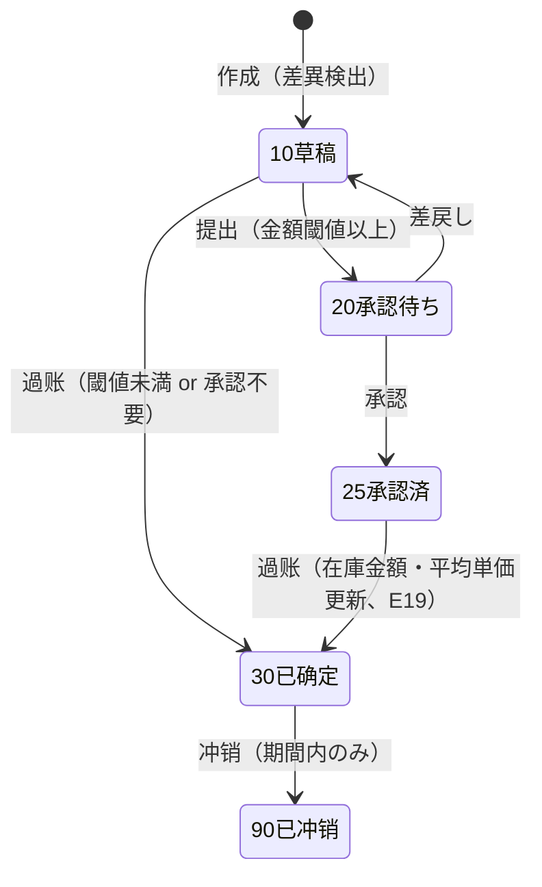

# 移动加权平均成本 详细设计书（移動加重平均原価 詳細設計書）

| 項目 | 内容 |
|---|---|
| 文書名 | 移动加权平均成本 详细设计书（移動加重平均原価 詳細設計書） |
| 文書番号 | DSN-INV-005 |
| 版数 | v1.0 |
| 作成日 | 2026-10-20 |
| 作成者 | inventory-designer |
| 承認者 | 未承認（レビュー待ち） |
| 状態 | ドラフト（レビュー中） |
| 関連文書 | [業務域概要](00-overview.md) / [入出庫](02-inbound-outbound.md) / [批次](04-batch-serial-status.md) / [DB 設計](90-db-design.md) / [共通业务规则 §6](../00-common/08-common-business-rules.md) / [跨域流程 §7](../00-common/09-cross-domain-flow.md) |

---

## 1. 機能概要

### 1.1 対象機能

| 項目 | 内容 |
|---|---|
| 機能 ID | F-INV-017 移动加权平均成本计算与重算 |
| 機能名 | 移动加权平均成本计算与重算 |
| 目的 | 在庫の数量と金額を常に整合させ、入庫原価の構成（采购价＋运费＋关税＋其他）、出庫原価、成本調整、期間再計算を一意に定義する。財務の仕訳（E18/E19）に原価を提供する |
| 利用者・ロール | 成本会计、会計、財務经理、倉庫主管（参照のみ） |
| 利用シーン | 入出庫過账時の自動原価計算、請求書価格差異の調整、月結前の原価確定、在庫評価額の確認 |
| 優先度 | P0 |
| 画面 ID | SCR-INV-022（成本查询）、SCR-INV-023（成本调整单） |
| 関連 IF | なし（FIN へは E18/E19 の領域事件で通知） |

### 1.2 適用範囲と原価計算単位

| 項目 | 決定 | 根拠 |
|---|---|---|
| 计价方法 | 移动加权平均法（Phase 1 唯一） | [08 §6.1](../00-common/08-common-business-rules.md) |
| **原価計算単位（cost group）** | **倉庫 × 物料 × 批次**（非批次管理物料は 倉庫 × 物料、`batch_id=0`） | [08 §6.1](../00-common/08-common-business-rules.md) の「`inv_stock_balance`（倉庫×物料×批次）に残高・金額・平均単価を保持」に従う。E19 の `batchNo` 項目とも整合 |
| 数量精度 | `NUMERIC(18,4)`（基本単位） | [01 §6.1](../00-common/01-common-item-definitions.md) |
| 金額精度 | `NUMERIC(18,2)`（CNY） | 同上 |
| 平均単価精度 | `NUMERIC(18,6)`（四捨五入 HALF_UP） | 同上 |
| 標準原価 | Phase 2（標準原価法・差異分析）。Phase 1 は移動平均のみ | [README](../README.md) 2.3 |
| 外貨 | Phase 1 は CNY のみ。外貨は Phase 2（レートは登録時スナップショット） | [06-code-list §3](../00-common/06-code-list.md) |

> **設計判断の記録**：原価計算単位を「倉庫×物料×批次」としたため、同一物料でも倉庫・批次が異なれば平均単価は独立する。これは ①批次別の原価把握（ロット原価）が製造業の要求であること、②E19 が `batchNo` を運ぶこと、③[08 §6.1] の残高定義と一致することを根拠とする。倉庫間・批次間の原価は移動平均の対象外であり、調撥は `TR_IN` で単価を引き継ぐ（[03](03-transfer-count.md) BR-TR-04）。

---

## 2. 業務要件・業務ルール

### 2.1 前提条件

| # | 前提条件 | 成立しない場合の挙動 |
|---|---|---|
| 1 | 対象期間が `20 OPEN`（`inv_period`） | `MSG-INV-042`/`MSG-COM-071` |
| 2 | 成本調整は対象期間が関账前、かつ後続期間に在庫取引が無い | `MSG-INV-038`（期間已关账） |
| 3 | 調整後の在庫金額が 0 以上 | `MSG-INV-037` |
| 4 | ユーザに `inventory:cost:view`/`inventory:cost:adjust`/`inventory:cost:approve`/`inventory:cost:recalc` がある | `403` |
| 5 | 原価計算に必要な入庫原価構成（采购价・运费・关税）が取得できている | 未取得時は暫定 0 で過账し、後日 `inv_cost_adjustment` で調整 |

### 2.2 業務ルール

| # | ルール | 根拠 | 関連項目 |
|---|---|---|---|
| BR-CS-01 | 入庫原価 = 采购单价（税抜）× 数量 + 运费分摊 + 关税分摊 + 其他可直接归属费用。按分基準は `inv_freight_alloc_base`（既定 `AMOUNT`、`QTY`/`WEIGHT` 可） | [08 §6.1](../00-common/08-common-business-rules.md) | `purchase_amount/freight_amount/duty_amount` |
| BR-CS-02 | 入庫後の平均単価 = `(旧Σ金額 + 入庫金額) ÷ (旧Σ数量 + 入庫数量)`、6 桁四捨五入 | 同上 | `avg_unit_cost` |
| BR-CS-03 | 出庫金額 = `出庫数量 × 出庫直前平均単価`、2 桁四捨五入。平均単価は**同一 cost group の全状態行の合計金額 ÷ 合計数量**から算出する（状態行ごとの丸め差を持ち込まない） | [08 §6.2](../00-common/08-common-business-rules.md) | `unit_cost/amount` |
| BR-CS-04 | **金額保存則**：`残高金額 = 旧金額 − 出庫金額`、`Σ成本層残額 = 残高金額`、`Σ事務金額 = 残高金額`（[BAT-INV-002](92-report-batch-design.md) で日次検証） | 本設計 | — |
| BR-CS-05 | 全量出庫（残数量 0）時は**残金額も 0** にする（最終出庫で端数調整）。逆に全量戻入時は元金額を復元する | 本設計 | CALC-05 |
| BR-CS-06 | 成本調整は**数量を変えず金額のみ**を更新する。したがって `inv_stock_txn` を生成せず、`inv_cost_adjustment` と `inv_cost_layer` のみ更新し、E19 を発行する | [09 §7.1](../00-common/09-cross-domain-flow.md)（在庫取引種別に原価調整が無いことの帰結） | `inv_cost_adjustment` |
| BR-CS-07 | 請求書価格と暫估価格の差異は、**残存数量分を在庫金額**へ、**既出庫分を当期の売上原価/製造原価**へ配分する（[08 §6.4](../00-common/08-common-business-rules.md)）。配分比 = `既出庫数量 ÷ 対象入庫数量` | [08 §6.4](../00-common/08-common-business-rules.md) | CALC-08 |
| BR-CS-08 | 成本調整後も在庫金額が負になる場合は**調整自体を拒否**（手動調査） | [08 §6.4](../00-common/08-common-business-rules.md) | `MSG-INV-037` |
| BR-CS-09 | 成本調整は**期間関账前のみ**。関账後は翌期間の調整（翌期費用処理）となる | 同上 | `MSG-INV-038` |
| BR-CS-10 | 完工品（`FGI`）の原価は FIN の完工原価（E24 `unitCost`）。未確定時は暫定単価で入庫し、確定後に `inv_cost_adjustment` で調整する | [09 §6.2](../00-common/09-cross-domain-flow.md) | `FGI` |
| BR-CS-11 | 委外受入（`OSR`）の原価 = 材料成本（`OSI` 発料原価の按分）+ 加工費（`processingFee` 按分） | [09 §7.1](../00-common/09-cross-domain-flow.md) | `OSR` |
| BR-CS-12 | 調撥（`TR_IN`）は `TR_OUT` の単価を引き継ぎ、**再計算しない**（金額保存則の維持） | [03](03-transfer-count.md) BR-TR-04 | `TR_IN` |
| BR-CS-13 | 棚卸差異（`ADJ_IN`/`ADJ_OUT`）の原価は**調整実行時点の現在平均単価** | [08 §7](../00-common/08-common-business-rules.md) | `ADJ_*` |
| BR-CS-14 | 状態変換（`ST_IN`/`ST_OUT`）は金額を再計算しない（転出金額をそのまま転入） | [04](04-batch-serial-status.md) BR-ST-03 | `ST_*` |
| BR-CS-15 | 原価が変動した全イベント（入庫・出庫・調整）で E18 を、平均単価・原価調整の確定時に E19 を発行する | [09 §3](../00-common/09-cross-domain-flow.md) | E18/E19 |
| BR-CS-16 | 出庫原価の単価は**ロック取得後の最新平均**を用いる（同時入庫があれば反映後の単価）。したがって E10 の `costAmount` が参考値でも、本域の計算結果を正とする | [09 §2.2](../00-common/09-cross-domain-flow.md) | — |
| BR-CS-17 | 期間再計算（重新计价）は**実行可能条件**（②後続期間未使用、③未過账事務なし、④未処理イベントなし）を満たす場合のみ実行でき、実行結果（差異明細）を保存する | 本設計 | `recalc` |
| BR-CS-18 | 原価は 6 桁で保持し、表示は 2〜6 桁（[01 §6.3](../00-common/01-common-item-definitions.md)）。**内部計算では丸めを最終段のみ**に適用し、途中で丸めない（`NUMERIC` のまま計算） | 本設計 | — |

### 2.3 計算式・判定式

| # | 対象 | 算式 | 丸め | 例（硅钢片 1001000001 / KGM、【示例値】） |
|---|---|---|---|---|
| CALC-01 | 入庫金額（行） | `数量 × 税抜単価 + 運費按分 + 関税按分 + 其他按分` | 2 桁 | 500 × 5.20 + 200.00 = **2,800.00** |
| CALC-02 | 運費按分率 | `行基準値 ÷ Σ行基準値`（基準 = 金額/QTY/WEIGHT） | 率は 8 桁保持 | 2,600 ÷ 10,400 = 0.25000000 |
| CALC-03 | 入庫後平均単価 | `(旧Σ金額 + 入庫金額) ÷ (旧Σ数量 + 入庫数量)` | 6 桁 HALF_UP | (500.00 + 2,800.00) ÷ (100 + 500) = **5.500000** |
| CALC-04 | 出庫金額（行） | `出庫数量 × 出庫直前平均単価` | 2 桁 HALF_UP | 120 × 5.500000 = **660.00** |
| CALC-05 | 出庫後残高 | `残数量 = 旧 − 出庫`、`残金額 = 旧 − 出庫金額`。残数量 0 なら残金額 0（端数調整） | 4/2 桁 | 600 − 120 = 480；3,300.00 − 660.00 = **2,640.00** |
| CALC-06 | 出庫後平均単価 | `残金額 ÷ 残数量` | 6 桁 HALF_UP | 2,640.00 ÷ 480 = **5.500000** |
| CALC-07 | 期末平均単価 | `Σ残金額 ÷ Σ残数量`（cost group 全体） | 6 桁 HALF_UP | 3,912.82 ÷ 700 = **5.589743** |
| CALC-08 | 価格差異の配分 | `差異総額 = (发票単価 − 入庫単価) × 対象入庫数量`、`既出庫分 = 差異総額 × 既出庫数量 ÷ 対象入庫数量`、`在庫分 = 差異総額 − 既出庫分` | 2 桁（最終行で調整） | (5.35 − 5.20) × 500 = 75.00；既出庫 75.00 × 120 ÷ 600 = 15.00；在庫分 60.00 |
| CALC-09 | 調整後平均単価 | `(残金額 + 在庫分) ÷ 残数量` | 6 桁 HALF_UP | (2,640.00 + 60.00) ÷ 480 = **5.625000** |
| CALC-10 | 委外材料費按分 | `Σ OSI 発料金額 ÷ 委外受入対象数量` | 6 桁 | — |
| CALC-11 | 関税按分 | `完税価格 × 関税率`（行ごと） | 2 桁 | 200 × 12.00 × 6% = 144.00（関税率は【示例値、非実データ】） |
| CALC-12 | 期間再計算差異 | `Σ(再計算金額) − Σ(既存金額)` | 2 桁 | — |

### 2.4 数値例（移动加权平均の計算過程）

**【示例値】硅钢片 1001000001（冷轧无取向电工钢带 50W470、KGM、批次管理・原価計算単位 = WH01×1001000001×261020P001）**

| 順 | 取引 | 数量 | 単価/金額 | 入庫金額 | 出庫金額 | 残数量 | 残金額 | 平均単価 |
|---|---|---|---|---|---|---|---|---|
| 1 | 期初在庫（前月繰越） | 100 | 5.00 | — | — | 100 | 500.00 | 5.000000 |
| 2 | `PI` 入庫（采购 5.20、運費按分 200.00） | 500 | 2,800.00 | 2,800.00 | — | 600 | 3,300.00 | 5.500000 |
| 3 | `SI` 出庫（120 × 5.500000） | 120 | — | — | 660.00 | 480 | 2,640.00 | 5.500000 |
| 4 | `PI` 入庫（采购 5.40、運費按分 100.00） | 300 | 1,720.00 | 1,720.00 | — | 780 | 4,360.00 | 5.589744 |
| 5 | `SI` 出庫（80 × 5.589744 = 447.17952 → 447.18） | 80 | — | — | 447.18 | 700 | 3,912.82 | 5.589743 |

> 計算根拠：CALC-01/03/04/05/06。行 5 の端数 0.00048 は出庫金額の 2 桁丸めにより残金額へ吸収される（金額保存則 BR-CS-04 が優先）。平均単価は残金額 ÷ 残数量で再計算するため、次回出庫は 5.589743 を用いる。

**【示例値】成本調整の数値例（請求書価格差異）**

前提：上表の行 2 の入庫（500 KGM @5.20、運費 200.00）に対し、請求書価格が 5.35 で到着。対象入庫 500、既出庫累計 120、残数量 480。

| 項目 | 金額 | 算式 |
|---|---|---|
| 差異総額 | 75.00 | (5.35 − 5.20) × 500 |
| 既出庫分（当期売上原価へ） | 15.00 | 75.00 × 120 ÷ 600（対象入庫 500 ＋ 期初 100 = 600 のうち出庫 120） |
| 在庫分（在庫金額へ） | 60.00 | 75.00 − 15.00 |
| 調整後残金額 | 2,700.00 | 2,640.00 + 60.00 |
| 調整後平均単価 | 5.625000 | 2,700.00 ÷ 480 |

> 本調整は `inv_cost_adjustment`（`adjustment_type=10 暂估差异`、`source_type='PURCHASE_INVOICE'`）として登録し、E19 で `avgUnitCost=5.625000`、`adjustmentAmount=60.00`（在庫分）、追加項目 `issuedAdjustmentAmount=15.00`（当期費用分）を FIN へ通知する。

### 2.5 状態遷移（`inv_cost_adjustment.adjustment_status`）



| 遷移 | トリガ | 権限 | 更新項目 | メッセージ |
|---|---|---|---|---|
| 10→20 | 提出 | `inventory:cost:adjust` | `adjustment_status=20` | `MSG-COM-005` |
| 10/25→30 | 過账 | `inventory:cost:adjust` | `adjustment_status=30`、`inv_cost_layer`・`inv_stock_balance` 更新、E19 | `MSG-COM-003` |
| 30→90 | 冲销 | `inventory:cost:adjust` | `adjustment_status=90`、逆調整、E19 | `MSG-COM-012` |

---

## 3. 関連機能

| 関係 | 機能 ID | 機能名 | 関係内容 |
|---|---|---|---|
| 上流 | F-INV-002〜008 | 入出庫 | 入庫原価構成・出庫原価の計算対象 |
| 上流 | F-INV-009 | 調撥 | `TR_IN` 単価引継ぎ |
| 上流 | F-PRD-004/007 | 完工・委外 | 完工原価・加工費の受領 |
| 上流 | F-FIN-003/006 | 三単マッチ・成本核算 | 価格差異・完工原価の提供 |
| 下流 | F-INV-020 | 月结 | 原価確定・関账前提 |
| 下流 | F-INV-021 | 报表 | 在庫金額・評価額 |
| 下流 | F-FIN-002/006 | 自动仕訳・成本核算 | E18/E19 による仕訳 |
| 参照 | F-MDM-004 | 税码 | 輸入関税の参考（金額は外部から取得） |

---

## 4. 画面設計

### 4.1 画面一覧

| 画面 ID | 画面名 | 類型 | 概要 |
|---|---|---|---|
| SCR-INV-022 | 成本查询（移动平均） | 一覧検索 | cost group 別の数量・金額・平均単価・成本層・直近取引。再計算の起動 |
| SCR-INV-023 | 成本调整单登録 | 登録編集 | 価格差異・運費差異の調整、承認、過账 |

### 4.2 画面項目定義（SCR-INV-022 成本查询）

| No | 項目 ID | 項目名 | 種別 | 型/桁 | 必須 | 初期値 | 入力チェック | DB 項目 | 備考 |
|---|---|---|---|---|---|---|---|---|---|
| 1 | `warehouseIds` | 倉庫 | 複数選択 | BIGINT[] | — | 既定倉庫 | コード存在 | `warehouse_id` | — |
| 2 | `materialKeyword` | 物料 | テキスト | VARCHAR(100) | — | 空 | 部分一致 | 結合 `mdm_material` | — |
| 3 | `batchNo` | 批次号 | テキスト | VARCHAR(64) | — | 空 | 前方一致 | `batch_no` | — |
| 4 | `periodCode` | 期間 | 選択 | VARCHAR(7) | — | 当月 | `YYYY-MM` | `period_code` | 期間別の評価額は月結後確定 |
| 5 | `onlyDiff` | 差異ありのみ | チェック | BOOLEAN | — | false | — | — | 再計算差異がある行のみ |
| 6 | `qtyOnHand` | 在庫数量 | 表示 | NUMERIC(18,4) | — | — | — | `qty_on_hand` 合計 | — |
| 7 | `amountOnHand` | 在庫金額 | 表示 | NUMERIC(18,2) | — | — | — | `amount_on_hand` 合計 | `inventory:cost:view` 必須 |
| 8 | `avgUnitCost` | 平均単価 | 表示 | NUMERIC(18,6) | — | — | — | `amount ÷ qty` | — |
| 9 | `layerCount` | 成本層数 | 表示 | INT | — | — | — | `inv_cost_layer` 件数 | 残存層のみ |
| 10 | `lastTxnDate` | 最終取引日 | 表示 | DATE | — | — | — | `last_txn_date` | — |

**イベント**

| No | イベント | トリガ | 処理内容 | 呼出 API |
|---|---|---|---|---|
| 1 | 検索 | 検索ボタン | cost group 一覧を取得 | `GET /api/inventory/costs/balances` |
| 2 | 層展開 | 行クリック | 成本層（入庫日・入庫金額・残数量・残金額）を表示 | `GET /api/inventory/costs/layers` |
| 3 | 成本流水 | 「原価流水」ボタン | 該当 group の入出庫と平均単価推移を表示 | `GET /api/inventory/costs/movements` |
| 4 | 再計算 | 「再計算」ボタン | 期間再計算のウィザード（プレビュー → 実行） | `POST /api/inventory/costs/recalculate`（202 ジョブ） |
| 5 | エクスポート | 「エクスポート」 | 非同期出力 | `POST /api/inventory/exports` |

### 4.3 画面項目定義（SCR-INV-023 成本调整单）

#### 4.3.1 ヘッダ

| No | 項目 ID | 項目名 | 種別 | 型/桁 | 必須 | 初期値 | 入力チェック | DB 項目 | 備考 |
|---|---|---|---|---|---|---|---|---|---|
| 1 | `adjustmentNo` | 調整番号 | テキスト | VARCHAR(32) | ○ | 自動（CA＋YYMMDD＋4） | — | `adjustment_no` | [08 §2.1](../00-common/08-common-business-rules.md)（Lead 2026-10-20 追加） |
| 2 | `adjustmentType` | 調整種別 | 選択 | SMALLINT | ○ | 10 | 10 暂估差异/20 运费差异/30 关税差异/40 价格调整/50 其他 | `adjustment_type` | — |
| 3 | `adjustmentDate` | 調整日 | 日付 | DATE | ○ | 当日 | 期間 OPEN | `adjustment_date` | — |
| 4 | `periodCode` | 対象期間 | 表示 | VARCHAR(7) | ○ | 調整日から | — | `period_code` | — |
| 5 | `sourceType` | 來源種別 | 選択 | VARCHAR(32) | ○ | `PURCHASE_INVOICE` | `PURCHASE_INVOICE`/`PURCHASE_RECEIPT`/`FINISHED_COST`/`MANUAL` | `source_type` | — |
| 6 | `sourceNo` | 來源番号 | テキスト | VARCHAR(32) | ○ | 空 | 存在（PIV/GR/工单） | `source_no` | — |
| 7 | `reason` | 調整理由 | テキスト | VARCHAR(500) | ○ | 空 | 5 文字以上 | `reason` | — |
| 8 | `totalAdjustAmount` | 調整金額合計 | 表示 | NUMERIC(18,2) | — | 自動 | — | `total_adjust_amount` | — |
| 9 | `adjustmentStatus` | 状態 | 表示 | SMALLINT | ○ | 10 | — | `adjustment_status` | — |

#### 4.3.2 明細

| No | 項目 ID | 項目名 | 種別 | 型/桁 | 必須 | 初期値 | 入力チェック | DB 項目 |
|---|---|---|---|---|---|---|---|---|
| 1 | `materialCode` | 物料 | マスタ選択 | VARCHAR(10) | ○ | 空 | 存在・有効 | `material_id/code` |
| 2 | `batchNo` | 批次号 | テキスト | VARCHAR(64) | △ | 空 | 批次管理時必須 | `batch_id/batch_no` |
| 3 | `warehouseId` | 倉庫 | 選択 | BIGINT | ○ | 空 | 有効 | `warehouse_id` |
| 4 | `targetQty` | 対象入庫数量 | 数値 | NUMERIC(18,4) | ○ | 0 | > 0 | `target_qty` |
| 5 | `oldUnitPrice` | 入庫単価（旧） | 数値 | NUMERIC(18,6) | ○ | 自動 | ≥ 0 | `old_unit_price` |
| 6 | `newUnitPrice` | 入庫単価（新） | 数値 | NUMERIC(18,6) | ○ | 空 | ≥ 0 | `new_unit_price` |
| 7 | `diffUnitPrice` | 単価差異 | 表示 | NUMERIC(18,6) | — | 自動 | — | `diff_unit_price` |
| 8 | `diffAmount` | 差異総額 | 表示 | NUMERIC(18,2) | — | 自動 | — | `diff_amount` |
| 9 | `remainingQty` | 残存数量 | 表示 | NUMERIC(18,4) | — | 自動 | — | `remaining_qty` |
| 10 | `issuedQty` | 既出庫数量 | 表示 | NUMERIC(18,4) | — | 自動 | — | `issued_qty` |
| 11 | `inventoryAdjustAmount` | 在庫分調整額 | 表示 | NUMERIC(18,2) | — | 自動 | — | `inventory_adjust_amount` |
| 12 | `issuedAdjustAmount` | 既出庫分（費用振替） | 表示 | NUMERIC(18,2) | — | 自動 | — | `issued_adjust_amount` |
| 13 | `oldAvgCost` | 調整前平均単価 | 表示 | NUMERIC(18,6) | — | 自動 | — | `old_avg_cost` |
| 14 | `newAvgCost` | 調整後平均単価 | 表示 | NUMERIC(18,6) | — | 自動 | — | `new_avg_cost` |

**イベント**

| No | イベント | トリガ | 処理内容 | 呼出 API |
|---|---|---|---|---|
| 1 | 來源参照 | 來源番号入力 | 請求書/受入情報から入庫単価・対象数量・既出庫数量を取得 | `GET /api/inventory/costs/adjustment-base` |
| 2 | 再計算 | 「再計算」 | 差異総額・在庫分・既出庫分・新平均単価を算出（CALC-08/09） | — |
| 3 | 保存 | 「保存」 | 検証 → 草稿登録（採番 CA） | `POST /api/inventory/cost-adjustments` |
| 4 | 提出 | 「提出」 | 承認フロー起票（閾値以上） | `POST /api/inventory/cost-adjustments/{id}/submit` |
| 5 | 過账 | 「過账」 | 在庫金額・平均単価更新、成本層更新、E19 発行 | `POST /api/inventory/cost-adjustments/{id}/post` |
| 6 | 冲销 | 「冲销」 | 逆調整（期間内のみ） | `POST /api/inventory/cost-adjustments/{id}/reverse` |

### 4.4 表示制御

| 条件 | 対象 | 制御 |
|---|---|---|
| `inventory:cost:view` なし | 金額・平均単価 | 非表示（API も返さない） |
| 期間 `40/90` | 調整登録・再計算 | ボタン非表示、理由表示 |
| `adjustment_status ≠ 10` | 編集 | 参照のみ |
| 在庫数量 0 の group | 再計算対象 | プレビューで「調整不要」表示 |
| 既出庫が無い | `issuedAdjustAmount` | 0 表示（在庫分のみ） |

---

## 5. 入力チェック仕様

| No | チェック ID | 対象 | 種別 | 条件 | タイミング | メッセージ ID |
|---|---|---|---|---|---|---|
| 1 | CHK-INV-017-01 | 対象入庫数量 | 範囲 | > 0、元入庫数量以内 | 保存時 | `MSG-COM-047` |
| 2 | CHK-INV-017-02 | 新入庫単価 | 範囲 | ≥ 0、6 桁 | 保存時 | `MSG-COM-048` |
| 3 | CHK-INV-017-03 | 差異金額 | 業務 | 0 でないこと（0 は登録不可） | 保存時 | `MSG-INV-061`（差異 0 警告） |
| 4 | CHK-INV-017-04 | 在庫金額 | 業務 | 調整後 `amount_on_hand ≥ 0` | 過账時 | `MSG-INV-037` |
| 5 | CHK-INV-017-05 | 期間 | 業務 | 対象期間 `20 OPEN`、後続期間未使用 | 保存・過账時 | `MSG-INV-038` |
| 6 | CHK-INV-017-06 | 承認 | 業務 | 承認対象は `25 承認済` | 過账時 | `MSG-INV-012` |
| 7 | CHK-INV-017-07 | 再計算前提 | 業務 | 未過账事務 0、未処理イベント 0、後続期間に在庫取引なし | 再計算実行時 | `MSG-INV-041` |
| 8 | CHK-INV-017-08 | 來源 | 業務 | 來源伝票が存在し、対象入庫と一致 | 保存時 | `MSG-INV-055` |

---

## 6. 処理詳細

### 6.1 処理一覧

| 処理 ID | 処理名 | 契機 | トランザクション | 排他 |
|---|---|---|---|---|
| PRC-INV-017-01 | 入庫原価計算・平均単価更新 | 入庫過账（[02](02-inbound-outbound.md) 6.2 の一部） | 入庫 TX 内 | 残高行ロック |
| PRC-INV-017-02 | 出庫原価計算 | 出庫過账（同上） | 出庫 TX 内 | 残高行ロック |
| PRC-INV-017-03 | 成本調整（登録〜過账） | 画面/API | 要 | 対象 cost group ロック（Advisory Lock + 残高行） |
| PRC-INV-017-04 | 期間再計算 | 画面/API（非同期） | 要（期間単位） | `pg_advisory_lock`（company + period）+ 期間の在庫更新ブロック |
| PRC-INV-017-05 | 成本層管理（FIFO 減算・按分調整） | 入出庫・調整 | 各 TX 内 | なし（残高行ロックに包含） |
| PRC-INV-017-06 | 暫估→確定の調整 | FIN からの完了原価確定 | 要 | cost group ロック |

### 6.2 処理手順（正常系）

**PRC-INV-017-01 入庫原価計算**

1. 入庫明細の原価構成を確定する：
   - `purchase_amount = qty × unit_price`（税抜、6 桁単価）
   - 運費・関税・其他はヘッダで入力された総額を `inv_freight_alloc_base` に従って行へ按分（CALC-02）。最終行で端数調整。
   - `amount = purchase_amount + freight_amount + duty_amount + other_amount`（2 桁）
2. cost group の現在残高（全状態行の Σ数量・Σ金額）を取得する（残高行ロック済み）。
3. 平均単価を CALC-03 で再計算し、6 桁 HALF_UP で保存する。cost group 内の全状態行の `avg_unit_cost` を同一値に更新する。
4. 対象状態行の `qty_on_hand`・`amount_on_hand` を加算する。
5. `inv_cost_layer` を INSERT する（`layer_type=10 入庫層`、`received_date=txn_date`、構成内訳、`remaining_qty/amount = 入庫数量/金額`）。
6. E18 の `lines[].unitCost` に**入庫単価（= 入庫金額 ÷ 入庫数量）**、`amount` に金額を設定する。平均単価が変化した場合は E19 を記録する（`avgUnitCost`、`adjustmentAmount=0`、`effectiveDate=txn_date`）。

**PRC-INV-017-02 出庫原価計算**

1. cost group の Σ数量・Σ金額を取得する（残高行ロック済み）。
2. 平均単価 = `Σ金額 ÷ Σ数量`（6 桁 HALF_UP、CALC-06）。数量 0 の場合はエラー（`MSG-INV-039`）。
3. 出庫金額 = `qty × 平均単価`（2 桁 HALF_UP、CALC-04）。
4. 端数調整：出庫後に残数量が 0 になる場合は、出庫金額 = 旧残金額（全額）として残金額を 0 にする（CALC-05）。数量が残る場合は `残金額 = 旧金額 − 出庫金額`、`新平均 = 残金額 ÷ 残数量`（CALC-06）。
5. `inv_stock_txn_line` に `unit_cost`（平均単価）・`amount`・`before_*`・`after_*` を保存する。
6. `inv_cost_layer` を FIFO で減算する（`received_date ASC, id ASC`）。層を跨ぐ場合は複数層から減算し、**庫齢分析用の残数量**を更新する（原価計算自体は移動平均であり、層は評価・分析用）。
7. E18 の `unitCost`/`amount` を設定する。

**PRC-INV-017-03 成本調整（価格差異）**

1. 來源（`PURCHASE_INVOICE` 等）から対象入庫明細・入庫単価・数量を取得する。
2. `diff_amount = (new_unit_price − old_unit_price) × target_qty`（CALC-08）。0 の場合は警告（`MSG-INV-061`）。
3. 対象入庫以降の既出庫数量を、同一 cost group の `inv_stock_txn_line`（`direction=−1`）から集計する。**対象入庫数量を上限**とする。
4. `issued_adjust_amount = diff_amount × issued_qty ÷ (target_qty + 対象以前の残数量)`、`inventory_adjust_amount = diff_amount − issued_adjust_amount`（CALC-08）。按分比の分母は「対象入庫時点の cost group 数量」を原則とする。
5. 承認が必要な場合は `20 承認待ち` で保存し、承認後に過账する。
6. 過账時：
   1. `inv_cost_adjustment` を `30 已确定` に更新する。
   2. cost group の残高金額に `inventory_adjust_amount` を加減し、平均単価を CALC-09 で再計算する。負金額なら `MSG-INV-037` でロールバック。
   3. `inv_cost_layer` の残存層へ `inventory_adjust_amount` を按分して加減する（`remaining_amount` を按分比で調整し、最終層で端数調整）。調整用の層（`layer_type=20 原価調整層`）を追加してもよい。
   4. 数量は変更しない（`inv_stock_txn` を生成しない、BR-CS-06）。
   5. E19 を発行する：`materialId, warehouseId, batchNo, avgUnitCost（新平均）, adjustmentAmount（在庫分）, effectiveDate, issuedAdjustmentAmount（既出庫分、追加項目）`。
   6. 監査ログ（COST_ADJUST）を記録する。
7. 期間内の冲销：逆符号の調整を実行し、E19 を再発行、`90 已冲销` とする。

**PRC-INV-017-04 期間再計算（重新计价）**

> 用途：暫估単価で入庫した後に確定原価が判明した、運費の按分基準を変更した等、同一期間内の原価を再計算する必要がある場合。**実行は期間关账前のみ**。

1. 前提チェック（CHK-INV-017-07）：①対象期間が `20 OPEN`、②未過账の `inv_stock_txn` が 0 件、③Outbox の未処理イベントが 0 件、④**後続期間（翌月以降）に在庫取引が無い**（後続で使用済みの場合は再計算不可 → `MSG-INV-041`）。
2. `pg_advisory_lock(hashtext('inv_recalc:' || company_id || ':' || period_code))` を取得し、二重実行を防止する。再計算中は同一期間の在庫更新をブロックする（`inv_period.recalc_lock=true` を立て、過账時にチェック）。
3. 対象期間の `inv_stock_txn`（`txn_status=30`、`txn_type` を問わない）を `txn_date ASC, id ASC` で走査し、cost group ごとに平均単価・残高・出庫金額を**仮想再計算**する（入庫原価構成は現行の `inv_cost_layer` / `inv_stock_txn_line` の金額を使用）。
4. 既存の残高金額・出庫金額との差異（CALC-12）を算出し、プレビュー（差異一覧）を返す。
5. 実行時（2 段階）：
   1. 差異を `inv_cost_adjustment`（`adjustment_type=50 期間再計算`、自動承認）として自動生成する（既出庫分は当期費用、残存分は在庫金額）。
   2. `inv_stock_balance` の金額・平均単価を更新し、`inv_stock_txn_line.amount/unit_cost` は**変更しない**（過账済事务の不変性を維持し、差異は調整で吸収する）。
   3. E19 を cost group ごとに発行する。
6. 実行結果（再計算前後・差異・調整番号）を `inv_period.recalc_result`（JSONB）に保存し、非同期ジョブ結果として返す。
7. 監査ログ（COST_RECALC）を記録する。

**PRC-INV-017-05 成本層管理**

| 操作 | タイミング | 内容 |
|---|---|---|
| INSERT 入庫層 | 入庫過账 | `layer_type=10`、`inbound_*`、`remaining_qty=qty`、`remaining_amount=amount` |
| FIFO 減算 | 出庫過账 | `received_date ASC, id ASC` で `remaining_qty` を減算。`remaining_qty` が 0 になった層は `status=40 枯渇` |
| 按分調整 | 成本調整 | 残存層の `remaining_amount` を残数量比で加減（最終層で端数調整） |
| 反向（沖销） | 沖销 | 入庫層は `status=90`・残数量 0、出庫は層を復元（FIFO の逆順） |
| 庫齢利用 | BAT-INV-003 | 残存層の `received_date` から `inv_age_snapshot` を生成 |

> 移動平均法では成本層は**原価計算の主体ではない**（平均単価が主体）。層は ①庫齢分析、②成本調整の按分根拠、③取引別原価の追跡に使用する。この位置づけを誤らないこと。

### 6.3 財務（FIN）との契约

| イベント | ペイロード項目（本域が保証） | FIN 側の用途 |
|---|---|---|
| E18 `inventory.txn.posted` | `txnId, txnNo, txnType, warehouseId, lines[{materialId, batchNo, qty, unitCost, amount, direction}], bizDate, sourceType, sourceId`；追加項目 `stockDocId`・`stockDocNo`・`totalQty`・`totalAmount`・`sourceEventAt`（[02](02-inbound-outbound.md) §2.7） |
| E19 `inventory.cost.updated` | `materialId, warehouseId, batchNo, avgUnitCost, adjustmentAmount, effectiveDate, issuedAdjustmentAmount（追加）` | 原価差異の取込。`adjustmentAmount` は在庫科目の増減、`issuedAdjustmentAmount` は当期売上原価/製造原価への振替 |
| E20 `inventory.period.closed` | `periodCode, closedAt` | 期間ロック・原価確定 |

**数量・金額の一致条件（月結時、[09 §10.3](../00-common/09-cross-domain-flow.md) チェック #6/#9）**：

1. `Σ(inv_stock_balance.amount_on_hand)` by 勘定区分（原材料 `1403` / 库存商品 `1405` / 委托加工物资 `1408`） = 総勘定元帳の対応残高。
2. 期中の `Σ(E18.amount)` by 借方科目 = 総勘定元帳の増加額。
3. 差異がある場合は `MSG-INV-041` で月结を中断し、原因（未処理イベント・未经由仕訳）を調査する。

### 6.4 例外処理

| No | 異常条件 | 検知箇所 | 処理 | ロールバック | メッセージ ID |
|---|---|---|---|---|---|
| 1 | 平均単価計算時に数量 0 | 出庫計算 | エラー | 全体 | `MSG-INV-039` |
| 2 | 調整後在庫金額が負 | 成本調整 | エラー | 全体 | `MSG-INV-037` |
| 3 | 期間締切・後続期間使用済み | 調整・再計算 | エラー | — | `MSG-INV-038` |
| 4 | 再計算前提未充足 | 再計算 | エラー（未過账・未処理イベント等） | — | `MSG-INV-041` |
| 5 | 差異 0 の調整 | 登録 | 警告・登録不可 | — | `MSG-INV-061` |
| 6 | 來源不一致 | 登録 | エラー | — | `MSG-INV-055` |
| 7 | 再計算の二重実行 | Advisory Lock | 待機後、実行中ならスキップ | — | `MSG-COM-084` |
| 8 | 金額保存則の不一致 | 日次対账（BAT-INV-002） | アラート・月结中断 | — | `MSG-INV-041` |

### 6.5 冪等性・再実行

- 入出庫の原価計算は入出庫トランザクション内で実行され、当該 TX の冪等性（[02](02-inbound-outbound.md) 6.5）に従う。
- 成本調整は `adjustment_no` の一意制約 + 状態遷移 + `Idempotency-Key` で二重過账を防止する。
- 再計算は Advisory Lock + `recalc_lock` で多重実行を防止し、同一期間の再実行は前回結果を破棄して上書きする（実行前に対账チェック）。

---

## 7. API 設計

### 7.1 API 一覧

| # | メソッド | パス | 権限 | 概要 |
|---|---|---|---|---|
| 1 | GET | `/api/inventory/costs/balances` | `inventory:cost:view` | cost group 別の数量・金額・平均単価 |
| 2 | GET | `/api/inventory/costs/layers` | `inventory:cost:view` | 成本層一覧（庫齢・残数量） |
| 3 | GET | `/api/inventory/costs/movements` | `inventory:cost:view` | 原価流水（平均単価の推移） |
| 4 | GET | `/api/inventory/costs/adjustment-base` | `inventory:cost:adjust` | 調整基礎情報（対象入庫・既出庫数量） |
| 5 | GET | `/api/inventory/cost-adjustments` | `inventory:cost:view` | 成本調整単一覧 |
| 6 | GET | `/api/inventory/cost-adjustments/{id}` | `inventory:cost:view` | 成本調整単詳細 |
| 7 | POST | `/api/inventory/cost-adjustments` | `inventory:cost:adjust` | 成本調整単登録（CA 採番） |
| 8 | PUT | `/api/inventory/cost-adjustments/{id}` | `inventory:cost:adjust` | 更新（草稿） |
| 9 | POST | `/api/inventory/cost-adjustments/{id}/submit` | `inventory:cost:adjust` | 承認提出 |
| 10 | POST | `/api/inventory/cost-adjustments/{id}/approve` | `inventory:cost:approve` | 承認（WF コールバック含む） |
| 11 | POST | `/api/inventory/cost-adjustments/{id}/post` | `inventory:cost:adjust` | 過账（在庫金額更新・E19） |
| 12 | POST | `/api/inventory/cost-adjustments/{id}/reverse` | `inventory:cost:adjust` | 冲销（期間内） |
| 13 | POST | `/api/inventory/costs/recalculate` | `inventory:cost:recalc` | 期間再計算（202 ジョブ） |
| 14 | GET | `/api/inventory/jobs/{jobId}` | `inventory:cost:recalc` | ジョブ結果（差異一覧） |

### 7.2 代表 API 詳細

#### 7.2.1 `GET /api/inventory/costs/balances?materialCode=1001000001&warehouseIds=...`

```json
{
  "code": 0,
  "message": "ok",
  "data": {
    "list": [
      {
        "warehouseCode": "WH01",
        "materialCode": "1001000001",
        "materialName": "冷轧无取向电工钢带",
        "batchNo": "261020P001",
        "uomCode": "KGM",
        "qtyOnHand": "700.0000",
        "amountOnHand": "3912.82",
        "avgUnitCost": "5.589743",
        "layerCount": 2,
        "lastTxnDate": "2026-10-20"
      }
    ],
    "total": 1
  }
}
```

#### 7.2.2 `POST /api/inventory/cost-adjustments`

```json
{
  "adjustmentType": 10,
  "adjustmentDate": "2026-10-22",
  "sourceType": "PURCHASE_INVOICE",
  "sourceNo": "PIV2610220001",
  "reason": "采购发票单価 5.35 与暂估 5.20 的差异调整",
  "lines": [
    {
      "materialId": "1845000000000000101",
      "warehouseId": "1845000000000000001",
      "batchNo": "261020P001",
      "targetQty": "500.0000",
      "oldUnitPrice": "5.200000",
      "newUnitPrice": "5.350000"
    }
  ]
}
```

レスポンス（201）：

```json
{
  "code": 0,
  "message": "ok",
  "data": {
    "id": "1845678901234568301",
    "adjustmentNo": "CA2610220001",
    "adjustmentStatus": 10,
    "totalAdjustAmount": "75.00",
    "lines": [
      {
        "lineNo": 10,
        "materialCode": "1001000001",
        "batchNo": "261020P001",
        "diffUnitPrice": "0.150000",
        "diffAmount": "75.00",
        "remainingQty": "480.0000",
        "issuedQty": "120.0000",
        "inventoryAdjustAmount": "60.00",
        "issuedAdjustAmount": "15.00",
        "oldAvgCost": "5.500000",
        "newAvgCost": "5.625000"
      }
    ]
  }
}
```

#### 7.2.3 `POST /api/inventory/costs/recalculate`

```json
{ "periodCode": "2026-10", "mode": "PREVIEW" }
```

レスポンス（200、PREVIEW）：

```json
{
  "code": 0,
  "message": "ok",
  "data": {
    "periodCode": "2026-10",
    "mode": "PREVIEW",
    "diffCount": 1,
    "totals": { "inventoryDiffAmount": "60.00", "issuedDiffAmount": "15.00" },
    "diffs": [
      {
        "materialCode": "1001000001",
        "batchNo": "261020P001",
        "warehouseCode": "WH01",
        "currentAvgCost": "5.500000",
        "recalcAvgCost": "5.625000",
        "inventoryDiffAmount": "60.00",
        "issuedDiffAmount": "15.00"
      }
    ]
  }
}
```

`mode=RUN` の場合は 202 + `{jobId}` を返し、`GET /api/inventory/jobs/{jobId}` で結果を取得する。

実行不可例：

```json
{
  "code": 50041,
  "message": "无法执行重新计价：后续期间已存在库存交易。",
  "data": { "reason": "NEXT_PERIOD_USED" }
}
```

---

## 8. データ更新仕様

| テーブル | 操作 | 更新項目 | 更新条件 | トリガ |
|---|---|---|---|---|
| `inv_stock_balance` | UPDATE | `amount_on_hand, avg_unit_cost, version` | cost group の全状態行 | 入出庫・成本調整・再計算 |
| `inv_cost_layer` | INSERT/UPDATE | `layer_type, inbound_*, remaining_qty, remaining_amount, status` | `id` または `source_txn_line_id` | 入庫・出庫・調整・沖销 |
| `inv_cost_adjustment` | INSERT/UPDATE | `adjustment_no, adjustment_type, adjustment_date, period_code, source_*, adjustment_status, total_adjust_amount, reason, approved_*, posted_*, version` | `id` + `version` | PRC-INV-017-03/04 |
| `inv_cost_adjustment_line` | INSERT | `adjustment_id, material_id, warehouse_id, batch_id, target_qty, old/new_unit_price, diff_*, remaining_qty, issued_qty, inventory_adjust_amount, issued_adjust_amount, old/new_avg_cost` | — | 同上 |
| `inv_stock_txn_line` | UPDATE | `unit_cost, amount, before_*, after_*`（過账時に確定） | 入庫 TX 内（未確定時） | 入出庫 |
| `inv_period` | UPDATE | `recalc_result, recalc_lock` | `period_code` | 再計算 |
| `sys_outbox_event` | INSERT | E18/E19 | 同一 TX | 入出庫・調整 |
| `sys_audit_log` | INSERT | COST_ADJUST / COST_RECALC / COST_REVERSE | — | 各処理 |

---

## 9. エラー処理・メッセージ

| メッセージ ID | 種別 | 本文 | 発生条件 | 利用者への対処 |
|---|---|---|---|---|
| `MSG-INV-037` | E | 成本调整导致库存金额为负，不能调整。 | 調整後金額 < 0 | 調整額・対象を見直す |
| `MSG-INV-038` | E | 会计期间已关账或后续期间已使用，不能做成本调整或重算。 | 期間締切・後続使用 | 翌期調整（費用処理）へ |
| `MSG-INV-039` | E | 无法计算平均单价（库存数量为 0）。 | 数量 0 で出庫 | 在庫を確認 |
| `MSG-INV-061` | W | 成本差异金额为 0，无需调整。 | 差異 0 | 内容確認 |
| `MSG-INV-041` | E | 原价核对不一致或无法重新计价：{0}。 | 対账差異・再計算前提未充足 | 差異原因を調査 |
| `MSG-INV-012` | E | 该记录当前状态不允许此操作。 | 未承認の過账等 | 状態確認 |
| `MSG-INV-055` | E | 来源单据不存在或已处理。 | 來源不整合 | 來源確認 |
| `MSG-COM-003` | I | 处理已完成。 | 調整過账・再計算完了 | — |
| `MSG-COM-012` | C | 该操作不可撤销，是否继续？ | 過账前確認 | OK/キャンセル |
| `MSG-COM-084` | W | 当前功能正在处理中，请稍候。 | 再計算の二重実行 | 待機 |

---

## 10. 権限・セキュリティ

| 種別 | 内容 |
|---|---|
| 画面権限 | `inventory:cost:view`（照会）、`inventory:cost:adjust`（調整登録・過账）、`inventory:cost:approve`（承認）、`inventory:cost:recalc`（再計算） |
| 職務分掌 | 調整の作成者と承認者を分離。再計算と承認を同一人物が行う場合は理由を記録 |
| 項目権限 | 原価・金額は `inventory:cost:view` のみ。営業・購買には非公開 |
| データ範囲 | 倉庫／工場単位のデータ範囲を強制 |
| 監査ログ | 調整（前後平均単価・金額・差異）、再計算（実行前後・差異一覧）、冲销を記録 |

---

## 11. 性能・非機能

| 項目 | 目標値 | 前提 |
|---|---|---|
| cost group 照会（100 件） | 2 秒以内 | `inv_stock_balance` 索引 |
| 入出庫時の原価計算 | 入出庫 TX の +50ms 以内 | cost group の集計は索引 + 残高行ロック内 |
| 成本調整の過账（1 明細） | 500ms 以内 | — |
| 期間再計算（10 万取引） | 10 分以内（非同期） | 期間内取引を順次走査。Phase 2 で並列化 |
| 日次対账（BAT-INV-002） | 5 分以内 | 集計 SQL + 索引 |

---

## 12. テスト観点

| No | 観点 ID | 分類 | 観点 | 期待結果 |
|---|---|---|---|---|
| 1 | TST-F-INV-017-01 | 正常系 | 入庫原価構成（采购＋運費＋関税） | 入庫金額 = CALC-01、平均単価 = CALC-03 |
| 2 | TST-F-INV-017-02 | 正常系 | 数値例（2.4）の再現 | 表の各値と一致（5.500000 → 5.589744 → 5.589743） |
| 3 | TST-F-INV-017-03 | 境界値 | 全量出庫 | 残数量 0・残金額 0（端数調整） |
| 4 | TST-F-INV-017-04 | 正常系 | 価格差異の調整 | 在庫分 60.00、既出庫分 15.00、新平均 5.625000 |
| 5 | TST-F-INV-017-05 | 異常系 | 調整後金額が負 | `MSG-INV-037`、ロールバック |
| 6 | TST-F-INV-017-06 | 異常系 | 関账後の調整 | `MSG-INV-038` |
| 7 | TST-F-INV-017-07 | 正常系 | 期間再計算（プレビュー→実行） | 差異一覧が出力され、実行後に残高金額が一致 |
| 8 | TST-F-INV-017-08 | 異常系 | 後続期間使用済みの再計算 | `MSG-INV-041` |
| 9 | TST-F-INV-017-09 | 整合 | 金額保存則（残高・層・流水） | 三者一致、差異 0 |
| 10 | TST-F-INV-017-10 | 整合 | E18/E19 のペイロード | FIN が必要とする項目が欠落しない |
| 11 | TST-F-INV-017-11 | 排他 | 同一 group への同時入出庫 | 平均単価が直列化され整合（[02](02-inbound-outbound.md) S3） |
| 12 | TST-F-INV-017-12 | 冪等 | 同一 Idempotency-Key で調整過账 | 二重調整なし |
| 13 | TST-F-INV-017-13 | 権限 | `inventory:cost:view` なし | 金額が返らない |
| 14 | TST-F-INV-017-14 | 正常系 | 調撥の単価引継ぎ | `TR_OUT` と `TR_IN` の単価一致、再計算なし |

---

## 13. 未決事項

| # | 事項 | 理由 | 暫定仕様 | 担当 | 期限 |
|---|---|---|---|---|---|
| 1 | （**已裁决**：倉庫×物料×批次）原価計算単位 | Lead 裁決（2026-10-20）：08 §6.1 と本設計どおり **倉庫×物料×批次** を維持。批次級原価が追溯・採購批価差異を支え、FIN 自動仕訳は E18 の `unitCost/amount` を受けるため再定義不要 | 実施済：05 §1.2 のとおり。FIN へは Lead が同期 | Lead / finance-designer / inventory-designer | 完了 2026-10-20 |
| 2 | （**已追補 08 §8.1**）成本調整の承認閾値 | [08 §8.1](../00-common/08-common-business-rules.md) に 2026-10-20 追補済（差異 < 1,000 元：財務经理（或签）／≥ 1,000 元：財務经理 → 財務総監（順送）） | 本表 2.5・画面 SCR-INV-023 の承認判定に反映済（50,000 元の暫定値は廃止） | Lead / finance-designer | 完了 2026-10-20 |
| 3 | 期間再計算の許容範囲 | 再計算を許可する状況（暫估確定・按分基準変更）をどこまで認めるか | ①暫估→確定、②運費・関税の按分基準変更、③入力誤りの訂正（冲销後の再計算）に限定 | inventory-designer / finance-designer | 2026-11-15 |
| 4 | 標準原価法・差異分析 | Phase 2 で標準原価を導入する場合、コスト層の構造を拡張する必要がある | Phase 1 は移動平均のみ。Phase 2 で `inv_cost_layer` に標準単価・差異列を追加する案を保留 | inventory-designer / finance-designer | 2027-06-30 |
| 5 | 外貨建て入庫の原価換算 | Phase 2 の多通貨対応時に、入庫時レートと支払時レートの差額処理が必要 | Phase 1 は CNY のみ。Phase 2 で `exchange_rate` と為替差損益の連携を設計 | inventory-designer / finance-designer | 2027-03-31 |

---

## 14. 改訂履歴

| 版数 | 日付 | 変更内容 | 変更者 |
|---|---|---|---|
| v1.0 | 2026-10-20 | 初版：原価計算単位、入出庫原価、運費・関税按分、数値例（硅钢片）、価格差異調整、期間再計算、成本層、E18/E19 契約、画面 2 件、API 14 件、テスト観点 | inventory-designer |
| v1.1 | 2026-10-20 | 90-data 実データ（参考単価）を例示に反映し、MSG-INV-061（差異 0）を追加してメッセージ整合 | inventory-designer |
| v1.2 | 2026-10-20 | Lead 裁决を反映：未決 #1 を「已裁决：倉庫×物料×批次」、#2 を「已追補 08 §8.1（成本調整 1,000 元閾値）」に更新 | inventory-designer |
| v1.3 | 2026-10-20 | 红队第 2 轮：E18 契約に追加項目（`stockDocId/stockDocNo/totalQty/totalAmount/sourceEventAt`）を反映し、在庫状態コード（10=待検/20=可用）に追従 | inventory-designer |
