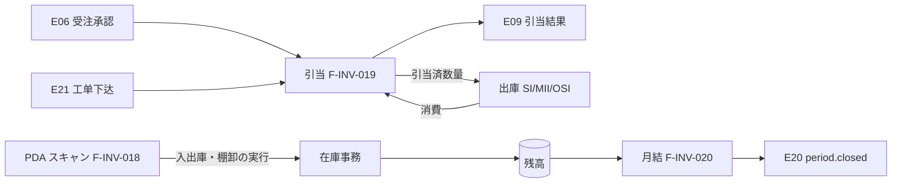
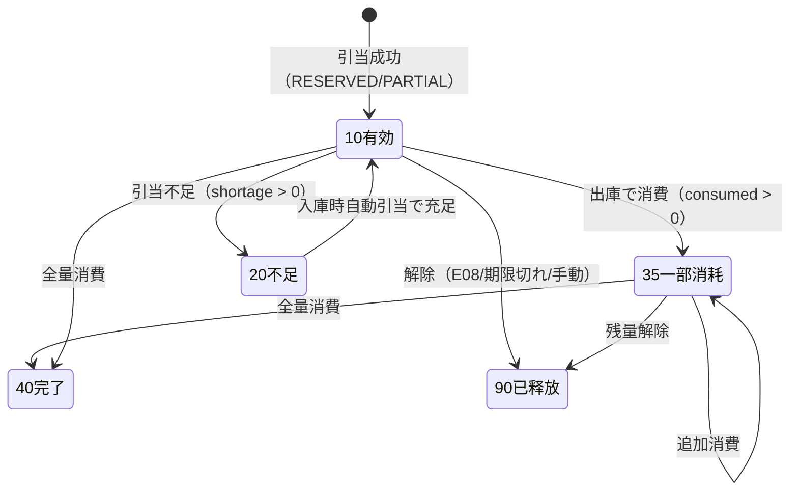
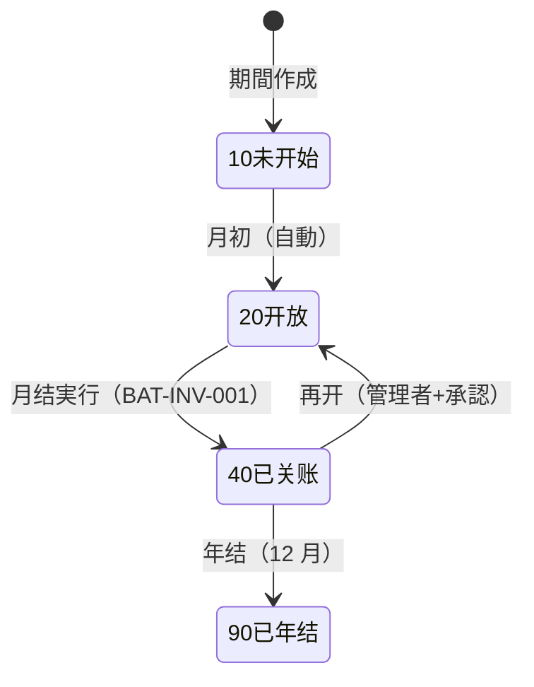
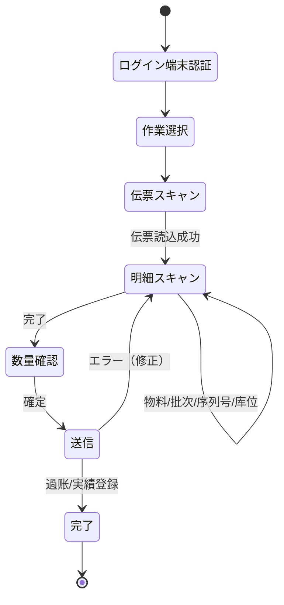

# 库存预留・条码PDA・月结 详细设计书（在庫引当・バーコードPDA・月次締め 詳細設計書）

| 項目 | 内容 |
|---|---|
| 文書名 | 库存预留・条码PDA・月结 详细设计书（在庫引当・バーコードPDA・月次締め 詳細設計書） |
| 文書番号 | DSN-INV-006 |
| 版数 | v1.0 |
| 作成日 | 2026-10-20 |
| 作成者 | inventory-designer |
| 承認者 | 未承認（レビュー待ち） |
| 状態 | ドラフト（レビュー中） |
| 関連文書 | [業務域概要](00-overview.md) / [在庫照会](01-stock-query.md) / [入出庫](02-inbound-outbound.md) / [DB 設計](90-db-design.md) / [跨域流程 §5/E06/E09/E21](../00-common/09-cross-domain-flow.md) / [共通业务规则 §10](../00-common/08-common-business-rules.md) |

---

## 1. 機能概要

### 1.1 対象機能

| 機能 ID | 機能名 | 概要 | 画面 ID | 優先度 |
|---|---|---|---|---|
| F-INV-019 | 库存预留/锁定 | 受注（E06）・工单（E21）による引当、変更（E07）・解除（E08）、消費（出庫）、期限切れ自動解放 | SCR-INV-024 | P0 |
| F-INV-018 | 条码/PDA 扫码出入库 | バーコード/QR による入出庫・移庫・棚卸のスキャン作業、オフライン補伝 | SCR-INV-026 | P1 |
| F-INV-020 | 库存期间月结/关账 | 月结前置检查 → 收发存汇总 → 期间关账 → E20 → 帳票、再开 | SCR-INV-025 | P0 |

### 1.2 三機能の関係



---

## 2. 業務要件・業務ルール

### 2.1 前提条件

| # | 前提条件 | 成立しない場合の挙動 |
|---|---|---|
| 1 | 引当：受注/工单が確定済（E06/E21 を受信済） | イベントが無ければ引当されない（`BAT-INV-007` で検出） |
| 2 | 引当：対象倉庫・物料が有効、在庫が存在 | 在庫 0 の場合は全量不足（`SHORTAGE`） |
| 3 | PDA：端末が登録済（`sys_device`）かつユーザが `inventory:barcode:scan` を保有 | 端末未登録は `MSG-INV-050` |
| 4 | 月结：対象期間の前月が `40 CLOSED`（または初回） | `MSG-INV-043`（前月未关账） |
| 5 | 月结：FIN の会計期間が未关账 | `MSG-INV-041`（FIN 关账済み） |
| 6 | 月结：バッチ実行ユーザが `inventory:period:close` を保有 | `403` |

### 2.2 引当（予約）の業務ルール

| # | ルール | 根拠 | 関連項目 |
|---|---|---|---|
| BR-RS-01 | 引当契機：①受注最終承認（E06）、②工单下达（E21）、③計画員の手動引当。引当は**在庫を確保するだけで、在庫状態・数量を変えない**（`qty_reserved` のみ増加） | [09 §5.2](../00-common/09-cross-domain-flow.md) | `qty_reserved` |
| BR-RS-02 | 引当単位：`倉庫 × 物料 × 批次`。**引当倉庫の優先順**：① E06/E21 の `lines[].warehouseId`（受注/工单の指定倉庫）→ ② 同工場の他倉庫（指定倉庫で不足時）→ ③ 他工場の倉庫 → ④ 不足（`shortage_qty`）。範囲は `sys_param.inv_allocate_scope`（既定 `SAME_PLANT`＝同工場他倉庫まで／`WAREHOUSE_ONLY`／`ALL`）で制御する。指定倉庫が無い場合は `mdm_material.default_warehouse_id`、それも無ければエラー（`MSG-INV-055`）。指定倉庫と異なる倉庫で引当した場合は E09 の `lines[].warehouseId` に**実引当倉庫**を返す | 本設計、Lead 裁決 2026-10-20（E06 に `warehouseId` 追加） | `inv_reservation_line`、`inv_allocate_scope` |
| BR-RS-03 | 引当順序：①指定批次（SAL/PRD が指定）→ ②FEFO（有効期限昇順）→ ③FIFO（初回入庫日昇順）。`sys_param.inv_picking_rule` で既定を変更可 | [04](04-batch-serial-status.md) BR-BT-08 | — |
| BR-RS-04 | 引当は**可用量の範囲内**（`可用量 = 在庫 − 引当 − 待検 − 凍結 − 不合格`、[00-overview](00-overview.md) 2.3）。不足時は引当可能分のみ確保し、残りを `shortage_qty` とする（バックオーダー） | [09 §5.3](../00-common/09-cross-domain-flow.md) | `shortage_qty` |
| BR-RS-05 | 引当結果は E09 で通知する。`status`：`RESERVED`（全量引当）/`PARTIAL`（一部引当、shortage>0）/`SHORTAGE`（全量不足）/`RELEASED`（解除） | [09 §3 E09](../00-common/09-cross-domain-flow.md) | E09 |
| BR-RS-06 | 予約の有効期限 `expire_date` = 納期（`deliveryDate`）＋ `sys_param.inv_reservation_valid_days`（既定 15 日）【示例値】。超過した予約は `BAT-INV-006` で自動解放し、E09（RELEASED）を発行 | 本設計 | `expire_date` |
| BR-RS-07 | 予約の**変更**（E07）：差分が増加なら追加引当（不足は shortage に反映）、減少なら差分を解放。`aggregateVersion` が古いイベントは無視する | [09 §2.3](../00-common/09-cross-domain-flow.md) | E07 |
| BR-RS-08 | 予約の**解除**（E08 受注取消）：残予約（`reserved_qty − consumed_qty`）を全量解放し、E09（RELEASED）を発行 | [09 §3 E08](../00-common/09-cross-domain-flow.md) | E08 |
| BR-RS-09 | 予約の**消費**：出庫（`SI`/`MII`/`OSI`）の過账時に、同一来源（受注/工单）・同一 `material/warehouse/batch` の予約を消費する（`qty_reserved` 減算、`consumed_qty` 加算）。予約を超える出庫は「予約外出庫」として警告（`MSG-INV-047`）し、出庫自体は成立させる | 本設計 | `consumed_qty` |
| BR-RS-10 | 予約が見つからない出庫（予約なし出荷・計画外領料）は可能。ただし警告を記録し、SAL/PRD へ E09 では通知しない（出庫の E18 で通知） | 本設計 | — |
| BR-RS-11 | **二重引当の禁止**：同一 `(source_type, source_id)` に対して有効な予約は 1 つ。部分引当（shortage あり）の予約は、入庫時に自動引当（`sys_param.inv_auto_allocate_on_receipt=true`）で不足分を補充する | 本設計 | `uk_inv_reservation_source` |
| BR-RS-12 | 引当は**優先順位を持たない**（先着順）。同一在庫に対して複数受注が競合した場合は、ロック取得順で先着が確保する（[02](02-inbound-outbound.md) 6.3 のロック順序） | 本設計 | — |
| BR-RS-13 | 手動引当・解放は計画員/営業經理が実行でき、理由を監査ログに記録する。解放は「消費済」の予約には不可 | 本設計 | — |
| BR-RS-14 | 予約は倉庫・批次単位で `qty_reserved` を更新するのみで、状態別残高行（`stock_status=20`）以外には引当できない | 本設計 | `status=20` |

### 2.3 条码/PDA の業務ルール

| # | ルール | 根拠 | 関連項目 |
|---|---|---|---|
| BR-BC-01 | バーコードの**符号・内容・ラベル形式は MDM の条码規則（F-MDM-017）を正**とし、本域はスキャンして解釈するのみ（再定義しない） | [00 设计方针 §9.4](../00-common/00-design-principles.md) | — |
| BR-BC-02 | 対応バーコード種別：`10 物料`（物料编码）、`20 批次`（batch_no）、`30 序列号`（serial_no）、`40 库位`（location_code）、`50 单据`（伝票番号）。1 次元/2 次元の別は MDM に従う | [06-code-list §14](../00-common/06-code-list.md)（条码出典は sources.md） | `barcode_type` |
| BR-BC-03 | PDA 作業種別：`10 入庫`（GRI/FGI/OSR）、`20 出庫`（SDO/MII/OSI）、`30 移庫`（TR）、`40 棚卸`（CNT）、`50 状態変換`、`60 照会`。作業開始時に**作業セッション**を作成し、終了時に閉じる | 本設計 | `session_id` |
| BR-BC-04 | スキャン順序：①伝票バーコード → ②物料 → ③批次/序列号 → ④库位 → ⑤数量入力（またはスキャン回数）。数量はスキャン回数を既定とし、手入力も可 | 本設計 | — |
| BR-BC-05 | **重複スキャン**：同一セッション内で同一バーコードを再スキャンした場合、数量管理品は数量を加算せず警告（`MSG-INV-054`）、序列号管理品は重複エラー（`MSG-INV-008`） | 本設計 | — |
| BR-BC-06 | **誤倉庫・誤物料・誤批次**：スキャンしたバーコードが作業（伝票）の倉庫/物料/批次と一致しない場合は拒否（`MSG-INV-051`/`MSG-INV-060`） | 本設計 | — |
| BR-BC-07 | **数量不一致**：スキャン数量が伝票数量と一致しない状態で確定しようとした場合はエラー（`MSG-INV-052`）。ただし「差異あり完了」を権限者が選んだ場合は差異理由付きで確定可（棚卸のみ） | 本設計 | — |
| BR-BC-08 | **オフライン**：PDA はオフライン時もスキャン実績をローカル保存し、復帰後に順次送信する。**在庫の過账はオンライン必須**（オフラインでは実績収集のみ） | 本設計 | `offline_flag` |
| BR-BC-09 | 冪等キー：`deviceId + ローカル連番`（`Idempotency-Key` ヘッダ）。再送・二重送信を排除 | [03 §9](../00-common/03-common-api-spec.md) | — |
| BR-BC-10 | 全スキャン（成功/失敗）を `inv_scan_log` に記録する（端末 ID、ユーザ、時刻、バーコード値、種別、結果、エラーコード）。個人情報は含めない | 本設計 | `inv_scan_log` |
| BR-BC-11 | 端末は `sys_device` に登録し、ユーザと紐付ける。紛失時は管理者が無効化する（SYS 設計に従う） | 本設計 | `device_id` |
| BR-BC-12 | ラベル印刷（PRT-INV-017）は物料/批次/序列号/库位の各単位で可能。再印刷は監査ログに記録 | 本設計 | — |

### 2.4 月结（在庫月次締め）の業務ルール

| # | ルール | 根拠 | 関連項目 |
|---|---|---|---|
| BR-CL-01 | 库存月结は FIN の会計期間关账**前**に完了する。順序：①在庫月结（BAT-INV-001）→ ②原価計算/調整 → ③FIN 原价計算 → ④FIN 期間关账（[08 §10](../00-common/08-common-business-rules.md)） | [08 §10](../00-common/08-common-business-rules.md) | E20/E30 |
| BR-CL-02 | 月结は**手動実行（ウィザード）またはスケジュール実行**（月初第 1 営業日 02:00）。二重実行は Advisory Lock で防止 | [09 §2.1](../00-common/09-cross-domain-flow.md) | — |
| BR-CL-03 | 月结前置检查（下記 2.6）がすべて 0 件でなければ**中断**し、チェック結果を画面に返す。中断時は在庫・期間状態を変更しない | 本設計 | `MSG-INV-041` |
| BR-CL-04 | 月结で**收发存汇总（`inv_stock_summary`）**を生成し、期初＋入庫−出庫＝期末を検証する。差異があれば中断 | 本設計 | CALC-04 |
| BR-CL-05 | 月结完了で `inv_period.period_status=40 CLOSED`、`inventory.period.closed`（E20）を発行する。FIN/SAL/PUR/PRD は E20 で期間ロックを認識する | [09 §3 E20](../00-common/09-cross-domain-flow.md) | E20 |
| BR-CL-06 | 关账後の在庫取引・成本調整は拒否（`MSG-INV-042`）。修正は翌期間の調整（遡及禁止） | [08 §6.1](../00-common/08-common-business-rules.md) | — |
| BR-CL-07 | **再开（reopen）**は管理者権限 `inventory:period:reopen` + 財務総監承認 + 理由必須。FIN 期間が既に CLOSED の場合は再开不可。再开は監査ログ + 通知を伴う | 本設計 | `MSG-INV-044` |
| BR-CL-08 | **年结**（12 月关账）後は `90 YEAR_CLOSED`。翌年度期間を `20 OPEN` に初期化し、期首残高を繰越す（`inv_stock_summary` の期末を翌年期首に） | 本設計 | — |
| BR-CL-09 | 在途調撥（`transfer_status=30/35`）は月结を跨いでよい（在途として期末在庫に含めない）。ただし在途金額を `PRT-INV-016` に注記し、FIN の在途物资処理と整合させる | [03](03-transfer-count.md) BR-TR-05 | — |
| BR-CL-10 | 月结時に未処理の棚卸単（`take_status IN (10,20,30,35)`）があれば中断（先に完了または取消） | [08 §10.3](../00-common/08-common-business-rules.md) | `MSG-INV-032` |
| BR-CL-11 | 月结の実行結果（チェック件数・汇总件数・所要時間・実行者）を実行履歴に保存し、再実行時は前回結果を残す | 本設計 | — |

### 2.5 計算式・判定式

| # | 対象 | 算式 | 丸め | 例（【示例値】） |
|---|---|---|---|---|
| CALC-01 | 引当可能量 | `可用量 = Σ(qty_on_hand − qty_reserved WHERE stock_status=20)` | 数量 4 桁 | 600 − 120 = 480.0000 KGM |
| CALC-02 | 引当不足量 | `shortage_qty = MAX(0, 要求数量 − 引当可能量)` | 4 桁 | 要求 500 − 可能 480 = 20.0000 |
| CALC-03 | 予約残 | `remaining_reserved = reserved_qty − consumed_qty − released_qty` | 4 桁 | 200 − 80 − 0 = 120.0000 |
| CALC-04 | 收发存検証 | `期末数量 = 期初数量 + 入庫数量 − 出庫数量`（`inv_stock_summary`） | 4 桁 | 100 + 500 − 120 = 480.0000 |
| CALC-05 | 月末在庫金額 | `期末金額 = 期初金額 + 入庫金額 − 出庫金額` | 2 桁 | 500.00 + 2,800.00 − 660.00 = 2,640.00 |
| CALC-06 | 月结检查合格条件 | 全チェック項目の件数 = 0 | — | — |
| CALC-07 | 引当期限 | `expire_date = 納期 + inv_reservation_valid_days` | — | 2026-10-25 + 15 = 2026-11-09 |
| CALC-08 | 库存周转率（月结时） | `期間出庫成本 ÷ 平均在庫金額`（平均 =（期初＋期末）÷2） | 4 桁 | 出庫 8,000,000 ÷ 平均 16,000,000 = 0.5000（年率換算は [07](07-reports.md)） |

### 2.6 月结前置检查（11 项）

| # | チェック | 対象テーブル | 条件 | 不合格時の対応 |
|---|---|---|---|---|
| 1 | 前月关账済 | `inv_period` | 前月 `period_status = 40/90` | `MSG-INV-043` |
| 2 | 未過账伝票なし | `inv_stock_txn` | 対象期間に `txn_status IN (10,20,25)` が 0 件 | 過账または取消 |
| 3 | 未処理イベントなし | `sys_outbox_event` | INV 関連の `status IN (0,2,9)` が 0 件 | `BAT-INV-007` 実行 |
| 4 | 未完了棚卸なし | `inv_stocktake` | `take_status IN (10,20,30,35)` が 0 件 | 完了または取消 |
| 5 | 未過账成本調整なし | `inv_cost_adjustment` | `adjustment_status IN (10,20,25)` が 0 件 | 過账または取消 |
| 6 | 余额・流水・成本層の一致 | `inv_stock_balance` / `inv_stock_txn_line` / `inv_cost_layer` | 三者差異 0（BAT-INV-002） | 差異調査 |
| 7 | 負在庫・負金額・予約超過なし | `inv_stock_balance` | `qty_on_hand < 0` / `amount_on_hand < 0` / `qty_reserved > qty_on_hand` が 0 件 | データ修正 |
| 8 | 期限切れ予約の処理済み | `inv_reservation` | `expire_date < 期間末日` かつ有効な予約が 0 件 | `BAT-INV-006` 実行 |
| 9 | FIN 会計期間が未关账 | `fin_period` | 対象期間 `status = OPEN` | FIN と調整 |
| 10 | 工单完了・未入庫なし | `prd_work_order`（参照） / `inv_stock_txn` | 対象期間の完了工单で `FGI` 未過账が 0 件 | PRD/倉庫で入庫 |
| 11 | 未適用の品質イベント待ちなし | `inv_event_wait` | `status=0`（未適用）が 0 件 | `BAT-INV-007` を実行し、E14/E24 の未処理を解消 |

### 2.7 状態遷移

**予約（`inv_reservation.reservation_status`）**



**在庫期間（`inv_period.period_status`）**



---

## 3. 関連機能

| 関係 | 機能 ID | 機能名 | 関係内容 |
|---|---|---|---|
| 上流 | — | E06/E07/E08/E21 | 引当のトリガ |
| 上流 | F-SAL-003/005 | 受注・出荷 | 引当要求・消費 |
| 上流 | F-PRD-002/004 | 工单・領料 | 引当要求・消費 |
| 下流 | F-INV-002〜008 | 入出庫 | 予約消費 |
| 下流 | F-INV-021 | 报表 | 月结后的收发存・库存余额表 |
| 下流 | F-FIN-007 | 期间关账 | E20/E30 の順序制御 |
| 関連 | F-INT-010 | 条码/PDA IF | 端末接続 |
| 関連 | F-SYS-016 | 定时任务监控 | BAT-INV-001/006 の監視 |

---

## 4. 画面設計

### 4.1 画面一覧

| 画面 ID | 画面名 | 類型 | 概要 |
|---|---|---|---|
| SCR-INV-024 | 库存预留照会・释放 | 一覧検索 | 予約の検索・残数量・不足・期限・手動引当/解放 |
| SCR-INV-025 | 库存月结执行 | ウィザード | 前置检查 → 汇总生成 → 关账 → 結果、再开 |
| SCR-INV-026 | PDA 扫码作業 | ウィザード（PDA） | 作業選択 → スキャン → 数量確認 → 送信 |

### 4.2 画面項目定義（SCR-INV-024 库存预留照会・释放）

| No | 項目 ID | 項目名 | 種別 | 型/桁 | 必須 | 初期値 | 入力チェック | DB 項目 |
|---|---|---|---|---|---|---|---|---|
| 1 | `sourceType` | 來源種別 | 選択 | VARCHAR(32) | — | 全 | `SALES_ORDER`/`WORK_ORDER` | `source_type` |
| 2 | `sourceNo` | 來源番号 | テキスト | VARCHAR(32) | — | 空 | 前方一致 | `source_no` |
| 3 | `materialKeyword` | 物料 | テキスト | VARCHAR(100) | — | 空 | 部分一致 | 結合 |
| 4 | `warehouseIds` | 倉庫 | 複数選択 | BIGINT[] | — | 既定 | 存在 | `warehouse_id` |
| 5 | `reservationStatuses` | 予約状態 | 複数選択 | SMALLINT[] | — | 10,20,35 | 10/20/35/40/90 | `reservation_status` |
| 6 | `onlyShortage` | 不足のみ | チェック | BOOLEAN | — | false | — | `shortage_qty > 0` |
| 7 | `expireDateTo` | 期限（〜） | 日付 | DATE | — | 空 | 実在日付 | `expire_date` |

**一覧列**：予約番号 / 來源種別 / 來源番号 / 得意先・工単 / 物料 / 倉庫 / 批次 / 引当数量 / 消費数量 / 残予約 / 不足数量 / 状態 / 有効期限 / 登録日時

**行操作**：詳細、手動引当（不足分の追加）、解放（理由必須）、來源伝票へ遷移（権限ある場合）

**表示制御**

| 条件 | 対象 | 制御 |
|---|---|---|
| `reservation_status IN (40,90)` | 解放ボタン | 非表示 |
| 残予約 0 | 解放ボタン | 非表示 |
| `inventory:reservation:release` なし | 解放ボタン | 非表示 |
| データ範囲外 | 行 | 非表示（SQL 強制） |

### 4.3 画面項目定義（SCR-INV-025 库存月结执行）

**ウィザード（5 ステップ）**

| Step | 画面 | 項目 | 内容 |
|---|---|---|---|
| 1 | 対象期間選択 | 対象期間（`periodCode`、既定＝前月） | `20 OPEN` の期間のみ選択可 |
| 2 | 前置检查 | 11 項目的チェック結果一覧（件数・対象・状態） | 0 件以外は赤表示。「再チェック」ボタン |
| 3 | 汇总生成プレビュー | 対象件数、期初・入庫・出庫・期末の合計、差異 | 実行前の確認 |
| 4 | 実行 | 実行ボタン（二重実行防止）、進捗 | 非同期ジョブ（`jobId`）、進捗バー |
| 5 | 結果 | 実行結果（成功/失敗、処理件数、所要時間、帳票リンク） | 失敗時は理由一覧・再実行 |

**画面項目定義（Step 2 チェック一覧）**

| No | 項目 ID | 項目名 | 種別 | 型 | 説明 |
|---|---|---|---|---|---|
| 1 | `checkNo` | チェック No | 表示 | INT | 2.6 の # |
| 2 | `checkName` | チェック名 | 表示 | VARCHAR(100) | — |
| 3 | `count` | 対象件数 | 表示 | INT | 0 で合格 |
| 4 | `status` | 判定 | 表示 | VARCHAR(16) | OK/NG |
| 5 | `detail` | 詳細 | リンク | — | NG の対象一覧へ遷移 |

**再开ボタン**：`inventory:period:reopen` + FIN 未关账 + 理由必須 + 承認フロー（財務総監）。

### 4.4 画面項目定義（SCR-INV-026 PDA 扫码作業）

| No | 項目 ID | 項目名 | 種別 | 型/桁 | 必須 | 初期値 | 入力チェック | 備考 |
|---|---|---|---|---|---|---|---|---|
| 1 | `deviceId` | 端末 ID | 表示 | VARCHAR(64) | ○ | 端末から | 登録済・有効 | — |
| 2 | `workType` | 作業種別 | 選択 | SMALLINT | ○ | 10 | 10/20/30/40/50/60 | 入庫/出庫/移庫/棚卸/状態変換/照会 |
| 3 | `sessionId` | セッション ID | 表示 | VARCHAR(64) | ○ | 自動 | — | 作業単位 |
| 4 | `docBarcode` | 伝票バーコード | スキャン | VARCHAR(128) | ○ | 空 | 対象伝票に一致 | — |
| 5 | `barcode` | スキャン値 | スキャン | VARCHAR(128) | ○ | 空 | 種別自動判定 | 物料/批次/序列号/库位 |
| 6 | `qty` | 数量 | 数値 | NUMERIC(18,4) | △ | スキャン回数 | > 0 | 手入力可 |
| 7 | `locationCode` | 库位 | スキャン | VARCHAR(32) | △ | 空 | 倉庫に属する | 庫位管理時 |
| 8 | `offlineFlag` | オフライン | 表示 | BOOLEAN | — | false | — | オフライン時は送信待ちキュー |

**画面フロー（PDA）**



### 4.5 イベント処理（PDA）

| No | イベント | トリガ | 処理内容 | 呼出 API | エラー時 |
|---|---|---|---|---|---|
| 1 | 端末認証 | アプリ起動 | 端末 ID + ユーザ認証（Sa-Token） | `POST /api/system/auth/login` | 端末未登録 |
| 2 | 伝票スキャン | スキャン | 伝票番号を解析し、対象伝票・明細を取得 | `GET /api/inventory/scan/sessions` / `POST /api/inventory/scan-sessions` | `MSG-INV-050` |
| 3 | 明細スキャン | スキャン | バーコード解析 → 種別判定 → 検証 → 数量加算 | `POST /api/inventory/scans` | `MSG-INV-008/050/051/054/056` |
| 4 | 数量確定 | 「確定」 | 送信（オンライン過账 or オフラインキュー） | `POST /api/inventory/stock-txns/{id}/post` | `MSG-INV-001/026` |
| 5 | オフライン復帰 | 通信復帰 | ローカルキューの順次送信 | `POST /api/inventory/scans/sync` | 競合はエラー一覧 |
| 6 | ラベル印刷 | 「印刷」 | PRT-INV-017 を Bluetooth/ネットワークプリンタへ | `POST /api/inventory/labels/print` | `MSG-INV-050` |

---

## 5. 入力チェック仕様

| No | チェック ID | 対象 | 種別 | 条件 | タイミング | メッセージ ID |
|---|---|---|---|---|---|---|
| 1 | CHK-INV-019-01 | 來源種別 | 値域 | `SALES_ORDER`/`WORK_ORDER`/`MANUAL` | 引当時 | `MSG-COM-042` |
| 2 | CHK-INV-019-02 | 引当数量 | 範囲/業務 | > 0、引当可能量以内（不足は shortage） | 引当時 | `MSG-COM-047` |
| 3 | CHK-INV-019-03 | 予約一意 | 業務 | 同一 `(source_type, source_id)` に有効予約 1 件 | 引当時 | `MSG-INV-047` |
| 4 | CHK-INV-019-04 | 解放 | 業務 | 残予約 > 0、消費済でない | 解放時 | `MSG-INV-048` |
| 5 | CHK-INV-019-05 | 期限 | 業務 | `expire_date ≥ 当日`（期限切れは自動解放対象） | 照会時 | — |
| 6 | CHK-INV-020-01 | 対象期間 | 業務 | `20 OPEN`、前月 `40/90` | 月结開始時 | `MSG-INV-043` |
| 7 | CHK-INV-020-02 | 前置检查 | 業務 | 11 項目すべて 0 件 | 月结実行時 | `MSG-INV-041` |
| 8 | CHK-INV-020-03 | 再开 | 業務 | FIN 未关账、理由必須、承認済 | 再开時 | `MSG-INV-044` |
| 9 | CHK-INV-018-01 | バーコード | 形式 | MDM 条码規則に一致 | スキャン時 | `MSG-INV-050` |
| 10 | CHK-INV-018-02 | 倉庫整合 | 業務 | バーコードの倉庫 = 作業倉庫 | スキャン時 | `MSG-INV-051` |
| 11 | CHK-INV-018-03 | 数量整合 | 業務 | スキャン数 = 伝票数量（確定時） | 確定時 | `MSG-INV-052` |
| 12 | CHK-INV-018-04 | 重複スキャン | 業務 | 同一セッション内の重複 | スキャン時 | `MSG-INV-054`/`MSG-INV-008` |
| 13 | CHK-INV-018-05 | 端末 | 業務 | 登録済・有効・ユーザ紐付済 | ログイン時 | `MSG-INV-050` |

---

## 6. 処理詳細

### 6.1 処理一覧

| 処理 ID | 処理名 | 契機 | トランザクション | 排他 |
|---|---|---|---|---|
| PRC-INV-019-01 | 引当（E06/E21） | イベント | 要 | 残高行 `FOR UPDATE`（[02](02-inbound-outbound.md) 6.3） |
| PRC-INV-019-02 | 引当変更（E07） | イベント | 要 | 同上 |
| PRC-INV-019-03 | 引当解除（E08/手動） | イベント/画面 | 要 | 同上 |
| PRC-INV-019-04 | 引当消費（出庫時） | 出庫過账 | 要（出庫 TX 内） | 出庫 TX のロックに包含 |
| PRC-INV-019-05 | 入庫時自動引当 | 入庫過账 | 要 | 同上 |
| PRC-INV-019-06 | 期限切れ解放 | BAT-INV-006 | 要（バッチ単位） | 予約行 `FOR UPDATE SKIP LOCKED` |
| PRC-INV-018-01 | スキャン検証 | PDA | 不要（照会） | なし |
| PRC-INV-018-02 | スキャン確定（過账/実績） | PDA | 要 | 出庫 TX のロックに包含 |
| PRC-INV-020-01 | 月结 | 手動/スケジュール | 要 | `pg_advisory_lock`（company + period） |
| PRC-INV-020-02 | 期間再开 | 管理者 | 要 | 同上 |

### 6.2 処理手順（正常系）

**PRC-INV-019-01 引当（E06 受注承認）**

1. `sys_event_consume_log` で `eventId` を重複排除する。`aggregateVersion` が既存予約より古ければ無視する。
2. `sourceType='SALES_ORDER'`、`sourceId=orderId` の有効予約を検索する。既存なら「追加引当」として差分を処理する（新規作成しない）。
3. 明細ごとに引当倉庫の候補を決定する（E06 `lines[].warehouseId` → 同工場他倉庫 → 他工場倉庫 → 不足。優先順位と範囲は BR-RS-02、`sys_param.inv_allocate_scope` で制御）。
4. 候補倉庫ごとに対象 `(warehouse, material)` の在庫を **`FEFO`/`FIFO`/指定批次** の順で候補抽出する（`inv_stock_balance` の `stock_status=20`、`available_qty > 0`）。指定倉庫で不足する場合は BR-RS-02 の優先順で次候補へ進む。
5. 候補行をロック順（`warehouse_id, material_id, batch_no, stock_status, location_id` 昇順）で `SELECT ... FOR UPDATE` する。
6. 各候補の `available = qty_on_hand − qty_reserved` を計算し、必要数量を充足するまで引当する。`qty_reserved += allocated`、`inv_reservation_line` に記録する。
7. 充足できなかった数量を `shortage_qty` とする。
8. `inv_reservation`（`reservation_no = RSV...`、`reservation_status` = 10 または 20、`expire_date` = 納期 + 15 日）を登録する（既存なら更新）。
9. E09 を Outbox に記録する（`status` = `RESERVED`/`PARTIAL`/`SHORTAGE`、`lines[{materialId, warehouseId, batchNo(追加), reservedQty, shortageQty}]`）。
10. 監査ログ（RESERVE）を記録する。

**PRC-INV-019-02 引当変更（E07）**

1. E07 の `lines`（差分）を取得する。`aggregateVersion` が既存予約の `source_version` 以下なら無視する。
2. 増加：追加引当（`PRC-INV-019-01` の 3〜7）。不足は `shortage_qty` に加算。
3. 減少：`reserved_qty` から減算し、`released_qty` に加算（消費済分は減らさない）。予約状態を更新する。
4. E09 を発行する（変更後の状態）。

**PRC-INV-019-03 引当解除（E08・手動）**

1. 有効予約を取得し、`remaining = reserved_qty − consumed_qty − released_qty` を算出する。
2. `remaining > 0` の各行について、対応する `inv_stock_balance.qty_reserved` を減算する（行ロック）。
3. `released_qty += remaining`、予約状態を `90 已释放` にする。
4. E09（`status='RELEASED'`）を発行する。
5. 手動解除の場合は理由を必須とし、監査ログに記録する。

**PRC-INV-019-04 引当消費（出庫時）**

1. 出庫過账（[02](02-inbound-outbound.md) 6.3）の中で、`sourceType` に対応する有効予約（`SALES_ORDER`/`WORK_ORDER`）を検索する。
2. 出庫明細の `warehouse/material/batch` に一致する予約行を探し、`consume = MIN(出庫数量, 残予約)` を消費する。
3. `qty_reserved -= consume`（残高行）、`consumed_qty += consume`（予約行）。予約状態を 35/40 に更新する。
4. 残予約で足りない分は「予約外出庫」として `WARN` ログ + `MSG-INV-047`（画面時のみ表示）。
5. 予約の E09 は発行**しない**（消費は E18 で通知。E09 は引当の状態変化のみ）。

**PRC-INV-019-06 期限切れ解放（BAT-INV-006）**

1. `reservation_status IN (10,20,35)` かつ `expire_date < 当日` の予約を抽出する（`FOR UPDATE SKIP LOCKED` で多重起動に強い実装）。
2. 各行の残予約を解放し（`PRC-INV-019-03` の 2〜3）、予約を `90 已释放` にする。
3. E09（`RELEASED`）を発行する。1 バッチ 1,000 件まで、超過は次回に繰越。
4. 通知：得意先/計画員へ「予約期限切れで解放」を站内通知。

**PRC-INV-018-02 スキャン確定（出庫例）**

1. PDA から `sessionId`・`docBarcode`・スキャン明細（物料/批次/序列号/数量/库位）を受信する。
2. セッションと端末を検証し、`Idempotency-Key`（`deviceId + localSeq`）で重複排除する。
3. 伝票（SDO/MII/OSI）の明細とスキャン結果を照合する（物料・批次・数量）。差異は `MSG-INV-052`。
4. オンライン：伝票を過账する（[02](02-inbound-outbound.md) 6.3）。オフライン：実績のみ保存し、`inv_scan_log` に `offline_flag=true` を記録、伝票は未過账のまま。
5. `inv_scan_log` に全スキャン結果を記録する。
6. 結果（過账番号・残数量・次のスキャン指示）を返す。

**PRC-INV-020-01 月结（BAT-INV-001）**

1. `pg_advisory_lock(hashtext('inv_close:' || companyId || ':' || periodCode))` を取得する（二重実行防止）。
2. 対象期間を取得し、`period_status=20 OPEN` を検証する。既に `40` なら「実行済み」として正常終了（冪等）。
3. 前置检查（2.6 の 11 項目）を実行する。1 項目でも 0 件でなければ、チェック結果を保存して**中断**（期間状態は変更しない、`MSG-INV-041`）。
4. 收发存汇总を生成する：`inv_stock_summary` に対象期間×倉庫×物料で「期初数量/金額、入庫数量/金額、出庫数量/金額、期末数量/金額、平均単価」を INSERT する（既存があれば DELETE → INSERT）。
5. 検証：CALC-04/05 が成立すること（期初＋入−出＝期末）。差異があれば中断（`MSG-INV-041`）。
6. 期末平均単価を確定し、`inv_stock_balance.avg_unit_cost` を 6 桁で再計算する（[05](05-costing.md) CALC-07）。
7. `inv_period` を `40 CLOSED`、`closed_at/closed_by/check_result` を更新する。
8. E20 `inventory.period.closed` を Outbox に記録する。
9. 次期間（翌月）を `20 OPEN` に更新する（未作成なら作成）。
10. 帳票（PRT-INV-016 库存余额表、PRT-INV-009 收发存汇总、PRT-INV-012 周转率）を非同期生成する。
11. 実行結果を `sys_job_execution` に記録し、通知（財務经理・倉庫主管）を送る。

**PRC-INV-020-02 期間再开**

1. `inventory:period:reopen` と承認（財務総監）を検証する。
2. FIN の対象期間が `OPEN` であることを確認する（`fin_period` 同期参照）。CLOSED なら `MSG-INV-044`。
3. `inv_period.period_status=20 OPEN`、`reopened_at/reopened_by/reopen_reason` を記録し、**E37 `inventory.period.reopened` を Outbox に記録する**（payload：periodCode, reason, approvedBy, reopenedAt。FIN 承認後に発行し、FIN/SAL/PUR/PRD へ期間ロック解除を通知）。E20 の取消は行わず、再開事実を E37 で通知する。
4. 監査ログ・通知（財務・倉庫・購買・営業）を記録する。

### 6.2.1 イベント順序逆転の保留（`inv_event_wait`）

E15（品質判定）が E14（入荷）／E24（完工）より先に到着した場合、INV は在庫に変換できずに取りこぼしてはならない。`inv_event_wait` に保留し、対象在庫伝票の過账と同一トランザクションで適用する（[02](02-inbound-outbound.md) §2.8）。

| 項目 | 内容 |
|---|---|
| 起動 | E15 受信ハンドラ（`PRC-INV-002-07`）。対象 `PI`/`FGI` が未過账の場合は `inv_event_wait` に INSERT して ACK |
| 適用 | E14/E24 の過账 TX 内で `inv_event_wait`（`waiting_for='PI'/'FGI'`、`source_type/source_id` 一致、`status=0`）を検索し、E15 を同一 TX で適用。適用後 `status=1`・`applied_txn_id` を記録 |
| 再試行 | `BAT-INV-007` が 5 分間隔で未適用 wait を再処理（最大 3 回）。24 時間超は `MSG-INV-064` でアラートし、`status=9`（放棄）は月結で報告 |
| 冪等 | `event_id` 一意（二重登録防止）+ `(source_type, source_id, txn_type)` 過账済一意（二重変換防止） |
| 月結 | 月結前置检查で未適用 wait = 0 件を確認（第 2.6 章 #11） |

### 6.3 例外処理

| No | 異常条件 | 検知箇所 | 処理 | ロールバック | メッセージ ID |
|---|---|---|---|---|---|
| 1 | 引当で在庫 0 | 引当処理 | 全量不足（SHORTAGE）で正常終了（エラーにしない） | — | E09 で通知 |
| 2 | 引当の二重処理 | 一意制約/eventId | 冪等スキップ | — | — |
| 3 | 引当変更の版数逆転 | aggregateVersion | 無視 | — | — |
| 4 | 予約解放で残予約 0 | 解除処理 | エラー | — | `MSG-INV-048` |
| 5 | PDA バーコード不明 | スキャン | スキャン拒否（記録） | — | `MSG-INV-050` |
| 6 | 誤倉庫・誤物料 | スキャン | 拒否 | — | `MSG-INV-051`/`MSG-INV-060` |
| 7 | 重複スキャン | スキャン | 数量加算せず警告 | — | `MSG-INV-054` |
| 8 | 数量不一致の確定 | 確定 | 拒否（棚卸は差異理由で可） | — | `MSG-INV-052` |
| 9 | オフライン中の過账要求 | 確定 | オンライン復帰後に実行 | — | `MSG-INV-050` |
| 10 | 月结前置检查 NG | 月结 | 中断・結果表示 | なし | `MSG-INV-041` |
| 11 | 月结中の割込更新 | 关账処理 | Advisory Lock で排除 | — | `MSG-COM-084` |
| 12 | 収发存の不一致 | 月结 | 中断 | なし | `MSG-INV-041` |
| 13 | FIN 关账済みの再开 | 再开 | 拒否 | — | `MSG-INV-044` |

### 6.4 冪等性・再実行

| 対象 | 仕様 |
|---|---|
| 引当 | `eventId` 重複排除 + `(source_type, source_id)` の有効予約一意 + `aggregateVersion` チェック。E09 は `eventId` 単位で 1 回のみ発行 |
| 予約消費 | 出庫 TX の冪等性に従う（[02](02-inbound-outbound.md) 6.5）。`consumed_qty` の二重加算を防ぐため、消費は出庫 TX の伝票 ID を `last_consume_txn_id` に記録し、同一 TX の再処理をスキップ |
| 期限切れ解放 | バッチ再実行可（解放済みは対象外）。1 予約 1 回のみ解放（`released_qty` で担保） |
| 月结 | `period_status=40` なら「実行済み」で正常終了。Advisory Lock で多重起動防止。再実行は再开後にのみ可能 |
| PDA スキャン | `Idempotency-Key`（deviceId + localSeq）+ `inv_scan_log` の一意制約（`device_id, local_seq`）で二重送信排除 |

---

## 7. API 設計

### 7.1 API 一覧

| # | メソッド | パス | 権限 | 概要 |
|---|---|---|---|---|
| 1 | GET | `/api/inventory/reservations` | `inventory:reservation:view` | 予約一覧 |
| 2 | GET | `/api/inventory/reservations/{id}` | `inventory:reservation:view` | 予約詳細 |
| 3 | POST | `/api/inventory/reservations` | `inventory:reservation:create` | 手動引当（計画員） |
| 4 | POST | `/api/inventory/reservations/{id}/release` | `inventory:reservation:release` | 予約解放 |
| 5 | POST | `/api/inventory/reservations/allocate` | `inventory:reservation:create` | 來源単位の引当（内部/API） |
| 6 | POST | `/api/inventory/scan-sessions` | `inventory:barcode:scan` | スキャンセッション開始 |
| 7 | GET | `/api/inventory/scan-sessions/{id}` | `inventory:barcode:scan` | セッション状態・明細 |
| 8 | POST | `/api/inventory/scans` | `inventory:barcode:scan` | スキャン（検証・数量加算） |
| 9 | POST | `/api/inventory/scans/sync` | `inventory:barcode:scan` | オフライン実績の一括送信 |
| 10 | POST | `/api/inventory/labels/print` | `inventory:barcode:print` | ラベル印刷（PRT-INV-017） |
| 11 | GET | `/api/inventory/periods` | `inventory:period:view` | 期間一覧・状態 |
| 12 | POST | `/api/inventory/periods/{periodCode}/close-checks` | `inventory:period:close` | 前置检查（ドライラン） |
| 13 | POST | `/api/inventory/periods/{periodCode}/close` | `inventory:period:close` | 月结実行（202 ジョブ） |
| 14 | POST | `/api/inventory/periods/{periodCode}/reopen` | `inventory:period:reopen` | 再开 |
| 15 | GET | `/api/inventory/jobs/{jobId}` | `inventory:period:close` | 月结ジョブ結果 |

### 7.2 代表 API 詳細

#### 7.2.1 `POST /api/inventory/reservations/{id}/release`

```json
{ "version": 3, "reason": "受注取消に伴う引当解除（E08）" }
```

レスポンス：

```json
{
  "code": 0,
  "message": "ok",
  "data": {
    "reservationNo": "RSV2610200001",
    "reservationStatus": 90,
    "releasedQty": "120.0000",
    "lines": [
      {
        "materialCode": "3001000001",
        "materialName": "YE3-100L1-4 三相异步电动机",
        "warehouseCode": "WH03",
        "batchNo": "261020M001",
        "releasedQty": "20.0000"
      }
    ],
    "reservationUpdatedEvent": { "status": "RELEASED" }
  }
}
```

#### 7.2.2 `POST /api/inventory/scans`

```json
{
  "sessionId": "1845678901234568401",
  "deviceId": "PDA-CZ-001",
  "barcodeValue": "3001000001",
  "barcodeType": 10,
  "workType": 20,
  "bizType": "SALES_DELIVERY",
  "bizId": "1845000000000003001",
  "localSeq": 17,
  "qty": "1",
  "locationCode": "WH03-C-01-01-01"
}
```

レスポンス：

```json
{
  "code": 0,
  "message": "ok",
  "data": {
    "scanResult": 1,
    "parsed": {
      "materialCode": "3001000001",
      "materialName": "YE3-100L1-4 三相异步电动机",
      "batchNo": "261020M001",
      "serialNo": "2610201000001",
      "locationCode": "WH03-C-01-01-01",
      "warehouseCode": "WH03"
    },
    "lineProgress": {
      "lineNo": 10,
      "requiredQty": "20.0000",
      "scannedQty": "13.0000",
      "remainingQty": "7.0000"
    },
    "nextHint": "続けて製品バーコードをスキャンしてください"
  }
}
```

エラー例（誤倉庫）：

```json
{
  "code": 50051,
  "message": "条码不属于当前作业仓库（条码仓库 WH01，作业仓库 WH03）。",
  "data": { "fieldErrors": [{ "field": "barcodeValue", "message": "仓库不一致" }] }
}
```

#### 7.2.3 `POST /api/inventory/periods/{periodCode}/close`

```json
{ "comment": "2026-10 月在庫月結", "jobMode": "ASYNC" }
```

レスポンス（202）：

```json
{
  "code": 0,
  "message": "ok",
  "data": { "jobId": "1845678901234568501", "periodCode": "2026-10", "status": "QUEUED" }
}
```

`GET /api/inventory/jobs/{jobId}`：

```json
{
  "code": 0,
  "message": "ok",
  "data": {
    "jobId": "1845678901234568501",
    "status": "SUCCEEDED",
    "periodCode": "2026-10",
    "checks": [
      { "checkNo": 2, "checkName": "未過账伝票", "count": 0, "status": "OK" },
      { "checkNo": 6, "checkName": "残高・流水・成本層の一致", "count": 0, "status": "OK" }
    ],
    "summary": { "openingQty": "12000.0000", "inQty": "48000.0000", "outQty": "45500.0000", "closingQty": "14500.0000", "closingAmount": "3865400.00" },
    "closedAt": "2026-11-01T02:15:33+08:00",
    "reportLinks": [
      { "prtId": "PRT-INV-016", "name": "库存余额表（月末）" }
    ]
  }
}
```

エラー例（前置检查 NG）：

```json
{
  "code": 50041,
  "message": "月结前置检查未通过：未過账伝票 3 件、未完了棚卸 1 件。",
  "data": {
    "checks": [
      { "checkNo": 2, "checkName": "未過账伝票", "count": 3, "status": "NG" },
      { "checkNo": 4, "checkName": "未完了棚卸", "count": 1, "status": "NG" }
    ]
  }
}
```

---

## 8. データ更新仕様

| テーブル | 操作 | 更新項目 | 更新条件 | トリガ |
|---|---|---|---|---|
| `inv_reservation` | INSERT/UPDATE | `reservation_no, source_type, source_id, source_no, reservation_status, expire_date, shortage_qty, version` | `id` + `version` | PRC-INV-019-01〜06 |
| `inv_reservation_line` | INSERT/UPDATE | `material_id, warehouse_id, batch_id/no, reserved_qty, consumed_qty, released_qty, shortage_qty, last_consume_txn_id, version` | `id` + `version` | 同上 |
| `inv_stock_balance` | UPDATE | `qty_reserved, version` | ロックキー | 引当・消費・解放 |
| `inv_period` | INSERT/UPDATE | `period_code, period_start_date, period_end_date, period_status, closed_at/by, check_result, recalc_result, reopened_at/by/reason, version` | `id` + `version` | PRC-INV-020-01/02 |
| `inv_stock_summary` | INSERT（期間単位で洗替） | `period_code, warehouse_id, material_id, opening_*, in_*, out_*, closing_*, avg_unit_cost` | `period_code` | 月结 |
| `inv_scan_log` | INSERT | `device_id, local_seq, user_id, scan_at, barcode_type, barcode_value, material_id, batch_no, serial_no, location_id, biz_type, biz_id, scan_result, error_code, session_id, offline_flag` | — | スキャン |
| `sys_outbox_event` | INSERT | E09/E20 | 同一 TX | 引当・月结 |
| `sys_audit_log` | INSERT | RESERVE/RELEASE/CONSUME/CLOSE/REOPEN/SCAN | — | 各処理 |
| `sys_job_execution` | INSERT | 月结・期限切れ解放の実行履歴 | — | バッチ |

---

## 9. エラー処理・メッセージ

| メッセージ ID | 種別 | 本文 | 発生条件 | 利用者への対処 |
|---|---|---|---|---|
| `MSG-INV-043` | E | 上期未关账，不能关账本期 {0}。 | 前月未关账 | 前月を先に关账 |
| `MSG-INV-044` | E | 会计期间已关账或已年结，不能重新打开。 | 再开不可 | 財務へ確認 |
| `MSG-INV-047` | E/W | 预留数量超过可用量（可用 {0} {1}），不足部分已作为缺货处理。 | 引当不足・予約外出庫 | 欠品対応 |
| `MSG-INV-048` | E | 预留已释放或已消耗，不能重复操作。 | 解放の二重実行 | 再取得 |
| `MSG-INV-050` | E | 条码无法识别，请重新扫描。 | 条码不正・端末不正 | 再スキャン |
| `MSG-INV-051` | E | 条码不属于当前作业仓库（条码仓库 {0}，作业仓库 {1}）。 | 誤倉庫 | 倉庫を確認 |
| `MSG-INV-052` | E | 扫描数量与单据数量不一致（应 {0}，实 {1}）。 | 数量不一致 | 数量修正 |
| `MSG-INV-054` | W | 扫码重复，已忽略本次扫描。 | 重複スキャン | 続行可 |
| `MSG-INV-060` | E | 条码与单据的物料/批次不一致。 | 誤物料・誤批次 | 対象確認 |
| `MSG-INV-041` | E | 原价核对不一致或无法执行：{0}。 | 月结・再計算 NG | 差異調査 |
| `MSG-INV-032` | E | 该仓库存在未完成的盘点单，不能执行该操作。 | 未完了棚卸 | 完了を待つ |
| `MSG-INV-042` | E | 库存期间 {0} 已关账，不能登记库存事务。 | 关账後の登録 | 翌期で処理 |
| `MSG-COM-084` | W | 当前功能正在处理中，请稍候。 | 月结・再計算の実行中 | 待機 |
| `MSG-COM-005` | I | 审批流程已提交。 | 月结再开の承認提出 | — |

---

## 10. 権限・セキュリティ

| 種別 | 内容 |
|---|---|
| 画面権限 | 予約：`inventory:reservation:view/create/release`。月结：`inventory:period:view/close/reopen`。PDA：`inventory:barcode:scan/print` |
| 職務分掌 | 月结実行者と承認者を分離（実行者不可自审）。再开は管理者 + 財務総監承認 |
| データ範囲 | 予約は全社参照可（データ範囲で絞込）、PDA は作業倉庫に限定 |
| 端末セキュリティ | 端末登録・失効管理、端末とユーザの紐付け、オフラインデータの暗号化（PDA 側） |
| 監査ログ | 予約（誰がいつどの在庫を確保したか）、解放（理由）、月结（チェック結果・実行結果）、再开（理由・承認者）、スキャン（全件） |

---

## 11. 性能・非機能

| 項目 | 目標値 | 前提 |
|---|---|---|
| 引当（1 受注 10 明細） | 500ms 以内 | 残高行ロック。在庫候補はインデックス |
| 予約一覧（100 件） | 2 秒以内 | `inv_reservation(source_type, source_id)` 索引 |
| PDA スキャン応答 | 300ms 以内（1 件） | オンライン時。オフライン時はローカル応答 |
| PDA 一括同期（500 件） | 30 秒以内 | バルク INSERT |
| 月结（在庫 8 万行・取引 40 万件/月） | 30 分以内 | 非同期ジョブ。集計 SQL に索引 |
| 月结检查（11 項目） | 5 分以内 | 各チェックの索引整備 |
| 同時月结 | 1 社 1 期間のみ | Advisory Lock |

---

## 12. テスト観点

| No | 観点 ID | 分類 | 観点 | 期待結果 |
|---|---|---|---|---|
| 1 | TST-F-INV-019-01 | 正常系 | E06 による全量引当 | `qty_reserved` 増加、E09=RESERVED |
| 2 | TST-F-INV-019-02 | 正常系 | 在庫不足の引当 | 可能分のみ引当、`shortage_qty` 設定、E09=PARTIAL |
| 3 | TST-F-INV-019-03 | 正常系 | E07 変更（増加・減少） | 差分が正しく反映、E09 |
| 4 | TST-F-INV-019-04 | 正常系 | E08 取消 | 残予約が解放、E09=RELEASED |
| 5 | TST-F-INV-019-05 | 正常系 | 出庫時の予約消費 | `consumed_qty` 増、`qty_reserved` 減 |
| 6 | TST-F-INV-019-06 | 異常系 | 期限切れ予約の解放バッチ | E09=RELEASED、在庫が戻る |
| 7 | TST-F-INV-019-07 | 排他 | 同一在庫への同時引当（2 受注） | 合計が在庫を超えない（先着で確保、後続は shortage） |
| 8 | TST-F-INV-019-08 | 冪等 | 同一 E06 の再受信 | 二重引当しない |
| 9 | TST-F-INV-018-01 | 正常系 | PDA で入庫スキャン→過账 | 明細と数量が一致し、在庫更新 |
| 10 | TST-F-INV-018-02 | 異常系 | 誤倉庫のバーコード | `MSG-INV-051` |
| 11 | TST-F-INV-018-03 | 異常系 | 同一バーコードの重複スキャン | `MSG-INV-054`、数量は加算されない |
| 12 | TST-F-INV-018-04 | 異常系 | 数量不一致の確定 | `MSG-INV-052` |
| 13 | TST-F-INV-018-05 | 正常系 | オフライン→復帰→同期 | 実績が一意に登録（二重なし） |
| 14 | TST-F-INV-020-01 | 正常系 | 月结（全チェック OK） | `inv_period=40`、E20、收发存汇总生成 |
| 15 | TST-F-INV-020-02 | 異常系 | 未過账伝票がある月结 | 中断、期間状態不変、`MSG-INV-041` |
| 16 | TST-F-INV-020-03 | 整合 | 期初＋入−出＝期末 | 差異 0（CALC-04/05） |
| 17 | TST-F-INV-020-04 | 冪等 | 同一期間の月结再実行 | 二重关账せず「実行済み」 |
| 18 | TST-F-INV-020-05 | 異常系 | FIN 关账後の再开 | `MSG-INV-044` |
| 19 | TST-F-INV-020-06 | 排他 | 月结実行中の在庫取引 | 取引はブロックまたは待機し、不整合にならない |

---

## 13. 未決事項

| # | 事項 | 理由 | 暫定仕様 | 担当 | 期限 |
|---|---|---|---|---|---|
| 1 | 期間再开時のイベント（**已裁决**） | [09 §3](../00-common/09-cross-domain-flow.md) に E37 `inventory.period.reopened` が追加された（2026-10-20 Lead 追補） | **已裁决：E37 で通知（FIN 承認後に発行）**。payload：periodCode, reason, approvedBy, reopenedAt。FIN/SAL/PUR/PRD は E37 で期間ロック解除を認識し、再開後の取引を受け付ける | Lead / inventory-designer | 完了（2026-10-20） |
| 2 | 引当有効期限の既定値（15 日） | 受注の納期遅延・先日付受注の扱いが未確定 | `sys_param.inv_reservation_valid_days=15`【示例値】。納期＋15 日 | 営業 / inventory-designer | 2026-11-15 |
| 3 | 入庫時自動引当の既定 ON/OFF | 欠品補充を自動化すると引当の公平性（先着 vs 優先顧客）が問題になる | 既定 ON（`inv_auto_allocate_on_receipt=true`）。優先順位ルールは Phase 2 | 営業 / 計画 / inventory-designer | 2026-11-30 |
| 4 | PDA オフライン範囲 | オフラインで過账まで許すか、実績収集のみか | 実績収集のみ（過账はオンライン必須）。Phase 2 で完全オフラインを検討 | inventory-designer / INT 担当 | 2027-03-31 |
| 5 | 月结中の在庫取引ブロック方式 | Advisory Lock のみか、期間フラグ + API 拒否か | `inv_period.recalc_lock` + 過账時チェックで拒否。月结は 30 分以内に完了する想定 | inventory-designer | 2026-11-15 |

---

## 14. 改訂履歴

| 版数 | 日付 | 変更内容 | 変更者 |
|---|---|---|---|
| v1.0 | 2026-10-20 | 初版：引当（E06/E07/E08/E21・消費・期限切れ）、PDA スキャン（種別・異常・オフライン）、月结（10 項目前置检查・冪等・再开）、画面 3 件、API 15 件、テスト観点 | inventory-designer |
| v1.1 | 2026-10-20 | Lead 追補 E37 `inventory.period.reopened` を反映：期間再开通知を E37 発行に変更し、未決 #1 を已裁决に更新 | system-workflow（validator） |
| v1.2 | 2026-10-20 | Lead 裁決：E06 `lines[].warehouseId` を引当倉庫の第一優先とし、不足時の跨倉規則（`inv_allocate_scope`、既定 `SAME_PLANT`）を BR-RS-02 と 6.2 に明記 | inventory-designer |
| v1.3 | 2026-10-20 | 红队第 2 轮：在庫状態コード改訂（引当対象=20 可用）、E15 逆順の `inv_event_wait` 保留（§6.2.1）、月結前置检查 #11 追加 | inventory-designer |
