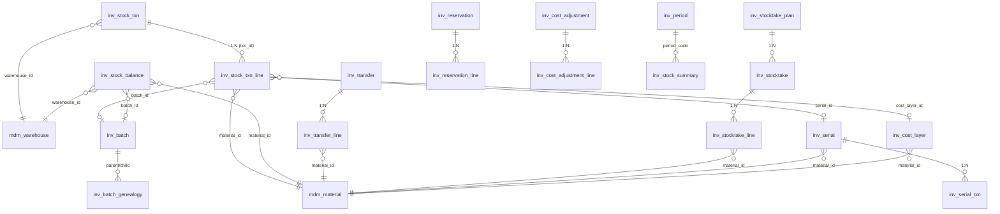

# 库存管理 DB 设计书（在庫管理 DB 設計書）

| 項目 | 内容 |
|---|---|
| 文書名 | 库存管理 DB 设计书（在庫管理 DB 設計書） |
| 文書番号 | DSN-INV-090 |
| 版数 | v1.0 |
| 作成日 | 2026-10-20 |
| 作成者 | inventory-designer |
| 承認者 | 未承認（レビュー待ち） |
| 状態 | ドラフト（レビュー中） |
| 関連文書 | [業務域概要](00-overview.md) / [DB 共通規格](../00-common/04-common-db-spec.md) / [共通項目定義](../00-common/01-common-item-definitions.md) / [入出庫](02-inbound-outbound.md) / [原価](05-costing.md) / [テーブル定義テンプレート](../_template/03-table-definition-template.md) |

---

## 1. 設計方針

### 1.1 データモデルの基本構造

```
[業務イベント]
   ├─ inv_stock_txn（事務ヘッダ：伝票番号・種別・来源・状態）
   │     └─ inv_stock_txn_line（事務明細：倉庫×物料×批次×状態×庫位の変動）
   ├─ inv_transfer（調撥単：在途管理）    └─ inv_transfer_line
   ├─ inv_stocktake_plan → inv_stocktake（棚卸単）└─ inv_stocktake_line
   ├─ inv_cost_adjustment（原価調整単）  └─ inv_cost_adjustment_line
   └─ inv_reservation（引当）             └─ inv_reservation_line

[残高・原価]  inv_stock_balance（倉庫×物料×批次×状態×庫位の残高）
              inv_cost_layer（入庫層：原価構成・庫齢）
[マスタ]      inv_batch / inv_serial / inv_batch_genealogy / inv_serial_txn
[集計]        inv_period / inv_stock_summary / inv_age_snapshot / inv_replenishment
[ログ]        inv_scan_log
```

設計の要点：

1. **更新責任の一元化**：`inv_stock_balance` を更新できるのは本域の `StockPostingManager` のみ（[02](02-inbound-outbound.md) 6.3）。他域は参照のみ。
2. **数量と金額の整合**：残高（`qty_on_hand`/`amount_on_hand`）・事務明細（`inv_stock_txn_line`）・原価層（`inv_cost_layer`）の三者が常に一致する（[BAT-INV-002](92-report-batch-design.md)）。
3. **状態は残高行の一部**：`stock_status` を残高の一意キーに含め、状態間移動は `ST_OUT`+`ST_IN` の対で表現する（[04](04-batch-serial-status.md)）。
4. **原価計算単位**：`(warehouse_id, material_id, batch_id)`（非批次は `batch_id=0`）。同一単位の全状態行が同一 `avg_unit_cost` を共有する（[05](05-costing.md) 1.2）。
5. **追記専用**：`inv_stock_txn` は過账後に数量・金額を変更しない。訂正は沖销（反向事務）。`inv_stock_txn_line` は INSERT のみ。
6. **マスタ参照は論理削除のため FK を張らない**（[04 §6](../00-common/04-common-db-spec.md)）。MDM マスタ（`mdm_material`/`mdm_warehouse`/`mdm_warehouse_bin`/`mdm_supplier`/`mdm_customer`）への参照はアプリ層で存在検証する。**域内の親子（txn→line 等）は FK を張る**。
7. **スナップショット**：伝票明細（`inv_stock_txn_line`）は `material_code/name/spec`、`inv_stock_txn` は `partner_name` を保持し、マスタ変更の影響を受けない（[01 §13](../00-common/01-common-item-definitions.md)）。

### 1.2 ER 図（主要テーブル）



### 1.3 排他・トランザクション方針

| 処理 | 分離レベル | 排他 | 実装 |
|---|---|---|---|
| 在庫過账 | READ COMMITTED | 残高行 `SELECT ... FOR UPDATE`、ロック順 `(warehouse_id, material_id, batch_no, stock_status, location_id)` 昇順 | [02](02-inbound-outbound.md) 6.3 |
| 在庫過账の再試行 | READ COMMITTED | デッドロック `40P01` → 最大 3 回、`lock_timeout=3s` | 同上 |
| 引当 | READ COMMITTED | 残高行 `FOR UPDATE`（引当順にロック） | [06](06-reservation-barcode-close.md) 6.2 |
| 伝票編集（草稿） | READ COMMITTED | 楽観排他（`version`） | 各画面 |
| 棚卸単生成 | READ COMMITTED | `pg_advisory_xact_lock('inv_stocktake:'||warehouse_id)` | [03](03-transfer-count.md) 6.2 |
| 月结・再計算 | REPEATABLE READ 検討 | `pg_advisory_lock('inv_close:'||company_id||':'||period_code)` | [06](06-reservation-barcode-close.md) 6.2 |
| バッチ（対账・庫齢） | READ COMMITTED | Advisory Lock（二重起動防止） | [92](92-report-batch-design.md) |

---

## 2. テーブル一覧

| # | 物理名 | 論理名 | 種別 | 主な更新元 | 件数見積（5 年） | 保存期間 | 章 |
|---|---|---|---|---|---|---|---|
| 1 | `inv_stock_balance` | 库存余额 | 残高 | 入出庫・調整 | 80,000 | 現行のみ | 4.1 |
| 2 | `inv_stock_txn` | 库存事务（头） | 伝票ヘッダ | 入出庫・調整 | 3,500 万 | 10 年 | 4.2 |
| 3 | `inv_stock_txn_line` | 库存事务明细 | 伝票明細 | 同上 | 1 億 | 10 年 | 4.3 |
| 4 | `inv_transfer` | 调拨单 | 伝票ヘッダ | F-INV-009 | 36,000 | 10 年 | 4.4 |
| 5 | `inv_transfer_line` | 调拨单明细 | 伝票明細 | F-INV-009 | 150,000 | 10 年 | 4.5 |
| 6 | `inv_stocktake_plan` | 盘点计划 | 伝票ヘッダ | F-INV-010 | 1,400 | 10 年 | 4.6 |
| 7 | `inv_stocktake` | 盘点单 | 伝票ヘッダ | F-INV-010 | 7,000 | 10 年 | 4.7 |
| 8 | `inv_stocktake_line` | 盘点单明细 | 伝票明細 | F-INV-010 | 70 万 | 10 年 | 4.8 |
| 9 | `inv_batch` | 批次主档 | マスタ | F-INV-011 | 33 万 | 無期限 | 4.9 |
| 10 | `inv_batch_genealogy` | 批次系谱 | 関連 | F-INV-011 | 140 万 | 10 年 | 4.10 |
| 11 | `inv_serial` | 序列号主档 | マスタ | F-INV-012 | 12 万 | 無期限 | 4.11 |
| 12 | `inv_serial_txn` | 序列号事务履历 | 履歴 | F-INV-012 | 60 万 | 10 年 | 4.12 |
| 13 | `inv_reservation` | 库存预留（头） | 伝票ヘッダ | F-INV-019 | 21 万 | 10 年 | 4.13 |
| 14 | `inv_reservation_line` | 库存预留明细 | 伝票明細 | F-INV-019 | 110 万 | 10 年 | 4.14 |
| 15 | `inv_cost_layer` | 成本层 | 残高/履歴 | F-INV-017 | 3,000 万 | 10 年 | 4.15 |
| 16 | `inv_cost_adjustment` | 成本调整单（头） | 伝票ヘッダ | F-INV-017 | 36,000 | 10 年 | 4.16 |
| 17 | `inv_cost_adjustment_line` | 成本调整单明细 | 伝票明細 | F-INV-017 | 140,000 | 10 年 | 4.17 |
| 18 | `inv_period` | 库存期间 | 設定 | F-INV-020 | 60 | 無期限 | 4.18 |
| 19 | `inv_stock_summary` | 收发存汇总 | 集計 | F-INV-020 | 130 万 | 10 年 | 4.19 |
| 20 | `inv_age_snapshot` | 库龄快照 | 集計 | BAT-INV-003 | 300 万 | 3 年 | 4.20 |
| 21 | `inv_replenishment` | 补货建议 | 集計 | BAT-INV-004 | 5 万 | 1 年 | 4.21 |
| 22 | `inv_scan_log` | 扫码记录 | ログ | F-INV-018 | 500 万 | 1 年 | 4.22 |
| 23 | `inv_event_wait` | 品質イベント保留 | 内部キュー | F-INV-014、BAT-INV-007 | 5 万 | 3 か月 | 4.23 |

> 件数見積は [04 §13](../00-common/04-common-db-spec.md) の `inv_stock_txn` 1,000 万行/初期・+500 万行/年、`inv_stock_balance` 6 万行/初期と整合させた。

---

## 3. 共通カラム・型の適用

### 3.1 共通監査カラム（[01 §2](../00-common/01-common-item-definitions.md)）

```sql
-- 業務テーブル（伝票・残高・マスタ）に展開
id          BIGINT       NOT NULL,              -- 雪花 ID（MyBatis-Plus ASSIGN_ID）
tenant_id   BIGINT       NOT NULL DEFAULT 0,
company_id  BIGINT       NOT NULL DEFAULT 1,
version     INT          NOT NULL DEFAULT 0,    -- 楽観排他
remark      VARCHAR(500),
ext_data    JSONB,
created_at  TIMESTAMPTZ  NOT NULL DEFAULT now(),
created_by  BIGINT       NOT NULL DEFAULT 0,
updated_at  TIMESTAMPTZ  NOT NULL DEFAULT now(),
updated_by  BIGINT       NOT NULL DEFAULT 0
```

| テーブル種別 | 付与する共通カラム |
|---|---|
| 残高・伝票・マスタ（1〜21 のうちログ/集計以外） | 全項目（`deleted` は**付けない**。伝票は取消ステータスで管理） |
| 履歴・ログ（`inv_serial_txn`、`inv_scan_log`、`inv_batch_genealogy`） | `id, tenant_id, company_id, created_at, created_by` のみ（追記専用） |
| 集計・スナップショット（`inv_stock_summary`、`inv_age_snapshot`、`inv_replenishment`） | `version` 不要。`created_at/created_by/updated_at/updated_by` |

### 3.2 型の適用

| 用途 | 型 | 例 |
|---|---|---|
| 数量 | `NUMERIC(18,4)` | `qty_on_hand`、`qty` |
| 金額 | `NUMERIC(18,2)` | `amount_on_hand`、`amount` |
| 単価・平均単価 | `NUMERIC(18,6)` | `avg_unit_cost`、`unit_cost` |
| 状態・区分 | `SMALLINT` | `stock_status`、`txn_status` |
| 事务種別 | `VARCHAR(16)` | `txn_type`（`PI`〜`ST_OUT` の 19 種） |
| 業務日付 | `DATE` | `txn_date`、`expiry_date` |
| 日時 | `TIMESTAMPTZ` | `posted_at`、`snapshot_at` |
| 期間 | `VARCHAR(7)` | `period_code`（`2026-10`） |
| 拡張・スコープ | `JSONB` | `scope_json`、`check_result` |

> **金額・数量に `FLOAT/DOUBLE` を使用しない**（[04 §4](../00-common/04-common-db-spec.md)）。

### 3.3 命名・索引・制約の方針

- 索引：`idx_{table}_{cols}`（B-Tree）、`uk_{table}_{cols}`（一意）、`ck_{table}_{意味}`（CHECK）。部分索引 `WHERE` を活用する。
- 一意制約：伝票は `(company_id, {伝票番号})`、残高は次元の全列、明細は親 + 行番号・次元。
- CHECK：状態値（`stock_status`/`txn_status` 等）、`txn_type`、符号（数量 > 0、残高 ≥ 0）、方向（`direction IN (1,-1)`）に付与する。
- コメント：全テーブル・全列に `COMMENT ON` を付与する（本文件では代表例を記載し、実装時に全列へ展開する）。

---

## 4. テーブル定義

### 4.1 `inv_stock_balance` 库存余额

| 項目 | 内容 |
|---|---|
| テーブル物理名 | `inv_stock_balance` |
| テーブル論理名 | 库存余额（在庫残高） |
| 種別 | 残高 |
| 更新元機能 | F-INV-002〜010、014、017、019（引当数量） |
| データ量見積 | 初期 6 万 / 5 年後 8 万 |
| 保存期間 | 現行のみ（履歴は `inv_stock_txn`） |
| 備考 | 1 行 = 1「倉庫×物料×批次×状態×庫位」の現在残高。**更新は本域の過账処理のみ** |

#### 4.1.1 概要

倉庫・庫位・物料・批次・在庫状態の組み合わせごとの現在数量・金額・平均単価を持つ。在庫状態を一意キーに含むため、待検・凍結・不合格は別行となる。`avg_unit_cost` は同一 `(warehouse_id, material_id, batch_id)` の全行で同一値（[05](05-costing.md) 1.2）。

#### 4.1.2 DDL

```sql
CREATE TABLE inv_stock_balance (
    id              BIGINT        NOT NULL,
    tenant_id       BIGINT        NOT NULL DEFAULT 0,
    company_id      BIGINT        NOT NULL DEFAULT 1,
    warehouse_id    BIGINT        NOT NULL,
    location_id     BIGINT        NOT NULL DEFAULT 0,      -- 0 = 库位未管理
    material_id     BIGINT        NOT NULL,
    batch_id        BIGINT        NOT NULL DEFAULT 0,      -- 0 = 非批次管理
    batch_no        VARCHAR(64)   NOT NULL DEFAULT '',     -- ロック順序・照会用の冗長列
    stock_status    SMALLINT      NOT NULL,
    qty_on_hand     NUMERIC(18,4) NOT NULL DEFAULT 0,
    qty_reserved    NUMERIC(18,4) NOT NULL DEFAULT 0,
    amount_on_hand  NUMERIC(18,2) NOT NULL DEFAULT 0,
    avg_unit_cost   NUMERIC(18,6) NOT NULL DEFAULT 0,
    last_txn_date   DATE,
    last_txn_id     BIGINT,
    version         INT           NOT NULL DEFAULT 0,
    remark          VARCHAR(500),
    ext_data        JSONB,
    created_at      TIMESTAMPTZ   NOT NULL DEFAULT now(),
    created_by      BIGINT        NOT NULL DEFAULT 0,
    updated_at      TIMESTAMPTZ   NOT NULL DEFAULT now(),
    updated_by      BIGINT        NOT NULL DEFAULT 0,
    CONSTRAINT pk_inv_stock_balance PRIMARY KEY (id),
    CONSTRAINT ck_inv_stock_balance_status CHECK (stock_status IN (10,20,30,40,50)),
    CONSTRAINT ck_inv_stock_balance_qty CHECK (qty_on_hand >= 0 AND qty_reserved >= 0 AND qty_reserved <= qty_on_hand),
    CONSTRAINT ck_inv_stock_balance_amount CHECK (amount_on_hand >= 0),
    CONSTRAINT ck_inv_stock_balance_avg CHECK (avg_unit_cost >= 0)
);

CREATE UNIQUE INDEX uk_inv_stock_balance_key
    ON inv_stock_balance (company_id, warehouse_id, material_id, batch_id, stock_status, location_id);
CREATE INDEX idx_inv_stock_balance_material_wh
    ON inv_stock_balance (company_id, material_id, warehouse_id, stock_status);
CREATE INDEX idx_inv_stock_balance_wh_material
    ON inv_stock_balance (company_id, warehouse_id, material_id);
CREATE INDEX idx_inv_stock_balance_batch
    ON inv_stock_balance (company_id, batch_id) WHERE batch_id <> 0;
CREATE INDEX idx_inv_stock_balance_status
    ON inv_stock_balance (company_id, stock_status) WHERE qty_on_hand > 0;

COMMENT ON TABLE inv_stock_balance IS '库存余额（倉庫×物料×批次×状態×庫位）';
COMMENT ON COLUMN inv_stock_balance.qty_reserved IS '引当済数量（可用量 = status=20 の qty_on_hand - qty_reserved）';
COMMENT ON COLUMN inv_stock_balance.stock_status IS '在庫状態：10待検 / 20可用 / 30冻结 / 40不合格 / 50報廃待処理';
COMMENT ON COLUMN inv_stock_balance.avg_unit_cost IS '同一(倉庫,物料,批次)の全状態行で共有する移動平均単価（6桁）';
```

#### 4.1.3 項目定義

| No | 物理名 | 論理名 | 型/桁 | NULL | PK | FK/参照先 | 既定値 | 備考 |
|---|---|---|---|---|---|---|---|---|
| 1 | `id` | 主キー | BIGINT | NOT NULL | ○ | — | アプリ採番 | 雪花 ID |
| 2 | `tenant_id` | 租户 ID | BIGINT | NOT NULL | — | — | 0 | 首期固定 |
| 3 | `company_id` | 公司 ID | BIGINT | NOT NULL | — | — | 1 | — |
| 4 | `warehouse_id` | 倉庫 ID | BIGINT | NOT NULL | — | `mdm_warehouse.id`（論理参照） | — | — |
| 5 | `location_id` | 庫位 ID | BIGINT | NOT NULL | — | `mdm_warehouse_bin.id`（論理参照） | 0 | 0=库位未管理 |
| 6 | `material_id` | 物料 ID | BIGINT | NOT NULL | — | `mdm_material.id`（論理参照） | — | — |
| 7 | `batch_id` | 批次 ID | BIGINT | NOT NULL | — | `inv_batch.id` | 0 | 0=非批次管理 |
| 8 | `batch_no` | 批次号 | VARCHAR(64) | NOT NULL | — | — | '' | ロック順序・照会用の冗長列 |
| 9 | `stock_status` | 在庫状態 | SMALLINT | NOT NULL | — | — | — | 10/20/30/40/50（[00-overview](00-overview.md) 2.2） |
| 10 | `qty_on_hand` | 現存数量 | NUMERIC(18,4) | NOT NULL | — | — | 0 | ≥ 0（DB CHECK） |
| 11 | `qty_reserved` | 引当数量 | NUMERIC(18,4) | NOT NULL | — | — | 0 | 0 ≤ reserved ≤ on_hand |
| 12 | `amount_on_hand` | 在庫金額 | NUMERIC(18,2) | NOT NULL | — | — | 0 | ≥ 0 |
| 13 | `avg_unit_cost` | 平均単価 | NUMERIC(18,6) | NOT NULL | — | — | 0 | 同一 cost group で同値 |
| 14 | `last_txn_date` | 最終取引日 | DATE | NULL | — | — | NULL | 遡及チェックに使用 |
| 15 | `last_txn_id` | 最終取引 ID | BIGINT | NULL | — | `inv_stock_txn.id` | NULL | — |
| 16 | `version` | 楽観排他版数 | INT | NOT NULL | — | — | 0 | — |
| 17 | `remark` | 備考 | VARCHAR(500) | NULL | — | — | NULL | — |
| 18 | `ext_data` | 拡張項目 | JSONB | NULL | — | — | NULL | — |
| 19-24 | `created_at/created_by/updated_at/updated_by` | 監査カラム | — | NOT NULL | — | — | 既定 | [01 §2](../00-common/01-common-item-definitions.md) |

#### 4.1.4 制約・整合性

| 制約 ID | 内容 | 実現方法 |
|---|---|---|
| UK-01 | 倉庫×物料×批次×状態×庫位で一意 | `uk_inv_stock_balance_key` |
| CK-01 | 状態は 10/20/30/40/50 | `ck_inv_stock_balance_status` |
| CK-02 | 数量・引当・金額・単価は非負、引当 ≤ 現存 | `ck_inv_stock_balance_qty`、`ck_inv_stock_balance_amount`、`ck_inv_stock_balance_avg` |
| IV-01 | 同一 cost group の `avg_unit_cost` は全行同値 | アプリ層（過账時に一括更新）+ [BAT-INV-002](92-report-batch-design.md) |
| IV-02 | `Σ inv_stock_balance.qty_on_hand`（cost group）= `Σ inv_cost_layer.remaining_qty` | バッチ検証（差異でアラート） |
| IV-03 | `Σ amount_on_hand` = `Σ inv_cost_layer.remaining_amount` | 同上 |

#### 4.1.5 更新仕様

| 操作 | 契機 | 更新項目 | 備考 |
|---|---|---|---|
| INSERT | 過账時に残高行が無い場合 | 全項目（0 初期値 + 初回変動） | `INSERT ... ON CONFLICT DO NOTHING` → 再 SELECT FOR UPDATE |
| UPDATE | 入出庫・状態変換・沖销 | `qty_on_hand, qty_reserved, amount_on_hand, avg_unit_cost, last_txn_date, last_txn_id, version` | ロック順序を厳守 |
| DELETE | なし | — | 残高 0 でも行は保持（[01](01-stock-query.md) 未決 #3） |

---

### 4.2 `inv_stock_txn` 库存事务（头）

| 項目 | 内容 |
|---|---|
| テーブル論理名 | 库存事务（在庫取引） |
| 種別 | 伝票ヘッダ |
| 更新元機能 | F-INV-002〜010、014、F-INV-017（沖销） |
| データ量見積 | 初期 1,000 万 / 年間 +500 万 / 5 年後 3,500 万 |
| 保存期間 | 10 年（[08 §12](../00-common/08-common-business-rules.md)） |
| 備考 | 1 行 = 1 業務伝票（GRI/SDO/MII/MIR/FGI/OSI/OSR/TR/CNT/AOI/AOO/ST）。月次パーティションは Phase 2 |

#### 4.2.1 概要

在庫の数量・金額・状態を変動させる**すべての事実**を記録する伝票ヘッダ。`txn_type` は [09 §7.1](../00-common/09-cross-domain-flow.md) の 19 種のみ。来源（`source_type + source_id`）と一意制約により二重計上を防ぐ。過账後は数量・金額を変更せず、訂正は沖销（`is_reversal=true` の反向事務）で行う。

#### 4.2.2 DDL

```sql
CREATE TABLE inv_stock_txn (
    id                BIGINT        NOT NULL,
    tenant_id         BIGINT        NOT NULL DEFAULT 0,
    company_id        BIGINT        NOT NULL DEFAULT 1,
    txn_no            VARCHAR(32)   NOT NULL,          -- GRI/SDO/MII/MIR/FGI/OSI/OSR/TR/CNT/AOI/AOO/ST
    txn_type          VARCHAR(16)   NOT NULL,
    txn_date          DATE          NOT NULL,
    factory_id        BIGINT        NOT NULL,
    warehouse_id      BIGINT        NOT NULL,
    source_type       VARCHAR(32)   NOT NULL,
    source_id         BIGINT,
    source_no         VARCHAR(32),
    partner_type      SMALLINT      NOT NULL DEFAULT 0, -- 0:なし 1:仕入先 2:顧客 3:部門/工場 4:その他
    partner_id        BIGINT,
    partner_name      VARCHAR(200),
    biz_module        VARCHAR(16),                      -- PUR/SAL/PRD/INV
    reference_txn_no  VARCHAR(32),                      -- 対になる事務（TR_OUT⇔TR_IN 等）
    pair_key          VARCHAR(64),                      -- ST_IN/ST_OUT 等の対をグループ化（UUID）
    is_reversal       BOOLEAN       NOT NULL DEFAULT FALSE,
    reversal_of_txn_id BIGINT,                          -- 沖销元の事務 ID
    reversed_txn_id   BIGINT,                           -- この事務を沖销した事務 ID（元に保持）
    reverse_reason    VARCHAR(500),
    reversed_at       TIMESTAMPTZ,
    reversed_by       BIGINT,
    txn_status        SMALLINT      NOT NULL DEFAULT 10, -- 10草稿/20承認待ち/25承認済/30已過账/90已沖销
    posted_at         TIMESTAMPTZ,
    posted_by         BIGINT,
    currency_code     VARCHAR(3)    NOT NULL DEFAULT 'CNY',
    accounting_period VARCHAR(7)    NOT NULL,
source_event_at   TIMESTAMPTZ,               -- 遅延イベントの原本業務日時（BR-16）
    total_qty         NUMERIC(18,4) NOT NULL DEFAULT 0,
    total_amount      NUMERIC(18,2) NOT NULL DEFAULT 0,
    version           INT           NOT NULL DEFAULT 0,
    remark            VARCHAR(500),
    ext_data          JSONB,
    created_at        TIMESTAMPTZ   NOT NULL DEFAULT now(),
    created_by        BIGINT        NOT NULL DEFAULT 0,
    updated_at        TIMESTAMPTZ   NOT NULL DEFAULT now(),
    updated_by        BIGINT        NOT NULL DEFAULT 0,
    CONSTRAINT pk_inv_stock_txn PRIMARY KEY (id),
    CONSTRAINT ck_inv_stock_txn_type CHECK (txn_type IN
        ('PI','SI','MII','MIR','FGI','OSI','OSR','TR_OUT','TR_IN','ADJ_IN','ADJ_OUT',
         'SC_IN','SC_OUT','AOI','AOO','RT_IN','PR_OUT','ST_IN','ST_OUT')),
    CONSTRAINT ck_inv_stock_txn_status CHECK (txn_status IN (10,20,25,30,90)),
    CONSTRAINT ck_inv_stock_txn_date CHECK (txn_date >= DATE '2020-01-01'),
    CONSTRAINT ck_inv_stock_txn_period CHECK (accounting_period ~ '^[0-9]{4}-[0-9]{2}$'),
    CONSTRAINT ck_inv_stock_txn_reversal CHECK (is_reversal = FALSE OR reversal_of_txn_id IS NOT NULL)
);

CREATE UNIQUE INDEX uk_inv_stock_txn_no ON inv_stock_txn (company_id, txn_no);
CREATE UNIQUE INDEX uk_inv_stock_txn_source_posted
    ON inv_stock_txn (company_id, source_type, source_id, txn_type)
    WHERE txn_status = 30 AND source_id IS NOT NULL;
CREATE UNIQUE INDEX uk_inv_stock_txn_reversal
    ON inv_stock_txn (reversal_of_txn_id)
    WHERE is_reversal = TRUE;
CREATE INDEX idx_inv_stock_txn_date_type ON inv_stock_txn (company_id, txn_date DESC, txn_type);
CREATE INDEX idx_inv_stock_txn_source ON inv_stock_txn (company_id, source_type, source_no);
CREATE INDEX idx_inv_stock_txn_status ON inv_stock_txn (company_id, txn_status) WHERE txn_status IN (10,20,25);
CREATE INDEX idx_inv_stock_txn_pair ON inv_stock_txn (pair_key) WHERE pair_key IS NOT NULL;

COMMENT ON TABLE inv_stock_txn IS '库存事务（在庫取引）ヘッダ。txn_type は 09 §7.1 の 19 種のみ';
COMMENT ON COLUMN inv_stock_txn.txn_no IS '業務伝票番号。GRI/SDO/MII/MIR/FGI/OSI/OSR/TR/CNT/AOI/AOO は 08 §2.1 の採番、ST は来源番号または内部番号';
COMMENT ON COLUMN inv_stock_txn.accounting_period IS 'txn_date から導出した会計期間（YYYY-MM）。inv_period の OPEN 判定に使用';
```

#### 4.2.3 項目定義

| No | 物理名 | 論理名 | 型/桁 | NULL | PK | FK/参照先 | 既定値 | 備考 |
|---|---|---|---|---|---|---|---|---|
| 1 | `id` | 主キー | BIGINT | NOT NULL | ○ | — | アプリ採番 | — |
| 2-3 | `tenant_id`/`company_id` | — | BIGINT | NOT NULL | — | — | 0/1 | — |
| 4 | `txn_no` | 事務番号 | VARCHAR(32) | NOT NULL | — | `sys_sequence` | — | 一意（`uk_inv_stock_txn_no`） |
| 5 | `txn_type` | 事務種別 | VARCHAR(16) | NOT NULL | — | — | — | 19 種（CHECK） |
| 6 | `txn_date` | 事務日 | DATE | NOT NULL | — | — | — | 遡及禁止・期間 OPEN |
| 7 | `factory_id` | 工場 ID | BIGINT | NOT NULL | — | `mdm_factory.id`（論理参照） | — | 倉庫の工場 |
| 8 | `warehouse_id` | 倉庫 ID | BIGINT | NOT NULL | — | `mdm_warehouse.id` | — | 1 事務 1 倉庫 |
| 9 | `source_type` | 来源種別 | VARCHAR(32) | NOT NULL | — | — | — | `PURCHASE_RECEIPT`/`SALES_DELIVERY`/`WORK_ORDER`/`OUTSOURCING_ORDER`/`TRANSFER`/`STOCKTAKE`/`SALES_RETURN`/`PURCHASE_RETURN`/`INSPECTION`/`MANUAL` |
| 10 | `source_id` | 来源 ID | BIGINT | NULL | — | — | NULL | 来源伝票の ID |
| 11 | `source_no` | 来源番号 | VARCHAR(32) | NULL | — | — | NULL | 来源伝票の番号 |
| 12 | `partner_type` | 相手種別 | SMALLINT | NOT NULL | — | — | 0 | 0 なし/1 仕入先/2 顧客/3 部門/4 その他 |
| 13 | `partner_id` | 相手 ID | BIGINT | NULL | — | — | NULL | — |
| 14 | `partner_name` | 相手名称 | VARCHAR(200) | NULL | — | — | NULL | **スナップショット** |
| 15 | `biz_module` | 来源モジュール | VARCHAR(16) | NULL | — | — | NULL | PUR/SAL/PRD/INV |
| 16 | `reference_txn_no` | 関連事務番号 | VARCHAR(32) | NULL | — | — | NULL | TR_OUT⇔TR_IN 等 |
| 17 | `pair_key` | 対グループ | VARCHAR(64) | NULL | — | — | NULL | ST_OUT+ST_IN、同倉移庫の TR 対 |
| 18 | `is_reversal` | 沖销フラグ | BOOLEAN | NOT NULL | — | — | FALSE | 沖销事務で TRUE |
| 19 | `reversal_of_txn_id` | 沖销元 ID | BIGINT | NULL | — | `inv_stock_txn.id` | NULL | 一意（1 事務 1 沖销） |
| 20 | `reversed_txn_id` | 沖销先 ID | BIGINT | NULL | — | `inv_stock_txn.id` | NULL | 元事務に保持 |
| 21 | `reverse_reason` | 沖销理由 | VARCHAR(500) | NULL | — | — | NULL | 沖销時必須 |
| 22-23 | `reversed_at/reversed_by` | 沖销日時/者 | TIMESTAMPTZ/BIGINT | NULL | — | — | NULL | — |
| 24 | `txn_status` | 事務状態 | SMALLINT | NOT NULL | — | — | 10 | 10/20/25/30/90 |
| 25-26 | `posted_at/posted_by` | 過账日時/者 | TIMESTAMPTZ/BIGINT | NULL | — | — | NULL | 過账時に設定 |
| 27 | `currency_code` | 通貨 | VARCHAR(3) | NOT NULL | — | `mdm_currency` | CNY | Phase 1 は CNY |
| 28 | `accounting_period` | 会計期間 | VARCHAR(7) | NOT NULL | — | — | — | `txn_date` から導出 |
| 29 | `total_qty` | 合計数量 | NUMERIC(18,4) | NOT NULL | — | — | 0 | 明細合計 |
| 30 | `total_amount` | 合計金額 | NUMERIC(18,2) | NOT NULL | — | — | 0 | 明細合計 |
| 31-36 | `version`/`remark`/`ext_data`/監査 | — | — | — | — | — | — | — |
| 37 | `source_event_at` | 原本業務日時 | TIMESTAMPTZ | NULL | — | — | NULL | 遅延イベントの業務日付（`txn_date` と分離、BR-16） |

#### 4.2.4 制約・整合性

| 制約 ID | 内容 | 実現方法 |
|---|---|---|
| UK-01 | 事務番号は公司内一意 | `uk_inv_stock_txn_no` |
| UK-02 | 同一来源・同一種別の**過账済**は 1 件のみ（二重計上防止、[09 §10.2](../00-common/09-cross-domain-flow.md)） | `uk_inv_stock_txn_source_posted`（部分一意） |
| UK-03 | 1 事務は 1 回しか沖销できない | `uk_inv_stock_txn_reversal` |
| CK-01 | 種別は 19 種のみ | `ck_inv_stock_txn_type` |
| CK-02 | 状態は 10/20/25/30/90 | `ck_inv_stock_txn_status` |
| CK-03 | 沖销事務は必ず沖销元を持つ | `ck_inv_stock_txn_reversal` |
| IV-01 | `total_qty/total_amount = Σ明細` | アプリ層 + 日次対账 |
| IV-02 | `txn_status=30` の事務のみ残高に反映 | アプリ層（過账TX） |

#### 4.2.5 更新仕様

| 操作 | 契機 | 更新項目 |
|---|---|---|
| INSERT | 入出庫/調整/状態変換の登録・イベント受信 | 全項目（`txn_status=10`、採番済） |
| UPDATE | 承認提出/コールバック | `txn_status=20/25`、`version` |
| UPDATE | 過账 | `txn_status=30, posted_at, posted_by, total_qty, total_amount, version` |
| UPDATE | 沖销（元事務） | `txn_status=90, reversed_at, reversed_by, reverse_reason, reversed_txn_id, version` |
| INSERT | 沖销（反向事務） | 全項目（`is_reversal=true`、`reversal_of_txn_id`） |
| DELETE | **禁止** | — |

---

### 4.3 `inv_stock_txn_line` 库存事务明细

| 項目 | 内容 |
|---|---|
| テーブル論理名 | 库存事务明细 |
| 種別 | 伝票明細 |
| 更新元機能 | 4.2 と同じ |
| データ量見積 | 初期 3,000 万 / 年間 +1,500 万 / 5 年後 1 億 |
| 保存期間 | 10 年 |
| 備考 | 1 行 = 1「倉庫×物料×批次×状態×庫位」の変動。序列号管理品は 1 行 = 1 個 |

#### 4.3.1 DDL

```sql
CREATE TABLE inv_stock_txn_line (
    id              BIGINT        NOT NULL,
    tenant_id       BIGINT        NOT NULL DEFAULT 0,
    company_id      BIGINT        NOT NULL DEFAULT 1,
    txn_id          BIGINT        NOT NULL,
    line_no         INT           NOT NULL,
    material_id     BIGINT        NOT NULL,
    material_code   VARCHAR(10)   NOT NULL,
    material_name   VARCHAR(200)  NOT NULL,
    spec            VARCHAR(200),
    uom_code        VARCHAR(8)    NOT NULL,
    qty             NUMERIC(18,4) NOT NULL,
    direction       SMALLINT      NOT NULL,                -- +1:IN / -1:OUT
    batch_id        BIGINT        NOT NULL DEFAULT 0,
    batch_no        VARCHAR(64)   NOT NULL DEFAULT '',
    stock_status    SMALLINT      NOT NULL,
    location_id     BIGINT        NOT NULL DEFAULT 0,
    unit_cost       NUMERIC(18,6),
    amount          NUMERIC(18,2),
    purchase_amount NUMERIC(18,2) NOT NULL DEFAULT 0,
    freight_amount  NUMERIC(18,2) NOT NULL DEFAULT 0,
    duty_amount     NUMERIC(18,2) NOT NULL DEFAULT 0,
    other_amount    NUMERIC(18,2) NOT NULL DEFAULT 0,
    before_qty      NUMERIC(18,4),
    before_amount   NUMERIC(18,2),
    after_qty       NUMERIC(18,4),
    after_amount    NUMERIC(18,2),
    after_avg_cost  NUMERIC(18,6),
    cost_layer_id   BIGINT,
    serial_id       BIGINT,
    serial_no       VARCHAR(64),
    source_line_id  BIGINT,
    source_line_no  INT,
    remark          VARCHAR(500),
    created_at      TIMESTAMPTZ   NOT NULL DEFAULT now(),
    created_by      BIGINT        NOT NULL DEFAULT 0,
    CONSTRAINT pk_inv_stock_txn_line PRIMARY KEY (id),
    CONSTRAINT fk_inv_stock_txn_line_txn FOREIGN KEY (txn_id) REFERENCES inv_stock_txn (id),
    CONSTRAINT ck_inv_stock_txn_line_qty CHECK (qty > 0),
    CONSTRAINT ck_inv_stock_txn_line_direction CHECK (direction IN (1, -1)),
    CONSTRAINT ck_inv_stock_txn_line_status CHECK (stock_status IN (10,20,30,40,50)),
    CONSTRAINT ck_inv_stock_txn_line_amount CHECK (amount IS NULL OR amount >= 0)
);

CREATE UNIQUE INDEX uk_inv_stock_txn_line_no ON inv_stock_txn_line (txn_id, line_no);
CREATE INDEX idx_inv_stock_txn_line_material_date
    ON inv_stock_txn_line (company_id, material_id, batch_id, txn_id);
CREATE INDEX idx_inv_stock_txn_line_batch
    ON inv_stock_txn_line (company_id, batch_id) WHERE batch_id <> 0;
CREATE INDEX idx_inv_stock_txn_line_serial
    ON inv_stock_txn_line (company_id, serial_no) WHERE serial_no IS NOT NULL;
CREATE INDEX idx_inv_stock_txn_line_source
    ON inv_stock_txn_line (company_id, source_line_id) WHERE source_line_id IS NOT NULL;

COMMENT ON TABLE inv_stock_txn_line IS '库存事务明细（在庫取引明細）。追記専用';
COMMENT ON COLUMN inv_stock_txn_line.direction IS '+1=入庫(IN) / -1=出庫(OUT)。残高変動 = direction × qty';
COMMENT ON COLUMN inv_stock_txn_line.amount IS '行金額（2桁）。入庫=原価構成合計、出庫=移動平均×数量。草稿時は NULL';
COMMENT ON COLUMN inv_stock_txn_line.after_avg_cost IS '過账後の移動平均単価（監査・原価追跡用）';
```

#### 4.3.2 項目定義（主要項目）

| No | 物理名 | 論理名 | 型 | NULL | 備考 |
|---|---|---|---|---|---|
| 1 | `id` | 主キー | BIGINT | NOT NULL | — |
| 4 | `txn_id` | 事務 ID | BIGINT | NOT NULL | FK → `inv_stock_txn` |
| 5 | `line_no` | 行番号 | INT | NOT NULL | 10 刻み |
| 6-9 | `material_id/code/name/spec` | 物料 | — | NOT NULL | **スナップショット** |
| 10 | `uom_code` | 単位 | VARCHAR(8) | NOT NULL | 基本単位 |
| 11 | `qty` | 数量 | NUMERIC(18,4) | NOT NULL | > 0（CHECK）。方向は `direction` |
| 12 | `direction` | 方向 | SMALLINT | NOT NULL | +1/-1（CHECK）。`txn_type` から決定 |
| 13-14 | `batch_id/batch_no` | 批次 | BIGINT/VARCHAR | NOT NULL | 非批次は 0/'' |
| 15 | `stock_status` | 在庫状態 | SMALLINT | NOT NULL | 変動対象の状態 |
| 16 | `location_id` | 庫位 | BIGINT | NOT NULL | 0=未管理 |
| 17 | `unit_cost` | 単価 | NUMERIC(18,6) | NULL | 入庫原価単価/出庫平均単価。草稿時 NULL |
| 18 | `amount` | 金額 | NUMERIC(18,2) | NULL | — |
| 19-22 | `purchase/freight/duty/other_amount` | 原価構成 | NUMERIC(18,2) | NOT NULL | 入庫時のみ値、他は 0 |
| 23-27 | `before_*/after_*` | 前後スナップショット | — | NULL | 監査・原価追跡用 |
| 28 | `cost_layer_id` | 原価層 ID | BIGINT | NULL | 入庫時に対応層 |
| 29-30 | `serial_id/serial_no` | 序列号 | BIGINT/VARCHAR | NULL | 序列号管理品のみ |
| 31-32 | `source_line_id/source_line_no` | 来源行 | BIGINT/INT | NULL | 部分入出庫の対応付け |
| 33 | `remark` | 備考 | VARCHAR(500) | NULL | — |

#### 4.3.3 更新仕様

| 操作 | 契機 | 內容 |
|---|---|---|
| INSERT | 伝票登録・過账 | 全項目。草稿時は `unit_cost/amount` を NULL とし、過账時に確定 |
| UPDATE | 過账（原価確定） | `unit_cost, amount, before_*, after_*, after_avg_cost, cost_layer_id` のみ |
| UPDATE | 沖销 | 原則なし（反向事務を INSERT） |
| DELETE | **禁止** | — |

---

### 4.4 `inv_transfer` 调拨单

| 項目 | 内容 |
|---|---|
| テーブル論理名 | 库存调拨单 |
| 種別 | 伝票ヘッダ |
| 更新元機能 | F-INV-009 |
| データ量見積 | 初期 5,000 / 年間 +6,000 / 5 年後 36,000 |
| 保存期間 | 10 年 |

```sql
CREATE TABLE inv_transfer (
    id               BIGINT        NOT NULL,
    tenant_id        BIGINT        NOT NULL DEFAULT 0,
    company_id       BIGINT        NOT NULL DEFAULT 1,
    transfer_no      VARCHAR(32)   NOT NULL,
    transfer_type    SMALLINT      NOT NULL DEFAULT 20,   -- 10同倉移庫/20跨倉調撥/30跨工場(P2)
    transfer_date    DATE          NOT NULL,
    from_factory_id  BIGINT        NOT NULL,
    from_warehouse_id BIGINT       NOT NULL,
    from_location_id BIGINT        NOT NULL DEFAULT 0,
    to_factory_id    BIGINT        NOT NULL,
    to_warehouse_id  BIGINT        NOT NULL,
    to_location_id   BIGINT        NOT NULL DEFAULT 0,
    transfer_status  SMALLINT      NOT NULL DEFAULT 10,   -- 10/20/25/30/35/40/90
    reason           VARCHAR(200)  NOT NULL,
    applicant_id     BIGINT        NOT NULL,
    approval_status  SMALLINT      NOT NULL DEFAULT 0,    -- 0不要/10待ち/20承認/30却下
    shipped_at       TIMESTAMPTZ,
    received_at      TIMESTAMPTZ,
    total_qty        NUMERIC(18,4) NOT NULL DEFAULT 0,
    in_transit_qty   NUMERIC(18,4) NOT NULL DEFAULT 0,
    version          INT           NOT NULL DEFAULT 0,
    remark           VARCHAR(500),
    ext_data         JSONB,
    created_at       TIMESTAMPTZ   NOT NULL DEFAULT now(),
    created_by       BIGINT        NOT NULL DEFAULT 0,
    updated_at       TIMESTAMPTZ   NOT NULL DEFAULT now(),
    updated_by       BIGINT        NOT NULL DEFAULT 0,
    CONSTRAINT pk_inv_transfer PRIMARY KEY (id),
    CONSTRAINT ck_inv_transfer_type CHECK (transfer_type IN (10,20,30)),
    CONSTRAINT ck_inv_transfer_status CHECK (transfer_status IN (10,20,25,30,35,40,90)),
    CONSTRAINT ck_inv_transfer_qty CHECK (total_qty >= 0 AND in_transit_qty >= 0),
    CONSTRAINT ck_inv_transfer_wh CHECK (
        (transfer_type = 10 AND from_warehouse_id = to_warehouse_id)
        OR (transfer_type IN (20,30) AND from_warehouse_id <> to_warehouse_id))
);
CREATE UNIQUE INDEX uk_inv_transfer_no ON inv_transfer (company_id, transfer_no);
CREATE INDEX idx_inv_transfer_status ON inv_transfer (company_id, transfer_status, transfer_date DESC);
CREATE INDEX idx_inv_transfer_from_wh ON inv_transfer (company_id, from_warehouse_id, transfer_date DESC);
CREATE INDEX idx_inv_transfer_to_wh ON inv_transfer (company_id, to_warehouse_id, transfer_date DESC);
CREATE INDEX idx_inv_transfer_intransit ON inv_transfer (company_id, transfer_date)
    WHERE transfer_status IN (30, 35);
COMMENT ON TABLE inv_transfer IS '库存调拨单（同倉移庫・跨倉調撥・在途管理）';
COMMENT ON COLUMN inv_transfer.in_transit_qty IS '出庫済・未受入の数量（= Σ line.qty - received_qty）';
```

**主要項目**：`transfer_no`（TR＋YYMMDD＋4、一意）、`transfer_type`（10/20/30）、`transfer_status`（10 草稿/20 承認待ち/25 承認済/30 出庫済（在途）/35 一部受入/40 受入完了/90 取消）、`from/to_warehouse_id`（種別 10 は同一、20/30 は相違の CHECK）、`in_transit_qty`（在途量）、`shipped_at/received_at`。

**更新仕様**：登録（草稿）→ 承認（`approval_status`/`transfer_status=25`）→ 出庫（`30`、`TR_OUT` 生成）→ 受入（`35`/`40`、`TR_IN` 生成）→ 取消（`90`、出庫前のみ）。

---

### 4.5 `inv_transfer_line` 调拨单明细

| 項目 | 内容 |
|---|---|
| 種別 | 伝票明細 |
| データ量見積 | 初期 2 万 / 年間 +2.5 万 / 5 年後 15 万 |

```sql
CREATE TABLE inv_transfer_line (
    id              BIGINT        NOT NULL,
    tenant_id       BIGINT        NOT NULL DEFAULT 0,
    company_id      BIGINT        NOT NULL DEFAULT 1,
    transfer_id     BIGINT        NOT NULL,
    line_no         INT           NOT NULL,
    material_id     BIGINT        NOT NULL,
    material_code   VARCHAR(10)   NOT NULL,
    material_name   VARCHAR(200)  NOT NULL,
    spec            VARCHAR(200),
    uom_code        VARCHAR(8)    NOT NULL,
    qty             NUMERIC(18,4) NOT NULL,
    shipped_qty     NUMERIC(18,4) NOT NULL DEFAULT 0,
    received_qty    NUMERIC(18,4) NOT NULL DEFAULT 0,
    returned_qty    NUMERIC(18,4) NOT NULL DEFAULT 0,
    in_transit_qty  NUMERIC(18,4) NOT NULL DEFAULT 0,
    batch_id        BIGINT        NOT NULL DEFAULT 0,
    batch_no        VARCHAR(64)   NOT NULL DEFAULT '',
    stock_status    SMALLINT      NOT NULL DEFAULT 10,
    unit_cost       NUMERIC(18,6),
    amount          NUMERIC(18,2),
    remark          VARCHAR(200),
    version         INT           NOT NULL DEFAULT 0,
    created_at      TIMESTAMPTZ   NOT NULL DEFAULT now(),
    created_by      BIGINT        NOT NULL DEFAULT 0,
    updated_at      TIMESTAMPTZ   NOT NULL DEFAULT now(),
    updated_by      BIGINT        NOT NULL DEFAULT 0,
    CONSTRAINT pk_inv_transfer_line PRIMARY KEY (id),
    CONSTRAINT fk_inv_transfer_line_head FOREIGN KEY (transfer_id) REFERENCES inv_transfer (id),
    CONSTRAINT ck_inv_transfer_line_qty CHECK (qty > 0 AND shipped_qty >= 0 AND received_qty >= 0
        AND received_qty + returned_qty <= shipped_qty AND in_transit_qty >= 0)
);
CREATE UNIQUE INDEX uk_inv_transfer_line_no ON inv_transfer_line (transfer_id, line_no);
CREATE INDEX idx_inv_transfer_line_material ON inv_transfer_line (company_id, material_id);
COMMENT ON TABLE inv_transfer_line IS '库存调拨单明细。金額保存則 ΣTR_OUT.amount = ΣTR_IN.amount（04 §7）';
```

**整合性**：`in_transit_qty = shipped_qty − received_qty − returned_qty`（アプリ層で更新）。`unit_cost` は `TR_OUT` 過账時に確定し、`TR_IN` は引継ぐ。

---

### 4.6 `inv_stocktake_plan` 盘点计划

| 項目 | 内容 |
|---|---|
| 種別 | 伝票ヘッダ |
| 更新元機能 | F-INV-010 |
| データ量見積 | 初期 200 / 年間 +240 / 5 年後 1,400 |

```sql
CREATE TABLE inv_stocktake_plan (
    id                 BIGINT        NOT NULL,
    tenant_id          BIGINT        NOT NULL DEFAULT 0,
    company_id         BIGINT        NOT NULL DEFAULT 1,
    plan_no            VARCHAR(32)   NOT NULL,
    plan_name          VARCHAR(100)  NOT NULL,
    plan_type          SMALLINT      NOT NULL DEFAULT 20,  -- 10全盤/20循環/30抽盤/40重点
    warehouse_id       BIGINT        NOT NULL,
    scope_json         JSONB         NOT NULL,             -- {categoryCodes,materialIds,locationIds,stockStatuses}
    freeze_mode        SMALLINT      NOT NULL DEFAULT 10,  -- 10時点スナップショット/20全倉凍結
    planned_start_date DATE          NOT NULL,
    planned_end_date   DATE          NOT NULL,
    plan_status        SMALLINT      NOT NULL DEFAULT 10,  -- 10/20/25/30/40/90
    approval_comment   VARCHAR(500),
    approved_at        TIMESTAMPTZ,
    approved_by        BIGINT,
    version            INT           NOT NULL DEFAULT 0,
    remark             VARCHAR(500),
    ext_data           JSONB,
    created_at         TIMESTAMPTZ   NOT NULL DEFAULT now(),
    created_by         BIGINT        NOT NULL DEFAULT 0,
    updated_at         TIMESTAMPTZ   NOT NULL DEFAULT now(),
    updated_by         BIGINT        NOT NULL DEFAULT 0,
    CONSTRAINT pk_inv_stocktake_plan PRIMARY KEY (id),
    CONSTRAINT ck_inv_stocktake_plan_type CHECK (plan_type IN (10,20,30,40)),
    CONSTRAINT ck_inv_stocktake_plan_freeze CHECK (freeze_mode IN (10,20)),
    CONSTRAINT ck_inv_stocktake_plan_status CHECK (plan_status IN (10,20,25,30,40,90)),
    CONSTRAINT ck_inv_stocktake_plan_date CHECK (planned_start_date <= planned_end_date)
);
CREATE UNIQUE INDEX uk_inv_stocktake_plan_no ON inv_stocktake_plan (company_id, plan_no);
CREATE INDEX idx_inv_stocktake_plan_wh ON inv_stocktake_plan (company_id, warehouse_id, plan_status);
COMMENT ON TABLE inv_stocktake_plan IS '盘点计划（全盤/循環/抽盤/重点）。scope_json に対象範囲を保持';
COMMENT ON COLUMN inv_stocktake_plan.scope_json IS 'JSON: {"categoryCodes":[],"materialIds":[],"locationIds":[],"stockStatuses":[10,20,30,40,50]}';
```

**更新仕様**：草稿 → 承認（WF）→ 实施中（`30`）→ 完了（`40`）/取消（`90`）。同一倉庫の未完了計画は 1 件のみ（アプリ検査 + `BAT-INV-001` チェック）。

---

### 4.7 `inv_stocktake` 盘点单

| 項目 | 内容 |
|---|---|
| 種別 | 伝票ヘッダ |
| 更新元機能 | F-INV-010 |
| データ量見積 | 初期 1,000 / 年間 +1,200 / 5 年後 7,000 |

```sql
CREATE TABLE inv_stocktake (
    id                BIGINT        NOT NULL,
    tenant_id         BIGINT        NOT NULL DEFAULT 0,
    company_id        BIGINT        NOT NULL DEFAULT 1,
    stocktake_no      VARCHAR(32)   NOT NULL,
    plan_id           BIGINT        NOT NULL,
    warehouse_id      BIGINT        NOT NULL,
    take_date         DATE          NOT NULL,
    snapshot_at       TIMESTAMPTZ   NOT NULL,
    snapshot_txn_id   BIGINT,                              -- スナップショット時点の最終事務 ID（純変動計算用）
    freeze_mode       SMALLINT      NOT NULL DEFAULT 10,
    take_status       SMALLINT      NOT NULL DEFAULT 10,   -- 10作成中/20実盤入力中/30差異確認中/35承認待ち/40承認済/90取消
    total_lines       INT           NOT NULL DEFAULT 0,
    counted_lines     INT           NOT NULL DEFAULT 0,
    diff_lines        INT           NOT NULL DEFAULT 0,
    diff_amount       NUMERIC(18,2) NOT NULL DEFAULT 0,
    diff_change_reason VARCHAR(500),
    approved_at       TIMESTAMPTZ,
    approved_by       BIGINT,
    adjust_txn_id     BIGINT,
    version           INT           NOT NULL DEFAULT 0,
    remark            VARCHAR(500),
    ext_data          JSONB,
    created_at        TIMESTAMPTZ   NOT NULL DEFAULT now(),
    created_by        BIGINT        NOT NULL DEFAULT 0,
    updated_at        TIMESTAMPTZ   NOT NULL DEFAULT now(),
    updated_by        BIGINT        NOT NULL DEFAULT 0,
    CONSTRAINT pk_inv_stocktake PRIMARY KEY (id),
    CONSTRAINT fk_inv_stocktake_plan FOREIGN KEY (plan_id) REFERENCES inv_stocktake_plan (id),
    CONSTRAINT ck_inv_stocktake_freeze CHECK (freeze_mode IN (10,20)),
    CONSTRAINT ck_inv_stocktake_status CHECK (take_status IN (10,20,30,35,40,90)),
    CONSTRAINT ck_inv_stocktake_lines CHECK (total_lines >= 0 AND counted_lines >= 0 AND diff_lines >= 0)
);
CREATE UNIQUE INDEX uk_inv_stocktake_no ON inv_stocktake (company_id, stocktake_no);
CREATE INDEX idx_inv_stocktake_wh_status ON inv_stocktake (company_id, warehouse_id, take_status);
CREATE INDEX idx_inv_stocktake_open ON inv_stocktake (company_id, warehouse_id)
    WHERE take_status IN (10,20,30,35);
COMMENT ON TABLE inv_stocktake IS '盘点单（账面スナップショット・実盤・差異・承認・調整）';
COMMENT ON COLUMN inv_stocktake.snapshot_txn_id IS 'スナップショット時点の最終在庫事務 ID。差異計算の期間変動還元に使用（03 §6.2）';
```

**更新仕様**：生成（`10`）→ 実盤開始（`20`）→ 差異計算（`30`）→ 提出/承認待ち（`35`）→ 承認・調整（`40`）/取消（`90`）。`diff_amount` は差異金額の**絶対値合計**（承認閾値判定用、[08 §8.1](../00-common/08-common-business-rules.md)）。

---

### 4.8 `inv_stocktake_line` 盘点单明细

| 項目 | 内容 |
|---|---|
| 種別 | 伝票明細 |
| データ量見積 | 初期 10 万 / 年間 +12 万 / 5 年後 70 万 |

```sql
CREATE TABLE inv_stocktake_line (
    id               BIGINT        NOT NULL,
    tenant_id        BIGINT        NOT NULL DEFAULT 0,
    company_id       BIGINT        NOT NULL DEFAULT 1,
    stocktake_id     BIGINT        NOT NULL,
    line_no          INT           NOT NULL,
    material_id      BIGINT        NOT NULL,
    material_code    VARCHAR(10)   NOT NULL,
    material_name    VARCHAR(200)  NOT NULL,
    spec             VARCHAR(200),
    batch_id         BIGINT        NOT NULL DEFAULT 0,
    batch_no         VARCHAR(64)   NOT NULL DEFAULT '',
    stock_status     SMALLINT      NOT NULL,
    location_id      BIGINT        NOT NULL DEFAULT 0,
    uom_code         VARCHAR(8)    NOT NULL,
    book_qty         NUMERIC(18,4) NOT NULL,
    net_movement     NUMERIC(18,4) NOT NULL DEFAULT 0,
    counted_qty      NUMERIC(18,4),
    re_counted_qty   NUMERIC(18,4),
    final_qty        NUMERIC(18,4),
    diff_qty         NUMERIC(18,4),
    unit_cost        NUMERIC(18,6) NOT NULL DEFAULT 0,
    diff_amount      NUMERIC(18,2) NOT NULL DEFAULT 0,
    diff_reason      SMALLINT,                              -- 10管理不善/20自然損耗/30計量誤差/40記録誤差/50災害/60その他
    new_batch_no     VARCHAR(64),
    adjust_txn_line_id BIGINT,
    remark           VARCHAR(200),
    version          INT           NOT NULL DEFAULT 0,
    created_at       TIMESTAMPTZ   NOT NULL DEFAULT now(),
    created_by       BIGINT        NOT NULL DEFAULT 0,
    updated_at       TIMESTAMPTZ   NOT NULL DEFAULT now(),
    updated_by       BIGINT        NOT NULL DEFAULT 0,
    CONSTRAINT pk_inv_stocktake_line PRIMARY KEY (id),
    CONSTRAINT fk_inv_stocktake_line_head FOREIGN KEY (stocktake_id) REFERENCES inv_stocktake (id),
    CONSTRAINT ck_inv_stocktake_line_counted CHECK (counted_qty IS NULL OR counted_qty >= 0),
    CONSTRAINT ck_inv_stocktake_line_recounted CHECK (re_counted_qty IS NULL OR re_counted_qty >= 0),
    CONSTRAINT ck_inv_stocktake_line_reason CHECK (diff_reason IS NULL OR diff_reason IN (10,20,30,40,50,60))
);
CREATE UNIQUE INDEX uk_inv_stocktake_line_key
    ON inv_stocktake_line (stocktake_id, material_id, batch_id, stock_status, location_id);
CREATE INDEX idx_inv_stocktake_line_diff
    ON inv_stocktake_line (stocktake_id) WHERE diff_qty IS NOT NULL AND diff_qty <> 0;
COMMENT ON TABLE inv_stocktake_line IS '盘点单明细。1 行 = 倉庫×物料×批次×状態×庫位';
COMMENT ON COLUMN inv_stocktake_line.net_movement IS 'スナップショット後の純変動（direction×qty 合計）。差異 = final_qty - (book_qty + net_movement)';
```

**更新仕様**：生成時 INSERT（`book_qty` スナップショット）、実盤入力（`counted_qty`/`re_counted_qty`）、差異計算（`final_qty, diff_qty, diff_amount`）、調整（`adjust_txn_line_id`）。

---

### 4.9 `inv_batch` 批次主档

| 項目 | 内容 |
|---|---|
| 種別 | マスタ |
| 更新元機能 | F-INV-011 |
| データ量見積 | 初期 5 万 / 年間 +6 万 / 5 年後 33 万 |
| 保存期間 | 無期限（参照用） |

```sql
CREATE TABLE inv_batch (
    id               BIGINT        NOT NULL,
    tenant_id        BIGINT        NOT NULL DEFAULT 0,
    company_id       BIGINT        NOT NULL DEFAULT 1,
    batch_no         VARCHAR(64)   NOT NULL,
    material_id      BIGINT        NOT NULL,
    batch_type       SMALLINT      NOT NULL DEFAULT 10,   -- 10采购/20制造/30期初/40其他
    supplier_id      BIGINT,
    supplier_batch_no VARCHAR(64),
    receipt_date     DATE,
    production_date  DATE,
    expiry_date      DATE,
    qc_status        SMALLINT      NOT NULL DEFAULT 10,   -- 10待検/20合格/30特採/40不合格
    batch_status     SMALLINT      NOT NULL DEFAULT 10,   -- 10有効/40枯渇/90封存
    first_txn_id     BIGINT,
    last_txn_date    DATE,
    version          INT           NOT NULL DEFAULT 0,
    remark           VARCHAR(500),
    ext_data         JSONB,
    created_at       TIMESTAMPTZ   NOT NULL DEFAULT now(),
    created_by       BIGINT        NOT NULL DEFAULT 0,
    updated_at       TIMESTAMPTZ   NOT NULL DEFAULT now(),
    updated_by       BIGINT        NOT NULL DEFAULT 0,
    CONSTRAINT pk_inv_batch PRIMARY KEY (id),
    CONSTRAINT ck_inv_batch_type CHECK (batch_type IN (10,20,30,40)),
    CONSTRAINT ck_inv_batch_qc CHECK (qc_status IN (10,20,30,40)),
    CONSTRAINT ck_inv_batch_status CHECK (batch_status IN (10,40,90)),
    CONSTRAINT ck_inv_batch_expiry CHECK (expiry_date IS NULL OR receipt_date IS NULL OR expiry_date >= receipt_date)
);
CREATE UNIQUE INDEX uk_inv_batch_material_no ON inv_batch (company_id, material_id, batch_no);
CREATE INDEX idx_inv_batch_expiry ON inv_batch (company_id, expiry_date, batch_status)
    WHERE expiry_date IS NOT NULL;
CREATE INDEX idx_inv_batch_supplier_lot ON inv_batch (company_id, supplier_batch_no)
    WHERE supplier_batch_no IS NOT NULL;
COMMENT ON TABLE inv_batch IS '批次主档（批号・種別・有效期・QC 状態）';
COMMENT ON COLUMN inv_batch.supplier_batch_no IS '供給者ロット番号（BN-LOT 形式を推奨。90-data/code-lists/batch-number-rule.csv）';
```

**更新仕様**：入庫時に INSERT（採番・有效期算出）、QC 判定（E15）で `qc_status` 更新、残高 0 で `batch_status=40`（日次バッチ）。

---

### 4.10 `inv_batch_genealogy` 批次系谱

| 項目 | 内容 |
|---|---|
| 種別 | 関連（履歴） |
| 更新元機能 | F-INV-011（FGI/OSR 過账時） |
| データ量見積 | 初期 20 万 / 年間 +25 万 / 5 年後 140 万 |
| 保存期間 | 10 年 |
| 備考 | 追記専用。批次追溯の中核 |

```sql
CREATE TABLE inv_batch_genealogy (
    id                 BIGINT      NOT NULL,
    tenant_id          BIGINT      NOT NULL DEFAULT 0,
    company_id         BIGINT      NOT NULL DEFAULT 1,
    parent_batch_id    BIGINT      NOT NULL,      -- 消費された原料/半成品の批次
    child_batch_id     BIGINT      NOT NULL,      -- 生成された製品/半製品の批次
    relation_type      SMALLINT    NOT NULL DEFAULT 10, -- 10生産消費/20委外/30拆分/40返工
    source_txn_id      BIGINT      NOT NULL,      -- FGI/OSR の事務
    source_txn_line_id BIGINT,
    work_order_id      BIGINT,
    outsourcing_order_id BIGINT,
    qty_consumed       NUMERIC(18,4) NOT NULL,
    created_at         TIMESTAMPTZ NOT NULL DEFAULT now(),
    created_by         BIGINT      NOT NULL DEFAULT 0,
    CONSTRAINT pk_inv_batch_genealogy PRIMARY KEY (id),
    CONSTRAINT ck_inv_batch_genealogy_rel CHECK (relation_type IN (10,20,30,40)),
    CONSTRAINT ck_inv_batch_genealogy_qty CHECK (qty_consumed > 0)
);
CREATE UNIQUE INDEX uk_inv_batch_genealogy_key
    ON inv_batch_genealogy (parent_batch_id, child_batch_id, source_txn_line_id);
CREATE INDEX idx_inv_batch_genealogy_child ON inv_batch_genealogy (company_id, child_batch_id);
CREATE INDEX idx_inv_batch_genealogy_parent ON inv_batch_genealogy (company_id, parent_batch_id);
CREATE INDEX idx_inv_batch_genealogy_wo ON inv_batch_genealogy (company_id, work_order_id)
    WHERE work_order_id IS NOT NULL;
COMMENT ON TABLE inv_batch_genealogy IS '批次系譜（父批次→子批次）。前向/後向追溯に使用';
```

---

### 4.11 `inv_serial` 序列号主档

| 項目 | 内容 |
|---|---|
| 種別 | マスタ |
| 更新元機能 | F-INV-012 |
| データ量見積 | 初期 2 万 / 年間 +2 万 / 5 年後 12 万 |
| 保存期間 | 無期限 |

```sql
CREATE TABLE inv_serial (
    id                BIGINT       NOT NULL,
    tenant_id         BIGINT       NOT NULL DEFAULT 0,
    company_id        BIGINT       NOT NULL DEFAULT 1,
    serial_no         VARCHAR(64)  NOT NULL,
    external_serial_no VARCHAR(64),
    material_id       BIGINT       NOT NULL,
    batch_id          BIGINT       NOT NULL DEFAULT 0,
    serial_status     SMALLINT     NOT NULL DEFAULT 10,  -- 10在庫/20已出庫/30已退回/40報廃/50凍結
    inbound_txn_id    BIGINT,
    inbound_date      DATE,
    outbound_txn_id   BIGINT,
    outbound_date     DATE,
    customer_id       BIGINT,
    customer_name     VARCHAR(200),
    work_order_id     BIGINT,
    manufacture_date  DATE,
    warranty_end_date DATE,
    version           INT          NOT NULL DEFAULT 0,
    remark            VARCHAR(500),
    ext_data          JSONB,
    created_at        TIMESTAMPTZ  NOT NULL DEFAULT now(),
    created_by        BIGINT       NOT NULL DEFAULT 0,
    updated_at        TIMESTAMPTZ  NOT NULL DEFAULT now(),
    updated_by        BIGINT       NOT NULL DEFAULT 0,
    CONSTRAINT pk_inv_serial PRIMARY KEY (id),
    CONSTRAINT ck_inv_serial_status CHECK (serial_status IN (10,20,30,40,50))
);
CREATE UNIQUE INDEX uk_inv_serial_no ON inv_serial (company_id, serial_no);
CREATE UNIQUE INDEX uk_inv_serial_external
    ON inv_serial (company_id, external_serial_no)
    WHERE external_serial_no IS NOT NULL;
CREATE INDEX idx_inv_serial_material ON inv_serial (company_id, material_id, serial_status);
CREATE INDEX idx_inv_serial_customer ON inv_serial (company_id, customer_id, outbound_date)
    WHERE customer_id IS NOT NULL;
CREATE INDEX idx_inv_serial_batch ON inv_serial (company_id, batch_id) WHERE batch_id <> 0;
COMMENT ON TABLE inv_serial IS '序列号主档（成品电机の個体識別・顧客・製造指図）';
COMMENT ON COLUMN inv_serial.serial_no IS '成品: {YYMMDD}{機座号3桁}{4位流水}（例 2610201000001）';
```

**更新仕様**：入庫時 INSERT（`10 在庫`）、出庫時に `20 已出庫` + 顧客・出荷日、返品で `30 已退回` → 良品 `10`／不良 `40`、報廃 `40`、凍結 `50`。履歴は `inv_serial_txn`。

### 4.12 `inv_serial_txn` 序列号事务履历

| 項目 | 内容 |
|---|---|
| 種別 | 履歴（追記専用） |
| 更新元機能 | F-INV-012 |
| データ量見積 | 初期 10 万 / 年間 +10 万 / 5 年後 60 万 |

```sql
CREATE TABLE inv_serial_txn (
    id           BIGINT      NOT NULL,
    tenant_id    BIGINT      NOT NULL DEFAULT 0,
    company_id   BIGINT      NOT NULL DEFAULT 1,
    serial_id    BIGINT      NOT NULL,
    txn_id       BIGINT      NOT NULL,
    txn_line_id  BIGINT,
    txn_type     VARCHAR(16) NOT NULL,
    direction    SMALLINT    NOT NULL,
    status_before SMALLINT,
    status_after  SMALLINT,
    txn_date     DATE        NOT NULL,
    warehouse_id BIGINT      NOT NULL,
    batch_id     BIGINT      NOT NULL DEFAULT 0,
    customer_id  BIGINT,
    work_order_id BIGINT,
    created_at   TIMESTAMPTZ NOT NULL DEFAULT now(),
    created_by   BIGINT      NOT NULL DEFAULT 0,
    CONSTRAINT pk_inv_serial_txn PRIMARY KEY (id),
    CONSTRAINT fk_inv_serial_txn_serial FOREIGN KEY (serial_id) REFERENCES inv_serial (id),
    CONSTRAINT ck_inv_serial_txn_direction CHECK (direction IN (1,-1))
);
CREATE INDEX idx_inv_serial_txn_serial ON inv_serial_txn (serial_id, txn_date DESC);
CREATE INDEX idx_inv_serial_txn_txn ON inv_serial_txn (txn_id);
COMMENT ON TABLE inv_serial_txn IS '序列号状態変化履歴。追記専用';
```

---

### 4.13 `inv_reservation` 库存预留（头）

| 項目 | 内容 |
|---|---|
| 種別 | 伝票ヘッダ |
| 更新元機能 | F-INV-019 |
| データ量見積 | 初期 3 万 / 年間 +3.6 万 / 5 年後 21 万 |

```sql
CREATE TABLE inv_reservation (
    id               BIGINT       NOT NULL,
    tenant_id        BIGINT       NOT NULL DEFAULT 0,
    company_id       BIGINT       NOT NULL DEFAULT 1,
    reservation_no   VARCHAR(32)  NOT NULL,          -- RSV + YYMMDD + 4桁（08 §2.1）
    source_type      VARCHAR(32)  NOT NULL,          -- SALES_ORDER / WORK_ORDER / MANUAL
    source_id        BIGINT       NOT NULL,
    source_no        VARCHAR(32),
    source_version   INT,                            -- E07 の aggregateVersion 管理
    reservation_status SMALLINT   NOT NULL DEFAULT 10, -- 10有効/20不足/35一部消耗/40完了/90已释放
    expire_date      DATE,
    shortage_qty     NUMERIC(18,4) NOT NULL DEFAULT 0,
    version          INT          NOT NULL DEFAULT 0,
    remark           VARCHAR(500),
    ext_data         JSONB,
    created_at       TIMESTAMPTZ  NOT NULL DEFAULT now(),
    created_by       BIGINT       NOT NULL DEFAULT 0,
    updated_at       TIMESTAMPTZ  NOT NULL DEFAULT now(),
    updated_by       BIGINT       NOT NULL DEFAULT 0,
    CONSTRAINT pk_inv_reservation PRIMARY KEY (id),
    CONSTRAINT ck_inv_reservation_source CHECK (source_type IN ('SALES_ORDER','WORK_ORDER','MANUAL')),
    CONSTRAINT ck_inv_reservation_status CHECK (reservation_status IN (10,20,35,40,90)),
    CONSTRAINT ck_inv_reservation_shortage CHECK (shortage_qty >= 0)
);
CREATE UNIQUE INDEX uk_inv_reservation_no ON inv_reservation (company_id, reservation_no);
CREATE UNIQUE INDEX uk_inv_reservation_source
    ON inv_reservation (company_id, source_type, source_id)
    WHERE reservation_status <> 90;
CREATE INDEX idx_inv_reservation_expire
    ON inv_reservation (company_id, expire_date)
    WHERE reservation_status IN (10,20,35);
COMMENT ON TABLE inv_reservation IS '库存预留（引当）ヘッダ。受注/工单単位';
COMMENT ON COLUMN inv_reservation.reservation_status IS '10有効(RESERVED)/20不足(SHORTAGE)/35一部消耗/40完了/90已释放(RELEASED)。E09 の status と対応';
```

**更新仕様**：E06/E21 で INSERT、E07 で数量調整（`source_version`）、出庫で `35/40`、E08/期限切れ/手動で `90`。

---

### 4.14 `inv_reservation_line` 库存预留明细

| 項目 | 内容 |
|---|---|
| 種別 | 伝票明細 |
| データ量見積 | 初期 15 万 / 年間 +18 万 / 5 年後 110 万 |

```sql
CREATE TABLE inv_reservation_line (
    id              BIGINT        NOT NULL,
    tenant_id       BIGINT        NOT NULL DEFAULT 0,
    company_id      BIGINT        NOT NULL DEFAULT 1,
    reservation_id  BIGINT        NOT NULL,
    line_no         INT           NOT NULL,
    material_id     BIGINT        NOT NULL,
    warehouse_id    BIGINT        NOT NULL,
    batch_id        BIGINT        NOT NULL DEFAULT 0,
    batch_no        VARCHAR(64)   NOT NULL DEFAULT '',
    reserved_qty    NUMERIC(18,4) NOT NULL,
    consumed_qty    NUMERIC(18,4) NOT NULL DEFAULT 0,
    released_qty    NUMERIC(18,4) NOT NULL DEFAULT 0,
    shortage_qty    NUMERIC(18,4) NOT NULL DEFAULT 0,
    last_consume_txn_id BIGINT,                   -- 消費の二重加算防止
    line_status     SMALLINT      NOT NULL DEFAULT 10, -- 10有効/35一部消耗/40完了/90已释放
    remark          VARCHAR(200),
    version         INT           NOT NULL DEFAULT 0,
    created_at      TIMESTAMPTZ   NOT NULL DEFAULT now(),
    created_by      BIGINT        NOT NULL DEFAULT 0,
    updated_at      TIMESTAMPTZ   NOT NULL DEFAULT now(),
    updated_by      BIGINT        NOT NULL DEFAULT 0,
    CONSTRAINT pk_inv_reservation_line PRIMARY KEY (id),
    CONSTRAINT fk_inv_reservation_line_head FOREIGN KEY (reservation_id) REFERENCES inv_reservation (id),
    CONSTRAINT ck_inv_reservation_line_qty CHECK (reserved_qty >= 0 AND consumed_qty >= 0
        AND released_qty >= 0 AND shortage_qty >= 0
        AND consumed_qty + released_qty <= reserved_qty)
);
CREATE UNIQUE INDEX uk_inv_reservation_line_no ON inv_reservation_line (reservation_id, line_no);
CREATE INDEX idx_inv_reservation_line_mat
    ON inv_reservation_line (company_id, material_id, warehouse_id, batch_id);
CREATE INDEX idx_inv_reservation_line_reserved
    ON inv_reservation_line (company_id, warehouse_id, material_id) WHERE reserved_qty > 0;
COMMENT ON TABLE inv_reservation_line IS '库存预留明细（倉庫×物料×批次）。残予約 = reserved - consumed - released';
```

---

### 4.15 `inv_cost_layer` 成本层

| 項目 | 内容 |
|---|---|
| 種別 | 残高/履歴 |
| 更新元機能 | F-INV-017（入出庫・調整に伴う） |
| データ量見積 | 初期 500 万 / 年間 +500 万 / 5 年後 3,000 万 |
| 保存期間 | 10 年（庫齢・原価追跡） |

```sql
CREATE TABLE inv_cost_layer (
    id                BIGINT        NOT NULL,
    tenant_id         BIGINT        NOT NULL DEFAULT 0,
    company_id        BIGINT        NOT NULL DEFAULT 1,
    layer_type        SMALLINT      NOT NULL DEFAULT 10,  -- 10入庫層/20原価調整層/30期初層
    warehouse_id      BIGINT        NOT NULL,
    material_id       BIGINT        NOT NULL,
    batch_id          BIGINT        NOT NULL DEFAULT 0,
    batch_no          VARCHAR(64)   NOT NULL DEFAULT '',
    source_txn_id     BIGINT,
    source_txn_line_id BIGINT,
    source_adjustment_line_id BIGINT,
    received_date     DATE          NOT NULL,
    inbound_qty       NUMERIC(18,4) NOT NULL,
    purchase_amount   NUMERIC(18,2) NOT NULL DEFAULT 0,
    freight_amount    NUMERIC(18,2) NOT NULL DEFAULT 0,
    duty_amount       NUMERIC(18,2) NOT NULL DEFAULT 0,
    other_amount      NUMERIC(18,2) NOT NULL DEFAULT 0,
    inbound_amount    NUMERIC(18,2) NOT NULL,
    inbound_unit_cost NUMERIC(18,6) NOT NULL,
    remaining_qty     NUMERIC(18,4) NOT NULL,
    remaining_amount  NUMERIC(18,2) NOT NULL,
    layer_status      SMALLINT      NOT NULL DEFAULT 10,  -- 10残存/40枯渇/90沖销
    remark            VARCHAR(200),
    version           INT           NOT NULL DEFAULT 0,
    created_at        TIMESTAMPTZ   NOT NULL DEFAULT now(),
    created_by        BIGINT        NOT NULL DEFAULT 0,
    updated_at        TIMESTAMPTZ   NOT NULL DEFAULT now(),
    updated_by        BIGINT        NOT NULL DEFAULT 0,
    CONSTRAINT pk_inv_cost_layer PRIMARY KEY (id),
    CONSTRAINT ck_inv_cost_layer_type CHECK (layer_type IN (10,20,30)),
    CONSTRAINT ck_inv_cost_layer_status CHECK (layer_status IN (10,40,90)),
    CONSTRAINT ck_inv_cost_layer_qty CHECK (inbound_qty > 0 AND remaining_qty >= 0
        AND remaining_qty <= inbound_qty),
    CONSTRAINT ck_inv_cost_layer_amount CHECK (inbound_amount >= 0 AND remaining_amount >= 0)
);
CREATE INDEX idx_inv_cost_layer_group
    ON inv_cost_layer (company_id, warehouse_id, material_id, batch_id, received_date);
CREATE INDEX idx_inv_cost_layer_remaining
    ON inv_cost_layer (company_id, warehouse_id, material_id, batch_id, received_date)
    WHERE remaining_qty > 0 AND layer_status = 10;
CREATE INDEX idx_inv_cost_layer_txn ON inv_cost_layer (source_txn_line_id);
COMMENT ON TABLE inv_cost_layer IS '成本层（入庫原価構成・残数量・残金額）。移動平均の主体ではなく、庫齢・原価追跡・調整按分の基礎';
COMMENT ON COLUMN inv_cost_layer.remaining_amount IS 'Σ remaining_amount（cost group）= inv_stock_balance.amount_on_hand（日次対账）';
```

**更新仕様**：入庫で INSERT（`remaining_qty=inbound_qty`）、出庫で FIFO 減算（`received_date ASC, id ASC`）、枯渇で `layer_status=40`、原価調整で按分加減、沖销で `90`。

---

### 4.16 `inv_cost_adjustment` 成本调整单（头）

| 項目 | 内容 |
|---|---|
| 種別 | 伝票ヘッダ |
| 更新元機能 | F-INV-017 |
| データ量見積 | 初期 5,000 / 年間 +6,000 / 5 年後 36,000 |

```sql
CREATE TABLE inv_cost_adjustment (
    id                  BIGINT        NOT NULL,
    tenant_id           BIGINT        NOT NULL DEFAULT 0,
    company_id          BIGINT        NOT NULL DEFAULT 1,
    adjustment_no       VARCHAR(32)   NOT NULL,          -- CA + YYMMDD + 4桁（08 §2.1）
    adjustment_type     SMALLINT      NOT NULL DEFAULT 10, -- 10暂估差异/20运费差异/30关税差异/40价格调整/50期間再計算
    adjustment_date     DATE          NOT NULL,
    period_code         VARCHAR(7)    NOT NULL,
    source_type         VARCHAR(32)   NOT NULL,          -- PURCHASE_INVOICE/PURCHASE_RECEIPT/FINISHED_COST/MANUAL/RECALC
    source_id           BIGINT,
    source_no           VARCHAR(32),
    adjustment_status   SMALLINT      NOT NULL DEFAULT 10, -- 10草稿/20承認待ち/25承認済/30已确定/90已冲销
    total_adjust_amount NUMERIC(18,2) NOT NULL DEFAULT 0,
    reason              VARCHAR(500)  NOT NULL,
    approved_at         TIMESTAMPTZ,
    approved_by         BIGINT,
    posted_at           TIMESTAMPTZ,
    posted_by           BIGINT,
    reversal_of_adjustment_id BIGINT,
    version             INT           NOT NULL DEFAULT 0,
    remark              VARCHAR(500),
    ext_data            JSONB,
    created_at          TIMESTAMPTZ   NOT NULL DEFAULT now(),
    created_by          BIGINT        NOT NULL DEFAULT 0,
    updated_at          TIMESTAMPTZ   NOT NULL DEFAULT now(),
    updated_by          BIGINT        NOT NULL DEFAULT 0,
    CONSTRAINT pk_inv_cost_adjustment PRIMARY KEY (id),
    CONSTRAINT ck_inv_cost_adjustment_type CHECK (adjustment_type IN (10,20,30,40,50)),
    CONSTRAINT ck_inv_cost_adjustment_status CHECK (adjustment_status IN (10,20,25,30,90))
);
CREATE UNIQUE INDEX uk_inv_cost_adjustment_no ON inv_cost_adjustment (company_id, adjustment_no);
CREATE INDEX idx_inv_cost_adjustment_period
    ON inv_cost_adjustment (company_id, period_code, adjustment_status);
CREATE INDEX idx_inv_cost_adjustment_source
    ON inv_cost_adjustment (company_id, source_type, source_no);
COMMENT ON TABLE inv_cost_adjustment IS '原価調整単（価格差異・運費差異・期間再計算）。数量は変えず金額のみ更新し E19 を発行';
```

**更新仕様**：草稿 → 承認（WF）→ 過账（`30`、残高金額・平均単価・層を更新、E19）→ 冲销（`90`、期間内のみ）。

---

### 4.17 `inv_cost_adjustment_line` 成本调整单明细

```sql
CREATE TABLE inv_cost_adjustment_line (
    id                    BIGINT        NOT NULL,
    tenant_id             BIGINT        NOT NULL DEFAULT 0,
    company_id            BIGINT        NOT NULL DEFAULT 1,
    adjustment_id         BIGINT        NOT NULL,
    line_no               INT           NOT NULL,
    material_id           BIGINT        NOT NULL,
    warehouse_id          BIGINT        NOT NULL,
    batch_id              BIGINT        NOT NULL DEFAULT 0,
    batch_no              VARCHAR(64)   NOT NULL DEFAULT '',
    target_qty            NUMERIC(18,4) NOT NULL,
    old_unit_price        NUMERIC(18,6) NOT NULL DEFAULT 0,
    new_unit_price        NUMERIC(18,6) NOT NULL DEFAULT 0,
    diff_unit_price       NUMERIC(18,6) NOT NULL DEFAULT 0,
    diff_amount           NUMERIC(18,2) NOT NULL DEFAULT 0,
    remaining_qty         NUMERIC(18,4) NOT NULL DEFAULT 0,
    issued_qty            NUMERIC(18,4) NOT NULL DEFAULT 0,
    inventory_adjust_amount NUMERIC(18,2) NOT NULL DEFAULT 0,
    issued_adjust_amount  NUMERIC(18,2) NOT NULL DEFAULT 0,
    old_avg_cost          NUMERIC(18,6) NOT NULL DEFAULT 0,
    new_avg_cost          NUMERIC(18,6) NOT NULL DEFAULT 0,
    remark                VARCHAR(200),
    created_at            TIMESTAMPTZ   NOT NULL DEFAULT now(),
    created_by            BIGINT        NOT NULL DEFAULT 0,
    CONSTRAINT pk_inv_cost_adjustment_line PRIMARY KEY (id),
    CONSTRAINT fk_inv_cost_adjustment_line_head FOREIGN KEY (adjustment_id) REFERENCES inv_cost_adjustment (id),
    CONSTRAINT ck_inv_cost_adjustment_line_qty CHECK (target_qty > 0 AND remaining_qty >= 0 AND issued_qty >= 0)
);
CREATE UNIQUE INDEX uk_inv_cost_adjustment_line_no ON inv_cost_adjustment_line (adjustment_id, line_no);
CREATE INDEX idx_inv_cost_adjustment_line_group
    ON inv_cost_adjustment_line (company_id, material_id, warehouse_id, batch_id);
COMMENT ON TABLE inv_cost_adjustment_line IS '原価調整明細。在庫分と既出庫分（当期費用）の配分を保持（05 §2.4）';
```

---

### 4.18 `inv_period` 库存期间

| 項目 | 内容 |
|---|---|
| 種別 | 設定（期間状態） |
| 更新元機能 | F-INV-020 |
| データ量見積 | 年 12 件 |

```sql
CREATE TABLE inv_period (
    id               BIGINT       NOT NULL,
    tenant_id        BIGINT       NOT NULL DEFAULT 0,
    company_id       BIGINT       NOT NULL DEFAULT 1,
    period_code      VARCHAR(7)   NOT NULL,
    period_start_date DATE        NOT NULL,
    period_end_date  DATE         NOT NULL,
    period_status    SMALLINT     NOT NULL DEFAULT 10, -- 10未开始/20开放/40已关账/90已年结
    closed_at        TIMESTAMPTZ,
    closed_by        BIGINT,
    check_result     JSONB,                            -- 月结前置检查結果
    summary_count    INT          NOT NULL DEFAULT 0,  -- 收发存汇总件数
    recalc_result    JSONB,                            -- 期間再計算結果
    recalc_lock      BOOLEAN      NOT NULL DEFAULT FALSE,
    reopened_at      TIMESTAMPTZ,
    reopened_by      BIGINT,
    reopen_reason    VARCHAR(500),
    version          INT          NOT NULL DEFAULT 0,
    remark           VARCHAR(500),
    created_at       TIMESTAMPTZ  NOT NULL DEFAULT now(),
    created_by       BIGINT       NOT NULL DEFAULT 0,
    updated_at       TIMESTAMPTZ  NOT NULL DEFAULT now(),
    updated_by       BIGINT       NOT NULL DEFAULT 0,
    CONSTRAINT pk_inv_period PRIMARY KEY (id),
    CONSTRAINT ck_inv_period_code CHECK (period_code ~ '^[0-9]{4}-[0-9]{2}$'),
    CONSTRAINT ck_inv_period_status CHECK (period_status IN (10,20,40,90)),
    CONSTRAINT ck_inv_period_date CHECK (period_start_date <= period_end_date)
);
CREATE UNIQUE INDEX uk_inv_period_code ON inv_period (company_id, period_code);
COMMENT ON TABLE inv_period IS '库存期间（月次）。FIN の fin_period と順序制御（在庫月结→原価→FIN 关账）';
COMMENT ON COLUMN inv_period.recalc_lock IS '期間再計算の実行中フラグ。過账時にチェックしてブロック';
```

---

### 4.19 `inv_stock_summary` 收发存汇总

| 項目 | 内容 |
|---|---|
| 種別 | 集計（月结生成） |
| 更新元機能 | F-INV-020（BAT-INV-001） |
| データ量見積 | 初期 20 万 / 年間 +26 万 / 5 年後 130 万 |
| 保存期間 | 10 年 |

```sql
CREATE TABLE inv_stock_summary (
    id              BIGINT        NOT NULL,
    tenant_id       BIGINT        NOT NULL DEFAULT 0,
    company_id      BIGINT        NOT NULL DEFAULT 1,
    period_code     VARCHAR(7)    NOT NULL,
    warehouse_id    BIGINT        NOT NULL,
    material_id     BIGINT        NOT NULL,
    uom_code        VARCHAR(8)    NOT NULL,
    opening_qty     NUMERIC(18,4) NOT NULL DEFAULT 0,
    opening_amount  NUMERIC(18,2) NOT NULL DEFAULT 0,
    in_qty          NUMERIC(18,4) NOT NULL DEFAULT 0,
    in_amount       NUMERIC(18,2) NOT NULL DEFAULT 0,
    out_qty         NUMERIC(18,4) NOT NULL DEFAULT 0,
    out_amount      NUMERIC(18,2) NOT NULL DEFAULT 0,
    closing_qty     NUMERIC(18,4) NOT NULL DEFAULT 0,
    closing_amount  NUMERIC(18,2) NOT NULL DEFAULT 0,
    avg_unit_cost   NUMERIC(18,6) NOT NULL DEFAULT 0,
    turnover_rate   NUMERIC(12,4),
    generated_at    TIMESTAMPTZ   NOT NULL DEFAULT now(),
    generated_by    BIGINT        NOT NULL DEFAULT 0,
    CONSTRAINT pk_inv_stock_summary PRIMARY KEY (id),
    CONSTRAINT ck_inv_stock_summary_balance CHECK (closing_qty = opening_qty + in_qty - out_qty)
);
CREATE UNIQUE INDEX uk_inv_stock_summary_key
    ON inv_stock_summary (company_id, period_code, warehouse_id, material_id);
CREATE INDEX idx_inv_stock_summary_period ON inv_stock_summary (company_id, period_code);
COMMENT ON TABLE inv_stock_summary IS '月次收发存汇总。期初＋入庫−出庫＝期末（DB CHECK）';
```

> `closing_amount` の整合は CHECK ではなくバッチで検証する（金額は丸めの影響を受けるため）。数量は CHECK で保証する。

---

### 4.20 `inv_age_snapshot` 库龄快照

```sql
CREATE TABLE inv_age_snapshot (
    id             BIGINT        NOT NULL,
    tenant_id      BIGINT        NOT NULL DEFAULT 0,
    company_id     BIGINT        NOT NULL DEFAULT 1,
    snapshot_date  DATE          NOT NULL,
    warehouse_id   BIGINT        NOT NULL,
    material_id    BIGINT        NOT NULL,
    batch_id       BIGINT        NOT NULL DEFAULT 0,
    batch_no       VARCHAR(64)   NOT NULL DEFAULT '',
    received_date  DATE          NOT NULL,
    age_days       INT           NOT NULL,
    age_bucket     VARCHAR(16)   NOT NULL,        -- 0-30/31-60/61-90/91-180/181-365/366-
    qty            NUMERIC(18,4) NOT NULL DEFAULT 0,
    amount         NUMERIC(18,2) NOT NULL DEFAULT 0,
    is_slow_moving BOOLEAN       NOT NULL DEFAULT FALSE,
    generated_at   TIMESTAMPTZ   NOT NULL DEFAULT now(),
    CONSTRAINT pk_inv_age_snapshot PRIMARY KEY (id),
    CONSTRAINT ck_inv_age_snapshot_days CHECK (age_days >= 0),
    CONSTRAINT ck_inv_age_snapshot_qty CHECK (qty >= 0)
);
CREATE UNIQUE INDEX uk_inv_age_snapshot_key
    ON inv_age_snapshot (snapshot_date, warehouse_id, material_id, batch_id, received_date, age_bucket);
CREATE INDEX idx_inv_age_snapshot_date ON inv_age_snapshot (company_id, snapshot_date DESC);
CREATE INDEX idx_inv_age_snapshot_slow
    ON inv_age_snapshot (company_id, snapshot_date) WHERE is_slow_moving = TRUE;
COMMENT ON TABLE inv_age_snapshot IS '日次庫齢スナップショット（BAT-INV-003）。過去日の庫齢は本表を正とする';
```

---

### 4.21 `inv_replenishment` 补货建议

```sql
CREATE TABLE inv_replenishment (
    id                  BIGINT        NOT NULL,
    tenant_id           BIGINT        NOT NULL DEFAULT 0,
    company_id          BIGINT        NOT NULL DEFAULT 1,
    as_of_date          DATE          NOT NULL,
    warehouse_id        BIGINT        NOT NULL,
    material_id         BIGINT        NOT NULL,
    uom_code            VARCHAR(8)    NOT NULL,
    available_qty       NUMERIC(18,4) NOT NULL DEFAULT 0,
    on_order_qty        NUMERIC(18,4) NOT NULL DEFAULT 0,
    safety_stock        NUMERIC(18,4) NOT NULL DEFAULT 0,
    avg_daily_usage     NUMERIC(18,4) NOT NULL DEFAULT 0,
    lead_time_days      INT           NOT NULL DEFAULT 0,
    reorder_point       NUMERIC(18,4) NOT NULL DEFAULT 0,
    suggested_qty       NUMERIC(18,4) NOT NULL DEFAULT 0,
    suggested_order_date DATE,
    is_shortage         BOOLEAN       NOT NULL DEFAULT FALSE,
    replenishment_status SMALLINT     NOT NULL DEFAULT 10, -- 10建議/30已转请购/40已忽略
    purchase_request_no VARCHAR(32),
    ignored_reason      VARCHAR(500),
    generated_at        TIMESTAMPTZ   NOT NULL DEFAULT now(),
    version             INT           NOT NULL DEFAULT 0,
    CONSTRAINT pk_inv_replenishment PRIMARY KEY (id),
    CONSTRAINT ck_inv_replenishment_status CHECK (replenishment_status IN (10,30,40)),
    CONSTRAINT ck_inv_replenishment_qty CHECK (available_qty >= 0 AND on_order_qty >= 0
        AND safety_stock >= 0 AND avg_daily_usage >= 0 AND suggested_qty >= 0)
);
CREATE UNIQUE INDEX uk_inv_replenishment_key
    ON inv_replenishment (company_id, as_of_date, warehouse_id, material_id);
CREATE INDEX idx_inv_replenishment_status
    ON inv_replenishment (company_id, as_of_date, replenishment_status);
CREATE INDEX idx_inv_replenishment_shortage
    ON inv_replenishment (company_id, as_of_date) WHERE is_shortage = TRUE;
COMMENT ON TABLE inv_replenishment IS '補貨建議（BAT-INV-004）。発注点・推奨発注量。PUR の計画採購が参照';
```

---

### 4.22 `inv_scan_log` 扫码记录

| 項目 | 内容 |
|---|---|
| 種別 | ログ（追記専用） |
| 更新元機能 | F-INV-018 |
| データ量見積 | 初期 100 万 / 年間 +100 万 / 5 年後 500 万 |
| 保存期間 | 1 年（その後アーカイブ） |

```sql
CREATE TABLE inv_scan_log (
    id            BIGINT       NOT NULL,
    tenant_id     BIGINT       NOT NULL DEFAULT 0,
    company_id    BIGINT       NOT NULL DEFAULT 1,
    device_id     VARCHAR(64)  NOT NULL,
    local_seq     BIGINT,                       -- PDA ローカル連番（冪等キー）
    session_id    VARCHAR(64)  NOT NULL,
    user_id       BIGINT       NOT NULL,
    scan_at       TIMESTAMPTZ  NOT NULL,
    work_type     SMALLINT     NOT NULL,        -- 10入庫/20出庫/30移庫/40棚卸/50状態変換/60照会
    scan_result   SMALLINT     NOT NULL,        -- 1成功/0失敗
    barcode_type  SMALLINT,                     -- 10物料/20批次/30序列号/40库位/50单据
    barcode_value VARCHAR(128) NOT NULL,
    material_id   BIGINT,
    batch_id      BIGINT,
    batch_no      VARCHAR(64),
    serial_no     VARCHAR(64),
    location_id   BIGINT,
    warehouse_id  BIGINT,
    biz_type      VARCHAR(32),
    biz_id        BIGINT,
    error_code    VARCHAR(32),
    error_message VARCHAR(500),
    offline_flag  BOOLEAN      NOT NULL DEFAULT FALSE,
    created_at    TIMESTAMPTZ  NOT NULL DEFAULT now(),
    created_by    BIGINT       NOT NULL DEFAULT 0,
    CONSTRAINT pk_inv_scan_log PRIMARY KEY (id),
    CONSTRAINT ck_inv_scan_log_result CHECK (scan_result IN (0,1))
);
CREATE UNIQUE INDEX uk_inv_scan_log_device_seq
    ON inv_scan_log (device_id, local_seq) WHERE local_seq IS NOT NULL;
CREATE INDEX idx_inv_scan_log_time ON inv_scan_log (company_id, scan_at DESC);
CREATE INDEX idx_inv_scan_log_barcode ON inv_scan_log (company_id, barcode_value);
CREATE INDEX idx_inv_scan_log_biz ON inv_scan_log (company_id, biz_type, biz_id);
COMMENT ON TABLE inv_scan_log IS 'PDA スキャン記録（成功・失敗の全件）。二重送信排除と異常追跡';
```
### 4.23 `inv_event_wait` 品質イベント保留（イベント順序逆転）

| 項目 | 内容 |
|---|---|
| テーブル物理名 | `inv_event_wait` |
| テーブル論理名 | 品質イベント保留（E15 先着時の待合せ） |
| 種別 | 内部キュー（ログ + 設定） |
| 更新元機能 | F-INV-002/005（E14/E24 過账）・F-INV-014（E15 購読）・BAT-INV-007 |
| データ量見積 | 初期 0 / 年間 +1 万 / 5 年後 5 万 |
| 保存期間 | 3 か月（適用済/放棄後） |
| 備考 | [09 §8](../00-common/09-cross-domain-flow.md) の `sys_event_wait` 相当。INV 実装のため `inv_` プレフィックス（[02](02-inbound-outbound.md) 未決 #6） |

**概要**：E15（品質判定）が E14（入荷）／E24（完工）より先に到着した場合に E15 を一時保留する。対象伝票の過账トランザクション内で同一 TX 適用し、適用不能なら `BAT-INV-007` が再試行する。`event_id` 一意で二重登録を防止する（[02](02-inbound-outbound.md) §2.8）。

```sql
CREATE TABLE inv_event_wait (
    id              BIGINT        NOT NULL,
    tenant_id       BIGINT        NOT NULL DEFAULT 0,
    company_id      BIGINT        NOT NULL DEFAULT 1,
    event_id        UUID          NOT NULL,           -- 受信イベント ID（冪等キー）
    event_type      VARCHAR(100)  NOT NULL,           -- quality.inspection.completed
    source_type     VARCHAR(32)   NOT NULL,           -- PURCHASE_RECEIPT / INSPECTION
    source_id       BIGINT        NOT NULL,           -- inspectionId / receiptId / workOrderId
    source_no       VARCHAR(32),
    warehouse_id    BIGINT        NOT NULL,
    waiting_for     VARCHAR(16)   NOT NULL,           -- PI / FGI
    payload         JSONB         NOT NULL,           -- E15 全ペイロード
    wait_status     SMALLINT      NOT NULL DEFAULT 0, -- 0待機 / 1適用済 / 9放棄
    retry_count     INT           NOT NULL DEFAULT 0,
    next_retry_at   TIMESTAMPTZ,
    applied_txn_id  BIGINT,
    last_error      VARCHAR(1000),
    version         INT           NOT NULL DEFAULT 0,
    created_at      TIMESTAMPTZ   NOT NULL DEFAULT now(),
    created_by      BIGINT        NOT NULL DEFAULT 0,
    updated_at      TIMESTAMPTZ   NOT NULL DEFAULT now(),
    updated_by      BIGINT        NOT NULL DEFAULT 0,
    CONSTRAINT pk_inv_event_wait PRIMARY KEY (id),
    CONSTRAINT ck_inv_event_wait_status CHECK (wait_status IN (0,1,9)),
    CONSTRAINT ck_inv_event_wait_for CHECK (waiting_for IN ('PI','FGI'))
);
CREATE UNIQUE INDEX uk_inv_event_wait_event ON inv_event_wait (event_id);
CREATE INDEX idx_inv_event_wait_pending ON inv_event_wait (company_id, wait_status, next_retry_at) WHERE wait_status = 0;
CREATE INDEX idx_inv_event_wait_source ON inv_event_wait (company_id, source_type, source_id);
CREATE INDEX idx_inv_event_wait_expire ON inv_event_wait (company_id, created_at) WHERE wait_status = 0;
COMMENT ON TABLE inv_event_wait IS '品質イベント保留（E15 先着時の待合せ）。09 §8 の sys_event_wait 相当';
COMMENT ON COLUMN inv_event_wait.waiting_for IS 'PI=入荷待ち、FGI=完工入庫待ち';
```

**更新仕様**：E15 受信時に `INSERT`（`wait_status=0`）。E14/E24 の過账 TX 内で `SELECT ... FOR UPDATE` → E15 適用 → `wait_status=1`・`applied_txn_id`。適用失敗は `retry_count+1`・`next_retry_at`（指数バックオフ）。24 時間超は `MSG-INV-064` アラート、`BAT-INV-007` で再処理。


---

## 5. 索引一覧（集約）

| # | 索引名 | テーブル | 種別 | 対象列 | 目的 |
|---|---|---|---|---|---|
| 1 | `uk_inv_stock_balance_key` | `inv_stock_balance` | UNIQUE | (company_id, warehouse_id, material_id, batch_id, stock_status, location_id) | 残高の一意キー（ロック対象） |
| 2 | `idx_inv_stock_balance_material_wh` | 同上 | B-Tree | (company_id, material_id, warehouse_id, stock_status) | 物料別在庫照会 |
| 3 | `uk_inv_stock_txn_no` | `inv_stock_txn` | UNIQUE | (company_id, txn_no) | 伝票番号一意 |
| 4 | `uk_inv_stock_txn_source_posted` | 同上 | UNIQUE 部分 | (company_id, source_type, source_id, txn_type) WHERE txn_status=30 | 二重計上防止 |
| 5 | `uk_inv_stock_txn_reversal` | 同上 | UNIQUE 部分 | (reversal_of_txn_id) WHERE is_reversal | 二重沖销防止 |
| 6 | `idx_inv_stock_txn_date_type` | 同上 | B-Tree | (company_id, txn_date DESC, txn_type) | 流水照会・月结集計 |
| 7 | `idx_inv_stock_txn_line_material_date` | `inv_stock_txn_line` | B-Tree | (company_id, material_id, batch_id, txn_id) | 台帳・追溯 |
| 8 | `idx_inv_stock_txn_line_serial` | 同上 | B-Tree | (company_id, serial_no) WHERE serial_no IS NOT NULL | 序列号追跡 |
| 9 | `uk_inv_transfer_no` / `idx_inv_transfer_intransit` | `inv_transfer` | UNIQUE / B-Tree 部分 | — / (company_id, transfer_date) WHERE status IN (30,35) | 在途一覧 |
| 10 | `uk_inv_stocktake_no` / `idx_inv_stocktake_open` | `inv_stocktake` | UNIQUE / B-Tree 部分 | — / (company_id, warehouse_id) WHERE status IN (10,20,30,35) | 未完了棚卸チェック |
| 11 | `uk_inv_stocktake_line_key` | `inv_stocktake_line` | UNIQUE | (stocktake_id, material_id, batch_id, stock_status, location_id) | 明細一意 |
| 12 | `uk_inv_batch_material_no` / `idx_inv_batch_expiry` | `inv_batch` | UNIQUE / B-Tree | — / (company_id, expiry_date) WHERE expiry_date IS NOT NULL | 批次・有效期 |
| 13 | `uk_inv_batch_genealogy_key` | `inv_batch_genealogy` | UNIQUE | (parent_batch_id, child_batch_id, source_txn_line_id) | 系譜の二重登録防止 |
| 14 | `uk_inv_serial_no` / `uk_inv_serial_external` | `inv_serial` | UNIQUE | — / (company_id, external_serial_no) WHERE NOT NULL | 序列号一意 |
| 15 | `uk_inv_reservation_source` | `inv_reservation` | UNIQUE 部分 | (company_id, source_type, source_id) WHERE status <> 90 | 二重引当防止 |
| 16 | `idx_inv_reservation_expire` | 同上 | B-Tree 部分 | (company_id, expire_date) WHERE status IN (10,20,35) | 期限切れ解放 |
| 17 | `idx_inv_cost_layer_remaining` | `inv_cost_layer` | B-Tree 部分 | (company_id, warehouse_id, material_id, batch_id, received_date) WHERE remaining_qty>0 | 庫齢・FIFO 減算 |
| 18 | `uk_inv_cost_adjustment_no` | `inv_cost_adjustment` | UNIQUE | (company_id, adjustment_no) | 調整番号一意 |
| 19 | `uk_inv_period_code` | `inv_period` | UNIQUE | (company_id, period_code) | 期間一意 |
| 20 | `uk_inv_stock_summary_key` | `inv_stock_summary` | UNIQUE | (company_id, period_code, warehouse_id, material_id) | 汇总一意 |
| 21 | `uk_inv_age_snapshot_key` | `inv_age_snapshot` | UNIQUE | (snapshot_date, warehouse_id, material_id, batch_id, received_date, age_bucket) | スナップショット一意 |
| 22 | `uk_inv_replenishment_key` | `inv_replenishment` | UNIQUE | (company_id, as_of_date, warehouse_id, material_id) | 建議一意 |
| 23 | `uk_inv_scan_log_device_seq` | `inv_scan_log` | UNIQUE 部分 | (device_id, local_seq) WHERE local_seq IS NOT NULL | 二重送信排除 |
| 24 | `uk_inv_event_wait_event` / `idx_inv_event_wait_pending` | `inv_event_wait` | UNIQUE / B-Tree 部分 | (event_id) / (company_id, wait_status, next_retry_at) WHERE wait_status=0 | 二重保留防止・未適用抽出 |

> 1 テーブル 5 本以内を目安（[04 §7](../00-common/04-common-db-spec.md)）。`inv_stock_txn`/`inv_stock_txn_line` は参照頻度が高いため 5 本まで許容し、Phase 2 のパーティション化で `txn_date` 索引を見直す。

---

## 6. 制約・整合性

### 6.1 テーブル間の不変条件（すべて日次バッチ `BAT-INV-002` で検証）

| # | 不変条件 | 検証 SQL の考え方 | 差異時の対応 |
|---|---|---|---|
| IV-01 | 残高数量 = 事務明細の累計 | `Σ(direction×qty)` by (warehouse, material, batch, status, location) = `qty_on_hand` | アラート・月結中断 |
| IV-02 | 残高金額 = 事務明細の累計 | `Σ(direction×amount)` = `amount_on_hand` | 同上 |
| IV-03 | 残高金額 = 成本層残額 | `Σ remaining_amount` by cost group = `amount_on_hand` | 同上 |
| IV-04 | 予約数量 = 有効予約の残予約 | `Σ(reserved−consumed−released)` = `qty_reserved`（status=10） | 同上 |
| IV-05 | 予約 ≤ 現存 | `qty_reserved ≤ qty_on_hand`（DB CHECK） | データ修正 |
| IV-06 | 平均単価の一貫性 | cost group 内の全行の `avg_unit_cost` が同値 | 再計算 |
| IV-07 | 金額保存則（調撥） | 同一 `transfer_no` の `Σ TR_OUT.amount = Σ TR_IN.amount`（全量受入時） | 調査 |
| IV-08 | 期末 = 期初 + 入 − 出 | `inv_stock_summary`（DB CHECK は数量のみ） | 月結中断 |
| IV-09 | 事務の明細合計 | `total_qty/total_amount = Σ line` | データ修正 |
| IV-10 | 状態変換の対 | `pair_key` 単位で `Σ(direction×qty) = 0`、`Σ amount = 0` | 調査 |
| IV-11 | 品質イベント保留の一意性 | `inv_event_wait` は `event_id` 一意。`wait_status=1`（適用済）の再適用なし | 調査 |

### 6.2 排他・ロック（再掲）

| 対象 | 方式 | 備考 |
|---|---|---|
| 残高行 | `SELECT ... FOR UPDATE` | ロック順 `(warehouse_id, material_id, batch_no, stock_status, location_id)` 昇順。`lock_timeout=3s` |
| 残高行の新規作成 | `INSERT ... ON CONFLICT DO NOTHING` → 再 `SELECT FOR UPDATE` | 同時初回入庫の競合回避 |
| 伝票（草稿） | 楽観排他（`version`） | 更新件数 0 で `MSG-COM-033` |
| 棚卸単生成 | `pg_advisory_xact_lock`（倉庫単位） | 二重生成防止 |
| 月結・再計算 | `pg_advisory_lock`（公司＋期間） | 二重実行防止 |
| バッチ（対账・庫齢） | `pg_advisory_xact_lock`（バッチ単位） | 多重起動防止 |

### 6.3 マスタ参照と FK の方針

| 参照 | FK | 理由 |
|---|---|---|
| `inv_stock_txn` → `inv_stock_txn_line`（親子） | ○ `RESTRICT` | 域内の親子。CASCADE 禁止 |
| `inv_transfer` → `inv_transfer_line` | ○ | 同上 |
| `inv_stocktake_plan` → `inv_stocktake` → `inv_stocktake_line` | ○ | 同上 |
| `inv_reservation` → `inv_reservation_line` | ○ | 同上 |
| `inv_cost_adjustment` → `inv_cost_adjustment_line` | ○ | 同上 |
| `inv_serial_txn` → `inv_serial` | ○ | 同上 |
| `inv_*` → `mdm_material` / `mdm_warehouse` / `mdm_warehouse_bin` / `mdm_supplier` / `mdm_customer` | **×** | MDM は論理削除（`deleted`）のため FK を張らない。アプリ層で存在・有効を検証（[04 §6](../00-common/04-common-db-spec.md)） |
| `inv_*` → `sys_user`（`created_by` 等） | × | 同上（`created_by=0` はシステム） |

---

## 7. データ量見積・保存期間

| テーブル | 初期 | 年間増加 | 5 年後 | 保存 | アーカイブ方針 |
|---|---|---|---|---|---|
| `inv_stock_txn` | 1,000 万 | 500 万 | 3,500 万 | 10 年 | Phase 2 で月次パーティション、10 年超は履歴 DB |
| `inv_stock_txn_line` | 3,000 万 | 1,500 万 | 1 億 | 10 年 | 同上 |
| `inv_cost_layer` | 500 万 | 500 万 | 3,000 万 | 10 年 | 残存層のみ現行、枯渇層は 3 年後にアーカイブ検討 |
| `inv_stock_balance` | 6 万 | — | 8 万 | 現行のみ | — |
| `inv_batch_genealogy` | 20 万 | 25 万 | 140 万 | 10 年 | — |
| `inv_serial` / `inv_serial_txn` | 2 万 / 10 万 | 2 万 / 10 万 | 12 万 / 60 万 | 10 年 | — |
| `inv_reservation` / `_line` | 3 万 / 15 万 | 3.6 万 / 18 万 | 21 万 / 110 万 | 10 年 | 完了・解放済は 2 年後にアーカイブ検討 |
| `inv_scan_log` | 100 万 | 100 万 | 500 万 | 1 年 | 1 年後に削除またはアーカイブ |
| `inv_event_wait` | 0 | 1 万 | 5 万 | 3 か月 | 適用済/放棄は 3 か月後に削除 |
| `inv_age_snapshot` | 50 万 | 60 万 | 300 万 | 3 年 | 3 年超は削除（再生成不能なため注意） |
| `inv_replenishment` | 1 万 | 1 万 | 5 万 | 1 年 | 1 年後に削除 |
| `inv_stock_summary` | 20 万 | 26 万 | 130 万 | 10 年 | — |

**容量見積**：`inv_stock_txn` 1 行 ≈ 400 bytes、3,500 万行 ≈ 14 GB。`inv_stock_txn_line` 1 行 ≈ 350 bytes、1 億行 ≈ 35 GB。索引込みで 5 年後 ≈ 80〜100 GB を想定（[04 §13](../00-common/04-common-db-spec.md) の性能目標を満たす）。

---

## 8. 更新タイミング一覧

| テーブル | INSERT | UPDATE | DELETE |
|---|---|---|---|
| `inv_stock_balance` | 過账時（行が無い場合） | 入出庫・状態変換・沖销・原価調整・引当 | なし |
| `inv_stock_txn` | 伝票登録・イベント受信 | 承認・過账・沖销 | 禁止 |
| `inv_stock_txn_line` | 伝票登録・過账 | 過账時の原価確定のみ | 禁止 |
| `inv_transfer` / `_line` | 調撥登録 | 承認・出庫・受入・退回・取消 | なし |
| `inv_stocktake_plan` | 計画登録 | 承認・状態遷移 | なし |
| `inv_stocktake` / `_line` | 生成・実盤 | 実盤入力・差異・承認・調整 | なし |
| `inv_batch` | 入庫時採番 | QC 判定・枯渇 | なし |
| `inv_batch_genealogy` | FGI/OSR 過账 | なし | 禁止 |
| `inv_serial` | 入庫時採番 | 出庫・返品・報廃・凍結 | なし |
| `inv_serial_txn` | 状態変化時 | なし | 禁止 |
| `inv_reservation` / `_line` | 引当時 | 変更・消費・解放 | なし |
| `inv_cost_layer` | 入庫・原価調整 | 出庫（FIFO 減算）・調整・沖销 | なし |
| `inv_cost_adjustment` / `_line` | 調整登録 | 承認・過账・沖销 | なし |
| `inv_period` | 期間初期化（月初） | 月結・再开・再計算 | なし |
| `inv_stock_summary` | 月結（期間単位で洗替） | 再計算時のみ | 月結再実行時に削除→再作成 |
| `inv_age_snapshot` | 日次バッチ | なし | 当日分を洗替 |
| `inv_replenishment` | 日次バッチ | 転送・無視 | `10 建議` を洗替 |
| `inv_scan_log` | スキャン時 | なし | 1 年後に削除 |
| `inv_event_wait` | E15 先着時 INSERT / 適用・再試行で UPDATE | なし（アーカイブ削除のみ） | BAT-INV-007 |

---

## 9. Flyway マイグレーション計画

| バージョン | ファイル名 | 内容 |
|---|---|---|
| `V2026102101` | `inventory/V2026102101__inv_create_stock_balance.sql` | `inv_stock_balance` + 索引 |
| `V2026102102` | `inventory/V2026102102__inv_create_stock_txn.sql` | `inv_stock_txn` / `inv_stock_txn_line` + 索引 |
| `V2026102103` | `inventory/V2026102103__inv_create_transfer.sql` | `inv_transfer` / `_line` |
| `V2026102104` | `inventory/V2026102104__inv_create_stocktake.sql` | `inv_stocktake_plan` / `inv_stocktake` / `_line` |
| `V2026102105` | `inventory/V2026102105__inv_create_batch_serial.sql` | `inv_batch` / `inv_batch_genealogy` / `inv_serial` / `inv_serial_txn` |
| `V2026102106` | `inventory/V2026102106__inv_create_reservation.sql` | `inv_reservation` / `_line` |
| `V2026102107` | `inventory/V2026102107__inv_create_cost.sql` | `inv_cost_layer` / `inv_cost_adjustment` / `_line` |
| `V2026102108` | `inventory/V2026102108__inv_create_period_summary.sql` | `inv_period` / `inv_stock_summary` / `inv_age_snapshot` / `inv_replenishment` |
| `V2026102109` | `inventory/V2026102109__inv_create_scan_log.sql` | `inv_scan_log` + 索引 |
| `V2026102110` | `inventory/V2026102110__inv_seed_period.sql` | 期間初期データ（2026-01〜2026-12、`R__seed` でも可） |
| `V2026102111` | `inventory/V2026102111__inv_comment_all.sql` | 全テーブル・全列の `COMMENT ON` |
| `V2026102112` | `inventory/V2026102112__inv_event_wait.sql` | `inv_event_wait` 新規 + `inv_stock_txn.source_event_at` 追加 |

- シード（コード表・初期マスタ）は [04 §10](../00-common/04-common-db-spec.md) に従い、`R__seed_inventory_*.sql`（冪等）または `V` スクリプトで投入する。**90-data の CSV を正**とする。
- 一度適用したスクリプトは編集しない。破壊的変更は 2 段階。
- `inv_stock_txn` のパーティション化（Phase 2）は新規マイグレーションで行い、`Phase 1` では単一テーブル + `txn_date` 索引とする（[未決](#10-未決事項)）。

---

## 10. 未決事項

| # | 事項 | 理由 | 暫定仕様 | 担当 | 期限 |
|---|---|---|---|---|---|
| 1 | `inv_stock_txn` の月次パーティション化 | 年 500 万行の増加に対し、Phase 1 は単一テーブル | Phase 1 は単一テーブル + `txn_date` 索引。Phase 2 で `PARTITION BY RANGE (txn_date)` へ移行（アプリからは 1 テーブルに見える） | inventory-designer | 2026-11-15 |
| 2 | `inv_stock_txn_line.amount` の NOT NULL 化 | 草稿時は原価未確定で NULL を許容 | 過账時に必ず設定する運用。NOT NULL 化は Phase 2（全伝票が過账前提になる場合） | inventory-designer | 2027-03-31 |
| 3 | `inv_scan_log` の保存期間 | [08 §12](../00-common/08-common-business-rules.md) に規定なし。監査要件と容量のバランス | 1 年保存後に削除（アーカイブは Phase 2）。監査上必要なら延長 | inventory-designer / SYS 担当 | 2026-11-30 |
| 4 | `inv_batch` の削除方針 | 参照実績のない誤登録批次を削除できるか | 在庫・事務参照がある限り削除禁止。参照ゼロかつ当日登録のみ取消可（`batch_status=90`） | inventory-designer | 2026-11-30 |
| 5 | 寄售・组装拆卸用の列追加 | F-INV-022/023（Phase 2）で `owner_type` 等の追加が必要 | Phase 1 では列を追加しない。Phase 2 でマイグレーション追加 | inventory-designer / Lead | 2027-06-30 |
| 6 | `inv_event_wait` と `sys_event_wait` の物理名 | [09 §8](../00-common/09-cross-domain-flow.md) は `sys_event_wait`、[04 DB 規格](../00-common/04-common-db-spec.md) のプレフィックス規約では SYS 所有。INV 実装のため暫定 `inv_event_wait` | 暫定 `inv_event_wait`（INV 所有）。SYS 共通基盤提供時に移管 | Lead / system-workflow / inventory-designer | 2026-10-25 |

---

## 11. 改訂履歴

| 版数 | 日付 | 変更内容 | 変更者 |
|---|---|---|---|
| v1.0 | 2026-10-20 | 初版：設計方針・ER、テーブル 22 件（残高・事務・調撥・棚卸・批次・序列号・予約・原価層・原価調整・期間・集計・スキャンログ）、索引 23 件、不変条件 10 件、排他、容量、更新タイミング、Flyway 計画 | inventory-designer |

| v1.1 | 2026-10-20 | 整合性修正：`inv_reservation_line` の CHECK（consumed + released ≤ reserved）を修正（E36/E37 によるテーブル変更なし） | inventory-designer |
| v1.2 | 2026-10-20 | 红队第 2 轮修复：`inv_event_wait` 追加（テーブル 23 件・索引 24 件）、`inv_stock_txn.source_event_at` 追加、在庫状態コメントを 10=待検/20=可用へ更新、Flyway V2026102112 追加 | inventory-designer |
