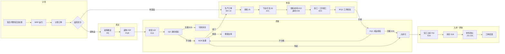
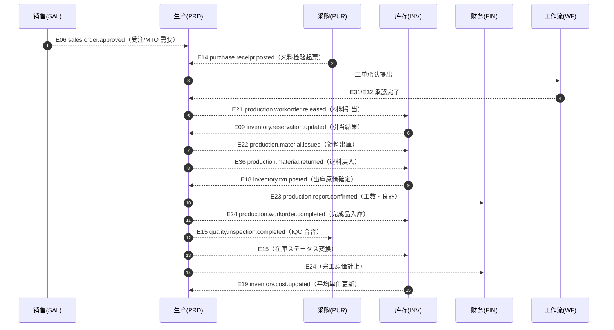

# 生产管理 业务域概要书（生産管理 業務概要書）

| 項目 | 内容 |
|---|---|
| 文書名 | 生产管理（含质量管理）业务域概要书（生産管理・品質管理 業務概要書） |
| 文書番号 | DSN-PRD-000 |
| 版数 | v1.0 |
| 作成日 | 2026-10-20 |
| 作成者 | production-designer |
| 承認者 | 未承認（レビュー待ち） |
| 状態 | ドラフト（レビュー中） |
| 関連文書 | [体系总览](../README.md) / [设计方针](../00-common/00-design-principles.md) / [共通项目定义](../00-common/01-common-item-definitions.md) / [共通业务规则](../00-common/08-common-business-rules.md) / [跨域流程](../00-common/09-cross-domain-flow.md) / [DB 共通规格](../00-common/04-common-db-spec.md) / [API 共通规格](../00-common/03-common-api-spec.md) / [样例企业](../90-data/demo-company.md) / [YE3 多阶 BOM](../90-data/bom-demo.md) / [YE3 工艺路线](../90-data/routing-demo.md) |

---

## 1. 業務概要

### 1.1 目的

生产管理域（PRD）负责把销售需求与经营计划转化为**可执行的制造指令**，并在制造过程中完成材料投入、工序进度、工时与质量的记录，最终产出可入库的合格品与可归集的生产成本。具体职责：

1. 维护「产品怎么造」的定义数据：BOM（多阶、版本、生效期、替代料、损耗率）、工艺路线（工序、工时、工作中心）、工作中心与产能。
2. 维护「造多少、什么时候造」的计划数据：需求预测、主生产计划（MPS）、MRP 物料需求计划、计划订单与动作消息。
3. 执行「按单制造」：生产订单（工单）的创建/下达/引当/领料/报工/入库/结案，以及委外加工的订单、发料、收货、加工费结算。
4. 保证「造得合格」：检验标准、IQC/IPQC/FQC/OQC 检验、不合格品 NCR 处置、批次追溯。
5. 向库存域提供出入库事实（E21/E22/E24/E25/E26/E36），向财务域提供材料费、人工费、制造费用与完工成本归集依据（E22/E23/E24 + E18），向销售域反馈交期执行情况。

> 本域的产品示例为**华东精密电机股份有限公司**（虚拟主体，仅用于设计验证）的 YE3 系列三相异步电动机，代表机型 **YE3-100L1-4（2.2 kW / 4 极）**，物料编码 `3001000001`（10 位＝大类 2 位 `30` 成品＋中类 2 位 `01` YE3 系列＋流水 6 位，出典：[06 代码一览](../00-common/06-code-list.md) 第 11 章・[08 共通业务规则](../00-common/08-common-business-rules.md) 2.2）。真实 BOM、材料牌号、工艺与工作中心以 [90-data/bom-demo.md](../90-data/bom-demo.md)、[90-data/routing-demo.md](../90-data/routing-demo.md)、[90-data/material-master.csv](../90-data/material-master.csv) 为准。

### 1.2 適用範囲

| 項目 | 内容 |
|---|---|
| 対象会社・拠点 | 华东精密电机股份有限公司 / 常州总装厂（主）、无锡零部件厂（部品加工・委外管理） |
| 対象機能範囲 | BOM・工艺路线・工作中心 → 需求预测/MPS/MRP → 生产订单 → 领料/报工 → 检验 → 完工入库 → 工单结案；委外加工全流程；质量管理（IQC/IPQC/FQC/OQC/NCR/追溯） |
| 対象外 | ①销售订单的登记与审批（SAL）；②采购订单、收货单、来料送检的发起（PUR）；③库存事务的实际记账、库存状态转换执行、移动加权平均计价（INV）；④会计凭证与成本差异分析（FIN）；⑤设备 IoT 数采的物理接入（INT，Phase 2）；⑥车间排产的图形化甘特图交互（Phase 2，数据模型在本域预留） |
| 前提 | ①MDM 物料主数据（含物料分类、基本单位、采购/生产视图字段）；②MDM 仓库・库位；③SYS 用户・角色・审批矩阵；④INV 可用量与引当接口；⑤FIN 会计期间状态与工费率（`prd_work_center`（PRD 所有）の费率或 `fin_labor_rate`） |

### 1.3 業務上の狙い（KPI）

| KPI | 定義・算式 | 目標値 | 実現する機能 ID |
|---|---|---|---|
| 计划达成率 | 当期按计划完工日完工的工单数 ÷ 当期计划完工工单数 × 100% | ≥ 95% | F-PRD-005、F-PRD-011、F-PRD-016 |
| 生产周期（工单） | Σ(完工日 − 下达日) ÷ 完工工单数（日） | ≤ 5 日 | F-PRD-005、F-PRD-017 |
| 良品率（工序） | 良品数 ÷（良品数 + 不良数 + 报废数）× 100% | ≥ 98.5% | F-PRD-007、F-PRD-017 |
| 一次通过率 FPY | 首次检验合格数 ÷ 首次送检数 × 100% | ≥ 96% | F-PRD-013、F-PRD-014 |
| 材料齐套率 | 下达时材料引当齐套的工单数 ÷ 下达工单数 × 100% | ≥ 98% | F-PRD-005、F-PRD-006 |
| BOM 准确率 | 抽检一致行数 ÷ 抽检总行数 × 100% | ≥ 99% | F-PRD-001、F-PRD-002 |
| 报工及时率 | 当日报工单数 ÷ 当日应报工工序数 × 100% | ≥ 95% | F-PRD-007 |
| 委外按期回收率 | 按期回收的委外订单数 ÷ 到期委外订单数 × 100% | ≥ 95% | F-PRD-009 |
| 工单成本差异率 | \|实际完工成本 − 标准成本\| ÷ 标准成本 × 100% | ≤ 5% | F-PRD-008、F-PRD-017（FIN 月结确定） |

> 目标值为【示例值】（示例企业年度经营目标）。KPI 的取数口径见 [07-dashboard-reports.md](07-dashboard-reports.md) 第 3 章。

## 2. 組織とロール

| ロール | 所属 | 主な操作 | 関連機能 ID | 権限（例） |
|---|---|---|---|---|
| 生产经理 | 生产部 | 工单审批、生产计划确认、结案审批、看板 | F-PRD-005、F-PRD-011、F-PRD-016 | `production:work-order:approve`、`production:plan:approve` |
| 计划员 | 生产部（计划科） | BOM/工艺参照、MRP 运行、计划订单确认、工单创建/下达/变更 | F-PRD-002、F-PRD-010、F-PRD-005、F-PRD-011 | `production:mrp:run`、`production:work-order:create/release` |
| 车间主管 | 生产部（车间） | 派工、报工审核、领料审核、异常处理 | F-PRD-005、F-PRD-006、F-PRD-007 | `production:work-report:approve`、`production:material-issue:approve` |
| 班组长 / 作业者 | 车间班组 | 报工登记（良品/不良/工时）、领料申请 | F-PRD-007、F-PRD-006 | `production:work-report:create` |
| 技术员 / 工艺员 | 技术部 | BOM 与工艺路线维护、检验标准制定、ECN 适用 | F-PRD-001、F-PRD-003、F-PRD-012 | `production:bom:update`、`production:routing:update`、`production:inspection-standard:update` |
| 质检员（IQC/IPQC/FQC） | 质量部 | 检验单登记、判定、NCR 起票 | F-PRD-013、F-PRD-014、F-PRD-015 | `production:inspection:create`、`production:ncr:create` |
| 质量主管 | 质量部 | 特采审批、NCR 处置审批、质量追溯 | F-PRD-014、F-PRD-015 | `production:ncr:approve`、`production:trace:view` |
| 仓管员 | 物流部（仓库） | 领料出库、完工入库、委外发料/收货、退料 | F-PRD-006、F-PRD-008、F-PRD-009 | `production:material-issue:create`、`production:completion:create` |
| 采购员 | 采购部 | 委外订单下单、加工费对账、MRP 建议转请购 | F-PRD-009、F-PRD-010 | `production:outsourcing:create`、`purchase:requisition:create` |
| 成本会计 | 财务部 | 工单成本归集与差异分析（FIN 主导，PRD 提供数据） | F-PRD-008、F-PRD-017 | `production:work-order:cost-view` |
| 系统管理员 | 信息部 | 参数维护、基础数据初始化 | F-PRD-020 | `production:param:update` |

### 2.1 承認経路

| 対象 | 条件 | 承認経路 | 方式 | 根拠 |
|---|---|---|---|---|
| 生产订单（工单） | 全部工单（下达前） | 计划员提出 → 生产经理审批 | 或签 | [08 共通业务规则](../00-common/08-common-business-rules.md) 第 8 章・示例企业规程 |
| 生产订单 超量/提前完工 | 完工数量 > 订单数量 5% 或提前 > 3 日 | 生产经理审批 | 或签 | 技术偏差管理规程（示例值） |
| BOM 变更 / 工艺变更 | 量产品变更 | 工艺员提出 → 技术部长 → 生产经理 → 质量主管（会签） | 順送 + 会签 | [08 共通业务规则](../00-common/08-common-business-rules.md) 11 章「重要项目变更」 |
| 检验标准变更 | 全部 | 质量主管审批 | 或签 | 质量管理体系文件控制（示例值） |
| 不合格品特采（让步接收） | 全部 | 质量主管 → 生产经理 → 技术部长（必要时顾客同意） | 順送 | [09 跨域流程](../00-common/09-cross-domain-flow.md) 第 8 章 |
| 报废（单次金额 ≥ 5,000 元） | 金额条件 | 质量主管 → 生产经理 → 财务经理 | 順送 | 示例企业规程（示例值） |
| 委外订单 | 加工费 ≥ 50,000 元 | 采购经理 → 生产经理 → 财务经理 | 順送 | [08 共通业务规则](../00-common/08-common-business-rules.md) 8.1（参照采购申请） |
| 工单结案 | 全部 | 计划员发起 → 生产经理确认（成本会计复核） | 順送 | 示例企业规程（示例值） |

> 审批经路通过 `wf_approval_matrix` 与 WF 流程定义管理，不在代码中硬编码；金额阈值与审批人是【示例值】。审批事件按 [09 跨域流程](../00-common/09-cross-domain-flow.md) 第 9 章（E31/E32）联动。

## 3. 業務フロー

### 3.1 全体フロー（計画→調達→製造→検査→入庫→原価）

### 3.2 処理手順（標準生産サイクル）

| # | 手順 | 実施者 | システム処理 | 入力 | 出力 | 異常時 |
|---|---|---|---|---|---|---|
| 1 | 需要収集 | 计划员 | 受注（SAL 同期参照）、売上予測、安全在庫割れ、既存工单未領料子件を需要源として集約 | 计划期间、对象品目 | 需求一览（`prd_mrp_demand`） | 需求源未确定 → 対象外とし警告 |
| 2 | MRP 実行 | 计划员 | BOM 展开、低层码顺序、毛需求→净需求→计划订单→动作消息（[05-mrp-planning.md](05-mrp-planning.md)） | BOM、库存、入荷预定、LT、批量规则 | 计划订单、动作消息 | BOM 循环/版数不整合 → 中断，`MSG-PRD-020` |
| 3 | 计划承認 | 生产经理 | 计划订单确认；采购品转请购（PUR），制造品转工单（PRD） | 计划订单 | PR 建议 / WO（10 草稿） | 计划跨期 → 警告 |
| 4 | 工单承認 | 生产经理 | WF 审批（E31/E32），状态 10→25 | 工单 | 批准工单 | 材料/能力不足 → 警告続行可（`MSG-PRD-045`） |
| 5 | 工单下达 | 计划员 | 材料引当（E21 → INV）、工序日程确定、制造指示书发行，状态 25→30 | 工单 | 引当结果（E09）、状态 30 | 引当不足 → 部分引当 + 补充请购建议（`MSG-PRD-046`） |
| 6 | 生産領料要求 | 仓管员 | PRD が領料**要求**を登録 → E22 → INV が MII を採番・出庫/引当消込 → E18。PRD は `stock_doc_id/stock_doc_no` を受領（**PRD は伝票採番しない**） | 工单、BOM、要求数量 | 領料要求（`prd_material_issue`） | 超領 → BOM 用量 × (1+损耗率) + 容许率検査（`MSG-PRD-030`） |
| 7 | 加工・報工 | 班组长 | 工序报工（良品/不良/报废/工数）→ E23；首件报工后状态 30→35 | 工单工序、数量、工时 | 报工单（`prd_work_report`） | 超工序数量 → `MSG-PRD-032`；未领料先报工 → 倒冲或缺料警告 |
| 8 | 工程内検査 | 质检员 | IPQC 检验单登记与判定（E15）；不合格 → NCR 起票 | 检验标准、样本 | 检验结果、NCR | 不合格 → 次工序禁止投入（`MSG-PRD-060`） |
| 9 | 完成検査 | 质检员 | FQC 成品检验与判定（E15） | 完成数量、批次 | 检验结果 | 不合格 → 返工/特采/报废 |
| 10 | 完工入库要求 | 仓管员 | PRD が完工**要求**を登録 → E24（`stockStatus=10 待検`）→ INV が FGI を採番・入庫 → E18。FQC 合格 E15 で在庫を 20 可用へ変換 | 完成品、批次 | 入庫要求（`prd_completion_receipt`） | 超订单数量 → 容许率検査（`MSG-PRD-040`） |
| 11 | 原価帰集 | 成本会计/系统 | 材料費（E22 実績）＋人工費（E23）＋製造費用配賦 → 完工暫定原価；FIN 月结确定（J11–J16） | 领料/报工实绩 | 工单成本（`prd_work_order.cost_*`）、E24 | 原価未確定 → 结案禁止（`MSG-PRD-075`） |
| 12 | 工单結案 | 计划员/生产经理 | 数量・材料・工时・检验全部闭环后结案（40→45），关闭变更 | 工单 | 结案记录 | 有余料/在制 → 提示先退料/盘点（`MSG-PRD-076`） |

### 3.3 状態遷移（本域の状態コード体系）

> 共通ステータス（[01 共通项目定义](../00-common/01-common-item-definitions.md) 7.1 / [08 共通业务规则](../00-common/08-common-business-rules.md) 3.1）を拡張して使用する。**域を跨ぐコードの意味を変えない**。

| 対象 | 状態コード | 状態名 | 意味 | 使用文書 |
|---|---|---|---|---|
| 生产订单（工单） | `10` | 草稿 | 手工/MRP 生成、未提交 | [02-work-order.md](02-work-order.md) |
| 生产订单 | `20` | 承認待ち | 已提交 WF、待生产经理审批（本域拡張。承認不要フローでは経由しない） | 同上 |
| 生产订单 | `25` | 承認済・未下达 | 批准完成、待下达 | 同上 |
| 生产订单 | `30` | 下达済 | 已下达、材料已引当、可开始作业 | 同上 |
| 生产订单 | `35` | 製造中 | 已首件报工（部分领料/部分报工/部分入库を含む） | 同上 |
| 生产订单 | `40` | 完工・結案 | 全数量完工入庫後、原価確定・未領 0 を確認して `closed_at` を設定（**終端**。`45 結案` は廃止し 08 §3 の終端 40 に整合） | [02-work-order.md](02-work-order.md) |
| 生产订单 | `90` | 取消 | 取消済み（引当解除・領料戻し・関連在庫戻し済み） | 同上 |
| 生产订单 | `95` | 却下 | 审批却下（再申請は `10` へ戻す） | 同上 |
| 工单材料行 | `00`/`10`/`20` | 未引当/部分引当/引当完了 | 引当状態（E09 受信で更新） | 同上 |
| 领料/退料要求 | `10`/`30`/`40`/`90` | 起票/要求確定（E22・E36）/INV 処理完了/取消 | 要求データのみ。MII・MIR 伝票は INV が採番・所有（`stock_doc_no`） | [03](03-material-issue-reporting.md) |
| 报工单 | `10`/`20`/`40`/`90` | 草稿/承認待ち/確定/取消 | 现场报工→班组长审核→確定（E23 発行） | 同上 |
| 完工入库要求 | `10`/`30`/`40`/`90` | 起票/要求確定（E24）/INV 処理完了/取消 | 要求データのみ。FGI 伝票は INV が採番・所有 | 同上 |
| 委外订单 | `10`/`20`/`25`/`30`/`35`/`40`/`90` | 共通体系に同じ | 30=発注済、35=一部受入、40=完了 | [04-outsourcing.md](04-outsourcing.md) |
| 委外発料/受入要求 | `10`/`30`/`40`/`90` | 起票/要求確定（E25・E26）/INV 処理完了/取消 | 要求データのみ。OSI・OSR 伝票は INV が採番・所有 | [04](04-outsourcing.md) |
| 检验单 | `10`/`30`/`40`/`90` | 草稿/検査中/判定確定/取消 | 判定確定で E15 発行 | [06-quality-management.md](06-quality-management.md) |
| NCR | `10`/`20`/`25`/`30`/`40`/`90` | 起票/承認待ち/承認済/処置中/完了/取消 | 処置完了で関連在庫・工单へ反映 | 同上 |
| BOM / 工艺路线 | `10`/`25`/`30`/`90` | 草稿/承認済/有効/廃止 | 有効期間（`valid_from`/`valid_to`）× `30` で適用判定 | [01-bom-routing-workcenter.md](01-bom-routing-workcenter.md) |
| 计划订单 | `10`/`20`/`25`/`30`/`40`/`90` | 提案/確認済/承認済/展開済/完了/取消 | 承认后转工单/请购 | [05-mrp-planning.md](05-mrp-planning.md) |
| 设备 | `10`/`20`/`30`/`40`/`90` | 待機/稼動/故障/修理中/廃棄 | Phase 2 詳細化 | [07-dashboard-reports.md](07-dashboard-reports.md) |

### 3.4 関連業務域との連携

| 相手域 | 連携内容 | 方式 | 契約 |
|---|---|---|---|
| SAL | 受注・売上予測の受領（MTO の需要源）、工单进度/交期回答の提供 | イベント購読（E06/E07/E08 + **E43 `sales.forecast.updated`（Phase 2）**）+ 同期参照（受注残照会） | [09 跨域流程](../00-common/09-cross-domain-flow.md) 第 5・6 章 |
| PUR | 来料检验起票（E14 受信）、IQC 判定結果通知（E15 発行）、MRP 計画発注→請購建議 | イベント（E14/E15）+ 計画データ連携（同期参照 API） | 第 4・8 章 |
| INV | 材料引当（E21）、領料出庫（E22）、退料戻入（E36）、完成品入庫（E24）、委外発料/受入（E25/E26）、在庫状態変換（E15）、平均単価参照（E19） | イベント（双方向） | 第 3・7・8 章 |
| FIN | 材料費（E22/E36/E18）、人工費（E23）、製造費用配賦、完工原価（E24）、仕訳 J11–J16 | イベント + 月結連携 | 第 7 章（J11〜J16） |
| WF | 工单・BOM 変更・特采・报废・委外的承認 | イベント（E31/E32）+ 提出 API | 第 9 章 |
| MDM | 物料・単位・倉庫・取引先の参照、マスタ変更イベント（E01/E39） | 同期参照 + E01/E39 購読 | 第 11 章 |
| SYS | 権限・組織・採番・監査ログ・添付・通知 | 公開 Service / API | [01 共通项目定义](../00-common/01-common-item-definitions.md) |
| INT | MES 工单下发/报工回传、PLM BOM/工艺同步、PDA/条码 | 外部 IF（IF-PRD-001〜004） | [92-report-batch-design.md](92-report-batch-design.md) |
| RPT | 生产 KPI 快照・分析视图的提供（読み取り専用） | 参照 | 第 12 章 |

**領域事件の発行/購読一覧**（[09 跨域流程](../00-common/09-cross-domain-flow.md) 第 3 章の契約に従う）

| 方向 | イベント | 契機 | ペイロード主要項目 | 本域の処理 |
|---|---|---|---|---|
| 発行 | `production.workorder.released`（E21） | 工单下达（25→30） | workOrderId, workOrderNo, lines[{materialId, requiredQty, uom, warehouseId}], plannedStartDate | 引当依頼 |
| 発行 | `production.material.issued`（E22） | 領料要求確定（MII は INV 採番） | workOrderId, requestNo, lines[{materialId, qty, unitCost, warehouseId, batchNo}], issuedAt | 材料費計上（J11） |
| 発行 | `production.material.returned`（E36） | 退料要求確定（MIR は INV 採番） | workOrderId, returnNo, lines[{materialId, qty, unitCost, warehouseId, batchNo}], returnReason, returnedAt | 在庫戻入・材料費戻し（J12） |
| 発行 | `production.report.confirmed`（E23） | 报工单確定 | workOrderId, operationId, goodQty, defectQty, workHours, reportedAt | 人工費・進捗更新 |
| 発行 | `production.workorder.completed`（E24） | 完工入库要求確定 | workOrderId, completedQty, inspectionId, inspectionResult, lines[{materialId, qty, batchNo, unitCost, stockStatus}], completedAt | 在庫は stockStatus=10 待検計上、FQC 合格 E15 で 20 可用 |
| 発行 | `production.outsourcing.issued`（E25） | 委外发料確定 | outsourcingOrderId, issueId, lines[{materialId, qty, unitCost}], issuedAt | 委託加工物資振替 |
| 発行 | `production.outsourcing.received`（E26） | 委外收货確定 | outsourcingOrderId, receiptId, lines[{materialId, qty, unitCost}], processingFee, receivedAt | 加工費計上 |
| 発行 | `quality.inspection.completed`（E15） | 検査判定確定（10 未検査では発行しない） | inspectionId, inspectionNo, inspectionType, sourceType, sourceNo, batchNo, warehouseId, resultCode(10/20/30/40/50), lines, inspectedAt | 在庫状態変換（待検→可用/不合格）・返品起動 |
| 購読 | `sales.order.approved`（E06） | 受注承認 | orderId, lines[{materialId, qty, deliveryDate}] | MTO 需要登録（`prd_mrp_demand`） |
| 購読 | `purchase.receipt.posted`（E14） | 入荷確定 | receiptId, lines[...] | IQC 検験単起票（待検） |
| 購読 | `inventory.reservation.updated`（E09） | 引当結果 | sourceId(=workOrderId), lines[{reservedQty, shortageQty}], status | 工单材料行引当状態更新 |
| 購読 | `inventory.txn.posted`（E18） | 在庫取引確定 | txnId, lines[{materialId, qty, unitCost, amount}] | 领料/入库实际成本回写 |
| 購読 | `inventory.cost.updated`（E19） | 平均単価更新 | materialId, avgUnitCost | 标准成本/暂定成本更新 |
| 購読 | `mdm.material.changed`（E01） | 物料変更 | materialId, changedFields | 参照キャッシュ更新 |
| 購読 | `workflow.task.completed`/`process.completed`（E31/E32） | 承認完了 | businessType, businessId, result | 工单/BOM/NCR 状態更新 |
| 購読 | `inventory.period.closed`（E20） | 在庫月結 | periodCode | 工单结案可能判定・原価確定 |
| 購読 | `inventory.period.reopened`（E37） | 在庫期間再開 | periodCode, reason, reopenedAt | 期間ロック解除の受信、再開後の領料・報工・入庫受付 |

## 4. 機能一覧

| 機能 ID | 機能名 | 概要 | 画面 ID | 種別 | 優先度 | 状態 | 詳細設計書 |
|---|---|---|---|---|---|---|---|
| F-PRD-001 | BOM 管理 | 多阶 BOM 的登记/修改/复制/版本/生效期/损耗率/替代料/承认；BOM 比较 | SCR-PRD-001〜003 | 登録/一覧 | P1 | 設計済 | [01-bom-routing-workcenter.md](01-bom-routing-workcenter.md) |
| F-PRD-002 | BOM 展开与成本卷算 | 多阶展开、低层码计算、用量与损耗、标准成本卷算、成本比较 | SCR-PRD-003 | 照会/計算 | P1 | 設計済 | 同上 |
| F-PRD-003 | 工艺路线管理 | 工序序列、工作中心、准备/单件工时、替代工序、版本与生效期 | SCR-PRD-004〜005 | 登録/一覧 | P1 | 設計済 | 同上 |
| F-PRD-004 | 工作中心与产能管理 | 工作中心、设备、班组、工作日历、班次、日能力 | SCR-PRD-006〜007 | 登録/一覧 | P1 | 設計済 | 同上 |
| F-PRD-005 | 生产订单管理 | 手工/MRP 生成、单阶/多阶、承认、下达、拆分/合并、变更、取消 | SCR-PRD-008〜011 | 登録/一覧/状態操作 | P1 | 設計済 | [02-work-order.md](02-work-order.md) |
| F-PRD-006 | 生产领料/补料/退料 | MII/MIR 登记、超领检查、倒冲（後方払出）、引当消込、退料戻入 | SCR-PRD-012〜013 | 登録/一覧 | P1 | 設計済 | [03-material-issue-reporting.md](03-material-issue-reporting.md) |
| F-PRD-007 | 工序报工 | 工序报工、良品/不良/报废、工数（人员/设备）、报工审核、返工追加工单 | SCR-PRD-014〜015 | 登録/一覧 | P1 | 設計済 | 同上 |
| F-PRD-008 | 生产入库 | 成品/半成品完工入库、批次、超量检查、取消 | SCR-PRD-016 | 登録/一覧 | P1 | 設計済 | 同上 |
| F-PRD-009 | 委外加工管理 | 委外订单、委外发料（OSI）、委外收货（OSR）、加工费结算与对账 | SCR-PRD-017〜020 | 登録/一覧/結算 | P2 | 設計済 | [04-outsourcing.md](04-outsourcing.md) |
| F-PRD-010 | MRP 物料需求计划 | 需求收集、毛需求→净需求→计划订单→动作消息、运行履历、计划订单确认 | SCR-PRD-021〜023 | バッチ/照会 | P1 | 設計済 | [05-mrp-planning.md](05-mrp-planning.md) |
| F-PRD-011 | 生产计划与排产 | 需求预测、MPS、粗能力负荷、日计划（甘特图为 Phase 2） | SCR-PRD-024 | 登録/計算 | P1 | 設計済 | [05-mrp-planning.md](05-mrp-planning.md) |
| F-PRD-012 | 检验标准管理 | 品目×工程×顾客的检验标准、检验项目、规格、抽样与判定基准 | SCR-PRD-025 | 登録/一覧 | P1 | 設計済 | [06-quality-management.md](06-quality-management.md) |
| F-PRD-013 | 检验实施（IQC/IPQC/FQC/OQC） | 检验单起票/登记/判定、E15 発行、結果照会 | SCR-PRD-026〜027 | 登録/一覧 | P1 | 設計済 | 同上 |
| F-PRD-014 | 不合格品处置（NCR） | NCR 起票、返工/特采/报废/返品处置、再检、处置履历 | SCR-PRD-028 | 登録/承認 | P1 | 設計済 | 同上 |
| F-PRD-015 | 质量追溯 | 批次/序列的正向・逆向追溯、受入ロット→完成品ロット→出荷先 | SCR-PRD-029 | 照会 | P1 | 設計済 | 同上 |
| F-PRD-016 | 生产进度看板 | 工单进度、日产量、工序滞留、缺料、异常工单 | SCR-PRD-030 | ダッシュボード | P1 | 設計済 | [07-dashboard-reports.md](07-dashboard-reports.md) |
| F-PRD-017 | 工时与效率统计 | 工时汇总、工数/产量/良率/效率、工作中心负荷与利用率 | SCR-PRD-031 | 集計/照会 | P1 | 設計済 | 同上 |
| F-PRD-018 | 设备台账/点检/维修 | 设备台账、点检计划与记录、维修工单（Phase 2 概要） | SCR-PRD-032 | 登録/一覧 | P2 | 設計済（概要） | 同上 |
| F-PRD-019 | 生产报表 | 工单执行、产量、良率、效率、委外回收等报表 | SCR-PRD-033 | 帳票/集計 | P1 | 設計済 | [92-report-batch-design.md](92-report-batch-design.md) |
| F-PRD-020 | 生产期末处理 | 工单结案、在制品结转、期间关闭检查、数据初始化 | —（バッチ） | バッチ | P1 | 設計済 | [92-report-batch-design.md](92-report-batch-design.md) |

> 優先度：P0（Phase 1 MVP）/ P1（Phase 1.5）/ P2（Phase 2）。本域无 P0 功能（生产为 Phase 1.5 范围）。状態：未設計/設計中/設計済/レビュー済/承認済。

## 5. 画面一覧

| 画面 ID | 画面名 | 類型 | 機能 ID | 権限コード | 遷移元 | 遷移先 |
|---|---|---|---|---|---|---|
| SCR-PRD-001 | BOM 一覧 | 一覧検索 | F-PRD-001 | `production:bom:view` | 菜单：生产管理 > BOM | 002、003 |
| SCR-PRD-002 | BOM 登録編集 | 登録編集 | F-PRD-001 | `production:bom:update` | 001 | 001、003 |
| SCR-PRD-003 | BOM 多阶展开・成本卷算 | 参照詳細 | F-PRD-002 | `production:bom:view` | 001、002 | 001 |
| SCR-PRD-004 | 工艺路线一覧 | 一覧検索 | F-PRD-003 | `production:routing:view` | 菜单：生产管理 > 工艺路线 | 005 |
| SCR-PRD-005 | 工艺路线登録編集 | 登録編集 | F-PRD-003 | `production:routing:update` | 004 | 004 |
| SCR-PRD-006 | 工作中心一覧・編集 | 一覧検索 | F-PRD-004 | `production:work-center:view` | 菜单：生产管理 > 工作中心 | 007 |
| SCR-PRD-007 | 工作日历・产能设定 | 登録編集 | F-PRD-004 | `production:work-center:update` | 006 | 006 |
| SCR-PRD-008 | 生产订单一覧 | 一覧検索 | F-PRD-005 | `production:work-order:view` | 菜单：生产管理 > 生产订单 | 009、010、011 |
| SCR-PRD-009 | 生产订单登録編集 | 登録編集 | F-PRD-005 | `production:work-order:create` | 008 | 008、010 |
| SCR-PRD-010 | 生产订单詳細（工序/用料/报工/入库标签） | 参照詳細 | F-PRD-005 | `production:work-order:view` | 008、009 | 009、012、014、016 |
| SCR-PRD-011 | 生产订单下达・拆分・合并 | ウィザード | F-PRD-005 | `production:work-order:release` | 008、010 | 008、010 |
| SCR-PRD-012 | 生产领料单登録編集 | 登録編集 | F-PRD-006 | `production:material-issue:create` | 010 | 013 |
| SCR-PRD-013 | 领退料一覧 | 一覧検索 | F-PRD-006 | `production:material-issue:view` | 菜单：生产管理 > 领料/退料 | 012 |
| SCR-PRD-014 | 工序报工登録（现场/扫码） | 登録編集 | F-PRD-007 | `production:work-report:create` | 010、PDA | 015 |
| SCR-PRD-015 | 报工一覧・审核 | 一覧検索 | F-PRD-007 | `production:work-report:view` | 菜单：生产管理 > 报工 | 014 |
| SCR-PRD-016 | 生产入库登録 | 登録編集 | F-PRD-008 | `production:completion:create` | 010 | 010 |
| SCR-PRD-017 | 委外订单一覧 | 一覧検索 | F-PRD-009 | `production:outsourcing:view` | 菜单：生产管理 > 委外加工 | 018、019、020 |
| SCR-PRD-018 | 委外订单登録編集 | 登録編集 | F-PRD-009 | `production:outsourcing:create` | 017 | 017、019 |
| SCR-PRD-019 | 委外发料・收货登録 | 登録編集 | F-PRD-009 | `production:outsourcing:create` | 017、018 | 017 |
| SCR-PRD-020 | 委外加工费结算 | 登録編集 | F-PRD-009 | `production:outsourcing:settle` | 017 | 017 |
| SCR-PRD-021 | MRP 运行向导 | ウィザード | F-PRD-010 | `production:mrp:run` | 菜单：生产管理 > MRP | 022 |
| SCR-PRD-022 | MRP 结果（需求/净需求/计划订单/动作消息） | 一覧検索 | F-PRD-010 | `production:mrp:view` | 021 | 023 |
| SCR-PRD-023 | 计划订单确认・转工单/请购 | 一覧検索 | F-PRD-010 | `production:mrp:confirm` | 022 | 008、024 |
| SCR-PRD-024 | MPS・排产（粗能力） | 登録編集 | F-PRD-011 | `production:plan:update` | 菜单：生产管理 > 生产计划 | 008、023 |
| SCR-PRD-025 | 检验标准一覧・編集 | 登録編集 | F-PRD-012 | `production:inspection-standard:update` | 菜单：生产管理 > 质量 > 检验标准 | 026 |
| SCR-PRD-026 | 检验单登録（IQC/IPQC/FQC/OQC） | 登録編集 | F-PRD-013 | `production:inspection:create` | 010、菜单 | 027 |
| SCR-PRD-027 | 检验一覧・判定 | 一覧検索 | F-PRD-013 | `production:inspection:view` | 菜单：生产管理 > 质量 > 检验 | 026、028 |
| SCR-PRD-028 | NCR 登録・处置 | 登録編集 | F-PRD-014 | `production:ncr:create` | 027、010 | 027、029 |
| SCR-PRD-029 | 质量追溯查询 | 照会 | F-PRD-015 | `production:trace:view` | 菜单：生产管理 > 质量 > 追溯 | — |
| SCR-PRD-030 | 生产进度看板 | ダッシュボード | F-PRD-016 | `production:dashboard:view` | 菜单：生产管理 > 看板 | 008 |
| SCR-PRD-031 | 工时・效率统计 | 一覧検索 | F-PRD-017 | `production:report:view` | 菜单：生产管理 > 统计 | 033 |
| SCR-PRD-032 | 设备台账（Phase 2） | 一覧検索 | F-PRD-018 | `production:equipment:view` | 菜单：生产管理 > 设备 | 032 |
| SCR-PRD-033 | 生产报表 | 帳票プレビュー | F-PRD-019 | `production:report:view` | 菜单：生产管理 > 报表 | 031 |

## 6. 帳票一覧

| 帳票 ID | 帳票名 | 出力タイミング | 帳票種別 | 機能 ID | 詳細 |
|---|---|---|---|---|---|
| PRT-PRD-001 | 生产订单（制造指示书） | 工单下达时（手動/自動） | 伝票 | F-PRD-005 | [92](92-report-batch-design.md) |
| PRT-PRD-002 | 生产领料要求書（MII は INV 帳票） | 領料要求確定時 | 要求書 | F-PRD-006 | 同上 |
| PRT-PRD-003 | 生产退料要求書（MIR は INV 帳票） | 退料要求確定時 | 要求書 | F-PRD-006 | 同上 |
| PRT-PRD-004 | 工序报工单 | 报工确定时（任意） | 伝票 | F-PRD-007 | 同上 |
| PRT-PRD-005 | 完工入库要求書（FGI は INV 帳票） | 入庫要求確定時 | 要求書 | F-PRD-008 | 同上 |
| PRT-PRD-006 | 委外订单（OS） | 委外订单审批后 | 伝票 | F-PRD-009 | 同上 |
| PRT-PRD-007 | 委外発料要求書（OSI は INV 帳票） | 発料要求確定時 | 要求書 | F-PRD-009 | 同上 |
| PRT-PRD-008 | 委外受入要求書（OSR は INV 帳票） | 受入要求確定時 | 要求書 | F-PRD-009 | 同上 |
| PRT-PRD-009 | 委外加工费结算明细 | 结算确定时 | 集計表 | F-PRD-009 | 同上 |
| PRT-PRD-010 | 检验报告（IQC/IPQC/FQC） | 判定确定时 | 伝票 | F-PRD-013 | 同上 |
| PRT-PRD-011 | 不合格品报告（NCR） | NCR 承认时 | 伝票 | F-PRD-014 | 同上 |
| PRT-PRD-012 | 批次追溯报告 | 追溯查询时 | 集計表 | F-PRD-015 | 同上 |
| PRT-PRD-013 | 生产工单执行明细表 | 任意/月次 | 一覧表 | F-PRD-019 | 同上 |
| PRT-PRD-014 | 产量・良率・工时效率报表 | 月次/任意 | 集計表 | F-PRD-019 | 同上 |
| PRT-PRD-015 | 简化成本计算表（工单） | 月次 | 集計表 | F-PRD-008、F-PRD-017 | 同上 |
| PRT-PRD-016 | 工序负荷表（粗能力） | 任意 | 集計表 | F-PRD-011 | 同上 |

## 7. バッチ一覧

| バッチ ID | バッチ名 | 起動方式 | 実行時間帯 | 処理概要 | 冪等性 |
|---|---|---|---|---|---|
| BAT-PRD-001 | MRP 自動実行（日次） | 日次/手動 | 毎日 20:00 | 需要収集→展开→计划订单→动作消息（[05](05-mrp-planning.md) 第 4 章） | 再実行可（同一运行日は上書き） |
| BAT-PRD-002 | 低层码再計算 | 日次/手動 | 毎日 20:10 | BOM 変更後の低层码再計算（[01](01-bom-routing-workcenter.md) 5.2） | 再実行可 |
| BAT-PRD-003 | 安全在庫・発注点チェック | 日次 | 毎日 07:00 | 安全在庫割れ → 需要源登録（設定時）・通知 | 再実行可（当日重複は除外） |
| BAT-PRD-004 | 納期遅延・滞留アラート | 日次 | 毎日 08:00 | 遅延工单/滞留工序/逾期检验の抽出と通知 | 再実行可 |
| BAT-PRD-005 | 工单自動結案 | 日次 | 毎日 01:00 | 全数入库・全数报工・検査完了・成本確定の工单に `closed_at` を設定（`order_status=40` のまま・結案は終端フラグ） | 再実行可 |
| BAT-PRD-006 | 在制品・工单成本结转 | 月次 | 月結前（月末翌 1 日 02:00） | 工单在制品余额、完工成本暂定值的结转与 FIN 连携 | 再実行可（当期間のみ） |
| BAT-PRD-007 | 工时汇总（日次/月次） | 日次/月次 | 毎日 02:30 / 月初 03:00 | 报工实绩 → 日次/月次工时表（[07](07-dashboard-reports.md)） | 再実行可 |
| BAT-PRD-008 | 产能负荷快照 | 日次 | 毎日 03:00 | 未完工工单的工序负荷×工作日历 → `prd_capacity_load` | 再実行可 |
| BAT-PRD-009 | 委外未回收提醒 | 日次 | 毎日 08:30 | 超過納期の委外订单/未回收发料の抽出と督促通知 | 再実行可 |
| BAT-PRD-010 | 检验超期提醒 | 日次 | 毎日 08:30 | 未判定の IQC/IPQC/FQC の抽出と通知 | 再実行可 |
| BAT-PRD-011 | MRP 需求・計画データ保持期限処理 | 月次 | 月初 05:00 | 完了計画订单・旧运行のアーカイブ（保存期間 3 年） | 再実行可 |

## 8. テーブル一覧

| 物理名 | 論理名 | 種別 | 主な用途 | 更新元機能 ID | データ量見積 |
|---|---|---|---|---|---|
| `prd_bom` | BOM 头 | マスタ | 品目×版本×工厂的 BOM 定义 | F-PRD-001 | 初期 3,000 / 年 +500 / 5 年 5,500 |
| `prd_bom_line` | BOM 明细 | マスタ | 构成件・用量・损耗率・低层码展开 | F-PRD-001 | 初期 30,000 / 年 +6,000 / 5 年 60,000 |
| `prd_bom_substitute` | BOM 替代料 | マスタ | 替代料与优先级、替代比率 | F-PRD-001 | 初期 3,000 / 年 +600 / 5 年 6,000 |
| `prd_routing` | 工艺路线头 | マスタ | 品目×版本×工厂的工艺定义 | F-PRD-003 | 初期 2,500 / 年 +400 / 5 年 4,500 |
| `prd_routing_operation` | 工艺工序 | マスタ | 工序序列・工作中心・工时 | F-PRD-003 | 初期 25,000 / 年 +4,000 / 5 年 45,000 |
| `prd_routing_operation_alt` | 替代工序 | マスタ | 同一工序的替代工作中心/设备 | F-PRD-003 | 初期 2,000 / 年 +300 / 5 年 3,500 |
| `prd_work_center` | 工作中心 | マスタ | 设备/班组的产能单位、费率 | F-PRD-004 | 初期 80 / 年 +5 / 5 年 105 |
| `prd_work_center_calendar` | 工作日历 | マスタ | 工作日・班次・能力时间 | F-PRD-004 | 初期 2,000 / 年 +800 / 5 年 6,000 |
| `prd_equipment` | 设备台账 | マスタ | 设备编号・规格・关联工作中心 | F-PRD-018 | 初期 150 / 年 +10 / 5 年 200 |
| `prd_equipment_maintenance` | 设备点检维修 | 伝票 | 点检记录・维修工单（P2） | F-PRD-018 | 初期 0 / 年 +3,000 / 5 年 15,000 |
| `prd_material_planning` | 物料计划参数 | マスタ | 提前期・批量规则・安全库存・低层码・良品率 | F-PRD-010 | 初期 8,000 / 年 +1,000 / 5 年 13,000 |
| `prd_demand_forecast` | 需求预测 | 伝票 | 品目×期間の予測数量 | F-PRD-011 | 初期 5,000 / 年 +12,000 / 5 年 65,000 |
| `prd_mps` | 主生产计划头 | 伝票 | 期间×工厂的 MPS | F-PRD-011 | 初期 100 / 年 +120 / 5 年 700 |
| `prd_mps_line` | 主生产计划明细 | 伝票 | 品目×日/週の计划数量 | F-PRD-011 | 初期 5,000 / 年 +12,000 / 5 年 65,000 |
| `prd_mrp_run` | MRP 运行 | 履歴 | 运行条件・件数・状態 | F-PRD-010 | 初期 0 / 年 +300 / 5 年 1,500 |
| `prd_mrp_demand` | MRP 需求 | 履歴 | 需要源・毛需求・净需求（品目×バケット） | F-PRD-010 | 年間 +150,000 / 5 年 750,000（3 年保存） |
| `prd_mrp_plan_order` | MRP 计划订单 | 伝票 | 计划订单（制造/采购・数量・日付） | F-PRD-010 | 年間 +60,000 / 5 年 300,000（3 年保存） |
| `prd_mrp_action` | MRP 动作消息 | 履歴 | 発注/製造/取消/延期建议 | F-PRD-010 | 年間 +100,000 / 5 年 500,000（3 年保存） |
| `prd_work_order` | 生产订单 | 伝票 | 工单头・数量・日期・状态・コスト | F-PRD-005 | 初期 30,000 / 年 +18,000 / 5 年 120,000 |
| `prd_work_order_material` | 工单用料 | 伝票明細 | BOM 展开后的必要量・引当・领料・损耗 | F-PRD-005、F-PRD-006 | 初期 300,000 / 年 +180,000 / 5 年 1,200,000 |
| `prd_work_order_operation` | 工单工序 | 伝票明細 | 工序日程・实绩工数・良品/不良 | F-PRD-005、F-PRD-007 | 初期 250,000 / 年 +150,000 / 5 年 1,000,000 |
| `prd_work_order_change` | 工单变更履历 | 履歴 | 变更项目・前後值・理由・承認 | F-PRD-005 | 年間 +30,000 / 5 年 150,000 |
| `prd_work_order_relation` | 工单拆分/合并关系 | 履歴 | 元工单与拆分/合并后工单的关联 | F-PRD-005 | 年間 +8,000 / 5 年 40,000 |
| `prd_material_issue` | 领料/退料要求 | 要求 | 要求データ（伝票番号は INV 参照） | F-PRD-006 | 初期 60,000 / 年 +50,000 / 5 年 310,000 |
| `prd_material_issue_line` | 领退料明细 | 伝票明細 | 物料・批次・数量・原价 | F-PRD-006 | 初期 240,000 / 年 +200,000 / 5 年 1,240,000 |
| `prd_work_report` | 报工单 | 伝票 | 工序报工头・数量・工数・状態 | F-PRD-007 | 初期 200,000 / 年 +150,000 / 5 年 950,000 |
| `prd_work_report_labor` | 报工工数明细 | 伝票明細 | 人员/设备×工时×賃率 | F-PRD-007 | 初期 400,000 / 年 +300,000 / 5 年 1,900,000 |
| `prd_work_report_defect` | 报工不良明细 | 伝票明細 | 缺陷代码・数量・处置区分・责任工序 | F-PRD-007、F-PRD-014 | 初期 80,000 / 年 +60,000 / 5 年 380,000 |
| `prd_completion_receipt` | 完工入库要求 | 要求 | 要求データ（FGI は INV 参照） | F-PRD-008 | 初期 40,000 / 年 +24,000 / 5 年 160,000 |
| `prd_completion_receipt_line` | 完工入库明细 | 伝票明細 | 产品/半成品・批次・数量・暂定成本 | F-PRD-008 | 初期 60,000 / 年 +40,000 / 5 年 260,000 |
| `prd_outsourcing_order` | 委外订单头 | 伝票 | 委外订单・供应商・加工费・交期 | F-PRD-009 | 初期 5,000 / 年 +4,000 / 5 年 25,000 |
| `prd_outsourcing_order_line` | 委外订单明细 | 伝票明細 | 委外品目・数量・加工单价・交期 | F-PRD-009 | 初期 15,000 / 年 +12,000 / 5 年 75,000 |
| `prd_outsourcing_issue` | 委外发料要求 | 要求 | 要求データ（OSI は INV 参照） | F-PRD-009 | 初期 5,000 / 年 +4,000 / 5 年 25,000 |
| `prd_outsourcing_issue_line` | 委外发料明细 | 伝票明細 | 材料・批次・数量・原价 | F-PRD-009 | 初期 20,000 / 年 +16,000 / 5 年 100,000 |
| `prd_outsourcing_receipt` | 委外收货要求 | 要求 | 要求データ（OSR は INV 参照） | F-PRD-009 | 初期 5,000 / 年 +4,000 / 5 年 25,000 |
| `prd_outsourcing_receipt_line` | 委外收货明细 | 伝票明細 | 品目・数量・材料费+加工费 | F-PRD-009 | 初期 15,000 / 年 +12,000 / 5 年 75,000 |
| `prd_outsourcing_settlement` | 委外结算单头 | 伝票 | 加工费结算・供应商・期间 | F-PRD-009 | 初期 500 / 年 +600 / 5 年 3,500 |
| `prd_outsourcing_settlement_line` | 委外结算明细 | 伝票明細 | 收货单×加工费×扣款 | F-PRD-009 | 初期 2,000 / 年 +2,400 / 5 年 14,000 |
| `prd_inspection_standard` | 检验标准头 | マスタ | 品目×工程×顾客的标准 | F-PRD-012 | 初期 2,000 / 年 +300 / 5 年 3,500 |
| `prd_inspection_standard_item` | 检验标准项目 | マスタ | 检验项目・规格・抽样・判定 | F-PRD-012 | 初期 20,000 / 年 +3,000 / 5 年 35,000 |
| `prd_inspection` | 检验单头 | 伝票 | IQC/IPQC/FQC/OQC 检验单 | F-PRD-013 | 初期 80,000 / 年 +60,000 / 5 年 380,000 |
| `prd_inspection_line` | 检验结果明细 | 伝票明細 | 项目×实测值×判定×不良数 | F-PRD-013 | 初期 600,000 / 年 +450,000 / 5 年 2,850,000 |
| `prd_ncr` | 不合格品报告 | 伝票 | NCR 头・不良内容・处置区分・承認 | F-PRD-014 | 初期 8,000 / 年 +6,000 / 5 年 38,000 |
| `prd_ncr_action` | NCR 处置措施 | 伝票明細 | 返工/特采/报废/返品・数量・结果 | F-PRD-014 | 初期 12,000 / 年 +9,000 / 5 年 57,000 |
| `prd_defect_code` | 缺陷代码 | マスタ | 不良現象・原因区分・责任工程 | F-PRD-012、F-PRD-014 | 初期 200 / 年 +20 / 5 年 300 |
| `prd_wo_lot` | 工单批次追溯 | 履歴 | 投入批次→产出批次→工序→设备的追溯链 | F-PRD-015 | 年間 +200,000 / 5 年 1,000,000（5 年保存） |
| `prd_capacity_load` | 产能负荷快照 | 集計 | 工作中心×日/週の负荷与能力 | BAT-PRD-008 | 年間 +60,000 / 5 年 300,000（1 年保存） |

> データ量は [04 DB 共通规格](../00-common/04-common-db-spec.md) 13 章の全社見積（`prd_work_order` 30,000 初期、`prd_work_report` 200,000 初期）との整合を取った【示例值】。詳細は [90-db-design.md](90-db-design.md)。

## 9. 外部 IF 一覧

| IF ID | 名称 | 相手先 | 方向 | 方式 | 頻度 | 契機 |
|---|---|---|---|---|---|---|
| IF-PRD-001 | MES 工单下发・报工回传 | 制造执行系统（MES） | 双方向 | REST/JSON | リアルタイム | 工单下达時・工序完了時 |
| IF-PRD-002 | PLM BOM/工艺同步 | 产品生命周期管理（PLM） | 受信 | REST/JSON/ファイル | 日次 | 设计变更（ECN）时 |
| IF-PRD-003 | PDA/条码 报工・领料扫描 | 手持终端/PDA | 双方向 | REST/JSON | リアルタイム | 现场扫描时 |
| IF-PRD-004 | 设备数据采集（Phase 2） | 设备 IoT 网关 | 受信 | MQTT/REST | 定期（分） | 设备状态・产量采集 |

> 域間連携（INV/PUR/FIN/WF）は `IF-` ではなく[09 跨域流程](../00-common/09-cross-domain-flow.md) の領域イベント（E15/E21〜E26 等）で行う（[设计方针](../00-common/00-design-principles.md) 6.4）。

## 10. 権限一覧

| 権限コード | 対象機能 | 対象データ範囲 | 付与ロール |
|---|---|---|---|
| `production:bom:view` | F-PRD-001/002 | 全社（技術・計画・製造・原価） | 生产经理、计划员、技术员、成本会计 |
| `production:bom:create` / `update` | F-PRD-001 | 所属工厂 | 技术员、工艺员 |
| `production:bom:approve` | F-PRD-001（BOM 变更审批） | 所属工厂 | 技术部长、生产经理 |
| `production:routing:view` | F-PRD-003 | 全社 | 计划员、生产经理、车间主管 |
| `production:routing:create` / `update` / `approve` | F-PRD-003 | 所属工厂 | 工艺员 / 技术部长 |
| `production:work-center:view` | F-PRD-004 | 全社 | 计划员、生产经理 |
| `production:work-center:update` | F-PRD-004 | 所属工厂 | 工艺员、计划员 |
| `production:work-order:view` | F-PRD-005 | 自己所属工厂（データ範囲） | 全生产相关人员 |
| `production:work-order:create` | F-PRD-005 | 所属工厂 | 计划员、车间主管 |
| `production:work-order:update` | F-PRD-005 | 所属工厂（10/25 状态のみ） | 计划员 |
| `production:work-order:approve` | F-PRD-005 | 所属工厂 | 生产经理 |
| `production:work-order:release` | F-PRD-005 | 所属工厂 | 计划员、生产经理 |
| `production:work-order:close` | F-PRD-005/F-PRD-020 | 所属工厂 | 生产经理、成本会计 |
| `production:work-order:cancel` / `reverse` | F-PRD-005 | 所属工厂 | 生产经理 |
| `production:material-issue:view` / `create` | F-PRD-006 | 所属工厂・所属仓库 | 仓管员、车间主管 |
| `production:material-issue:approve` | F-PRD-006（超领审批） | 所属工厂 | 车间主管、生产经理 |
| `production:material-issue:reverse` | F-PRD-006 | 所属工厂 | 仓管员（当日）、生产经理 |
| `production:work-report:view` | F-PRD-007 | 所属车间 | 班组长、车间主管 |
| `production:work-report:create` | F-PRD-007 | 所属车间 | 班组长、作业者 |
| `production:work-report:approve` | F-PRD-007 | 所属车间 | 车间主管 |
| `production:completion:create` | F-PRD-008 | 所属仓库 | 仓管员 |
| `production:outsourcing:view` | F-PRD-009 | 全社 | 采购员、计划员、生产经理 |
| `production:outsourcing:create` / `update` | F-PRD-009 | 所属工厂 | 采购员、计划员 |
| `production:outsourcing:approve` | F-PRD-009 | 全社 | 采购经理、生产经理 |
| `production:outsourcing:settle` | F-PRD-009 | 全社 | 采购员、成本会计 |
| `production:mrp:run` | F-PRD-010 | 全社 | 计划员 |
| `production:mrp:view` | F-PRD-010 | 全社 | 计划员、采购员、生产经理 |
| `production:mrp:confirm` | F-PRD-010 | 全社 | 计划员、生产经理 |
| `production:plan:view` / `update` | F-PRD-011 | 全社 | 计划员、生产经理 |
| `production:inspection-standard:view` / `update` | F-PRD-012 | 全社 | 质检员、质量主管、工艺员 |
| `production:inspection:create` | F-PRD-013 | 所属工厂 | 质检员 |
| `production:inspection:view` | F-PRD-013 | 全社 | 质检员、质量主管、计划员 |
| `production:inspection:judge` | F-PRD-013（合否判定） | 全社 | 质检员、质量主管 |
| `production:ncr:create` | F-PRD-014 | 所属工厂 | 质检员、车间主管 |
| `production:ncr:approve` | F-PRD-014（特采・报废） | 全社 | 质量主管、生产经理 |
| `production:trace:view` | F-PRD-015 | 全社 | 质检员、质量主管、生产经理 |
| `production:equipment:view` / `update` | F-PRD-018 | 所属工厂 | 设备员（Phase 2） |
| `production:dashboard:view` | F-PRD-016 | データ範囲適用 | 生产经理、计划员、车间主管 |
| `production:report:view` / `export` | F-PRD-017/019 | データ範囲適用 | 生产经理、计划员、成本会计 |
| `production:param:update` | F-PRD-020 | 全社 | 系统管理员 |

> 権限コードは [设计方针](../00-common/00-design-principles.md) 6.6（`{module}:{resource}:{action}`）に従う。データ範囲（全社/工場/部門/本人）は SYS のロールデータ範囲で定義し、API 側で強制適用する（[01 共通项目定义](../00-common/01-common-item-definitions.md) 第 4 章）。

## 11. 用語（本域固有）

| 用語 | 説明 | 対応英語/日文 |
|---|---|---|
| 多阶 BOM | 具有层级结构的物料清单，可逐阶展开到最下阶 | Multi-level BOM / 多段 BOM |
| 低层码 | 物料在全部 BOM 中出现的最大层级（0=最终产品），MRP 按低层码升序展开 | Low-level Code / ローレベルコード |
| 生效期 | BOM/工艺路线/检验标准的适用期间 `valid_from`〜`valid_to` | Effective Period / 有効期間 |
| 损耗率 | BOM 子件在加工过程中的预定损耗比例（比率 0.0350 = 3.5%） | Scrap Rate / ロス率 |
| 成本卷算 | 按 BOM 逐阶汇总材料费、人工费、制造费用得到标准成本 | Cost Roll-up / 原価積上 |
| 替代料 | 在主料缺料/成本变化时可替代使用的物料，含优先级与替代比率 | Substitute Material / 代替品 |
| 工作中心 | 执行工序的设备/班组单位，是产能与费率的最小管理单位 | Work Center / ワークセンター |
| 粗能力 | 依据工艺工时与工作日历概算的能力需求与供给比较 | Rough-cut Capacity / 粗能力 |
| 倒冲 | 完工/报工时按 BOM 标准用量自动扣减材料，不预先领料 | Backflush / 後方払出 |
| 补料 | 因损耗/不良超出标准用量时追加领料 | Additional Issue / 追加払出 |
| 拆分 | 将一张工单按数量/工序拆成多张工单 | Split / 分割 |
| 合并 | 将相同品目/交期/工艺的多张工单合并为一张 | Merge / 統合 |
| 结案 | 工单数量、材料、工时、检验、成本全部闭环后关闭，不可变更 | Close / 結案 |
| 批次追溯 | 由投入批次追溯到产出批次→出货，或逆向追溯 | Lot Traceability / ロット追跡 |
| NCR | 不合格品报告（Nonconformance Report），记录不良内容与处置 | NCR / 不適合品報告 |
| 特采（让步接收） | 不合格品在顾客/技术同意下条件接收 | Concession / 特採 |
| 首件 | 每批/每班开始时的首件检验对象 | First Article / 初品 |
| IPQC | 过程检验（工序内检验），工序完成后按检验标准实施 | In-process Inspection / 工程内検査 |
| FQC | 成品检验，完工入库前实施 | Final Inspection / 最終検査 |
| OQC | 出货检验，出荷前（任意）实施 | Outgoing Inspection / 出荷検査 |
| IQC | 来料检验，采购收货后入库前实施 | Incoming Inspection / 受入検査 |
| 报工 | 记录工序完成数量、良品/不良/报废与工数的作业 | Work Report / 作業実績報告 |
| 派工 | 将工单工序分配给班组/作业者 | Dispatching / 割当 |
| 在制品 | 已投入材料与工时但尚未完工入库的工单成本 | WIP / 仕掛品 |
| 工费率 | 工作中心单位工时的费率（人工费/制造费用） | Work Center Rate / 工賃率 |

## 12. 他域との依存関係

| 依存先 | 依存内容 | 未成立時の影響 | 対応 |
|---|---|---|---|
| MDM | 物料主数据（分类/单位/采购生产视图）、仓库、供应商、取引先 | 工单/BOM/委外无法登记 | 主数据先行（P0），本域引用 |
| MDM | 工作中心关联的组织・成本中心、费率 | 成本卷算/制造费用配賦不可 | 费率缺失时使用默认费率并警告 |
| INV | 可用量/引当/出库/入库/状态转换/平均单价 | 下达不能引当、领料不能出库、入库不能记账 | 本域产出入库事实，INV 执行记账 |
| INV | 批次编号规则与批次主数据 | 批次追溯链断裂 | 批次由 INV 生成；本域记录关联 |
| PUR | 收货单与来料检验（E14）、请购（MRP 建议） | IQC 无法起票、采购需求传递不了 | E14 购読 + 请购 API |
| SAL | 受注・预测（需要源）、出荷实绩 | MTO 无需要源；交期反馈不可 | E06 购読 + 受注残照会 |
| FIN | 会计期间状态、工费率、成本核算结果 | 报工/领料跨期、完工原价未确定 | 期间状态照会（缓存 1 分）、月末结账后结案 |
| WF | 审批（工单/BOM 变更/特采/报废/委外） | 状態 25/承認済 に進めない | WF 未設定時は「承認スキップ」不可（設定で自動承認可） |
| SYS | 採番（WO/OS/REQ/IQC/NCR）、权限、审计、附件。**在庫側伝票（MII/MIR/FGI/OSI/OSR）の採番は INV が所有** | 单号无法生成 | 採番サービス同期呼出 |
| INT | MES/PLM/PDA | 无 MES 时手工报工；无 PLM 时手工维护 BOM | IF 可选，失败时降级手工 |

## 13. 未決事項

| # | 事項 | 理由 | 暫定仕様 | 担当 | 期限 |
|---|---|---|---|---|---|
| 1 | 委外加工费的税区分与进项税处理（加工费是否单独开票、税率 13%） | 与 PUR/FIN 的委外结算口径需统一 | 暂按「加工费 13% 进项税、不含税单价录入口径」设计；FIN 凭证模板待 FIN 域确认 | PRD + FIN | 2026-11-10 |
| 2 | ~~成本核算方法与差异分摊口径~~ **已決（2026-10-20，Yuri 确认）** | 按 FIN BC-01 定为正式规则：MTS 品种法（按产品+期间归集）、MTO 分批法（按工单归集）| 本域工单只归集「实际领料（E22）+实际报工（E23）」；**不在 PRD 侧使用预配赋率**，制造费用由 FIN 月末按 BC-05 实际分配（待分配费用 ÷ 分配标准合计，默认直接人工工时，J15）计入工单；完工按 BC-07/BC-08 转出。标准成本第一版启用（2026-10-20 Yuri 确认不分期）；来源以哪里为准仍待定（见 G2-21） | PRD + FIN | 已決 |
| 3 | MES 接口形态（REST 实时 vs 文件批量）、报工回传颗粒度 | INT 域接口设计未定 | 暂定 REST 实时 + 幂等键（工单号+工序+报工时刻）；文件批量作为备用 | PRD + INT | 2026-11-20 |
| 4 | 多阶工单（半成品子工单）的自动生成方式：MRP 计划订单递归生成 or 下达时按 BOM 层级展开 | 影响工单结构与成本结转 | 暂定 MRP 生成「按低层码逐阶」的子工单；下达时单阶展开材料（[02] 3.3） | PRD | 2026-11-20 |
| 5 | 设备点检/维修的详细设计（点检项目库、维修工时、备件领用） | Phase 2 范围 | 本域仅定义台账与概要流程；详细设计在 Phase 2 补充 | PRD | 2027-03-31 |
| 6 | 顾客特殊要求（CSR）与检验标准的多顾客差异化 | 质量体系文件需按顾客合同配置 | 检验标准按「品目×工程×顾客」三维定义，顾客为空表示通用；CSR 字段预留 `ext_data` | PRD | 2026-11-30 |
| 7 | 返工工单的成本独立核算 vs 并入原工单 | 质量成本归属口径未定 | 暂定返工工单独立核算，成本差异在 FIN 报表中按「质量成本」单列 | PRD + FIN | 2026-12-10 |
| 8 | 排产算法（有限能力/无限能力）与甘特图实现（Phase 2） | 现场调度规则需与车间确认 | Phase 1 采用无限能力 + 手工调整；`prd_work_order_operation` 保留 planned/actual 日期字段 | PRD | 2027-03-31 |
| 9 | 物料替代是否自动替换（MRP 展开时按优先级自动选用替代料） | 需工艺/质量确认替代规则 | 暂定 MRP 仅提示替代料，不自动替换；工单领料时允许手工选用替代料 | PRD + 技术部 | 2026-11-30 |
| 10 | 90-data 中 YE3 BOM/工艺明细的最终版（用量、工时、检验项目具体值） | data-researcher の bom-demo/routing-demo は落盤済み。ただし数値は【示例値】 | 本域は 90-data の落盤済みデータを引用済み（01/05/94）。実測値への差替えは同データ更新後 | PRD + DATA | 2026-11-30 |
| 11 | 物料中分类（分類码下 2 位）の口径統一 | **Lead 裁決済み：06-code-list.md §11 を唯一の基準とし、90-data CSV をこれに合わせる**。YE3-100L1-4 = `3001000001`、QZY-2/180 = `1004000001`、风扇 = `4005000001` | 本域は裁決後のコードで作成済み（裁決日 2026-10-20）。CSV の最終突合のみ残 | PRD + DATA + Lead | 2026-10-31 |

> 本文正文中不保留未処理の `【未決】` マーカー。決定が必要な事項は本表に集約し、レビュー後に回写・クローズする。

## 14. 改訂履歴

| 版数 | 日付 | 変更内容 | 変更者 |
|---|---|---|---|
| v1.0 | 2026-10-20 | 初版：業務概要、組織/ロール/承認経路、業務フロー、状態体系、関連域/イベント、機能 20・画面 33・帳票 16・バッチ 11・テーブル 47・IF 4・権限一覧、依存関係、未決事項 11 | production-designer |

| v1.1 | 2026-10-20 | 红队修复第2轮（REV-001/002/003/004/012 等）：INV 単一採番への整合（MII/MIR/FGI/OSI/OSR は INV 所有、PRD は request_no＋stock_doc_id/stock_doc_no 参照）、E15 resultCode/batchNo/warehouseId、E24 stockStatus=10 待検→E15 合格で 20 可用、原価サンプル 120 PCE／材料 79,187.55（標準 79,194.00・価格差異 −6.45）／人工 6,450.00／費用 7,740.00／93,377.55（778.15）、工单結案を 40＋closed_at に統一（45 廃止）、INV API 参照・工费率所有権 | production-designer |

