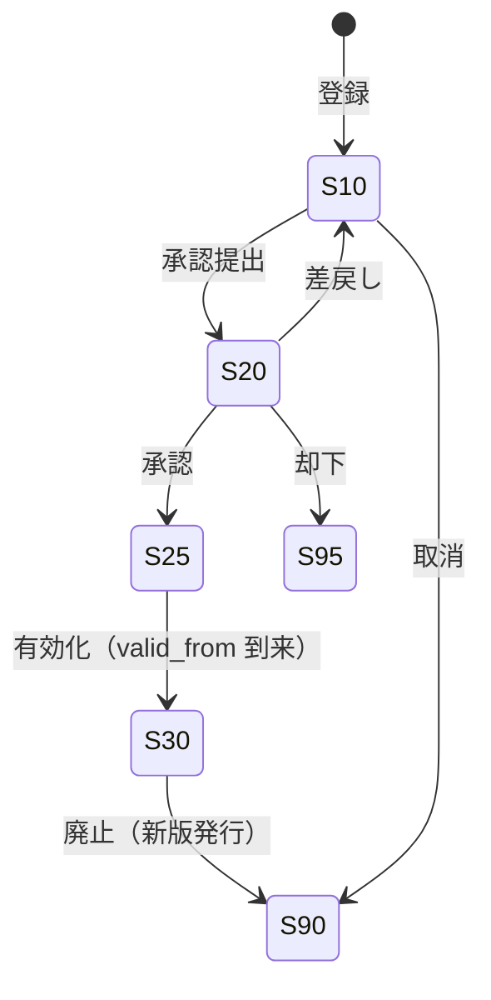

# BOM・工艺路线・工作中心 详细设计书（BOM・工程路線・ワークセンター 詳細設計書）

| 項目 | 内容 |
|---|---|
| 文書名 | BOM・工艺路线・工作中心 详细设计书（BOM・工程路線・ワークセンター 詳細設計書） |
| 文書番号 | DSN-PRD-001 |
| 版数 | v1.1 |
| 作成日 | 2026-10-20 |
| 作成者 | production-designer |
| 承認者 | 未承認（レビュー待ち） |
| 状態 | ドラフト（レビュー中） |
| 関連文書 | [业务域概要](00-overview.md) / [MRP](05-mrp-planning.md) / [生产订单](02-work-order.md) / [DB 设计](90-db-design.md) / [API 设计](91-api-design.md) / [YE3 多阶 BOM](../90-data/bom-demo.md) / [YE3 工艺路线・工作中心](../90-data/routing-demo.md) / [物料主数据](../90-data/material-master.csv) / [共通业务规则](../00-common/08-common-business-rules.md) |

---

## 1. 機能概要

| 項目 | 内容 |
|---|---|
| 機能 ID | F-PRD-001（BOM 管理）、F-PRD-002（BOM 展开与成本卷算）、F-PRD-003（工艺路线管理）、F-PRD-004（工作中心与产能管理） |
| 機能名 | BOM・工艺路线・工作中心のマスタ管理と展開・卷算 |
| 目的 | 「製品をどう造るか」を定義する基礎データを維持する。BOM は多階・版本・有効期間・损耗率・替代料を持ち、MRP・工单展開・原価卷算の基礎となる。工艺路线は工序順・工作中心・標準工時を持ち、日程計画・能力計画・報工・原価の基礎となる。工作中心は設備・班組・日历・能力・工费率を持ち、粗能力と製造費用配賦の単位となる |
| 利用者・ロール | 技術員/工艺員（登録・変更）、技術部長（承認）、計画員（参照・展開）、成本会計（卷算参照） |
| 利用シーン | ①新製品・派生機種の BOM/工艺登録 ②設計変更（ECN）時の版数更新 ③MRP 実行前の BOM 有効性確認 ④標準原価の卷算・見直し ⑤能力不足時の替代工序検討 |
| 優先度 | P1（第一版.5。BOM/工艺/工作中心は工单より先行整備が必要） |
| 画面 ID | SCR-PRD-001〜007（第 7 章） |
| 関連 IF | IF-PRD-002（PLM からの BOM/工艺同期。第一版） |

### 1.1 対象データの範囲

| データ | テーブル | 数量規模 | 更新頻度 |
|---|---|---|---|
| BOM 头・明細・替代料 | `prd_bom`・`prd_bom_line`・`prd_bom_substitute` | 品目 3,000 × 平均 10 行 | 月次（設計変更時） |
| 工艺路线・工序・替代工序 | `prd_routing`・`prd_routing_operation`・`prd_routing_operation_alt` | 品目 2,500 × 平均 10 工序 | 月次 |
| 工作中心・日历 | `prd_work_center`・`prd_work_center_calendar` | 80 工作中心 × 250 日 | 年次＋随時 |
| 物料计划参数 | `prd_material_planning` | 8,000 品目 | 随時（計画員） |

> YE3-100L1-4 の実データは [90-data/bom-demo.md](../90-data/bom-demo.md)（BOM 47 行・4 階層）と [90-data/routing-demo.md](../90-data/routing-demo.md)（14 工序・12 工作中心・129 min/台）を正とする。本文は同データを引用して設計を説明する。

## 2. 業務要件・業務ルール

### 2.1 前提条件

| # | 前提条件 | 成立しない場合の挙動 |
|---|---|---|
| 1 | 親品目・子品目が物料マスタに存在し有効（`mdm_material.status=1`） | エラー `MSG-COM-049` |
| 2 | 子品目の基本単位と BOM 使用単位が換算可能（同一単位グループ） | エラー `MSG-PRD-022` |
| 3 | 工艺路線の工作中心が有効（`status=1`）で同一工厂に属する | エラー `MSG-PRD-014` |
| 4 | BOM/工艺の登録・変更権限を保有（技術部） | 403、`MSG-COM-030` |
| 5 | 承認済（25）以降の BOM は直接編集不可（新版登録） | エラー `MSG-PRD-012` |

### 2.2 業務ルール

**BOM（BR-BOM）**

| # | ルール | 根拠 | 関連項目 |
|---|---|---|---|
| BR-BOM-01 | BOM は「親品目 × 工厂 × 版本 × 有効期間」で一意。同一品目・同一期間に有効版（`bom_status=30`）は 1 つのみ | 展開の一意性 | `uk_prd_bom_material_version` |
| BR-BOM-02 | BOM 编码は `BOM-{親物料编码}-V{2桁版本}`（[08](../00-common/08-common-business-rules.md) 2.2）。YE3-100L1-4 は `BOM-3001000001-V01` | 採番 | `bom_no` |
| BR-BOM-03 | 子品目の `component_qty` は**親 1 単位あたりの純使用量（net）**、`loss_rate` は**工程损耗率（比率）**、`required_qty = component_qty ÷ (1 − loss_rate)` を展開用の所要量（gross）とする。**本定義は [90-data/bom-demo.md](../90-data/bom-demo.md) §4 と同一** | 展開の一貫性 | `prd_bom_line` |
| BR-BOM-04 | 损耗率は 0〜0.95（95% 未満）。0.95 以上は「材料利用率 5% 未満」として登録不可（誤入力防止） | 妥当性 | `ck_prd_bom_line_loss` |
| BR-BOM-05 | 多階 BOM は最大 15 階層。循環参照（自己参照・間接循環）は登録時・承認時に再帰検査で拒否 | [09](../00-common/09-cross-domain-flow.md) 6.3 | `MSG-PRD-010` |
| BR-BOM-06 | 虚拟件（`component_type=30`）は在庫を持たず、展開時に透過する（MRP は計画订单を作らない） | MRP の透過展開 | `material_type=40` |
| BR-BOM-07 | 替代料は `substitute_group` 単位で管理し、`priority_no` 昇順。`ratio` は「主料に対する最大替代比率」で、1.0000 は全量替代可、0.3000 は 30% まで。**MRP は自动替代しない**（未決 #9） | 品質・原価の統制 | `prd_bom_substitute` |
| BR-BOM-08 | 有効期間の重複は不可。新版登録時は旧版に `valid_to` を設定し `bom_status=90`（廃止）にする | 版数管理 | `MSG-PRD-011` |
| BR-BOM-09 | BOM 変更（数量・材料・代替料）は WF 承認（技術部長→生産経理→購買経理→財務経理）を要する。承認前は展開に使用しない | [00-overview](00-overview.md) 2.1 | `bom_status` |
| BR-BOM-10 | 完成品 BOM に包装材料（托盘・木箱・紙箱・防锈袋・銘牌・説明書）を含める（第一版）。梱包 BOM の分離は 第一版（[bom-demo.md](../90-data/bom-demo.md) §9-3） | 原価の一体管理 | — |
| BR-BOM-11 | 同一子品目が複数行に重複する場合（例：M6×20 螺栓が L1 と L2 に出現）は行を分けて保持し、展開時に合算する（Y型重複）。低层码は最大深さを採用 | 展開の正確性 | 第 4.4 節 |

**工艺路线（BR-RT）**

| # | ルール | 根拠 | 関連項目 |
|---|---|---|---|
| BR-RT-01 | 工艺路线编码は `RT-{物料编码}-V{2桁版本}`。YE3-100L1-4 は `RT-3001000001-V01` | 採番 | `routing_no` |
| BR-RT-02 | 工序序号は 10 刻み。工序順は必須で、同一 SEQ の重複不可 | 日程計算 | `operation_seq` |
| BR-RT-03 | 標準工時は「準備時間（min/ロット）」と「単件工時（min/PCE）」を分離して保持する。原価計算では準備時間をロット数量で按分する | [routing-demo.md](../90-data/routing-demo.md) §6.1 | `setup_time`・`run_time_per_unit` |
| BR-RT-04 | 検査点（`is_inspection_point=true`）の工序は、完了時に IPQC を起票する（YE3 は 120 出厂試験が検査点。工程内検査は 20/30/50/60/70/80〜100 の各工序でも実施） | [06](06-quality-management.md) | `inspection_standard_id` |
| BR-RT-05 | 代替工序は能力不足・設備故障時に手動選択する（能率係数 `efficiency_rate` を工数に乗じる）。自動振替は 第一版 | 能力柔軟性 | `prd_routing_operation_alt` |
| BR-RT-06 | 工艺変更は WF 承認を要し、既存工单には反映しない（工单はスナップショット）。未着手工单のみ「工艺変更」で差替え可 | [02](02-work-order.md) 6.8 | — |

**工作中心（BR-WC）**

| # | ルール | 根拠 | 関連項目 |
|---|---|---|---|
| BR-WC-01 | 工作中心编码は `WC` + 3 桁（`WC001`〜`WC012` の 12 名称。[06](../00-common/06-code-list.md) §10 に正式登録済み） | 採番 | `work_center_code` |
| BR-WC-02 | 日能力は「稼働時間（h）× 設備台数 × 班数」で算出し、日历の `available_capacity` と整合させる | 能力計画 | CALC-WC-01 |
| BR-WC-03 | 工费率（`labor_rate_per_hour`）・製造費用配賦率（`overhead_rate_per_hour`）は **PRD 所有**（工作中心マスタ）。年次見直し、既存工单は実績記録時点の率を保持。FIN は本マスタを参照し `fin_labor_rate` 等の重複マスタを持たない（Lead 裁決 2026-10-20） | [09](../00-common/09-cross-domain-flow.md) J13/J15 | `prd_work_report_labor.hourly_rate` |
| BR-WC-04 | 工作日历は工場共通パターン＋工作中心個別上書き。法定节假日・厂休・年度检修を `day_type` で管理する | [demo-company.md](../90-data/demo-company.md) §4 | `prd_work_center_calendar` |
| BR-WC-05 | 瓶颈工作中心（YE3 は `WC008` 装配、1,500 PCE/日）は粗能力計画で重点監視する | [routing-demo.md](../90-data/routing-demo.md) §2 | `is_bottleneck` |

### 2.3 計算式・判定式

| # | 対象 | 算式 | 丸め | 例 |
|---|---|---|---|---|
| CALC-BOM-01 | 所要量（gross） | `required_qty = component_qty ÷ (1 − loss_rate)` | 4 桁四捨五入 | 10.8 ÷ (1−0.30) = 15.4286 KGM |
| CALC-BOM-02 | 多階展開量 | `qty(child, level n) = qty(parent) × required_qty(child) ÷ base_qty(parent)` | 4 桁切上 | 120 × 1.0050 = 120.60 |
| CALC-BOM-03 | 累積展開（孫以下） | 各階で CALC-BOM-02 を繰り返す（中間损耗率も累積） | 4 桁切上 | 120 × 1.0050 × 1.0050 × 1.0101 × 15.4286 |
| CALC-BOM-04 | 低层码 | `LLC(item) = max(全 BOM における item の深さ)`。深さは成品を 0 とし親→子で +1 | 整数 | 电工钢 = 4 |
| CALC-BOM-05 | 標準材料費（卷算） | `材料費 = Σ(child.required_qty × child.standard_unit_cost)` を最下階から積上げ | 6 桁 | 第 4.6 節 |
| CALC-BOM-06 | 標準加工費（卷算） | `加工費 = Σ(工序 (setup_time÷ロット数量 + run_time_per_unit) × 工费率)` | 6 桁 | 2.215 h × 25.00 |
| CALC-BOM-07 | 標準原価 | `標準原価 = 材料費 + 加工費 + 製造費用配賦` | 6 桁 | 659.95＋53.75＋64.50 = 778.20 |
| CALC-RT-01 | 工序必要工数 | `need_hours = setup_time ÷ ロット数量 + run_time_per_unit × 数量` | 2 桁（h） | 0.75 + 2.15 = 2.90 h |
| CALC-RT-02 | 日程（終了） | `planned_end = planned_start + CEILING(need_hours ÷ (日稼働時間 × 標準人数))` 稼働日 | 日切上 | 第 5.4 節 |
| CALC-WC-01 | 日能力 | `capacity = 稼働時間(8h) × 設備台数 × 班数(2) × 能率(0.95)` | 2 桁 | WC002: 8×2×2×0.95 = 30.4 h/日 |
| CALC-WC-02 | 能力換算（台数） | `能力台数 = 日能力(h) ÷ 単件工時(h/PCE)` | 整数切り捨て | 30.4 ÷ (8/60) = 228 セット/日 |

> YE3 の単件工時・良品率・工賃率は【示例値】（[routing-demo.md](../90-data/routing-demo.md) §3・§6）。材料牌号・執行標準は【実データ】。

### 2.4 状態遷移（BOM・工艺路线）



| 遷移 | トリガ | 権限 | 更新項目 | メッセージ |
|---|---|---|---|---|
| 10→20 | 承認提出 | `production:bom:update` | `bom_status=20` | `MSG-COM-005` |
| 20→25 | 承認 | `production:bom:approve` | `bom_status=25`、`approved_*` | — |
| 25→30 | 有効化（日次バッチ） | システム | `bom_status=30`、`effective_status=1` | — |
| 30→90 | 新版発効 | システム/技術員 | `bom_status=90`、`valid_to` | — |

> 工艺路线も同一の状態体系（`routing_status`）。承認者・承認経路は [00-overview](00-overview.md) 2.1。

## 3. 関連機能

| 関係 | 機能 ID | 機能名 | 関係内容 |
|---|---|---|---|
| 上流 | F-MDM-002 | 物料主数据 | 品目・単位・分類・標準単価を参照 |
| 上流 | F-MDM-016 | 物料替代关系 | 替代グループの整合（任意） |
| 下流 | F-PRD-010 | MRP | BOM 展開・低层码・所要量 |
| 下流 | F-PRD-005 | 生产订单 | 工单の材料・工序スナップショット展開 |
| 下流 | F-PRD-007 | 報工 | 工艺の標準工時を初期値に使用 |
| 下流 | F-PRD-011 | 生产计划 | 工作中心能力・粗能力 |
| 参照 | F-PRD-012 | 检验标准 | 工序の `inspection_standard_id` |
| 参照 | F-FIN-006 | 成本核算 | 標準原価の卷算結果 |

## 4. BOM 管理設計

### 4.1 BOM データモデル

```
prd_bom（親品目 × 工厂 × 版本 × 有効期間）
  ├─ prd_bom_line（子品目・純使用量・损耗率・必要量・投入工序・倒冲区分）
  │     └─ prd_bom_substitute（替代料・优先順・替代比率・有効期間）
  └─ prd_material_planning（低层码・提前期・批量規則・安全在庫）※1:1（品目×工厂）
```

| 項目 | 保持場所 | 補足 |
|---|---|---|
| 親品目・版本・有効期間 | `prd_bom` | `bom_no`・`valid_from`/`valid_to`・`is_default` |
| 子品目構成・usage・损耗 | `prd_bom_line` | `component_qty`（net）・`loss_rate`・`required_qty`（gross） |
| 投入工序・倒冲区分 | `prd_bom_line` | `operation_seq`・`feeding_type`（10 先行 / 20 倒冲） |
| 替代料 | `prd_bom_substitute` | `substitute_group`・`priority_no`・`ratio` |
| 低层码・提前期 | `prd_material_planning` | BAT-PRD-002 で計算 |

### 4.2 YE3-100L1-4 多階 BOM（実データ引用）

**BOM 编码**：`BOM-3001000001-V01`、親品目 `3001000001`（YE3-100L1-4 2.2kW）、基準数量 1 PCE、有効期間 `valid_from=2026-10-01`〜無期限（【示例値】）、階層 4 段（L0〜L3、素材は L4 に相当）。

```mermaid
flowchart TD
    P[3001000001 YE3-100L1-4] --> A[2001000004 定子总成 1.0050]
    P --> B[2002000004 转子总成 1.0050]
    P --> C[2003000001 机座加工件 1.0050]
    P --> D[2004000001 前端盖加工件 1.0050]
    P --> E[2004000002 后端盖加工件 1.0050]
    P --> F[2004000003 风罩加工件 1.0101]
    P --> G[2004000004 接线盒总成 1.0101]
    P --> H[4005000001 风扇 1.0101]
    P --> I[4002000001〜0008 紧固件 各n×1.0204]
    P --> J[5004000001 铭牌 1.0000]
    P --> K[5001000001/5002000001/5003000001/5004000002 包装 各1.0000]
    A --> A1[2001000002 定子铁心 1.0050]
    A --> A2[2001000003 定子绕组 1.0101]
    A --> A3[1005000003 1032 浸渍漆 1.1579 KGM]
    A --> A4[4003000001 引接线 1.8947 MTR]
    A1 --> A11[2001000001 定子冲片 1.0101]
    A1 --> A12[4002000011 定子扣片 6.1224 PCE]
    A11 --> A111[1001000001 50W470 电工钢 15.4286 KGM]
    A2 --> A21[1004000001 QZY-2/180 2.6804 KGM]
    A2 --> A22[1005000001 NMN 6640 0.4737 KGM]
    A2 --> A23[1005000002 3240 层压板 0.1739 KGM]
    B --> B1[2002000002 转子铁心 1.0050]
    B --> B2[2002000003 轴加工件 1.0050]
    B --> B3[4001000001 6205-2RS 2.0101 PCE]
    B --> B4[4002000009 平键 1.0204 PCE]
    B --> B5[4002000010 轴用挡圈 2.0408 PCE]
    B1 --> B11[2002000001 转子冲片 1.0101]
    B1 --> B12[1002000003 铝锭 AL99.70 0.9043 KGM]
    B11 --> B111[1001000001 50W470 电工钢 6.0000 KGM]
    B2 --> B21[1002000001 45# 圆钢 1.7857 KGM]
    C --> C1[1003000001 机座铸件 HT200 7.2527 KGM]
    D --> D1[1003000002 端盖铸件 HT200 2.2826 KGM]
    E --> E1[1003000002 端盖铸件 HT200 2.2826 KGM]
    F --> F1[1002000002 Q235B 钢板 0.6250 KGM]
    G --> G1[1003000003 接线盒座铸件 0.9239 KGM]
    G --> G2[1005000002 3240 层压板 0.1111 KGM]
    G --> G3[4002000001 六角头螺栓 M6×20 4.0816 PCE]
```



**主要行（BOM 明細の抜粋・全 47 行は [90-data/bom-demo.md](../90-data/bom-demo.md) §3 を正とする）**

| 行 | 親コード | 子コード | 子名称（牌号・規格） | 単位 | 純使用量 | 损耗率 | 必要量（gross） | 投入工序 | 倒冲 | 出典 |
|---|---|---|---|---|---|---|---|---|---|---|
| 10 | 3001000001 | 2001000004 | 定子总成 | PCE | 1.0000 | 0.0050 | 1.0050 | 110 总装 | ○ | 【示例値】数量 |
| 20 | 3001000001 | 2002000004 | 转子总成 | PCE | 1.0000 | 0.0050 | 1.0050 | 110 总装 | ○ | 同上 |
| 30 | 3001000001 | 2003000001 | 机座加工件 | PCE | 1.0000 | 0.0050 | 1.0050 | 110 总装 | ○ | 同上 |
| 40 | 3001000001 | 2004000001 | 前端盖加工件 | PCE | 1.0000 | 0.0050 | 1.0050 | 110 总装 | ○ | 同上 |
| 50 | 3001000001 | 2004000002 | 后端盖加工件 | PCE | 1.0000 | 0.0050 | 1.0050 | 110 总装 | ○ | 同上 |
| 60 | 3001000001 | 2004000003 | 风罩加工件（Q235B 冲压） | PCE | 1.0000 | 0.0100 | 1.0101 | 110 总装 | ○ | 同上 |
| 70 | 3001000001 | 2004000004 | 接线盒总成 | PCE | 1.0000 | 0.0100 | 1.0101 | 110 总装 | ○ | 同上 |
| 80 | 3001000001 | 4005000001 | 风扇（铝合金 ZL102） | PCE | 1.0000 | 0.0100 | 1.0101 | 110 总装 | ○ | 【実データ】GB/T 1173-2013 |
| 90 | 3001000001 | 4002000001 | 六角头螺栓 M6×20 8.8 级 | PCE | 8.0000 | 0.0200 | 8.1633 | 110 总装 | ○ | 【実データ】GB/T 5782-2025 |
| 100 | 3001000001 | 4002000002 | 六角头螺栓 M8×25 8.8 级 | PCE | 4.0000 | 0.0200 | 4.0816 | 110 总装 | ○ | 【実データ】GB/T 5782-2025 |
| 110〜160 | 3001000001 | 4002000003〜0008 | 六角螺母・平垫・弹垫 M6/M8 | PCE | 4〜8 | 0.0200 | 4.0816〜8.1633 | 110 总装 | ○ | 【実データ】GB/T 6170-2015 等 |
| 170 | 3001000001 | 5004000001 | 铭牌（铝质 60×40） | PCE | 1.0000 | 0.0000 | 1.0000 | 140 包装 | — | 【実データ】GB/T 13306-2011 |
| 180〜210 | 3001000001 | 5001000001 等 | 托盘・紙箱・防锈袋・説明書 | PCE | 各 1.0000 | 0.0000 | 1.0000 | 140 包装 | — | 【実データ】GB/T 2934-2007 等 |
| 220 | 2001000004 | 2001000002 | 定子铁心 | SET | 1.0000 | 0.0050 | 1.0050 | 30 叠压 | ○ | 【示例値】 |
| 230 | 2001000004 | 2001000003 | 定子绕组 | SET | 1.0000 | 0.0100 | 1.0101 | 70 浸漆 | ○ | 同上 |
| 240 | 2001000004 | 1005000003 | 三聚氰胺醇酸浸渍漆 1032 | KGM | 1.1000 | 0.0500 | 1.1579 | 70 浸漆 | ○ | 【実データ】JB/T 9558-1999 |
| 250 | 2001000004 | 4003000001 | 电机绕组引接线 3×1.5mm² | MTR | 1.8000 | 0.0500 | 1.8947 | 60 嵌线 | — | 【要確認】JB/T 6213.1 版数 |
| 260 | 2001000002 | 2001000001 | 定子冲片（1 套、净重 10.8 kg） | SET | 1.0000 | 0.0100 | 1.0101 | 30 叠压 | ○ | 【示例値】 |
| 270 | 2001000002 | 4002000011 | 定子扣片（1.0mm 冷轧钢带冲制） | PCE | 6.0000 | 0.0200 | 6.1224 | 30 叠压 | — | 外協加工件 |
| 280 | 2001000003 | 1004000001 | QZY-2/180 φ1.00 漆包线 | KGM | 2.6000 | 0.0300 | 2.6804 | 50 绕线 | — | 【実データ】GB/T 6109.5-2025 |
| 290 | 2001000003 | 1005000001 | NMN 6640 柔软复合材料 t0.20 | KGM | 0.4500 | 0.0500 | 0.4737 | 60 嵌线 | — | 【要確認】標準版数 |
| 300 | 2001000003 | 1005000002 | 3240 环氧玻璃布层压板 t1.0 | KGM | 0.1600 | 0.0800 | 0.1739 | 60 嵌线 | — | 【実データ】GB/T 1303.4-2009 |
| 310 | 2002000004 | 2002000002 | 转子铁心（铸铝） | SET | 1.0000 | 0.0050 | 1.0050 | 40 转子铸铝 | ○ | 【示例値】 |
| 320 | 2002000004 | 2002000003 | 轴加工件（45# 精加工） | PCE | 1.0000 | 0.0050 | 1.0050 | 100 轴加工 | ○ | 同上 |
| 330 | 2002000004 | 4001000001 | 深沟球轴承 6205-2RS（25×52×15） | PCE | 2.0000 | 0.0050 | 2.0101 | 110 总装 | — | 【実データ】GB/T 276-2013 |
| 340 | 2002000004 | 4002000009 | 普通型平键 A 型 8×7×40 | PCE | 1.0000 | 0.0200 | 1.0204 | 110 总装 | — | 【実データ】GB/T 1096-2003 |
| 350 | 2002000004 | 4002000010 | 轴用弹性挡圈 φ25 | PCE | 2.0000 | 0.0200 | 2.0408 | 110 总装 | — | 【要確認】GB/T 894 版数 |
| 360 | 2002000002 | 2002000001 | 转子冲片（1 套、净重 4.2 kg） | SET | 1.0000 | 0.0100 | 1.0101 | 40 转子铸铝 | ○ | 【示例値】 |
| 370 | 2002000002 | 1002000003 | 重熔用铝锭 AL99.70 | KGM | 0.8500 | 0.0600 | 0.9043 | 40 转子铸铝 | — | 【実データ】GB/T 1196-2023 |
| 380 | 2003000001 | 1003000001 | 灰铸铁机座铸件 HT200 毛坯 | KGM | 6.6000 | 0.0900 | 7.2527 | 80 机座加工 | — | 【実データ】GB/T 9439-2023 |
| 390 | 2004000001 | 1003000002 | 灰铸铁端盖铸件 HT200 毛坯（前） | KGM | 2.1000 | 0.0800 | 2.2826 | 90 端盖加工 | — | 同上 |
| 400 | 2004000002 | 1003000002 | 灰铸铁端盖铸件 HT200 毛坯（后） | KGM | 2.1000 | 0.0800 | 2.2826 | 90 端盖加工 | — | 同上 |
| 410 | 2004000003 | 1002000002 | 碳素结构钢热轧钢板 Q235B t1.0 | KGM | 0.5500 | 0.1200 | 0.6250 | 90 端盖加工 | — | 【実データ】GB/T 700-2006 |
| 420 | 2004000004 | 1003000003 | 灰铸铁接线盒座铸件 HT200 毛坯 | KGM | 0.8500 | 0.0800 | 0.9239 | 90 端盖加工 | — | 同上 |
| 430 | 2004000004 | 1005000002 | 3240 层压板（接线板） | KGM | 0.1000 | 0.1000 | 0.1111 | 90 端盖加工 | — | 同上 |
| 440 | 2004000004 | 4002000001 | 六角头螺栓 M6×20 | PCE | 4.0000 | 0.0200 | 4.0816 | 90 端盖加工 | — | 同上 |
| 450 | 2001000001 | 1001000001 | 冷轧无取向电工钢带 50W470 | KGM | 10.8000 | 0.3000 | 15.4286 | 10 下料 | — | 【実データ】GB/T 2521.1-2016 |
| 460 | 2002000001 | 1001000001 | 冷轧无取向电工钢带 50W470 | KGM | 4.2000 | 0.3000 | 6.0000 | 10 下料 | — | 同上 |
| 470 | 2002000003 | 1002000001 | 优质碳素结构钢圆钢 45# φ30 | KGM | 1.2500 | 0.3000 | 1.7857 | 100 轴加工 | — | 【実データ】GB/T 699-2015 |

> 行番号は本設計書の説明用（`line_no` は 10 刻みで付番し、実際は 10,20,…）。「【示例値】数量」は数量・损耗率が示例値であることを示す。材質・牌号・執行標準は【実データ】で [90-data/bom-demo.md](../90-data/bom-demo.md) §3・§10 の出典による。

**注意（重複出現の扱い）**

- `1001000001 50W470` は定子冲片（行 450）と转子冲片（行 460）の 2 箇所に出現 → 展開時に合算（120 PCE で厳密展開 2,623.42 KGM、[90-data/bom-demo.md](../90-data/bom-demo.md) §5.1 の概算 2,571.43 との差は中間損耗の累積）。
- `1005000002 3240` は定子绕组（行 300）と接线盒总成（行 430）の 2 箇所 → 合算。
- `4002000001 六角头螺栓 M6×20` は成品直下（行 90）と接线盒总成（行 440）の 2 箇所 → 合算（低层码は深い方 2）。
- `1003000002 端盖铸件` は前後端盖で 2 回出現（行 390/400）→ 合算。

### 4.3 多階展開アルゴリズム（F-PRD-002）

**定義**：`expand(parentCode, parentQty, level)` を再帰的に適用し、子品目の所要量（gross）を算出する。

```
function expand(parent, parentQty, level, result):
    if level > 15: error MSG-PRD-010（最大階層超過）
    bom = findEffectiveBom(parent, baseDate)        // bom_status=30 かつ 有効期間内
    if bom == null:
        if parent.material_type == 製造成品/半成品: error MSG-PRD-020
        return
    for line in bom.lines:
        childQty = parentQty × line.required_qty ÷ bom.base_qty   // 4 桁切上
        result.add(line.component_material_id, childQty, level+1, parent, line)
        if line.component_type == 仮想件:                        // 透過展開（計画対象外）
            expand(line.component_material_id, childQty, level+1, result)
        else if line.component_material_id が製造品/半成品:
            expand(line.component_material_id, childQty, level+1, result)   // 多階
    return result
```

| 引数・戻り値 | 内容 |
|---|---|
| 入力 | `parentCode`（親品目）、`parentQty`（親の所要量）、`baseDate`（展開基準日：受注明細納期 or 工单計画着手日） |
| 出力 | 明細リスト（品目・所要量・階層・親品目・BOM 行） |
| 丸め | `childQty` は 4 桁切上（`CEILING`）。中間合算は丸めない（最下階で合算後に 4 桁切上） |
| 循環検出 | 再帰パス上の品目を Set で保持し、再出現で `MSG-PRD-010` |
| 有効版選択 | `valid_from ≦ baseDate ≦ valid_to` かつ `bom_status=30`。複数該当時は `is_default=true` → `version_no` 最大 |
| 性能 | BOM キャッシュ（品目×工厂、TTL 5 分）。1 回の展開で最大 1,000 行 |

**YE3 120 PCE の展開算例（厳密・中間損耗累積、【示例値】）**

| # | 品目 | 計算 | 展開量 |
|---|---|---|---|
| 1 | 2001000004 定子总成 | 120 × 1.0050 | 120.6000 PCE |
| 2 | 2001000002 定子铁心 | 120.6000 × 1.0050 | 121.2030 SET |
| 3 | 2001000001 定子冲片 | 121.2030 × 1.0101 | 122.4271 SET |
| 4 | 1001000001 50W470（定子側） | 122.4271 × 15.4286 | 1,888.85 KGM |
| 5 | 2002000004 转子总成 | 120 × 1.0050 | 120.6000 PCE |
| 6 | 2002000002 转子铁心 | 120.6000 × 1.0050 | 121.2030 SET |
| 7 | 2002000001 转子冲片 | 121.2030 × 1.0101 | 122.4271 SET |
| 8 | 1001000001 50W470（转子側） | 122.4271 × 6.0000 | 734.57 KGM |
| — | **50W470 合計** | ①＋② | **2,623.42 KGM** |
| 9 | 2001000003 定子绕组 | 120.6000 × 1.0101 | 121.82 SET |
| 10 | 1004000001 QZY-2/180 | 121.82 × 2.6804 | 326.54 KGM |
| 11 | 2003000001 机座加工件 | 120 × 1.0050 | 120.60 PCE |
| 12 | 1003000001 机座铸件 | 120.60 × 7.2527 | 874.68 KGM |

> [90-data/bom-demo.md](../90-data/bom-demo.md) §5.1 の表は「1 台当たり gross × 120」の単純積上げ（50W470＝2,571.43 KGM）である。本設計の MRP・工单展開は**中間工程の损耗率も累積する厳密展開**（2,623.42 KGM）を採用する。設計書・原価計算では両者の差（約 2.0%）を「累積损耗」として説明する。

### 4.4 低层码（Low-Level Code）計算（BAT-PRD-002）

**定義**：`LLC(品目) = 全 BOM における品目の最大深さ`（成品 = 0、直接子 = 1）。同一品目が複数階層に出現する場合は**最大値**を採る。

```
function recalcLowLevelCode(factoryId):
    // 1. 全有効 BOM を読み込み、親→子のエッジを構築
    edges = loadEffectiveBomEdges(factoryId)        // (parentMaterialId, childMaterialId)
    llc = new Map()
    llc[成品品目] = 0
    // 2. トポロジカル順（深さ優先）で最大深さを伝播
    for (material in allMaterials) :
        for (child in edges.from(material)) :
            llc[child] = max(llc[child], llc[material] + 1)
    // 3. 循環検出（自己参照・間接循環）
    if hasCycle(edges) : throw MSG-PRD-010
    // 4. prd_material_planning へ一括 UPDATE
    updateLowLevelCode(llc, last_calculated_at = now())
```

- 実行契機：BOM の承認・廃止時（非同期）、日次 BAT-PRD-002、MRP 実行前の未更新検出時。
- トポロジカル順は「親の LLC が確定してから子を更新」するため、深さ優先の帰りがけ順で計算する（`Kahn` 法でも可）。
- 循環が存在する場合は LLC が確定しないため、計算を中断し BOM 担当者に通知（`MSG-PRD-010`）。

**YE3 BOM の LLC 計算結果（主要品目）**

| 品目 | 出現箇所（深さ） | LLC | 備考 |
|---|---|---|---|
| `3001000001` YE3-100L1-4 | 0 | 0 | 最終製品 |
| `2001000004` 定子总成 | 1 | 1 | — |
| `2002000004` 转子总成 | 1 | 1 | — |
| `2003000001` 机座加工件 | 1 | 1 | — |
| `2004000001/0002` 前端盖/后端盖加工件 | 1 | 1 | — |
| `2004000003` 风罩加工件 | 1 | 1 | — |
| `2004000004` 接线盒总成 | 1 | 1 | — |
| `4005000001` 风扇 | 1 | 1 | 外購件 |
| `5001000001` 托盘 等包装 | 1 | 1 | — |
| `5004000001` 銘牌 | 1 | 1 | — |
| `2001000002` 定子铁心 | 2 | 2 | — |
| `2001000003` 定子绕组 | 2 | 2 | — |
| `2002000002` 转子铁心（铸铝） | 2 | 2 | — |
| `2002000003` 轴加工件 | 2 | 2 | — |
| `4001000001` 6205-2RS | 2 | 2 | — |
| `4002000009` 平键 / `4002000010` 挡圈 | 2 | 2 | — |
| `1005000003` 1032 浸渍漆 / `4003000001` 引接线 | 2 | 2 | — |
| `1003000001` 机座铸件 | 2 | 2 | 機座加工件の子 |
| `1003000002` 端盖铸件 | 2 | 2 | 前後端盖の子 |
| `1002000002` Q235B 钢板 | 2 | 2 | 風罩の子 |
| `1003000003` 接线盒座铸件 | 2 | 2 | — |
| `4002000001` M6×20 螺栓 | 1, 2 | **2** | 成品直下と接线盒の 2 箇所 → 最大値 |
| `1005000002` 3240 层压板 | 2, 3 | **3** | 接线盒（2）と定子绕组（3）→ 最大値 |
| `2001000001` 定子冲片 | 3 | 3 | — |
| `2002000001` 转子冲片 | 3 | 3 | — |
| `4002000011` 定子扣片 | 3 | 3 | — |
| `1004000001` QZY-2/180 | 3 | 3 | — |
| `1005000001` NMN 6640 | 3 | 3 | — |
| `1002000003` 铝锭 AL99.70 | 3 | 3 | — |
| `1002000001` 45# 圆钢 | 3 | 3 | — |
| `1001000001` 50W470 电工钢 | 4 | **4** | 定子冲片・转子冲片の子（最深） |

> MRP は LLC 昇順（0→4）に処理する。`1005000002` と `4002000001` のように複数階層に出現する品目は、**最深の階層まで需要が集約されてから**净需求を計算できる（[05](05-mrp-planning.md) 3.4）。

### 4.5 成本卷算（Cost Roll-up）（F-PRD-002）

**卷算の原則**：最下階から上位へ、子品目の標準単価 × 必要量を積上げ、加工費（工数 × 工费率）と製造費用配賦を加算する。

```
function rollUpCost(materialId, baseDate, factoryId):
    bom = findEffectiveBom(materialId, baseDate)
    if bom == null : return 購買標準単価 / 移動平均単価
    materialCost = Σ(line.required_qty × rollUpCost(line.child, baseDate, factoryId)
                     ÷ bom.base_qty)                         // 再帰
    routing = findEffectiveRouting(materialId, baseDate)
    laborCost = Σ( (op.setup_time ÷ lotSize + op.run_time_per_unit) × op.labor_rate )
    overheadCost = Σ( (op.setup_time ÷ lotSize + op.run_time_per_unit) × op.overhead_rate )
    return materialCost + laborCost + overheadCost              // 6 桁
```

| 項目 | 計算 | 出典 |
|---|---|---|
| 材料費 | 子品目の標準単価（購買品＝購買標準単価、自制半成品＝再帰卷算値）× 必要量（gross） | [90-data/bom-demo.md](../90-data/bom-demo.md) §6 |
| 加工費 | 工序の準備時間（ロット按分）＋単件工時 × 工賃率（工作中心） | [90-data/routing-demo.md](../90-data/routing-demo.md) §3・§6 |
| 製造費用 | 加工工数 × 配賦率（工作中心 `overhead_rate_per_hour`） | 同上 |
| 標準原価 | 材料費＋加工費＋製造費用 | 1 PCE あたり 6 桁 |

**YE3-100L1-4 の卷算算例（1 台あたり、【示例値】・[90-data/bom-demo.md](../90-data/bom-demo.md) §6 と同一）**

| # | 費目 | 明細 | 金額（CNY） |
|---|---|---|---|
| 1 | 直接材料：50W470 | 21.4286 KGM × 5.20 元/KGM | 111.43 |
| 2 | 直接材料：QZY-2/180 | 2.6804 KGM × 78.00 元/KGM | 209.07 |
| 3 | 直接材料：アルミ地金 | 0.9043 KGM × 19.50 元/KGM | 17.63 |
| 4 | 直接材料：機座鋳物 HT200 | 7.2527 KGM × 8.50 元/KGM | 61.65 |
| 5 | 直接材料：端蓋鋳物 HT200 | 4.5652 KGM × 8.20 元/KGM | 37.43 |
| 6 | 直接材料：接線盒座鋳物 | 0.9239 KGM × 9.00 元/KGM | 8.32 |
| 7 | 直接材料：45# 丸鋼 | 1.7857 KGM × 6.80 元/KGM | 12.14 |
| 8 | 直接材料：Q235B 鋼板 | 0.6250 KGM × 4.60 元/KGM | 2.88 |
| 9 | 直接材料：軸受 6205-2RS | 2.0101 PCE × 9.50 元/PCE | 19.10 |
| 10 | 直接材料：緊固件・キー・擋圈・扣片 | 明細積上げ | 10.27 |
| 11 | 直接材料：NMN 6640 | 0.4737 KGM × 20.00 元/KGM | 9.47 |
| 12 | 直接材料：3240 板材 | 0.2850 KGM × 26.00 元/KGM | 7.41 |
| 13 | 直接材料：1032 浸漬漆 | 1.1579 KGM × 32.00 元/KGM | 37.05 |
| 14 | 直接材料：引接線 | 1.8947 MTR × 3.20 元/MTR | 6.06 |
| 15 | 直接材料：ファン | 1.0101 PCE × 8.50 元/PCE | 8.59 |
| 16 | 直接材料：銘牌 | 1 PCE × 2.80 元/PCE | 2.80 |
| 17 | 直接材料：包装 | 積上げ | 98.65 |
| — | **直接材料 合計** | — | **659.95** |
| 18 | 直接人工 | 2.15 h × 25.00 元/h | 53.75 |
| 19 | 製造費用 | 2.15 h × 30.00 元/h | 64.50 |
| — | **標準原価（単位）** | 材料＋人工＋製造費用 | **778.20** |
| 20 | 販売単価（税抜） | [material-master.csv](../90-data/material-master.csv) | 856.50 |
| — | 粗利益／粗利率 | 856.50 − 778.20 | 78.30／9.1% |

- 準備工時は「390 min/ロット ÷ 100 PCE = 3.9 min/台」を加算した 2.215 h/台で原価計算する（[routing-demo.md](../90-data/routing-demo.md) §6.1）。上表は簡略化して 2.15 h で表示。
- 標準原価は `prd_material_planning` の標準単価更新、または BOM/工艺変更時に再卷算する（F-PRD-002）。卷算結果は FIN の `fin_standard_cost` 版登録に使い、`prd_work_order.standard_cost` には下达時に発行済み版をスナップショットする（なしは NULL、PR #8 決定 2（蓝色大肥鱼 2026-10-21））。
- 購買品の標準単価は MDM の購買標準単価、自制半成品は再帰卷算、在庫評価は移動平均（[08](../00-common/08-common-business-rules.md) 第 6 章）であり、標準原価と実際原価の差異は工程で分析する（[03](03-material-issue-reporting.md) 4.7）。

### 4.6 替代料管理

| 主料 | 替代料 | 条件・制約 | 优先順 | 出典 |
|---|---|---|---|---|
| `1001000001` 50W470（宝钢 B50A470／首钢 50W470） | 同牌号の他社材 | 技術同等。`substitute_group=STEEL-50W470`。材料特性（鉄損・板厚）が同等であること | 1〜3 | [bom-demo.md](../90-data/bom-demo.md) §7 |
| `1001000001` 50W470 | `1001000002` 50W600 | **非 IE3 製品のみ**降級替代可。IE3 認証製品（YE3）は不可 | — | 同上 |
| `4001000001` 6205-2RS（哈軸／瓦軸／洛軸） | 同型番の他ブランド | 寸法・荷重が GB/T 276-2013 に適合すること | 1〜3 | 同上 |
| `1004000001` QZY-2/180 φ1.00 | φ0.90／φ1.12 等 | 巻数・抵抗値の再計算が必要。技術承認必須 | — | [material-master.csv](../90-data/material-master.csv) `substitute_group=WIRE-QZY2` |

- 替代可否は `substitute_group` が一致し、`valid_from`〜`valid_to` 内であること。
- **MRP は自动替代しない**（未決 #9）。工单領料時に手動で替代料を選択し、`is_substitute=true`・`substitute_for_material_id` に主料を記録する（[03](03-material-issue-reporting.md) BR-MI-04）。
- 替代料使用実績は `prd_material_issue_line` から集計し、原価差異・品質への影響を分析する。

### 4.7 BOM 版本・有効期間・ECN

| 項目 | ルール |
|---|---|
| 版本採番 | `sys_sequence` キー `PRD_BOM_VERSION`（品目×工厂単位で 01〜99）。`bom_no = BOM-{親物料编码}-V{2位}` |
| 有効期間 | `valid_from` 必須、`valid_to` は無期限可。展開基準日で判定 |
| 新版発行 | 旧版に `valid_to`（新版の `valid_from` 前日）を設定し `bom_status=90`。新 `version_no` を採番 |
| ECN 連携 | `eco_no` に設計変更番号を保持。PLM 連携（IF-PRD-002）時は ECN 単位で BOM を同期 |
| 適用基準日 | 工单は「計画着手日」、MRP は「実行日」、見積は「見積基準日」で有效版を選択（[00-overview](00-overview.md) 3.2） |
| 変更影響 | 承認済以降の BOM 変更は既存工单に反映しない（工单スナップショット）。未着手工单は「BOM 変更」機能で再展開可（[02](02-work-order.md) 6.8） |

## 5. 工艺路线管理設計（F-PRD-003）

### 5.1 YE3-100L1-4 工艺路线（実データ引用・[90-data/routing-demo.md](../90-data/routing-demo.md) §3）

**工艺路线编码**：`RT-3001000001-V01`、対象 `3001000001`、工場 `CZ01`（総装）＋`WX01`（部品）、有効期間 `2026-10-01`〜無期限（【示例値】）。

| 工序 | 工序名 | 工作中心 | 工場 | 設備・工装 | 準備時間（min/ロット） | 単件工時（min/PCE） | 良品率 | 検査点 | 出典 |
|---|---|---|---|---|---|---|---|---|---|
| 10 | 下料 | `WC001` | WX01 | 開巻落料ライン、剪板機、金型 | 30 | 3.0 | 99.8% | — | 【示例値】工時 |
| 20 | 冲片 | `WC002` | WX01 | 高速プレス 250T、複合金型 | 45 | 8.0 | 99.5% | ○ | 同上 |
| 30 | 叠压・扣片 | `WC003` | WX01 | 定子圧入機、扣片機 | 30 | 6.0 | 99.8% | ○ | 同上 |
| 40 | 转子铸铝 | `WC011` | WX01 | ダイカスト機 160T、金型 | 40 | 4.0 | 99.0% | ○ | 同上 |
| 50 | 绕线 | `WC004` | CZ01 | 自動巻線機、巻線型 | 25 | 10.0 | 99.5% | ○ | 同上 |
| 60 | 嵌线・整形 | `WC005` | CZ01 | 嵌線ライン、整形機、絶縁材 | 10 | 25.0 | 99.3% | ○ | 同上 |
| 70 | 浸漆・烘干 | `WC006` | CZ01 | VPI 含浸設備、乾燥炉 | 60 | 8.0 | 99.8% | ○ | 同上 |
| 80 | 机座加工 | `WC007` | WX01 | CNC 旋盤、マシニングセンタ | 40 | 12.0 | 99.5% | ○ | 同上 |
| 90 | 端盖加工 | `WC007` | WX01 | CNC 旋盤、ボーリング盤 | 30 | 8.0 | 99.5% | ○ | 同上 |
| 100 | 轴加工 | `WC007` | WX01 | CNC 旋盤、円筒研削盤、キー溝加工機 | 35 | 10.0 | 99.5% | ○ | 同上 |
| 110 | 总装 | `WC008` | CZ01 | 総組ライン、圧入機、トルクレンチ | 10 | 18.0 | 99.5% | ○ | 同上 |
| 120 | 出厂试验 | `WC009` | CZ01 | 出荷試験台（絶縁・耐圧・直流抵抗・無負荷・拘束・振動・騒音） | 5 | 8.0 | 99.8% | ●（IPQC/FQC） | 【実データ】GB/T 1032-2023 等 |
| 130 | 喷漆 | `WC012` | CZ01 | 塗装ライン、乾燥炉、膜厚計 | 20 | 5.0 | 99.5% | ○ | 【示例値】 |
| 140 | 包装入库 | `WC010` | CZ01 | 包装ライン、バーコードラベル | 10 | 4.0 | 99.9% | ○ | 同上 |
| — | **合計** | — | — | — | **390 min/ロット** | **129 min/台（2.15 h）** | 直通 99.2% | — | — |

> 検査点 `●` は IPQC を必須起票する工序。`○` は工程内検査を実施するが検査単は省略可（不良発生時に NCR 起票）。判定基準は [90-data/routing-demo.md](../90-data/routing-demo.md) §4・§5 と [06-quality-management.md](06-quality-management.md)。

### 5.2 工艺路线データモデル・項目定義

| 項目 | テーブル | 必須 | 説明 |
|---|---|---|---|
| `routing_no` | `prd_routing` | ○ | `RT-{物料编码}-V{2位}` |
| `version_no` | `prd_routing` | ○ | 01〜99。BOM と独立に管理（BOM だけ変更する場合あり） |
| `routing_status` | `prd_routing` | ○ | 10 草稿 / 25 承認済 / 30 有効 / 90 廃止 |
| `valid_from`/`valid_to` | `prd_routing` | ○/— | 有効期間（BOM と同一の考え方） |
| `operation_seq` | `prd_routing_operation` | ○ | 10 刻み |
| `operation_code`/`operation_name` | `prd_routing_operation` | ○ | 例 `OP020`/`冲片` |
| `work_center_id` | `prd_routing_operation` | ○ | 同一工場の工作中心のみ選択可 |
| `equipment_id` | `prd_routing_operation` | — | 既定設備（未指定可） |
| `setup_time` | `prd_routing_operation` | ○ | 準備工数（h/ロット）。min で管理する場合は 60 で除算 |
| `run_time_per_unit` | `prd_routing_operation` | ○ | 単件工数（h/PCE）。min/PCE を 60 で除算して保持（4 桁） |
| `labor_time_per_unit` | `prd_routing_operation` | — | 単件人工工数（標準人数を掛けた人工換算） |
| `machine_time_per_unit` | `prd_routing_operation` | — | 単件設備工数 |
| `standard_workers` | `prd_routing_operation` | ○ | 標準同時作業人数（嵌線は複数名） |
| `is_inspection_point` | `prd_routing_operation` | ○ | IPQC 起票フラグ |
| `inspection_standard_id` | `prd_routing_operation` | — | 工序別検査標準（NULL は品目共通を検索） |
| `is_backflush` | `prd_routing_operation` | ○ | 当工序完了時に材料倒冲するか |

- 工数は DB 上 `NUMERIC(12,2)`（h）と `NUMERIC(12,4)`（単件）で保持する。設計書の min 表記は画面表示用に min で入力し、サーバで h に換算する（1 min = 0.0166667 h、6 桁丸め）。
- `operation_code` は社内標準（例：`OP010`〜`OP140`）。[90-data](../90-data/routing-demo.md) の工序 SEQ をそのまま使用する。

### 5.3 替代工序（`prd_routing_operation_alt`）

| 主工序 | 替代工作中心 | 能率係数 | 用途 | 備考 |
|---|---|---|---|---|
| 60 嵌线（`WC005`） | `WC004`（绕线設備の一部転用） | 1.2500 | 嵌線能力不足・欠勤時 | 技能者の配置が必要 |
| 70 浸漆（`WC006`） | 外部委外（熱処理/含浸） | 1.8000 | VPI 設備故障時 | 委外订单（[04](04-outsourcing.md)）へ |
| 120 出厂試験（`WC009`） | `WC009` 別試験台 | 1.0000 | 試験台故障時 | 設備単位で代替 |

- 替代工序は工单工序で手動選択（`efficiency_rate` を工数に乗算）。選択履歴は工单変更履歴に記録。
- 自動振替（能力不足時の自動割当）は 第一版（未決 #8）。

### 5.4 工序日程の計算

```
planned_start(seq=10) = workOrder.planned_start_date
for each operation in seq ASC:
    need_hours = setup_time + run_time_per_unit × planned_qty
    duration_days = CEILING(need_hours ÷ (日稼働時間 × standard_workers))
    planned_start = max(前工序.planned_end + queue_time, workOrder.planned_start_date)
    planned_end = addWorkdays(planned_start, duration_days)
```

- 日稼働時間は工作中心の日历（`prd_work_center_calendar.working_hours`）。
- 工程間の `queue_time`・`move_time` は工艺路线マスタで保持（既定 0.5 h）。跨工場（WX01→CZ01）は輸送日数 1 日を加算（[05](05-mrp-planning.md) 3.12）。
- 日程は工单下达時に確定し、`prd_work_order_operation.planned_start_date/planned_end_date` に保存する。以後の報工実績は `actual_*` に記録し、日程は変更しない（変更は[02](02-work-order.md) 6.8）。

## 6. 工作中心与产能管理設計（F-PRD-004）

### 6.1 工作中心データ（実データ引用・[90-data/routing-demo.md](../90-data/routing-demo.md) §2）

| WC | 工作中心名 | 工場 | 主要設備 | 班制 | 日能力（示例） | 工賃率（元/h・示例） | 配賦率（元/h・示例） | 原価部門 | 瓶颈 |
|---|---|---|---|---|---|---|---|---|---|
| `WC001` | 下料 | WX01 | 開巻落料ライン、剪板機 | 2 班 | 3,000 枚/日 | 32.00 | 18.00 | CC-WX-STAMP | — |
| `WC002` | 冲片 | WX01 | 高速プレス 250T × 2 | 2 班 | 2,000 セット/日 | 32.00 | 22.00 | CC-WX-STAMP | — |
| `WC003` | 叠压（扣片） | WX01 | 定子圧入機 × 2 | 2 班 | 1,700 セット/日 | 33.00 | 20.00 | CC-WX-STAMP | — |
| `WC011` | 转子铸铝 | WX01 | ダイカスト機 160T × 1 | 3 班 | 1,200 セット/日 | 35.00 | 26.00 | CC-WX-CAST | — |
| `WC007` | 机加工 | WX01 | CNC 旋盤 × 6、MC × 4 | 2 班 | 2,000 セット/日 | 38.00 | 28.00 | CC-WX-MACH | — |
| `WC004` | 绕线 | CZ01 | 自動巻線機 × 4 | 2 班 | 1,800 セット/日 | 30.00 | 16.00 | CC-CZ-WIND | — |
| `WC005` | 嵌线・整形 | CZ01 | 嵌線ライン × 2（24 工位） | 2 班 | 1,600 セット/日 | 32.00 | 17.00 | CC-CZ-WIND | 能力バッファ |
| `WC006` | 浸漆・烘干 | CZ01 | VPI 真空含浸設備 × 2、乾燥炉 | 2 班 | 2,000 セット/日 | 31.00 | 24.00 | CC-CZ-WIND | — |
| `WC008` | 装配 | CZ01 | 総組ライン × 2 | 2 班 | 1,500 PCE/日 | 33.00 | 19.00 | CC-CZ-ASSY | **● 瓶颈** |
| `WC009` | 出厂试验 | CZ01 | 出荷試験台 × 3 | 2 班 | 1,600 PCE/日 | 36.00 | 25.00 | CC-CZ-TEST | — |
| `WC012` | 喷漆 | CZ01 | 塗装ライン × 1、乾燥炉 | 2 班 | 1,800 PCE/日 | 30.00 | 21.00 | CC-CZ-PAINT | — |
| `WC010` | 包装 | CZ01 | 包装ライン | 2 班 | 1,900 PCE/日 | 28.00 | 12.00 | CC-CZ-ASSY | — |

> 工賃率・配賦率・日能力は【示例値】（[routing-demo.md](../90-data/routing-demo.md) §2 の工賃率を引用し、配賦率は本設計で追加）。瓶颈は `WC008`（1,500 PCE/日 × 22 日 ≒ 33,000 PCE/月、[demo-company.md](../90-data/demo-company.md) の月産 3.2 万台と整合）。

### 6.2 工作日历（`prd_work_center_calendar`）

| 項目 | 内容 |
|---|---|
| 工場共通パターン | CZ01：2 班（08:00–16:30 / 16:30–01:00、休憩 30 分）、日稼働 16 h。WX01：3 班（8h×3）、日稼働 24 h（冲片・铸铝は連続） |
| 休日 | 日曜定休（CZ01 は繁忙期に土曜稼働）、法定节假日、年度检修（7 月第 2 週 3 日） |
| 登録単位 | 工作中心 × 日付 × 班次。`day_type`（10 工作日 / 20 休息日 / 30 节假日 / 40 临时调整） |
| 能力計算 | `available_capacity = working_hours × 設備台数 × 能率（0.95）`。`capacity_uom` が PCE の場合は台数換算 |
| メンテナンス | 年次で翌年分を一括生成（BAT または画面）。実績（残業・休出）は日次で更新 |

### 6.3 能力・粗能力の計算（F-PRD-011 連携）

| 計算 | 式 | 例（WC008） |
|---|---|---|
| 日能力（時間） | `8h × 班数(2) × 設備台数(2) × 能率(0.95)` | 30.4 h/日 |
| 日能力（台数） | `日能力(h) ÷ (単件工時 + 準備按分)` | 30.4 ÷ (18/60) = 101 PCE/日/ライン → 2 ラインで 202 PCE/日 |
| 月能力 | `日能力 × 稼働日数` | 30.4 × 22 = 668.8 h/月（2 ライン） |
| 負荷（計画） | `Σ(未完工工单工序の残工数 + 计划订单×標準工時)` | [05](05-mrp-planning.md) 6.2 |
| 負荷率 | `負荷 ÷ 能力` | 0.85 未満：正常、0.85〜1.00：注意、1.0 超：超過 |

> 上の台数換算は簡易式。正確な能力は「工作中心の標準工時 × 数量 ÷ 実稼働時間」で計算し、`prd_capacity_load` に日次スナップショットを保存する（BAT-PRD-008）。

## 7. 画面設計

### 7.1 画面一覧

| 画面 ID | 画面名 | 類型 | 概要 |
|---|---|---|---|
| SCR-PRD-001 | BOM 一覧 | 一覧検索 | 品目・版本・状態・有効期間で検索、BOM 比較・コピー |
| SCR-PRD-002 | BOM 登録編集 | 登録編集 | ヘッダ＋明細（子品目・使用量・损耗率・投入工序・倒冲）＋替代料 |
| SCR-PRD-003 | BOM 多階展開・成本卷算 | 参照詳細 | ツリー展開、累積所要量、標準原価の内訳表示 |
| SCR-PRD-004 | 工艺路线一覧 | 一覧検索 | 品目・版本・状態で検索 |
| SCR-PRD-005 | 工艺路线登録編集 | 登録編集 | 工序明細（SEQ・WC・工時・検査点）＋替代工序 |
| SCR-PRD-006 | 工作中心一覧・編集 | 一覧検索 | 工作中心・能力・工费率の一覧編集 |
| SCR-PRD-007 | 工作日历・产能设定 | 登録編集 | 日历（日付×班次）と能力の一括設定 |

### 7.2 画面項目定義（SCR-PRD-002 BOM 登録編集）

| No | 項目 ID | 項目名 | 区分 | 種別 | 型/桁 | 必須 | 初期値 | 入力チェック | データソース | DB 項目 | 権限 | 備考 |
|---|---|---|---|---|---|---|---|---|---|---|---|---|
| 1 | bom_no | BOM 编码 | ヘッダ | テキスト | VARCHAR(32) | ○ | 自動採番 | 一意、形式 `BOM-{品目}-V{2位}` | `sys_sequence` | `bom_no` | 参照のみ | 保存時採番 |
| 2 | material_code | 親品目 | ヘッダ | コード選択 | VARCHAR(64) | ○ | 空 | 存在・有効・製造品/半成品 | `mdm_material` | `material_id`/`material_code`/`material_name` | 編集可 | 選択後に BOM/工艺の有無を表示 |
| 3 | factory_id | 工場 | ヘッダ | 選択 | BIGINT | ○ | ログインユーザ既定 | 有効 | `mdm_factory` | `factory_id` | 編集可 | — |
| 4 | version_no | 版本 | ヘッダ | 数値 | SMALLINT | ○ | 次版本 | 01〜99、一意 | `sys_sequence` | `version_no` | 編集可 | 既存版本の参照コピー可 |
| 5 | base_qty | 基準数量 | ヘッダ | 数値 | NUMERIC(18,4) | ○ | 1 | > 0 | — | `base_qty` | 編集可 | YE3 は 1 PCE |
| 6 | base_uom_code | 基準単位 | ヘッダ | テキスト | VARCHAR(16) | ○ | 品目基本単位 | — | `mdm_material` | `base_uom_code` | 参照のみ | — |
| 7 | valid_from | 有効開始日 | ヘッダ | 日付 | DATE | ○ | 当日 | 期間重複チェック | — | `valid_from` | 編集可 | — |
| 8 | valid_to | 有効終了日 | ヘッダ | 日付 | DATE | — | 空（無期限） | `≧ valid_from` | — | `valid_to` | 編集可 | — |
| 9 | is_default | 既定版本 | ヘッダ | チェック | BOOLEAN | — | false | 同一品目で 1 件のみ | — | `is_default` | 編集可 | — |
| 10 | eco_no | 設計変更番号 | ヘッダ | テキスト | VARCHAR(32) | — | 空 | 32 桁 | PLM | `eco_no` | 編集可 | — |
| 11 | bom_status | 状態 | ヘッダ | バッジ | SMALLINT | — | 10 | — | — | `bom_status` | 参照のみ | 10/25/30/90 |
| M1 | line_no | 行番号 | 明細 | 数値 | INT | — | 10 刻み | 一意 | — | `line_no` | 参照のみ | — |
| M2 | component_code | 子品目 | 明細 | コード選択 | VARCHAR(64) | ○ | 空 | 存在・有効・単位整合・循環なし | `mdm_material` | `component_material_id`/`component_code`/`component_name` | 編集可 | — |
| M3 | component_qty | 純使用量 | 明細 | 数値 | NUMERIC(18,4) | ○ | 0 | > 0 | — | `component_qty` | 編集可 | net（[bom-demo.md](../90-data/bom-demo.md) §4） |
| M4 | loss_rate | 损耗率 | 明細 | 数値 | NUMERIC(7,4) | ○ | 0 | 0〜0.95 | — | `loss_rate` | 編集可 | 比率（0.3000 = 30%） |
| M5 | required_qty | 必要量（gross） | 明細 | 数値 | NUMERIC(18,4) | — | 自動 | CALC-BOM-01 | — | `required_qty` | 参照のみ | `component_qty ÷ (1−loss_rate)` |
| M6 | uom_code | 単位 | 明細 | テキスト | VARCHAR(16) | ○ | 子品目基本単位 | 換算可能 | `mdm_material` | `uom_code` | 編集可 | — |
| M7 | component_type | 区分 | 明細 | 選択 | SMALLINT | ○ | 10 标准 | 10/20/30/40 | 固定値 | `component_type` | 編集可 | 30 虚拟件 |
| M8 | level_no | 階層 | 明細 | 数値 | SMALLINT | — | 自動 | — | — | `level_no` | 参照のみ | 展開時に算出 |
| M9 | operation_seq | 投入工序 | 明細 | 選択 | INT | △ | 10 | 工艺路線に存在 | `prd_routing_operation` | `operation_seq` | 編集可 | — |
| M10 | feeding_type | 投入方式 | 明細 | 選択 | SMALLINT | ○ | 10 先行 | 10/20 倒冲 | 固定値 | `feeding_type` | 編集可 | — |
| M11 | is_key_part | 关键件 | 明細 | チェック | BOOLEAN | — | false | — | — | `is_key_part` | 編集可 | 追跡対象 |
| M12 | substitute_group | 替代组 | 明細 | テキスト | VARCHAR(32) | — | 空 | 32 桁 | — | `substitute_group` | 編集可 | 替代料登録時に必須 |
| M13 | position_no | 装配位置 | 明細 | テキスト | VARCHAR(32) | — | 空 | 32 桁 | — | `position_no` | 編集可 | 定子/转子/机座等 |
| S1 | substitute_code | 替代料 | 替代 | コード選択 | VARCHAR(64) | ○ | 空 | 同一替代组・有効 | `mdm_material` | `prd_bom_substitute.substitute_material_id` | 編集可 | — |
| S2 | substitute_qty | 替代使用量 | 替代 | 数値 | NUMERIC(18,4) | ○ | 主料量 | > 0 | — | `substitute_qty` | 編集可 | 主料 1 単位あたり |
| S3 | priority_no | 优先順 | 替代 | 数値 | SMALLINT | ○ | 1 | 1〜9、一意 | — | `priority_no` | 編集可 | — |
| S4 | ratio | 替代比率 | 替代 | 数値 | NUMERIC(7,4) | ○ | 1 | 0〜1 | — | `ratio` | 編集可 | 1.0000 = 全量替代可 |
| S5 | valid_from/to | 替代有効期間 | 替代 | 日付 | DATE | — | 空 | `from ≦ to` | — | `valid_from`/`valid_to` | 編集可 | — |

### 7.3 画面項目定義（SCR-PRD-005 工艺路线登録編集）

| No | 項目 ID | 項目名 | 区分 | 種別 | 型/桁 | 必須 | 初期値 | 入力チェック | DB 項目 | 権限 |
|---|---|---|---|---|---|---|---|---|---|---|
| 1 | routing_no | 工艺路线编码 | ヘッダ | テキスト | VARCHAR(40) | ○ | 自動採番 | `RT-{品目}-V{2位}` | `routing_no` | 参照のみ |
| 2 | material_code | 対象品目 | ヘッダ | コード選択 | VARCHAR(64) | ○ | 空 | 存在・製造品 | `material_id` | 編集可 |
| 3 | factory_id | 工場 | ヘッダ | 選択 | BIGINT | ○ | 既定 | 有効 | `factory_id` | 編集可 |
| 4 | version_no | 版本 | ヘッダ | 数値 | SMALLINT | ○ | 次版本 | 01〜99 | `version_no` | 編集可 |
| 5 | valid_from/valid_to | 有効期間 | ヘッダ | 日付 | DATE | ○/— | 当日/空 | `from ≦ to` | `valid_from`/`valid_to` | 編集可 |
| 6 | routing_status | 状態 | ヘッダ | バッジ | SMALLINT | — | 10 | — | `routing_status` | 参照のみ |
| P1 | operation_seq | 工序 SEQ | 明細 | 数値 | INT | ○ | 10 刻み | 一意、> 0 | `operation_seq` | 編集可 |
| P2 | operation_code | 工序编码 | 明細 | テキスト | VARCHAR(32) | ○ | `OP{SEQ}` | 32 桁 | `operation_code` | 編集可 |
| P3 | operation_name | 工序名 | 明細 | テキスト | VARCHAR(100) | ○ | 空 | 100 桁 | `operation_name` | 編集可 |
| P4 | work_center_code | 工作中心 | 明細 | 選択 | VARCHAR(32) | ○ | 空 | 有効・同一工場 | `work_center_id`/`code`/`name` | 編集可 |
| P5 | equipment_code | 設備 | 明細 | 選択 | VARCHAR(32) | — | 空 | 工作中心に所属 | `equipment_id` | 編集可 |
| P6 | setup_time_min | 準備時間（min/ロット） | 明細 | 数値 | NUMERIC(12,2) | ○ | 0 | ≧ 0 | `setup_time`（÷60） | 編集可 |
| P7 | run_time_per_unit_min | 単件工時（min/PCE） | 明細 | 数値 | NUMERIC(12,4) | ○ | 0 | ≧ 0 | `run_time_per_unit`（÷60） | 編集可 |
| P8 | standard_workers | 標準人数 | 明細 | 数値 | SMALLINT | ○ | 1 | ≧ 1 | `standard_workers` | 編集可 |
| P9 | is_inspection_point | 検査点 | 明細 | チェック | BOOLEAN | — | false | — | `is_inspection_point` | 編集可 |
| P10 | inspection_standard_no | 検査標準 | 明細 | コード選択 | VARCHAR(40) | △ | 空 | 検査標準が有効 | `inspection_standard_id` | 編集可 |
| P11 | is_backflush | 倒冲 | 明細 | チェック | BOOLEAN | — | false | — | `is_backflush` | 編集可 |
| P12 | work_instruction | 作業要点 | 明細 | テキスト | TEXT | — | 空 | 2,000 桁 | `work_instruction` | 編集可 |
| A1 | alt_work_center_code | 替代工作中心 | 替代工序 | 選択 | VARCHAR(32) | ○ | 空 | 主 WC と異なる | `prd_routing_operation_alt.alt_work_center_id` | 編集可 |
| A2 | efficiency_rate | 能率係数 | 替代工序 | 数値 | NUMERIC(7,4) | ○ | 1 | 0.5〜3.0 | `efficiency_rate` | 編集可 |

### 7.4 イベント処理

| No | 画面 | イベント | トリガ | 処理内容 | 呼出 API | 画面遷移 |
|---|---|---|---|---|---|---|
| 1 | SCR-PRD-001 | 検索 | 検索ボタン | 品目・状態・有効期間で BOM を検索 | `GET /api/production/boms` | 同一画面 |
| 2 | SCR-PRD-001 | 新規 | ボタン | 空の BOM 登録画面へ | — | SCR-PRD-002 |
| 3 | SCR-PRD-001 | コピー | ボタン | 既存 BOM を新版本として複製（数量・構成をコピー） | `POST /api/production/boms/{id}/copy` | SCR-PRD-002 |
| 4 | SCR-PRD-001 | 比較 | ボタン | 2 版本の明細差分（追加・削除・数量変更）を表示 | `GET /api/production/boms/compare?ids=` | ダイアログ |
| 5 | SCR-PRD-002 | 子品目選択 | コード変更 | 品目情報・単位・標準単価を取得、必要量を計算 | `GET /api/mdm/materials/{id}` | 同一画面 |
| 6 | SCR-PRD-002 | 数量/损耗変更 | セル編集 | 必要量（gross）を再計算 | —（フロント計算） | 同一画面 |
| 7 | SCR-PRD-002 | 循環チェック | 保存前 | 親子関係の循環をサーバで検証 | `POST /api/production/boms` | エラー時 `MSG-PRD-010` |
| 8 | SCR-PRD-002 | 保存 | ボタン | 検証→採番→INSERT→明細・替代料保存 | `POST /api/production/boms` | SCR-PRD-001 |
| 9 | SCR-PRD-002 | 承認提出 | ボタン | WF 提出、状態 20 | `POST /api/production/boms/{id}/submit` | SCR-PRD-001 |
| 10 | SCR-PRD-003 | 展開 | ボタン | 指定数量・基準日で多階展開し、累積所要量を表示 | `GET /api/production/boms/{id}/explode?qty=` | 同一画面 |
| 11 | SCR-PRD-003 | 卷算 | ボタン | 標準原価の内訳を表示 | `GET /api/production/boms/{id}/cost-rollup` | 同一画面 |
| 12 | SCR-PRD-005/007 | 登録/保存 | ボタン | 工艺/日历の検証・保存 | `POST /api/production/routings` 等 | 一覧 |

## 8. 入力チェック仕様

| No | チェック ID | 対象 | 種別 | 条件 | タイミング | メッセージ ID |
|---|---|---|---|---|---|---|
| 1 | CHK-PRD-001-01 | 親品目 | 必須/業務 | 存在・有効・製造品/半成品 | 保存時 | `MSG-COM-049` |
| 2 | CHK-PRD-001-02 | 子品目 | 必須 | 存在・有効・自己参照不可 | 保存時 | `MSG-PRD-010` |
| 3 | CHK-PRD-001-03 | 純使用量 | 範囲 | > 0、4 桁精度 | 入力時 | `MSG-COM-047` |
| 4 | CHK-PRD-001-04 | 损耗率 | 範囲 | 0〜0.95 | 入力時 | `MSG-PRD-013` |
| 5 | CHK-PRD-001-05 | 有効期間 | 相関 | 同一品目・期間の重複なし | 保存/承認時 | `MSG-PRD-011` |
| 6 | CHK-PRD-001-06 | 循環参照 | 業務 | 再帰展開で循環なし | 保存/承認時 | `MSG-PRD-010` |
| 7 | CHK-PRD-001-07 | 基準数量 | 範囲 | > 0 | 保存時 | `MSG-COM-047` |
| 8 | CHK-PRD-001-08 | 版本 | 一意 | 同一品目×工場で一意 | 保存時 | `MSG-COM-050` |
| 9 | CHK-PRD-001-09 | 単位整合 | 業務 | 子品目の基本単位と換算可能 | 保存時 | `MSG-PRD-022` |
| 10 | CHK-PRD-001-10 | 替代料 | 業務 | 同一 `substitute_group`・有効期間内 | 保存時 | `MSG-PRD-038` |
| 11 | CHK-PRD-003-15 | 工作中心 | 業務 | 有効・同一工場 | 保存時 | `MSG-PRD-014` |
| 12 | CHK-PRD-003-16 | 工序 SEQ | 一意 | 明細内で重複なし | 保存時 | `MSG-PRD-015` |
| 13 | CHK-PRD-003-17 | 工時 | 範囲 | ≧ 0、単件工時 ≤ 24h | 入力時 | `MSG-COM-044` |
| 14 | CHK-PRD-004-12 | 日历 | 相関 | 同一工作中心×日付×班次で一意 | 保存時 | `MSG-COM-050` |
| 15 | CHK-PRD-004-13 | 能力 | 範囲 | ≧ 0 | 保存時 | `MSG-COM-044` |
| 16 | CHK-PRD-001-11 | 楽観排他 | 排他 | `version` 一致 | 保存時 | `MSG-COM-033` |

## 9. 権限・セキュリティ

| 種別 | 内容 |
|---|---|
| 画面権限 | SCR-PRD-001/003 `production:bom:view`、SCR-PRD-002 `production:bom:update`、SCR-PRD-004 `production:routing:view`、SCR-PRD-005 `production:routing:update`、SCR-PRD-006/007 `production:work-center:update` |
| 操作権限 | BOM/工艺の登録・変更（update）、承認（approve）、廃止（update）、コピー（update）、展開・卷算（view） |
| 項目権限 | 標準単価・原価内訳は `production:work-order:cost-view` 保持者のみ（SCR-PRD-003 の卷算タブ） |
| データ範囲 | 工場単位（`factory_id`）。技術員は担当工場のみ |
| 監査ログ | BOM/工艺の登録・変更・承認・廃止を `sys_audit_log` に記録（before/after JSON）。数量・损耗率・有効期間の変更は必須 |
| 変更管理 | BOM 変更は WF 承認必須（BR-BOM-09）。承認前の展開は可能だが「承認待ち」表示 |

## 10. テスト観点

| No | 観点 ID | 分類 | 観点 | 期待結果 |
|---|---|---|---|---|
| 1 | TST-F-PRD-001-01 | 正常系 | YE3 の 4 階層 BOM を登録・承認 | `BOM-3001000001-V01` が有効化 |
| 2 | TST-F-PRD-001-02 | 異常系 | 自己参照 BOM | `MSG-PRD-010` |
| 3 | TST-F-PRD-001-03 | 異常系 | 間接循環（A→B→C→A） | `MSG-PRD-010` |
| 4 | TST-F-PRD-001-04 | 異常系 | 有効期間の重複 | `MSG-PRD-011` |
| 5 | TST-F-PRD-001-05 | 境界値 | 损耗率 0.95 / 0.951 | 0.95 可、0.951 エラー |
| 6 | TST-F-PRD-001-06 | 正常系 | 新版発行で旧版が廃止 | `valid_to` 設定、`bom_status=90` |
| 7 | TST-F-PRD-001-07 | 正常系 | 替代料（50W470 の他社材）を登録 | `substitute_group` 一致で保存可 |
| 8 | TST-F-PRD-001-08 | 異常系 | 50W600 を IE3 製品の替代に使用 | 技術承認なしは警告/拒否（BR-BOM-07） |
| 9 | TST-F-PRD-002-01 | 正常系 | 120 PCE の多階展開 | 4.3 の算例どおり（50W470 2,623.42 KGM） |
| 10 | TST-F-PRD-002-02 | 正常系 | 同一品目の重複出現（50W470×2、3240×2）を合算 | 合算値が正しい |
| 11 | TST-F-PRD-002-03 | 正常系 | 低层码再計算 | 4.4 の表どおり（电工钢 4、3240 3 等） |
| 12 | TST-F-PRD-002-04 | 正常系 | 成本卷算 | 材料 659.95＋人工 53.75＋費用 64.50 = 778.20 |
| 13 | TST-F-PRD-002-05 | 境界値 | 展開数量 0 / 負数 | エラー |
| 14 | TST-F-PRD-002-06 | 正常系 | 有効期間外の基準日で展開 | エラー（有効 BOM なし） |
| 15 | TST-F-PRD-003-01 | 正常系 | YE3 の 14 工序を登録 | SEQ 一意、合計 129 min/台 |
| 16 | TST-F-PRD-003-02 | 異常系 | 工序 SEQ 重複 | `MSG-PRD-015` |
| 17 | TST-F-PRD-003-03 | 異常系 | 異なる工場の工作中心を選択 | `MSG-PRD-014` |
| 18 | TST-F-PRD-004-01 | 正常系 | カレンダー登録と日能力計算 | CALC-WC-01/02 |
| 19 | TST-F-PRD-004-02 | 異常系 | 同一日付・班次の重複 | `MSG-COM-050` |
| 20 | TST-F-PRD-004-03 | 正常系 | 粗能力で WC008 の負荷率が計算される | 超过時赤表示 |
| 21 | TST-F-PRD-001-09 | 権限 | 権限なしユーザの BOM 変更 | 403、`MSG-COM-030` |
| 22 | TST-F-PRD-001-10 | 排他 | 同一 BOM の同時更新 | 409、`MSG-COM-033` |

## 11. 未決事項

| # | 事項 | 理由 | 暫定仕様 | 担当 | 期限 |
|---|---|---|---|---|---|
| 1 | BOM に包装材料を含めるか（梱包 BOM の分離） | 原価・在庫の扱いが現場運用に依存 | 当面は含める（[bom-demo.md](../90-data/bom-demo.md) §9-3）。第一版 で分離を検討 | PRD + FIN | 2027-03-31 |
| 2 | 材料利用率（50W470 30% 损耗）の実測値 | 【示例値】。実際の歩留りは金型・板取りに依存 | 実測（タイムスタディ・材料試験）で更新 | 技術部 | 2026-12-31 |
| 3 | 工賃率・配賦率の決定方法（工作中心別 vs 全社平均） | FIN の配賦方針と整合が必要 | 暫定：工作中心別の工賃率＋全社平均配賦率（[routing-demo.md](../90-data/routing-demo.md) §6.1） | PRD + FIN | 2026-12-10 |
| 4 | 標準原価の更新頻度（年次 vs 随時） | 標準原価差異の分析精度に影響 | 暫定：年次更新＋BOM/工艺変更時に再卷算 | PRD + FIN | 2026-12-20 |
| 5 | 配置 BOM（B3/B5/B35、特殊電圧）の管理方式 | 多品種派生の BOM 管理が未確定 | 当面は派生品目ごとに BOM を複製。第一版 で配置 BOM（[bom-demo.md](../90-data/bom-demo.md) §9-5） | PRD + 技術部 | 2027-03-31 |
| 6 | WC011/WC012 の正式コード化 | **已裁决（Lead、2026-10-20）：06-code-list.md §10 に `WC001`〜`WC012` の 12 名称を正式登録**。routing-demo・demo-company と一致 | 本文は 12 工作中心を正として記載済み（追加対応不要） | 完了 | 2026-10-20 |
| 7 | 工程間の仕掛移動（工序完了時の半製品在庫）の要否 | 現場の仕掛管理と在庫計上の整合 | 暫定：工程間は報工のみ、在庫計上は半成品工単の完工時（[02](02-work-order.md) 6.3） | PRD + INV | 2027-03-31 |

## 12. 改訂履歴

| 版数 | 日付 | 変更内容 | 変更者 |
|---|---|---|---|
| v1.0 | 2026-10-20 | 初版：BOM データモデル・YE3 多階 BOM（47 行抜粋）・展開/低层码/成本巻算/替代料/版本、工艺路线（14 工序）・替代工序・日程計算、工作中心（12 WC）・日历・能力、画面 7 件の項目定義、入力チェック 16、テスト観点 22、未決 7 | production-designer |
| v1.1 | 2026-10-20 | Lead 裁决反映：WC011/WC012 を 06-code-list.md §10 の正式工作中心（WC001〜WC012）として確定。BR-WC-01・工作中心表の「補助」表記を削除し、未決 #6 を完了クローズ | production-designer |


| v1.1 | 2026-10-20 | 红队修复第2轮（REV-001/002/003/004/012 等）：INV 単一採番への整合（MII/MIR/FGI/OSI/OSR は INV 所有、PRD は request_no＋stock_doc_id/stock_doc_no 参照）、E15 resultCode/batchNo/warehouseId、E24 stockStatus=10 待検→E15 合格で 20 可用、原価サンプル 120 PCE／材料 79,187.55（標準 79,194.00・価格差異 −6.45）／人工 6,450.00／費用 7,740.00／93,377.55（778.15）、工单結案を 40＋closed_at に統一（45 廃止）、INV API 参照・工费率所有権 | production-designer |
