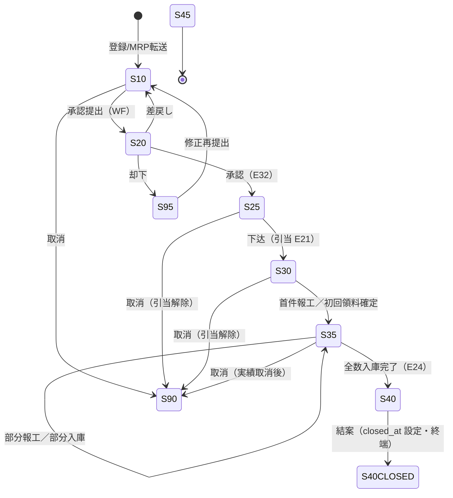
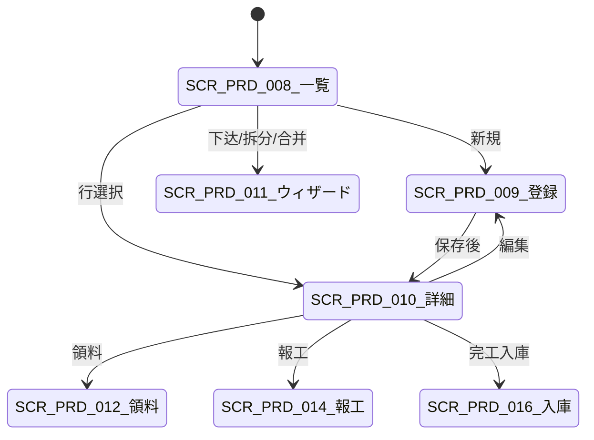

# 生产订单管理 详细设计书（製造指図管理 詳細設計書）

| 項目 | 内容 |
|---|---|
| 文書名 | 生产订单管理 详细设计书（製造指図管理 詳細設計書） |
| 文書番号 | DSN-PRD-002 |
| 版数 | v1.0 |
| 作成日 | 2026-10-20 |
| 作成者 | production-designer |
| 承認者 | 未承認（レビュー待ち） |
| 状態 | ドラフト（レビュー中） |
| 関連文書 | [业务域概要](00-overview.md) / [BOM・工艺](01-bom-routing-workcenter.md) / [領料・報工](03-material-issue-reporting.md) / [MRP](05-mrp-planning.md) / [DB 设计](90-db-design.md) / [API 设计](91-api-design.md) / [跨域流程](../00-common/09-cross-domain-flow.md) / [共通业务规则](../00-common/08-common-business-rules.md) |

---

## 1. 機能概要

| 項目 | 内容 |
|---|---|
| 機能 ID | F-PRD-005（生产订单管理）、F-PRD-011（計画確定後の工单化・日程） |
| 機能名 | 生产订单（工单）的登録・承認・下达・拆分・合并・変更・取消・結案 |
| 目的 | MRP の計画订单または手動登録から製造指示（工单）を作成し、BOM 展開による材料需求・工艺展開による工序日程を確定する。承認・下达（材料引当 E21）を経て現場に作業指示を発行し、製造実績（領料・報工・入庫）を集約する**製造実績の唯一の集約単位**を提供する |
| 利用者・ロール | 计划员（登録/下达/変更）、生产经理（承認/結案）、车间主管（着手/進捗）、倉管員（引当結果確認） |
| 利用シーン | ①日次 MRP 後の計画订单転送 ②非标・試作の手動工单登録 ③受注変更に伴う工单数量・日程変更 ④設備故障・材料遅延による拆分/保留 ⑤完了後の結案処理 |
| 優先度 | P1（第一版.5） |
| 画面 ID | SCR-PRD-008（一覧）、SCR-PRD-009（登録編集）、SCR-PRD-010（詳細）、SCR-PRD-011（下达・拆分・合并ウィザード） |
| 関連 IF | IF-PRD-001（MES 工单下发・報工回传）、IF-PRD-003（PDA/条码） |

### 1.1 「多阶/单阶」製造の定義

| 種別 | 定義 | 本設計での実現 |
|---|---|---|
| 単阶工单 | 1 つの完成品（または半製品）に対する製造指示。材料として子品目を払い出すのみ | 既定。材料は `prd_work_order_material` に展開。子品目が製造品の場合は在庫から払出（または不足時は補充手配） |
| 多阶工单 | 親工单の子品目（製造品）に対して子工单を自動生成し、階層で製造を管理 | `prd_work_order.parent_work_order_id` で親子関係。MRP の計画订单が低层码ごとに生成される場合は自動的に多阶構造になる（[05](05-mrp-planning.md) 5.3）。手動時は「子工单を同時作成」チェックで生成 |
| 虚拟件（幻影） | BOM 上の中間構成で在庫を持たない品目 | 工单を作らず、材料を透過展開（`material_type=40`） |

> 半製品（定子总成・转子总成等）を在庫として持つか、都度製造するかは `prd_material_planning.material_type` と BOM 構成で決まる。YE3 の標準機は半製品を**在庫**として持つ（MTS）ため、総装工单は単阶で半製品を引き当てる。

## 2. 業務要件・業務ルール

### 2.1 前提条件

| # | 前提条件 | 成立しない場合の挙動 |
|---|---|---|
| 1 | 対象品目の生産計画マスタ `prd_material_planning.material_type`（品目×工厂）が `∈ {20 制造品, 30 委外品}`（委外は [04](04-outsourcing.md) へ）。MDM の `mdm_material.material_type`（10 成品〜80 服务）ではない（[90](90-db-design.md) `prd_material_planning`） | エラー `MSG-PRD-001`「製造品ではありません」（HTTP 422 / `60001`）。当該品目×工厂の計画行が存在しない場合も同じ |
| 2 | 有効な BOM が存在する（製造品。基準日＝`planned_start_date`（計画着手日）。未入力時は会社のタイムゾーンの当日（現時点では Asia/Shanghai のみ）） | 登録・草稿保存・承認提出は**可**（画面は `MSG-PRD-020` を警告表示するのみ）。**下达時のみ必須**で、なければ 422／`60020`／`MSG-PRD-020`（蓝色大肥鱼 2026-10-21 #36 決定） |
| 3 | 有効な工艺路线が存在する（または工序を手動登録） | 警告のうえ工序 0 件で登録可（後から追加） |
| 4 | 工厂・倉庫が有効 | エラー `MSG-COM-049` |
| 5 | 会計期間が締切済でない | `MSG-COM-071` |
| 6 | 受注由来の場合、受注が承認済（25 以上） | エラー `MSG-PRD-002`「承認前の受注からは工单を作成できません」 |

### 2.2 業務ルール

| # | ルール | 根拠 | 関連項目 |
|---|---|---|---|
| BR-WO-01 | 工单の承認は WF（E31/E32）で行う。承認不要フロー（少額・標準機）は設定で自動承認可（パラメータ `production.wo.approval.required=true` が既定。イベントではない） | [08](../00-common/08-common-business-rules.md) 8 章 | `order_status=20` |
| BR-WO-02 | 承認済（25）以降の内容変更は禁止。変更は「変更申請＋承認」で行い、`prd_work_order_change` に前後値を記録する | [08](../00-common/08-common-business-rules.md) 3.3-3 | `prd_work_order_change` |
| BR-WO-03 | 下达（25→30）時に材料引当を実行し、E21 を発行する。引当結果は INV の E09 で受信し、材料行の `reserved_qty`/`shortage_qty` を更新する | [09](../00-common/09-cross-domain-flow.md) E21/E09 | `prd_work_order_material` |
| BR-WO-04 | 引当不足があっても下达は可能（部分引当）。不足分は動作メッセージ＋補充請購建議として計画員に通知する | [09](../00-common/09-cross-domain-flow.md) 6.3 | `shortage_qty` |
| BR-WO-05 | 首件報工（または最初の領料確定）で `order_status=35`（製造中）へ遷移する。全数量入庫完了で `40`、結案で `45` | [00-overview](00-overview.md) 3.3 | — |
| BR-WO-06 | 拆分は「数量による拆分」と「工序による拆分」を可能とする。拆分後の子工单数量合計は元工单数量と一致する（許容率内の端数は最終子工单に寄せる） | 現場の段取り変更 | 6.5 |
| BR-WO-07 | 合併は同一品目・同一工厂・同一 BOM/工艺版本・同一納期区分の工单に限る。状態は 10/25 のみ | 意図しない混流防止 | 6.6 |
| BR-WO-08 | 工单の `order_qty` 変更は、既に領料・報工・入庫がある場合は「残数量」に対する変更として扱い、完了済数量は変更しない | 実績の保護 | 6.7 |
| BR-WO-09 | 結案条件は「全数入庫完了（`completion_status=20`）＋全数報工完了（`report_status=20`）＋検査完了（`inspection_status ∈ {20,30}`）＋原価確定（`cost_status=20`）＋未領材料が 0（`remaining_qty=0`）」 | [09](../00-common/09-cross-domain-flow.md) 10.3-5 | 6.9 |
| BR-WO-10 | 取消（→90）は「領料・報工・入庫の実績がない」場合のみ可能。実績がある場合は先に各伝票を取消す（引当解除・材料戻し） | [08](../00-common/08-common-business-rules.md) 3.3-4 | 6.8 |
| BR-WO-11 | 保留（`is_hold=true`）中は報工・入庫を拒否する（材料引当・領料は可）。保留解除は理由と承認を要する | 品質・設備異常時の保護 | `prd_work_order_change` |
| BR-WO-12 | 工单番号は `WO{YYMMDD}{4桁日序}`（[08](../00-common/08-common-business-rules.md) 2.1）。取消・再作成でも新しい番号を採番する | 監査性 | `prd_work_order.work_order_no` |
| BR-WO-13 | 同一受注明細に対して複数工单を作成できる（分納・分割）。合計完工数量は受注数量を超えない（超入庫容许率内） | 分納対応 | `sales_order_id` |
| BR-WO-14 | 工单の日程は工艺路線の工序順・標準工数・工作日历から算出し、後工程の着手日は前工程の完了日＋待ち時間とする | [05](05-mrp-planning.md) 6.3 | `prd_work_order_operation` |
| BR-WO-15 | **G2-18**：MTO 工单の `material_id` は `sales_order_line_id` の物料と一致必須（不一致は HTTP 422 / `60056` / `MSG-PRD-056`。業務拒否に共通 4002 を使わない）。数量は物料基本単位。完工累計 `completed_qty` ≤ 受注行／工单 `allowed_qty`（`allowed_qty = floor(base×(1+rate))`、`mdm_uom.decimal_places`。容差 NUMERIC(5,4)：受注行→物料→分類→`sys_param.prd.completion_over_rate`。NULL 継承、0 明示。欠落は 5000）。跨表ロックは受注行→工单（同一表 id 昇順）。超産は専用承認＋Flowable（未承認は `MSG-PRD-100`/`60100`）。承認時は増分方式 `allowed_qty = allowed_qty + delta`（delta＝`request_qty`、≤0/NULL は `60103`）：工单級は受注行と当該工单を各 +delta（他工单は自身の上限に拘束）、受注行級は受注行のみ +delta（工单不変・按分なし）。受注変更時は率で再算出後に承認済 delta 合計を加算し戻す（[90 §3.19.1](90-db-design.md)）。 | G2-18/#47/#29、#54 | `sales_order_line_id`、`allowed_qty`、`completed_qty`、`over_receipt_rate` |

### 2.3 計算式・判定式

| # | 対象 | 算式 | 丸め | 例 |
|---|---|---|---|---|
| CALC-WO-01 | 純必要量 | `required_qty = BOM.component_qty × order_qty ÷ BOM.base_qty` | 4 桁四捨五入 | 120 × 1.0000 = 120.0000 |
| CALC-WO-02 | 総必要量（gross） | `total_required_qty = required_qty ÷ (1 − BOM.loss_rate)` | 4 桁切上 | 120.0000 ÷ (1−0.0050) = 120.6030 |
| CALC-WO-03 | 超領上限 | `max_issue_qty = total_required_qty × (1 + 超領容许率 0.03)` | 4 桁切上 | 120.6030 × 1.03 = 124.2211 |
| CALC-WO-04 | 工序必要工数 | `need_hours = setup_time + run_time_per_unit × qty` | 2 桁（h） | 0.5 + 0.35 × 120 = 42.50 h |
| CALC-WO-05 | 工序日程（開始） | `planned_start = max(前工序 planned_end + queue_time, 工单 planned_start)` | 稼働日 | — |
| CALC-WO-06 | 工序日程（終了） | `planned_end = planned_start + CEILING(need_hours ÷ (日稼働時間 × 標準人数))` 稼働日換算 | 日切上 | 42.5 ÷ (16 × 1) = 2.66 → 3 日 |
| CALC-WO-07 | 進捗率 | `progress_rate = reported_good_qty ÷ order_qty`（0〜1.2） | 4 桁 | 60 ÷ 120 = 0.5000 |
| CALC-WO-08 | 引当充足率 | `reservation_rate = reserved_qty ÷ total_required_qty` | 4 桁 | 90 ÷ 141.89 = 0.6343 |
| CALC-WO-09 | 標準原価 | `standard_cost = fin_standard_cost.total_unit_cost`（下达時スナップショット、なしは NULL。卷算式 材料費（BOM 巻上）＋ 加工費（工艺工数 × 工费率）は FIN の版登録時に使用） | 6 桁 | [01](01-bom-routing-workcenter.md) 5.3 |
| CALC-WO-10 | 単位換算 | BOM 使用単位 ≠ 物料基本単位のとき `qty_base = qty_bom × conversion_rate`（`mdm_uom_conversion` の `from_uom_code`=BOM 単位・`to_uom_code`=基本単位、基準日有効・`status=1`。基準日は登録・保存・承認提出・下达とも `planned_start_date`、未入力なら会社タイムゾーン（現時点 Asia/Shanghai）の当日（蓝色大肥鱼 2026-10-21 最終決定）。逆方向行のみなら `1 ÷ conversion_rate`）。基準日に有効な換算率が 0 件または複数件なら換算不可（`60022`）。`required_qty`・`total_required_qty` に適用。換算前の単位・総必要量は `bom_uom_code`・`bom_qty` に保持（蓝色大肥鱼 2026-10-21 決定） | 基本単位の `mdm_uom.decimal_places` で**切上**（`rounding_mode` によらず、払出不足を防ぐ） | 10 BOX × 12 = 120 PCE |

### 2.4 状態遷移



| # | 遷移 | トリガ | 権限 | 更新項目 | 事前条件 | メッセージ |
|---|---|---|---|---|---|---|
| T-01 | 10→20 | 承認提出 | `production:work-order:submit` | `order_status=20`、`submitted_at` | 条件なし（材料明細 0 行可（蓝色大肥鱼 2026-10-21 PR #37 決定）。有効 BOM は不要（蓝色大肥鱼 2026-10-21 #36 決定）） | `MSG-COM-005` |
| T-02 | 20→25 | 承認（WF E32） | `production:work-order:approve` | `order_status=25`、`approved_by/at` | 承認者本人、自己承認不可 | — |
| T-03 | 20→10 | 差戻し | 承認者 | `order_status=10` | 理由必須 | `MSG-COM-034` |
| T-04 | 20→95 | 却下 | 承認者 | `order_status=95` | 理由必須 | — |
| T-05 | 25→30 | 下达 | `production:work-order:release` | `order_status=30`、`released_by/at`、E21 発行 | 材料明細 0 行なら同一トランザクションで有効 BOM を展開（基準日＝`planned_start_date`、未入力時は下达処理日の会社タイムゾーン当日（現時点 Asia/Shanghai。登録時と同一規則））。BOM なしは 422／`60020`／`MSG-PRD-020`、状態不変・書込みなし（蓝色大肥鱼 2026-10-21 #36 決定（蓝色大肥鱼 2026-10-21 PR #37 決定））。既存明細があれば再展開しない、引当可能（不足可）、工作日历済 | `MSG-PRD-044` |
| T-06 | 30→35 | 首件報工/領料確定 | `production:work-report:create` / `material-issue:create` | `order_status=35`、`actual_start_date` | 保留中でない | — |
| T-07 | 35→40 | 全数入庫 | `production:completion:create` | `order_status=40`、`completion_status=20`、`actual_end_date` | 入庫累計 ≥ order_qty、FQC 合格/特采 | `MSG-PRD-040` |
| T-08 | 40→40（closed_at 設定） | 結案 | `production:work-order:close` | `closed_by/at`、`close_reason`、`wip_cost=0`（`order_status` は 40 のまま＝終端） | BR-WO-09 の全条件 | `MSG-PRD-075` |
| T-09 | 10/25/30/35→90 | 取消 | `production:work-order:cancel` | `order_status=90`、`cancel_reason` | BR-WO-10、引当解除済 | `MSG-PRD-046` |
| T-10 | 任意→保留中 | 保留 | `production:work-order:update` | `is_hold=true`、`hold_reason` | 理由必須 | `MSG-PRD-047` |

**サブステータス（状態とは独立に管理）**

| サブステータス | 値 | 更新契機 |
|---|---|---|
| `material_issue_status` | 00 未 / 10 一部 / 20 完了 | 引当（E09）・領料確定（E22） |
| `report_status` | 00 未 / 10 一部 / 20 完了 | 報工確定（E23） |
| `completion_status` | 00 未 / 10 一部 / 20 完了 | 完工入库確定（E24） |
| `inspection_status` | 00 未 / 10 検査中 / 20 合格 / 30 不合格・特采 | 検査判定（E15） |
| `cost_status` | 00 未帰集 / 10 暫定 / 20 確定 | 月結（BAT-PRD-006）・FIN 連携 |

> 「作成→下达→领料中→生产中→报工完成→入库→关闭/结案」という業務表現は、上記の主状態＋サブステータスで表現する（例：「领料中」＝ `order_status=30` かつ `material_issue_status=10`）。

## 3. 関連機能

| 関係 | 機能 ID | 機能名 | 関係内容 |
|---|---|---|---|
| 上流 | F-PRD-010 | MRP | 計画订单から工单を生成（`source_type=10`） |
| 上流 | F-PRD-001/003 | BOM/工艺 | 材料・工序の展開元。変更は工单に反映しない（スナップショット） |
| 上流 | F-SAL-003 | 销售订单 | MTO 工单の受注・納期・顧客（E06 購読で需要登録） |
| 下流 | F-PRD-006 | 领料/退料 | 工单材料の払出（E22）・退料戻入（E36） |
| 下流 | F-PRD-007 | 報工 | 工序実績・工数・良品/不良（E23） |
| 下流 | F-PRD-008 | 完工入库 | 完成品入庫（E24） |
| 下流 | F-PRD-009 | 委外 | 工序・部品の委外（E25/E26） |
| 参照 | F-PRD-012/013 | 检验标准/検査 | IPQC/FQC の起票 |
| 参照 | F-INV-001/006 | 库存/引当 | 引当結果（E09）・出庫原価（E18） |

## 4. 画面設計

### 4.1 画面一覧

| 画面 ID | 画面名 | 類型 | 概要 |
|---|---|---|---|
| SCR-PRD-008 | 生产订单一覧 | 一覧検索 | 検索・一括承認/下达/取消・印刷・エクスポート |
| SCR-PRD-009 | 生产订单登録編集 | 登録編集 | ヘッダ＋材料明細＋工序明細の登録・編集・承認提出 |
| SCR-PRD-010 | 生产订单詳細 | 参照詳細 | 基本情報・用料・工序・報工・入庫・検査・原価・変更履歴のタブ表示、各操作への導線 |
| SCR-PRD-011 | 生产订单下达・拆分・合并 | ウィザード | 下达（引当確認）・数量/工序拆分・合併の 3 モード |

### 4.2 画面遷移



### 4.3 画面レイアウト（SCR-PRD-009 登録編集）

```
┌──────────────────────────────────────────────────────────────────────┐
│ パンくず：ホーム > 生产管理 > 生产订单 > 生産訂単登録                │
├──────────────────────────────────────────────────────────────────────┤
│〔ヘッダ〕 工单号 [WO2610200001] 类型[▼量产] 状态(10 草稿)            │
│  工厂[▼CZ01] 品目[3001000001 YE3-100L1-4] 数量[120.0000] PCE        │
│  计划着手[2026-11-12] 计划完成[2026-11-17] 優先度[▼5] 仓库[▼WH03]    │
│  来源[受注 SO2610200001] 顧客[常州泵业有限公司]                       │
│  □子工单を同時作成  □倒冲  □保留                                     │
├──────────────────────────────────────────────────────────────────────┤
│〔タブ〕[材料明細] [工序明細] [検査点] [履歴]                         │
├──────────────────────────────────────────────────────────────────────┤
│ 材料明細： 行|物料编码|物料名称|単位|総必要量|引当|領料|未領|倉庫|倒冲│
│   10 |1001000001|50W470 电工钢带|KGM|141.8854|0|0|141.8854|WH01|□ │
│   [+行追加] [BOM再展開] [引当確認]                                    │
├──────────────────────────────────────────────────────────────────────┤
│ 工序明細： SEQ|工序|工作中心|準備工数|単件工数|標準人数|着手|完了|状態│
│   10 |下料|WC001|0.50|0.0200|1|2026-11-12|2026-11-12|未着手         │
│   20 |冲片|WC001|1.00|0.0600|1|2026-11-12|2026-11-13|未着手         │
│   …                                                                   │
├──────────────────────────────────────────────────────────────────────┤
│ [保存] [保存して継続] [承認提出] [BOM再展開] [キャンセル]            │
└──────────────────────────────────────────────────────────────────────┘
```

### 4.4 画面項目定義（SCR-PRD-009 登録編集・ヘッダ）

| No | 項目 ID | 項目名 | 区分 | 種別 | 型/桁 | 必須 | 初期値 | 入力チェック | データソース | DB 項目 | 権限 | 備考 |
|---|---|---|---|---|---|---|---|---|---|---|---|---|
| 1 | work_order_no | 工单号 | ヘッダ | テキスト | VARCHAR(32) | ○ | 自動採番（保存時） | 桁数 12、一意 | `sys_sequence(PRD_WORK_ORDER)` | `work_order_no` | 参照のみ | 取消・再作成で新番号 |
| 2 | work_order_type | 工单类型 | ヘッダ | 選択 | SMALLINT | ○ | 10 量产 | 10/20/30/40 | 固定値 | `work_order_type` | 編集可 | 返工は NCR から起票 |
| 3 | factory_id | 工厂 | ヘッダ | 選択 | BIGINT | ○ | ログインユーザ既定工場 | 有効工場 | `mdm_factory` | `factory_id` | 編集可 | — |
| 4 | material_code | 品目编码 | ヘッダ | コード選択 | VARCHAR(64) | ○ | 空 | 存在・製造品のみ（有効 BOM なしは警告のみ、下达時に必須） | `mdm_material` / `prd_bom` | `material_id`/`material_code` | 編集可 | 選択時に BOM/工艺を自動展開 |
| 5 | material_name | 品目名称 | ヘッダ | テキスト | VARCHAR(200) | — | 自動 | — | マスタ | `material_name` | 参照のみ | スナップショット |
| 6 | uom_code | 单位 | ヘッダ | テキスト | VARCHAR(16) | ○ | マスタ既定 | — | `mdm_material` | `uom_code` | 参照のみ | — |
| 7 | order_qty | 注文数量 | ヘッダ | 数値 | NUMERIC(18,4) | ○ | 0 | > 0、≧ 既入庫数量（変更時） | — | `order_qty` | 編集可 | 変更は残数量扱い |
| 8 | planned_start_date | 计划着手日 | ヘッダ | 日付 | DATE | ○ | BOM/工艺から算出 | 過去日警告、≦ 完成日 | — | `planned_start_date` | 編集可 | — |
| 9 | planned_end_date | 计划完成日 | ヘッダ | 日付 | DATE | ○ | 受注明細納期 or 当日+LT | ≧ 着手日 | `prd_material_planning` | `planned_end_date` | 編集可 | 遅延は赤字 |
| 10 | priority_no | 優先度 | ヘッダ | 選択 | SMALLINT | ○ | 5 | 1〜9 | 固定値 | `priority_no` | 編集可 | 1 最高 |
| 11 | warehouse_id | 完工入库倉庫 | ヘッダ | 選択 | BIGINT | ○ | 品目既定倉庫 | 有効倉庫 | `mdm_warehouse` | `warehouse_id` | 編集可 | — |
| 12 | bom_no | 適用 BOM | ヘッダ | テキスト | VARCHAR(32) | — | 自動解決 | — | `prd_bom` | `bom_id`/`bom_no` | 参照のみ | 基準日で有效版を選択（基準日＝`planned_start_date`（計画着手日）。未入力時は会社のタイムゾーンの当日（現時点では Asia/Shanghai のみ）） |
| 13 | routing_no | 適用工艺 | ヘッダ | テキスト | VARCHAR(40) | — | 自動解決 | — | `prd_routing` | `routing_id`/`routing_no` | 参照のみ | — |
| 14 | sales_order_id | 受注 | ヘッダ | コード選択 | VARCHAR(32) | △ | 空 | MTO 時必須、承認済受注のみ | `sal_sales_order` | `sales_order_id` | 編集可 | MTO の紐付け |
| 14a | sales_order_line_id | 受注明細 | ヘッダ | コード選択 | BIGINT | △(MTO○) | 空 | MTO 必須・品目一致（`MSG-PRD-056`） | `sal_sales_order_line` | `sales_order_line_id` | 編集可 | G2-18 完工上限の基準 |
| 14b | allowed_qty | 許容完工上限 | ヘッダ | 数値 | NUMERIC(18,4) | — | 受注行／計算 | — | 受注行スナップショット | `allowed_qty` | 参照のみ | floor(受注行残 × (1+許容率))、`uom.decimal_places` で切捨 |
| 14c | completed_qty | 完工累計 | ヘッダ | 数値 | NUMERIC(18,4) | — | 0 | — | 完工入庫 | `completed_qty` | 参照のみ | 完工入庫・取消で増減 |
| 15 | customer_id | 顧客 | ヘッダ | テキスト | VARCHAR(200) | — | 受注から引継 | — | `mdm_customer` | `customer_id`/名称 | 参照のみ | — |
| 16 | source_type | 来源区分 | ヘッダ | テキスト | SMALLINT | ○ | 20 手工 | — | 固定値 | `source_type` | 参照のみ | 10 MRP/20 手工/30 受注/40 拆分/50 合并/60 返工 |
| 17 | source_no | 来源单号 | ヘッダ | テキスト | VARCHAR(64) | — | 空 | — | — | `source_no` | 参照のみ | MRP 計画订单番号等 |
| 18 | is_backflush | 倒冲 | ヘッダ | チェック | BOOLEAN | — | false | — | — | `is_backflush` | 編集可 | 有効時は材料を自動払出 |
| 19 | is_hold | 保留 | ヘッダ | チェック | BOOLEAN | — | false | 保留理由必須 | — | `is_hold`/`hold_reason` | 編集可 | 報工・入庫をブロック |
| 20 | create_child_wo | 子工单作成 | ヘッダ | チェック | BOOLEAN | — | false | — | — | （`prd_work_order_relation`） | 編集可 | 多阶製造時 |
| 21 | progress_rate | 進捗率 | ヘッダ | 数値 | NUMERIC(7,4) | — | 0 | — | — | `progress_rate` | 参照のみ | バー表示 |
| 22 | order_status | 状態 | ヘッダ | バッジ | SMALLINT | — | 10 | — | — | `order_status` | 参照のみ | 色付きバッジ |
| 23 | over_receipt_rate | 完工超収容差 | ヘッダ | 数値 | NUMERIC(5,4) | — | チェーン解決値 | — | 受注行→物料→分類→会社 `sys_param` `prd.completion_over_rate`（登録時に解決） | `over_receipt_rate` | 参照のみ | % 表示・小数 2 桁（比率 NUMERIC(5,4) で保存）。前端は送信しない（[90-db-design.md](90-db-design.md) `prd_work_order.over_receipt_rate`） |
| 24 | remark | 備考 | ヘッダ | テキスト | VARCHAR(500) | — | 空 | 500 桁 | — | `remark` | 編集可 | — |

**材料明細（タブ）項目定義**

| No | 項目 ID | 項目名 | 種別 | 型/桁 | 必須 | 初期値 | 入力チェック | データソース | DB 項目 | 権限 |
|---|---|---|---|---|---|---|---|---|---|---|
| M1 | line_no | 行番号 | 数値 | INT | — | 10 刻み自動 | — | — | `line_no` | 参照のみ |
| M2 | material_code | 物料编码 | コード選択 | VARCHAR(64) | ○ | BOM 展開 | 存在・有効・単位整合 | `mdm_material` | `material_id`/`material_code` | 編集可（追加時） |
| M3 | material_name | 物料名称 | テキスト | VARCHAR(200) | — | BOM 展開 | — | マスタ | `material_name` | 参照のみ |
| M4 | uom_code | 単位 | テキスト | VARCHAR(16) | ○ | BOM 展開 | — | マスタ | `uom_code` | 参照のみ |
| M5 | required_qty | 理論必要量 | 数値 | NUMERIC(18,4) | ○ | 自動計算 | > 0、CALC-WO-01 | — | `required_qty` | 参照のみ |
| M6 | loss_rate | 损耗率 | 数値 | NUMERIC(7,4) | — | BOM 値 | 0〜1 | `prd_bom_line` | `loss_rate` | 参照のみ |
| M7 | total_required_qty | 総必要量 | 数値 | NUMERIC(18,4) | ○ | 自動計算 | CALC-WO-02 | — | `total_required_qty` | 参照のみ |
| M8 | reserved_qty | 引当済 | 数値 | NUMERIC(18,4) | — | 0 | — | E09 | `reserved_qty` | 参照のみ |
| M9 | shortage_qty | 不足 | 数値 | NUMERIC(18,4) | — | 0 | — | E09 | `shortage_qty` | 参照のみ（赤） |
| M10 | issued_qty | 領料済 | 数値 | NUMERIC(18,4) | — | 0 | — | E22 | `issued_qty` | 参照のみ |
| M11 | remaining_qty | 未領 | 数値 | NUMERIC(18,4) | — | 自動計算 | — | — | `remaining_qty` | 参照のみ |
| M12 | warehouse_id | 出庫倉庫 | 選択 | BIGINT | ○ | 品目既定倉庫 | 有効倉庫 | `mdm_warehouse` | `warehouse_id` | 編集可 |
| M13 | feeding_type | 投入方式 | 選択 | SMALLINT | ○ | BOM 値 | 10 先行/20 倒冲 | 固定値 | `feeding_type` | 編集可 |
| M14 | operation_seq | 投入工序 | 選択 | INT | △ | BOM 値 | 工序明細に存在 | — | `operation_seq` | 編集可 |
| M15 | is_key_part | 关键件 | チェック | BOOLEAN | — | BOM 値 | — | `prd_bom_line` | `is_key_part` | 参照のみ |
| M16 | used_substitute_material_id | 替代料 | コード選択 | BIGINT | △ | 空 | 同一替代组内 | `prd_bom_substitute` | `used_substitute_material_id` | 編集可 |

**工序明細（タブ）項目定義**

| No | 項目 ID | 項目名 | 種別 | 型/桁 | 必須 | 初期値 | 入力チェック | データソース | DB 項目 | 権限 |
|---|---|---|---|---|---|---|---|---|---|---|
| P1 | operation_seq | 工序序号 | 数値 | INT | ○ | 10 刻み | > 0、一意 | — | `operation_seq` | 編集可 |
| P2 | operation_code | 工序编码 | テキスト | VARCHAR(32) | ○ | 工艺 | — | `prd_routing_operation` | `operation_code` | 参照のみ |
| P3 | operation_name | 工序名称 | テキスト | VARCHAR(100) | ○ | 工艺 | — | 同上 | `operation_name` | 編集可 |
| P4 | work_center_id | 工作中心 | 選択 | BIGINT | ○ | 工艺 | 有効・工厂一致 | `prd_work_center` | `work_center_id`/`code`/`name` | 編集可 |
| P5 | equipment_id | 設備 | 選択 | BIGINT | △ | 工艺 | 工作中心に所属 | `prd_equipment` | `equipment_id` | 編集可 |
| P6 | setup_time | 準備工数 | 数値 | NUMERIC(12,2) | ○ | 工艺 | ≧ 0 | 同上 | `setup_time` | 編集可 |
| P7 | run_time_per_unit | 単件工数 | 数値 | NUMERIC(12,4) | ○ | 工艺 | ≧ 0 | 同上 | `run_time_per_unit` | 編集可 |
| P8 | standard_workers | 標準人数 | 数値 | SMALLINT | ○ | 工艺 | ≧ 1 | 同上 | `standard_workers` | 編集可 |
| P9 | planned_qty | 计划良品数 | 数値 | NUMERIC(18,4) | ○ | order_qty | > 0 | — | `planned_qty` | 参照のみ |
| P10 | planned_start_date | 计划着手日 | 日付 | DATE | ○ | 自動算出 | ≦ 完了日 | — | `planned_start_date` | 編集可 |
| P11 | planned_end_date | 计划完了日 | 日付 | DATE | ○ | 自動算出 | ≧ 着手日 | — | `planned_end_date` | 編集可 |
| P12 | is_inspection_point | 检验点 | チェック | BOOLEAN | — | 工艺 | — | `prd_routing_operation` | `is_inspection_point` | 参照のみ |
| P13 | operation_status | 工序状態 | バッジ | SMALLINT | — | 0 未着手 | — | — | `operation_status` | 参照のみ |

### 4.5 イベント処理（SCR-PRD-009）

| No | イベント | トリガ | 処理内容 | 呼出 API | 画面遷移 | 備考 |
|---|---|---|---|---|---|---|
| 1 | 品目選択 | 品目コード変更 | 有効 BOM・工艺を基準日で解決し、材料/工序明細を自動展開。既存明細は確認後に置換 | `GET /api/production/boms/effective?materialId&factoryId&date` | 同一画面 | 既存明細がある場合は `MSG-COM-011`。`factoryId` は必須（工单の工厂を渡す。欠落 1001） |
| 2 | 数量変更 | 数量変更 | 材料明細の必要量・工序の予定工数を再計算（引当済がある場合は再引当提案） | —（フロント計算） | 同一画面 | 領料済がある場合は変更不可 |
| 3 | BOM再展開 | ボタン | 最新の有効 BOM で材料明細を再生成（手動追加行は保持） | `POST /api/production/work-orders/{id}/explode-bom` | 同一画面 | 変更履歴に記録 |
| 4 | 引当確認 | ボタン | INV の引当可能量を照会し、不足を表示 | `GET /api/inventory/stock-balances/available` | 同一画面 | 同期参照 |
| 5 | 保存 | ボタン | 入力チェック→採番→INSERT→明細保存→監査ログ | `POST /api/production/work-orders` または `PUT .../{id}` | 詳細画面 | 二重送信防止 |
| 6 | 承認提出 | ボタン | 保存後 WF 提出、状態 20 | `POST /api/production/work-orders/{id}/submit` | 一覧 | 承認経路未設定時 `MSG-COM-073` |
| 7 | 子工单作成 | チェック ON | 子品目（製造品）の工单を同時生成（数量は `required_qty`） | `POST .../{id}/create-child-work-orders` | 同一画面 | 多阶製造 |
| 8 | キャンセル | ボタン | 未保存時は確認、保存済は詳細へ | — | 一覧/詳細 | `MSG-COM-011` |

### 4.6 一覧画面仕様（SCR-PRD-008）

| 項目 | 内容 |
|---|---|
| 検索条件 | 工单号（前方一致）、品目コード/名称（部分一致）、工单类型、状態（複数）、計画着手日/完成日（範囲）、工場、部門、受注番号、顧客、優先度、来源区分、保留フラグ、欠品フラグ |
| 既定検索条件 | 工場=ログインユーザ既定、状態=未完了（10,20,25,30,35）、計画完成日=当日〜+90 日 |
| ソート | 既定：計画完成日昇順 → 優先度昇順 → 工单号昇順 |
| ページング | 20/50/100/200（既定 20） |
| 一括操作 | 承認提出、承認（権限者のみ）、下达、取消、保留/解除、帳票印刷、エクスポート |
| エクスポート | Excel、10,000 件超は非同期ジョブ（`POST /api/production/exports`） |
| 行操作 | 詳細、編集、下达、領料、報工、入庫、印刷（最大 3 個＋「その他」） |
| 表示色 | 遅延（計画完成日 < 当日）＝赤、今日完成＝橙、保留＝灰、完了＝緑 |

### 4.7 表示制御

| 条件 | 対象 | 制御 |
|---|---|---|
| `order_status ≥ 25` | 品目・数量（完了済を除く）・BOM/工艺 | 編集不可（変更申請ボタンのみ） |
| `order_status=10` | 下达ボタン | 非表示 |
| `order_status=25` | 編集・削除 | 非表示、下达ボタン表示 |
| `order_status ∈ {40,45,90,95}` | 編集・下达・領料・報工・入庫 | 非表示（詳細参照のみ） |
| `is_hold=true` | 報工・入庫 | 非表示、保留理由を表示 |
| 権限 `production:work-order:cost-view` なし | 標準原価・実績原価・差異 | 非表示（API でも返さない） |
| `standard_cost IS NULL`（下达前、または下达時に発行版なし） | 標準原価・原価差異 | 「未設定」と表示（0 と表示しない）。API は `standardCost: null`（PR #8 決定 2（蓝色大肥鱼 2026-10-21）） |
| データ範囲外の工场 | 一覧・詳細 | 403 画面（`MSG-COM-031`） |

### 4.8 下达・拆分・合并ウィザード（SCR-PRD-011）項目定義

| No | 項目 ID | 項目名 | ステップ | 種別 | 必須 | 入力チェック | 備考 |
|---|---|---|---|---|---|---|---|
| W1 | mode | 処理モード | 1 | ラジオ | ○ | 10 下达 / 20 拆分 / 30 合并 | 選択した工单状態で実行可否を判定 |
| W2 | target_ids | 対象工单 | 1 | 一覧選択 | ○ | 1 件以上、状態条件一致 | 下达：25 / 拆分：30・35 / 合并：10・25 |
| W3 | release_date | 下达日 | 1 | 日付 | ○ | 未来日可、過去日不可（上海時間当日基準。違反は 60104／`MSG-PRD-104`（422））（蓝色大肥鱼 2026-10-21） | 既定：当日 |
| W4 | reservation_mode | 引当方式 | 2 | ラジオ | ○ | 10 全量引当 / 20 部分引当（不足許容） | 既定：20 |
| W5 | shortage_action | 不足時処理 | 2 | ラジオ | △ | 10 補充請購建議 / 20 何もしない | 不足がある場合のみ |
| W6 | split_type | 拆分方式 | 2 | ラジオ | △ | 10 数量拆分 / 20 工序拆分 | 拆分モードのみ |
| W7 | split_lines | 拆分明細 | 2 | 明細 | △ | 合計 = 元数量、各 > 0 | 数量拆分時 |
| W8 | split_operation_seq | 拆分工序 | 2 | 選択 | △ | 工序明細に存在 | 工序拆分時（当該工序以降を子工单へ） |
| W9 | merge_target | 合并先 | 2 | ラジオ | △ | 既存工单 or 新規 | 合并モードのみ |
| W10 | schedule_preview | 日程プレビュー | 3 | 一覧 | — | — | 工序別の着手/完了日、能力負荷表示 |
| W11 | execute | 実行 | 4 | ボタン | — | 確認ダイアログ | 実行後は結果（成功/失敗）表示 |

## 5. 入力チェック仕様

| No | チェック ID | 対象 | 種別 | 条件 | タイミング | メッセージ ID |
|---|---|---|---|---|---|---|
| 1 | CHK-PRD-002-01 | 品目 | 業務 | `prd_material_planning.material_type`（品目×工厂）`∈ {20 制造品, 30 委外品}`（`mdm_material.material_type` ではない）。計画行なしも NG | 保存時 | `MSG-PRD-001`（422 / `60001`） |
| 2 | CHK-PRD-002-02 | 数量 | 範囲 | > 0、4 桁精度 | 入力時 | `MSG-COM-047` |
| 3 | CHK-PRD-002-03 | 数量（変更） | 業務 | 変更後数量 ≧ 既入庫数量 | 保存時 | `MSG-PRD-003` |
| 4 | CHK-PRD-002-04 | 計画日 | 相関 | 着手日 ≦ 完成日 | 保存時 | `MSG-COM-045` |
| 5 | CHK-PRD-002-05 | 計画日 | 業務 | 過去日は警告（登録は可） | 保存時 | `MSG-PRD-004` |
| 6 | CHK-PRD-002-06 | 受注 | 業務 | 受注が承認済（≥25）、受注明細の品目と一致 | 保存時 | `MSG-PRD-002` |
| 7 | CHK-PRD-002-07 | BOM | 業務 | 有効 BOM が存在（基準日＝`planned_start_date`（計画着手日）。未入力時は会社のタイムゾーンの当日（現時点では Asia/Shanghai のみ）） | 品目選択/保存/承認提出時は警告のみ、下达時はエラー（422／`60020`）（蓝色大肥鱼 2026-10-21 #36 決定） | `MSG-PRD-020` |
| 8 | CHK-PRD-002-08 | 工艺 | 業務 | 有効工艺が存在（または工序 1 件以上） | 品目選択/保存時は警告のみ（工序 0 件で登録可）、承認時は工序 0 件ならエラー（422／`60021`）（蓝色大肥鱼 2026-10-21 決定） | `MSG-PRD-021` |
| 9 | CHK-PRD-002-09 | 材料明細 | 必須 | 保存・提出時はチェックしない（0 行可（蓝色大肥鱼 2026-10-21 PR #37 決定））。下达時は 0 行なら BOM 展開（§6.4 2a） | — | — |
| 10 | CHK-PRD-002-10 | 材料単位 | 業務 | BOM 使用単位と物料基本単位が同一単位、または同一換算グループ（`mdm_uom.conversion_group`）で換算可能（[01](01-bom-routing-workcenter.md) CHK-PRD-001-09 と同一基準）。換算不可は拒否 | 登録時は BOM 展開行を検査、保存時は当該保存で新規追加、または単位・数量を変更した行（`bom_line_id` NULL の手動行を含む）のみ検査、承認提出時は変更追跡を行わず全材料明細を検査、下达時は全行を再検査（変更フラグ・列は追加しない）（蓝色大肥鱼 2026-10-21 最終決定） | `MSG-PRD-022`（422／`60022`） |
| 11 | CHK-PRD-002-11 | 状態 | 状態 | 編集は 10/25 のみ、提出は 10 のみ | 操作時 | `MSG-COM-034` |
| 12 | CHK-PRD-002-12 | 自己承認 | 権限 | 起案者と承認者が同一でない | 承認時 | `MSG-PRD-005` |
| 13 | CHK-PRD-002-13 | 拆分合計 | 相関 | 子工单数量合計 = 元工单数量（±0.0001） | 拆分実行時 | `MSG-PRD-048` |
| 14 | CHK-PRD-002-14 | 合并条件 | 業務 | 同一品目・工場・BOM/工艺版本・納期区分 | 合并実行時 | `MSG-PRD-049` |
| 15 | CHK-PRD-002-15 | 保留理由 | 必須 | 保留時は理由 500 桁以内で必須 | 保存時 | `MSG-COM-040` |
| 16 | CHK-PRD-002-16 | 楽観排他 | 排他 | `version` 一致 | 保存時 | `MSG-COM-033` |

## 6. 処理詳細

### 6.1 処理一覧

| 処理 ID | 処理名 | 契機 | トランザクション | 排他 |
|---|---|---|---|---|
| PRC-PRD-002-01 | 工单登録（BOM/工艺展開） | 保存 | 要 | なし（新規） |
| PRC-PRD-002-02 | 工单変更（数量・日程・保留） | 変更申請/承認 | 要 | 楽観排他＋工单行ロック |
| PRC-PRD-002-03 | 工单承認提出・承認 | 提出/承認 | 要（提出のみ） | 楽観排他 |
| PRC-PRD-002-04 | 工单下达（引当 E21） | 下达 | 要 | 工单行ロック |
| PRC-PRD-002-05 | 引当結果反映（E09 購読） | イベント | 要（冪等） | 材料行ロック |
| PRC-PRD-002-06 | 拆分 | ウィザード | 要 | 元工单行ロック |
| PRC-PRD-002-07 | 合并 | ウィザード | 要 | 対象工单行ロック（ID 昇順） |
| PRC-PRD-002-08 | 取消 | 取消 | 要 | 工单行ロック |
| PRC-PRD-002-09 | 結案（手動/バッチ） | 結案/BAT-PRD-005 | 要 | 工单行ロック |
| PRC-PRD-002-10 | 子工单作成（多阶） | ボタン/API | 要 | 親工单行ロック |

### 6.2 工单登録（PRC-PRD-002-01）

1. 入力チェック（第 5 章）を実行する。
2. 権限・データ範囲（`factory_id`）を検証する。
3. 基準日 = `planned_start_date` として、有効 BOM（`bom_status=30`、有効期間内、`is_default` 優先）と有効工艺（同条件）を解決する。基準日の `planned_start_date` が未入力なら会社のタイムゾーンの当日（現時点では Asia/Shanghai）を使う。BOM がなくても登録は続行し（材料明細 0 件）、`MSG-PRD-020` を警告として返す（蓝色大肥鱼 2026-10-21 #36 決定）。
4. 工单番号を採番する（`sys_sequence` キー `PRD_WORK_ORDER`、`WO{YYMMDD}{4桁}`）。採番は同一トランザクション内。
5. `prd_work_order` を INSERT する（`order_status=10`、`source_type`、`parent_work_order_id`、`standard_cost` は NULL のまま。卷算値（[01](01-bom-routing-workcenter.md) 5.3）は画面の参考表示のみで、正式値は下达時にスナップショットする（§6.4、PR #8 決定 2（蓝色大肥鱼 2026-10-21）））。
6. 有効 BOM がある場合のみ、BOM を展開し `prd_work_order_material` を INSERT する（BOM なしは材料明細 0 行のまま）（CALC-WO-01/02/10）。登録時に BOM 展開行を CALC-WO-10 で即時に基本単位へ換算して `uom_code`／`required_qty` に格納し、BOM 原単位・数量を `bom_uom_code`／`bom_qty` に保持する（例外なし）。基準日に有効な換算率が 0 件・複数件、または換算不可の行が 1 行でもあれば 422／`60022`／`MSG-PRD-022` で登録全体をロールバックする（蓝色大肥鱼 2026-10-21 最終決定。登録時に検査しないのは有効 BOM なし（`60020` は警告）のみ）。`prd_bom_line.is_key_part`・`substitute_group`・`operation_seq` を引き継ぐ。
7. 工艺を展開し `prd_work_order_operation` を INSERT する（CALC-WO-04/05/06）。工序日程は [05](05-mrp-planning.md) 6.3 の式で算出する。
8. `create_child_wo=true` の場合、製造品の子品目について子工单を生成する（PRC-PRD-002-10）。子工单は `order_status=10`、`parent_work_order_id` に親 ID を設定。
9. 変更履歴の初版（`prd_work_order_change` の `change_type=10` 相当は登録時は作らない。初回登録は監査ログのみ）。
10. 監査ログ（CREATE）を記録し、登録結果を返す。

**材料明細の手動追加・編集**（蓝色大肥鱼 2026-10-21 決定）：`PUT /api/production/work-orders/{id}` で材料明細を追加、または物料・単位・数量を編集するとき、行ごとに CHK-PRD-002-10 を検査する。入力単位を `bom_uom_code`・入力数量を `bom_qty` として保持し、CALC-WO-10 で基本単位へ換算・切上げて `uom_code`／`required_qty` に格納する。検査対象は当該保存で新規追加された行、および単位・数量を変更した行（BOM 展開行を含む。変更有無は保存前の DB 行との比較で判定し、変更フラグ列は持たない）。1 行でも換算不可なら 422／`60022`／`MSG-PRD-022` で保存全体をロールバックする（`version` 不変）。承認提出時（§6.3 手順 2a）と下达時（§6.4 2a）には全材料明細を再検査する（蓝色大肥鱼 2026-10-21 最終決定）。

### 6.3 工单承認（PRC-PRD-002-03）

1. `order_status=10` を確認（それ以外は `MSG-COM-034`）。
2. 工序明細 1 行以上を確認する（0 行は 422／`60021`／`MSG-PRD-021`、状態不変（蓝色大肥鱼 2026-10-21 決定））。材料明細は確認しない（0 行可。材料は下达時に §6.4 2a で確保）（蓝色大肥鱼 2026-10-21 PR #37 決定）。
2a. 全材料明細（BOM 展開行・手動行とも、変更追跡なし）について CHK-PRD-002-10 を再検査する（換算率の基準日は CALC-WO-10 に従う）。1 行でも換算不可なら 422／`60022`／`MSG-PRD-022` で中止し全体ロールバック（`order_status=10`・`version` 不変、WF 提出なし）（蓝色大肥鱼 2026-10-21 最終決定）。
3. WF へ提出（`businessType=PRODUCTION_WORK_ORDER`、`businessId`、`variables` に金額・工場・優先度）。E31/E32 の受信で状態更新（冪等：`taskId`＋`result`）。
4. 承認時に `approved_by/at` を設定。自己承認チェック。
5. 却下（95）は再提出不可（10 へ戻して修正）。

### 6.4 工单下达（PRC-PRD-002-04）

チェック順序（蓝色大肥鱼 2026-10-21 PR #37 決定）：`60104`（下达日過去日）→ `allowed_qty` NULL は `5000`（工单ロック前）→ 工单 `FOR UPDATE` → 状態・保留・引当チェック → 材料明細 0 行時の有効 BOM 解決（なしは `60020`）または展開 → 単位整合（換算不可は `60022`）→ 状態変更。

1. `order_status=25` を確認。MTO は先に受注行を `FOR UPDATE`、続けて工单を id 昇順で `FOR UPDATE`（[04 §11.1](../00-common/04-common-db-spec.md)）。`material_id`＝受注行物料を検証（不一致 `MSG-PRD-056`/`60056`）。`allowed_qty` を受注行からスナップショット。
2. 保留中（`is_hold=true`）は下达不可（`MSG-PRD-047`）。
2a. 工单の `FOR UPDATE` 取得後、同一トランザクションで材料明細件数を確認する（蓝色大肥鱼 2026-10-21 PR #37 決定）。
   - 0 行：有効 BOM（基準日＝`planned_start_date`、未入力時は下达処理日の会社タイムゾーン当日（現時点 Asia/Shanghai。登録時と同一規則））を解決し、CALC-WO-01/02 で `prd_work_order_material` を INSERT してから以降の手順と状態変更を行う。
   - 0 行で有効 BOM なし：422／`60020`／`MSG-PRD-020` で中止し、全体ロールバック（`order_status=25`・`version` 不変、材料明細を書かない、E21 を Outbox に記録しない）（蓝色大肥鱼 2026-10-21 #36 決定）。
   - 1 行以上：再展開せず既存明細のまま下达する。
   - 単位整合（CHK-PRD-002-10）（蓝色大肥鱼 2026-10-21 決定）：展開した行・既存行のすべてについて、BOM 使用単位（`bom_uom_code`）と物料基本単位（`mdm_material.base_uom_code`）が同一単位、または同一換算グループ（`mdm_uom.conversion_group`）で換算可能かを検査し、CALC-WO-10 で基本単位へ換算・切上げて `uom_code`／`required_qty`／`total_required_qty` に格納する（`bom_uom_code`・`bom_qty` は換算前の値を保持）。1 行でも換算不可なら 422／`60022`／`MSG-PRD-022` で中止し、`60020` と同様に全体ロールバック（`order_status=25`・`version` 不変、材料明細を書かない、E21 を Outbox に記録しない）。
   - 同一工单の同時下达は行ロックで直列化され、後続は 409／`4002` または `4003`（後続リクエストは `FOR UPDATE` で待機し、取得後に状態 30 を検知して `4002`、`version` が古ければ `4003`。ロック待ちタイムアウトは既存の `lock_timeout` 処理に従い、新コードは設けない）。展開は 1 回のみ。
3. 材料行の引当依頼データを作成する：`lines[] = {materialId, requiredQty（total_required_qty − 既引当）, uom, warehouseId}`。
4. 標準原価スナップショット：`material_id` と下达日の期間で（下达日はリクエストの `releaseDate`（未指定時は Asia/Shanghai 当日）で、その月で検索。蓝色大肥鱼 2026-10-21） `fin_standard_cost`（`status=40`、`period_from ≤ 期間 ≤ COALESCE(period_to, ∞)`）を検索し、`total_unit_cost` を `standard_cost` に設定する。発行版がなければ `standard_cost=NULL` のまま下达を続行し、`MSG-FIN-117`（警告「未设定标准成本，本期不进行成本差异分析。」）を返す。下达後は再スナップショットしない（PR #8 決定 2（蓝色大肥鱼 2026-10-21））。
5. 工单を `order_status=30`、`released_by/at` に更新し、Outbox に E21 `production.workorder.released` を記録する（同一トランザクション）。
6. INV が引当を実行し、E09 `inventory.reservation.updated` を返す。本域は PRC-PRD-002-05 で材料行の `reserved_qty`/`shortage_qty` を更新する。
7. 引当不足がある場合：`shortage_action=10` なら補充請購建議（PUR の請購 API を非同期で起動、または動作消息）を生成。`MSG-PRD-045`（警告）を返す。
8. 日程を再計算（引当完了日を考慮）し、製造指示書（PRT-PRD-001）を出力可能にする。
9. 監査ログ（RELEASE）を記録する。

**E21 ペイロード例（[09](../00-common/09-cross-domain-flow.md) 3 章のエンベロープに格納）**

```json
{
  "workOrderId": "1845678901234567890",
  "workOrderNo": "WO2610200001",
  "factoryId": "1845000000000000100",
  "materialId": "1845000000000000301",
  "lines": [
    { "materialId": "1845000000000002001", "requiredQty": "2571.4300", "uom": "KGM", "warehouseId": "1845000000000000201" },
    { "materialId": "1845000000000002002", "requiredQty": "2571.4300", "uom": "KGM", "warehouseId": "1845000000000000201" }
  ],
  "plannedStartDate": "2026-11-12"
}
```

### 6.5 引当結果反映（PRC-PRD-002-05 / E09 購読）

1. `eventId` を `sys_event_consume_log` で重複排除し、`aggregateId`（=`workOrderId`）で工单を取得する。
2. 材料行を `material_id` で突合し、`reserved_qty`・`shortage_qty` を**上書き**（加算ではなく INV の最新値を正とする）。
3. `material_issue_status` を再計算（全行 `reserved_qty ≥ total_required_qty` なら 20、一部なら 10）。
4. 不足があれば動作消息（`prd_mrp_action` 相当の補充建议）と画面通知を作成する。
5. 受信は冪等（`aggregateVersion` が古いイベントは無視）。

### 6.6 拆分（PRC-PRD-002-06）

**数量拆分**

1. 元工单 `order_status ∈ {30,35}`、未完了数量（`order_qty − completed_qty`）> 0 を確認。元工单行ロック。
2. 拆分明細（`split_lines`）の合計 = 元工单 `order_qty`（±0.0001）を検証（`MSG-PRD-048`）。
3. 子工单を N 件作成（`work_order_type=40`、`source_type=40`、`parent_work_order_id=元工单`、`root_work_order_id=元の root`）。材料・工序は元工单からコピーし、数量を按分する（材料は `required_qty × 子数量 ÷ 元数量`、4 桁切上）。
4. 元工单は `order_status=90`（取消）または「残数量 0 で 40」にする（設定 `split.source_close=true` なら取消）。実績（領料・報工・入庫）がある場合は**実績を子工单の最初の 1 件へ引き継ぐ**（実績数量をそのまま移管し、元工单は取消）。
5. 引当を再実行する：元工单の引当を解除（E21 の取消イベントではなく INV の引当解除 API）し、子工单分を E21 で引当てる。
6. `prd_work_order_relation` に `relation_type=10`、`relation_qty`、`relation_reason` を追記。監査ログ（SPLIT）。

**工序拆分**

1. 指定工序 `split_operation_seq` 以降を子工单へ移管する。子工单の工序は当該工序から開始（`operation_status=0`）。
2. 材料のうち当該工序以降で投入する材料（`feeding_type=20` 倒冲、`operation_seq ≥ split_operation_seq`）を子工单へ移す。
3. 前工序までの実績（報工済数量）は元工单に残す。子工单の `planned_qty` は「前工序完了数量 − 後工程完了数量」とする。
4. 引当は前工序分を元工单、後工程分を子工单に振り分ける。

### 6.7 合并（PRC-PRD-002-07）

1. 対象工单（2 件以上）の `order_status ∈ {10,25}` を確認し、ID 昇順でロックする。
2. 合并条件（同一 `material_id`・`factory_id`・`bom_id`・`routing_id`・`planned_end_date` の同一週）を検証（`MSG-PRD-049`）。
3. 合并先：既存工单 or 新規工单（`order_qty = Σ 対象数量`）。新規の場合は新番号を採番。
4. 材料・工序を合并後の数量で再展開し、`prd_work_order_relation` に `relation_type=20` を追記。
5. 対象工单を `order_status=90`（取消理由「合并」）に更新。引当済の場合は引当を解除し、合并先で再引当。
6. 監査ログ（MERGE）。

### 6.8 変更（PRC-PRD-002-02）

| 変更種別 | 可能状態 | 承認 | 処理 | 引当への影響 |
|---|---|---|---|---|
| 数量変更（増） | 25/30/35 | 要（WF） | `order_qty` 増分のみ更新、材料・工序を再展開（増分）。`prd_work_order_change` に前後値 | 増分を追加引当（E21 再発行） |
| 数量変更（減） | 25/30/35 | 要（WF） | 残数量の減少。既入庫数量未満にはできない（`MSG-PRD-003`） | 減分の引当を解除 |
| 日程変更 | 25/30/35 | 不要（計画員） | `planned_start/end_date`、工序日程を再計算 | なし |
| BOM 変更 | 25/30 | 要（技術＋生産） | 材料明細を再展開（既領料分は維持、未領分を差替え） | 差額を再引当 |
| 工艺変更 | 25/30 | 要（技術＋生産） | 未着手の工序のみ差替え（着手済は変更不可） | なし |
| 保留/解除 | 30/35 | 解除のみ要 | `is_hold` 更新、`prd_work_order_change` に記録 | なし |
| 取消 | 10/25/30/35 | 要 | 6.9 参照 | 引当解除 |

### 6.9 取消・結案（PRC-PRD-002-08/09）

**取消（→90）**

1. 実績チェック：`prd_material_issue`（取消以外）・`prd_work_report`（確定）・`prd_completion_receipt`（確定）が存在する場合は取消不可（`MSG-PRD-046`）。先に各伝票を取消す。
2. 引当が残っている場合は INV の引当解除 API を呼び、E21 相当の解除イベントを送る（[09](../00-common/09-cross-domain-flow.md) E09 の解除）。
3. `order_status=90`、`cancel_reason` を更新。子工单がある場合は連鎖取消（設定 `wo.cancel.cascade=true`）。
4. 監査ログ（CANCEL）。

**結案（40→45）**

1. 前提条件（BR-WO-09）を検証する：`completion_status=20`、`report_status=20`、`inspection_status ∈ {20,30}`、`cost_status=20`、全材料行 `remaining_qty=0`（未領 0）、`is_hold=false`。
2. 未達の場合は `MSG-PRD-075` に不足条件を列挙して返す（複数条件を同時表示）。
3. `order_status=40` のまま `closed_by/at`・`close_reason`・`wip_cost=0` を設定（結案＝終端フラグ）。以後の一切の変更・実績登録を拒否する。
4. BAT-PRD-005 が毎日 01:00 に条件成立工单を自動結案する（手動結案も可）。設定 `wo.auto_close.enabled=true`。
5. 監査ログ（CLOSE）。

### 6.10 例外処理

| No | 異常条件 | 検知箇所 | 処理 | ロールバック | メッセージ ID |
|---|---|---|---|---|---|
| 1 | BOM なし | 登録/展開/承認提出：警告のみで続行。下达：エラー終了（422／`60020`） | 下达時のみ全体 | `MSG-PRD-020`（蓝色大肥鱼 2026-10-21 #36 決定） |
| 1a | 材料単位の換算不可（CHK-PRD-002-10） | 登録（BOM 展開行）／保存（新規追加・単位／数量変更行）／承認提出（全行）／下达（全行） | 422／`60022` で中止 | 全体（登録は工单を作成しない、提出は `order_status=10` 不変、下达は `order_status=25`・`version` 不変、E21 なし） | `MSG-PRD-022`（蓝色大肥鱼 2026-10-21 決定） |
| 2 | 引当不足 | 下达 | 部分引当で続行（設定）または中止。警告表示 | なし（続行時） | `MSG-PRD-045` |
| 3 | INV 引当 API 失敗 | 下达（E21 配信） | Outbox リトライ（1 分〜6 時間、最大 10 回）。工单は 30 のまま「引当待ち」表示 | なし（非同期） | `MSG-PRD-044` |
| 4 | 状態不整合（同時承認） | 承認 | 409、最新再取得 | 全体 | `MSG-COM-034` |
| 5 | 楽観排他競合 | 保存 | 409、最新再取得 | 全体 | `MSG-COM-033` |
| 6 | 拆分合計不一致 | 拆分 | エラー、拆分しない | 全体 | `MSG-PRD-048` |
| 7 | 合并条件不一致 | 合并 | エラー、合并しない | 全体 | `MSG-PRD-049` |
| 8 | 結案条件未達 | 結案 | エラー、不足条件一覧を返す | 全体 | `MSG-PRD-075` |
| 9 | 会計期間締切 | 登録/変更 | エラー | 全体 | `MSG-COM-071` |
| 10 | 子工单作成失敗（一部） | 多阶作成 | 全件ロールバック（全件成功 or 全件失敗） | 全体 | `MSG-PRD-051` |

## 7. API 設計

| No | メソッド | パス | 権限 | 概要 | リクエスト | レスポンス |
|---|---|---|---|---|---|---|
| 1 | GET | `/api/production/work-orders` | `production:work-order:view` | 一覧 | 検索条件 | `PageResult<WorkOrderListDto>` |
| 2 | GET | `/api/production/work-orders/{id}` | `production:work-order:view` | 詳細 | — | `WorkOrderDetailDto` |
| 3 | POST | `/api/production/work-orders` | `production:work-order:create` | 登録 | `WorkOrderCreateRequest` | `WorkOrderDetailDto`（201） |
| 4 | PUT | `/api/production/work-orders/{id}` | `production:work-order:update` | 変更 | `WorkOrderUpdateRequest` | `WorkOrderDetailDto` |
| 5 | POST | `/api/production/work-orders/{id}/submit` | `production:work-order:submit` | 承認提出 | `version`, `comment` | `WorkOrderDetailDto` |
| 6 | POST | `/api/production/work-orders/{id}/release` | `production:work-order:release` | 下达 | `version`, `releaseDate`, `reservationMode` | `WorkOrderDetailDto` |
| 7 | POST | `/api/production/work-orders/{id}/cancel` | `production:work-order:cancel` | 取消 | `version`, `reason` | `WorkOrderDetailDto` |
| 8 | POST | `/api/production/work-orders/{id}/close` | `production:work-order:close` | 結案 | `version`, `comment` | `WorkOrderDetailDto` |
| 9 | POST | `/api/production/work-orders/{id}/split` | `production:work-order:release` | 拆分 | `splitType`, `lines[]` | `WorkOrderDetailDto[]` |
| 10 | POST | `/api/production/work-orders/merge` | `production:work-order:release` | 合并 | `ids[]`, `targetMode` | `WorkOrderDetailDto` |
| 11 | POST | `/api/production/work-orders/{id}/explode-bom` | `production:work-order:update` | BOM 再展開 | `version` | `WorkOrderDetailDto` |
| 12 | POST | `/api/production/work-orders/{id}/hold` | `production:work-order:update` | 保留/解除 | `version`, `isHold`, `reason` | `WorkOrderDetailDto` |
| 13 | POST | `/api/production/work-orders/batch-release` | `production:work-order:release` | 一括下达 | `ids[]`, `releaseDate` | `BatchResultDto` |
| 14 | GET | `/api/production/work-orders/{id}/materials` | `production:work-order:view` | 材料明細 | — | `List<WorkOrderMaterialDto>` |
| 15 | GET | `/api/production/work-orders/{id}/operations` | `production:work-order:view` | 工序明細 | — | `List<WorkOrderOperationDto>` |

**登録リクエスト例**

```json
{
  "workOrderType": 10,
  "factoryId": "1845000000000000100",
  "materialId": "1845000000000000301",
  "orderQty": "120.0000",
  "uomCode": "PCE",
  "plannedStartDate": "2026-11-12",
  "plannedEndDate": "2026-11-17",
  "priorityNo": 5,
  "warehouseId": "1845000000000000203",
  "salesOrderId": "1845678901234567000",
  "isBackflush": false,
  "createChildWo": false,
  "remark": "YE3-100L1-4 受注分（SO2610200001）"
}
```

**登録レスポンス例（抜粋）**

```json
{
  "code": 0,
  "message": "ok",
  "data": {
    "id": "1845678901234567890",
    "workOrderNo": "WO2610200001",
    "orderStatus": 10,
    "statusName": "草稿",
    "materialCode": "3001000001",
    "materialName": "YE3-100L1-4 三相异步电动机 2.2kW",
    "orderQty": "120.0000",
    "plannedStartDate": "2026-11-12",
    "plannedEndDate": "2026-11-17",
    "standardCost": "778.200000",
    "materials": [
      { "lineNo": 10, "materialCode": "1001000001", "materialName": "冷轧无取向电工钢带 50W470", "totalRequiredQty": "2571.4300", "uomCode": "KGM" },
      { "lineNo": 20, "materialCode": "1004000001", "materialName": "QZY-2/180 φ1.00", "totalRequiredQty": "321.6500", "uomCode": "KGM" }
    ],
    "operations": [
      { "operationSeq": 10, "operationName": "下料", "workCenterCode": "WC001", "plannedStartDate": "2026-11-12", "plannedEndDate": "2026-11-12" }
    ],
    "version": 0
  }
}
```

> 数値・ID は【示例値】。`materialCode` は [06 代码一览](../00-common/06-code-list.md) 11 章・[90-data](../90-data/README.md) の口径に従う（YE3 成品 `3001000001`、QZY-2/180 は `1004000001`）。

**エラー例（引当不足）**

```json
{
  "code": 60045,
  "message": "一部材料の引当が不足しています。不足分は補充手配が必要です。",
  "data": {
    "shortages": [
      { "materialCode": "2001000004", "requiredQty": "120.6030", "reservedQty": "90.0000", "shortageQty": "30.6030" }
    ]
  }
}
```

## 8. データ更新仕様

| テーブル | 操作 | 更新項目 | 更新条件 | トリガ |
|---|---|---|---|---|
| `prd_work_order` | INSERT | 全項目 | 登録 | PRC-PRD-002-01 |
| `prd_work_order` | UPDATE | `order_qty`、`planned_*`、`is_hold`、`version` | 変更承認 | PRC-PRD-002-02 |
| `prd_work_order` | UPDATE | `order_status`、`submitted_at`/`approved_*` | 承認 | PRC-PRD-002-03 |
| `prd_work_order` | UPDATE | `order_status=30`、`released_*` | 下达 | PRC-PRD-002-04 |
| `prd_work_order` | UPDATE | `order_status=90`、`cancel_reason` | 取消 | PRC-PRD-002-08 |
| `prd_work_order` | UPDATE | `closed_by/at`、`close_reason`、`wip_cost=0`（`order_status=40` のまま） | 結案 | PRC-PRD-002-09 |
| `prd_work_order_material` | INSERT | 全項目 | 登録/再展開 | PRC-PRD-002-01/11 |
| `prd_work_order_material` | UPDATE | `reserved_qty`、`shortage_qty`、`issue_status` | E09 受信 | PRC-PRD-002-05 |
| `prd_work_order_operation` | INSERT/UPDATE | 日程・工数・状態 | 登録/変更/報工 | PRC-PRD-002-01/02、F-PRD-007 |
| `prd_work_order_change` | INSERT | 全項目 | 変更申請/承認 | PRC-PRD-002-02 |
| `prd_work_order_relation` | INSERT | 全項目 | 拆分/合并 | PRC-PRD-002-06/07 |
| `sys_outbox_event` | INSERT | E21 等 | 下达/取消 | PRC-PRD-002-04/08 |
| `sys_audit_log` | INSERT | 操作ログ | 各処理 | 全処理 |

## 9. エラー処理・メッセージ

| メッセージ ID | 種別 | 本文 | 発生条件 | 利用者への対処 | ログ |
|---|---|---|---|---|---|
| `MSG-PRD-001` | E | 指定した品目は製造品ではありません。製造品または委外品を選択してください。 | 品目区分不一致 | 品目を変更 | WARN |
| `MSG-PRD-002` | E | 承認前の受注からは工单を作成できません。 | 受注状態 <25 | 受注を承認後、再実行 | WARN |
| `MSG-PRD-003` | E | 変更後の数量が既入庫数量を下回っています。 | 数量減が入庫実績未満 | 数量を確認 | WARN |
| `MSG-PRD-004` | W | 計画着手日が過去日です。このまま登録しますか？ | 過去日 | 確認 | — |
| `MSG-PRD-005` | E | 起案者と承認者が同一のため承認できません。 | 自己承認 | 別の承認者へ | WARN |
| `MSG-PRD-020` | E | 有効な BOM がありません。BOM を登録・承認してください。 | BOM なし | BOM 登録 | ERROR |
| `MSG-PRD-021` | E | 有効な工艺路线がありません。工艺路线を登録してください。 | 工艺なし。品目選択・保存では警告（`warnings[]`、処理続行）、承認で工序明細 0 行時はエラー（422／`60021`）（蓝色大肥鱼 2026-10-21 決定） | 工艺登録 | WARN（警告時）／ERROR（承認時） |
| `MSG-PRD-022` | E | BOM の単位と物料の基本単位が整合しません（換算不可）。 | 単位不整合（同一単位でも同一換算グループでもない、または換算率なし） | BOM・単位換算マスタを修正 | ERROR |
| `MSG-PRD-040` | E | 完工数量が許容上限（`allowed_qty`）を超えています。 | ハード超過 | 数量修正 | ERROR |
| `MSG-PRD-044` | E | 下达に失敗しました。時間をおいて再実行してください。 | E21 発行失敗 | 再実行 | ERROR |
| `MSG-PRD-045` | W | 一部材料の引当が不足しています。不足分は補充手配が必要です。 | 引当不足 | 補充請購 | WARN |
| `MSG-PRD-046` | E | 実績のある工单は取消できません。先に領料・報工・入庫を取消してください。 | 実績あり | 実績取消 | WARN |
| `MSG-PRD-047` | E | 保留中の工单は下达・報工・入庫できません。 | 保留中 | 保留解除 | WARN |
| `MSG-PRD-048` | E | 拆分明細の数量合計が元工单数量と一致しません。 | 拆分合計不一致 | 数量修正 | WARN |
| `MSG-PRD-049` | E | 合并条件（品目・工場・BOM/工艺・納期）が一致しない工单は合并できません。 | 合并条件不一致 | 対象見直し | WARN |
| `MSG-PRD-051` | E | 子工单の作成に失敗しました。処理をロールバックしました。 | 多阶作成失敗 | 再実行 | ERROR |
| `MSG-PRD-075` | E | 結案条件を満たしていません。{0} | 結案条件未達 | 条件を解消 | WARN |
| `MSG-COM-033` | E | データが他のユーザに更新されました。最新情報を再取得してください。 | 楽観排他 | 再取得 | WARN |
| `MSG-COM-034` | E | 該当データは現在の状態ではこの操作を実行できません。 | 状態不整合 | 状態確認 | WARN |

## 10. 権限・セキュリティ

| 種別 | 内容 |
|---|---|
| 画面権限 | SCR-PRD-008/009/010/011 は `production:work-order:view`。登録は `create`、編集は `update`、承認は `approve`、下达/拆分/合并は `release`、取消は `cancel`、結案は `close` |
| 操作権限 | 承認提出（submit）、承認（approve）、下达（release）、拆分/合并（release）、取消（cancel）、結案（close）、保留（update）、原価参照（cost-view） |
| 項目権限 | 標準原価・実績原価・差異は `production:work-order:cost-view` 保持者のみ。他は非表示かつ API でも返さない |
| データ範囲 | 工場単位（`factory_id`）。计划员は担当工場のみ、生产经理は全社 |
| 監査ログ | CREATE / UPDATE / SUBMIT / APPROVE / RELEASE / CANCEL / CLOSE / SPLIT / MERGE を `sys_audit_log` に記録（before/after に数量・状態・日程を含む） |
| 機密 | 顧客名・受注金額は権限に応じマスキング（[01 共通项目定义](../00-common/01-common-item-definitions.md) 第 15 章） |

## 11. 性能・非機能

| 項目 | 目標 | 前提 |
|---|---|---|
| 一覧検索（100 件） | 2 秒以内 | `idx_prd_work_order_status_date`、12 万行 |
| 詳細取得（材料 30 行・工序 15 行） | 1 秒以内 | — |
| 登録（BOM 3 階・材料 30 行） | 3 秒以内 | BOM キャッシュ、一括 INSERT |
| 下达（E21 発行まで） | 2 秒以内 | Outbox は非同期配信 |
| 一括下达（100 件） | 30 秒以内 | 非同期ジョブ推奨 |
| 同時編集 | 20 ユーザ | 楽観排他、行ロックは 3 秒待ち |

## 12. テスト観点

| No | 観点 ID | 分類 | 観点 | 期待結果 |
|---|---|---|---|---|
| 1 | TST-F-PRD-005-01 | 正常系 | 品目選択で BOM/工艺が展開され、材料・工序明細が生成される | CALC-WO-01/04 の値 |
| 2 | TST-F-PRD-005-02 | 正常系 | 承認→下达→引当→E21 発行 | 状態 25→30、材料行に引当結果反映 |
| 3 | TST-F-PRD-005-03 | 正常系 | 引当不足でも部分引当下达できる | 警告表示、`shortage_qty` 設定 |
| 4 | TST-F-PRD-005-04 | 正常系 | 数量拆分で子工单が作成され、合計が一致する | `MSG-PRD-048` が出ない |
| 5 | TST-F-PRD-005-05 | 正常系 | 合并で対象工单が取消になり、合并先に集約される | `relation_type=20` 記録 |
| 6 | TST-F-PRD-005-06 | 異常系 | 数量減が既入庫未満 | エラー、`MSG-PRD-003` |
| 7 | TST-F-PRD-005-07 | 正常系／異常系 | BOM なし品目で登録・承認提出、続けて下达 | 登録・提出は成功（`MSG-PRD-020` 警告）、下达は 422／`60020` |
| 8 | TST-F-PRD-005-08 | 異常系 | 自己承認 | エラー、`MSG-PRD-005` |
| 9 | TST-F-PRD-005-09 | 正常系 | 全数入庫で 40、結案で 45、以後の変更拒否 | 状態遷移と拒否 |
| 10 | TST-F-PRD-005-10 | 異常系 | 実績あり工单の取消 | エラー、`MSG-PRD-046` |
| 11 | TST-F-PRD-005-11 | 排他 | 同時承認（2 ユーザ） | 後勝ちせず 409 |
| 12 | TST-F-PRD-005-12 | 権限 | 権限なしでの承認・下达 | 403、`MSG-COM-030` |
| 13 | TST-F-PRD-005-13 | 境界値 | 数量 0 / 負数 | エラー、`MSG-COM-047` |
| 14 | TST-F-PRD-005-14 | 正常系 | 保留中の報工・入庫拒否、解除後は可 | `MSG-PRD-047` |
| 15 | TST-F-PRD-005-15 | 冪等 | E09 の重複受信 | 二重更新されない |
| 16 | TST-F-PRD-005-16 | 正常系 | 他域からの MRP 計画订单転送で工单が作成される | `source_type=10`、`source_no` 設定 |
| 17 | TST-F-PRD-005-17 | 境界値 | `allowed_qty` ちょうどまで許可、超過は MTO 未承認なら `MSG-PRD-100`、ハード超過は `MSG-PRD-040` | 上限ちょうどは成功、超過は所定コードで拒否 |
| 18 | TST-F-PRD-005-18 | 正常系 | 子工单同時作成（多阶） | `parent_work_order_id` 設定、材料透過なし |
| 19 | TST-F-PRD-005-19 | 正常系／異常系 | 下达時の材料単位：同一単位はそのまま、換算可能は基本単位へ換算・切上げ（`bom_uom_code`・`bom_qty` 保持）、換算不可は 422／`60022`・全体ロールバック。登録時の BOM 展開行、保存時の新規追加行・単位／数量変更行（BOM 展開行の単位を換算不可に変更した場合を含む）、承認提出時の全行で換算不可は 422／`60022` | AC-PRD-14 |

## 13. 未決事項

| # | 事項 | 理由 | 暫定仕様 | 担当 | 期限 |
|---|---|---|---|---|---|
| 1 | 承認不要フロー（標準機の自動承認）の適用範囲 | 現場のスピードと統制のバランス | 工単金額 < 50,000 元かつ標準機は自動承認可（設定）。既定は承認要 | PRD | 2026-11-30 |
| 2 | 拆分時の実績引継ぎ方法（最初の子工单へ全量引継ぎ vs 按分） | 実績の正確な帰属が現場運用に依存 | 暫定：実績は最初の子工单へ引継ぎ。按分は 第一版 | PRD + 経理 | 2026-12-10 |
| 3 | 複数受注を 1 工单に集約するか（MTS の見込生産） | MTS は受注と直結しないため | 受注紐付けは任意（`sales_order_id` NULL 可）。集約は 第一版 | PRD + SAL | 2026-12-20 |
| 4 | 工程間の仕掛移動（工程完了時の半製品在庫計上）の要否 | 現行は工程完了一括で在庫計上しない | 当面は工程完了を報工のみで管理し、在庫計上しない（在制品は工单単位） | PRD + INV | 2027-03-31 |
| 5 | 工单の外部（MES）連携項目と更新方向 | MES 導入有無が未定 | 暫定：PRD→MES は工单・工序の下发、MES→PRD は報工実績（IF-PRD-001）。詳細は INT 域 | PRD + INT | 2026-12-31 |

## 14. 改訂履歴

| 版数 | 日付 | 変更内容 | 変更者 |
|---|---|---|---|
| v1.0 | 2026-10-20 | 初版：工单の登録/承認/下达/変更/拆分/合并/取消/結案、状態遷移 T-01〜T-10、サブステータス、画面 4 件の項目定義、処理 10、入力チェック 16、メッセージ 20、API 15、テスト観点 18 | production-designer |
| v1.1 | 2026-10-20 | 红队修复第2轮（REV-001/002/003/004/012 等）：INV 単一採番への整合（MII/MIR/FGI/OSI/OSR は INV 所有、PRD は request_no＋stock_doc_id/stock_doc_no 参照）、E15 resultCode/batchNo/warehouseId、E24 stockStatus=10 待検→E15 合格で 20 可用、原価サンプル 120 PCE／材料 79,187.55（標準 79,194.00・価格差異 −6.45）／人工 6,450.00／費用 7,740.00／93,377.55（778.15）、工单結案を 40＋closed_at に統一（45 廃止）、INV API 参照・工费率所有権 | production-designer |
| v1.2 | 2026-10-21 | `prd_work_order.standard_cost` を既定値なし・NULL 可に変更、下达時に `fin_standard_cost` 発行版をスナップショット、なしは NULL＋`MSG-FIN-117`・差異スキップ・画面「未設定」（PR #8 決定 2（蓝色大肥鱼 2026-10-21））。※旧版では v1.3 と誤記（v1.2 欠番。git 履歴上 v1.2 の改訂は存在しないため改号） | 业务分析 |
| v1.3 | 2026-10-21 | CHK-PRD-002-01／前提条件 1 を `prd_material_planning.material_type ∈ {20,30}`（品目×工厂）で判定と明記（`mdm_material.material_type` ではない）、計画行なしも `MSG-PRD-001`（422 / `60001`）（#18 決定 6（蓝色大肥鱼 2026-10-21）） | 业务分析 |
| v1.4 | 2026-10-21 | §4.4 に No.23 `over_receipt_rate`（参照のみ・% 表示）を追加、W3 下达日に過去日不可（上海時間当日基準）、標準原価スナップショットの期間を `releaseDate`（未指定時 Asia/Shanghai 当日）の月と明記（蓝色大肥鱼 2026-10-21） | 业务分析 |
| v1.5 | 2026-10-21 | W3 下达日の過去日エラーを 60104／`MSG-PRD-104`（422）に確定（蓝色大肥鱼 2026-10-21 承認）。§4.4 `remark` の No. 重複（23）を 24 に修正 | 业务分析 |
| v1.6 | 2026-10-21 | §4.5 品目選択の呼出 API を `boms/effective?materialId&factoryId&date` に変更（`factoryId` 必須。蓝色大肥鱼 2026-10-21 PR #32 決定） | 业务分析 |
| v1.7 | 2026-10-21 | 有効 BOM は下达時のみ必須（登録・草稿保存・承認提出は警告のみ、下达は 422／`60020`）、BOM 基準日＝計画着手日（未入力時は会社タイムゾーン当日、現時点 Asia/Shanghai）を前提条件 2・T-01/T-05・§4.4・CHK-PRD-002-07・§6.2/§6.4・§6.10・TST-F-PRD-005-07 に反映（蓝色大肥鱼 2026-10-21 #36 決定） | 业务分析 |
| v1.8 | 2026-10-21 | T-01 承認提出の材料明細 1 行以上の条件を削除。T-05／§6.4 2a：工单ロック後、材料明細 0 行なら同一トランザクションで有効 BOM を展開（基準日は登録時と同一規則）、BOM なしは 60020 で状態・明細不変、既存明細は再展開しない（蓝色大肥鱼 2026-10-21 PR #37 決定） | 业务分析 |
| v1.9 | 2026-10-21 | CHK-PRD-002-09（保存・提出時の材料明細 1 行以上）を削除、§6.2 手順 6 を BOM ありの場合のみ展開に変更、§6.4 にチェック順序（60104→allowed_qty NULL 5000→ロック→状態/引当→60020/展開→状態変更）を明記、60020 時は E21 なし（蓝色大肥鱼 2026-10-21 PR #37 決定） | 业务分析 |
| v1.10 | 2026-10-21 | §6.3 承認手順 2 を工序明細 1 行以上のみに変更（材料明細は下达時に確保）、§6.4 2a 同時下达の後続を 409／4002 または 4003 に明記（蓝色大肥鱼 2026-10-21 PR #37 決定） | 业务分析 |
| v1.11 | 2026-10-21 | §6.3 承認：工序明細 0 行は 422／60021／MSG-PRD-021、CHK-PRD-002-08 と MSG-PRD-021 を警告（選択・保存）／エラー（承認）の二用途に（蓝色大肥鱼 2026-10-21 決定） | 业务分析 |
| v1.12 | 2026-10-21 | CHK-PRD-002-10：整合＝同一単位または同一換算グループで換算可能（CHK-PRD-001-09 と同一基準）、換算不可は拒否。検査は下达時の BOM 展開・既存明細と材料明細の手動追加・編集時（登録・提出・承認では検査しない）。CALC-WO-10（基本単位へ換算・切上げ、BOM 単位・数量を保持）、§6.2 手順 6・§6.4 2a・手動明細編集・§6.10・MSG-PRD-022 文言・TST-F-PRD-005-19 を追加。有効換算率 0 件・複数件も換算不可（蓝色大肥鱼 2026-10-21 決定） | 业务分析 |
| v1.13 | 2026-10-21 | CHK-PRD-002-10：手動材料明細は保存時と承認提出時に検査し、下达時の BOM 展開で再検査（§6.3 手順 2a 追加、提出の 60022 は全体ロールバック）。BOM 展開行は登録・提出・承認で検査しない（蓝色大肥鱼 2026-10-21 後続訂正） | 业务分析 |
| v1.14 | 2026-10-21 | CHK-PRD-002-10：保存は新規追加・単位／数量変更行のみ、承認提出・下达は全行検査（変更フラグなし）。CALC-WO-10 の基準日を planned_start_date／当日（Asia/Shanghai）に統一。§6.2 手順 6 登録時は BOM 展開行を即時換算し換算不可は 60022 で全体ロールバック（蓝色大肥鱼 2026-10-21 最終決定） | 业务分析 |
