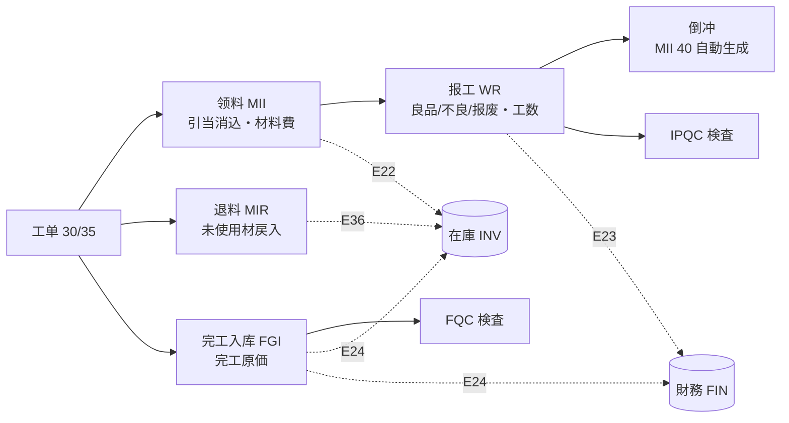
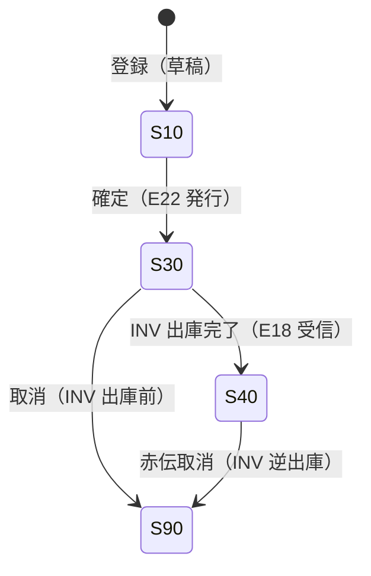
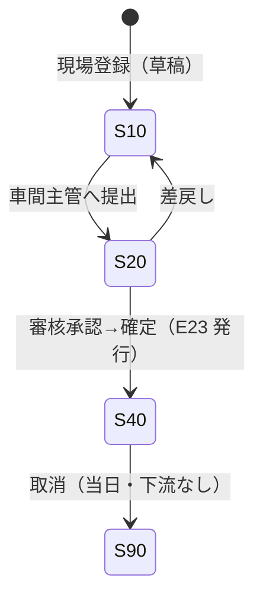
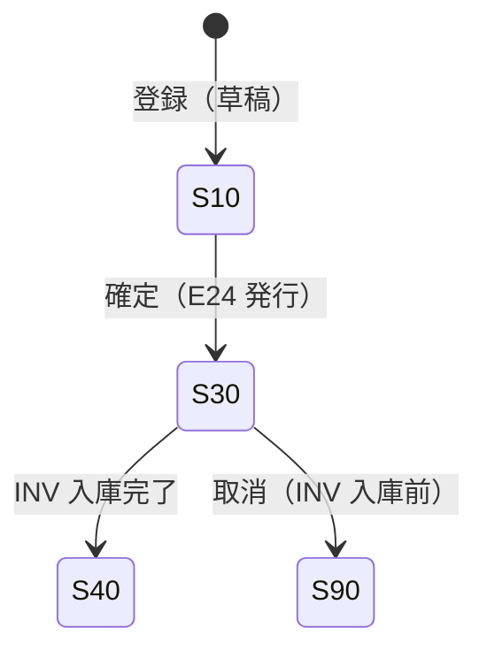

# 生产领料・报工・完工入库 详细设计书（材料払出・作業実績・完成入庫 詳細設計書）

| 項目 | 内容 |
|---|---|
| 文書名 | 生产领料・报工・完工入库 详细设计书（材料払出・作業実績・完成入庫 詳細設計書） |
| 文書番号 | DSN-PRD-003 |
| 版数 | v1.0 |
| 作成日 | 2026-10-20 |
| 作成者 | production-designer |
| 承認者 | 未承認（レビュー待ち） |
| 状態 | ドラフト（レビュー中） |
| 関連文書 | [业务域概要](00-overview.md) / [生产订单](02-work-order.md) / [质量](06-quality-management.md) / [DB 设计](90-db-design.md) / [API 设计](91-api-design.md) / [跨域流程](../00-common/09-cross-domain-flow.md) 第 7 章 / [共通业务规则](../00-common/08-common-business-rules.md) |

---

## 1. 機能概要

| 項目 | 内容 |
|---|---|
| 機能 ID | F-PRD-006（生产领料/补料/退料・倒冲）、F-PRD-007（工序报工）、F-PRD-008（生产入库） |
| 機能名 | 材料払出・作業実績報告・完成品入庫 |
| 目的 | 工单に対する材料払出の**要求**（MII/MIR 伝票は INV が採番・実行）・倒冲を記録して材料費を実績化し、工程ごとの良品/不良/报废・工数を記録して人工費・製造費用を帰集する。完成品を入庫（FGI）して在庫と完工原価を確定する。**在庫（E18/E22/E24/E36）と財務（J11–J16）へ渡す唯一の生産実績源泉**となる |
| 利用者・ロール | 倉管員（領料/退料/入庫）、班組長・作業者（報工）、車間主管（報工審核/超領承認）、質検員（検査連携）、成本会計（原価確認） |
| 利用シーン | ①作業開始前の材料一括払出 ②加工ロス・不良による補料 ③残材の返却 ④各工程完了時の報工（PDA/PC）⑤完成品の検査後入庫 |
| 優先度 | P1（第一版.5） |
| 画面 ID | SCR-PRD-012（領料登録）、SCR-PRD-013（領退料一覧）、SCR-PRD-014（報工登録）、SCR-PRD-015（報工一覧・審核）、SCR-PRD-016（生産入庫登録） |
| 関連 IF | IF-PRD-001（MES 報工回伝）、IF-PRD-003（PDA/条码） |

### 1.1 三つの伝票の関係



| 伝票 | テーブル | 番号規則 | 発行イベント | 財務への効果 |
|---|---|---|---|---|
| 領料要求（→INV MII） | `prd_material_issue`（`issue_type=10/20/40/50`） | PRD 要求番号 `REQ{YYMMDD}{4桁}`。**MII 伝票は INV が採番**（`stock_doc_no`） | E22 `production.material.issued` | J11 生産領料（材料費） |
| 退料要求（→INV MIR） | `prd_material_issue`（`issue_type=30`） | PRD 要求番号 `REQ{YYMMDD}{4桁}`。**MIR 伝票は INV が採番** | E36 `production.material.returned` | J12 生産退料（材料費戻し） |
| 報工（WR） | `prd_work_report`＋`_labor`＋`_defect` | `WR{YYMMDD}{4桁}` | E23 `production.report.confirmed` | J13 直接人工（＋J14/J15 製造費用） |
| 完工入库（FGI） | `prd_completion_receipt`＋`_line` | `FGI{YYMMDD}{4桁}` | E24 `production.workorder.completed` | J16 完工入库（完成品原価） |

## 2. 業務要件・業務ルール

### 2.1 前提条件

| # | 前提条件 | 成立しない場合の挙動 |
|---|---|---|
| 1 | 工单が `order_status ∈ {30,35}`（領料・報工・入庫） | エラー `MSG-COM-034` |
| 2 | 工单が保留中でない（報工・入庫） | エラー `MSG-PRD-047` |
| 3 | 対象材料が `prd_work_order_material` に存在（領料） | エラー `MSG-PRD-030`「工单の材料明細にない物料は払出できません」 |
| 4 | 会計期間が締切済でない | `MSG-COM-071` |
| 5 | 検査点工序の完了時は IPQC 合格（または特采） | エラー `MSG-PRD-060`「検査未合格の工序は次工程へ進めません」 |
| 6 | FQC 合格（または特采）でなければ完工入库不可 | エラー `MSG-PRD-062` |

### 2.2 業務ルール

| # | ルール | 根拠 | 関連項目 |
|---|---|---|---|
| BR-MI-01 | 領料数量は「工单材料の未領数量（`remaining_qty`）」を上限とし、超領は「超領容许率 3%（パラメータ `production.issue.over_rate=0.03`。イベントではない）」の範囲内で警告、超過は承認（車間主管→生産経理）を要する | 材料費の統制 | CALC-WO-03 |
| BR-MI-02 | 補料（`issue_type=20`）は不良/ロスによる追加払出。理由区分（`issue_reason=30`）を必須とし、BOM 標準量との差を記録する | 原価差異の説明 | `issue_reason` |
| BR-MI-03 | 退料（MIR）は未使用材料・残材を倉庫へ戻す。引当が残っている場合は引当を解除し、`prd_work_order_material.returned_qty` を加算する | 在庫の正確性 | `prd_material_issue_line.return_qty` |
| BR-MI-04 | 代替料を使用する場合は `is_substitute=true`・`substitute_for_material_id` に主料を記録する。代替可否は BOM の `substitute_group` で検証する | [01](01-bom-routing-workcenter.md) | `used_substitute_material_id` |
| BR-MI-05 | 倉庫は工单材料行の `warehouse_id` を既定とし、変更は権限者のみ（データ範囲内） | 在庫管理 | — |
| BR-MI-06 | 倒冲（`feeding_type=20`）は工单の `is_backflush=true` または工序 `is_backflush=true` の場合、報工確定時に BOM 標準量 × 良品数で自動生成する（不足時は警告のみ、マイナス在庫禁止） | 後方払出 | 6.4 |
| BR-MI-07 | 報工の良品 + 不良 + 报废 ≤ 投入数量。不良は「返工可能」、报废は「返工不可」と定義する | 歩留り管理 | CALC-WR-01 |
| BR-MI-08 | 報工確定で E23 を発行し、工单の良品累計・工数累計・人工費・製造費用（暫定）を更新する。確定後の修正は取消→再登録のみ | 実績の保護 | 6.6 |
| BR-MI-09 | 報工は工序単位・日単位。同一工序の同日複数回報工を許可（シフト単位）。重複チェックは「工单＋工序＋日付＋シフト＋投入数量」で行う | 現場運用 | `prd_work_report` |
| BR-MI-10 | 工序内返工は同一工单・同一工序に `report_type=20`（返工）で追加報工する。跨工单返工は NCR から返工工单（`work_order_type=30`）を起票する | 返工の归集 | [06](06-quality-management.md) |
| BR-MI-11 | 完工入库数量（**基本単位**）は MTO では `allowed_qty`（受注行スナップショット）、MTS では「注文数量 × (1+`over_receipt_rate`)」を上限とし、超過は `MSG-PRD-040`/`60040` または超産未承認時 `MSG-PRD-100`/`60100`。全数入庫で工单 40、`is_last_receipt=true` を設定する | [02](02-work-order.md) BR-WO-05 | CALC-WO-07 |
| BR-MI-12 | 製品批次は INV が採番（`{YYMMDD}M{3位}`）。工单が複数回入庫する場合は同一批次を引き継ぐ | [90-data/demo-company.md](../90-data/demo-company.md) 3.3 | `batch_no` |
| BR-MI-13 | 完工原価は「材料費実績＋人工費実績＋製造費用配賦」で暫定計算し、FIN 月結で確定する（J11–J16）。完工入库時は暫定単価で在庫計上し、月結後に差異調整する | [09](../00-common/09-cross-domain-flow.md) 7.2 | `prd_work_order.actual_*` |
| BR-MI-14 | 材料費の実績単価は INV の移動平均（E18）を正とする。PRD は参考単価で計上し、E18 受信で `actual_unit_cost`・`actual_amount` を更新する | 原価の権威 | `prd_material_issue_line.unit_cost` |
| BR-MI-15 | 伝票の取消は確定後 24 時間以内かつ下流処理（在庫出庫・仕訳）が取消可能な場合のみ。それ以外は赤伝（反対伝票）で処理する | [08](../00-common/08-common-business-rules.md) 13.1 | 6.7 |

### 2.3 計算式・判定式

| # | 対象 | 算式 | 丸め | 例 |
|---|---|---|---|---|
| CALC-MI-01 | 領料上限 | `max_issue = total_required_qty × (1 + 0.03) − issued_qty + returned_qty` | 4 桁切上 | 120.6030×1.03−0+0 = 124.2211 |
| CALC-MI-02 | 行金額（領料） | `amount = issue_qty × unit_cost` | 2 桁四捨五入 | 120.6030 × 252.00 = 30,391.96 |
| CALC-MI-03 | 工单材料費累計 | `actual_material_cost = Σ(領料金額) − Σ(退料金額)` | 2 桁 | 79,187.55 |
| CALC-MI-04 | 工序投入数量 | `input_qty = 前工序良品数 + 前工序返工受入` | 4 桁 | 120 |
| CALC-MI-05 | 良品率 | `yield_rate = reported_good_qty ÷ input_qty` | 4 桁 | 120 ÷ 120 = 1.0000 |
| CALC-MI-06 | 不良率 | `defect_rate = (defect_qty + scrap_qty) ÷ input_qty` | 4 桁 | 2 ÷ 120 = 0.0167 |
| CALC-MI-07 | 報工人工費 | `labor_amount = Σ(labor_hours × hourly_rate)` | 2 桁 | 258.0 h × 25.00 = 6,450.00 |
| CALC-MI-08 | 報工製造費用（暫定） | `overhead_amount = Σ(machine_hours × overhead_rate)` | 2 桁 | 258.0 × 30.00 = 7,740.00 |
| CALC-MI-09 | 暫定完工原価 | `actual_total_cost = actual_material_cost + actual_labor_cost + actual_overhead_cost` | 2 桁 | 79,187.55＋6,450.00＋7,740.00＝93,377.55 |
| CALC-MI-10 | 暫定単位原価 | `unit_cost = actual_total_cost ÷ completed_qty` | 6 桁 | 93,377.55 ÷ 120 = 778.146250 |
| CALC-MI-11 | 原価差異 | `cost_variance = actual_total_cost − standard_cost × completed_qty` | 2 桁 | 93,377.55 − 93,384.00 = −6.45 |
| CALC-MI-12 | 在制品残高 | `wip_cost = actual_material_cost + actual_labor_cost + actual_overhead_cost − Σ(完工入库原価)` | 2 桁 | 月結時 |

> 単位原価は `NUMERIC(18,6)`、金額は `NUMERIC(18,2)`（[01 共通项目定义](../00-common/01-common-item-definitions.md) 第 6 章）。

### 2.4 状態遷移

**領料/退料（`prd_material_issue`）**



**報工（`prd_work_report`）**



**完工入库（`prd_completion_receipt`）**



| 遷移 | トリガ | 権限 | 更新項目 | メッセージ |
|---|---|---|---|---|
| 領料 10→30 | 確定 | `production:material-issue:create` | `issue_status=30`、E22 発行 | `MSG-PRD-031` |
| 領料 30→40 | E18 受信 | システム | `issue_status=40`、`issued_at`、`stock_txn_id` | — |
| 領料 30→90 | 取消 | `production:material-issue:reverse` | `issue_status=90`、引当戻し | `MSG-PRD-033` |
| 報工 10→20→40 | 提出→審核 | `production:work-report:approve` | `report_status=40`、`confirmed_at`、E23 | — |
| 報工 40→90 | 取消 | `production:work-report:approve` | `report_status=90`、累計戻し | `MSG-PRD-036` |
| 入庫 10→30→40 | 確定→E18 | `production:completion:create` | `receipt_status=30/40`、E24 | — |

## 3. 画面設計

### 3.1 画面一覧

| 画面 ID | 画面名 | 類型 | 概要 |
|---|---|---|---|
| SCR-PRD-012 | 生产领料单登録編集 | 登録編集 | 工单選択→材料明細（未領/引当/在庫）→数量入力→確定 |
| SCR-PRD-013 | 领退料一覧 | 一覧検索 | 領料/退料の検索・参照・取消・印刷 |
| SCR-PRD-014 | 工序报工登録 | 登録編集 | 工序選択→投入/良品/不良/报废/工数→不良明细→提出（PDA 対応） |
| SCR-PRD-015 | 报工一覧・審核 | 一覧検索 | 報工一覧・審核（承認/差戻し）・取消 |
| SCR-PRD-016 | 生产入库登録 | 登録編集 | 完成数量・批次・検査結果確認→確定 |

### 3.2 画面レイアウト（SCR-PRD-012 領料登録）

```
┌──────────────────────────────────────────────────────────────────────┐
│ パンくず：ホーム > 生产管理 > 生产领料 > 領料登録                    │
├──────────────────────────────────────────────────────────────────────┤
│〔ヘッダ〕 领料单号[MII2610200001] 类型[▼领料] 状態(10 草稿)          │
│  工单[WO2610200001 ▼] 品目[YE3-100L1-4] 数量[120] 状態[30 下达済]     │
│  出庫倉庫[▼WH02] 领料日[2026-11-12] 来源[▼手工]                      │
├──────────────────────────────────────────────────────────────────────┤
│ 材料明細： □|行|物料编码|物料名称|単位|総必要|引当|既領|未領|本次|批次│
│           □|10|2001000004|定子总成|PCE|120.60|120.60|0|120.60|120|…│
│           □|20|2002000004|转子总成|PCE|120.60|120.60|0|120.60|120|…│
│           □|30|2003000001|机座加工件|PCE|120.24|100.00|0|120.24|100|…│
│           [全選択] [未領を一括入力] [引当確認]                        │
├──────────────────────────────────────────────────────────────────────┤
│ 合計数量 [ ] 合計金額 [ ]  ※超領は承認が必要                          │
├──────────────────────────────────────────────────────────────────────┤
│ [確定] [保存] [キャンセル] [印刷]                                     │
└──────────────────────────────────────────────────────────────────────┘
```

### 3.3 画面項目定義（SCR-PRD-012 領料登録）

| No | 項目 ID | 項目名 | 区分 | 種別 | 型/桁 | 必須 | 初期値 | 入力チェック | データソース | DB 項目 | 権限 | 備考 |
|---|---|---|---|---|---|---|---|---|---|---|---|---|
| 1 | request_no | 要求番号 | ヘッダ | テキスト | VARCHAR(32) | ○ | 域内要求番号 | 一意 | `sys_sequence(PRD_MATERIAL_REQUEST)` | `request_no` | 参照のみ | MII 伝票番号は INV 採番（`stock_doc_no`） |
| 2 | issue_type | 类型 | ヘッダ | 選択 | SMALLINT | ○ | 10 领料 | 10/20/30/40/50 | 固定値 | `issue_type` | 編集可 | 30 退料選択時は画面項目が切替 |
| 3 | work_order_no | 工单 | ヘッダ | コード選択 | VARCHAR(32) | ○ | 空 | 存在・状態 30/35・保留でない | `prd_work_order` | `work_order_id` | 編集可 | 選択で材料明細を展開 |
| 4 | issue_date | 领料日 | ヘッダ | 日付 | DATE | ○ | 当日 | 過去 30 日〜当日、締切期間外 | — | `issue_date` | 編集可 | — |
| 5 | warehouse_id | 出庫倉庫 | ヘッダ | 選択 | BIGINT | ○ | 工单材料行の倉庫 | 有効・データ範囲内 | `mdm_warehouse` | `warehouse_id` | 編集可 | — |
| 6 | source_type | 来源 | ヘッダ | 選択 | SMALLINT | ○ | 10 手工 | 10/20/30/40 | 固定値 | `source_type` | 編集可 | 20 倒冲は自動 |
| 7 | total_qty | 合計数量 | フッタ | 数値 | NUMERIC(18,4) | — | 自動 | — | — | `total_qty` | 参照のみ | 明細合計 |
| 8 | total_amount | 合計金額 | フッタ | 数値 | NUMERIC(18,2) | — | 自動 | — | — | `total_amount` | 参照のみ | 権限者のみ表示 |
| 9 | remark | 備考 | フッタ | テキスト | VARCHAR(500) | — | 空 | 500 桁 | — | `remark` | 編集可 | — |
| M1 | material_code | 物料编码 | 明細 | テキスト | VARCHAR(64) | ○ | 工单材料 | — | `prd_work_order_material` | `material_id`/`material_code` | 参照のみ | — |
| M2 | material_name | 物料名称 | 明細 | テキスト | VARCHAR(200) | ○ | 自動 | — | 同上 | `material_name` | 参照のみ | — |
| M3 | total_required_qty | 総必要量 | 明細 | 数値 | NUMERIC(18,4) | — | 自動 | — | — | `total_required_qty` | 参照のみ | — |
| M4 | reserved_qty | 引当済 | 明細 | 数値 | NUMERIC(18,4) | — | 自動 | — | E09 | `reserved_qty` | 参照のみ | — |
| M5 | issued_qty | 既領 | 明細 | 数値 | NUMERIC(18,4) | — | 自動 | — | — | `issued_qty` | 参照のみ | — |
| M6 | remaining_qty | 未領 | 明細 | 数値 | NUMERIC(18,4) | — | 自動 | — | — | `remaining_qty` | 参照のみ | — |
| M7 | issue_qty | 本次領料 | 明細 | 数値 | NUMERIC(18,4) | ○ | 未領数量 | > 0、上限チェック（CALC-MI-01） | — | `issue_qty` | 編集可 | 超領は承認フラグ |
| M8 | batch_no | 批次 | 明細 | 選択 | VARCHAR(64) | △ | 空 | 批次管理品は必須、在庫存在 | INV 批次照会 | `batch_no` | 編集可 | FEFO 順に候補表示 |
| M9 | location_id | 庫位 | 明細 | 選択 | BIGINT | △ | 既定庫位 | 倉庫内に存在 | `mdm_warehouse_bin` | `location_id` | 編集可 | — |
| M10 | unit_cost | 単価 | 明細 | 数値 | NUMERIC(18,6) | — | 移動平均（参照） | ≧ 0 | E19/INV | `unit_cost` | 参照のみ | 原価権限のみ表示 |
| M11 | amount | 金額 | 明細 | 数値 | NUMERIC(18,2) | — | 自動 | — | — | `amount` | 参照のみ | — |
| M12 | is_substitute | 替代料 | 明細 | チェック | BOOLEAN | — | false | 替代组一致 | `prd_bom_substitute` | `is_substitute` | 編集可 | ON で替代料選択 |
| M13 | substitute_material_code | 替代物料 | 明細 | コード選択 | VARCHAR(64) | △ | 空 | 同一 `substitute_group` | `prd_bom_substitute` | `substitute_for_material_id` | 編集可 | — |
| M14 | issue_reason | 理由 | 明細 | 選択 | SMALLINT | △ | 10 | 補料時必須（20/30/50） | 固定値 | `issue_reason` | 編集可 | — |

### 3.4 画面項目定義（SCR-PRD-014 報工登録）

| No | 項目 ID | 項目名 | 区分 | 種別 | 型/桁 | 必須 | 初期値 | 入力チェック | データソース | DB 項目 | 権限 | 備考 |
|---|---|---|---|---|---|---|---|---|---|---|---|---|
| 1 | work_order_no | 工单 | ヘッダ | コード選択/スキャン | VARCHAR(32) | ○ | 空（PDA はバーコード） | 存在・状態 30/35・保留でない | `prd_work_order` | `work_order_id` | 編集可 | — |
| 2 | operation_seq | 工序 | ヘッダ | 選択 | INT | ○ | 最初の未完了工序 | 未完了・前工序完了 | `prd_work_order_operation` | `work_order_operation_id` | 編集可 | — |
| 3 | report_no | 报工单号 | ヘッダ | テキスト | VARCHAR(32) | — | 自動採番（確定時） | 一意 | `sys_sequence(PRD_WORK_REPORT)` | `report_no` | 参照のみ | — |
| 4 | report_date | 报工日 | ヘッダ | 日付 | DATE | ○ | 当日 | 当日以前 7 日以内 | — | `report_date` | 編集可 | — |
| 5 | shift_code | 班次 | ヘッダ | 選択 | VARCHAR(16) | △ | 現行シフト | A/B/C | 固定値 | `shift_code` | 編集可 | — |
| 6 | report_type | 報工種別 | ヘッダ | 選択 | SMALLINT | ○ | 10 正常 | 10/20/30/40/50 | 固定値 | `report_type` | 編集可 | 20 返工・30 返修 |
| 7 | input_qty | 投入数量 | 明細 | 数値 | NUMERIC(18,4) | ○ | 前工序良品数 | > 0、累計 ≤ 工序計画×1.05 | — | `input_qty` | 編集可 | — |
| 8 | reported_good_qty | 良品数量 | 明細 | 数値 | NUMERIC(18,4) | ○ | 0 | ≧ 0、`good+defect+scrap ≤ input` | — | `reported_good_qty` | 編集可 | — |
| 9 | defect_qty | 不良数量 | 明細 | 数値 | NUMERIC(18,4) | — | 0 | ≧ 0、不良明細合計と一致 | — | `defect_qty` | 編集可 | — |
| 10 | scrap_qty | 报废数量 | 明細 | 数値 | NUMERIC(18,4) | — | 0 | ≧ 0 | — | `scrap_qty` | 編集可 | NCR 起票対象 |
| 11 | rework_qty | 返工受入 | 明細 | 数値 | NUMERIC(18,4) | — | 0 | ≧ 0 | — | `rework_qty` | 編集可 | 返工完了時 |
| 12 | setup_hours | 準備工数 | 明細 | 数値 | NUMERIC(12,2) | — | 標準準備工数 | ≧ 0 | `prd_work_order_operation` | `setup_hours` | 編集可 | — |
| 13 | labor_hours | 人工工数 | 明細 | 数値 | NUMERIC(12,2) | ○ | 標準工数×良品数 | > 0、当日 24h 以内 | — | `labor_hours` | 編集可 | — |
| 14 | machine_hours | 設備工数 | 明細 | 数値 | NUMERIC(12,2) | — | 人工工数と同値 | ≧ 0 | — | `machine_hours` | 編集可 | — |
| 15 | defect_code | 缺陷代码 | 不良明細 | コード選択 | VARCHAR(32) | ○ | 空 | 有効コード | `prd_defect_code` | `defect_code_id` | 編集可 | 不良明細 1 行以上 |
| 16 | disposition | 処置 | 不良明細 | 選択 | SMALLINT | ○ | 10 返工 | 10/20/30/40/50/60 | 固定値 | `disposition` | 編集可 | 30 报废は NCR 必須 |
| 17 | labor_lines | 作業者別工数 | 工数明細 | 明細 | — | △ | ログインユーザ | 合計 = labor_hours | `sys_user` | `prd_work_report_labor` | 編集可 | 班組単位入力可 |
| 18 | report_status | 状態 | フッタ | バッジ | SMALLINT | — | 10 | — | — | `report_status` | 参照のみ | — |

### 3.5 画面項目定義（SCR-PRD-016 生産入庫登録）

| No | 項目 ID | 項目名 | 区分 | 種別 | 型/桁 | 必須 | 初期値 | 入力チェック | DB 項目 | 権限 |
|---|---|---|---|---|---|---|---|---|---|---|
| 1 | request_no | 要求番号 | ヘッダ | テキスト | VARCHAR(32) | — | 域内要求番号 | 一意 | `request_no` | 参照のみ | FGI 伝票番号は INV 採番（`stock_doc_no`） |
| 2 | work_order_no | 工单 | ヘッダ | コード選択 | VARCHAR(32) | ○ | 空 | 状態 30/35、全工序完了（最終工序） | `work_order_id` | 編集可 |
| 3 | receipt_type | 入库类型 | ヘッダ | 選択 | SMALLINT | ○ | 10 成品 | 10/20/30 | `receipt_type` | 編集可 |
| 4 | receipt_date | 入库日 | ヘッダ | 日付 | DATE | ○ | 当日 | 締切期間外 | `receipt_date` | 編集可 |
| 5 | warehouse_id | 入库倉庫 | ヘッダ | 選択 | BIGINT | ○ | 工单の完工倉庫 | 有効 | `warehouse_id` | 編集可 |
| 6 | receipt_qty | 入库数量 | 明細 | 数値 | NUMERIC(18,4) | ○ | 良品残余 | > 0、累計 ≤ 注文×1.05 | `receipt_qty` | 編集可 |
| 7 | batch_no | 批次 | 明細 | 選択 | VARCHAR(64) | ○ | 自動採番（INV） | 既存批次 or 新規 | `batch_no` | 編集可 |
| 8 | production_date | 製造日 | 明細 | 日付 | DATE | △ | 当日 | ≦ 入库日 | `production_date` | 編集可 |
| 9 | quality_status | 品質状態 | 明細 | 選択 | SMALLINT | — | FQC 結果から | 10/20/30/40 | `quality_status` | 参照のみ |
| 10 | unit_cost | 暫定単価 | 明細 | 数値 | NUMERIC(18,6) | — | 自動計算 | ≧ 0 | `unit_cost` | 参照のみ（原価権限のみ表示） |
| 11 | is_last_receipt | 最終入库 | ヘッダ | チェック | BOOLEAN | — | 自動判定 | — | `is_last_receipt` | 参照のみ |
| 12 | inspection_id | FQC 検査 | ヘッダ | テキスト | VARCHAR(32) | △ | FQC 検査単 | 合格/特采のみ | `inspection_id` | 参照のみ |

### 3.6 イベント処理

**SCR-PRD-012 領料登録**

| No | イベント | トリガ | 処理内容 | 呼出 API | 画面遷移 | 備考 |
|---|---|---|---|---|---|---|
| 1 | 工单選択 | 工单変更 | 材料明細を取得し、未領数量を初期表示。引当済・在庫を併記 | `GET /api/production/work-orders/{id}/materials` | 同一画面 | — |
| 2 | 未領一括入力 | ボタン | 全行の `issue_qty` に未領数量を設定 | — | 同一画面 | 数量制限内で調整 |
| 3 | 引当確認 | ボタン | INV の引当可能量を照会し、不足を警告 | `GET /api/inventory/available-quantities` | 同一画面 | `MSG-COM-070` |
| 4 | 批次選択 | 批次セル | 在庫批次を FEFO 順にダイアログ表示 | `GET /api/inventory/batches?materialId&warehouseId` | ダイアログ | — |
| 5 | 確定 | ボタン | 検証→採番→INSERT→E22 発行→INV 出庫依頼 | `POST /api/production/material-issues` | 一覧/詳細 | 超領は承認フロー |
| 6 | 保存（草稿） | ボタン | `issue_status=10` で保存 | 同 API（`status=10`） | 同一画面 | — |
| 7 | 取消 | ボタン | 確定後の取消（INV 出庫前のみ） | `POST /api/production/material-issues/{id}/cancel` | 一覧 | `MSG-PRD-033` |

**SCR-PRD-014 報工登録**

| No | イベント | トリガ | 処理内容 | 呼出 API | 画面遷移 | 備考 |
|---|---|---|---|---|---|---|
| 1 | 工单スキャン | バーコード読取 | 工单・未完了工序を特定し、投入数量を自動設定 | `GET /api/production/work-orders/by-no/{no}` | 同一画面 | PDA |
| 2 | 工序選択 | 工序変更 | 前工序良品数・標準工数を取得し初期値を設定 | `GET .../operations/{seq}` | 同一画面 | — |
| 3 | 数量変更 | 良品/不良/报废 | 良品率・不良率をリアルタイム表示。`input` との整合チェック | — | 同一画面 | — |
| 4 | 不良追加 | ボタン | 不良明細行を追加（缺陷コード・数量・処置） | — | 同一画面 | 不良合計 = `defect_qty` |
| 5 | 工数入力 | 工数欄 | 作業者別工数明細に按分（均等割 or 実入力） | — | 同一画面 | 合計 = `labor_hours` |
| 6 | 提出 | ボタン | 検証→報工保存→状態 20（審核待ち） | `POST /api/production/work-reports` | 一覧 | — |
| 7 | 審核承認 | ボタン（SCR-PRD-015） | 状態 40、E23 発行、工单累計・人工費更新、倒冲実行 | `POST /api/production/work-reports/{id}/approve` | 一覧 | 倒冲で MII 自動生成 |
| 8 | 取消 | ボタン | 確定後 24 時間以内のみ。累計戻し・倒冲取消 | `POST .../cancel` | 一覧 | `MSG-PRD-036` |

**SCR-PRD-016 生産入庫登録**

| No | イベント | トリガ | 処理内容 | 呼出 API | 画面遷移 | 備考 |
|---|---|---|---|---|---|---|
| 1 | 工单選択 | 工单変更 | 良品残余・FQC 結果・暫定単価を表示 | `GET .../completion-preview` | 同一画面 | — |
| 2 | FQC 確認 | 自動 | FQC 不合格なら入庫不可（特采は可） | — | 同一画面 | `MSG-PRD-062` |
| 3 | 確定 | ボタン | 採番→INSERT→E24 発行→INV 入庫依頼 | `POST /api/production/completion-receipts` | 一覧 | `is_last_receipt` 自動判定 |
| 4 | 取消 | ボタン | 入庫前のみ取消可 | `POST .../cancel` | 一覧 | — |

## 4. 処理詳細

### 4.1 処理一覧

| 処理 ID | 処理名 | 契機 | トランザクション | 排他 |
|---|---|---|---|---|
| PRC-PRD-003-01 | 領料確定（E22 発行） | 確定ボタン | 要 | 工单材料行ロック |
| PRC-PRD-003-02 | 退料確定（E36 発行） | 確定ボタン | 要 | 同上 |
| PRC-PRD-003-03 | 倒冲（報工確定時） | 報工審核 | 要（報工と同一 TX） | 材料行ロック（material_id 昇順） |
| PRC-PRD-003-04 | 報工確定（E23 発行） | 審核承認 | 要 | 工单工序行ロック |
| PRC-PRD-003-05 | 完工入库確定（E24 発行） | 確定 | 要 | 受注行→工单ロック（§11.1）。`completed_qty+今回 ≤ allowed_qty` |
| PRC-PRD-003-06 | 在庫取引結果反映（E18 購読） | イベント | 要（冪等） | 伝票行ロック |
| PRC-PRD-003-07 | 工单原価帰集 | 報工/領料/入庫確定 | 要（当該 TX 内で累計更新） | 工单行ロック |
| PRC-PRD-003-08 | 伝票取消 | 取消 | 要 | 伝票行ロック |

### 4.2 領料確定（PRC-PRD-003-01）

1. 入力チェック（第 5 章）を実行。工单状態（30/35）・保留でないことを検証。
2. 工单材料行を `work_order_id`＋`material_id` でロック（`ORDER BY material_id`）。`remaining_qty` を再取得（同時領料防止）。
3. 各明細の `issue_qty` が `max_issue`（CALC-MI-01）以内か検証。超過は承認フロー（状態 20 相当の承認待ち＝`approval_required=true`）へ。
4. 引当の消込：E22 発行前に INV へ「引当済数量のうち今回払出分を消込」を依頼する（E22 ペイロードに `reservationId` を含めない場合は INV が `source_id` で照合）。
5. `prd_material_issue`（`issue_status=30`）と明細を INSERT。`prd_work_order_material.issued_qty`・`remaining_qty`・`issue_status` を UPDATE。`prd_work_order.actual_material_cost` は暫定単価で加算（E18 で確定値に補正）。
6. Outbox に E22 `production.material.issued` を記録（同一 TX）。ペイロード：

```json
{
  "workOrderId": "1845678901234567890",
  "issueId": "1845678901234567901",
  "requestNo": "REQ2611200001",
  "lines": [
    { "materialId": "1845000000000002001", "qty": "120.0000", "uom": "PCE", "batchNo": "261025M001", "unitCost": "252.000000" }
  ],
  "issuedAt": "2026-11-12T09:30:00+08:00"
}
```

7. 監査ログ（CREATE/POST）を記録し、結果を返す。INV から E18 を受信したら `prd_material_issue_line.unit_cost`・`amount` を INV の権威原価で上書きし、工单材料費を補正する（PRC-PRD-003-06）。

### 4.3 退料確定（PRC-PRD-003-02）

1. 工单状態 30/35、当該材料の `issued_qty` 以上の退料を拒否（`MSG-PRD-034`）。
2. `issue_type=30`、`prd_material_issue_line.return_qty` に数量を設定。`applied_qty` は負値。
3. 工单材料の `returned_qty` を加算、`remaining_qty` を再計算。引当が残っていれば INV で引当解除。
4. Outbox に E36 `production.material.returned` を記録（同一 TX）。INV が入庫（`MIR`）・FIN が J12 を計上。ペイロードは 4.3.1 を参照。
5. 工单の `actual_material_cost` を減算（暫定）。

#### 4.3.1 E36 ペイロード例（退料 MIR）

```json
{
  "workOrderId": "1845678901234567890",
  "returnId": "1845678901234568911",
  "returnNo": "MIR2611200001",
  "lines": [
    { "materialId": "1845000000000002001", "qty": "12.0000", "uom": "PCE", "batchNo": "261105M001", "unitCost": "252.000000" }
  ],
  "returnReason": "総装完了による余料返却",
  "returnedAt": "2026-11-20T15:10:00+08:00"
}
```

> 退料は E22 ではなく **E36 `production.material.returned`**（[09 跨域流程](../00-common/09-cross-domain-flow.md) §3）を使用する。INV は `returnId` を冪等キーとして在庫戻入（MIR）・在庫状態の復元を行い、FIN は J12（材料費返し）を計上する。

### 4.4 倒冲（PRC-PRD-003-03）

**対象**：`prd_work_order.is_backflush=true` または該当工序の `is_backflush=true`、かつ材料行の `feeding_type=20`（倒冲）。

```
倒冲数量 = BOM 標準必要量（required_qty per unit） × 当回報工の良品数量
         （工序別倒冲の場合は当該工序で投入する材料のみ）
```

1. 報工確定の同一トランザクション内で、倒冲対象材料を特定する。
2. 在庫（INV 照会）が不足する場合：`MSG-PRD-035` 警告を出し、**マイナス在庫は作らない**。不足分は「未払出」として残し、後日手動領料（`issue_type=20` 補料）で処理する。
3. `prd_material_issue`（`issue_type=40`、`source_type=20`）を自動生成し、明細に倒冲数量を設定。`prd_work_report.linked_issue_id` を設定。
4. E22 を発行（通常領料と同じ）。`prd_work_report.backflush_flag=true`。
5. 倒冲の取消：報工取消時に連動して倒冲領料を取消（E22 の逆）。

### 4.5 報工確定（PRC-PRD-003-04）

1. 報工（`report_status=20`）の内容を検証：`input = good + defect + scrap` の整合（許容 0.0001）、不良明細合計 = `defect_qty`、工数明細合計 = `labor_hours`。
2. 工单工序行をロックし、累計を検証：`reported_good_qty + 今回 ≤ planned_qty × (1+0.05)`（`MSG-PRD-032`）。
3. 工数・賃率から人工費（CALC-MI-07）と製造費用（CALC-MI-08）を計算。
4. `prd_work_report` を `report_status=40`、`confirmed_at` に更新。工单工序・工单の累計（`reported_good_qty`・`reported_defect_qty`・`scrapped_qty`・`actual_labor_cost`・進捗率）を UPDATE。
5. 初回報工なら工单を `order_status=35`、`actual_start_date` を設定。
6. 検査点（`is_inspection_point=true`）の工序は、良品確定後に `prd_inspection`（IPQC）を自動起票し `inspection_status=10` にする（[06](06-quality-management.md) 6.2）。
7. 倒冲対象があれば PRC-PRD-003-03 を実行。
8. Outbox に E23 `production.report.confirmed` を記録：

```json
{
  "workOrderId": "1845678901234567890",
  "operationId": "1845678901234567920",
  "operationSeq": 110,
  "goodQty": "120.0000",
  "defectQty": "2.0000",
  "scrapQty": "0.0000",
  "workHours": "71.25",
  "laborAmount": "1781.25",
  "overheadAmount": "2137.50",
  "reportedAt": "2026-11-15T17:20:00+08:00"
}
```

9. 全工序完了かつ全数量良品なら `report_status=20`（工单）。監査ログ（APPROVE/POST）。

### 4.6 完工入库確定（PRC-PRD-003-05）

1. 工单状態 30/35、保留でないこと。FQC（`inspection_type=30`）が合格（20）または特采（30）であること（`MSG-PRD-062`）。**ロック**：MTO は受注行を先に `FOR UPDATE`、続けて工单を id 昇順で `FOR UPDATE`（§11.1）。MTO は `material_id`＝受注行物料を再検証（不一致 `MSG-PRD-056`/`60056`）。
2. 入庫数量（**基本単位**）が `completed_qty + 今回 ≤ allowed_qty` を満たすこと。**優先**：MTO かつ超産未承認なら **`MSG-PRD-100`/`60100`**；MTS または承認後も超過（ハード）なら **`MSG-PRD-040`/`60040`**。MTS で `allowed_qty` 未設定時は算出してから比較。
3. 暫定単位原価（CALC-MI-10）を計算し、明細に設定。`is_last_receipt` は「今回入庫後 `completed_qty ≥ order_qty`」で true。
4. `prd_completion_receipt`（`receipt_status=30`）＋明細を INSERT。工单の `completed_qty`・`completion_status`・`actual_end_date` を UPDATE。全数入庫なら `order_status=40`。
5. Outbox に E24 `production.workorder.completed` を記録：

```json
{
  "workOrderId": "1845678901234567890",
  "completedQty": "120.0000",
  "lines": [
    { "materialId": "1845000000000000301", "qty": "120.0000", "batchNo": "261120M001", "unitCost": "778.146250" }
  ],
  "completedAt": "2026-11-18T10:00:00+08:00"
}
```

6. INV が入庫（`FGI`）・E18 を発行、FIN が J16 を計上。本域は E18 受信で `prd_completion_receipt_line.unit_cost`・`amount` を確定値に補正し、`cost_status` を更新する。
7. 監査ログ（POST/CREATE）。

### 4.7 工单原価帰集（PRC-PRD-003-07）

**帰集の構成（[09](../00-common/09-cross-domain-flow.md) 7.2 J11–J16 と対応）**

| 原価要素 | データ源 | 計算 | 財務仕訳 |
|---|---|---|---|
| 直接材料費 | `prd_material_issue_line`（MII/MIR） | `Σ 領料金額 − Σ 退料金額`（CALC-MI-03） | J11/J12 |
| 直接人工費 | `prd_work_report_labor`（`labor_type=10`） | `Σ(工数 × 賃率)`（CALC-MI-07） | J13 |
| 製造費用 | `prd_work_report_labor`（`labor_type=30`）＋工作中心配賦率 | `Σ(設備工数 × 配賦率)`（CALC-MI-08、暫定）→ 月結で FIN が実績配賦（J14→J15） | J14/J15 |
| 完工原価 | 上記 3 要素 | `actual_total_cost`（CALC-MI-09） | J16 |
| 在制品 | 未完部分 | 投入原価 − 完工入庫原価（CALC-MI-12） | 月結で FIN が残高計上 |

**完工数量と在制品の按分（第一版）**

```
完工原価 = 直接材料費（完工数量に対応する実際領料額）
          + 直接人工費 × (完工数量 ÷ 累計良品数量)
          + 製造費用 × (完工数量 ÷ 累計良品数量)
在制品原価 = 投入原価合計 − 完工原価
```

- 直接材料費は「実際領料額のうち完工数量分」を `Σ(材料単価 × 完工数量 × BOM 標準使用量)` で按分し、領料超過分（ロス・不良）は完工原価に含める（設定 `cost.material.variance_to_completed=true`）。
- 人工費・製造費用は「累計良品数量に対する完工数量の比率」で按分する（簡便法）。
- FIN 月結で約当产量による精算を行い、差異は `cost_variance` に計上する（未決 #2）。

**YE3 製造工单の原価算例（WO2610200001、120 PCE、[示例值]）**

> 対象は YE3-100L1-4 の製造工单（120 PCE）。材料は BOM の素材・部品（標準材料費 659.95/台 × 120＝79,194.00）。実際材料費は価格差異 −6.45 を含む 79,187.55。工数は 258.0 h（2.15 h/台 × 120）、賃率 25.00 元/h、配賦率 30.00 元/h（[90-data/bom-demo.md](../90-data/bom-demo.md) §6 と同一）。

| # | 要素 | 内容 | 金額（CNY） |
|---|---|---|---|
| 1 | 直接材料費（実際） | 標準 79,194.00 ＋ 価格差異 −6.45 | 79,187.55 |
| 2 | 直接人工費 | 258.0 h × 25.00 元/h（工程別賃率の加重平均） | 6,450.00 |
| 3 | 製造費用（暫定） | 258.0 h × 30.00 元/h（工作中心配賦率） | 7,740.00 |
| 4 | 実際完工原価合計 | ①＋②＋③ | **93,377.55** |
| 5 | 実際単位原価 | 93,377.55 ÷ 120 PCE | 778.146250（表示 778.15） |
| 6 | 標準原価 | 778.20 × 120 PCE（[01](01-bom-routing-workcenter.md) 4.5 卷算） | 93,384.00 |
| 7 | 原価差異 | ④−⑥ | **−6.45**（−0.01%） |

> 上記は設計検証用の【示例値】。材料単価は [material-master.csv](../90-data/material-master.csv) の `price_ref_cny`、標準原価は [90-data/bom-demo.md](../90-data/bom-demo.md) §6 と同一の 778.20 元/台。**材料 79,187.55 は実際額（標準 79,194.00 との価格差異 −6.45 を含む）**。仕訳は [09](../00-common/09-cross-domain-flow.md) 7.2 の J11–J16 に従う。
**財務仕訳との契約（J11–J16）**

| 仕訳 | 借方 | 貸方 | 金額根拠 | 発生元イベント | PRD が渡す項目 | タイミング |
|---|---|---|---|---|---|---|
| J11 生産領料 | 生产成本-直接材料 `5001` | 原材料 `1403` | 領料原価（E18 確定値） | E22 → INV → E18 | `workOrderId`、`lines[].qty`、`lines[].unitCost`、`warehouseId` | 領料確定時 |
| J12 生産退料 | 原材料 `1403` | 生产成本-直接材料 `5001` | 退料原価 | E36（MIR） | `workOrderId`、`returnId`、`returnNo`、`lines[].qty/unitCost`、`returnReason` | 退料確定時 |
| J13 報工人工費 | 生产成本-直接人工 `5001` | 应付职工薪酬 `2211` | 工数 × 賃率 | E23 | `laborAmount`、`workHours`、`operationId` | 報工確定時 |
| J14 製造費用発生 | 制造费用 `5101` | 銀行/減価償却/買掛等 | 実際発生額 | （FIN 側の費用計上） | —（PRD 関与なし） | 発生時 |
| J15 製造費用結転 | 生产成本-製造費用 `5001` | 制造费用 `5101` | 配賦額 | （FIN 月結） | PRD は `overheadAmount` と工数・工作中心を提供 | 月結時 |
| J16 完工入库 | 库存商品 `1405` | 生产成本 `5001` | 完工原価（E24 `lines[].stockStatus=10` 待検計上後、E15 合格で 20） | E24 | `completedQty`、`lines[].unitCost`、`inspectionId`、`inspectionResult` | 完工入库確定時 |

- 金額の一致責任：J11/J12 は INV の在庫原価（E18）が正、J13/J15 は FIN の給与・配賦が正、J16 は PRD の完工原価（E24）が正。月結時に PRD の `actual_*` と FIN の生産成本残高を照合する（[09](../00-common/09-cross-domain-flow.md) 10.3-9）。
- PRD は仕訳を起票しない（更新責任は FIN）。`fin_voucher` への変換は FIN の自動仕訳テンプレート（`fin_voucher_template`）で行う。

### 4.8 伝票取消（PRC-PRD-003-08）

| 伝票 | 条件 | 処理 | 関連イベント |
|---|---|---|---|
| 領料要求（→INV MII） | `prd_material_issue`（`issue_type=10/20/40/50`） | PRD 要求番号 `REQ{YYMMDD}{4桁}`。**MII 伝票は INV が採番**（`stock_doc_no`） | E22 `production.material.issued` | J11 生産領料（材料費） |
| 退料要求（→INV MIR） | `prd_material_issue`（`issue_type=30`） | PRD 要求番号 `REQ{YYMMDD}{4桁}`。**MIR 伝票は INV が採番** | E36 `production.material.returned` | J12 生産退料（材料費戻し） |
| 報工（WR） | 確定後 24 時間以内、後工程報工なし、倒冲領料取消可能 | 状態 90、工单累計・人工費戻し、倒冲取消、IPQC 検査取消（未判定のみ） | E23（取消） |
| 完工入库（FGI） | `receipt_status=30`（INV 入庫前）または当日中 | 状態 90、`completed_qty` 戻し（戻し数量 ≤ `completed_qty`、超過は `MSG-PRD-102`/`60102`）、工单 40→35 | E24（取消） |

- 24 時間超・月結後は赤伝（反対伝票）で処理する（[08](../00-common/08-common-business-rules.md) 13.1）。
- 取消は監査ログ（REVERSE）に理由と前後値を記録する。

## 5. 入力チェック仕様

| No | チェック ID | 対象 | 種別 | 条件 | タイミング | メッセージ ID |
|---|---|---|---|---|---|---|
| 1 | CHK-PRD-003-01 | 工单 | 状態 | `order_status ∈ {30,35}`、保留でない | 画面表示/保存 | `MSG-COM-034`、`MSG-PRD-047` |
| 2 | CHK-PRD-003-02 | 領料数量 | 範囲 | > 0、`≤ max_issue`（超過は承認） | 保存時 | `MSG-PRD-030` |
| 3 | CHK-PRD-003-03 | 退料数量 | 範囲 | > 0、`≤ issued_qty − returned_qty` | 保存時 | `MSG-PRD-034` |
| 4 | CHK-PRD-003-04 | 批次 | 必須 | 批次管理品は必須、在庫に存在 | 保存時 | `MSG-COM-040`、`MSG-PRD-037` |
| 5 | CHK-PRD-003-05 | 替代料 | 業務 | 同一 `substitute_group`、期間内有効 | 保存時 | `MSG-PRD-038` |
| 6 | CHK-PRD-003-06 | 投入数量 | 相関 | `input_qty ≥ good + defect + scrap` | 保存時 | `MSG-PRD-032` |
| 7 | CHK-PRD-003-07 | 不良明細 | 相関 | 明細合計 = `defect_qty` | 保存時 | `MSG-PRD-039` |
| 8 | CHK-PRD-003-08 | 工数 | 範囲 | > 0、24h 以内、明細合計 = `labor_hours` | 保存時 | `MSG-PRD-041` |
| 9 | CHK-PRD-003-09 | 报废 | 業務 | 报废数量 > 0 は NCR 起票が必要 | 保存時 | `MSG-PRD-042` |
| 10 | CHK-PRD-003-10 | 累計良品 | 範囲 | 工序累計 ≤ 計画 × 1.05 | 保存時 | `MSG-PRD-032` |
| 11 | CHK-PRD-003-11 | 検査点 | 業務 | 前工序が検査点の場合、合否確定済 | 保存時 | `MSG-PRD-060` |
| 12 | CHK-PRD-003-12 | 入庫数量 | 範囲 | > 0、累計 ≤ `allowed_qty`（基本単位）。MTO 未承認超産は `MSG-PRD-100`/`60100` 優先 | 保存時 | `MSG-PRD-100` / `MSG-PRD-040` |
| 13 | CHK-PRD-003-13 | FQC | 業務 | 合格または特采 | 入庫時 | `MSG-PRD-062` |
| 14 | CHK-PRD-003-14 | 会計期間 | 業務 | 締切済でない | 保存時 | `MSG-COM-071` |
| 15 | CHK-PRD-003-15 | 楽観排他 | 排他 | `version` 一致 | 保存時 | `MSG-COM-033` |

## 6. データ更新仕様

| テーブル | 操作 | 更新項目 | 更新条件 | トリガ |
|---|---|---|---|---|
| `prd_material_issue` | INSERT | 全項目 | 領料/退料登録 | PRC-PRD-003-01/02 |
| `prd_material_issue` | UPDATE | `issue_status`、`issued_at`、`stock_txn_id` | E18 受信/取消 | PRC-PRD-003-06/08 |
| `prd_material_issue_line` | INSERT | 全項目 | 同上 | 同上 |
| `prd_material_issue_line` | UPDATE | `unit_cost`、`amount`、`stock_txn_line_id` | E18 受信 | PRC-PRD-003-06 |
| `prd_work_order_material` | UPDATE | `issued_qty`、`returned_qty`、`consumed_qty`、`remaining_qty`、`issue_status`、`actual_unit_cost`、`actual_amount` | 領料/退料確定 | PRC-PRD-003-01/02 |
| `prd_work_report` | INSERT | 全項目 | 報工登録 | F-PRD-007 |
| `prd_work_report` | UPDATE | `report_status`、`confirmed_at`、`labor_amount`、`overhead_amount`、`backflush_flag`、`linked_issue_id` | 審核承認 | PRC-PRD-003-04 |
| `prd_work_report_labor` | INSERT | 全項目 | 報工登録 | F-PRD-007 |
| `prd_work_report_defect` | INSERT | 全項目 | 報工登録 | F-PRD-007 |
| `prd_work_order_operation` | UPDATE | `input_qty`、`reported_*_qty`、`actual_*_hours`、`operation_status`、`actual_start_date`/`actual_end_date`、`inspection_status` | 報工確定 | PRC-PRD-003-04 |
| `prd_work_order` | UPDATE | `reported_*_qty`、`progress_rate`、`actual_labor_cost`、`actual_material_cost`、`order_status`、`report_status`、`actual_start_date` | 報工/領料確定 | PRC-PRD-003-04/07 |
| `prd_completion_receipt` | INSERT | 全項目 | 入庫登録 | PRC-PRD-003-05 |
| `prd_completion_receipt_line` | INSERT/UPDATE | 全項目、`unit_cost`/`amount` 補正 | 入庫確定/E18 | 同上 |
| `prd_work_order` | UPDATE | `completed_qty`、`completion_status`、`order_status`、`actual_end_date` | 入庫確定 | PRC-PRD-003-05 |
| `prd_work_order` | UPDATE | `cost_status`、`cost_variance`、`actual_total_cost`、`wip_cost` | 月結/入庫 | PRC-PRD-003-07、BAT-PRD-006 |
| `sys_outbox_event` | INSERT | E22/E36/E23/E24 | 各確定 | 同上 |
| `sys_audit_log` | INSERT | 操作ログ | 各処理 | 全処理 |

## 7. エラー処理・メッセージ

| メッセージ ID | 種別 | 本文 | 発生条件 | 利用者への対処 | ログ |
|---|---|---|---|---|---|
| `MSG-PRD-030` | E | 工单の材料明細にない物料、または領料数量が上限を超えています。 | 材料不一致/超領 | 材料・数量を確認（超領は承認申請） | WARN |
| `MSG-PRD-031` | E | 領料の確定に失敗しました。在庫の引当状況を確認してください。 | E22 発行/INV 連携失敗 | 再実行 | ERROR |
| `MSG-PRD-032` | E | 投入数量と良品・不良・报废の合計が一致しません。 | 数量不整合 | 数量修正 | WARN |
| `MSG-PRD-033` | E | 在庫出庫済のため取消できません。先に在庫の逆出庫を行ってください。 | 取消不可 | 赤伝処理 | WARN |
| `MSG-PRD-034` | E | 退料数量が領料数量を超えています。 | 過剰退料 | 数量修正 | WARN |
| `MSG-PRD-035` | W | 倒冲対象の在庫が不足しています。不足分は手動で領料してください。 | 倒冲不足 | 手動領料 | WARN |
| `MSG-PRD-036` | E | 確定後 24 時間を超えた報工は取消できません。赤伝で処理してください。 | 期限超過 | 赤伝 | WARN |
| `MSG-PRD-037` | E | 指定した批次の在庫がありません。批次を再選択してください。 | 批次なし | 再選択 | WARN |
| `MSG-PRD-038` | E | 指定した物料は当該 BOM の替代料ではありません。 | 替代不許可 | 替代料確認 | WARN |
| `MSG-PRD-039` | E | 不良明細の数量合計が不良数量と一致しません。 | 明細不一致 | 明細修正 | WARN |
| `MSG-PRD-040` | E | 完工数量が許容上限（`allowed_qty`）を超えています。 | ハード超過 | 数量修正 | WARN |
| `MSG-PRD-041` | E | 工数の合計が作業者別工数の合計と一致しません。 | 工数不一致 | 工数修正 | WARN |
| `MSG-PRD-042` | E | 报废を登録するには NCR を起票してください。 | 报废時 NCR なし | NCR 起票 | WARN |
| `MSG-PRD-060` | E | 検査未合格の工序は次工程へ進めません。 | IPQC 未合格 | 検査完了後 | WARN |
| `MSG-PRD-062` | E | 成品検査（FQC）が合格していないため入庫できません。 | FQC 未合格 | 検査完了/特采承認 | WARN |
| `MSG-COM-070` | W | 在庫が不足しています。現在の利用可能数量：{0}。 | 在庫不足 | 補充手配 | — |
| `MSG-COM-071` | E | 会計期間が締切済のため登録・更新できません。 | 期間締切 | 翌期処理 | WARN |

## 8. 権限・セキュリティ

| 種別 | 内容 |
|---|---|
| 画面権限 | SCR-PRD-012 `production:material-issue:create`、SCR-PRD-013 `production:material-issue:view`、SCR-PRD-014 `production:work-report:create`、SCR-PRD-015 `production:work-report:view`、SCR-PRD-016 `production:completion:create` |
| 操作権限 | 領料確定（create）、超領承認（approve）、退料（create）、報工提出（create）、報工審核（approve）、報工取消（approve）、入庫確定（create）、伝票取消（reverse） |
| 項目権限 | 単価・金額・原価は `production:work-order:cost-view` 保持者のみ（他は非表示・API でも返さない） |
| データ範囲 | 倉庫（`warehouse_id`）・工場（`factory_id`）単位。作業者は自班組の工单のみ |
| 監査ログ | 領料/退料/報工/入庫の登録・確定・取消を `sys_audit_log` に記録（数量・金額・状態の前後値） |
| 現場セキュリティ | PDA は端末認証＋ユーザ認証。バーコードは工单・工序・材料の照合のみに使用（書換不能） |

## 9. 性能・非機能

| 項目 | 目標 | 前提 |
|---|---|---|
| 領料登録（材料 30 行） | 2 秒以内 | 工单材料の一括取得 |
| 報工登録（1 件） | 1 秒以内 | PDA 応答含む |
| 報工確定（倒冲 10 行含む） | 2 秒以内 | 材料行ロック（material_id 順） |
| 完工入库確定 | 2 秒以内 | 暫定原価の高速計算（インメモリ集計） |
| 一覧検索（100 件） | 2 秒以内 | インデックス使用 |
| 同時報告 | 50 端末（PDA） | 楽観排他＋行ロック、3 秒待ち |
| 日次報工件数 | 約 2,000 件/日（全社） | [04](../00-common/04-common-db-spec.md) 13 章（年 15 万件）と整合 |

## 10. テスト観点

| No | 観点 ID | 分類 | 観点 | 期待結果 |
|---|---|---|---|---|
| 1 | TST-F-PRD-006-01 | 正常系 | 領料確定で E22 発行・在庫出庫・材料費計上 | 状態 40、`actual_material_cost` 加算 |
| 2 | TST-F-PRD-006-02 | 正常系 | 退料確定で材料戻し・引当解除 | `returned_qty` 加算 |
| 3 | TST-F-PRD-006-03 | 異常系 | 超領（許容率超） | 承認待ちまたはエラー `MSG-PRD-030` |
| 4 | TST-F-PRD-006-04 | 異常系 | 工单材料にない物料の領料 | エラー `MSG-PRD-030` |
| 5 | TST-F-PRD-006-05 | 正常系 | 倒冲で報工確定時に自動領料 | `issue_type=40` 生成、`backflush_flag` |
| 6 | TST-F-PRD-006-06 | 境界値 | 倒冲在庫不足 | 警告 `MSG-PRD-035`、マイナス在庫なし |
| 7 | TST-F-PRD-006-07 | 正常系 | 代替料使用（同一替代组） | `is_substitute=true`、原価は代替料 |
| 8 | TST-F-PRD-007-01 | 正常系 | 報工確定で E23 発行・累計更新 | 工单 35、`reported_good_qty` 更新 |
| 9 | TST-F-PRD-007-02 | 異常系 | 良品+不良+报废 > 投入 | エラー `MSG-PRD-032` |
| 10 | TST-F-PRD-007-03 | 異常系 | 不良明細合計 ≠ 不良数 | エラー `MSG-PRD-039` |
| 11 | TST-F-PRD-007-04 | 境界値 | 良品数が計画×1.05 超 | エラー `MSG-PRD-032` |
| 12 | TST-F-PRD-007-05 | 正常系 | IPQC 検査点の工序で検査起票 | `prd_inspection` 生成、`inspection_status=10` |
| 13 | TST-F-PRD-007-06 | 異常系 | 検査未合格で次工程報工 | エラー `MSG-PRD-060` |
| 14 | TST-F-PRD-007-07 | 正常系 | 返工報工（`report_type=20`）で良品が回復 | 累計良品に加算、不良は返工欄へ |
| 15 | TST-F-PRD-007-08 | 異常系 | 24 時間超の報工取消 | エラー `MSG-PRD-036` |
| 16 | TST-F-PRD-008-01 | 正常系 | 完工入库で E24 発行・工单 40 | `completed_qty` 更新、`is_last_receipt` |
| 17 | TST-F-PRD-008-02 | 異常系 | FQC 不合格で入庫 | エラー `MSG-PRD-062` |
| 18 | TST-F-PRD-008-03 | 境界値 | `allowed_qty` 境界 | 許容内は可。MTO 未承認超過は `60100`、ハード超過は `60040` |
| 19 | TST-F-PRD-008-04 | 正常系 | 部分入庫→残数入庫で `is_last_receipt=true` | 工单 40 |
| 20 | TST-F-PRD-003-01 | 正常系 | E18 受信で原価補正 | `unit_cost` が INV 値に更新 |
| 21 | TST-F-PRD-003-02 | 冪等 | E18/E09 の重複受信 | 二重更新されない |
| 22 | TST-F-PRD-003-03 | 権限 | 原価権限なしユーザの金額参照 | 項目非表示・API 非返却 |

## 11. 未決事項

| # | 事項 | 理由 | 暫定仕様 | 担当 | 期限 |
|---|---|---|---|---|---|
| 1 | 報工の承認要否（全件審核 vs 事後チェック） | 現場の工数入力負荷と不正防止のバランス | 既定は全件審核（SCR-PRD-015）。信頼できる班組は自動承認可（設定） | PRD | 2026-11-30 |
| 2 | 在制品の按分方法（約当产量 vs 簡便法） | FIN の原価計算方法と整合が必要 | 暫定は簡便法（完工比率）。FIN 月結で確定・差異調整 | PRD + FIN | 2026-11-15 |
| 3 | 材料費差異の完工原価への配賦方法 | ロス・不良による超過領料を完工に含めるか | 設定 `cost.material.variance_to_completed=true`（完工に含める） | PRD + FIN | 2026-12-10 |
| 4 | 半製品（定子总成等）の工程間入庫の要否 | 工程完了時の在庫計上が現場運用に依存 | 暫定：半製品は専用工单の完工時のみ入庫。工程間は報工のみ | PRD + INV | 2027-03-31 |
| 5 | PDA オフライン時の報工（後追い登録） | 通信障害時の運用 | 当面はオンラインのみ。第一版 でオフラインキュー | PRD + INT | 2027-03-31 |
| 6 | 作業者別工数の入力必須化 | プライバシー・入力負荷 | 既定は班組単位（代表者）。個人別は任意 | PRD | 2026-12-20 |

## 12. 改訂履歴

| 版数 | 日付 | 変更内容 | 変更者 |
|---|---|---|---|
| v1.0 | 2026-10-20 | 初版：領料/退料/倒冲/報工/完工入库の全フロー、画面 5 件の項目定義、E22/E36/E23/E24 ペイロード、原価帰集と J11–J16 契約、YE3 原価算例、入力チェック 15、メッセージ 17、テスト観点 22、未決 6 | production-designer |


| v1.1 | 2026-10-20 | 红队修复第2轮（REV-001/002/003/004/012 等）：INV 単一採番への整合（MII/MIR/FGI/OSI/OSR は INV 所有、PRD は request_no＋stock_doc_id/stock_doc_no 参照）、E15 resultCode/batchNo/warehouseId、E24 stockStatus=10 待検→E15 合格で 20 可用、原価サンプル 120 PCE／材料 79,187.55（標準 79,194.00・価格差異 −6.45）／人工 6,450.00／費用 7,740.00／93,377.55（778.15）、工单結案を 40＋closed_at に統一（45 廃止）、INV API 参照・工费率所有権 | production-designer |

